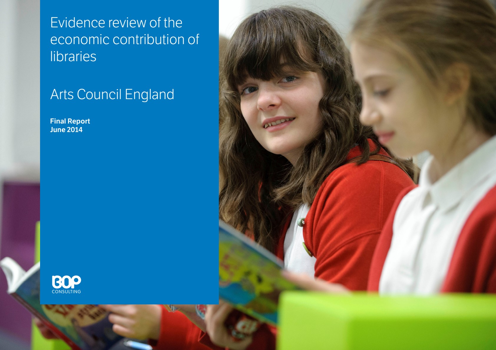
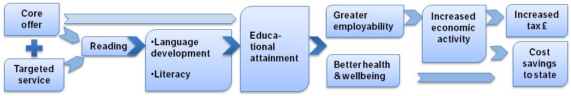
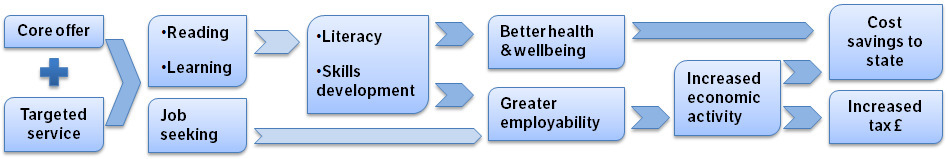
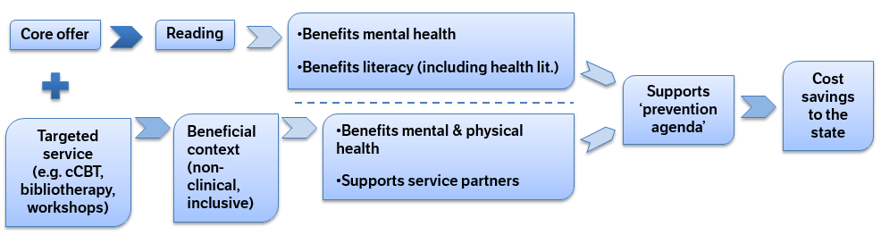
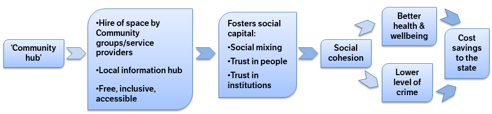
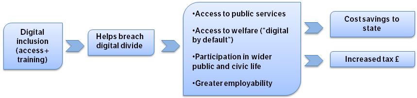

<!-- PAGE: 1 -->
# Evidence review of the economic contribution of libraries

**Arts Council England**

Final Report  
June 2014

<!-- PAGE: 2 -->

## Contents

- Foreword from Arts Council England (1)
- Executive summary (2)
- 1. Introduction (6)
  - 1.[^1] Aims and Context (6)
  - 1.[^2] Methodology (7)
- 2. Three key “hypotheses” (8)
- 3. Hypothesis[^1]: Economic impact (10)
- 4. Hypothesis[^2]: Place-based economic development (12)
- 5. Hypothesis[^3]: Benefit-cost and total economic value (14)
  - 5.[^1] Summary (18)
- 6. Libraries’ social and educational benefits (20)
  - 6.[^1] Children’s and young people’s education and personal development (21)
  - 6.[^2] Adult education, skills and employability (27)
  - 6.[^3] Health and wellbeing (31)
  - 6.[^4] Community support and cohesion (37)
  - 6.[^5] Digital inclusion (43)
- 7. Conclusion (48)
- 8. Improving the evidence base (53)
- 9. Bibliography (54)

### Table of Figures

- Figure[^1]: How the three key hypotheses link up (9)

*Front cover: Readers at the opening of Manchester Central Library. Photo: Joel Fildes*

<!-- PAGE: 3 -->

## Foreword from Arts Council England 
Every day, across England a wide range of people walk into their library, 
or visit their library online to do an extraordinary range of things: borrow 
a book or DVD, attend a training session, track down some crucial 
information, meet a friend or client, study quietly and even download an 
e-book.  
Libraries support us in an everyday way, throughout our lives. 
Walk into any library and see toddlers, mums and dads at Story Time, 
studious teenagers and the local job club. And while just about 
everybody is getting online, around a quarter of us don’t have access at 
home. Whilst anything can happen in a library, something you rarely see 
is money changing hands. Perhaps the odd overdue charge, a small fee 
to attend a workshop or borrow a film but overwhelmingly library 
services are free for all at the point of use.  
And so when we talk of an 'economic contribution', as we 
increasingly must with arts and culture at a time when local authorities 
face significant financial challenges, libraries may not immediately 
spring to mind. Think a little more laterally and it becomes clear that 
there are many arguments for the vital financial role that libraries play.  
For example, whilst libraries may not 'turn a profit' they provide us 
with many things that support local economies, from information for 
businesses, to access to essential text books. Libraries have a local 
presence and may contribute to a sense of place. Then there are the 
beneficial effects of services accessed in a library whether that be a 
social reading club, support to quit smoking, or help looking for jobs 
online. These are the services that ensure effective and financially 
efficient public spending and enable us to lead healthy and fulfilling 
lives.  
So it is entirely believable that libraries make an economic 
contribution, but what we don't know is how it is made or how much it

is.  This report is our first step in understanding what it is about public 
libraries than can make an economic contribution and the scale of 
contribution a library can make. It is a question of some complexity and 
this report summarises both the available evidence on the subject, and 
the ways in which others have approached the question, including the 
advantages and potential pitfalls of the different methodologies.  
Having this consolidated base of evidence allows us to take the 
next step, and begin to develop new research into this question. In the 
next[^12] months we will be investigating further one area of impact and 
asking how libraries contribute to healthy lives and what that represents 
financially.  
Answering the question of the economic contribution of libraries 
is no small undertaking, and one that Arts Council England will not be 
able to do alone. So we are working with partners (such as the Society of 
Chief Librarians, the British Library and the Local Government 
Association) and wider library constituency to develop our research in 
this field.  In the meantime, the evidence presented here will support 
discussion at local and national level about library reform and raise the 
debate about this subject up to the level it deserves and requires.  
 
Brian Ashley 
Director, Libraries 
Arts Council England <!-- PAGE: 4 --> ## Executive summary 
In February 2014, BOP was commissioned by Arts Council England to 
undertake a literature review on how public libraries and their services 
contribute to the economy. The aim of this review is to identify and 
review the available evidence at national level and provide Arts Council 
England and the wider libraries sector with a better understanding of 
how libraries create economic benefits. 
Economic valuation studies of public libraries 
As the traditional metrics for measuring the economic contribution of an 
industry are not appropriate in a public library context, researchers have 
used a number of different methods for quantifying the economic value 
of libraries. We identify three different hypotheses across the literature 
as to how public libraries make a contribution to the economy: 
- as economic actors in their own right (economic impact) 
- as institutions that facilitate the creation of economic value in the 
adjacent area and local economy (place-based economic 
development) 
- as organisations that deliver a wide range of services, most of which 
are valued by both users and non-users when set against their cost of 
provision (benefit-cost/total economic value approaches) 
All three hypotheses require empirical methods based on the collection 
of primary data, which makes them both bespoke and relatively 
expensive. They have not been designed to add up to an aggregate 
picture of the economic value of public libraries in England nor for their 
results to be comparable.  
As the early sections of this report demonstrate, the economic 
impact literature shows that public libraries employ people and spend 
money, having a knock-on effect in the local economy, through supply 
chain expenditures and the wage expenditure of employees. A few large 
library facilities may also trigger significant ancillary spending in the 
local economy by visitors who are drawn to the area by the library.

However, while economic impact assessment is well tried and 
tested within other industry contexts in the UK and in other country 
contexts with regards to libraries (specifically the US), it has, 
unfortunately, few merits for libraries within a UK public policy context. 
Libraries simply do not have the characteristics to perform well when 
assessed using the additionality requirements that are embedded in 
public policy economic impact appraisals in the UK.  
Libraries’ contribution to wider place-based economic 
development is an area which suggests greater promise, based on the 
existing current case studies both in the UK and internationally. Libraries 
can be anchor tenants in mixed-use physical developments and 
regeneration initiatives, potentially boosting the footfall, buzz, image and 
profile of a neighbourhood or area – particularly if the library is new, 
large and/or housed in an iconic building. Finally, where specialist 
services are provided, they can also support local economic 
development through business advice and support for individuals, micro 
businesses and SMEs.  
However, the evidence base on libraries contribution to wider 
place-based economic development is at present under developed. It is 
based on only a small number of case studies, which vary greatly in 
detail and lack longitudinal analysis and attempts to account for other 
factors that may also have contributed to identifiable regeneration and 
local economic development. 
Benefit-cost studies are the most numerous and, in the case of 
contingent valuation (CV) methods, have the potential to gain the most 
traction with national government stakeholders. There is near universal 
consistency across these studies in reporting positive benefit-cost 
ratios for public libraries – whether using stated or revealed preference 
methods – across both multiple countries and institutional contexts (eg 
studies at different geographic scales and for institutions of differing 
sizes). This demonstrates that societies value public libraries over and 
above what they pay for them collectively.  
But benefit-cost approaches, particularly CV methods, are also 
very expensive and complex to undertake to a credible standard. The 
robustness of many CV studies within the libraries field is compromised 
due to a range of methodological weaknesses. Furthermore, the wide <!-- PAGE: 5 --> differences in method, assumptions and quality standards and the 
combination of different revealed and stated preference methods within 
the overall benefit-cost literature undermines the cumulative value of 
this evidence base.  
So while we know that the benefit-cost of public libraries is 
positive, we do not know whether this is one-and-a-half, twice or[^10] 
times the cost of provision. The choice of methods and assumptions 
does, however, seem to have a consistent bearing on benefit-cost ratios:  
- CV studies are more likely to produce lower benefit-cost ratios than 
revealed preference studies 
- Studies that ascertain willingness to pay (WTP) are likely to produce 
lower benefit-cost ratios than those that only assess willingness to 
accept (WTA) 
- CV studies that use WTP and attempt to correct for the range of 
cognitive biases that are embedded in the CV approach are likely to 
produce the lowest benefit-cost ratios  
Finally, there are arguably three structural weaknesses that are 
characteristic of studies that use economic valuation techniques to 
measure the value of public libraries:[^1]. The various estimation techniques are all focused on producing an 
overall figure for impact, value, or return on investment. They pay 
little attention to how the constituent library services, resources and 
buildings generate this value (aside from some revealed preference 
studies that look at one or two services only, such as book and 
media lending).[^3]. Lastly, studies really only measure the short term economic value of 
library services. In theory, through attempting to capture the total 
economic value of library services, CV methods should provide a 
broad brush quantification of all of the possible social, educational, 
and cultural benefits that society gains from public libraries, 
including extending into the future by measuring ‘existence value’. 
However, in practice, very few CV library studies actually measure 
non-use values, due to practical and cost constraints. This means 
that the wider value to society in the present is not captured and 
neither is the value of these in the future.  
These structural weaknesses in economic valuation approaches 
mean that literature from disciplines other than economics is required in 
order to understand in more detail, and more holistically, how public 
libraries make an economic contribution to society.  
Studies on libraries’ educational and social impact  
The study considers libraries’ educational and social impact within five 
key areas, chosen to cover the main activities currently taking place 
across the library service: 
- Children and young people’s education and personal 
development: Existing research provides compelling evidence that 
library usage is linked to reading levels among children and young 
people, and that library usage and reading, in turn, are important 
factors in literacy skill levels and general educational attainment. 
Some research also suggests that the quality of public libraries’ space 
supports educational attainment. While there is no evidence of the 
direct financial benefits of libraries’ impact specifically, some recent 
studies indicate the private and public economic benefits that would <!-- PAGE: 6 --> their learning and for job searching activities. Literature from the UK 
also provides evidence of the provision of job support services, if not 
evidence of impact. Overall, research in the UK on adult learning, 
skills development and library-based employment support remains 
largely focused on local, smaller-scale studies.  
- Health and wellbeing: While there is no consistent data on the 
provision of library-based health and wellbeing activities, existing 
research suggests that such activities are increasingly becoming a 
core part of the public library offer in the UK. Bibliotherapy activities 
are now widely available across public libraries in the UK, and 
computer-based cognitive behavioural therapy (cCBT) activities are 
increasing. Existing research also suggests strong correlations 
between reading and mental health benefits, as well as a link between 
literacy and health literacy – people’s ability to access and use health 
information. For all of these reasons libraries contribute to the health 
‘prevention agenda’. A small number of studies also suggest library-
based health provision could contribute to reducing the current high 
costs of ill health. Evidence is lagging behind practice in terms of 
demonstrating what benefits service providers may get from using 
libraries to deliver health activities, although several UK-based case 
studies suggest that libraries are valued for their non-clinical 
atmosphere and community reach. Overall, several reports highlight 
the lack of quantitative information on the take-up and benefits of 
libraries’ health services and the need to use standardised 
methodologies, specifically those that will be recognised by the 
medical sector. 
- Community support and cohesion: Current research demonstrates 
that a majority of library users and non-users consider libraries as 
important for their community, and it suggests that libraries may play 
an important role in contributing to the social capital of communities. 
Evidence exists in particular for libraries’ contribution to facilitating 
social contact and mixing within local communities, as well as 
through increasing levels of trust among people. Existing research 
also demonstrates that people place a high trust in libraries 
themselves as institutions. While it might be argued that this may 
contribute to wider trust in institutions in general – a further marker of

social capital – there is currently only little evidence to support this. 
Several studies further suggest that through increasing social capital, 
libraries contribute to enhanced community cohesion and thereby to 
healthier, safer communities. Although evidence of the impact of 
cohesion on reducing deprivation is limited, the cost of ill health and 
crime within communities illustrates the potential cost savings that 
could be realised through healthier and safer communities. 
- Digital inclusion: Studies demonstrate a high level of available ICT 
provision across the public library networks, as well as the high usage 
of this provision by library users and the role libraries thus play in 
increasing digital inclusion. Evidence also shows that library ICT 
provision is frequently used by visitors to gain information important 
to their everyday life, including education, work and social networks. 
In addition, several recent studies highlight the personal benefits of 
digital inclusion by increasingly employability, in addition to the cost 
savings to the state through services increasingly being provided 
online under the ‘digital by default’ agenda. 
Summary of the evidence 
The existing literature on the educational and social benefits of libraries 
naturally contains limitations and weaknesses, including in particular 
issues around: 
- a general lack of longitudinal studies and surveys/studies with large 
sample sizes 
- studies that take a limited case study approach or are largely 
anecdotal, with short case studies and/or a focus on one particular 
library service or small group of users  
- the need for further research that is aimed at, and fulfils the 
requirements not only of the cultural sector, but also of the medical 
sector, in order to gain recognition of the service within the health 
sector 
- a lack of aggregatable management and impact data on libraries’ 
various local services and their users and partners 
- the difficulty of establishing causality between library usage and a 
range of outcomes <!-- PAGE: 7 --> - Lack of evidence of the savings to the state generated by libraries 
regarding the downstream outcomes that libraries contribute towards  
However, evidence is already sufficient to conclude that public 
libraries provide positive outcomes for people and communities in many 
areas – far exceeding the traditional perception of libraries as just places 
from which to borrow books. What the available evidence shows is that 
public libraries, first and foremost, contribute to long term processes of 
human capital formation, the maintenance of mental and physical 
wellbeing, social inclusivity and the cohesion of communities. This is the 
real economic contribution that public libraries make to the UK. The fact 
that these processes are long term, that the financial benefits arise 
downstream from libraries’ activities, that libraries make only a 
contribution to what are multi-dimensional, complex processes of 
human and social development, suggests that attempting to derive a 
realistic and accurate overall monetary valuation for this is akin to the 
search for the holy grail. What it does show is that measuring libraries’ 
short term economic impact provides only a very thin, diminished 
account of their true value.

<!-- PAGE: 8 -->

## 1. Introduction

### 1.[^1] Aims and Context 
In February 2014, BOP was commissioned by Arts Council England to 
undertake a literature review on how public libraries and their services 
contribute to the economy.  
The aim of this review is to identify and review the available 
evidence at national level and provide Arts Council England and the 
wider libraries sector with a better understanding of how libraries create 
economic benefits. Arts Council England is strongly aware of the large 
range of activities that take place across libraries in England today, and 
the unique role that they can play in the lives of individuals and local 
communities. The Arts Council was therefore keen for the review not 
only to explore the direct economic impact libraries may make, but to 
also identify and consider the indirect ways in which libraries make an 
economic contribution via the social and educational benefits they 
provide (through their core services and the many other activities they 
offer). 
This literature review comes at a challenging time for libraries. 
Reduced local authority budgets have led many library services to face a 
period of restructuring. Alongside the current pressure on funds, 
libraries are also facing a further longer term challenge to traditional 
measures of use: both library visits and book lending have been in 
steady decline for the past[^15] years. 
Not all is doom and gloom. The role of libraries as community 
spaces that provide a gateway to a wider range of public services has 
become increasingly important, and in this area of their work libraries 
have seen some increase in funding through various programmes and 
initiatives. Take-up of services such as ICT provision, programmes and 
activities is also on the increase. Overall visitor numbers are falling but 
statistics show that large parts of society still consider libraries as

essential or very important for their communities (whether they are 
library users or not). That policy makers believe in the lasting importance 
of public libraries is demonstrated by the fact that alongside library 
1closures,[^40] new libraries were opened in the last[^15] months, including 
new flagship libraries in Birmingham, Liverpool and, most recently, the 
renovated Manchester Central Library.  
Nevertheless, to move on successfully, libraries clearly need to 
continue to adapt – to a different funding climate, new financing models, 
new technological opportunities, as well as to changing visitor needs 
and behaviour. And in order to be able to do so, libraries (just as the 
wider arts and culture sector) also need to provide sound evidence of 
the social, education, health and economic contributions they make to 
society, in order to secure future public (and private) funding.  
So while it is a challenging time for the library service it is also an 
interesting one: it offers new opportunities for libraries to develop their 
offer and role in society, and to develop an evidence base which will 
2help them to be considered as ‘the strategic national resource’ that they 
truly are. As the lead strategic body for the library sector, Arts Council 
England recognises and supports this. The recent publication The value 
of art and culture to people and society therefore marks the beginning of 
a substantial research programme to plug some of the evidence gaps 
that currently exist, which, ‘in 2014, … will [focus] on researching the 
economic contribution of museums and of libraries’[^3]. 
This literature review marks a first step in this effort, identifying 
what evidence already exists around libraries’ direct and indirect 
economic impact, and where there are gaps in our knowledge. It is 
hoped that the review will enable Arts Council England and the wider 
sector to better understand, and have stronger evidence of, how 
libraries make an economic contribution and, in doing so, support the 
Arts Council England in further developing and advocating the public 
value of libraries in the future.

<!-- PAGE: 9 -->

### 1.[^2] Methodology 
This evidence review is based on a rapid but thorough literature review 
of the latest evidence in the area of research. It focuses in particular on 
literature published since 2009, when the last detailed literature review 
4on the impact of libraries was published. Although this did not focus 
specifically on libraries’ economic impact, it captures many of the 
themes particularly around social and educational impacts, which are 
also relevant to this review. However, the library landscape has changed 
considerably since then, making this a timely update of the previous 
review. 
The review includes both international academic literature and 
‘grey’ literature, i.e. non-academic journal literature, including work by 
foundations, trusts, charities and government bodies. While primarily 
focusing on the anglophone world, a search was also conducted for 
studies on the economic impact of libraries published in Spanish, 
French, German and Portuguese, to provide added insight into the 
approaches and methods used outside of the anglophone world. 
In addition to this desk-based review, BOP conducted a 
consultation process, which included: 
- Email-based consultation with a reference group made up of library 
stakeholders on relevant literature to be included in the review 
- A preliminary findings meeting with the internal project steering 
group  
- A meeting with members of the steering group and reference group, 
to discuss findings and implications 
This report represents the conclusion of the review and consultation 
process. The findings have been grouped into three identified key 
hypotheses, which are most commonly used to demonstrate libraries’ 
economic impact in the existing literature. The next chapter will explain 
in brief these hypotheses, how they sit together, and how the social and 
educational benefits that libraries provide feed into these hypotheses.

The subsequent chapters then provide more details on the available 
evidence identified for each of these three hypotheses.  
In order to review how libraries may provide indirect economic 
impacts via their social and educational benefits, five impact areas have 
been looked at in detail:  
- Children’s and young people’s education and personal development 
- Adult education, skills and employability 
- Health and wellbeing 
- Community support and cohesion 
- Digital provision 
For each of these areas, a logic model was developed which details the 
‘chain’ of how libraries’ offer is purported to deliver social and 
educational, and ultimately economic, benefits. The literature review 
then demonstrates where in these logic models the evidence is 
strongest, and which of the links are currently weakest in terms of 
available evidence. 
The review concludes with an overview of where the main gaps 
are in the current evidence, before providing some first suggestions as 
to how the evidence may be improved going forward.

<!-- PAGE: 10 -->

2.Three key 
“hypotheses” 
The central challenge in placing a value on the contribution of public 
libraries to the economy is that library services are provided either 
entirely free at the point of use or for minimal cost. This means that the 
typical economic valuation methods for a sector or organisation – i.e. the 
financial value of their output (using a measure such as Gross Value 
Added (GVA)) – does not provide a realistic value as libraries’ output 
consists overwhelmingly of non-market goods. All of the economic 
valuation methods that have been applied to libraries start from this 
same challenge. But they diverge in terms of:  
- the degree to which they try to compensate for the inability to use 
consumer spending as an accurate proxy of value  
- the assumptions on where (and how) economic value is created  
- the methods that they deploy to measure the economic contribution 
of libraries  
As stated above, the review has looked at studies in English, as 
well as in Spanish, German, Portuguese and French. The review finds 
that, despite widening the search out to include non-English language 
research, the vast bulk of existing studies is produced in the anglophone 
world, and much of it in the US. The studies fall into three broadly 
defined categories. Each category represents a different hypothesis as 
to how libraries create economic value in communities.  
- Hypothesis[^1]: Financial impact – a simple assertion that libraries are 
important actors in the local economy: they employ a significant 
number of people, they purchase goods and services in the local 
economy and they attract visitors who make other expenditures as 
part of their trip to the library. Methodologies concentrate on 
quantifying the financial flows of expenditure made by libraries and 
their visitors.

- Hypothesis[^2]: Place-based impact – public library buildings of 
sufficient scale and interest can be catalysts within wider area 
regeneration or physical development programmes because of the 
visitors that they draw to the location and the enhancement to the 
image of the area that they can bring. Libraries can also contribute 
further to local economic development by supporting business and 
enterprise through specialist library services. This element of 
libraries’ economic contribution is the least studied within the 
literature.  
- Hypothesis[^3]: Benefit-cost analyses and ‘total economic value’ 
approaches – depending on what method is chosen and in which 
study, these accounts are founded upon the premise that libraries 
deliver a variety of services to individuals that have value even though 
these are not paid-for (as they bring a range of social, educational and 
cultural benefits). These studies often extend to the premise that 
there is a residual value in a library/library service as an institution that 
exists even for individuals that make no use of them (so-called ‘non-
use’ value). In this way, these studies attempt to measure the total 
economic value that libraries bring, usually in comparison to the costs 
that are incurred in providing the same services. More limited benefit-
cost methods simply look at this ratio for only the users of library 
services.  
These three hypotheses cannot be made consistent nor 
comparable with one another and the resulting studies measure 
different things using different approaches. Adding to the challenges of 
understanding the various approaches, some studies use a mix of 
methodologies, particularly by combining economic impact with a total 
economic value approach.  
In attempting to capture both library use value and the residual 
non-use value of a library in a community, we suggest that the total 
economic value approach may encompass some of the benefits that 
both financial impact and place-based impact approaches seek to 
capture (albeit via very different methodological means). That is, part of 
the non-use value that people assign to libraries may be related to 
libraries spending money in the local economy and providing jobs that 
enable library employees’ wages to be spent locally. Equally, some of <!-- PAGE: 11 --> the non-use value that people assign to libraries could stem from a 
recognition of their general importance to the fabric of a town or city (for 
instance, in driving footfall that helps other businesses in the immediate 
vicinity to thrive), or for the business support services that they provide 
but are not used by many in the population.  
 
Figure[^1] How the three key  “hypotheses” link up

![Figure[^1]: How the three key hypotheses link up](assets/figure-1-hypotheses.png)

*Source: BOP Consulting, 2014*

Our depiction in Figure[^1] above of how Hypothesis[^3] is linked to[^1] and[^2] 
is theoretical at present. This is because within studies that attempt to 
derive a global figure for the total economic value of a particular library 
or library service, it is not possible to breakdown what ‘use value’ or 
‘non-use’ value consists of in any level of detail due to the constraints 
and complications of the methodologies.  
This lack of specific knowledge is indicative of a more general 
limitation with studies that use economic valuation techniques to

quantify the value of public libraries. What they produce is an empirical 
result, a figure of £Xm (or more often $Xm). This tends to make the 
outcome a bit of a ‘black box’ – in that it provides some measure of 
output/performance, but without really knowing the constituent parts 
that create this value. Of course, a global figure of £Xm might be useful 
for headline lobbying or fundraising purposes, but it is hard to 
understand the specific impact of specific library services using these 
methods. They are therefore only of limited use within service planning 
and when entering into budget negotiations against competing public 
services at the local authority level.  
For this reason, the next three sections of the report cover the 
literature under each of the three hypotheses in more detail, before the 
literature is opened out to look at how libraries contribute to the 
economy through the impact of specific library service areas.

<!-- PAGE: 12 -->

## 3. Hypothesis[^1]: Economic impact   
Studies that seek to quantify the expenditure streams made by public 
libraries are overwhelmingly US-based and conceptually the simplest in 
terms of what they are trying to capture. Studies look at the turnover of 
5library organisations and the number of people they employ – their 
economic ‘footprint’. In addition to looking at libraries own expenditure, 
these studies also use ‘multipliers’ to assess the value of the subsequent 
rounds of expenditure in a local economy as a result of the existence of 
the library. These take account of two streams of expenditure in 
particular:  
- indirect impacts: the expenditure made by the suppliers of public 
libraries in order to fulfil their library contracts  
- induced impacts: the wage expenditures made by public library 
employees and those in its supplier firms 
Studies typically extend beyond the rounds of expenditure 
associated with the library or library service itself to also look at ancillary 
visitor expenditure triggered as a result of visiting a library. This could be 
library users visiting local cafés and shops, taking a taxi or even staying 
overnight as part of a trip. Multipliers are then applied to visitor 
expenditure to estimate the knock-on effects of these ancillary 
expenditures.  
The US studies show that libraries are significant agents in their 
local economies. For instance:

- The economic impact of Libraries in Indiana (2007)[^6] calculates that an 
additional $216 million in economic activity was generated through 
public library expenditure 
- The economic contribution of Wisconsin Public Libraries (2008)[^7] 
reports local libraries’ contribution at $753 million 
- National Welfare & Economic Contributions of Public Libraries[^8] for the 
Australian Library and Information Association (2013) estimates 
economic benefits of AUD $3,[^180] million 
- The Carnegie Library of Pittsburgh Economic Impact Study (2006)[^9] 
estimates an economic output of $63 million plus $28 million in 
services to the population. 
A similar approach for the UK was used in: 
- The economic value of library services (2013)[^10] found that libraries 
supported[^1],296 jobs in Scotland, 596 in Wales and 327 in Northern 
Ireland (in addition to direct employment) 
- Birmingham Library Economic Appraisal (2009)[^11] estimated £84.[^4] 
million in benefits and £10.[^9] million in costs for a[^30]-year period (in 
this particular reference case) 
However, these non-UK studies have only a limited applicability 
within a UK public policy context. This is because the methodologies 
they use are generally too simple to pass the quality threshold expected 
in the UK, where best practice guidelines in economic impact appraisal, 
such as that contained with the Treasury’s Green Book, are now widely 
adhered to in most sectors. This means that it would not be sufficient to 
take turnover figures and apply multipliers to this amount (as happens in 
most of the US studies). Any assessment of direct, indirect, induced and 
visitor impact within a UK public policy context must instead be 
subjected to an ‘additionality’ assessment, which tries to estimate what 
is actually attributable to the intervention being assessed and what 
would have happened in any case (the ‘reference case’). The outturn of <!-- PAGE: 13 --> an additionality assessment is a smaller ‘net’ impact from a larger gross 
economic impact. There are a number of factors that have to be taken 
into account to produce a gross to net conversion, but it is pertinent to 
highlight two in this context.  
First, money received from public funding, such as a local 
authority, counts as an input and therefore has to be subtracted from the 
calculation of organisational expenditure. As public libraries’ revenues 
in the UK consist almost solely of public funding, this leaves very little 
remaining as the net calculation of direct organisational expenditure, 
and therefore only very small sums will be generated in the calculation of 
indirect and induced impact.  
Second, the assessment of the value of ancillary visitor 
expenditure made as a result of visiting a library should also only count 
that which is genuinely additional expenditure. What this means in 
practice is that virtually all expenditure made by local residents on a trip 
to the library would have to be discounted from the calculations, as this 
expenditure would have been made elsewhere in the local economy if 
the library did not exist. Thus visitor expenditure is only likely to be 
significant if the library attracts a significant number of people from 
outside the local area, who are travelling specifically to come to the 
library (a set of circumstances that is rare in the UK).  
As this explication suggests, an economic impact approach is 
only likely to be useful in the UK context for a very small number of large 
libraries. For instance, BOP was commissioned by Birmingham City 
Council to estimate the likely economic impact of the new £50 million 
12central library. The new library was expected to support the creation of <!-- PAGE: 14 --> 4.Hypothesis[^2]: 
Place-based economic 
development 
As noted in section two, the second hypothesis regarding how libraries 
generate economic value is rooted in geography and place. That is, 
public libraries – particularly large, new, well-equipped ones and/or 
those housed in iconic buildings – often attract significant visitor 
numbers, increasing footfall in the neighbouring area, meaning that:  
- other economic activities that rely on passing trade, such as shops 
and restaurants, receive a boost 
- surrounding urban spaces feel more safe and animated, leading to a 
greater buzz in the area 
New, iconic or newly refurbished buildings may also provide a more 
intangible benefit to the neighbourhood in which they are housed, by 
helping to enhance the profile and image of the area. The stability and 
longevity of public libraries means that having a library as a tenant as 
part of a private-public development partnership can reduce some of the 
financial risk associated with mixed use schemes. Lastly, some larger 
libraries’ can play an additional role in local economic development by 
directly providing small and medium sized businesses with a range of 
dedicated business support resources and services 
In all of these ways, then, new/large/iconic public libraries can be 
key assets in wider place-based economic development strategies. 
However, the literature that seeks to demonstrate the effectiveness of 
libraries’ place-based impact is relatively slim and focused on case 
studies or general treatises on the theme.

For instance, the 2007 study Making Cities Stronger: Public library 
Contributions to Local Economic Development discusses ways in which 
public libraries in the US have a place-based impact on urban centres. 
Highlighting the amenity value they bring to a neighbourhood or 
development site, the report provides anecdotal illustrations of how 
libraries have been key assets within mixed-use development schemes, 
shopping malls and area-based regeneration. The latter, for instance, is 
highlighted by using the example of the relocation of the Memphis 
Public Library’s South Branch from a quiet residential location to a 
rundown ex-industrial area. The impact of the relocation is described as 
follows:  
The eight storefronts were vacant when the library moved in. 
Now, four years later, the shopping strip is completely full. 
Though the South Branch library is not the only factor in the 
revitalization of the South Mall commercial strip, it is reasonable 
to conclude that local businesses reap a ‘spin-off’ benefit from the[^100],000 visitors that stop by the library each year.[^13] 
A UK example from the literature is provided by BOP’s study on the 
anticipated economic benefits that the new £50 million Birmingham 
Library would bring to the city[^14]. The report drew on a series of 
international case studies of major new capital projects, including new 
library buildings and major galleries and museums. It looked at projects 
like Seattle’s public library, opened in 2004 at a cost of $165.[^9] million, an 
iconic project that led to an increase of[^55] per cent in library usage 
during the first[^10] years. Figures for the first year suggested that net new 
spending associated with the library amounted to $16 million. The study 
also covered national libraries, like the Singapore National Library, 
opened in 2005 at a cost of £266 million. The library attracted[^2].[^6] million 
visitors in the first year, a 300 per cent increase. 
The contribution of public libraries to area based redevelopment 
and regeneration is once again skewed towards large, new and/or newly 
refurbished libraries as they are most likely to have a catalytic role in <!-- PAGE: 15 --> terms of enhanced attractiveness and increased visitor numbers 
(whether these are locals or tourists).  
This hypothesis needs more data support, as noted above. At 
present, case studies provide strong local stories, but they are not easily 
transferable and generally lack a longitudinal analysis and provide little 
consideration of other contributory factors to neighbourhood 
regeneration/development. It is therefore difficult within this research to 
assess how attributable any measurable change is to the library 
investment as opposed to other factors.  
Libraries are not unique in this regard, as there is a general lack of 
studies that address these issues within the wider literature on cultural 
capital projects and area-based development – one must go back to 
2003 to find a well-known example. This study, undertaken by Artscape 
and Ryerson University[^15], compared three neighbourhoods over time – 
one in Vancouver (near a newly renovated theatre) and two in Toronto 
(with artists live-work space) – matched with two similar 
neighbourhoods in Toronto that had no specific arts and cultural capital 
investment. The study used geomatics and a variety of socioeconomic 
indicators to (i) establish more accurately what economic and social 
change took place in each neighbourhood and then (ii) to assess what 
was most likely the result of the cultural capital projects as opposed to 
what would have happened in any case.  
There is a lack of studies in England into libraries provision of 
resources and services to support small businesses and entrepreneurs. 
In part, this is because dedicated, specialist services for businesses 
have never been part of the universal offer of public libraries. Building on 
the model of the British Library’s Business and IP Centre and its national 
network in core city libraries, the recent Arts Council England 
programme to provide dedicated business centres in a small number of 
branch libraries across England (the Enterprising Libraries programme), 
is clearly seeking to enhance libraries’ offer in this area. The forthcoming

evaluation of the programme should provide some evidence of how 
effective this has been to-date.   
In lieu of evidence from the UK, literature from the US provides 
some evidence for the potential of libraries activities to support local 
enterprise, if not quite ‘impact’ of the same. Urban libraries in the US 
regularly provide business planning and start-up support, which even 
stretches to a start-up competition (complete with access to seed 
16funding), in the case of the Brooklyn Business Library. Evidence from 
the 2008 Public Libraries and Community Economic Development report 
by Christine Hamilton-Pennell[^17], which looks at public libraries in rural 
areas in the US , suggests that supporting small businesses and 
entrepreneurs is more a core part of a local library’s offer than in the UK. 
For example, in the small town of Greeley in Colorado, this support even 
extended to reference librarians undertaking market research studies for 
some companies.  
As this example shows, even in the US the evidence for how 
libraries support local economic development via enterprise support is 
based on case studies. Even given this – and the fact that local libraries’ 
business and enterprise support seems more advanced than in the UK – 
the Hamilton-Pennell report still points to abiding challenges, such as a 
general lack of awareness among the business community of the 
services and resources offered by libraries, and the need to upskill 
librarians to properly engage with this agenda.

<!-- PAGE: 16 -->

## 5. Hypothesis[^3]: Benefit-cost and total economic value 
The third hypothesis regarding libraries’ economic benefits is the most 
holistic and contains the most methodologically complex approaches. 
Rather than look specifically at the financial flows of library expenditure 
and related expenditures in the visitor economy (as in hypothesis[^1]), or 
at how libraries directly and indirectly support other economic actors 
and activities in their immediate neighbourhood (hypothesis[^2]), the third 
approach attempts to assess the economic value of public libraries by 
looking at how people themselves value libraries. At the heart of this is 
the value they derive from using library services, but some approaches 
also go beyond individuals’ own use values and look to quantify the 
wider value that libraries have for society.  
Ordinarily this valuation would be derived through how much 
people pay for library services, but as the price mechanism is largely 
absent from public libraries this is done mainly through two economic 
valuation methods.  
- Revealed preference (RP): these studies look at actual library user 
behaviour in terms of their direct consumption of library services. In 
lieu of accurate price information regarding these services, proxy 
values are estimated for this consumption. Most commonly, a price 
value is placed on the use of library services based on what it would 
cost to consume the same amount of goods if these were sourced on 
the open market, and this cost is assigned as a proxy value for the 
prices of the services offered by libraries. This market substitute 
method produces economic estimates that are either expressed as 
the aggregate value of the total consumption of library services, or the 
cost savings that individuals benefit from by consuming library 
services rather than by buying them on the open market. The other

most commonly used revealed preference method is to value library 
services via the travel costs that users incur in visiting a library.  
- Stated preference: in the absence of individuals’ preferences being 
revealed through a market value, people are instead asked through 
surveys to state hypothetically how much they would be willing to pay 
(WTP) for a given public library service. This is termed a contingent 
valuation (CV) method and is also sometimes presented to people the 
other way around – as a hypothetical willingness to accept (WTA) 
figure, in terms of how much compensation they would be prepared 
to accept for the closure of a library. An important difference to 
revealed preference methods is that – in theory more than in practice 
(see below) – CV studies seek to establish a value beyond that 
derived by existing users, to include the wider value to society (by 
surveying non-users).  
These methods are often used in combination and can also blur 
into one another. For instance, travel cost estimation methods often use 
not only the monetary cost of getting to the library but also the 
opportunity cost of the time spent there (which has to be established by 
survey means). For this reason, this method is sometimes referred to as 
‘contingent travel cost behaviour’. Similarly, instead of using market 
substitutes to price users’ revealed preferences, users can also be asked 
to state a value for the services they use. Unlike classic CV studies, these 
are not based on a hypothetical WTP/WTA, but on asking users to state 
the value of the time that they have saved through using library services 
or the value of the costs that they think they have saved through using 
the library. They also differ from classic CV WTP/WTA studies by being 
limited to the users of the library and not the non-users. 
What is common across all of these methods is that, having 
arrived at some valuation of the benefits, the studies then compare this 
with the costs of their provision to arrive at benefit-cost estimates. These 
are expressed as a ratio between the money invested in provision versus 
the money gained as benefits, and for this reason the ratio is sometimes 
described as a return on investment (ROI) ratio.  
To a lay person, classic CV WTP/WTA methods may seem 
particularly abstract and divorced from the everyday work and impact of 
library services. However, they have evolved from a branch of <!-- PAGE: 17 --> economics that has historically concerned itself with how to value non-
market goods, such as the natural environment. Importantly for the UK 
context, their use has also been validated by the update of the 
Treasury’s Green Book in 2011, including in relation to culture and 
heritage, following earlier work that suggested that these methods might 
be applied to the cultural sector[^18].  
A characteristic of stated preference CV WTP/WTA methods that 
distinguishes them from other economic valuation methods is that they 
usually have the ambition to derive a monetary figure for the total 
economic value of a good or service. This means developing a monetary 
value for the non-use value in addition to the more obvious use value). 
General, non CV-based surveys that ask people more simply about the 
importance they attach to libraries suggest that non-use values are 
significant for libraries[^19]. Non-use value can be sub-divided into: 
- indirect value: for instance, residents living close to a library may 
benefit from proximity to the library even if they do not use it directly 
(eg other people value the facility such that it generates a small 
premium on all houses that are close by) 
- option value: people may not presently use a library but still value it 
nonetheless as they want to be able to exercise the option to use it at 
some future time 
- existence value: people may not presently use a library but still value 
its existence, either because they are aware that other people in the 
community derive benefit from it or because they wish the library to 
still be there for future generations (‘bequest value’).  
The total economic value of a good or service therefore equals 
use value + indirect value + option value + existence value. However, 
this comprehensive and exhaustive macro approach – to measure all 
kinds of both non-use as well as use value – is very much the gold

standard of benefit-cost approaches. In reality, very few studies in the 
libraries field have sought to be this comprehensive. This is driven by the 
difficulty of access, increased cost and complexity of studying non-use 
20values.  
The earliest benefit-cost study identified through the review dates 
from 1998. The St Louis Public Library (SLPL) Services Valuation Study 
uses a market substitute and two types of CV technique to establish the 
21value of libraries in St Louis. This included: 
- a telephone survey of a stratified sample of general users, teachers 
and business users (322+75+25 respectively) 
- the survey asked respondents for their WTP and WTA, as well as 
establishing a separate valuation through the revealed preference of 
the opportunity cost of the time spent by teachers and business users  
- a price list/matrix of market substitutes that was developed to assess 
the value provided (consumer surplus) by the libraries (eg price of a 
book $14, magazine $2.[^95]).  
Using a range of methods provided a range of different overall 
valuations. For instance, the aggregate value derived when different 
library users were asked for their willingness to accept the closure of the 
library service was very high ($136 million). It was far lower when the 
question was phrased in terms of a willingness to pay increased taxes to 
keep open the service ($15 million). This shows that stated preference 
techniques have some inherent cognitive biases that need to be 
carefully accounted for within studies – which takes both a high degree 
of specialist expertise as well as a large research budget. When 
modelled through the opportunity cost of the time spent by teachers and 
business users, the eventual valuation ($110 million) was closer to the 
WTA sum.

<!-- PAGE: 18 -->

The St Louis study has been followed by many more benefit-cost 
studies in the US, such as: 
- 22Taxpayer Return on Investment in Florida Public Libraries (2004) – 
the study reported that Florida’s public libraries returned $6.[^54] for 
every $1 invested from all sources. Valuations were derived from 
several methods: market substitutes; monetisation of time saved 
through use of libraries, and an economic impact analysis.  
- Value for Money: Southwestern Ohio’s Return from Investment in 
Public Libraries (2006)[^23] – this report used a market substitution 
approach to estimate that for every dollar invested in library 
operations the public received about $2.[^56] in directly quantifiable 
benefits. However, the method is questionable as the figures derived 
through the market substitute calculation then had an ‘economic 
impact’-style multiplier applied to them.  
- The economic impact of Libraries in Indiana (2007)[^24], which 
combined an economic impact analysis on the local economy with a 
benefit-cost estimate of the services provided, including a CV study of 
users that valued their book lending.  
The earliest benefit-cost study of libraries in the UK seems to be Morris 
et al in 2002, which sought to place a value on library book lending in the 
UK. The study used a WTP method to establish that, compared with a 
cost to public libraries of £724 million to provide the service, library book 
borrowers valued the service at £814 million, representing a consumer 
surplus of £91.[^4] million[^25]. However, the study is seriously undermined by 
having a very small sample size (100 responses from book borrowers at 
just four libraries in England) on which to base such a large aggregate 
calculation.  
The British Library is more commonly thought to have pioneered 
the use of CV methods in the UK library context with the study it

commissioned in 2004 that was published academically in 2007[^26]. It 
demonstrated that the library generated a value of £363 million, which 
was approximately[^4].[^4] times the level of its annual public funding of £83 
million. The study included non-use value and provided estimates that 
were designed to cover the value to the UK as a whole. In many ways the 
study is a benchmark as it was ambitious and methodologically sound 
and featured a good sample size for the geography it was seeking to 
cover (2,459, consisting of 429 users and[^2],030 non-users from the 
general population). Interestingly the British Library repeated a CV study 
in 2013, which identified a net benefit of £419 million, approximately[^4].[^9] 
times the level of its annual public funding in 2011/12, and again based 
on a large sample (1,742)[^27]. 
Around the same time, the Museums, Libraries and Archives 
Council (MLA) commissioned a study of Bolton’s three museums,[^15] 
libraries and its central archive[^28]. The study also included non-use value 
and the total economic value was estimated to be £10.[^4] million (£4.[^4] 
million by library users, £2.[^8] million by museum users, £200,000 by 
archive users, and £3 million by local non-users of any of the services). 
Given total costs of £6.[^5] million, this provided a benefit-cost ratio of[^1].[^6]:[^1]. 
While the sample size was adequate for users (325), unfortunately it was 
small for non-users (68). 
More recently, research consultancy ERS undertook a 2012 study 
for the Archives, Libraries, and Museums Alliance (ALMA) UK on the 
economic value of library services in Scotland, Wales and Northern 
Ireland. This used a mixed method approach: economic impact and a 
benefit-cost analysis that was driven by the value of the cost savings that 
respondents identified they made by using library services. Although the 
study does not seek to establish a figure for non-use value, the research 
is based on a large sample size of users (4,000) across the three 
territories. The study identified values of £24.[^10] by users per visit in 
Scotland, £26.[^38] in Wales and £27.[^27] in Northern Ireland, which <!-- PAGE: 19 --> translates into a value per visit of[^5].[^5] times,[^7].[^5] times and six times above 
cost respectively.  
CV studies have also been undertaken in Europe. Scandinavia is 
relatively well represented in the field, principally due to the work of 
Svanhild Aabø. From her doctoral thesis, she has published two papers 
that use different data sets from her research. The second of these 
papers[^29] estimated a benefit of four Norwegian krone (NOK) for each 
one NOK invested in Norwegian public libraries, though as with several 
other studies, it is based on a limited sample of users (242). The data set 
used in her 2005 paper on libraries in Norway again has a small sample 
size (250), but suggests some interesting findings regarding how WTP 
varies according to some key characteristics[^30]: 
- distance to the library was found to be directly related to the WTP, 
with WTP increasing with proximity  
- library users have a higher WTP than non-users 
- city residents have a lower WTP than those in rural areas 
- people who used libraries as children have a higher WTP than those 
who did not 
Aabø later also undertook a meta analysis of[^38] different benefit-
cost studies of public libraries, which overwhelmingly covered the US 
(30) and then the UK (two), Australia (two), New Zealand (one) and 
Norway (two)[^31]. Her review covered market substitute and various types 
of CV approaches, as well as providing median and mean ROI at several 
geographical scales: national, state, county and individual level. The 
reported mean ROI ratios are:  
- 3.[^5]:[^1] for studies that estimated the benefits at the national level (of 
which there were five studies) 
- 5:[^1] for studies that estimated the benefits at the state level (six 
studies)

- 4.[^6]:[^1] for studies that estimated the benefits at the county level (seven 
studies) 
- 4.[^2]:[^1] for studies that estimated the benefits at the individual library 
level (18 studies). 
She then deepens the analysis by undertaking a regression analysis on 
the studies and finds that CV methods tend to produce a lower valuation 
than market substitute approaches.  
Elsewhere in Europe: 
- Two student theses in German have looked at city libraries in Berlin 
Mitte and Melle, Lower Saxony. The first estimated a benefit-cost of 
€5.[^60] return for each euro invested, based on a combination of 
market substitutes and WTP methods[^32], while the Melle study 
estimated annual benefits from the city library of €3 million per year[^33].  
- 34A 2014 study in Spanish ambitiously provides estimates for[^19] 
regional areas covering the whole of Spain and two Spanish 
territories in Africa. It finds that the ROI is between €2.[^8]-3.[^83] per euro 
invested. Unfortunately the study is again compromised by being 
based on a survey sample of[^1],500, which is too small to be able to 
generate robust estimates for so many different territories. 
- Also this year, a study on the Municipal Library of Prague[^35] was 
published, which uses both WTP and WTA in studying the value of the 
library via a survey of[^2],[^200] people. The research finds that what 
people are willing to accept for the loss of the library (4,000 Czech 
koruna (CZK)) is higher than the average willingness to pay (642CZK). 
The study also looks at how individual WTP depends on economic 
and socio-demographic variables. However, the survey is 
undermined by having an unrepresentative sample (eg three quarters 
of the respondents are women and non-users are not represented as 
all respondents are drawn from the library’s database of users).

<!-- PAGE: 20 -->

There is a clear interest and a practice in applying benefit-cost 
approaches to public libraries in Korea. In 2011 Giyeong Kim published a 
critical review of valuation studies. It identifies CV method and RP 
method as the most common strategies and looks at[^15] studies in detail. 
Most of the studies (10) are drawn from the US and include some that are 
also reviewed by Aabø in her 2009 review (eg the St Louis Library), as 
well as two from Australia and the first British Library study. It was also 
able to include one existing local CV study in Korea of the Jungrang 
Public Library that was conducted by Chung and published in 2008.  
The results covered by Kim’s review range widely in terms of 
benefit-cost estimates: from $0.[^84] to $10.[^33] of benefit per $1 invested. 
Echoing Aabø’s review finding, Kim also finds that CV methods produce 
lower estimates of the benefit-cost of libraries than revealed preference 
methods:  
- the median result across the CV studies was $3.[^79] of benefit per $1 
invested (six studies), compared with 
- a median result across the revealed preference studies of $4.[^46] of 
benefit per $1 invested (nine studies). 
Interestingly the one study which contained a negative benefit-cost ratio 
of $0.[^84] of benefit per $1 invested was the local Korean study which 
applied a dissonance minimizing (DM) format to its initial CV results. The 
application of the DM format was intended to control for cognitive 
biases that are a feature of CV methods. Before applying the DM format 
to the results, Chung’s study had a much higher and positive ratio of[^36]$2.[^95] of benefit per $1 invested.  
The third Korean article details an empirical CV study that sought to 
measure the ROI for[^22] Korean libraries, based on responses from[^1],220 
questionnaires; a small sample for so many libraries. WTP estimates 
were separately derived from users’ use of materials, their use of space 
and their use of programs. The overall ROI was estimated at[^3].[^66] per one 
Korean won (KRW) invested. However, the ROI differed according to the

different type of libraries:[^3].[^58] KRW for large libraries,[^4].06 KRW for 
medium sized libraries, and[^3].[^9] KRW for small libraries.  
 
### 5.[^1] Summary 
Benefit-cost approaches, whether based on market substitutes, time and 
cost savings, or contingent WTP/WTA methods show near universal 
consistency in reporting positive benefit-cost ratios for public libraries, 
across multiple countries. However, there is little agreement between 
studies as to how big the benefit-cost ratios are, with estimates ranging 
from[^1]:[^1] to almost[^10] times the amount invested. The disparities may, in 
part, be explained by the different scale at which the studies are being 
conducted (see Aabø’s meta review). But they are also likely to be 
heavily influenced by the different methods, assumptions and quality 
standards used across the studies.  
Broadly, the evidence from two literature reviews of these 
approaches suggests that it is revealed preference studies that are most 
likely to produce benefit-cost ratios at the upper end of the spectrum. In 
turn, this is likely to be related to the fact that in pricing market 
substitutes to value library lending, the studies set lending at anything 
from five per cent to[^100] per cent of the buy-to-own price.  
The range of assumptions and methods, and in particular the 
multiple combinations that are often used within one study, is at times 
confusing and hinders the development of a cumulative evidence base 
which would be able to make greater use of sector-wide benchmarks 
and standardisation.  
The CV method requires such large samples that many studies 
are undermined at this first stage. Further, one of the main theoretical 
advantages of CV studies – that they can cover ‘total economic value’ – is 
rarely realised in practice across the library studies as non-use value is 
often excluded for pragmatic and cost reasons. The environmental 
economics literature has also shown that there are a lot of potential 
cognitive biases in how people respond to CV survey questionnaires. 
Some of these can be overcome or avoided with careful survey design <!-- PAGE: 21 --> and large sample sizes. However, the consistently higher values 
obtained by studies that compare WTA with WTP demonstrate that there 
are some cognitive biases hardwired into the method. It is also 
interesting to note that the one reported study that explicitly tried to 
correct for potential cognitive biases at the post-results stage (i.e. 
beyond addressing standard issues of survey design and sampling) led 
to a significantly reduced (and negative) benefit-cost ratio. This is only 
one of two examples that we found that produced an overall negative 
37benefit-cost ratio, both of which are CV studies.  
While benefit-cost approaches provide ratios and financial 
figures that may have a particular use in some case making scenarios, 
they provide only scant information on what it is that actually creates this 
value. This is especially true of WTP and WTA methods, which generally 
result in just one or two calculations. While there is more indication of 
how users value individual services within revealed preference studies 
that use market substitutes, these estimations tend to be heavily 
concentrated on book and media lending, where market substitutes are 
easier to identify.  
The range of individual and community development 
opportunities that are now regularly provided by libraries in the UK – 
services for young children and parents, adult and employability skills, 
health information and services, and digital inclusion initiatives, and so 
on – are poorly covered, if at all, by revealed preference approaches. 
This is despite the fact that these social, cultural and educational 
benefits are clearly key to the usage of today’s libraries. As the next 
chapters will demonstrate, the personal and community development 
activities provided by libraries are also key to the long term economic 
contribution that libraries make to society.

<!-- PAGE: 22 -->

6.Libraries’ social and 
educational benefits  
In order to review how public libraries may provide social and 
educational benefits, and how these in turn create economic benefits 
(i.e. feed into the total economic value of libraries), five impact areas 
have been looked at in detail. These were chosen to cover the main 
activities across the library service:  
- Children’s and young people’s education and personal development 
- Adult education, skills and employability 
- Health and wellbeing 
- Community support and cohesion 
- Digital provision 
For each area, a logic model has been developed detailing the ‘chain’ of 
how libraries’ offer is purported to deliver social and educational and 
ultimately economic benefits. This offer includes libraries’ core offer 
(books and media lending, ICT provision and provision of freely 
accessible space) as well as the targeted services libraries provide 
within each impact area (eg national programmes such as the Summer 
Reading Challenge or Books on Prescription, and local projects and 
activities such health information provision and ICT courses, etc) 
The following sections then consider the available evidence for 
each ‘link’ in this chain. They begin by looking at usage and uptake, and 
then consider the subsequent impacts as presented in the logic model, 
highlighting which links are supported by the strongest evidence, and 
where the evidence is weakest. Each step takes us further away from 
direct impact of libraries, as the influence of other factors on these later 
outcomes increases. However the logic models serve to demonstrate 
clearly how , and in how far, libraries are seen to contribute to each of the 
subsequent outcome in the chain.

As an indicative guide, the different levels of evidence are 
represented in the colour gradient of the arrows within the logic models, 
which range from dark blue (strongest evidence) to light blue (weakest 
evidence).

<!-- PAGE: 23 -->

### 6.[^1] Children’s and young people’s education and personal development

#### The logic model

Via their core offer and targeted services (i.e. activities and 
programmes for children and young people), libraries promote 
reading, which in turn supports language development and literacy 
and thereby, overall educational attainment. In parallel, libraries, in 
terms of their space and the behavioural norms it embodies, are 
also suggested to directly support educational attainment. 
Increased educational attainment then leads to greater 
employability and better health and wellbeing for children and 
young people as they grow up. Greater employability in turn 
generates increased economic activity and thus increased tax 
revenues for the public purse as well as cost savings to the state 
through lower welfare payments. Cost savings to the state are also 
a benefit of having a healthier population.   
 
 

 

#### Usage

This chain can only function if we know that children and young people 
visit public libraries and attend their targeted services. In terms of 
libraries’ core offer, a number of recent large-sample surveys from the 
UK and US demonstrate that this is indeed the case. These are generally 
based on self-defined usage where participants are requested to rate 
their own library usage behaviour, or parents are asked to rate 
attendance in the case of small children. The 2012/13 Taking Part 
survey[^38] found that[^69] per cent of those aged[^5]-10 (based on adult 
respondents) and[^77] per cent of those aged[^11]-15 years had been to a 
library in the previous year. Comparison with previous years found that 
‘the overall result has remained steady since 2008/09’, though pointed 
to significant changes between 2008/09 and 2010/11 which had since 
been reversed.  
A survey of[^17],089 pupils aged[^8]-16 across[^112] schools in England 
conducted in 2009[^39] found that[^44] per cent said they use public 
libraries[^40]. While this figure is considerably smaller than that of the 
Taking Part survey, this divergence may be explained by the fact that the 
former asked about attendance within the last[^12] months, whereas the <!-- PAGE: 24 --> latter asked more generally about ‘using libraries’, which may arguably 
imply a stronger usage (as the former could be affirmed by those who 
have been to a library once in the past[^12] months, but who would do not 
generally consider themselves as ‘using libraries’).The researchers, 
Christina Clark and Lucy Hawkins, also found that public libraries attract 
children and young people from across society, including those from 
more or less affluent backgrounds and children from different ethnic 
backgrounds[^41].  
Conversely, research based on the Millennium Cohort Survey, a 
nationally representative sample of[^12],644 British children, found that by 
comparing the poorest to the richest children, the former were 
‘considerably less likely to visit the library’ and other places of interest 
42such as museums, plays and concerts:[^45] per cent within the high 
income group were taken to the library at least once a month at age 
three, compared to[^38] per cent in the middle income group and only[^24] 
per cent in the low income group. A similar pattern emerges at age five, 
where[^41] per cent in the high income group were taken to the library at 
least once a month,[^36] per cent in the middle income group and[^30] per 
cent in the low income group. The study indicates the importance of 
parents as key determinants in whether children will be library users or 
not. This is supported by Clark and Hawkins’ findings among[^8]-16 year 
olds: the most common reason that young people did not go to their 
public libraries, cited by over[^50] per cent of the non-users of all ages, 
was that their family did not go. The authors concluded that ‘it appears 
that the role that the child’s family plays is both a key positive feature of 
library use, and the major barrier to library access’[^43].  
The surveys also suggest that in the UK, public library usage 
drops as young people grow older. Clark and Hawkins’ survey showed 
that public library use declined ‘drastically and significantly with age’ –

conducted by the MLA in 2010[^44] also found that younger adults (aged[^18]-24) were the least likely to define themselves as current users, 
although they still found that[^45] per cent did so. By contrast, a US-based[^45] survey conducted in 2012found that within the age groups[^16]-17,[^72] per 
cent had used a library in the past year, by far the most likely age group 
to have done so, and that[^60] per cent of Americans under[^30] (claimed 
they had) used a library in the past year (although it is not clear whether 
this study differentiated between public and school libraries). 
Available evidence of the take-up of targeted services focuses 
largely on a few national programmes: for example, the annual Summer 
Reading Challenge had the highest recorded participation levels in 2013, 
reaching 800,000 UK children aged[^4]-11 across the UK[^46]; the Boys into 
Books project engaged over[^13],000 schools and reached 330,000 
children[^47]. Evidence of the take up of the day-by-day activities within 
individual library services is patchier – while figures exist for individual 
case studies, no aggregate figures are available to provide a picture of 
uptake across the country.   
 
The impact of library usage on children and young 
people’s reading habits 
A 2010 study by Rachana Bhatt found that ‘there is no quantitative 
estimate of how much reading results from having access to low cost 
reading material’ and that ‘it is difficult to estimate the causal effect of 
48library use on reading’. This study itself attempted to fill this evidence 
gap, and a number of studies have since provided further indications 
that library usage is linked to reading levels among children (including 
being read to by their parents) and young people. 
Based on multiple regression analysis of data from the US’s 
Current Population Survey, American Time Use Survey and National <!-- PAGE: 25 --> increases the amount of time an individual spends reading by 
approximately[^27] minutes on an average day[^49]‘. For children too young 
to read themselves, Bhatt’s findings also suggest that ‘library usage 
increases the probability of reading to a household child by[^12].[^5] per cent 
points’.  
 A recent US-based survey of[^2],252 Americans aged[^16]+50 
provides indications that parents strongly believe that libraries increase 
their children’s reading habits:[^94] per cent of parents said libraries are 
important or very important for their children, and[^84] per cent of these 
said that a major reason they want their children to have access to 
libraries is because they help children develop a love of reading and 
books.  
Clark and Hawkins’ survey[^51] indicates that library usage 
encourages reading among young people. They found that ‘interesting 
reading material’ was given as the most common reason (by[^51].[^5] per 
cent) why young people used public libraries, ahead of other reasons 
52such as ‘friendly space’ and availability of computers. Public library 
users were nearly twice as likely to say they read outside of class and 
enjoy reading, while non-library users were almost three times as likely 
as users to rate themselves as ‘not very good readers’. The authors 
concluded that while ‘these links are not necessarily causal; […] they 
suggest that public libraries […] have a role to play in the reading 
patterns of those pupils who use them’. 
 
The impact of reading habits and library usage on 
literacy and educational attainment 
Following on from the above research which suggests that libraries 
encourage reading among children and young people, there is also, 
according to the 2009 literature review for DCMS[^53], ‘strong research 
evidence [that] shows that pre-school language and literacy

experiences are accurate predictors of later educational attainment’. 
Similarly, a 2008 literature review by Judy McLean, conducted for a 
graduate certificate programme at a US-based college of education, 
claimed that ‘research has also shown that there is a[^90] per cent 
probability that a child will remain a poor reader at the end of the fourth 
grade if the child is a poor reader at the end of the first grade. Therefore, 
children who start school behind typically stay behind’. The author 
concluded that ‘there is evidence to support that meaningful literacy 
activities, such as reading, singing and playing with children, can impact 
a child’s brain development and subsequently help provide them with 
the pre-reading skills they need to start school.’[^54]  
These findings suggest that from early on, an engagement with 
books and reading provides children with increased literacy skills, and 
they provide compelling indications of a positive link between children 
and young people’s literacy skills and their (future) educational 
attainment. Clark and Hawkins’ survey suggests that young people 
themselves recognise this – it showed that reading was seen as 
important to succeeding in life by the vast majority of young library users 
(95 per cent) and non-users (86 per cent)[^55]. Therefore it can be argued 
that by encouraging children and young people to read more, libraries 
contribute to their educational attainment. 
Evidence of a direct link between library use and activities and 
educational attainment has until recently been less clear. The 2009 
literature review for DCMS[^56] noted that the research evidence on the 
impact of library-based pre-school language and literacy activities was 
limited, and a 2007 study for MLA North East[^57] found that 
Bookstart, Summer Reading Challenge and other national 
programmes have a research base to provide underpinning 
evidence of their impact. Other activities however, do not <!-- PAGE: 26 --> necessarily have learning outcomes defined, or measured 
beyond participation. 
More recent surveys do point directly to a link between library usage and 
educational attainment. 
The research based on the Millennium Cohort Survey found that 
children who were taken to the library at least once a month (alongside 
five other measures of “parenting and the home environment”, including 
reading to children) showed significantly better results in a number of 
tests assessing their cognitive development, including vocabulary tests. 
The authors added that ‘it is well known that early cognitive ability is a 
strong predictor of final educational attainment (Galindo-Rueda and 
58Vignoles 2005)’.  
Another recent study, which analysed the reading behaviour of 
around[^6],000 young people followed by the 1970 British Cohort Study, 
found that children who read for pleasure made more progress in maths, 
vocabulary and spelling between the ages of[^10]-16 than those who 
rarely read. The authors concluded that the combined effect on 
children’s progress of reading books often, going to the library regularly 
and reading newspapers at[^16] was four times greater than the advantage 
children gained from having a parent with a degree[^59].  
A study commissioned by MLA North East in 2008, which 
included a survey among schools, revealed that nearly[^80] per cent of 
respondents considered pupils more likely to visit a library 
independently as a result of use of library resources/ services with the 
schools. Between[^35] per cent and[^65] per cent also agreed that library 
services and resources had a range of other learning impacts on pupils, 
including ‘deeper knowledge and understanding of subject areas’ 
(around[^62] per cent), practical skills, creative thinking, social skills and 
opportunities for personal achievement. The authors however also 
concluded that with regard to targeted library activities, ‘by far the most 
common finding is that activity is perceived to have an impact on 
learning, but the impact is not measured’[^60]. Interestingly, Clark and

Hawkins found that young people themselves also seem to see this link 
– they found that a substantial number of young people considered 
library usage as having an impact on their educational attainment. Of 
those surveyed who were library users,[^38] per cent believed that library 
usage will ‘help them to do better at school’[^61] .  
Such findings are also supported by programmes taking place in 
or supported by libraries. For example, the Bookstart National Impact 
Evaluation, though a relatively small sample size, found that a 
comparison of the ‘Bookstart children’ with a control group provided 
‘longitudinal evidence that involvement in the programme gave children 
a significant and sustained advantage over their counterparts’, based on 
evidence suggesting that it gave a significant and lasting boost to their 
62language and literacy skills.   
 
The impact of the quality of the space in public 
libraries 
A number of studies also point to the conducive learning environment at 
libraries, although these do not necessarily distinguish between age 
groups. A 2008 report for the MLA[^63] highlighted the importance of 
libraries as informal learning environments in achieving learning 
outcomes, quoting previous project reports/evaluations which found 
that ‘the informal atmosphere in which libraries and museums provide 
learning appears to be a key factor in building confidence and 
enthusiasm of learners and can ease the transition between informal and 
formal learning’. Similarly, it quoted another study which ‘[…] identifies 
libraries as safe, neutral spaces already used by communities as a place 
to get information and knowledge, which therefore have a natural role as 
community learning hubs’ and concluded that libraries ‘provide 
opportunities for people to try out new experiences with minimal risk. 
The accessibility of libraries, especially for the ‘harder to reach’, together 
with the opportunities they provide for ‘opportunistic’ learning, is <!-- PAGE: 27 --> proposed as a natural fit with the requirements and aspirations of adult 
learning funders’.  
A small number of studies suggest that the quality of the space of 
public libraries may have an impact on children’s and young people’s 
education attainment by providing a quiet, accessible and safe place for 
learning. In their 2010 report What does the public want from libraries[^64], 
the MLA conducted a number of focus groups and found that virtually all 
participants thought libraries have a key role to play in children’s 
education, and ‘parents often used libraries to help their children learn’. 
More specifically, Bhatt’s econometric study found that ‘library use 
significantly increases probability of homework completion and good 
behaviour among school-aged children’[^65]. An Australian study also 
made a link between library activities and children’s behaviour, 
suggesting that library sessions helped to teach young children how to 
orientate towards an adult and behave as a member of a collective. This 
in turn would mean that these children will ‘find behaving as a class 
member in school more familiar than those who do not’[^66] – arguably an 
important skill in supporting their educational attainment.  
A study commissioned by MLA North East in 2008, which was 
based on a documentation review, interviews with librarians and 
teachers and a survey of schools, suggests that teachers also value 
libraries’ benefits for children and young people. The study suggests 
that libraries provide an environment filled with reading and ICT 
resources, in which young people ‘can hang around and have exposure 
to books and learning materials outside the classroom’. While the 
authors stated that this did not have a recorded impact, they 
nevertheless claimed that it had an ‘experiential effect that impacts on 
their learning’[^67]. Clark and Hawkins found that young people also value 
the space provided by libraries – of the young people they surveyed who 
were library users,[^40] per cent said they valued libraries as a friendly 
space[^68] .

The impact on health and wellbeing 
The benefits of libraries on people’s health and wellbeing are addressed 
in detail in Section[^6].[^3] of this report. 
 
The impact of literacy and educational attainment on 
employability and public and personal economic 
returns 
There is no evidence of the direct financial benefits of libraries’ impact 
on literacy and educational attainment but a number of recent studies 
demonstrate the potential cost savings of addressing illiteracy and low 
education levels, and there is also a well-established literature on both 
the private and public economic returns to education. As summarised in 
the 2009 literature review[^69], ‘there is strong research evidence that 
reading and literacy are key to academic success and strongly 
correlated with a wide range of positive socioeconomic outcomes’. 
Following on the above evidence of libraries’ contribution to literacy and 
education among children and young people, this provides a strong 
indication that libraries make a contribution to reducing the public and 
personal costs of illiteracy and low educational achievement.  
The Every Child a Reader Evaluation in 2010[^70] summarised that:  
Literacy difficulties have been associated with costs both for the 
individual and for the public purse including special needs 
provision, truancy, exclusion, reduced employment opportunities, 
increased health risks and a greatly increased risk of involvement 
with the criminal justice system. The risks are in addition to those 
associated with disadvantage and lack of qualifications.  
It referenced a previous evaluation estimating the return on every pound 
spent on Every Child a Reader at £11 to £17, but acknowledged that these 
findings were contested. The findings of the evaluation are backed up by 
a recent study for Booktrust, which found that ‘whilst there is little <!-- PAGE: 28 --> evidence to suggest a direct link between positive attitudes towards 
literacy and social mobility, there are strong indicators of the importance 
of reading, writing and ‘literacy’ in contributing to positive social 
mobility’. Indeed, ‘it seems that without a capacity to read and write […], 
social mobility is less likely’, and clear links were identified between 
employability and reading and writing abilities, as a ‘limited ability to 
read and write remains a concern of employers and government to this 
day’[^71]. 
Trying to put a price on such claims, a recent report[^72] estimated 
that ‘if the UK had taken action to close the achievement gap at[^11], this 
would have led to a more skilled workforce and higher economic 
growth’. Based on work from Stanford University and an approach 
developed by McKinsey, analysis for the report showed that GDP in 
2020 would be around two per cent or£30 billion higher if the UK had 
taken action to close the achievement gap at[^11] ‘so that the poorest 
pupils achieved the same levels as others by the end of primary school’. 
A recent report for the World Literacy Foundation (WLF)[^73] claimed that 
illiteracy in the UK (which accounts for[^20] per cent of the UK’s adult 
population) was estimated to cost the UK economy approximately £81 
billion per year. Both these figures have been contested, with fact 
checking organisation Full Fact highlighting a number of 
methodological issues and pointing to a previous, and more 
conservative figure provided in the 2006 Treasury report The Leitch 
Review of Skills. The latter report nevertheless still estimated that around[^14] per cent (five million) are not functionally literate, and recommended 
that ‘the UK should dramatically ‘raise its game’ when it came to 
literacy’[^74].

<!-- PAGE: 29 -->

### 6.[^2] Adult education, skills and employability

#### Logic model

Via their core offer and targeted activities for adults, it is suggested 
that libraries promote reading and learning among adults and 
support adults in job seeking. Reading and learning lead to 
increased adult literacy and skills development, which in turn leads 
to better health and wellbeing and greater employability. At the 
same time, job seeking also directly supports greater 
employability. Greater employability then leads to increased 
economic activity, resulting in cost savings to the state and 
increased tax income. In parallel, better health and wellbeing can 
also lead to cost savings to the state. 
 

#### Usage

Recent statistics released by the Chartered Institute of Public Finance 
and Accountancy (CIPFA)[^75] show that the total number of visits to public 
libraries in England in 2012/13 was at around 240 million visits per year 
(making no distinction between age groups). While this represents a  
 
 

 
decline of six per cent on 2010/11, when the total number of visits was at 
around 264 million, this is a substantial figure when compared to 
England’s total population of around[^53] million (2011).  
Backing this up, several recent UK-based surveys demonstrate 
that libraries’ core offer is used by a large part of the adult population. 
Based on a nationally representative sample of[^1],[^102] adults across 
England, the MLA in 2010[^76] found that[^57] per cent considered 
themselves library users. More recently, the Taking Part Survey for 
2012/13 Quarter 477 of[^9],383 adults in England found that[^37] per cent had 
used a library in the[^12] months prior to being interviewed, a significant 
decrease from[^48] per cent in 2005/06 and[^39] per cent in 2011/12. A 
survey conducted for the Carnegie UK Trust of[^1],301 adults in England 
(with the same survey carried out in all four UK jurisdictions and the 
Republic of Ireland)[^78] registered slightly higher figures for England 
alone, finding that half of those surveyed in England had used a public 
library in the previous[^12] month. Breaking this down into further detail 
shows that libraries are used across society: 
- All three surveys found that usage was higher amongst women than 
men: the Taking Part survey found that library attendance was at[^42].[^3] 
per cent among women and[^31].[^4] per cent among men; the Carnegie <!-- PAGE: 30 --> survey found that[^53] per cent of women had used the library service 
within the past[^12] months compared to[^46] per cent of men.  
- The MLA survey and the Taking Part survey both registered higher 
usage among people of BME background than among those from a 
white background: according to the MLA, in 2009/10,[^38] per cent from 
a white background and[^51] per cent from a BME background said 
they had used the library in the past year. The Taking Part Survey in 
turn found that attendance was[^45].[^1] per cent among adults from BME 
groups and[^35].[^9] per cent among adults from the white ethnic group. 
- All three surveys found that those not working used the service more 
than those who were working: the MLA survey found that in 09/10 42 
per cent of those not working and[^37] per cent of those working used a 
library and the Taking Part survey found that attendance among 
adults who were not working was at[^41] per cent, compared to[^34] per 
cent among those who were working. The Carnegie survey also 
concluded that ‘people who work part-time or who are not working 
use the service more than those who are in full-time work’. 
While the MLA survey noted that a greater proportion of highly educated 
people use libraries, they found that the difference in usage between 
more or less educated people was smaller than for arts, museums and 
galleries. The authors concluded that ‘libraries are a social leveller … 
[They] reach a much broader range of age groups, genders, and ethnic 
and social backgrounds’[^79]. However, evidence from the other two more 
recent and considerably larger surveys does not corroborate this. The 
Carnegie survey found that[^71] per cent of senior managers and 
professionals had visited a library, compared to[^42] per cent of those in 
semi-skilled or unskilled occupations. They also found that the number 
of those who thought libraries were ‘not very’ or ‘not at all’ important to 
communities were higher in the lowest socioeconomic grouping (six per 
cent), compared with senior managers or professionals (two per cent)[^80]. 
This is echoed by the Taking Part survey, which found that adults in 
upper socioeconomic groups had a higher rate of library attendance

(39.[^7] per cent) than people in lower socioeconomic groups (33 per 
cent)[^81]. 
Interestingly, the Carnegie survey also revealed that[^52] per cent 
of those who said they had used a library in the previous year were 
frequent users, using the library at least once a month. The findings 
suggest that it may be difficult to change non-users into users – given a 
list of suggested improvements to the library service, the authors found 
that[^42] per cent of non-users said that none of these suggested changes 
would encourage them to make use of the service. The MLA 2010 
similarly found that while libraries ‘may well be able to broaden their 
appeal to some current non-users’, ‘there are some groups who, whether 
due to life stage or lifestyle choice, are unlikely to be drawn to their local 
library in the short term, or perhaps never at all’. Of the non-users 
surveyed, only eight per cent said that improving the range and quality 
of books would encourage them to make more use of libraries, and on[^14] 
per cent said longer opening hours would do so. The authors concluded 
that ‘proactive marketing would be important to draw non-users in, as 
82they would be unlikely to seek libraries out’. 
In contrast to the core offer, only anecdotal figures are available 
to indicate the usage of the range of library-based learning activities 
targeted at adults. John Crawford and Christine Irving[^83] refer to data from 
the Caerphilly County Borough Council library service, which played a 
key part in a learning project involving[^56] libraries from the public and 
educational sectors, and which attracted[^2],000 participants to its 
information literacy training sessions. A 2009 MLA report included 
information on an initiative across the Suffolk library service, which 
embedded financial learning within its IT learning opportunities, 
concluding that ‘support is provided and uptake among older people 
has been high’[^84]. Similar figures exist for other activities at local level but 
there are no aggregate figures to provide a picture of provision and 
usage of such activities across England.

<!-- PAGE: 31 -->

The impact of library usage on adult reading and literacy 
Only a few recent studies attempt to demonstrate a link between library 
usage and adult reading habits, and it remains difficult to confirm the 
direction of causation– i.e. whether prolific readers tend to use libraries 
more, or whether libraries encourage prolific reading. Perhaps most 
convincingly, Rachana Bhatt found that proximity to a library was 
strongly associated with higher rates of library use, and, as mentioned 
before, that this in turn increased time spent reading by an average of[^27] 
85minutes per day. Adult library users recognise this link –a US-based 
survey[^86] of nearly[^3],000 people aged[^16]+ found that[^95] per cent thought 
public libraries were important because they promote literacy and a love 
87of reading. In the UK, the 2012 Carnegie Trust survey found a clear 
relationship between how many books people read and how often they 
use a library across all UK jurisdictions, and that the most common 
reason for using a library was to borrow or return books. However, they 
concluded: ‘our research shows quite clearly that it is people’s reading 
status which has the most direct bearing on whether they use the public 
library service and how frequently they use it’, rather than the opposite.  
Evidence of the benefits of library usage and frequent reading on 
adult literacy levels remain patchy and anecdotal, with research 
currently much better at providing evidence of activity rather than 
evidence of impact. In one study, Carla McLoughlin and Anne Morris[^88] in 
2004 claimed that ‘it has long been recognised that libraries offer, in 
addition to a rich collection of resources, anonymity and a friendly, open 
environment well suited to adults with poor literacy who may be 
experiencing social exclusion’. Based on interviews with eight senior 
librarians, representing eight public library local authority services in the 
UK – and reports provided by these libraries themselves to explain how 
they were addressing adult literacy – the authors concluded that their 
research revealed, ‘an important role for public libraries in introducing 
and promoting the pleasure of reading to adults with poor literacy’.

The impact on learning and skills development 
A number of recent surveys demonstrate that users value and use 
libraries as places to support their learning. A US-based survey from 
2013 tell us that[^95] per cent of Americans aged[^16]+ agree that the 
materials and resources available at public libraries play an important 
role in ‘giving everyone a chance to succeed’,[^72] per cent consider the 
available research resources at libraries as very important or somewhat 
important and[^81] per cent say that public libraries provide many services 
89people would have a hard time finding elsewhere. Based on a 
representative telephone survey of[^1],000+ respondents, Usherwood et 
al found that ‘the fact that museums, libraries and archives can cater to a 
90variety of learning styles and needs is highly valued’. The 2010 MLA 
survey found that access to reference books was given as an important 
reason for visiting libraries – 44 per cent of respondents said they used 
libraries to access books for study. Some users from BME backgrounds 
and younger adults also said they used the library as a place to study (21 
per cent, compared to four per cent from white ethnic backgrounds;[^17] 
per cent within the[^18]-24 age bracket compared to six per cent for users 
overall). Based on a number of focus groups, the authors summarised 
that ‘for those studying (of all ages), access to reference books was an 
important reason to visit the library’ and ‘that libraries also offer 
something unique in relation to learning opportunities as they provide 
an informal environment for learning’[^91]. 
Less evidence is available on the impact of libraries’ core offer 
and learning activities on adult learning and skills development. A 2008 
92report by City University for MLA cited a previous study from 2004, 
based on a survey of[^1],000 learners in libraries, museums and other 
venues in London, which found that learning in libraries made learners 
more confident (88 per cent), encouraged learners to get more 
qualifications (76 per cent) and put learners in a stronger position to get 
a job (51 per cent). Other than that the evidence remains largely 
anecdotal and focused on smaller-scale local studies. The same study <!-- PAGE: 32 --> by City University for example also mentioned the evaluation of a project 
in Wandsworth in 2007, which worked with over[^200] learners who were 
‘not ready to engage in more formal college’, and which resulted in[^154] 
City and Guilds qualifications and nearly[^25] per cent reported 
progression to further training, work experience, or employment.  
The impact on health and wellbeing 
The benefits of libraries on people’s health and wellbeing are addressed 
in detail in Section[^6].[^3] of this report. 
The impact on adult job seeking, employability and 
economic activity 
Surveys show that libraries’ ICT provision is considered useful – and 
used by library visitors – for job searches, CV writing etc. The US-based 
survey conducted by PEW in 2013 found that libraries are particularly 
valued by those who are unemployed or searching for a job, with[^49] per 
cent of unemployed respondents considering librarian assistance in 
finding information to be very important and[^47] per cent of job seekers 
saying help finding or applying for a job was very important to them and 
their families[^93]. A further US-based study from 2010 based on a national 
telephone survey of[^3],[^176] public access computing users and non-users,[^44],881 online surveys at public libraries, and 280 interviews with users, 
library staff and community stakeholders at four public libraries confirms 
this. It found that of[^169] million library users,[^77] million (45 per cent) were 
library internet users. Among these users, the three most common 
reasons were using the internet for a variety of education purposes (an 
estimated[^32].[^5] million,[^42] per cent), for employment or career purposes

cent used it to search for job opportunities and[^68] per cent who 
searched for a job submitted an application online[^94]. 
No evidence on the usage by those searching for employment 
exists from the UK, although research shows that support to job seekers 
is provided at UK libraries, and suggests that the library authorities 
believe their online provision to be used for such purposes. A study for 
the MLA in 2010 found that at least[^86] per cent of library authorities 
provided support to the unemployed to get online, and that this support 
was delivered through services including support with job-searching 
online (76 per cent), support with CV writing (71 per cent) and short 
courses to improve ICT skills (63 per cent). When asking the library 
authorities about their views on the motivations for library users to 
access the internet in a library setting, ‘using the internet to find 
employment, i.e. job search activities (35 per cent) and writing CVs (28 
per cent) were also mentioned with frequency’[^95].  
Other than this, evidence of the impact of libraries on job seeking 
and employability is largely provided through case studies based on 
only small numbers, and thus not generalisable. For example, a 2012 
project between Derby City Libraries and a local arts centre using 
theatre skills to help build self-esteem and confidence in jobseekers 
found that all participants reported an increase in their personal 
 confidence, with respondents describing the projectas ‘so helpful’ and 
saying that the courses ‘really helped my confidence and helped me 
remain positive’. Of the[^33] jobseekers who attended,[^40] per cent gained 
either temporary or permanent employment (although it was also 
conceded that the main challenge was to retain jobseekers for three 
96sessions of the workshop).

<!-- PAGE: 33 -->

### 6.[^3] Health and wellbeing

#### Logic model

By contributing to increased reading levels among the population, 
as well as through targeted activities such as therapeutic reading 
groups, health workshops etc, libraries contribute to the mental 
 andphysical health of the population and support health service 
partners in delivering their services. It is suggested that this in turn 
contributes to the ‘prevention agenda’ – i.e. improving and 
protecting the health and wellbeing of all through health 
protection, health improvement and the prevention of ill health (eg 
through promoting more physical activity, healthier diets, better 
knowledge of the causes of ill health etc)[^97]. This ultimately leads to 
cost savings to the state.  
 
 

Provision and usage 
As already suggested in the 2009 literature review[^98], ‘a baseline of 
activity regarding health and wellbeing activities is not known with any 
consistency’. However, the report suggests that such activities 
increasingly seem to be part of the core public library offer, and this is 
supported by a number of recent studies and surveys. Some data also 
exists on the usage of such services, although this remains largely 
anecdotal beyond the existing national programmes.  
Olivia Walwyn and Jennifer Rowley in 2011[^99] found that ‘this 
emphasis on reader development, partnership, and patient 
empowerment in both the library and health sectors is epitomized in the 
expansion of bibliotherapy, the use of books to improve individuals’ 
health. By the end of 2006 about half the library services in England 
provided bibliotherapy schemes (or programs), and it was decided to 
extend them to all[^22] library authorities in Wales’. Based on existing 
studies, they highlighted the diverse activities covered by the term 
‘bibliotherapy’, which may include practices such as:

<!-- PAGE: 34 -->

- Books-on-Prescription (where patients are prescribed medical 
information books which they pick up at their library) 
- creative bibliotherapy (eg therapeutic reading groups; the discussion 
of fiction and poetry through reading groups)  
- one-to-one ‘book-chat’ sessions (eg set up through referral by a 
health worker) 
The authors found that currently, ‘the majority of these programmes 
consisted of books-on-prescription schemes’ but that over the past[^20] 
years, ‘more intentionally therapeutic reading groups have developed, 
inspired by significant growth in the popularity of reading groups[^100](Hartley, 2001), and the expansion of the self-help movement’. 
A 2010 study for the MLA[^101] concluded that there was ‘evidence of a 
wide range and diversity of health and wellbeing activity in public 
libraries’. The research found the current library offer ‘diverse and 
varied’, with its core elements, such as health information and 
signposting and health promotion, available ‘in most places’. Based on a 
survey of local authorities, it found that[^87] per cent of authorities offered 
reading groups with therapeutic purpose and[^63] per cent delivered 
creative bibliotherapy. Twenty-one per cent of library authorities were at 
that point offering computerised cognitive behavioural therapy services 
(cCBT). The study suggests that this is an aspect of libraries’ provision 
that is still emerging, but is seeing a rapid increase. The authors Debbie 
Hicks et al found that over half of those offering cCBT services had only 
been doing so for one to two years, and that a further[^10] per cent of 
library services were preparing to introduce cCBT.  
 Data on usage seems most detailed with regard to the Books on 
Prescription scheme – an evaluation of the scheme in Wales from 2008 
found that[^70] per cent of community mental health teams reported 
102103issuing prescriptions, and a recent DCMS report claimed that the

Reading Well Books on Prescription programme (which is part of the 
Society of Chief Librarian’s Universal Health Offer) was used by six 
million people ‘with anxiety, depression and other mild to moderate 
mental health illnesses in England’ and was continuing to grow. The 
report found that borrowing of the[^30] core titles has increased by[^145] 
per cent since the launch of the programme in June 2013. 
Surveys show that[^81] per cent of library authorities provide 
104access to e-information on health and wellbeing. Overall, however, 
while a large number of examples of the provision and usage of 
workshops/ health information activities can be found across different 
studies, evidence of this remains anecdotal. An MLA report in 2009[^105] for 
example mentioned activities such as an ‘Over-50s Roadshow’ that had 
been run across libraries in North Yorkshire for several years and which 
included information stands by health providers and health checks. 
Across seven events held in March 2009, over[^2],000 people attended, 
with one library attracting 500 people. The report also mentioned a 
Skilled for Health[^106] pilot project run across five London library 
authorities, in which ‘a wide range of local people participated with 
different ethnic backgrounds, languages and aged from[^22] to[^75]’. Silvia 
Anton[^107] and Debbie Hicks et al[^108] both highlighted the example of a 
partnership between the Manchester library service and the charity 
Macmillan Cancer Support , which provided cancer information, support 
and health promotion across three community libraries. 
 
Benefits to mental and physical health 
While some recent studies provide indications of benefits of library-
based therapeutic reading groups and health literacy, these are largely 
based on small samples. Indeed, several reports highlight the lack of 
quantitative information on the take-up and benefits of these services, 
and point to a lack of consensus on a national baseline as well as on 
standardised evaluation methodology across studies[^109]. A particular <!-- PAGE: 35 --> issue appears to lie in the fact that ‘research that has been carried out 
has tended to be dismissed by medical professionals because of its 
qualitative nature’[^110]. Hicks et al similarly concluded that ‘libraries’ 
evidence collection is focused on anecdotal and usage data rather than 
impact evaluation’, and that ‘libraries need robust evidence of impact, 
delivered in a language that commissioners and other partners [eg from 
the health sector] understand’.[^111]  
Despite this overall observation, existing studies provide some 
insight into the impact of reading, literacy and library-based activities on 
mental and physical health. What perhaps underpins their success is the 
reference to the beneficial context of libraries for patients. The Skilled for 
Health pilot project for example found that a large majority of the 
participants particularly valued the library setting of the activities - 88 per 
cent said the library was a good place for learning and all said they 
would like to continue learning in the library[^112]. Hicks et al[^113] quote a 
service user as ‘describing the library as “a happy place” where you can 
be anonymous and where “all you have to do is go up the road and you 
can get yourself back on track again”’. Similarly, Anton quotes another 
library user: ‘anybody uses the library … you could be there for any 
reason … it’s a bit anonymous I suppose’[^114].  
 
The health benefits of literacy and reading  
As noted in the 2009 literature review[^115], ‘there is now a wealth of 
research that demonstrates strong correlations between literacy levels 
and a variety of physical and mental health and wellbeing outcomes’. A 
number of studies have also linked adult learning to mental wellbeing, as 
well as the indirect economic benefits gained from higher skills levels 
and strengthened social support networks. The 2009 review concludes 
that ‘provided libraries can robustly evidence the impact of their services 
and resources in terms of literacy and learning outcomes, it is 
reasonable to posit that this will generate additional health and 
wellbeing benefits’.

In addition, a few recent surveys also provide indications of the 
beneficial effects of reading (rather than literacy) on adult’s life 
satisfaction – in the 2014 Booktrust Reading Habits survey[^116],[^76] per cent 
of respondents said they felt reading improved their life, and the same 
number said it helped to make them feel good. The authors also found 
that ‘people who read books regularly are on average more satisfied with 
life, happier, and more likely to feel that the things they do in life are 
worthwhile’.  
 
The benefits of health literacy 
It may also be argued that libraries have a role to play in promoting 
health literacy – improving people’s access to health information and 
their capacity to use it effectively – which in turn may be associated with 
improved health outcomes more generally.  
There is some suggestion that overall literacy skills play a role in 
people’s health literacy levels (i.e. impacting on their capacity to access 
and use information). A 2009 systematic literature review of health 
literacy and child health[^117] found that ‘child and parent literacy seems 
associated with important health outcomes’, including health 
knowledge and health-influencing behaviour. The authors also found 
that studies indicated that people with lower literacy had less 
knowledge about health outcomes, behaviours and health services, and 
that this related to worse health outcomes particularly for younger 
children. Although conceding that more research was necessary to 
better understand the causality of this relationship, they suggested that 
‘practitioners should consider the role of literacy and interventions that 
can improve health behaviours and health outcomes’. Given the role of 
libraries in promoting general literacy in children and adults as 
discussed above, this strongly suggests a role for libraries’ core offer in 
contributing to users’ capacity to access and use health information 
effectively.

<!-- PAGE: 36 -->

A US–based study by Ruth Parker in 2005 suggested that low 
health literacy limited the effective dissemination of relevant health 
information in society, especially to vulnerable populations where health 
118literacy challenges are particularly pervasive. Parker concluded that 
‘library professionals have a unique opportunity to help overcome health 
literacy challenges through developing effective communications 
strategies for disseminating relevant health information to audiences 
with differing levels of health literacy.’[^119] 
This suggestion of using libraries to disseminate health 
information is given further support by evidence demonstrating that 
libraries are already being used as a source of information on health and 
wellness issues. A US study from 2010[^120], based on large-scale 
surveying, found that of[^77] million library computer users,[^37] per cent 
(around[^28] million users) used the computers to find out about health 
and wellness issues, including learning about medical conditions, 
finding health care providers, and assessing health insurance options. 
Of these,[^84] per cent reported doing research about a disease, illness, or 
medical condition,[^60] per cent logged on to learn about diet and 
nutrition, and[^53] per cent used the library computers to learn about a 
medical procedure.  
 Evidence on the effectiveness of using libraries to disseminate 
health information and promote people’s understanding of such 
information from the UK is predominantly based on case studies of 
library-based health information activities. For example, the Skilled for 
Health pilot project in London (mentioned above) found that[^64] per cent 
of participants felt they knew more about using health services after 
121completing the course. In another example, a project based in Suffolk 
Libraries to address bad diet and food poverty via Health and Wellbeing 
Workshops resulted in[^84] per cent participants saying they would 
change their diet,[^84] per cent saying they would take up more regular 
physical exercise, and[^89] per cent saying they understood the effect 
food and exercise has on good mental health. The survey also found that

feedback from mental health service was particularly positive, with[^93] 
per cent finding the activity ‘useful and inspiring’[^122].  
 
Bibliotherapy & cCBT 
Based on a review of selected studies and case studies, the Reading 
Agency[^123] concluded that there was ‘strong evidence that self-help 
reading can help people with common mental health conditions, such as 
anxiety and depression, sometimes on its own or with other forms of 
treatment’. It also found evidence to suggest that ‘the Books on 
Prescription model is an effective method of delivering self-help reading’ 
and concluded that ‘whilst support and guidance increases the 
effectiveness of self-help, books alone are also helpful’. A 2010 study on 
124bibliotherapy (focusing on books on prescription-type activity), based 
on interviews with[^11] users and five practitioners, supports this. It found 
that bibliotherapy was perceived as a way to bring books to individuals 
who would not normally have the resources or inclination to engage in 
therapeutic reading, and as promoting inclusion. It seems ease of 
access to literature was particularly important for the success of the 
scheme – the prescription procedure was considered user-friendly, 
helping to ‘overcome previous failed attempts to find informative 
literature’. A full evaluation of the Books on Prescription scheme is due 
for publication later this year, and should provide further insight into the 
125benefits of the scheme. 
Liz Brewster et al also point to the fact that the National Institute 
of Health and Clinical Excellence (NICE) recommends the use of guided 
self-help treatments for certain conditions, and that the evidence 
provided by the institute is frequently used to champion such schemes. 
She quotes one interviewee: ‘The National Institute for Clinical 
Excellence published guidelines on treatment for anxiety and 
depression and eating disorders, and in all of these they suggested that <!-- PAGE: 37 --> bibliotherapy was something to be considered … that GPs should 
consider books before considering medication’[^126]. 
Walwyn and Rowley in 2011 in turn found that, based on 
interviews with[^14] members of three library-based therapeutic reading 
groups, various benefits were described including emotional relief and 
insight (eg from identification with the characters), sparking an interest, 
companionship and boosting self-esteem and confidence, and that 
‘groups were successfully targeting those who needed them most’. They 
concluded that ‘from a participant perspective, therapeutic reading 
groups offer individuals a distinctive range of benefits, deriving from 
their unique structure and combination of reading and conversation’ and 
that these benefits ‘dramatically improve individuals’ personal lives, but 
127also enable them to make positive contributions to society’. Certainly, 
these claims to the beneficial effects of reading are backed up by the 
Booktrust Reading Habits survey[^128] mentioned in Section[^6].[^2], which 
showed that[^76] per cent of respondents said they felt reading improved 
their life and helped to make them feel good, and led the authors to 
conclude that ‘people who read books regularly are on average more 
satisfied with life, happier, and more likely to feel that the things they do 
in life are worthwhile’. 
cCBT service provision in libraries remains at a relatively early 
stage of development and there is therefore no conclusive evidence yet 
of its impact. Silvia Anton in 2010 pointed to one programme endorsed 
by the National Institute of Health and Clinical Excellence (NICE), and 
which ‘has been shown to be successful for individuals experiencing 
symptoms of mild to moderate depression.’ She goes on to suggest that 
this endorsement, ‘combined with MLA’s recent evidence of libraries 
being perceived as safe spaces by both patients and partners, is an 
encouraging sign for the future development of this service’[^129].

Benefits for health service providers 
Existing studies show that a large number of library-based health-related 
activities take place in partnership with health providers. Based on their 
survey of library authorities in 2010, Debbie Hicks et al found that around 
three quarters (733) of all schemes in the areas of health and wellbeing 
were operated in partnership (with various agencies, from the public, 
private and third sectors), and although they found that interviewees felt 
many partnerships were not strong or well-established, the survey also 
130indicated that one third of all partnerships were longstanding. The 
Community Libraries Programme Evaluation in 2010 in turn found 
‘various examples of local health and social organisations making use of 
libraries following the Community Libraries Programme’. This included 
organisations such as Age Concern and Harrogate and Ripon Centres 
for Voluntary Service, who were ‘committed to utilising spaces at the 
new library building’, with Age Concern ‘trialling approaches in the new 
facility by running weekly sessions’[^131].  
There is only a little evidence to suggest why service providers 
value libraries as a space to deliver health activities, or what benefits it 
may have for them. Hicks et al[^132] found that case study evidence 
suggested libraries were valued for their ‘neutral, non-stigmatised, non-
clinical community space’ and that they were considered as having a 
‘huge asset in the community space that they provide’. One case study 
also found that the partners considered the library workforce as a ‘huge 
asset’ due to their community knowledge and outreach potential. 
Similarly, the researchers found that library-based cCBT services were 
considered the ‘best bet’ for health partners, as they provided a low-
cost, neutral community venue and they felt the public liked using the 
library for cCBT. The report mentioned the project between the 
Manchester library service and the Macmillan Cancer Charity, quoting 
Macmillan as saying they felt ‘the library was playing an important role in 
normalising the view of cancer as a health issue and normalising the 
  process of diagnosing and dealing with the disease’.

<!-- PAGE: 38 -->

Grainne McKenna et al[^133] in 2010 also found that GPs provided the 
majority of referrals to bibliotherapy schemes, with the remaining 
referrals coming from psychologists and psychiatrists. Based on 
interviews with five GPs, she found that the majority of GPs expressed 
enthusiasm towards bibliotherapy, but that ‘the extent to which each 
practitioner implemented it varied considerably.’  
 
The prevention agenda and generating cost savings 
A small number of recent studies have highlighted the benefits of library-
based health provision in contributing to the ‘prevention agenda’, and 
the potential savings that this may bring.  
Ruth Parker in 2005 claimed that limited health literacy (in the US) 
may lead to billions of dollars in avoidable health care costs[^134]. In the UK, 
Hicks et al[^135] highlighted the need to cut costs and broaden the health 
and social care provision, and suggested that this will be a key driver in 
developing the partnership structures that support libraries’ health and 
wellbeing offer. While not referring specifically to partnerships in the 
area of health and wellbeing, Anne Goulding[^136] supports this suggestion. 
Based on a number of interviews, she found these revealed that ‘public 
libraries are increasingly sharing premises with a range of other services 
… and there are undoubtedly sound financial, strategic and community 
engagement advantages to this’.  
More recently, the 2014 Chief Cultural & Leisure Officers 
Association (CLOA) report points out that such measures will become 
increasingly important, in particular with the drive to extend local 
government duties to include more responsibility for the health and 
wellbeing of local residents, and with the renewed focus on prevention 
and the involvement of communities in response to pressures on the 
NHS. The authors suggest that ‘the new funding landscape provides an 
incentive to reduce costs, minimise hospital admissions and support the 
prevention agenda’ and that libraries will have a role to play in this 
development: ‘key services that can contribute to this prevention

agenda include cultural services covering arts, heritage, libraries and 
archives, sports and recreation, parks and open spaces’.[^137] 
Finally, to illustrate the importance of the prevention agenda, it is 
worth pointing to the high costs that are currently incurred due to ill 
health in Great Britain overall: 
- According to the NHS, the wider economic cost of mental illness in 
England has been estimated at £105.[^2] billion each year, including 
costs of services, lost productivity at work, and reduced quality of life. 
In 2008/09, the NHS spent around £10.[^4] billion (10.[^8] per cent of its 
annual secondary healthcare budget) on mental health services[^138]. 
- According to a 2011 study published in the Journal of Public Health, in 
2006–07, poor diet-related ill health cost the NHS in the UK £5.[^8] 
billion, the cost of physical inactivity was £900 million, smoking cost 
was £3.[^3] billion, alcohol cost £3.[^3] billion and overweight and obesity 
cost £5.[^1] billion[^139].

<!-- PAGE: 39 -->

### 6.[^4] Community support and cohesion

#### Logic model

As community hubs, libraries are free, inclusive and accessible, 
providing space for community groups and service providers alike, 
as well as providing local information for the community. It is 
suggested that this fosters social capital, as libraries’ accessibility 
supports greater social mixing within the population and libraries 
promote increased trust in people and institutions. This in turn 
leads to stronger communities as a whole. 
Usage of libraries as ‘community hubs’ 
In a 2009 report for the MLA on the benefits of museums, libraries and 
archives for older people, Fiona Aldridge and Yanina Dutton concluded 
that libraries (along with museums and archives) ‘are uniquely placed in 
providing public spaces within local communities’[^140]. Similarly, Anne 
Goulding in 2008 claimed that based on an analysis of selected 
literature, ‘it could be argued that public libraries have long had a 

enabling community involvement, cohesion and capacity building has 
been emphasised by public library managers and policymakers’, and 
suggested that ‘the public library is being positioned as a key 
community resource’[^141].  
Recent surveys certainly indicate the high value that users and 
non-users place on libraries as venues for the community. The MLA in 
2010[^142] found that[^90] per cent of users and[^59] per cent of non-users 
considered libraries as essential or very important to communities. The 
survey conducted by the Carnegie Trust[^143] revealed that[^74] per cent of 
those surveyed in England felt libraries were ‘very important’ or 
‘essential’ for communities, while only[^44] per cent said that they were 
very important or essential for them personally. Kathryn Zickuhr et al 
noticed a similar pattern in the US, finding that ‘even as their reliance on 
their local public library dips, adults in their late 20s start to express a 
greater appreciation for libraries in general’, with almost three quarters 
saying that the library is important to them and their families[^144]. Carolyn 
Miller et al found that, based on their survey of nearly[^3],000 people aged <!-- PAGE: 40 --> While this provides a clear indication of the value that people 
place on the availability of libraries’ core offer (of space, books and ICT) 
for the community, evidence of the provision and uptake of library-based 
community activities and library usage by community groups is largely 
case study based. Referring to a 2006 report for the MLA, Goulding 
claimed that the ‘evidence of community and voluntary groups using the 
public library space is widespread, as is that of the library publicising 
services available to the community’. However, she also pointed out that 
‘examples of more complex partnership work in public libraries are less 
common’. Aldridge and Dutton in 2009[^146] found that ‘while the research 
shows that facilities are increasingly being opened up to local groups 
and organisations, there is more potential for these spaces to be used 
well, for a variety of purposes, by a wider range of stakeholders’. Perhaps 
echoing this, the MLA in 2010 found that despite the increasing offer of 
other activities, books are still the main reason why most people use 
libraries and that beyond reading and learning (particularly for children), 
‘detailed knowledge of the range of services on offer is not high, even 
amongst some user groups’[^147]. 
Libraries foster social capital 
Social capital is a concept that was developed to examine the value of 
social networks. It refers to the collective value of all ‘social networks’ 
(i.e. who it is that people know) and the inclinations that arise from these 
networks to do things for other people (i.e. the norms of reciprocity and 
trust). Links can be between individuals, between individuals and 
groups, or between individuals, groups and institutions. Connections to 
other people thus become an asset that can benefit individuals and 
communities.  
Literature shows that libraries may contribute to developing 
social capital in particular through their promotion of social mixing (i.e. 
by drawing in and bringing together people from across society) and the 
trust they inspire among people and in institutions.

Supporting social mixing  
As demonstrated by recent survey data outlined in sections[^6].[^1] and[^6].[^2], 
libraries’ core offer is valued and used by people across society. As 
Rachel Smithies summarised in a 2011 research and literature review for 
Arts Council England, based on DCMS Data for 2010/11 and a summary 
report for DCMS’s CASE programme in 2010:  
…people who are older and with higher education levels are more 
likely to visit a library – though this pattern is less marked than for 
other forms of cultural engagement … Differences in 
socioeconomic status do not affect the likelihood of people using 
a library. Similarly, illness or having a disability does not reduce 
the likelihood of engaging. People from minority ethnic 
backgrounds are generally more likely to visit than white 
people[^148].   
Based on their survey of 2013 in the USA, Zickuhr et al[^149] similarly 
concluded that ‘women, African-Americans and Hispanics, adults who 
live in lower-income households, and adults with lower levels of 
educational attainment are more likely than other groups to declare all 
the library services we asked about as very important’. 
Certainly, this implies that libraries have the potential to 
contribute to social mixing among the local community. The 2010 MLA 
survey found that the opportunity for social contact at libraries was seen 
as a very important motivation for some user groups, particularly older 
people, parents and people in rural areas[^150]. Similarly, a 2006 study[^151] 
based on a telephone survey of[^1],000 respondents found that 
‘museums, libraries and archives are seen as social, recreational places 
[with] the opportunity to mix with fellow users and receive professional 
advice’. The key to this seems to lie in libraries functioning as community 
meeting places. Gunnar Svendsen points out that libraries are a place 
where all people can gather in a relaxed and informal atmosphere and 
on a voluntary basis, ‘for a multitude of individual and social purposes’ 
and cites library and information science studies which show that ‘public <!-- PAGE: 41 --> libraries are open meeting places, which function as important providers 
of a long row of individual and collective benefits in local 
communities’[^152].  
Such findings are supported by several studies which provide 
more detailed examples of library-based social mixing. Most of these 
take a case study approach or have relatively small sample sizes. 
The Community Libraries Programme evaluation, for example, 
revealed that ‘the library has become a venue for young people from 
different ethnic backgrounds, participating in positive activities, mixing 
and building a rapport amongst groups who did not previously 
socialise’. One case study of a library-based Conversation Class 
‘appeared to contribute to social inclusion’. Participants particularly 
appreciated being given the opportunity to communicate with native 
English speakers and reported the fact that they had made new friends 
since coming to class. The authors also found that young people 
appreciated having a facility ‘similar to a youth club’ at the library, and 
 153that this brought different social, ethnic and age groups together. 
Several studies also suggest the importance of local libraries in 
promoting the integration of immigrants, in particular Scandinavian 
studies. Based on telephone surveys with 250 people, Svanhild Aabø et 
al in 2009 concluded that the library is a meeting place and place for 
joint activities, where people learn something about those different from 
themselves. ‘The library appears to be a place, where in a safe 
environment and in an unobtrusive way, people are exposed to the 
complexity of the digital and multicultural society and learn something 
 154about multiculturalism’. Although writing that there is limited 
published research on the role of public libraries in the lives of 
immigrants, Ragnar Audonson et al in 2011[^155] in turn mentioned a 
previous study of public libraries in New York, which found that they had 
the potential for being an important information ground for immigrants. 
A further study he cites, from Denmark, found that ‘immigrants, to a

higher degree than ethnic Norwegians, used the library for purposes 
other than borrowing books, in particular, as a meeting place’, and a 
Swedish report concluded that local branch libraries were important 
meeting places, with librarians often representing the first connection 
immigrants made with Swedish people. Audonson et al themselves 
conducted interviews with nine female immigrants to Norway. Findings 
suggested that libraries helped immigrants to cope with their new 
environments in particular in the early stages of immigration. Mothers 
felt ‘they could live out their needs for social contact’ and nearly all 
respondents reported that the library played a vital role in helping them 
learn Norwegian (by providing literature for different skill levels) and 
about Norwegian society in general.  
Volunteering at libraries may also be a pathway into supporting 
social mixing. A 2005 survey[^156] found that[^67] per cent of libraries 
involved volunteers. Although the survey found that volunteers were 
predominantly white and[^73] per cent were aged[^55]+, Anne Goulding 
made the point that volunteers can help libraries reach hard to reach 
groups. She referred to an example where boys from an exclusive local 
school offered ICT taster sessions to local people, which were also taken 
up by a local project for asylum seekers, ‘[initiating] a dialogue between 
these two groups … who otherwise … almost certainly would not have 
spent time talking together’[^157]. Encouragingly, recent CIPFA data also 
shows that the number of volunteers in libraries has been on the 
increase in the past years, from[^20],473 in 2010/11 to[^32],029 in 2012/13 
(with an increase of[^44] per cent between 2011/12 and 2012/13)[^158].  
It seems volunteers may be particularly helpful in attracting older 
people to the library – Aldridge and Dutton found that ‘using older 
people as volunteers has proved an extremely successful approach to 
[delivering IT training] to older people’[^159] and that such volunteering 
opportunities may meet in particular the needs of a range of older 
people, including the most vulnerable and isolated. Another example the 
authors included, of activities for older people in libraries (as an <!-- PAGE: 42 --> alternative to using day care centres, and to provide enjoyable 
activities), suggests that these activities present:  
….an opportunity to mix socially and find out about local services 
and learning opportunities. This project contributes to improving 
the citizenship and health literacy of older people. The events 
have led to a book group and a theatre group forming.[^160] 
Increasing trust in people 
There is some evidence to suggest that the contribution by libraries to 
social mixing further leads to increased trust among people, thereby 
again contributing to the creation of social capital.  
Andreas Vårheim et al[^161] in 2008 quoted a previous study by Cox 
et al in 2000 (‘the only comprehensive study of public libraries and 
social capital to date’), which demonstrated that different groups meet in 
the library and that ‘libraries function to enhance social interaction and 
trust, and that they foster equal access and a sense of equity’. Based on 
a small number of interviews with library professionals in the US and 
Norway, Vårheim et al concluded that public libraries, ‘by being an 
institution where everybody is welcome regardless of social status’, and 
which ‘meet its patrons as equals and on their own terms more than 
most other public service institutions’, are likely to be a generator of 
‘generalised trust’ (defined by Vårheim et al as situation where 
individuals trust most people, not only their own kind). The authors 
suggested that by making themselves more accessible to new and 
diverse groups of users, libraries could counteract the fact that ‘racially 
and ethnically diverse populations drive down trust’, and concluded that 
‘public libraries seem the most important factor in creating generalised 
trust in the OECD area’[^162]. 
The authors suggested that Cox et al’s findings indicate that ‘as 
both a meeting place and a universal service institution, the public 
library seems to be a creator of social capital’, and went on to suggest 
that ‘contacts made on an equal footing in a public space like the library

could have more positive consequences for social capital than more 
asymmetrical meetings in commercial spaces, where buying power is 
crucial.’ Interestingly, the study also identified a correlation between 
high spending on public libraries and high levels of social trust (in OECD 
countries), although conceding a problem of causal direction (i.e. high 
trusting countries may prioritise public libraries). The authors concluded 
that by increasing generalised trust, ‘libraries probably matter for the 
creation of social capital’, but more findings that replicate those in their 
163study were needed.  
Based on the review of several studies, Catherine Johnson more 
recently concluded that ‘research supports claims made about public 
library’s role in contributing to the social capital of communities’[^164] 
(although she argued that at that point little evidence existed of exactly 
how this social capital was built). Based on data analysis, Johnson 
herself suggested that the concepts that emerge as linking libraries to 
social capital formation include the relationships and trust between 
workers and patrons, workers linking patrons to resources, special help 
provided by library workers, and libraries as safe places to visit, to 
connect with others and to reduce social isolation. She argues that 
communities need accessible gathering spaces where people can 
interact and feel part of the community in order to be able to thrive. 
Similarly, Gunnar Svendsen in 2013 summarised existing studies 
which had stressed the capability of public libraries to promote 
community building, function as a social meeting place, correlate with 
local community involvement, relieve social isolation, enhance social 
integration, create trust between diverse people and foster civic 
discourse, social responsibility and tolerance. Based on his 
questionnaire of rural branch libraries in Denmark, Svendsen found that 
library-based cultural events and libraries’ ‘social meeting-place 
functions’ seem to be the most likely to engender social capital. This is 
so, he argues, because they benefit not only the participants individually, 
but the whole community, due to their ability to foster networks, trust 
and shared norms.’[^165]

<!-- PAGE: 43 -->

Increasing trust in libraries and other institutions  
A number of studies also highlight the level of trust people have in 
166libraries. The 2009 literature review found that literature suggests that 
libraries themselves are trusted institutions as ‘users and non-users 
identify libraries as inclusive, non-market, non-threatening, non-
judgmental spaces’. Similarly, the above-mentioned 2006 survey-based 
study[^167] found that information provided by ‘traditional repositories’ (i.e. 
libraries, archives and museums) is highly trusted ‘because of their 
higher levels of authenticity and neutrality; lack of editorial bias or 
manipulation; the professional assistance and … the availability of a 
variety of authoritative published sources’. Importantly, this seems to go 
against a general trend of (occasionally quite significant) declining trust[^168].in political and other key institutions in the UK and internationally.  
While it could be suggested that this trust in libraries in turn 
contributes to wider trust in institutions, there is currently little evidence 
of this. Some evidence does exist that public libraries may contribute to 
better ties between people, groups and institutions within a local area, 
thus leading to increased ‘institutional social capital’. Based on his 
survey of branch libraries in[^62] rural Danish municipalities, Svendsen 
pointed out the importance of libraries in creating effective partnerships 
within the local area. He argued that as public and voluntary institutions 
collaborate on local core and non-core library services, public libraries 
are breeding grounds for ‘institutional social capital.[^169] 
Community cohesion and healthier communities with 
less crime – and the potential cost savings to the state 
In summary, a number of studies demonstrate a link between libraries 
and the social capital of communities, based on their availability as safe 
social gathering places for all, their ability to foster relationships and 
trust between employees, visitors, groups and local institutions, and 
their ability to relieve social isolation and promote integration, social and

civic responsibility. As Svendsen goes on to suggest, the networks, 
trusts and norms fostered by libraries contribute to strengthening social 
(or community) cohesion, communication and integration within the 
 170community – ‘goods, which no citizen is excluded from enjoying’. 
Backing this up, a 2005 report for the MLA[^171] defined community 
cohesion as the ‘quality and character of relationships between 
residents of a given locality’, pointing out that this was particularly 
salient in social policy due to the concern over the lack of integration 
between people from different backgrounds within certain localities. The 
authors suggested that ‘numerous public library project and partnership 
activities can be said to contribute to this theme’ and identified four 
attributes of the public library that contribute to community cohesion: 
- library as resource, by providing resources that people can use to 
explore and learn about differences, heritage etc 
- librarians as expertise, by providing support in information seeking 
- library as place, by providing a civic building that people are 
encouraged to enter at no cost, and with few expectations  
- library as symbol, by being perceived as a public resource providing a 
public good 
Arguably then, this is a sign of stronger communities as a whole – 
Johnson suggests that ‘because social capital is associated with more 
cohesive and healthy communities, organisations that foster social 
172capital should be considered valuable community assets’. Indeed, 
some research suggests specifically that community cohesion may 
contribute to people’s health (and thus to the ‘prevention agenda’ as 
outlined in Section[^6].[^3] above), as well as to reduced levels of crime.  
In its Better Together guide for people in the health sector, the 
Coventry University Institute of Community Cohesion[^173] suggests that 
health and community cohesion are ‘inextricably linked’, arguing that in <!-- PAGE: 44 --> more cohesive communities, it is easier for public services to engage 
with the local community and tailor their services to local health needs. 
The author, Andrew Lawrence, cites several studies, including Robert 
Putnam’s Bowling Alone: the collapse and rise of American community, 
in which Putnam suggests that in cohesive communities, social capital 
increases, and so does the state of people’s health. Lawrence also 
mentions research in Britain: 
- Petrou and Kupek in 2007 ‘found a strong relationship between high 
stocks of social capital and improved health outcomes’ 
- research by the Neighbourhood Renewal Unit for the Audit 
Commission suggested that ‘there is a correlation between a lack of 
cohesion and inequality in life chances at the local level’, with lack of 
community cohesion associated with economic inequality, poor 
mental health, higher levels of crime and antisocial behaviour 
However, a 2007 report by Asif Afridi for the Commission on 
174Integration and Cohesion found that there is ‘relative paucity of 
evidence’ on the effect of cohesion on deprivation and ‘only very limited 
evidence to support the idea that cohesion can actually reduce 
deprivation and inequality’. Afridi found some ‘relevant research in the 
areas of mental health and criminal justice’, citing: 
- a 2007 academic study by Fone which concluded that ‘in areas where 
deprivation is marked but social cohesion is high, … the effects of 
deprivation on mental health are ameliorated’  
- the above mentioned work by Robert Putnam, in which Putnam also 
argued that ‘higher levels of social capital, all else being equal, 
translate[s] into lower levels of crime’ 
- a 2006 Home Office report which ‘suggests that strong community 
cohesion can transcend factors of public disorganisation […] which 
have traditionally been seen as the strongest predictors of crime’. 
This belief in the value of community cohesion for strong, healthy 
communities is reflected in the fact that government and a variety of

public agencies have identified social capital as a crucial factor in the 
success of public policies, from improving health outcomes to 
strengthening local democracy. In a discussion paper prepared by the 
175Performance and Innovation Unit of the Cabinet Office in 2002, it was 
argued that social capital made citizens more community-orientated, law 
abiding and co-operative with the state, as well as being ‘more 
sophisticated consumers of politics’.    
As suggested in Section[^6].[^3], a small number of recent studies 
have highlighted the potential cost savings that may be gained through 
measures contributing to the health ‘prevention agenda’, while studies 
show the high costs faced by Britain due to physical and mental ill 
health. Similarly, research has been undertaken to put a value on the 
costs of crime. A Home Office Research Study from 2000 found that ‘the 
total cost of crime to England and Wales in 1999/2000 is estimated at 
around £60 billion, although this figure is still far from comprehensive, as 
it does not include important costs such as fear of crime or quality of life 
impacts’. As part of this overall figure, the authors found that the 
response to crime by the criminal justice system alone constituted 
around[^20] per cent of the total cost of crime, at around £12 billion[^176]. 
While not suggesting any potential measures to reduce costs 
themselves, such figures clearly illustrate the potential cost savings that 
may be made through promoting heather communities less at risk of 
crime.

<!-- PAGE: 45 -->

### 6.[^5] Digital inclusion

#### Logic model

Libraries support digital inclusion across their communities 
through providing basic access to computer terminals and the 
internet, and through targeted ICT training. This provision helps 
breach the digital divide by providing access to online public 
services and welfare provision for all, as well as by giving everyone 
a chance to participate in online-based public and civic life. This in 
turn leads to cost savings for the state.  
Breaching the digital divide: provision and usage 
A number of recent publications highlight the existing lack of internet 
access and digital skills in the UK, and raise concerns over the 
(increasingly urgent) emergence of digital exclusion and a digital divide 
in the population. 
According to recent findings by Catherine McDonald for the 
Tinder Foundation,[^11] million people in the UK have poor digital skills[^177]. 
She predicts that if current trends are not addressed,[^6].[^2] million people 
could remain without basic online skills by 2020. ONS data for 2012[^178] 
 

also shows that[^7].[^42] million in the UK had never accessed the internet – 
leading to the assumption that a large proportion of these people may 
also have no computer (let alone internet) access at home. This ‘digital 
exclusion’ is concentrated in certain key groups within society: the ONS 
data reveals that internet use is linked to socioeconomic and 
demographic characteristics, such as age, sex, disability, geographical 
location and weekly earnings: ‘adults who are less likely to have used the 
internet include the elderly and the disabled.’[^179] The divergence seems 
particularly strong with regard to disability. Some[^3].[^8] million (33 per 
cent) of those who were disabled had never used the internet, 
representing[^50] per cent of the[^7].[^4] million adults who had never used the 
internet. Of those adults who reported no disability, only nine per cent 
(3.[^5] million adults) had never used the internet. Income results in a 
smaller difference – six per cent of those earning less than £200 per 
week had never used the internet compared with only two per cent of 
those earning above £500 per week.  
Alongside this, studies demonstrate the existing level of available 
ICT provision across the public library networks. In 2004, the People’s 
Network evaluation found that almost all of the UK’s[^4],000 libraries were 
connected to the internet and concluded that ‘citizens can now go into 
any library and be confident of gaining [internet] access’[^180]. The number <!-- PAGE: 46 --> has increased rapidly - recent CIPFA figures[^181] show that in 2012/13, 
there were[^34],075 terminals with library catalogues and internet access 
in England alone, while the Reading Agency[^182] published figures saying 
that there are now[^42],914 computer terminals (with internet access) in 
libraries across the UK. The MLA in 2010[^183] also found that libraries are 
already well suited to providing support to get visitors online. Eighty per 
cent of English library authorities had received funding to train frontline 
library staff in digital skills, and[^91] per cent offered support to library 
users to get online via one-to-one and group support.[^76] per cent 
claimed they offered specific support for older people and[^86] per cent 
offered support to the unemployed to get online, eg for job searching (76 
per cent) and CV writing (71 per cent). All libraries are now UKOnline 
centres and they account for around half of the[^6],000 UKOnline centres 
184in the country, meaning that ‘libraries provide free internet access to 
people of all age, supported by trained staff’[^185].  
Several large-scale surveys also demonstrate the high usage of 
this provision, although this focuses on the core offer (the availability of 
computer terminals and access) rather than the take-up of courses. The 
People’s Network evaluation[^186] cited earlier studies which found that[^10] 
per cent of all internet users in the UK recently accessed the internet 
from a public library (2003 UK online report) and that[^16] per cent of 
those aged[^16]+ used the internet at the public library (MORI survey 
2004), although this figure may well have decreased over time as 
internet access in other public spaces (eg cafés) and via smartphones 
has become more ubiquitous. Still, more recent surveys suggest that ICT 
provision remains a major draw for young people, with[^39] per cent of 
those surveyed by Christina Clark and Lucy Hawkins in 2011[^187] reporting 
that they used libraries because they have computers.

The MLA’s survey[^188] of English adults in 2010 in turn showed that 
of the[^57] per cent who considered themselves library users,[^20] per cent 
said their main reason to use the library was to use computers with an 
internet connection. This is echoed by findings in the US: a 2010 study 
based on large-scale surveying for the Institute of Museum and Library 
Services found that ‘internet access is now one of the most sought after 
public library services, used by nearly half of all visitors’[^189]. More 
recently, research for the Pew Research Centre based on a national 
190survey of[^2],252 Americans aged[^16] in 2012 found that[^77] per cent of 
those they surveyed said free access to computers and internet was a 
very important service of libraries, and that[^26] per cent of those aged[^16]+ 
used computers and wifi at libraries to go online.  
Studies also seem to indicate that this service is indeed used by 
those at risk of digital exclusion, rather than those who are already 
‘digitally included’. Although the 2010 US-based study[^191] found that of 
those who used the internet at libraries,[^75] per cent had internet access 
at home, work or elsewhere, it also found that[^44] per cent of people 
beneath the federal poverty line used public libraries’ ICT facilities, and 
stressed that ‘but for libraries, millions of Americans would not have 
reliable internet access in a digital age when a connection is often 
needed to complete school assignments, apply for jobs, or secure 
government services’. Similarly, reports have suggested that libraries’ 
ICT offer in the UK is a ‘real incentive for those who didn’t have this at 
home, who include those in lower income groups, older people and the 
unemployed’[^192] , and that libraries are a key delivery mechanism to 
support the delivery of the national plan for digital participation[^193].  
More recent studies provide firmer evidence for the use of ICT 
provision in libraries in the UK by those who need it the most. Citing a 
previous report from the DCMS in 2010, Macdonald[^194] concluded that <!-- PAGE: 47 --> ‘there is evidence from England that half of those who do not have 
access to the internet at home, but use the internet in public places, do 
so in a public library’. During a recent presentation at the 2014 Libraries 
195and Welfare Reform Conference, Janene Cox, the president of the 
Society of Chief Librarians claims that during 2012, around[^1].[^5] million 
people were supported to go online for the first time within their library 
(although the source of this figure is unclear). Drawing on figures of the 
Staffordshire library service, Cox also noted that the service hosted[^2],900 IT learning events during 2012/13 and supported on average 230 
people per day to get online for the first time in Staffordshire alone. 
Evidence suggests that libraries may be more successful in 
attracting people to use such services than other venues: research has 
found that library-based UKOnline centres have considerably higher 
footfall than in other community-based centres, with an average of 300 
drop-in users per week in library-based centres as opposed to[^40] per 
week in the community-based ones. Of the two million users annually, 
‘three-quarters are counted as being socially excluded, and around half 
196have no formal qualifications when they start using a centre’. 

#### Personal benefits of digital inclusion

As demonstrated above, libraries regularly support people in ‘getting 
online for the first time’ and gaining basic IT skills. Recent surveys also 
show that library ICT is frequently used by visitors to gain information 
important to their everyday life, and to support their education and work. 
197The 2004 evaluation of the People’s Network programme found 
that libraries were increasingly ‘using ICT as a means to supporting 
learning around customers’ interests’, and mentioned a range of value-
added services, such as information finding, content creation and 
facilitating interactive learning. Looking at the survey returns of the Pew 
Research Centre survey mentioned previously, Zickuhr et al found that of 
the[^26] per cent of those who used computers and wifi at libraries to go 
online, many do so to gain information important to their everyday life, or

to support their education or work:[^66] per cent said they used the library 
ICT provision for research for school or work[^198],[^47] per cent said they got 
health information,[^41] per cent said they visited government websites or 
got information about government services,[^36] per cent said they looked 
for jobs or applied for jobs online,[^16] per cent said they paid bills or did 
online banking and[^16] per cent said they took an online class or 
completed an online certification program. A 2010 USA study[^199] similarly 
found that[^32] million library visitors (42 per cent of library computer 
users) reported using library computers for educational activities,[^30] 
million (40 per cent) for employment and career purposes and[^28] million 
(37 per cent) used them to support health and wellness issues. The 
authors found that: 
Patrons relied on library computers to take fundamental steps in 
their lives. For example, they used these resources to find work, 
apply to college, secure government benefits, and learn about 
critical medical treatments. They also used library computers to 
connect with family and friends, plan family outings, manage bank 
accounts, apply for permits, start local clubs, and read the daily 
newspaper. 
Several recent studies highlight the personal and public benefits of 
digital inclusion, although these do not necessarily link specifically to 
libraries. Among these benefits, gaining basic IT skills, the support of 
education and work, help in accessing health and other important 
information, accessing online services, and help in staying connected 
with family and friends stand out in particular.   
Citing a number of previous studies, a study by Douglas White for 
the Carnegie UK Trust in 2013 suggested that the ‘advantages offered by 
online access are well documented’, including benefits such as 
improved educational attainment and job prospects, better access to 
public services and advice and enhanced civil participation[^200]. Similarly, 
201as quoted by Crawford and Irving, <!-- PAGE: 48 --> The Digital Britain interim report (Department for Culture, Media 
and Sport, 2009:[^63]–64) states that digital life skills are needed by 
all; digital work skills are needed by most and digital economy 
skills are needed by some: ‘education and training for digital 
technologies … underpins everything we do in the 21st century’. 
Indeed, Catherine McDonald references a 2012 survey which found that[^72] per cent of employers say they would not interview an entry level 
candidate without basic IT skills, and suggested that ‘getting online 
could really benefit the[^75],000 Jobseeker’s Allowance claimants who 
currently have never been online’[^202]. 
Although not a research study, Helen Milner, chief executive of 
203the Tinder Foundation, in a recent article for Guardian Professional 
also suggested that technology helps people to ‘think more intelligently’ 
about their lifestyle and health, in addition to allowing people to 
complete health transactions online. This becomes particularly pertinent 
when considering that existing surveys demonstrate an important 
overlap between the digitally excluded and those who suffer from 
disabilities.  
In addition to the above, everyday services including government 
and private services will increasingly be provided online, and it is highly 
likely that this will include aspects of welfare services and health care 
services under the government’s ‘digital by default’ agenda[^204]. 
Highlighting this, Janene Cox in the above-mentioned presentation at 
the Libraries and Welfare Reform Conference 2014 referred to eight pilot 
projects across[^61] public library authorities (funded by Arts Council 
England), which showed that libraries ‘have a fundamental role to play in 
supporting people to use online public services as part of the shift to 
digital by default for online government services’ (although no further 
detail was provided on the source for this)[^205].

Finally, studies also show that libraries’ ICT provision can be an 
important tool in helping people to stay connected to their social 
networks. Milner summarised that ‘digital inclusion has had a huge 
impact on wellbeing, helping people connect with friends and family, 
find jobs, feel less isolated, save money and access education’.[^206] The 
MLA in 2010 suggested that the ‘ability to provide assisted access to 
online services enables libraries to effectively bridge the digital divide 
reinforcing the social inclusion implications of their community outreach[^207] 208 role’.This is supported by recent surveys – for example, Zickuhr et al
found that of the[^26] per cent who went online at libraries,[^54] per cent 
said they used email and[^35] per cent said they visited social networking 
sites. Similarly, CFE in their report for MLA found that when asking 
English library authorities what motivated library users to access the 
internet in a library setting,[^89] per cent said ‘to send email’ and[^41] per 
cent said ‘to access a social networking site’[^209]. 
Economic benefits of digital inclusion 
Several recent studies highlight (potential) cost savings to the state 
through promoting digital inclusion, in particular by supporting and 
making feasible the increasing shift of government services to online 
provision. 
The UK government in 2013 calculated that by shifting the 
transactional services offered by central government departments from 
offline to digital channels – by going ‘digital by default’ – it could make 
an estimated £1.[^7] billion to £1.[^8] billion total annual savings[^210]. Echoing 
211this, McDonald cited an earlier Tinder Foundation study, which 
suggested that the NHS could save £108 million if only one per cent of its 
face-to-face visits were converted to online services, and that the 
government saves around £194 per person through online transactions. 
The author concluded that:

<!-- PAGE: 49 -->

We recognise that helping everyone to have the skills to use the 
internet proficiently will not alone deliver £63 billion. But we 
anticipate that if every adult used the internet by default for their 
everyday transactions, it would go a significant way towards 
delivering these economic benefits. 
A US-based report in 2010[^212] attempted to place a figure on the 
full cost of exclusion in the US. By developing and looking at different 
categories in which digital inclusion is becoming increasingly important, 
including, among others, health care, education, economic opportunity 
and e-government, they provided a conservative approximation of the 
annual costs of digital exclusion of around $55.[^2] billion[^213].  
Finally looking at the personal economic benefits to digital 
inclusion, a 2009 PricewaterhouseCoopers study for the government-
appointed Champion of Digital Inclusion Task Force claimed that people 
with good IT skills earn between three per cent and[^10] per cent more 
than those without. Based on this, it calculated that ‘if the currently 
digitally excluded employed people got online, each of them would 
increase their earnings by an average of over £8,300 in their lifetime and 
deliver between £560 million and £1,680 million of overall economic 
benefit’[^214].

<!-- PAGE: 50 -->

## 7. Conclusion 
Economic valuation studies of public libraries 
As the traditional metrics for measuring the economic contribution of an 
industry are not appropriate in a public library context, researchers have 
used a number of different methods for quantifying the economic value 
of libraries. We identify three different hypotheses across the literature 
as to how public libraries make a contribution to the economy: 
- as economic actors in their own right (economic impact) 
- as institutions that facilitate the creation of economic value in the 
adjacent area and local economy (place-based economic 
development) 
- as organisations that deliver a wide range of services, which are 
valued by users and non-users value when set against their cost of 
provision (benefit-cost/total economic value approaches).   
All of the three hypotheses require empirical methods based on the 
collection of primary data, which makes them both bespoke and 
relatively expensive. They have not been designed to produce an 
aggregate picture of the economic value of public libraries in England 
nor for their results to be comparable.  
As the early sections of this report demonstrate, the economic 
impact literature shows that public libraries employ people and make 
expenditures that have knock-on effects in the local economy, through 
supply chain expenditures and the wage expenditure of employees. A 
few large library facilities may also trigger significant ancillary spending 
in the local economy by visitors who are drawn to the area by the library.  
However, while economic impact assessment is well tried and 
tested within other industry contexts in the UK and in other country 
contexts with regards to libraries (specifically the US), it has 
unfortunately few merits for libraries within a UK public policy context. 
Libraries simply do not have the characteristics to perform well when 
assessed using the additionality requirements that are embedded in 
public policy economic impact appraisals.

Libraries’ contribution to wider place-based economic 
development is an area which suggests greater promise, based on the 
existing current case studies both in the UK and internationally. Libraries 
can be anchor tenants in mixed use physical developments and 
regeneration initiatives, potentially boosting the footfall, buzz, image and 
profile of a neighbourhood or area – particularly if the library is new, 
large and/or housed in an iconic building. Finally, where specialist 
services are provided, they can also support local economic 
development through business advice and support for individuals, micro 
businesses and SMEs.  
The evidence base on libraries contribution to wider place-based 
economic development is, however, under developed. It is based on 
only a small number of case studies (which vary greatly in detail), and 
that lack longitudinal analysis and attempts to account for other factors 
that may also have contributed to identifiable regeneration and local 
economic development. 
Benefit-cost studies are the most numerous and, in the case of CV 
methods, have the potential to gain the most traction with national 
government stakeholders. They are also the only economic valuation 
method that enables non-use value to be properly assessed, which 
surveys of attitudes across the general public in the UK suggests is 
significant with regard to libraries. The British Library’s two CV studies 
are illustrative of what can be achieved when these studies are done 
well, but the British Library is a very specific case.  
There is also near universal consistency in reporting positive 
benefit-cost ratios for public libraries across the studies – whether using 
stated or revealed preference methods – across multiple countries and 
institutional contexts (eg studies at different geographic scales and for 
institutions of differing sizes). This demonstrates that societies value 
public libraries over and above what they pay for them collectively.  
But benefit-cost approaches, particularly CV methods, are also 
very expensive and complex to undertake to a credible standard. The 
robustness of many CV studies within the libraries field is compromised 
because of insufficient sample sizes for the geography of the library 
service(s) that they are seeking to capture. Further, the wide differences 
in method, assumptions and quality standards, and the combination of <!-- PAGE: 51 --> different revealed and stated preference methods within the overall 
benefit-cost literature somewhat undermines the cumulative value of the 
evidence base.  
So while we know that the benefit-cost of public libraries is 
positive, we do not know whether this is one-and-a-half, twice or ten 
times the cost of provision. Clearly, the choice of methods and 
assumptions has a consistent bearing on benefit-cost ratios:  
- CV studies are more likely to produce lower benefit-cost ratios than 
revealed preference studies 
- studies that ascertain WTP (willingness to pay) are likely to produce 
lower benefit-cost ratios than those that only assess WTA 
(willingness to accept) 
- CV studies that use WTP and attempt to correct for the range of 
cognitive biases that are embedded in the CV approach are likely to 
produce the lowest benefit-cost ratios.  
Finally, there are arguably three structural weaknesses that are 
characteristic of studies that use economic valuation techniques to 
measure the value of public libraries.[^1]. The various estimation techniques are all focused on producing an 
overall figure for impact, value, or return on investment. They pay 
little attention to how the constituent library services, resources and 
buildings generate this value (aside from some revealed preference 
studies that look at one or two services only, such as book and 
media lending).[^3]. Lastly, studies really only measure the short term economic value of 
library services. In theory, through attempting to capture the total 
economic value of library services, CV methods should provide a 
broad brush quantification of all of the possible social, educational, 
and cultural benefits that society gains from public libraries, 
including extending into the future by measuring ‘existence value’. 
In practice, very few CV library studies actually measure non-use 
values, due to practical and cost constraints. This means that the 
wider value to society in the present is not captured and neither is 
the value of these in the future.  
These structural weaknesses in economic valuation approaches 
mean that literature from disciplines other than economics is required in 
order to understand in more detail, and more holistically, how public 
libraries make an economic contribution to society.  
Studies on libraries’ educational and social impact  
With regard to children’s and young people’s education and personal 
development , recent large-scale research provides compelling 
evidence that library usage is linked to reading levels among children 
and young people. There is also strong research evidence showing that 
library usage and reading are important factors in literacy skill levels and 
general educational attainment, while some research also suggests that 
the quality of the space provided by public libraries is conducive to 
children and young people’s educational attainment. Finally, while there 
is no evidence of the direct financial benefits of libraries’ impact on 
literacy and educational attainment, some recent studies indicate the 
private and public economic benefits of addressing illiteracy and low <!-- PAGE: 52 --> applications. UK literature demonstrates evidence of activity in terms of 
the provision of job support services, if not evidence of impact. 
Research in the UK on adult learning, skills development and library-
based employment support remains largely focused on local, smaller-
scale studies.  
Turning to health and wellbeing, while there is no consistent data 
on the overall provision of dedicated health and wellbeing activities in 
libraries, the research that does exist suggests that such activities are 
increasingly becoming a core part of the public library offer in the UK.  
In terms of evidence of impact, there are strong correlations 
between reading and mental health benefits (and library usage is linked 
to better reading levels). Literacy is also closely aligned with health 
literacy – people’s ability to access health information and their capacity 
to use it effectively. Bibliotherapy is now widely available across public 
libraries in the UK, particularly related to self-help ‘books on 
prescription’ schemes, but also more socially-focused therapeutic 
reading groups. Computer-based cognitive behavioural therapy (cCBT) 
activities are also beginning to be made available through public 
libraries.  
For all of these reasons libraries contribute to the health 
prevention agenda. However, the evidence base is currently lagging 
behind practice in terms of robustly demonstrating what benefits service 
providers may get from using libraries as a space to deliver health 
activities. Several UK-based case studies indicate that libraries appeal 
and value by health service providers resides in their non-clinical 
atmosphere and their community knowledge and reach. 
Overall, several reports highlight the lack of quantitative 
information on the take-up and benefits of libraries’ health services and 
the need to use standardised methodologies across studies, specifically 
those that will be recognised by the medical sector.  
A small number of recent studies also suggest that library-based 
health provision could result in cost savings by supporting the health 
‘prevention agenda’ and contributing to reducing the high costs 
currently incurred due to ill health in the UK.

With regard to community support and cohesion, current survey 
evidence demonstrates that a majority of users and non-users consider 
libraries as important for their community. Research also suggests that 
libraries may play an important role in contributing to the social capital of 
communities. Evidence exists in particular for libraries’ contribution to 
social capital formation through supporting social contact and mixing 
within local communities, as well as through increasing levels of trust 
among people. Research demonstrates that people place a high trust in 
libraries themselves as institutions. While it might be argued that this 
may contribute to wider trust in institutions in general – a further marker 
of social capital – there is currently only little evidence to support this.  
Several studies suggest that through increasing social capital, 
libraries contribute to enhanced community cohesion and thereby to 
healthier, safer communities. Although evidence of the impact of 
cohesion on reducing deprivation is limited, current statistics on the 
high costs of ill health and crime within communities illustrate the 
potential cost savings that could be realised through healthier and safer 
communities. 
Finally, studies demonstrate the high level of available ICT 
provision across the public library networks, as well as the high usage of 
this provision by library users and the role libraries thus play in 
increasing digital inclusion. Existing survey-based evidence also shows 
that library ICT provision is frequently used by visitors to gain 
information important to their everyday life, including education, work, 
and to access social networks. In addition, several recent studies 
highlight the personal benefits of digital inclusion by increasingly 
employability. These are in addition to the cost savings to the state 
related to government and private services increasingly being provided 
online under the ‘digital by default’ agenda. 
Summary of the evidence 
The existing literature on the educational and social benefits of libraries 
naturally contains limitations and weaknesses (see below). But it is 
already sufficient to conclude that public libraries provide positive 
outcomes for people and communities in many areas – far exceeding the 
traditional perception of libraries as just places from which to borrow <!-- PAGE: 53 --> books. What the available evidence shows is that public libraries, first 
and foremost, contribute to long term processes of human capital 
formation, the maintenance of mental and physical wellbeing, social 
inclusivity and the cohesion of communities. This is the real economic 
contribution that public libraries make to the UK. The fact that these 
processes are long term, that the financial benefits arise downstream 
from libraries’ activities, that libraries make only a contribution to what 
are multi-dimensional, complex processes of human and social 
development, suggests that attempting to derive a realistic and accurate 
overall monetary valuation for this is akin to the search for the Holy Grail. 
What it does show is that measuring libraries’ short term economic 
impact provides only a very thin, diminished account of their true value.  
Generic gaps and weaknesses in the literature  
Based on the findings of the above literature review, the following table 
215provides a very basic summary of the available evidence in all areas, in 
terms of whether the evidence base is: 
- Promising: with encouraging findings from a number of different 
studies that corroborate the contribution that libraries can make in 
these areas; main weaknesses lie in the comprehensiveness of the 
data re lack of baselines/statistical significance re sample sizes 
- Emerging: with evidence from a number of studies that libraries make 
a contribution, but the studies are less robust – for instance, less use 
of control groups, fewer longitudinal studies, and so on 
- Limited: with some evidence of impact but only from a handful of 
studies and/or less consistency across study

Children &AdultsCommunities
Young People
Reading EmergingPromising Notapplicable
frequency(lack of causality)
Literacy skill       
Limited(= health PromisingNotapplicable
(attitudinal/ anecdotal)literacy)
Limited
Skills 
----(lack of empirical data onNotapplicable
developmenttake-up and benefits of 
lifelong learning offer)
EmergingEmerging
EmployabilityNotapplicable(not specific to (more evidence of take-up 
libraries)than long termbenefits)
Limited
Physical ----(lack of evidence of offer, 
Notapplicablewellbeing
needfor research aimed at 
medical profession)
EmergingMental 
----Notapplicable(needfor research aimed at 
wellbeing
medical profession)
Community Limited
trust & NotapplicableNotapplicable(lackof empirical data on 
take up (other than core cohesion
offer)  and impact)
Limited
Digital (lack of demographics and ----
Notapplicableimpact of usage)
inclusion
  
A number of further observations can be made across the literature on 
social and educational impact.  
- Across the impact areas, there is a general lack of longitudinal studies 
and surveys/studies with large sample sizes – a challenge that is not 
uncommon in public policy research in general. However, a number of 
recent quantitative studies based on large survey samples were 
found, particularly in the area of children and young people’s and 
adults’ library use and reading habits. 
- Many of the existing studies take a ‘case study’ approach or are 
largely anecdotal – this is also mentioned by a number of reviews <!-- PAGE: 54 --> across the literature. This raises some quality issues with regard to 
previous studies in the area. Issues lie in particular with: studies that 
rely on very short case studies; ones that focus on a particular library 
or library service only or on a particular (small) group of users or 
otherwise small samples; and ones that rely solely on information 
provided by service providers themselves.  
- The lack of empirical evidence has been pointed out as a particular 
problem with regard to the impact of libraries’ health services on the 
physical and mental health and wellbeing of library users. Several 
studies state the need for further research that is aimed at, and fulfils 
the requirements not only of the cultural sector, but also of the 
medical sector, in order to gain recognition of the service within the 
medical sector. 
- Other than for large, national programmes based in libraries, there is 
currently a lack of aggregatable management and impact data on 
libraries’ various local services and their users and partners. CIPFA 
provides annual management data for general usage, but this is not 
publically available and does not cover/differentiate between the full 
range of services libraries provide. Existing evidence is largely based 
on studies of individual activities, making it difficult to establish a 
picture as a whole – that is, the provision, take-up and impact of the 
many activities that take place in libraries today. 
- Several studies point out the difficulty of establishing causality 
between library usage and a range of outcomes, eg reading habits, 
literacy skills and wider social and personal benefits. This is a 
common problem within social research – for example within 
education and health care – and requires large-scale and/or 
sophisticated research to address[^216]. 
- Little research has been done to date to quantify savings to the state 
generated by libraries regarding the downstream outcomes that 
libraries contribute towards (eg greater literacy, digital inclusion).

<!-- PAGE: 55 -->

## 8. Improving the evidence base 
As highlighted in the Introduction, this literature review is part of Arts 
Council England’s efforts to plug some of the evidence gaps that 
currently exist around the ‘wider benefits of art and culture to people and 
society’, and, as such, this is a first step in further researching the direct 
and indirect economic contribution of libraries.  
Developing detailed proposals for improving the evidence base 
is not within the scope of this review. However, we offer the following 
brief remarks that provide some pointers and questions that may help in 
developing this next step.  
Most obviously, this review (as with many others in the cultural 
sector) has identified some general methodological weaknesses and 
limitations of the literature. These include the need to undertake more 
longitudinal research, to try and achieve larger sample sizes and to 
undertake case studies with more depth and rigour. To this could be 
added the need to undertake research and evaluation of core services, 
as opposed to ‘one-off’ project-based evaluations.   
In addition, there are a number of inter-related questions that can 
help Arts Council England and its partners to identify additional priorities 
for future research. Namely, 
- Purpose: What is the aim of the research – is its main aim to improve 
performance management and service delivery, or is it to support 
advocacy or case making to government and other stakeholders (eg 
service partners)?  
- Geography: Should new research look at specific local services or 
activities, or attempt to provide a wider, national picture?  
- Population: Libraries are a universal public service so should the aim 
of research be to discover what benefits the whole population derives 
from public libraries? Or, given that much of the ‘new’ public library 
offer has been developed to help tackle various forms of economic

and social disadvantage, should research look instead at the impact 
of library services on certain target groups (eg job seekers, people on 
low incomes, migrants)?  
- Public service outcomes: This review has demonstrated that public 
libraries services are now wide and varied, making a contribution 
across a similarly diverse set of socioeconomic agendas. Is there a 
case to prioritise particular policy areas? Here, we note in passing 
that in education, health and the area of policy that used to be 
referred to as ‘communities’, public libraries have a contribution to 
make in achieving outcomes, but they will always be much smaller 
than the contribution made by other public services (i.e. schools and 
colleges, hospitals and GPs, and local authorities respectively). In the 
area of digital inclusion, however, libraries have become the single 
most important public intervention, either by chance or design. 
Finally, it should also be remembered that it is not necessary nor 
advisable to try and create an evidence base for all activities that take 
place across all libraries. Requirements for evidence that reach too far or 
are too time-consuming to undertake can quickly hamper innovation 
and responsiveness. The need for evidence therefore needs to be 
balanced with the need for flexibility and open-mindedness, in order to 
encourage new ideas and maintain a service that can quickly adapt to 
new or local needs.

<!-- PAGE: 56 -->

## 9. Bibliography 
Aabø, S., 2005 (a). ‘Are public libraries worth their price? A contingent 
valuation study of Norwegian public libraries.’ New Library World no.[^106] 
(11/12):487-495 
 
Aabø, S., 2005 (b). ‘Valuing the benefits of public Libraries.’ Information 
Economics & Policy no.[^17] (2):[^175]-198 
 
Aabø, S., Audunson, R. and Varheim, A., 2009. ‘How do public libraries 
function as meeting places?’ Library & Information Science Research[^32] 
(2010)[^16]–26 
 
Aabø, Svanhild, 2009. ‘Libraries and return on investment (ROI): A meta-
analysis.’ New Library World. Vol.[^110] 
 
Afridi, A., 2007. Community Cohesion & Deprivation. A Discussion Paper 
for the Commission on Integration and Cohesion. Commission on 
Integreation and Cohesion. [pdf] Available at: www.brap.org.uk/ 
[Accessed May 2014] 
 
Alberini, A and Kahn, J., 2006. A Handbook on Contingent Evaluation. 
Edward Elgar Publishing 
 
Aldridge, S., Halpern, D. and Fitzpatrick, S., 2002. Social Capital. A 
Discussion Paper. Performance and Innovation Unit. Cabinet Office. 
[pdf] Available at: 
http://webarchive.nationalarchives.gov.uk/20100125070726/http://cabi
netoffice.gov.uk/media/cabinetoffice/strategy/assets/socialcapital.pdf 
[Accessed April 2014]

Anton, S., 2010. ‘Social inclusion through libraries that provide digital 
health information and support.’ Journal of Social Inclusion[^1](2) 2010 
 
Arts Council England, 2013. Artwork Derby - Libraries 
Development Initiative. [online] Available at: 
http://www.artscouncil.org.uk/funding/funded-projects/case-
studies/artwork-derby-libraries-development-initiative/  [Accessed April 
2014] 
 
Arts Council England, 2014. The Value of Arts and Culture to People and 
Society. An evidence review. [pdf] Available at: 
http://www.artscouncil.org.uk/media/uploads/pdf/The-value-of-arts-
and-culture-to-people-and-society-An-evidence-review-Mar-2014.pdf 
[Accessed April 2014] 
 
Arup Economics+Planning, 2009. Birmingham Library Economic 
Appraisal. Birmingham City Council  
 
Audonson, R., Essmat, S. and Aabo, S., 2011, ‘Public libraries: A meeting 
place for immigrant women?’ Library & Information Science Research[^33] 
(2011) 220–227 
 
Becker, S., Crandall, M., Fisher, K., Kinney, B., Landry, C. and Rocha, A., 2010. Opportunity for All. How the American Public benefits from
Internet Access at U.S. Libraries. (IMLS-2010-RES-01). Institute of 
Museum and Library Services. Washington, D.C. [pdf] Available at: 
http://www.imls.gov/assets/1/assetmanager/opportunityforall.pdf 
[Accessed February 2014] 
 
Bhatt, R., 2010. ‘The impact of public library use on reading, television, 
and academic outcomes.’ Journal of Urban Economics[^68] (2010) pp.[^148]- <!-- PAGE: 57 --> Blanck. S. 2005. Was sind uns unsere Bibliotheken wert? Diskussion von 
Impact und Outcome am Beispiel einer Marktwert-Studie an öffentlichen 
Bibliotheken in Berlin. Diplomarbeit Fachbereich 
Informationswissenschaften, Fachhochschule Potsdam 
 
BOP, 2009. Capturing the Impact of Libraries. Final Report. Department 
for Culture, Media and Sport. [pdf] Available at: 
http://webarchive.nationalarchives.gov.uk/+/http:/www.culture.gov.uk/i
mages/publications/Capturing_the_impact_of_libraries.pdf [Accessed 
February 2014] 
 
BOP, 2011. The potential economic and social benefits of the Library of 
Birmingham. For Birmingham City Council 
 
BOP, 2013. World Cities Culture Report. Mayor of London. [pdf] Available 
at: 
http://www.worldcitiescultureforum.com/sites/default/files/publication
s/WCCR2013.pdf [Accessed April 2014] 
 
Booktrust, 2009. Bookstart National Impact Evaluation. [pdf]. Available 
at: www.boekstartpro.nl/files.php?file_id=935 [Accessed February 2014] 
 
Brand, S and Price, R. 2000. Home Office Research Study 217. The 
economic and social costs of crime. Research, Development and 
Statistics Directorate Home Office. [pdf] Available at:  
http://webarchive.nationalarchives.gov.uk/20110218135832/rds.homeof
fice.gov.uk/rds/pdfs/hors217.pdf [Accessed May 2014] 
 
Brewster, L., Sen, B. and Cox, A., 2010.’Legitimising bibliotherapy: 
evidence-based discourses in healthcare.’ Journal of Documentation 
Vol.[^68] No.[^2], 2012, pp.[^185]-205  
 
Cabinet Office, 2013 (a). Press Release. Government publishes costs of 
transactional services for the first time. [online] Available at: 
https://www.gov.uk/government/news/government-publishes-costs-of-
transactional-services-for-the-first-time [Accessed April 2014]

Cabinet Office, 2013 (b). Policy Paper. Government Digital Strategy. 
December 2013. [online] Available at: 
https://www.gov.uk/government/publications/government-digital-
strategy/government-digital-strategy [Accessed April 2014] 
 
Carnegie Mellon University, 2006. Carnegie Library of Pittsburgh. 
Community Impact and Benefits. Carnegie Mellon University Center for 
Economic Development and Carnegie Library of Pittsburgh. [pdf] 
Available at: 
http://www.clpgh.org/about/economicimpact/CLPCommunityImpactFi
nalReport.pdf [Accessed April 2014] 
 
CFE, 2010. Role of public libraries in promoting and supporting digital 
participation. CFE for MLA 
 
Chung, H. -K., 2008. ‘The contingent valuation method in public libraries’. 
Journal of Librarianship and Information Science,[^40](2),[^71]−80. 
 
CIPFA, 2013 Public Library Statistics 2012/13. [pdf] Available at: 
http://www.cipfa.org/policy-and-guidance/publications/p/public-
library-statistics-2012[^13]-estimates-and-2011[^12]-actuals-pdf 
(Subscription only) 
 
City University; Culture, Policy, Management Department, 2008. Helping 
people get started. The contribution of London’s museums, libraries and 
archives to skills and employment, particularly for people getting started 
in training and the labour market . For MLA London. 
 
Clark, C. and Hawkins, L., 2011. Public Libraries and Literacy: Young 
people’s reading habits and attitudes to public libraries, and an 
exploration of the relationship between public library use and school 
attainment. National Literacy Trust. [pdf] Available at: 
http://files.eric.ed.gov/fulltext/ED515944.pdf [Accessed February 2014] 
 
Clark, C., 2012. Children’s and Young People’s Reading Today. Findings 
from the 2011 National Literacy Trust’s annual survey. National Literacy 
Trust. [pdf] Available at: <!-- PAGE: 58 --> http://www.literacytrust.org.uk/assets/0001/4543/Young_people_s_rea
ding_FINAL_REPORT.pdf [Accessed February 2014] 
 
CLOA, 2014. The role of culture and leisure in improving health and well-
being. Produced by the Chief Cultural & Leisure Officers Association on 
behalf of National Leisure and Culture Forum. [pdf] Available at: 
http://www.cloa.org.uk/images/stories/Print_version_-
_The_role_of_culture_and_sport_in_improving_health_and_well-
being.pdf [Accessed March 2014] 
 
Cox, J., 2014. Libraries and Welfare Reform Conference Presentation 
speech, March 2014. [pdf] Full transcript provided to BOP by Janene 
Cox; presentation slides available at: 
http://lgalabour.local.gov.uk/documents/10180/6004962/Janene+Cox+
-+Libraries+and+Welfare+Reform+(14+pages).pdf/f20ca3a3-84f7-4d69-
a246-1d3df53590ad [Accessed March 2014] 
 
Crawford, J. and Irving, C., 2012. ‘Information literacy in employment 
training: The experience of Inverclyde Libraries.’ Journal of Librarianship 
and Information Science 2012[^44]:[^79]  
 
Cree, A., Kay, A. and Steward, J., 2012. The Economic and Social Cost of 
Illiteracy in a Global Context. Final Report from the World Literacy 
Foundation. [pdf] Available at: 
http://www.worldliteracyfoundation.org/The_Economic_&_Social_Cost
_of_Illiteracy.pdf [Accessed February 2014] 
 
DCMS, 2013 (a). Taking Part 2012/13 Annual Child Report. Statistical 
Release. Department for Culture, Media and Sport [pdf] Available at: 
https://www.gov.uk/government/uploads/system/uploads/attachment_
data/file/231004/Taking_Part_Year_8_2012_13_Child_Report.pdf 
[Accessed April 2014] 
 
DCMS, 2013 (b). Taking Part 2012/13 Quarter[^4]. Statistical Release. 
Department for Culture, Media and Sport [pdf] Available at: 
https://www.gov.uk/government/publications/taking-part-2012[^13]-
quarter-4-statistical-release--2 [Accessed May 2014]

DCMS, 2014. DCMS’s Report under Public Libraries and Museums Act. 
Available at: https://www.gov.uk/government/publications/report-
under-the-public-libraries-and-museums-act-1964-for-2012[^13] 
[Accessed February 2014] 
 
Digital Impact Group and Econsult Corporation, 2010. The Economic 
Impact of Digital Exclusion. Econsult Corporation. [pdf] Available at: 
http://www.econsult.com/articles/030810_costofexclusion.pdf 
[Accessed February 2014] 
 
Duffy, B., Downing, P. and Skinner, G., 2003. Exploring Trust in Public 
Institutions, Report for the Audit Commission. MORI. [pdf] Available at: 
http://www.ipsos-
mori.com/DownloadPublication/1180_sri_trust_in_public_institutions_2
003.PDF [Accessed March 2014] 
 
ERS, 2008. Public Libraries’ Impact on Children and Young People’s 
Learning . MLA North East.  
 
ERS, 2009. Boys into Books Programme Evaluation. A report to the MLA. 
 
ERS, 2010. Community engagement in public libraries: an evaluation of 
the Big Lottery Fund’s Community Libraries Programme. Final Report. 
MLA 
 
ERS, 2012. The economic value of library services. Final Report. For 
ALMA UK 
 
Full Fact, 2012. Are one in five British adults illiterate? [online] Available 
at: https://fullfact.org/factchecks/illiteracy_adults_Sun_Mail-6861 
[Accessed June 2014] 
 
Gleed, A., 2014. Booktrust Reading Habits Survey 2013, DJS Research 
Limited for Booktrust. [pdf] Available at: 
http://www.booktrust.org.uk/usr/library/documents/main/1576-
booktrust-reading-habits-report-final.pdf [Accessed February 2014]

<!-- PAGE: 59 -->

Goulding, A., 2008. ‘Engaging with community engagement. Public 
libraries and citizen involvement.’ New Library World Vol.[^110] No.[^1]/2, 
2009, pp.[^37]-51 
 
Griffiths, J-M., King, D., Tomer, C. Lynch, T. and Harrington, J. 2004. 
Taxpayer Return on Investment in Florida Public Libraries . State Library 
and Archives of Florida. [pdf] Available at: 
http://dlis.dos.state.fl.us/bld/roi/pdfs/ROISummaryReport.pdf 
[Accessed April 2014] 
 
Hamilton-Pennell, C., 2008. Public Libraries and Community Economic 
Development: Partnering for Success. Rural Research Report. Illinois 
Institute for Rural Affairs. [pdf] Available at:  
http://www.iira.org/pubs/publications/IIRA_RRR_688.pdf [Accessed 
March 2014] 
 
Harris, K. and Dudley, M., 2005. Public Libraries and Community 
Cohesion. Developing indicators. MLA [pdf] Available at: 
http://www.local-
level.org.uk/uploads/8/2/1/0/8210988/public_libraries_and_community
_cohesion.pdf [Accessed April 2014] 
 
Hicks, D., Creaser, C., Greenwood, H., Spezi, V. White, S. and Frude, N., 2010. Public library activity in the area of health and well-being. Final
report. MLA [pdf] Available at: 
http://www.artscouncil.org.uk/media/uploads/mla_research_files/librar
y-health-final-report-20-May-2010.pdf [Accessed February 2014]

Hutt City Libraries, 2013. Social Return on Investment Analysis. Hutt City. 
[pdf] Available at: http://www.huttcity.govt.nz/Documents/a-
z/SROI%20Libraries%20Report.pdf [Accessed April 2014] 
 
Indiana Business Research Centre, 2007. The economic impact of 
Libraries in Indiana. Kelley School of Business. [pdf] Available at: 
http://www.ibrc.indiana.edu/studies/economicimpactoflibraries_2007.p
df [Accessed March 2014] 
 
Johnson, C., 2012. ‘How do public libraries create social capital? An 
analysis of interaction between library staff and patrons.’ Library & 
Information Science Research[^34] (2012)[^52]–62 
 
Jones, K., Lea, T., Jones, T. and Harvey, S., 2003. Beyond Anecdotal 
Evidence: the Spillover Effects of Investments in Cultural Facilities. 
CSCA, Toronto 
 
Jura Consultants, 2005. Bolton’s museum, library and archive services – 
an economic valuation .Bolton Metropolitan Borough Council and MLA 
North West. [pdf] Available at: 
http://webarchive.nationalarchives.gov.uk/20120215211001/http://rese
arch.mla.gov.uk/evidence/documents/bolton_main.pdf [Accessed April 
2014] 
 
Kim, G., 2011. ‘A critical review of valuation studies to identify 
frameworks in library services’. Library & Information Science Research, <!-- PAGE: 60 --> Lawrence, A. 2009. Better Together. iCoCo, Institute of Community 
Cohesion, Department of Health. [pdf] Available at:  
http://resources.cohesioninstitute.org.uk/Publications/Documents/Doc
ument/DownloadDocumentsFile.aspx?recordId=5&file=PDFversion 
[Accessed May 2014] 
 
Levin, Driscoll and Fleeter, 2006. Value for Money: Southwestern Ohio’s 
Return from Investment in Public Libraries [pdf] Available at: 
http://9libraries.info/docs/EconomicBenefitsStudy.pdf [Accessed April 
2014] 
 
Levy, R., Little S., Clough, P., Nutbrown, C.,Bishop, J., Lamb, T. and 
Yamada-Rice, D., 2014. Evidence Review: Attitudes to Reading and 
Writing and their links with social mobility 1914-2014. Final Report. 
Commissioned by Booktrust 
http://www.publishersassociation.org.uk/index.php?option=com_doc
man&task=doc_download&gid=1020&Itemid= [Accessed April 2014] 
 
stMacdonald, L., 2012. A New Chapter. Public library services in the[^21] 
century AND A New Chapter. Public library services in the 21st century – 
English data about attitudes to and use of public libraries. Carnegie UK 
Trust. Available at: 
http://www.carnegieuktrust.org.uk/publications/2012/a-new-chapter---
discussion-paper AND 
http://www.carnegieuktrust.org.uk/publications/2012/a-new-chapter--
england-factsheet [Accessed April 2014] 
 
MacLean, J., 2008. Library preschool storytimes: Developing early 
literacy skills in children. [pdf] Available at: 
https://www.ed.psu.edu/educ/goodling-institute/professional-
development/Judy%20MacLean%20Library%20Preschool%20Storytim
es.pdf [Accessed February 2014] 
 
Majarrez, C., Cigna, J., Bajaj, B. and M, D.P., 2007. Making Cities Stronger: 
Public library Contributions to Local Economic Development. Urban 
Libraries Council. [pdf[ Available at:

http://community-wealth.org/sites/clone.community-
wealth.org/files/downloads/report-manjarraz-et-al.pdf [Accessed 
March 2014] 
 
McDonald, C., 2014. A Leading Digital Nation by 2020: Calculating the 
cost of delivering online skills for all. For Tinder Foundation and Go ON 
UK. [pdf] Available at: 
http://www.tinderfoundation.org/sites/default/files/research-
publications/a_leading_digital_nation_by_2020_0.pdf [Accessed April 
2014] 
 
McKenna, G., Hevety, D. and Martin, E., 2010. ‘Patients’ and Providers’ 
Perspectives on Bibliotherapy in Primary Care.’ Clinical Psychology and 
Psychotherapy.[^17], 497–509 (2010) 
 
McLoughlin, C. and Morris, A., 2004. ‘UK Public Libraries: Roles in Adult 
Literacy Provision.’ Journal of Librarianship and Information Science 
2004[^36]:[^37] 
 
Miller, C., Zickuhr, K., Rainie, L. And Purcell, K. 2013. Parents, Children, 
Libraries, and Reading. Pew Research Center, PEW’s Internet & 
American Life Project. [pdf] Available at: 
http://libraries.pewinternet.org/files/legacy-
pdf/PIP_Library_Services_Parents_PDF.pdf [Accessed February 2014] 
 
Milner, H., 2013. The preventative care revolution depends on closing 
the digital divide. Guardian professional. [online] Available at: 
http://www.theguardian.com/healthcare-network/2013/nov/01/nhs-
preventive-care-digital-divide [Accessed March 2014] 
 
MLA, 2010. What do the public want from libraries? User and non-user 
research - full research report. MLA. [pdf] Available at: 
http://www.artscouncil.org.uk/media/uploads/mla_research_files/what
_public_want_from_libraries_full_research_report_final_081110.pdf 
[Accessed February 2014] 
 
Morris, A., Sumsion, J. and Hawkins, M. 2002. ‘Economic Value of Public 
Libraries in the UK’. Libri, 2002, vol.[^52], pp.[^78]–87 <!-- PAGE: 61 --> NHS, accessed 2014. Mental Health Outcomes Strategy. [online] 
Available at: 
http://www.nhs.uk/nhsengland/NSF/pages/Mentalhealth.aspx 
[Accessed May 2014] 
 
Nichols, S., 2011. ‘Young children's literacy in the activity space of the 
library: A geosemiotic investigation.’ Journal of Early Childhood Literacy, 
June 2011 vol.[^11] no.[^2] 164-189  
 
NorthStar Economics, 2008. The Economic Contribution of Wisconsin 
Public Libraries to the Economy of Wisconsin. For the Wisconsin 
Department of Public Instruction. [pdf] Available at: 
http://pld.dpi.wi.gov/files/pld/pdf/wilibraryimpact.pdf [Accessed March 
2014] 
 
O’Brien, D., 2010. Measuring the value of culture: a report to the 
Department for Culture Media and Sport. DCMS. [pdf] Available at: 
https://www.gov.uk/government/uploads/system/uploads/attachment_
data/file/7793[^3]/measuring-the-value-culture-report.pdf [Accessed 
March 2014] 
 
ONS, 2013. Statistical Bulletin. Internet Access Quarterly Update, Q[^4] 
2012 [pdf] Available at: 
http://www.ons.gov.uk/ons/dcp171778_300874.pdf [Accessed April 
2014]  
 
Park, A., Bryson, C., Clery, E., Curtice, J. and Phillips, M. (eds.), 2013, 
British Social Attitudes: the 30th Report, London: NatCen Social 
Research. [online] Available at: 
http://www.bsa-30.natcen.ac.uk/read-the-report/key-findings/trust,-
politics-and-institutions.aspx [Accessed April 2014] 
 
Parker, R., 2005. ‘Library outreach: overcoming health literacy 
 challenges.’Journal of the Medical Library Association[^93](4) 
Supplement 2005

Pung, C., Clarke, A. and Patten, L., 2007. ‘Measuring the economic impact 
of the British Library.’ New Review of Academic Librarianship Volume[^10],Issue[^1], 2004 
 
Reading Agency, accessed 2014 (a). Library Facts. [online] Available at: 
http://readingagency.org.uk/news/library-facts004/ [Accessed April 
2014] 
 
Reading Agency, accessed 2014 (b). Reading Well Books on 
Prescription evidence base. [online] Available at: 
http://readingagency.org.uk/adults/impact/research/reading-well-
books-on-prescription-scheme-evidence-base.html [Accessed 
February 2014] 
 
Scarborough, P., Bhatnagar, P., Wickramasinghe, K., Allender, S., Foster, 
C. and Rayner, M. 2011. The economic burden of ill health due to diet, 
physical inactivity, smoking, alcohol and obesity in the UK: an update to 
2006–07 NHS costs . Journal of Public Health Advance Access published 
May[^11], 2011. Published by Oxford University Press on behalf of Faculty 
of Public Health  
 
SGS Economics and Planning, 2013. National Welfare & Economic 
Contributions of Public Libraries, Final Report. Australian Library and 
Information Association. [pdf] Available at: 
https://www.alia.org.au/sites/default/files/documents/advocacy/Contri
bution%20of%20Australian%20Public%20Libraries%20Report.pdf 
[Accessed March 2014] 
 
Smithies, R., 2011. A review of research and literature on museums and 
libraries. Arts Council England. [pdf] Available at: 
http://www.artscouncil.org.uk/media/uploads/pdf/a_review_of_researc
h.pdf [Accessed March 2014] 
 
Stekskal, P.H. 2014. Modelling public library value using the contingent 
valuation method: The case of the Municipal Library of Prague. Journal of 
Librarianship and Information Science March[^13]

<!-- PAGE: 62 -->

Sullivan, A. and Brown, M., 2013, Social Inequality and cognitive ability at 
age[^16]: The role of reading. Institute of Education, University of London. 
[pdf] Available at: http://www.cls.ioe.ac.uk/shared/get-
file.ashx?itemtype=document&id=1719 [Accessed February 2014] 
 
Svendsen, G.L.H., 2013. ‘Public libraries as breeding ground for social 
capital in rural Denmark.’ European Society for Rural 
Sociology.Sociologia Ruralis, Vol[^53], Number[^1], January 2013 
 
Tanner et al., 2010. Evaluation of Every Child a Reader. Department for 
Education. [pdf] Available at: 
https://www.gov.uk/government/uploads/system/uploads/attachment_
data/file/1826[^31]/DFE-RR[^114].pdf [Accessed February 2014] 
 
Tessler, A., 2013. Economic valuation of the British Library. Oxford 
Economics. [pdf] Available at: 
http://www.bl.uk/aboutus/stratpolprog/increasingvalue/britishlibrary_e
conomicevaluation.pdf [Accessed March 2014] 
 
TNS Infratest, 2010. Die TIO – Zukunft mit MehrWert. Eine Studie zuWert 
und Nutzen der Technischen Informationsbibliothek. TNS Infratest. [pdf] 
Available at: http://www.tib-hannover.de/fileadmin/presse/tib-studie- 2010.pdf [Accessed March 2014]
 
Usherwood, B., Wilson, K. and Bryson, J., 2006. Relevant repositories of 
public knowledge? Perceptions of archives libraries and museums in 
modern Britain. The Centre for the Public Library and Information in 
Society Department of Information Studies, University of Sheffield. [pdf] 
Available at: 
https://www.sheffield.ac.uk/polopoly_fs/1.128102!/file/CPLIS---
Repositories-of-Public-Knowledge.pdf [Accessed February 2014]  
 
Vårheim, A., Steinmo, S. and Ide, E., 2008. Do libraries matter? 
Public libraries and the creation of social capital. Journal of 
Documentation Vol.[^64] No.[^6], pp.877-892

Waldfogel, J. and Washbrook, E., 2010. Low income and early cognitive 
development in the U.K. A report for the Sutton Trust. [pdf] Available at: 
http://www.suttontrust.com/our-
work/research/download/35/%E[^2]%80%8E  [Accessed February 2014] 
 
Walwyn, O. and Rowley, J., 2011. ‘The value of therapeutic reading 
groups organized by public libraries.’ Library & Information Science 
Research[^33] (2011) 302–312 
 
Warren, H. and Paxton, W., 2013. Too Young to Fail. Save the Children. 
Save the Children. [pdf] Available at: 
http://www.savethechildren.org.uk/resources/online-library/too-young-
fail [Accessed March 2014] 
 
White, D., 2013. Across the Digital Divide. Tackling digital exclusion in 
Glasgow. Carnegie UK Trust. [pdf] Available at: 
http://www.carnegieuktrust.org.uk/CMSPages/GetFile.aspx?guid=5091
5777-d807-4561-9527-b45aee5d5014 [Accessed February 2014] 
 
Yanez, J. 2014. El valor economico y social de los servicios de 
informacion: bibliotecas. Estudio fesabid. [pdf] Available at: 
file:///C:/Documents%20and%20Settings/bethany.lewis/My%20Docum
ents/Downloads/fesabid-valor-economico-social-servicios-
informacion-bibliotecas.pdf [Accessed April 2014] 
 
Zickuhr, K., Rainie, L., Purcell, K., Madden, M. and Brenner, J. 2012. 
Younger American’s Reading and Library Habits. Pew Research Center, 
PEW’s Internet & American Life Project. [pdf]. Available at:  
http://libraries.pewinternet.org/files/legacy-
pdf/PIP_YoungerLibraryPatrons.pdf [Accessed February 2014] 
Zickuhr, K., Rainie, L., Purcell, K., and Duggan, M., 2013 (a). How 
Americans value Public Libraries in their Community. Pew Research 
Center, PEW’s Internet & American Life Project. Available at:  
http://libraries.pewinternet.org/2013/12/11/libraries-in-communities/ 
[Accessed February 2014]

<!-- PAGE: 63 -->

Zickuhr, K., Rainie, L. and Purcell, K., 2013 (b). Library services in the 
digital age. Pew Research Centre., PEW’s Internet & American Life 
Project. [pdf]. Available at: http://libraries.pewinternet.org/files/legacy-
pdf/PIP_Library%20services_Report.pdf [Accessed February 2014]

<!-- PAGE: 64 -->

**Arts Council England**  
The Hive[^49] Lever Street  
Manchester M[^1] 1FN  
Email: enquiries@artscouncil.org.uk  
Phone: 0845 300 6200  
Textphone: 020 7973 6564  
artscouncil.org.uk  
@ace_national  
Facebook.com/artscouncilofengland  

Charity registration no 1036733  

You can get this publication in Braille, in large print, and on audio CD.  
To download this publication, or for the full list of Arts Council England publications, see artscouncil.org.uk  
ISBN: 978-0-7287-1546-2  

© Arts Council England, June 2014  

We are committed to being open and accessible.  
We welcome all comments on our work. Please send these to:  
National Director, Advocacy & Communications, at Arts Council England, address above.

## Footnotes

[^1]: Reading Agency, accessed 2014 (a)
[^2]: . This emphasis on the aggregate quantification of value can also seem somewhat abstract. For instance, it does not generate the kind of evidence that facilitates detailed decision-making and therefore it can seem remote from the day-to-day reality of service planning and budget setting. Relatedly, using economic valuation methods alone means that it can be hard to communicate the benefits of libraries to non-economist audiences. All the methods require some degree of technical knowledge to properly understand, with CV studies being particularly complicated and specialist.
[^3]: Arts Council England, 2014, p.43
[^4]: BOP, 2009
[^5]: For example, see: Indiana Business Research Centre, 2007, NorthStar Economics, 2008, Arup, 2009
[^6]: ,000 jobs over the first 10 years, which in turn will add £6 million in value to local businesses. But the economic impact approach offers very little for the smaller public libraries in the UK, which serve a limited catchment area.
[^7]: NorthStar Economics, 2008
[^8]: SGS Economics and Planning, 2013
[^9]: Carnegie Mellon University, 2006
[^10]: ERS, 2012
[^11]: Arup Economics+Planning, 2009
[^12]: BOP, 2011
[^13]: Majarrez et al, 2007, quote on p.24.
[^14]: BOP, 2011
[^15]: Jones et al, 2003
[^16]: +, 94 per cent of Americans said that having a public library improved the quality of life in a community, and 90 per cent say that closing their public library would have an impact on their community145.
[^17]: Hamilton-Pennell, 2008
[^18]: O’Brien (2010)
[^19]: For instance, the majority of non-users (57 per cent) surveyed for the MLA research in
[^20]: For instance, in order to derive separate values for indirect value, option value, and existence value, one would ideally require separate survey cohorts: indirect value and option value would require individuals who live in the same general town or city but who do
[^21]: Holt et al, 1998.
[^22]: Griffiths et al, 2004
[^23]: Levin et al, 2006
[^24]: .5 per cent of KS4 pupils. A survey of 1,102 adults in England
[^25]: Consumer surplus is a monetary gain that exists if consumers are able to consume a product for a price that is less than the highest price that they would be willing to pay for it – it is a commonly used measure within CV studies and welfare economics more generally.
[^26]: Pung et al, 2007.
[^27]: Tessler, 2013
[^28]: Jura Consultants (2005)
[^29]: Aabø, 2005 (a)
[^30]: Aabø, 2005 (b)
[^31]: Aabø, 2009
[^32]: Blanck et al, 2006
[^33]: (2011) 112–119 Koop, U. 2009. Wirkungsmessung für Bibliotheken unter besonderer Berücksichtigung des Return on Investment. Masterarbeit. Fachhochschule Osnabrücker, Osnabrücker Arbeitspapiere zum Hochschul- und Wissenschaftsmanagement, Nr. 18 August 2009 [pdf] Available at: http://www.wiso.hs- osnabrueck.de/fileadmin/users/451/upload/Arbeitspapiere/AP_18_Wirk ungsmessung_fuer_Bibliotheken_Koop.pdf [Accessed March 2014]
[^34]: Yanez, 2014
[^35]: Stekskal, 2014
[^36]: Chung (2008), cited in Kim (2011).
[^37]: The other negative ratio is contained within an Australian study that uses three different methodologies to value the Hutt City Libraries: travel cost, WTP, and financial cost savings. The aggregate figure provided for the value of the libraries is AUD $10.9m, which translates
[^38]: DCMS, 2013 (a), quote on p.15
[^39]: Clark and Hawkins, 2011
[^40]: With girls “marginally but significantly” more likely to use the public library compared with boys (38.7 per cent vs 49.2 per cent) and higher usage for school libraries than for public libraries.
[^41]: Usage from both pupils with and without free school meals ranged between 46 per cent and 48 per cent and usage by pupils from white, Asian, Black and Mixed backgrounds all ranged between 41 per cent and 62 per cent, with those of White background indicating lowest usage.
[^42]: Waldfogel and Washbrook, 2010, p.26 and p.50
[^43]: Clark and Hawkins, 2011, quote on p.17
[^44]: MLA, 2010
[^45]: Zickuhr et al, 2012
[^46]: DCMS, 2014
[^47]: ERS, 2009
[^48]: Bhatt, 2010, quote on p.149
[^49]: These figures are not specific to children and young people; Bhatt provides only one figure across age groups.
[^50]: Miller et al, 2013
[^51]: Clark and Hawkins, 2011, quote on p.18
[^52]: Research in the USA showed similar results – of the 60 per cent of Americans under 30 who used the library in the past year, 46 per cent did so for research, 38 per cent to borrow books and 23 per cent to borrow newspapers, magazines or journals (Zickuhr et al, 2012)
[^53]: BOP, 2009, p.21
[^54]: MacLean, 2008, quotes on p.5 and p.3
[^55]: Clark and Hawkins, 2011
[^56]: BOP, 2009
[^57]: ERS, 2008
[^58]: Waldfogel and Washbrook, 2010, p.5
[^59]: Sullivan and Brown, 2013
[^60]: ERS, 2008, quotes on p.27 and p.37
[^61]: Clark and Hawkins, 2011
[^62]: Bookstart, 2008
[^63]: City University, 2008, p.7
[^64]: MLA, 2010, p.24
[^65]: Bhatt, 2010, p.149
[^66]: Nichols, 2011, p.187
[^67]: ERS, 2008, quotes on p.37
[^68]: Clark and Hawkins, 2011
[^69]: BOP, 2009, p.19
[^70]: Tanner et al, 2010, quote on p.15
[^71]: Levy et al., 2014, quotes on p.2 and p.3
[^72]: Warren and Paxton, 2013, quotes on p.vi and p.9
[^73]: Cree et al., 2012
[^74]: Full Fact, 2012
[^75]: CIPFA, 2013
[^76]: MLA, 2010
[^77]: DCMS, 2013 (b)
[^78]: Macdonald, 2012
[^79]: MLA, 2010, quote on p.vi
[^80]: Macdonald, 2012
[^81]: DCMS, 2013 (b)
[^82]: MLA, 2010, quotes on p.vii and p.49
[^83]: Crawford and Irving, 2012
[^84]: Aldridge and Dutton, 2009, p.10
[^85]: Bhatt,2010
[^86]: Zickuhr et al, 2013
[^87]: Macdonald, 2012, quotes on p.32
[^88]: McLoughlin and Morris, 2004, p.37
[^89]: Zickuhr et al., 2013 (a)
[^90]: Usherwood et al., 2006, p.4
[^91]: MLA, 2010, p.21 and p.22
[^92]: City University, 2008, quote on p.6
[^93]: Zickuhr et al., 2013 (a)
[^94]: Becker et al., 2010, p.5-7
[^95]: CFE, 2010, p.29
[^96]: Arts Council England, 2013
[^97]: CLOA, 2014
[^98]: BOP, 2009, p.26
[^99]: Walwyn and Rowley, 2011, p.302
[^100]: Walwyn and Rowley, 2011, p.303
[^101]: Hicks et al, 2010, quote on p.3
[^102]: McKenna et al, 2010
[^103]: DCMS, 2014
[^104]: CFE, 2010
[^105]: Aldridge and Dutton, 2009, quote on p.15
[^106]: A national initiative designed to tackle health inequalities by improving health literacy in disadvantaged communities and “equip people with the skills and knowledge needed to make informed decisions about their health and wellbeing”.
[^107]: Anton, 2010
[^108]: Hicks et al, 2010
[^109]: Hicks et al, 2010; BOP, 2009
[^110]: Walwyn and Rowley, 2011, p.303
[^111]: Hicks et al, 2010, p.5
[^112]: Aldridge and Dutton, 2009
[^113]: Hicks et al, 2010, p.50
[^114]: Anton, 2010, p.108
[^115]: BOP, 2009, quotes on p.29
[^116]: Gleed, 2014, quote on p.2
[^117]: DeWalt and Hink, 2009, quotes on p.265 and p.273
[^118]: Parker, 2005
[^119]: Parker, 2005, p.84
[^120]: Becker et al., 2010
[^121]: Aldridge and Dutton, 2009
[^122]: CLOA, 2014
[^123]: Reading Agency, accessed 2014 (b)
[^124]: McKenna et al, 2010, quote on p.501
[^125]: DCMS, 2014
[^126]: Brewster et al, 2010, p.197
[^127]: Walwyn and Rowley, 2011, p.309 and p.311
[^128]: Gleed, 2014, quote on p.2
[^129]: Anton, 2010, p.108
[^130]: Hicks et al, 2010,
[^131]: ERS, 2010, quotes on p.22
[^132]: Hicks et al, 2010, quotes p.4, p.23 and p.34
[^133]: McKenna et al, 2010, quote on p.500
[^134]: Parker, 2005
[^135]: Hicks et al, 2010
[^136]: Goulding, 2008, p.44
[^137]: CLOA, 2014, quotes on p.10 and p.5
[^138]: NHS, accessed 2013
[^139]: Scarborough et al, 2011
[^140]: Aldridge and Dutton, 2009, p.7
[^141]: Goulding, 2008, p.39
[^142]: MLA, 2010
[^143]: Macdonald, 2012
[^144]: Zickur et al, 2012, p.4
[^145]: Miller et al, 2013
[^146]: Aldridge and Dutton, 2009, p.7
[^147]: MLA, 2010, p.57
[^148]: Smithies, 2011, p.22
[^149]: Zickuhr et al, 2013 (a), quote on website
[^150]: MLA, 2010
[^151]: Usherwood et al, 2006, quote on p.3
[^152]: Svendsen, 2013, p. quotes on p.56 and p.53
[^153]: ERS, 2010, p.15
[^154]: Aabø et al, 2009, p.25
[^155]: Audonson et al, 2011, quotes on p.221 and 224
[^156]: Howlett et al, 2005
[^157]: Goulding, 2008, p.45
[^158]: CIPFA, 2013
[^159]: Aldridge and Dutton, 2009, p.7
[^160]: Aldridge and Dutton, 2009, p.13
[^161]: Vårheim et al, 2008, quotes on p.881
[^162]: Vårheim, 2008, quotes on p.889, p.877 and p.890
[^163]: Vårheim, 2008, quotes on p.886 and p.889
[^164]: Johnson, 2012, quote on p.61
[^165]: Svendsen, 2013, quotes on p.63
[^166]: Big Lottery Fund, 2004.The People’s Network. Evaluation Summary. Big Lottery Fund Research. [pdf] Available at: www.biglotteryfund.org.uk/er_eval_peoples_network_evaluation_summ ary_uk.pdf [Accessed February 2014]
[^167]: Usherwood et al., 2006, p.6
[^168]: See Duffy et al, 2003 and Park et al, 2013
[^169]: Svendsen, 2013, quotes on p.53
[^170]: Svendsen, 2013, quotes on p.63
[^171]: Harris and Dudley, 2005, quotes on p.7 and p.3
[^172]: Johnson, 2012, p.52. Johnson also suggests that in particular new library buildings, by creating civic pride and motivating community members to improve other aspects of their neighbourhood, may increase the level of social capital in a community.
[^173]: Lawrence, 2009, p.15-16
[^174]: Afridi, 2007, p.6-7
[^175]: Aldridge et al, 2002
[^176]: Brand and Price, 2000
[^177]: McDonald, 2014
[^178]: ONS, 2013
[^179]: ONS, 2013, p.5
[^180]: Big Lottery Fund, 2004, p.4
[^181]: CIPFA, 2013
[^182]: Reading Agency, accessed 2014 (a), citing The Reading Agency survey August 2013, Taking Part statistical release , DCMS 2013 and CIPFA, Public Library Statistics, December
[^183]: CFE, 2010
[^184]: CFE, 2010
[^185]: Aldridge and Dutton, 2009, p.11
[^186]: Big Lottery Fund, 2004
[^187]: Clark and Hawkins, 2011
[^188]: MLA, 2010
[^189]: Becker et al, 2010
[^190]: Miller et al, 2013
[^191]: Becker et al, 2010, p.2
[^192]: MLA, 2010, p.21
[^193]: CFE, 2010
[^194]: Macdonald, 2012, p.20
[^195]: Cox, 2014
[^196]: CFE, 2010, p.9
[^197]: 2004 People’s Network evaluation
[^198]: Zickuhr et al, 2013 (b)
[^199]: Becker et al, 2010, quote on p.3
[^200]: White, 2013, p.3
[^201]: Crawfird and Irving, 2012, p.87
[^202]: McDonald, 2014, p.7
[^203]: Milner, 2013
[^204]: See McDonald, 2014, p.11, Cabinet Office, 2013 (a) and Cabinet Office, 2013 (b)
[^205]: Cox, 2014
[^206]: Milner, 2013
[^207]: Hicks et al, 2010, p.49/50
[^208]: Zickuhr et al, 2013 (b)
[^209]: CFE, 2010
[^210]: Cabinet Office, 2013 (a) and Cabinet Office, 2013 (b)
[^211]: McDonald, 2014, quote on p.7
[^212]: Digital Impact Group and Econsult Corporation, 2010
[^213]: Following the American English definition, where one billion equals 1,000,000,000
[^214]: PricewaterhouseCoopers LLP, 2009, p.2
[^215]: In the table, “not applicable” means that the theme (eg Skills Development) is not applicable to the group (eg Communities), as the two are conceptually distinct (eg skills development takes place at the individual level). The “---“ refers to combinations of theme and group that may be logically compatible (eg the benefits of digital inclusion specifically
[^216]: For instance, the use of instrumental variables (IV) to estimate causal relationships when controlled experiments are not feasible or when a treatment is not successfully delivered to every unit in a randomised experiment. Using an instrumental variable method enables the
