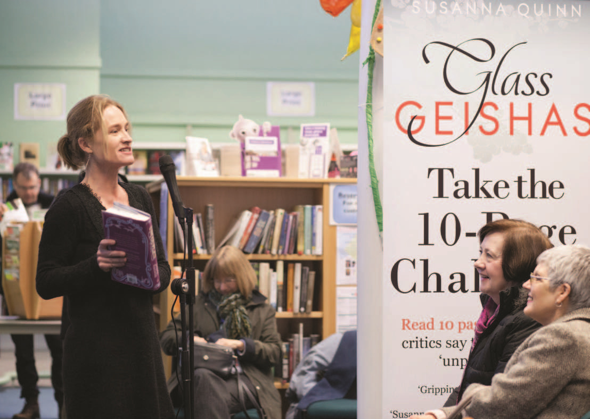

<!-- PAGE: 1 -->

# Envisioning the library of the future

## Phases 1 and 2: full report

**Research by Ipsos MORI and Shared Intelligence**

This document is an independent report, part of *Envisioning the library of the future*, commissioned by Arts Council England.

<!-- PAGE: 2 -->

## Contents

| Section | Page |
| :--- | ---: |
| **1.** Executive summary | 3 |
| **2.** Why focus on libraries of the future? | 8 |
| **3.** Method: a two stage approach | 10 |
| **4.** The key trends from phase 1 presented to participants | 11 |
| **5.** Libraries of the future: what stakeholders said | 12 |
| **6.** The library of the future: our conclusions | 21 |

## Technical annexes

| Annex | Page |
| :--- | ---: |
| **1.** Methodology | 27 |
| **2.** Provoking discussion: evidence and information presented to workshop | 35 |

### Notes and thanks

We use the term 'library sector' throughout this report. We have used this to describe a broad group of people: public library staff (both frontline and managerial); library user groups; academics with an interest in libraries; writers and authors with close connections to libraries; library students; third sector organisations connected to libraries and reading; community activists; and cultural organisations with connections to libraries.

When we began this project we saw it as important to work closely with colleagues at Arts Council England because we believed our findings would be more useful if this work resulted from a close working and real collaboration each step of the way. We are pleased we were able to work exactly as we had hoped, and must give special thanks to Arts Council England staff who played a vital active role in organising logistics for the workshops, helping to facilitate the open space discussion at each of the workshops, recording the conversations, and working with us to refine our methods at each stage. Their contribution has been invaluable and essential to the delivery of this project.

<!-- PAGE: 3 -->

## 1 Executive summary

### 1

**We still need public libraries and the next generation will need them too, maybe more so. But while a few libraries are preparing for the future, too many are struggling to keep up.**

**1.1** The core purpose of libraries is, and looks set to remain, enabling people to access, explore and enjoy reading and knowledge. For libraries to fulfil this purpose and reverse declining use, the services they provide must be closely attuned to the particular needs and aspirations of the communities they serve. Achieving this goal hinges on community engagement, enablement, and co-production becoming organising principles for libraries, modelling an emerging new settlement between taxpayers and the state. It also depends on developing the skills and capacity of the sector so it can react and adapt much faster. Libraries must also learn to secure and manage a diversity of funding streams (especially payment by results and non-government funds).

**1.2** This trajectory poses significant leadership challenges for the library sector. Most notable is the need for asymmetric leadership – mobilising resources behind libraries’ core purpose while meeting the particular needs of individual communities. A key task for Arts Council England, as the development agency for libraries, is to help the sector to meet this leadership challenge.

**1.3** While there are individuals involved in running public libraries who are already creating libraries of the future *now*, the appetite to adapt, reverse falling use, and grasp opportunities, does not seem to extend far enough across the sector.

**1.4** On top of that there are indications that the sector, although highly skilled, is finding that staff in many places lack some of the most important skills needed for the future – be it community engagement, using digital technology, communications and marketing, advocacy, audience development, or leadership in a fluid environment.

**1.5** And our final conclusion is that, with some notable exceptions, overall communication and knowledge sharing within the sector on critical issues seems limited, and the ‘reaction speed’ in many parts of the sector is slow.

### Our approach

This review was structured around five core questions:

- how is society, the economy and technology likely to change over the next 10 years and which of those trends are likely to have the biggest impact on libraries?
- what does innovation in the library service currently look and feel like?
- what do library stakeholders think are the implications of these trends for the library of the future?
- what does all this mean for the future of the library service?
- what are the implications of all of this for Arts Council England?

<!-- PAGE: 4 -->

| Question | Methodology |
| :--- | :--- |
| How are society, the economy and technology likely to change over the next 10 years and which of those trends are likely to have the biggest impact on libraries? | - initial consultation with library experts - rapid evidence review of major societal, economic and technological trends - Delphi Enquiry via an online survey with invited experts in libraries and other fields |
| What does innovation in the library service currently look and feel like? | - initial consultation with library stakeholders - innovation review |
| What do library stakeholders think are the implications of these trends for the library of the future? | - five open space workshops with library stakeholders and others held across England informed by the crafting of four scenarios for 2022 - online conversation hosted by Arts Council England |
| What does all this mean for the future of the library service? | - sense-making workshops with Arts Council England and within the research consultancy team |
| What are the implications of all this for Arts Council England? | - sense-making workshops with Arts Council England |

<!-- PAGE: 5 -->

### 2 How are society, the economy and technology likely to change over the next 10 years and which of those trends are likely to have the biggest impact on libraries?

**2.1** A number of major changes in society over the next 10 years are likely to impact on libraries. The UK’s population is growing, ageing and becoming increasingly diverse. The outlook for the economy is uncertain and there are serious concerns about poverty and inequality. The reductions in public expenditure look set to continue and public sector reform is likely to accelerate with a conscious drive towards localism, co-production, and the development of new and diverging forms of service delivery.

**2.2** At the same time, as consumers and as citizens, we are demanding more personalised and responsive services 24 hours a day. This is happening hand in hand with the digital and mobile revolution. Smartphone sales now outpace sales of desktops and laptops. There has been a dramatic rise in e-publishing and e-books, and consumption of online newspapers and media has increased (similar to patterns in music and film). Information overload and issues of data integrity are growing. But significantly, one in four people (usually older and poorer) still do not use the internet and the digital divide continues to be a reality.

### 3 What does innovation in the library service currently look and feel like?

**3.1** Innovation and experimentation *is* being carried out by library managers and frontline staff in England (as well as abroad). The examples we have presented in our separate innovation review are exciting, add value in their communities, and are attracting new users. They have come about where staff have been inspired, used their imagination, and implemented ideas which address some of the massive societal and technological changes highlighted in the trends review. Some of the innovations and experiments we have included required heads of service and politicians to secure new investment, but most did not.

**3.2** Overall, innovation in public libraries in England is on a limited scale, and even when one library develops a new idea or service which works, the speed of transmission and adoption by others is slow. We found stakeholders frequently cite ‘good practice’ as innovation without seeing there is a difference. We also believe most library users will *not* find the kinds of examples in the innovation review in their own local library.

### 4 What do library stakeholders think are the implications of these trends for the library of the future?

**4.1** We have grouped what stakeholders said about library services of the future under eight themes. These are themes which workshop participants defined themselves through the open space workshop format. The boxes below provide a flavour of the conversation in relation to each of the themes.

<!-- PAGE: 6 -->

### (1) Funding, volunteers and partnership

- the justification for public funding of a core library offer remains strong
- there is likely to be a move towards outcome-based funding, more charged-for services and charitable income as part of a more diverse funding picture
- volunteering in libraries forms part of a new settlement between local councils and communities
- community involvement in libraries will become an organising principle rather than a way of staving off closure

### (2) Digital society and e-books, and (3) children and literacy

- the risk of a real digital divide in society is growing rapidly and the potential role of libraries in ’assisted digital’ is huge
- unless libraries address the current issues with e-book lending nothing else matters, but it makes no sense for individual library services to find solutions to this independently
- libraries are essential for the learning, literacy and cultural development of people of all ages (especially children) and for information literacy

### (4) Communicating the brand, national consistency and (5) new audiences and users

- libraries offer much more than books and reading, but too few people know this
- libraries of the future must achieve a step-change in how they communicate their offer
- although library usage is falling, there is strong public support for libraries across the population
- it can be difficult to strike a balance between national consistency and local fi

### (6) Social purpose, making the political case, public space and (7) rural communities

- discussion tends to focus on *what* libraries must do in the future; stakeholders find it harder to articulate *why* they should do it
- there are concerns that the powerful ideas about the purpose and ethos of the library are not well rehearsed outside the sector
- the core purpose of libraries is to give people the experience of the pleasure of reading and knowledge. Libraries are a real space in a virtual world, acting as a gateway to that world for some
- rural libraries face unique challenges, not least in terms of broadband access and demographic change

### (8) Skills, leadership and innovation

- libraries will need information professionals, but also community mobilisers, managers of volunteers, and educators, to support reading, knowledge and new technology
- library staff will have to be innovative – not just in how services are provided, but in how they are funded
- the qualifications provided by the library schools may be less relevant for careers in public libraries as opposed to commercial, medical, or academic libraries

<!-- PAGE: 7 -->

### 5 What does all this mean for the future of the library service?

**5.1** One of the strongest messages from participants is that libraries of the future must articulate their core purpose much more clearly than they do now. The core purpose needs to be tightly defined for the modern era but is in essence an enduring one: the provision of access to reading and knowledge for all.

**5.2** The delivery of this purpose will continue to be influenced by the rapidly changing social and technological context. In the next decade we believe that means going beyond simply providing access, to reaching out, guiding and enabling people to discover, enjoy and utilise reading and knowledge. It also means strategically embracing whatever information technology comes around the corner next.

**5.3** A few libraries in this country are already doing this brilliantly, but many are not.

**5.4** For some readers of this report, our confidence that libraries will have enduring relevance and purpose sits oddly alongside the national data which shows that library use is falling steadily. Our answer is that those libraries bucking the trend and attracting more users are a better indication of the true potential of libraries of the future, and could be the norm not the exception. We believe that if the majority of library services were more closely attuned to the particular needs and aspirations of the communities they serve, and organised around engagement and co-production, then the picture on user numbers would be very different.

**5.5** In this context we believe that libraries of the future will reflect the particular needs of the communities they serve, with community engagement, enablement, and co-production becoming organising principles for libraries. This would model the emerging new settlement between taxpayers, citizens, service users and the state. The precise shape of that offer will be influenced by a number of factors, including:

- the extent to which nationally co-ordinated products and activities are avilable which libraries could buy in to – for example, a national e-book lending service, or the national offers currently being developed by the Society of Chief Librarians
- the local politicial environment and wider policies of local councils and other partners
- the extent to which those running the library service are able to build a rich understanding of the needs and aspirations of their communities
- the extent to which libraries are able to build their skills and leadership

### 6 What are the implications of all this for Arts Council England?

**6.1** The leadership challenges for the library sector and Arts Council England are significant, requiring what is in effect an asymmetrical focus:

- enabling the sector nationally to articulate its core purpose, promote the library offer, and demonstrate its impact – whilst also supporting locally determined shaping of that offer in the context of the priorities of the local authority and local communities
- injecting a sense of urgency across the sector about the need for innovation, change, and action on falling use – and helping the sector as a whole become more responsive
- providing time and space to enable the conversations which took place in May to continue, and in which Arts Concil England again convenes but does not instruct
- supporting the development of leadership and frontline skills for delivering library services of the future

<!-- PAGE: 8 -->

## 2 Why focus on libraries of the future?

### 1 Overall purpose

**1.1** In February 2012 Shared Intelligence and Ipsos MORI were commissioned by Arts Council England to carry out a research project which would stimulate a strategic and future-focused debate on public libraries, encourage fresh thinking, and pave the way for more detailed exploration of how the public value libraries. This would support Arts Council England in creating an inspiring and challenging vision for the purpose, value and potential of public libraries of the future.

**1.2** As readers of this report will recognise, much of the recent debate about public libraries has focused mainly on the short term – especially funding and management decisions. While these are important issues in their own right, so too are the questions of how libraries adapt in the longer term to some major societal changes, not least:

- the anticipated continued reductions in public expenditure and the heavy jostling for position which has begun in the run up to the next comprehensive spending review
- the enormous shifts in public services’ relationships with citizens, which began before the financial crisis, but which have been entirely recast by it
- the speed of technological change, particularly the rapid growth in use of online mobile to access written, visual and audio information, combined with a significant minority of people without access to the internet

**1.3** Coming into this project we were well aware of the danger that short term changes (driven by the need to cut expenditure) were already limiting the sector’s capacity to innovate and develop. We knew that some might see this project as a distraction from the real (ie immediate and current) issues. But we had also seen through our other work, a small but growing number of library practitioners who are instigating strategic discussions, *are* setting positive action-focused agendas, and *are* looking beyond the short term.

**1.4** As part of a three phase programme, the work we report on here (the first two phases) was intended to draw on library sector and other expertise to allow Arts Council England to:

- understand likely future trends in how people will interact with library services in the future given societal, economic, technological and demographic change
- develop thinking on possible future developments for library services, drawing on new models emerging here and internationally, to explore the potential and options for future-facing libraries
- open up conversation and debate, creating the space and conditions to encourage radical, aspirational and future-focused thinking, and to develop a shared understanding on the potential of libraries so that we can turn all of this work into a focused, evidence-based and engaging ‘future vision for libraries’

### 2 Our approach

**2.1** The potential implications of social, economic and technological change for public libraries are huge in practical terms, bring a great deal of uncertainty, and provoke intense debate. Add to that the current pressure on public spending, controversies and protests over service closures, and it is little wonder that discussions about libraries of the future are often coloured by assertion more than hard evidence, and focus on what is happening now, at the expense of what needs to happen next.

<!-- PAGE: 9 -->

### 3 Jolting discussion forward to 2022

**3.1** A major challenge has been to acknowledge the very real challenges facing the library sector now, but not at the expense of spending more time thinking ahead to the future. We needed to convene a debate which could deal with the present *and* look ahead to the future. Much of our planning for this research focused on how to ‘leap frog’ and jolt the discussion out of the current and ahead to the future. We decided to look to the year 2022 because we felt in 10 years there would be enough change to society and local public services to stimulate discussion, but it was also near enough into the future that participants would be able to think realistically about the implications of these changes for libraries.

### 4 Evidence, data and facts

**4.1** We knew that, as with all groups of stakeholders who understand their subject well, there is a tendency to rely on long-held assumptions, or one’s own direct experience, without re-testing that against changing contexts and new evidence. So we decided it was critical to design an approach that ensured the debate challenged assumptions by being grounded in evidence, data and facts about the scale and direction of societal and technological changes pertinent to libraries.

### 5 Hearing a range of voices and views

**5.1** It was important to connect with, and amplify, the new thinking and creativity which is already emerging from within the sector, and we knew this would not just come from the most established or senior voices. So in addition to key stakeholders we also targeted academics, library students, frontline staff, technologists, other public sector workers, and community activists. We were also keen to target new kinds of professional networks, in particular members of the Library Camp[^1] network whose example we also followed in adopting an open space format for the regional workshops.

### 6 Convening debate, but not dictating the agenda

**6.1** Another principle of our approach was that this should not be the type of conversation and debate in which we (or Arts Council England) asked questions and collected answers. We wanted to instigate genuine conversation, and have Arts Council England use its convening power to enable conversation to take place, but not dictate what was discussed. This led to our decision to base the regional workshops on an open space format. It also led us to facilitate an online conversation, but in a very light-touch fashion. Although the online conversation was clearly branded as Arts Council England, the contributors held a range of opinions (including library campaigners), as did those who commented – but we and Arts Council England held back from intervening (even to respond to direct criticism of the Arts Council, or the project itself) .

### 7 Building on, not repeating, previous work

**7.1** There is always a concern that when a new organisation takes on a new responsibility (as the Arts Council has with libraries), that previous discussions will be repeated needlessly. It was important to ensure the approach taken here built upon, rather than duplicated, previous work conducted across the sector, including detailed work carried out by the MLA (which was the national development agency for libraries prior to the Arts Council). In particular, its 2010 study, *What do the public want from libraries?*, which provided a more immediate picture about what the public thought and wanted from libraries to help the sector develop the service going forward, and before that the MLA’s 2008 action plan Framework for the Future.

**7.2** This work also had to compliment Arts Council England’s own initial thinking on libraries, which was captured in its recent publication, *Culture, knowledge and understanding*. This document provides a framework for decision-making in the arenas of museums and libraries during the current spending period (2011–15) and it drew comprehensively on an accompanying review of research done with and about the library sector, *A review of research and literature on museums and libraries.*

<!-- PAGE: 10 -->

## 3 Method – a two stage approach

The outline of our two-stage methodology is as follows:

### Phase one:

**1 An initial scoping exercise with library experts** to understand what they thought the research needed to achieve. This involved telephone and face-to-face interviews with senior figures in the sector and Arts Council England staff.

**2 An evidence review** of major societal, economic and technological trends that might impact on the future of the library service, which drew on a number of sources, including Ipsos MORI’s own work to create an evidence base for discussing libraries of the future in phase two.

**3 A Delphi Enquiry with over 200 invited library practitioners and experts in related fields** in the form of an online survey to understand whether and how those in the sector see these trends impacting on libraries. Respondents considered 50 statements about how the country might look in 2022 and were asked to rate the likelihood of an event or trend coming to pass and the magnitude of the impact it would have on libraries.

**4**  An innovation review to identify what public library innovation (as opposed to ‘best practice’) currently looks like, which drew together over 100 examples of innovation from the UK and abroad.

### Phase two:

**5 Discussion with stakeholders via an online conversation** which continued throughout the life of phase two and was designed to widen the debate and create more opportunities for participation. The website has received 10,900 visits, and 120 comments to date. It has also had significant traffic from United States, Australia, Croatia, Canada and India.

**6 A series of five regional ‘open space’ workshops** with library sector stakeholders held across Arts Council England’s regions. These were the core of phase two, generating discussion in reaction to the evidence generated in phase one, and asking what library stakeholders thought were the implications of the evidence for libraries in 2022. The open space format was important to ensure the debate remained as open as possible – participants themselves determined what was discussed and debated, whilst ensuring that the debate focused on looking to the future.

**7 Sense-making discussions** were held with Arts Council England – first with the core project team immediately after the final workshop, and then with a larger group of Arts Council staff to understand what the findings meant for their organisation.

A full outline of the project methodology can be found in the technical annexes in this report.

<!-- PAGE: 11 -->

## 4 The key trends from phase 1 which we presented to participants

Section 5 which follows, records what stakeholders said in response to the trends review and the other inputs presented at the start of each open space workshop. The full set of workshop inputs have been published online by Arts Council England[^2]; the headline social and economic trends from this were:

- continued growth and demographic change in the UK population – older and more ethnically diverse
- increasing poverty and overcrowding, along with rising public concern about social inequality
- low economic growth, increasing public debt, low wage growth and market uncertainty matched, unsurprisingly, by rising public concern about the economy too
- continued constraint on public spending into the next comprehensive spending review period and beyond, coupled with increasingly sophisticated public debates over taxes, and spending choices
- the translation of localism principles into practice resulting in more local control over public services, more variation in patterns of spending, and more local difference in how public services are run
- changing consumer behaviour with more demand for choice, power, 24-hour access, and personalisation, often exercised through online activity and comparison
- longer working hours, accelerated by always-connected technology – resulting in genuine ‘down-time’ being seen as a precious commodity to be used wisely
- technology, especially the continued rise of handheld and mobile devices, in sheer numbers and breadth of usage
- a growing digital divide impacting the poorest, oldest and least well-educated segments of the population
- huge changes in how we consume and interact with information, from how we communicate and interact with knowledge and media, to our reading habits and literacy levels

<!-- PAGE: 12 -->

## 5 Libraries of the future: what stakeholders said

We have grouped what stakeholders said about library services of the future under eight themes. These were themes which workshop participants defined themselves, through the open space workshop format.

### Theme 1 – funding, volunteers and partnerships

**1**  Libraries can only exist if they have sufficient resources. There was wide recognition that resources come in many forms, not simply hard cash, and libraries need to attract all of them. A health organisation offering to part-fund a building, an adult learning team agreeing to contribute towards staff costs, community organisations offering to lead training courses in return for free space – these all contribute to the pot of cash and non-cash resources which libraries need to operate.

**2**  So workshop attendees saw the future of funding as more than simply re-shuffling public cash funding. It was assumed public libraries would remain a free service, but securing resources of all kinds was seen as the biggest challenge – especially resources which were not from government sources. Sharing services, partnerships, outcome-based funding, winning commissions, selling to personalised budget-holders – these are essential but do not go beyond re-configuring public money. Alternatives are being considered or trialled which many felt will become much more important: income generation from new activities (eg live theatre in Lewisham and Southwark); setting up charitable fundraising arms (eg Manchester); using community council precepts; premium membership or ‘friends’ schemes; and seeking Lottery or other grants.

**3**  However, this is where issues of skills, capacity and knowledge sharing first arose. Even the most creative new approaches were not widely known about by those at the workshops. Also, for libraries to exploit new opportunities (and by ‘libraries’ they meant of course ‘library staff’) requires a significant change in skills and culture. It needs more entrepreneurial capacity, and real incentives to innovate. Senior management in local authorities may also need to give their library services more autonomy to do what is required to build a successful and sustainable library service.

**4**   On volunteers we heard a change in emphasis from volunteering (being seen by many today as a means of reducing expenditure) to a future position emerging where co-production is the organising principle for community engagement and outreach, community-led library provision, and for embedding libraries in their communities. But this raises significant questions. Firstly, where will the community enabling skills come from? They are currently in short supply in libraries. Secondly, how does this sit with the very imprecise use of the term ‘community library’ now? ‘Community library’ is currently being used to refer to anything from a council-led, volunteer-assisted library, to a total withdrawal of public funding. Community libraries of the future will need to be much more clearly explained, and the term used carefully and transparently, if the benefits of collaboration between communities and public services are to be had.

**5**  Many examples were cited of libraries further extending their collaborations with other services and external organisations (eg Macmillan Cancer Support). But with these came concerns that libraries risk delivering significant outcomes for other public services ‘for free’, ie that those other services benefit from, but make no direct contribution to the cost of achieving those outcomes (supporting jobseekers, helping people use NHS Direct or supplementing children’s centre activities). Looking ahead to 2022, this was felt by many to be unsustainable; libraries of the future would need to be clearer and shout louder about the outcomes they deliver for other agencies, and the cost of achieving them. Not surprisingly many expected to be working closer with arts <!-- PAGE: 13 --> organisations to secure funding. But it was seen as important that libraries should only get involved in cultural activity where it was consistent with their strategic purpose.

**6**  Stakeholders talked of continuing the diversification of services offered in libraries, often in the context of diversifying income. Providing bookable meeting spaces and co-locating with health, leisure and arts venues (eg Eccles and Ivybridge) were seen as meeting real public needs, bringing the possibility of income, and also providing visible ways to validate libraries’ importance to budget holders. Partnerships around health and wellbeing were seen as particularly important in the future.

**7**  However, looking ahead, there were perceived risks of diluting the library brand. This risk was seen to come from the tensions between having to offer something to the *agendas of decision- makers* (which can be transient and short term) while also staying on a *strategic path* which supports the long term sustainability of libraries. Some were concerned about libraries trying to do too much, or acting too opportunistically, and referred to the ‘Woolworths effect’ of offering lots of useful things, but in an un-guided way which loses connection with the public and leads eventually to failure.

### What does this mean?

- libraries need to be much clearer and shout louder about the outcomes they deliver, develop capacity to win funding from a range of sources, and learn to be more entrepreneurial
- libraries will need much stronger workforce skills around community engagement and enablement
- libraries may need to guard against losing their way – of becoming everything and nothing – through successive short-term decisions
- although there are some promising examples of new approaches being taken to funding, to working with communities, or with partners, these are not widely known about or systematically shared. Sharing learning, innovation and experimentation needs active support in any sector, and in the case of libraries this needs to happen nationally

### Theme 2 – digital society and e-books

**8**  There was universal recognition among participants that the effect of the digital revolution on our lives is continuing to accelerate, especially in how we access and consume information and the written word. Stakeholders saw the digital revolution as a social phenomenon, as well as a technological one. There were mixed views about how well libraries were responding to the growth of a digital culture and society, and the explosion in the quantity of information we now confront.

**9** Participants discussed many individual examples of digital activities in libraries (eg social media surgeries, computer ‘maker’ labs and basic courses), but these raised crucial questions about how libraries can offer something unique and tied to a clear purpose. A common concern was that some digital or e-book services being offered by libraries were simply alternatives to services the public could (and often would) get elsewhere and often for free, especially from Google (in relation to accessing information), but also from Amazon (discovering books and what others readers thought about them) or Wikipedia (moderated information and traceable sources) or resources like Freecycle (local sharing and swapping of skills and resources).

**10**  Obvious comparisons were made to what had happened in music, film, newspapers and television where 20th century institutions struggled to adapt, while un-signed artists began publishing their work at the tap of a screen. Some stakeholders said they knew they had to be more than ‘middle men for content’ – not just providing access but helping communities navigate and exploit knowledge. In all this disruption stakeholders saw new opportunities which some organisations were exploiting. For libraries many opportunities were identified – libraries becoming active connectors of their communities, hubs for local self-published writers, organising local-level sharing of scarce resources, or even taking data about people’s reading habits to publishers to form new alliances and create new services.

**11**  However, it was also clear these ideas and discussion were new to many in the sector, plus there were major commercial and technical <!-- PAGE: 14 --> barriers preventing some ideas from being implemented. This included external factors like variable broadband quality, uncertainty about the future of e-book lending and the evolution of current formats. There were also internal factors such as local variation in the degree of freedom libraries have to develop library-specific digital infrastructure separate from local authority-wide information and communications technology (ICT) systems.

**12**  The risk of a real digital divide developing in society was often raised in discussion, and the potential role of libraries in ‘assisted digital’ was seen to be huge – building on the legacy of libraries’ role in UK Online. But stakeholders were also aware that national activity on digital inclusion was taking shape so quickly, that the pivotal role libraries could play in the future of digital inclusion might not be exploited. There was also a concern new solutions might be invented needlessly.

**13**  Some examples emerged of online interactions which in fact created new reasons for people to meet in person – including online communities focused on place or neighbourhood, or libraries becoming workspaces for freelancers (such as at Willesden Green). Similarly, as digital reading continues to accelerate, the need could increase for physical ‘shopfronts’ as places where readers can browse books in person, and where publishers and authors can connect with the public (in the same way retailers in the future are still likely to need shops even when purchases are increasingly made online).

**14**  Even though some discussions were joined by real digital visionaries, the overall impression, acknowledged by those who took part, was of a sector only just beginning to confront these issues.

**15**  Finally, the migration of reading and publishing to digital puts libraries in the midst of complicated, hard-to-predict issues over competing technology, the protection of IP, and the intentions of the major technology firms. Some felt that unless libraries can build clearer strategies for approaching e-books (offering as much e-book stock as possible, joining multi-borough systems, treating e-books as complimentary, or treating them as replacements for physical stock) then nothing else matters. Many stakeholders felt it made no sense for individual library services to attempt to find solutions to the e-book questions independently.

### What does this mean?

- although almost every library service is actively developing its digital offer, the strain on skills is showing and new skills either need to be brought in quickly or developed among existing staff
- libraries of the future could be the places where local authors, self and traditionally published, meet their readers – and could become centres for self-publishing
- libraries could be exploited much more over the coming decade to deliver assisted digital, using the resources which are already in place
- libraries could attract new users by responding to demand for space for physical meet-ups which arise out of online activity (eg social media surgeries, or hobby groups which have developed because of social media)
- stability in the changing framework of legal, digital rights protection and file format issues surrounding e-book lending is only going to be resolved if there is intervention at national level – individual library services cannot be expected to do much on their own

### Theme 3 – children, young people and literacy

**16**  Although libraries were seen to have a continuing and essential role in the learning, literacy, and cultural education of people of all ages, the view from stakeholders was that libraries’ role in relation to supporting children’s learning and literacy was especially important for the future. At the same time, catering to children and young people was becoming increasingly demanding in terms of meeting changing tastes. On the one hand some children are more familiar with technology than library staff, but on the other hand children can be very naïve about the quality or veracity of the information they encounter.

**17**  As the sheer quantity of online digital information grows, libraries’ potential to support learning about information literacy and critical appraisal of information becomes huge.

<!-- PAGE: 15 -->

**18**  The potential has also emerged for libraries to help communities curate and broadcast their own local histories to the world (as Peterborough library is doing) rather than bringing the world to communities.

**19**  Looking to the future, children growing up now are likely to see less distinction between libraries, information and reading, and other forms of culture and art (music, film and images). Libraries of the future could end up as the physical hubs for a convergence of cultural activity.

**20**  Links with schools and school libraries are variable – but in the future this seems to be an obvious opportunity to be developed. With schools having increasing autonomy this would only come through local negotiation with individual schools (as in Stockton). Some library services had already begun signing up all school children as library card holders, even before Arts Council England/DCMS made this a priority.

### What does this mean?

- libraries need to share learning faster about how to keep up with young people’s ever changing tastes and needs in terms of space, services and policies, and staff skills – especially how to do so within existing budgets and without extra new investment
- libraries could be supported through national programmes like Arts Award or the ‘bridge organisations’ to develop their role as places where convergent youth and children’s arts and culture is developed
- libraries could form closer collaborations with schools to support information literacy and critical thinking as our environment becomes ever more flooded with information

### Theme 4 – communicating the brand, the core offer and national consistency

**21**  The core library offer is already much more than just books and reading. That said, most stakeholders held the view that the heart of what libraries are for is, and will continue to be, reading, learning and access to knowledge. There was also a strong sense that the important social role this plays goes unrecognised by other public services. Librarians feel they struggle to communicate the case to partners, local leaders and government about the social benefit and value provided directly by reading, learning and access to knowledge – for health, jobs, and social mobility.

**22**  The free, neutral public space libraries provide must also be seen as a core part of the offer. Some stakeholders were uneasy about focusing too much on the physical library (versus the wider service) but the dominant view was that online and outreach services enhance but cannot replace libraries as places to visit.

**23**  Discussing how libraries of the future need to communicate what they do tapped into related and long-standing frustrations about the ineffectiveness of library marketing and promotion to the public.

**24**  There are a number of examples of libraries promoting themselves successfully, increasing the number of users, raising their profile, and widening their user base. However, despite the public’s special affection for libraries, stakeholders saw too few examples of effective promotion and communication. This was often put down to a significant gap in professional skills across the sector, and it was felt libraries of the future must get better at promotion, marketing and communication.

**25**  In communications terms, local variation is a real challenge. The idea of national marketing campaigns was attractive in terms of economy of scale and overall impact, yet even a simple campaign message of ‘Come to your library where you can get help setting up a book club and use the internet for free, seven days a week’ would attract caveats from individual authorities – so for the public it would risk being an empty message.

**26**  In this context the ‘national offers’ led by Society of Chief Librarians (SCL) were seen as major opportunities for libraries. There is a lot of value for library promotion and communication in having some services which everyone could expect in every library, such as books on prescription, or free internet and wifi.

**27**  Similarly a national library card was suggested on several occasions. Some felt this was a political impossibility because of the desire to retain local identity, but others felt that if there could be a Greater Manchester single library card and a Northern Ireland one, this proved that political desire for local branding was not an obstacle.

<!-- PAGE: 16 -->

### What does this mean?

- there is a strong desire for the national library bodies to shift focus and give more attention to delivering clear and bold messages about local libraries (what they offer and why) to other public agencies, and also to the public
- as well as making more use of communications professionals (eg in local authorities’ corporate communications teams or elsewhere), it seems likely that libraries will need to train their own staff to communicate and market their offers better – and also share their knowledge and skills with each other
- the national offers could be a chance to launch national or regional marketing campaigns, although this will be difficult unless there is buy-in to having at least some things which are the same everywhere
- libraries could join forces to commission sustained national marketing campaigns to drive up public library visitor numbers and capitalise on existing initiatives and resources (eg National Libraries Day and Summer Reading Challenge)

### Theme 5 – building new audiences, new users, and using data

**28**  Despite the fact that those who use libraries find them essential and enjoyable, many people are unaware of the range of services offered by libraries (ie they still think it’s about borrowing books and internet access), making them less likely to visit. So like other public-facing institutions, libraries have to win the public’s attention, and competition for that attention is increasing. In this context being able to understand potential audiences (teenagers, parents, commuters, home-workers and job-seekers) and then targeting and attracting them are completely inter-connected.

**29**  Many stakeholders pointed to the volume of user data amassed by libraries, and the growing number of free or cheap online tools now available make it easier in principle to connect with users, increase usage, and apply segmentation to understand target audiences – but this is only happening in a few places (Brent and Winchester were among those mentioned, as were the structured approaches developed by The Reading Agency).

**30**  So the general feeling was that libraries fall behind many other user-facing organisations (like leisure centres, cinemas or high street retailers) in exploiting the tools now available to generate visibility, attract new users and maintain relationships with the public. Workshop attendees from the audience development sector, on hearing the challenges faced by library staff, felt a great deal could be learned from their own work with other cultural organisations such as theatres and museums.

**31**  Some stakeholders also argued the data already held about library users would be gold dust to publishers and others, and asked whether this could be used to the advantage of libraries and their communities.

### What does this mean?

- library services should build closer links with the audience development agencies and tap into their expertise – they could support the use of data and evidence to understand different library audiences and how to better communicate with them
- libraries should consider the value of the national offers, not just in terms of service improvement *per se*, but specifically in terms of attracting new users
- libraries could also promote their data more actively to other council departments in return for marketing support – eg data on levels of reading by area/branch, patterns of demand for internet access, take-up of books on prescription, and so on
- publishers and retailer interest could be tested for new partnerships based around the data libraries hold on reading habits and the performance of specific books and products
- promotion of the national offers could be focused in particular on attracting new users and boosting visits – and some kind of national library card (or national reciprocal scheme) might give the national offers more traction

<!-- PAGE: 17 -->

### Theme 6 – social purpose and making the political case

**32**  At the workshops we heard many views about *what* libraries must do in the future. But although there was some discussion about *why* (ie fundamental purpose and ethos), this seemed harder for stakeholders to articulate. When we pushed on this issue and asked if it mattered, stakeholders said yes it did. They also saw how it linked to the ‘Woolworths effect’ of doing lots of useful things, but without clarity of purpose or coherence.

**33**  It was only when we prompted that we surfaced what stakeholders believe about *why* we have publicly-funded libraries. What was striking though, was that when stakeholders did focus on the fundamental purpose of libraries they found themselves returning to enduring concepts – almost identical to the arguments made when the very first rate-funded public libraries were established over a century ago in the north west. That is, providing knowledge and education as opportunities for social mobility – or, as the Victorians might have said, ’betterment and emancipation’.

**34**  It was also clear that although being seldom discussed within the sector, these powerful ideas about the purpose and ethos of libraries have significant potential to strengthen the connection of libraries with the public and with funders. The problem is that they are not articulated beyond the sector (or even within the sector). There were no easy explanations as to why this is the case, but part of the problem might be that ‘purpose and ethos’ discussions could possibly be seen as ideological, and against the strong public service culture of impartiality.

**35**  We were surprised by how little we heard about the role of councillors in shaping the library of the future. Local politicians were referred to most often as people who had to be got ‘on side’ to oppose individual library closures or budget cuts. Local political leaders were perceived by the vast majority of participants as people to be lobbied and influenced rather than people with whom to share the leadership necessary to deliver the library of the future.

**36**  Stakeholders also concluded that to influence political choices the voice of library users and the library sector must be stronger – especially on the question of why we have libraries – and this needs to be backed up with convincing evidence about the impact of libraries on local communities and social outcome.

**37**  Those who had the support of their local politicians had spent time developing different arguments for different audiences. Heads of service had prepared messages which resonated with politicians, but had different messages to attract new and existing users. When libraries have a clear sense of their purpose, which they can turn into convincing arguments for politicians, as well as an offer and a message which attracts the public, then political backing *and* increased use can be achieved.

### What does this mean?

- do libraries of the future need to be more up front about their core purpose, ethos, and social mission – and what happens if they are not, or cannot?
- library managers need to counter-balance the need to shape libraries around short term political imperatives, with longer term efforts to ensure libraries retain a clear and compelling sense of purpose which can stand the test of time
- better evidence is essential to react to short term political imperatives (eg when job losses suddenly become the hot topic, libraries have to have something to say on that, or education or cohesion) – and this may need national support

### Theme 7 – libraries and rural communities

**38**  Rural libraries will continue to face unique challenges, not least in terms of poor broadband access in their communities and demographic change. Much depends on the implementation of the national Broadband Delivery Programme (due to be complete by 2015). If it succeeds there are exciting and unique opportunities presented by the digital revolution for libraries operating in rural communities. If broadband infrastructure remains patchy, many of these opportunities cannot be exploited. Instead there may be other opportunities for libraries as ‘digital bridgeheads’ in broadband cold-spots.

**39**  The other big issue is that budget priorities in rural areas are increasingly influenced by pressures arising from rural demographic <!-- PAGE: 18 --> patterns – an ageing population, and outward-migration of young people. The result is that in many rural areas public spending is prioritised towards services which deal with these pressures and libraries (unless they articulate their role in helping alleviate them) can be seen as lower priority.

### What might this mean?

- the role of rural libraries could be quite different depending on how successful rural broadband infrastructure investment turns out to be
- rural libraries may develop in a different direction from urban and suburban libraries – in response to rural demographic patterns and pressures around social care or employment

### Theme 8 – skills, leadership and innovation

**40**  Skills and leadership were seen as the biggest organisational challenges for public libraries of the future.

**41**  The professional skills challenges are across the board, and these came out in almost every open space discussion. The leadership challenges for the sector were seen as more specific, about exercising local autonomy, and building teams within local library services which could set their own direction and agenda for change and constantly re-shape services, without having to wait for national policy directions which in the future will not arrive.

**42**  Re-designing how services run, how they are funded and developing new income requires new skills as well as leadership. It needs more flexible roles, so that changing and adapting services can be continuous and gradual, not a sporadic upheaval. It also means more reliance on problem-solving and initiative competencies, instead of hierarchies and instructions. All these skills sets are scarce in library services at the moment.

**43**  On skills for the future, stakeholders focused on the need for skills to help the public understand a sea of information, promote services better, enable local people to play an active role in their library and seek out and support those who benefit most. This meant libraries would need information professionals, but also community mobilisers, managers of volunteers, educators, and animators of community activity around reading, literature and new information technology (some library services like Essex and Slough are already pushing this approach). Many stakeholders, especially junior and frontline library staff, talked about users needing ‘guides’ or ‘navigators’, and these terms are already being used by some libraries to describe jobs which are about helping others discover and make sense of information, written words and learning.

**44**  In some workshop discussions participants recognised they were actually talking about changing their own jobs which prompted some to ask, ‘Do all my colleagues want to change?’ and ‘How many have the potential to thrive in a community development role?’.

**45**  There was also disappointment with the library schools, about their slow pace of change, and the fact that what they offer seems increasingly poorly matched to the skills which *public* libraries need (as opposed to commercial, academic or legal libraries).

**46**  We also heard frustration from newly qualified professionals and library students about their perception of an ‘old-guard’ and *their* appetite to lead change. But, most importantly of all, stakeholders believed skills and new ideas alone would not achieve the kinds of improvements being discussed. Coming full circle, they said the precursor was for library services to have more autonomy to take decisions which were in the best interests of library users, and which stemmed from a clear sense of purpose.

### What does this mean?

- the successful libraries of the future will be those which have acquired or developed new skills and strong leadership and which can deliver innovation and autonomy
- library professionals of the future are likely to have more in common with community development professionals, educators, and digital technology specialists, than they do with the traditional librarian role
- support from national bodies (SCL, Chartered Institute of Library and Information Professionals(CILIP) Arts Council England, Local Government Association (LGA) and library schools) will probably be needed to develop those skills *most needed* by library services (digital information and web, delivering innovation, business skills and community <!-- PAGE: 19 --> development) and in supporting development of a ‘next generation’ of library leaders

- the question of how much autonomy library managers have to innovate and to act in the best interests of their communities needs debating at a national level

### The innovation problem

**47**  The concept of innovation provoked a great deal of discussion in its own right and became an issue which cut across several open space discussions. This was partly because we raised the issue by presenting our innovation review, but we also surfaced real tensions that exist above and beyond this project.

**48**  Innovation and experimentation *is* being undertaken by library managers and frontline staff both in England and abroad. The examples we have presented in our separate innovation review are exciting, inspiring, are adding value to their communities and are attracting new users. They have come about where staff have shown inspiration, deep imagination, and come up with ideas which address some of the massive societal and technological changes highlighted in the trends review. Some of the innovations and experiments we have highlighted required heads of service and politicians to secure new investment, but most did not.

**49**  However, what the open space discussions highlighted is that (in this country at least) overall innovation in libraries is limited, and even when one library service has developed something new which works, adoption by others is very slow. Not only that, but we frequently found that workshop participants wanted to include ‘good practice’ as innovation (even where some ideas were more than a decade old) and many did not accept a difference between the two concepts. There were also some participants who questioned the very notion that libraries should constantly innovate and adapt, arguing that what was really required was to deliver existing services in the best way possible.

### Better evidence needed… and skills to use it

- another cross-cutting issue was around evidence and the skills to use it. There is good research out there about the wider social value libraries have on health, ageing-well, employment and cohesion, but the sector struggles to cite it and use it with impact. All local services are under pressure to increase their impact on the big social outcomes, but stakeholders are concerned that hard evidence about the ‘heavy-lifting’ libraries *already do* is not used enough. There are also gaps, especially in high quality research about the impact of libraries on specific policy goals (eg does the experience of people who receive help from libraries in finding a job differ from those who get no support or get it somewhere else?) There is some good research (eg on Bookstart’s impact on early years development), but more is needed
- not only do stakeholders find it difficult to locate good quality evidence, but they also worry about the ability of the sector as a whole to use evidence effectively, make the case for libraries with impact, and develop targeted messages for specific decision-makers. Without better approaches to sharing and using evidence, stakeholders’ urgent concern was that libraries will lose out as other local services and cultural institutions fight *their* corners in future government spending reviews

### Debates about attitudes to *change* need to play out within the sector

**50**  Finally, alongside the workshop discussions, the online conversation generated debate using guest pieces from individuals representing a wide range of views about public libraries. The very first guest post was an argument for libraries to be far more active champions of social justice. Several guest authors then made their case in different ways for libraries to do more to embrace technology and e-publishing, which was often tied to connecting better with children and teenagers. We also invited contributions from library campaigners who focused on keeping libraries under local authority control and safeguarding public funding for them.

<!-- PAGE: 20 -->

**51**  The comment threads which developed following each post were particularly interesting. Real conversations and debates took off from the outset. Many ended up on questions of e-publishing, and debates over how prominent books and reading should be compared to other services. But what the online conversation also highlighted was the spectrum of views within the library profession – from those passionate about libraries but for whom change and new technology cannot come quickly enough, to those who believe the current model of public libraries would fully meet users’ needs, so long as sufficient funding could be provided.

**52**  Generally speaking this was not about library professionals arguing with users or campaigners – but professionals debating with each other about whether and how things need to change. To us this again highlights the challenge of supporting those professionals who are already creating libraries of the future to influence the rest of the sector. In our view the kind of debate which has taken place through the open space workshops and the online conversation, if it is allowed to play out further within the profession, could be vital to accelerating the pace of change. If not, there is a risk the two points of view will simply entrench and stifle change.

*Staircase at Dalston CLR James Library, London. Photo: Michael Cameron Photography*

<!-- PAGE: 21 -->

## 6 The library of the future: our conclusions

### The pace of social change is rapid and cannot be ignored

**1**  As our trends analysis and Delphi Enquiry showed, major changes in society over the next 10 years are likely to have a major impact on libraries. The UK’s population is growing, ageing and becoming increasingly diverse. The outlook for the economy is uncertain and there are serious concerns about poverty and inequality with particular implications for children’s education and development. The reductions in public expenditure look set to continue and public sector reform is likely to accelerate with a stated drive towards localism and the development of new and diverging forms of service delivery.

**2**  The public are demanding more personalised services which they can use 24 hours a day. This is happening hand in hand with a revolution in the way we communicate and access information. On the surface the driver is fast-developing web and mobile technology, but this is just as much a social revolution. An unprecedented amount of information is free and instantaneous, but often unverifiable. There has been a dramatic rise in e-publishing and self-publishing. Digital news and other media continue to grow rapidly but business models are in flux. Information overload and concerns about privacy and data integrity are rising. However, one in four people still do not or cannot use the internet and the need for assistance in digital access is growing.

**3**  In amongst all this, the number of people visiting their local library is falling.

### Libraries of the future need to state their purpose imaginatively and boldly

**4**  The founders of the first English rate-funded public lending libraries had a clear sense of their purpose and benefit to society. They expressed this imaginatively and boldly as part of a strong national narrative around ‘improvement’. Speaking at the opening of the Campfield Library in 1852 Charles Dickens expressed his hope that ‘the books thus made available’ through the ‘free lending library’ would ‘prove a source of pleasure and improvement in the cottages, the garrets, and the cellars of the poorest of our people.’

**5**  Dickens’ focus on improvement and enjoyment resonates powerfully with the challenges society is likely to face in 2022. Enabling people to develop new skills themselves is a vitally important purpose of libraries. This is central to the challenges of supporting individual resilience and adaptability, meeting the needs of UK employers for a highly skilled workforce, and supporting our growth as a knowledge economy.  Similarly access to the written word, literature and knowledge for pleasure (and leisure) are increasingly recognised as vital ingredients to health, wellbeing and quality of life[^3].

**6**  Our best library services today have just as clear a sense of purpose and direction as in 1852; that purpose informs everything they do and they communicate it in imaginative and impactful ways.

**7**  Our starting point is that it is possible to see a core purpose for libraries of the future which is compelling and relevant, and will be as valid in 10 years’ time as now. That core purpose is the provision of access to reading, information, and resources which support learning and knowledge for all.

<!-- PAGE: 22 -->

**8**  Then, underpinning libraries’ core purpose, is the ethos of equity of opportunities – public libraries offering free, neutral public spaces in which everyone has the opportunity to fulfil their potential.

**9**  So the core purpose remains as it has been for many years. But the rapid developments in digital technology, the changing relationships between the public and the services they use, and the new economic context, mean that core purpose will need to be discharged in very different ways. Libraries cannot simply wait to *provide access* to learning, information, books and knowledge for those who walk through the door or visit their websites. Library services of the future must *reach out* proactively, engaging with their communities and discharging their core purpose by enabling, seeking out those who would benefit, helping communities self-organise and navigate information – making a difference through their creativity and expertise.

**10**  Then there is the issue of communication and visibility. Much has been written and debated in other places about public awareness of libraries, especially of those who seldom use them. The research could not be clearer[^4]. There are millions of people who might benefit from using their library – to borrow a book, to learn how to get online, to find space to study, to learn how to read, to search for a job…But if their library service doesn’t grab their attention with effective communication they will never know and probably never visit.

### Today’s best libraries show what libraries of the future could and should be

**11**  Those library professionals with the clearest sense of what they and their library services are there to achieve are the ones driving change now.

**12**  Our best libraries and the individuals who run them, with their sense of social purpose and desire to adapt and innovate, provide a glimpse now of what libraries of the future could and should be:

- they will be experts in helping their communities access organised information and culture for enjoyment and for necessity. This will extend beyond books and the written word to all media forms (words, audio, video and others), the technologies (digital or analogue) to access that content, and assistance to use those technologies
- they will be active and socially *engaged organisations* attuned to their community, and will seek out and reach out not just to those in poverty, but to people on the wrong side of the digital divide, people who lack information literacy, and to those who are not fluent in English. They will judge the quality of their services by how much difference they make
- they will enable communities to *share* with each other, not just loan from the library, and to *create* themselves as much as consume *from* others
- they will offer face-to-face and virtual support for self-learning and self-teaching
- they will help us navigate the sea of information we are confronted with and develop the essential life skills of information literacy
- they will provide public spaces dedicated to information, reading and knowledge, which are physically flexible, and collaboratively managed with their local communities

**13**  For some readers of this report our confidence in libraries’ enduring relevance and purpose sits oddly alongside the national pattern of falling use.  But our interpretation of the evidence is that those libraries bucking the trend and attracting increasing numbers of users are better indications of the true potential of libraries and could be the norm not the exception.

<!-- PAGE: 23 -->

### But many library services are taking short term and reactive decisions

**14**  We have seen many different ways in which libraries are changing and adapting their services, building new partnerships with other services, and re-positioning themselves with users, funders, and politicians. Some of these changes are future-focused and driven by a clear sense of purpose. However, the biggest challenge for libraries of the future, based on the findings of this project, is that many library services are making changes now which are not derived from a clear sense of purpose, but which are piecemeal and reactive. In doing so they risk being shaped less by strategic goals and more by short term political, financial, and organisational pressures, and seeking to do a little bit of many things, but in effect becoming nothing unique.

### Balancing national narrative and local community focus

**15**  Library services of the future will need to balance a stronger national narrative around purpose, with being closely attuned to their own individual communities. This means the offer in each community will be a synthesis of local and national factors, including:

- the precise way in which the local library service has chosen to express its own purpose, goals, and priorities
- the way in which members of the local community express what they want from their library service
- the availability of national elements to draw upon, for example, national e-book lending services, franchises from national institutions such as the British Library, or national offers developed by bodies such as the Society of Chief Librarians
- the impact of the wider policies of the local council and other partners including:
  - the extent other agencies see libraries as providers of commissioned services (eg for older people or business support)
  - which social outcomes have been selected as local priorities
  - the extent of public service co-location
  - the library service’s quality of insight about the needs and aspirations of their community, and the extent they have built a collaborative relationship with their communities

**16**  The final point about insight and collaboration is critically important and featured prominently in our open space workshops and discussions with Arts Council England. It also echoes our conclusion that the most future-focused library services today are those which understand the aspirations of their local communities the best.

### Channelling current concerns into helping understand the role of libraries of the future

**17**  Libraries have become a flashpoint for public discontent about spending cuts to an extent many other public services have not. The challenge for those leading library services today, which will determine the shape of libraries of the future, is whether they can channel public and political concern into an appetite for helping create library services which will excite and inspire not just now, but for decades to come.

**18**  In many places the terms of debate between the public and those leading library services have been focused only on the level of resources libraries receive, rather than using the spotlight to also debate what libraries do, and how they will meet the needs of communities in the future.

**19**  In a few places however, heads of libraries are using of the fact that politicians and the public have engaged with the library agenda, as the opportunity to debate *the nature of library services* in relation to changing community needs, changing technology, and best use of scarce budgets. They are channelling the concerns over resources into discussions and real action on the fundamentals of library form and function. In doing so they are creating library services which embody new models of collaboration between library users, managers, funders, and politicians.

<!-- PAGE: 24 -->

### National players: enabling but not cascading

**20**  Up until now we have been talking mainly about local library services. But the actions of national players (national public agencies, sector organisations and non-government organisations) will have significant impact on the future of libraries.

**21**  The era of national players deciding and cascading policy and budgets in a top-down fashion is clearly on the wane. But in the future we do expect national players to take on enabling roles of different kinds.

**22**  In some cases action by a national player will make it possible to offer new services locally, such as franchises from the British Library, nationally-branded activities like the Summer Reading Challenge, or services developed by the Society of Chief Librarians. There may also be some activities where the potential savings from national co-ordination are so significant and so tempting that inevitably someone seizes the opportunity. In a few cases action by national players may be the only way through an impasse (as might be the case with e-book lending). Equally there may be times of crisis where only a national body will be able to exert the leadership needed for the good of the sector.

### Co-production as an organising principle

**23**  The search for models of public services built upon collaboration between users and providers is being driven by changing public expectations and attitudes towards public institutions, the economy being under sustained pressure, and opportunities created by technology. We see this as just one part of a wider re-setting of the ‘settlement’ between citizens, taxpayers, consumers and government. Organisations all across public services, from health to law and order and education, are struggling with the scale of these challenges and the upheaval required in the ways organisations are managed and operate.

**24**  So for libraries to view volunteering, user engagement and other forms of collaborative working simply as reducing costs, seems to miss the point.

**25**  The real opportunity is to create library services which communities are part of, as equals. Some library services are already doing this and we believe they could become exemplars, not just among libraries, but for all public services. They have resisted using volunteering simply as a cost-cutting tool and instead are using co-production as the organising principle for their service. In doing so they are breaking down distinctions between those who provide and those who receive the service. So they are making it just as easy for local residents to start a new activity in the library as it is for staff members. Staff and users are creating new ideas or new services together, sharing skills, and deciding together how the service should develop. But again, for libraries of the future this needs to be the norm, not the exception.

### Connecting with local councillors

**26**  Finally, there was a conspicuous gap in the work which led to this report, a gap which also relates to localism. The gap is due to the fact that very few councillors were involved in Arts Council England’s regional events held as part of this study. In our view there is a need for closer engagement between senior library staff and local political leaders if the library of the future sketched out in this report is to be achieved. Nationally, Arts Council England must use its relationship with the LGA to help create conditions in which this engagement can take place.

### What does this mean for the library sector?

What public libraries of the future will need, and what is needed now to create the public libraries of the future are:

- a collective vision, encompassing clarity of social purpose, stronger leadership locally, new and different business models, and leadership collaboration nationally
- bold action to communicate to the general public the many ways in which libraries are useful, especially targeting those who stand to benefit most
- evidenced arguments about added-value which are strong enough to have impact in an era of outcome-based funding
- local service models in which co-production <!-- PAGE: 25 --> is an organising principle which unlocks opportunities, rather than a short term defensive response to reduce expenditure

- a continuation of the conversation which Arts Council England began in May 2012 which will help develop the leadership needed to meet the challenges we identify (and those informal leaders who participated in this work will be just as important in this as the established sector voices).

### Postscript: from 2012 to 2022

In 2012 the contribution of volunteers was heralded as one of the successes of the London 2012 Olympic and Paralympic Games. In the subsequent years libraries built on that legacy and showed how the engagement and skills needed to attract and deploy volunteers could become an organising principle for a local public service. This has transformed the concept of library membership in many peoples’ minds from one of using a service to an act of involvement and joining in.

In 2012 there was increasing talk about life-long learning and the need for people to retrain and develop new skills at different points in their lives. But most training took place within formal educational settings. By 2022 libraries had led the development of a new era of grassroots-organised education and learning, from the basics to high-tech skills. This has helped many over 50s get back into work and develop new careers, and contributed to the economic vitality of many towns and cities.

In 2012 libraries were known by most people as a service around borrowing books, reading, and accessing knowledge and information. In 2022 libraries are known first and foremost as organisations which enable people to create, learn, make, discover and share.

In 2012 fears about the digital divide were beginning to halt the pace of the shift to online transactions for some public services. Over the last decade libraries have helped ensure that no one need be left behind as a result of that shift and have become the preferred partners of many agencies in breaking down the barriers to citizens and customers accessing digital information.

In 2012 music was all about download, but people still stocked up on vinyl at their local record shop. In 2022 local libraries are full of people who have never known a world without the web, but they also have great collections of printed books for those who cherish a printed page over a touchscreen.

**Ipsos MORI Shared Intelligence November 2012**

<!-- PAGE: 26 -->

## Envisioning the library of the future – technical annexes

*Children’s activities at Ewell Library, Surrey. Photo: Benedict Johnson*

<!-- PAGE: 27 -->

## Methodology

Our method and approach was multi-pronged. It needed to be methodologically robust and build up a foundation of relevant evidence, data, and facts on which to base (and challenge) the discussions to be held in phase two. At the same time it had to enable a wide cross-section of library practitioners, experts and stakeholders from other fields to bring a variety of perspectives to the debate, both face-to-face and remotely. Lastly it had to jolt the discussions in phase two into *long term implications*, recognising that it would be a challenge to shift mindsets out of the present, when the present holds so many challenges of its own.

### Phase 1

#### Initial scoping interviews to check the current state of debate

In the first weeks of the research we conducted a series of stakeholder interviews with senior figures from the sector including representatives of the professional bodies, local councillors, a national literacy charity, and Arts Council England’s relationship managers. In each case we asked questions around: what trends they believed had impacted most on libraries recently; what trends and issues emerging now will have the biggest implications for libraries in the next 10 years; where in the UK and abroad we should look for innovation in libraries; and whether they could suggest anyone who should be invited to take part in our expert Delphi Enquiry, or be invited to the regional workshops.

#### Rapid review of how society is changing and what wider trends are pertinent to libraries

**27**  Ipsos MORI undertook a rapid evidence review to help inform the initial debate about what society might look like in 10 years’ time and the impact, if any, this could have on libraries.

**28**  This element of the project aimed to provide an overview of trends and recent data available, focusing on pertinent ‘high level’ issues including changes to demography, society, the economy and technological developments. The intention was to use the evidence to inform a Delphi Enquiry and the development of scenarios to test in the open space workshops.

**29**  The review was not intended to provide comprehensive coverage of all relevant data sources, given the time limitations of the project. Rather, it sought to draw on existing secondary data (qualitative and quantitative) based on previous research conducted by Ipsos MORI, plus wider publicly available information pertinent to the debate (eg data available through the Office of National Statistics and large government surveys such as DCMS’ *Taking Part* and DCLG’s *Citizenship Survey*). It was not intended to act as, nor should it be interpreted as, a wholesale evidence or futures review of UK society. Drawing on over 100 sources, the review covered the following issues, looking at how trends have changed over time and how they might look in the future:

- population change
- households and families
- community, diversity and identity
- young people in society
- engagement and participation
- economy, work and consumer behaviour
- poverty and inequality
- reading and literacy
- technology
- future public service delivery

**30**  The review also provided a headline picture of what the public thinks of libraries, levels of <!-- PAGE: 28 --> usage and reasons for non-usage, drawing on existing research that had been carried out in and for the sector.

**31**  A summary of the trends review is provided in a separate document.

#### The Delphi Enquiry: views from invited experts and library practitioners about what trends are most relevant to libraries

**32**  Building on the picture presented by the evidence review, an online Delphi Enquiry *(en.wikipedia.org/wiki/Delphi_method)* was used to test some of the review’s findings. In particular, it aimed to build a better sense of which of the identified issues and trends were felt to be most relevant to libraries.

**33**  A Delphi Enquiry involves asking an invited group of panellists – in this case, a purposively selected sample of experts comprising established library voices and a range of others – to consider a series of statements or propositions to help generate consensus. Similar approaches have been used previously in government consultations and they have been particularly effective in obtaining, exchanging and developing informed opinion on the likelihood and potential impact of identified trends. They have also helped identify the implications of trends. In this instance, the Enquiry was designed to help identify those trends and issues thought to be most pertinent to library services, as well as helping to focus the subsequent debate and provide provocations others could respond to in the later workshops.

**34**  Drawing on the wealth of data collected through the trends review, a set of around 50 ‘statements’ or ‘propositions’ describing how things might look in 10 years’ time was developed and refined, with Arts Council England inputting to the process. Example statements included:

‘England continues to have an ageing population.’

‘The demand on public services continues to outstrip supply.’

‘Demand has increased for self-led learning and remote learning resources.’

‘An increase in the volume of available information has undermined overall trust in information.’

‘The public expects all services to be accessible the instant they want or need them.’

**35**  A list of approximately 200 invited individuals was developed in consultation with Arts Council England to ensure a mix of participants from different disciplines in the UK and abroad, including librarians, library and information experts and academics, educators, library campaigners, senior public service managers and politicians, and people from cultural organisations and from charities.

**36**  For each statement panellists were asked to firstly identify how likely they felt that statement would be the case in 2022. Secondly, assuming it was the case, they were asked how much impact they thought it would have on the public library service. We did not ask whether this impact would be positive or negative for libraries, just whether panellists thought there would be an impact, and the magnitude of this. Panellists were ask to select their response using a scale of one to five, where one was *very unlikely* and five was *very likely* for the first question, and one was *low impact* and five was *high impact* for the second.

**37**  The Delphi Enquiry took the form of an online survey, hosted by Ipsos MORI, and branded jointly with Shared Intelligence and Arts Council England logos. Panellists were sent a covering email from *artscouncil@ipsos-mori. com* with a unique link to a secure website where they were able to complete the survey. To encourage as much response as possible, information about the wider research, the Delphi Enquiry and timescales was provided to panellists in advance by Arts Council England via email. A reminder email was also sent during the fieldwork window.

<!-- PAGE: 29 -->

**38**  The online survey was designed for convenience – panellists were able to complete their response in multiple sessions, saving their progress as they went. In addition to the 50 statements, panellists were also asked some basic information about themselves – job role, type of organisation, etc – to support the analysis.

**39**  The Delphi approach meant that the survey was run over two waves with the same group of people. The aim of the second wave was to see how responses changed, if at all, when panellists were asked to consider the statements in light of the collective response others gave during the first wave. As panellists worked their way through the second wave survey, they could see the distribution of responses from the first wave for each statement (as a percentage figure) and the overall mean score. Re-presenting the questions showing the results from the first round benefits the policy process – the expectation was that at least some panellists would respond differently to being shown the results, with a possible divergence or convergence of opinion around each statement overall.

**40**  Response rates to the two waves were encouraging, given that this was a busy audience and the window for completing surveys was kept fairly short.

| Survey period | Response rate |
| :--- | ---: |
| **Wave one 22 March–3 April 2012** | **41%** |
| **Wave two 16–23 April 2012** | **30%** |

**41**  Full details of the statements and topline results of both waves of the Delphi Enquiry are provided in a separate document. Results are based on all respondents and are unweighted.

#### Innovation review: what does innovation in public libraries look like now?

**42**  The purpose of the innovation review was to identify genuinely new ways of working and services to the public, which amounted to more than best practice, from the UK and overseas. Our hope was that presenting examples of innovation would frame the workshop open space discussions in the context of innovation and adaptation, highlight how future challenges are already being met now, and stimulate debate about what public libraries of the future need to be. The key areas of focus were as follows:

- **innovation in the entire library service** – for instance major flagship library projects, wholesale moves from hard copy to digital information, or from general services to personalised services
- **innovation in individual parts of the service** – incremantal adaptation across the service, for instance promoting services through gamification, media and information literacy classes
- **innovation in funding and organisational models** – new partnerships, diversifying income and seeking donations
- **individual libraries adopting more distinctive definitions of their purpose** – such as libraries focusing on being the guardians of community stories and history
- **innovation in the professional role** – re-examining the core skills required of a librarian
- **innovation in library systems** – for instance, single catalogues over very large areas (regional and national) using cloud data and software
- **applying the concept of ’public library’ in new, relevent ways** – for instance library ‘outposts’ in public spaces, such as transport hubs, airports and shopping centres

<!-- PAGE: 30 -->

**43**  The innovation review was initially conducted as a desk study. However, as we entered phase two of the research we asked for further examples from workshop participants and others who had found out about the project through the online conversation, social media, or other publicity (one library service submitted several examples of innovation in their own service via a series of Tweets following one of the workshops). We also used online networks such as This Week in Libraries to draw attention to our research and request further leads and examples.

#### An online conversation to generate discussion and reach a wider group of stakeholders

**44**  The online conversation was intended to create more opportunities for participation, and to generate more discussion and interest in the research. Arts Council England created a stand-alone blog site (using Wordpress), *librariesconversation.wordpress.com/*, on which we published guest articles which were open to anyone at all to comment. During the life of phase two of the project, 16 blog posts were published. Each guest blogger was approached directly and asked to author a 500–700 word article on a subject related to the libraries of the future. Some support was given to the guest bloggers; in some cases we made light edits for clarity (but did not interfere with meaning). Working with the Arts Council’s web team we publicised these via social media and through Shared Intelligence’s own channels using the #acelibraries hashtag. Guest bloggers were also asked to publicise their posts.

**45**  The blog has received around 10,900 visits, and 120 comments, to date. It has also had significant traffic from the United States, Australia, Croatia, Canada and India. Most visitors appeared to arrive at the site via links on Twitter, followed by Arts Council England’s website, then by Ian Anstice’s Public Library News blog. In addition, 425 links to the blog have been added by visitors to their own websites and 69 other bloggers have been following the blog.

**46**  Although Twitter was principally used to draw attention to the guest blog posts, it also generated conversations in their own right. It is difficult to produce a figure for the volume of discussion on Twitter. However, we do know most visitors to the Wordpress blog arrived via a link seen on Twitter. On the days of the workshops we saw #acelibraries used in a variety of ways. On the day of the Swiss Cottage workshop we counted 126 tweets using #acelibraries, some from people not at the workshop asking what was happening, some from participants using Twitter to create running commentary, and some were simply re-tweeting what they had read. At the Birmingham workshop some participants used Twitter as a back-channel to have conversations with each other, or to take issue with something they had heard.

### Phase 2

#### Regional open space workshops: designed to provoke future-focused discussion

**47**  The five regional workshops held in phase two of the research are the main sources of the evidence referred to in this report. The invitation to attend one of these events was open to anyone, but they were pitched to attract individuals with an interest in discussing what libraries of the future need to be and do. A total of 247 people attended the five events, many of whom were library professionals, some senior and some frontline. But the events also attracted people from other fields connected to reading, books, writing and publishing, as well as student librarians, members of user and campaigning groups, technologists, trade unionists, and people from other sectors of the arts.

**48**  The workshops were designed to meet Arts Council England’s brief in terms of guiding ‘discussions of future trends and possibilities’ and ‘providing a need for space for ‘radical, aspirational and future-focused thinking’.

**49**  They were designed to connect with, and amplify, new thinking and creativity that may have been already emerging from within the sector – alongside established voices. They were designed using ‘open space’ principles. This meant that having heard the evidence, it was participants who set the agenda for discussion and proposed specific discussion topics. This was important to ensure that participants were put in the driving seat in terms of determining what the key issues to be discussed and debated should be; the only conditions being that the debate had to be focused on looking to the <!-- PAGE: 31 --> future. All participants had to be encouraged to take an active part, and the main points of each discussion had to be recorded in writing.

**50**  The open space format allowed participants to propose any topic they wished – the only caveat was that at least one other person had to want to discuss the subject with them. This meant the open space discussions served to identify what issues stakeholders see as most important, and provide a snapshot of the issues they are discussing in their own spheres and networks.

#### Building up the picture with evidence and using vignettes to provide a ‘jolt’ to 2022

**51**  The workshop structure and agenda was designed with this in mind. The first part provided an opportunity for Arts Council England to introduce the study and explain its purpose. Shared Intelligence and Ipsos MORI then began building up a picture of wider societal trends, drawing on the work from phase one. First they gave a brief synopsis of the trends and evidence review, drawing on those issues that were seen to have the most impact on libraries from the Delphi Enquiry. The aim was to ‘jolt’ or ‘leap frog’ participants’ thinking away from the ‘here and now’ and towards 2022. Then a summary of the innovation review was presented to show how libraries are already adapting to these trends.

**52**  Finally, having spent the morning session of each workshop presenting the phase one provocation materials, we sought to move discussion on to what libraries would need to be in 10 years’ time from now – ie by the year 2022.

**53**  We chose to commence the future-focused discussion with an exercise designed to bring to life the evidence and data which had just been presented, and to ‘jolt’ the discussion out of the present. This involved presenting four vignettes – short sketches of life in 2022 from the perspective of four individuals. These have been published online as part of the slides from the workshops[^5]. They were created, not to make predictions about the future, but to show how the data might come together at a human scale and to provide different interpretations of how the driving forces of change might lead to different possible futures. Scenarios can help ‘jolt’ people out of the present and their existing assumptions, and enable them to visualise ’plausible futures’. In this case we wanted to help participants reflect on how the world might look in 2022, drawing on the trends and innovation work, and what this might mean for libraries. Each scenario presented a different type of story; some were deliberately designed to be more pessimistic than others. The aim was to design a set of scenarios that can be used again by Arts Council England in stimulating possible further debate with and about the library sector.

#### ’What do you think we need to use the open space to discuss?’

**54**  The second part of the workshop involved participants focusing on what the information presented in the morning meant for libraries in the future, and its implications.

**55**  Participants initially worked in small groups to agree what they thought were the most important issues, drawing on the information presented earlier in the day. They were asked to consider the question, ‘Having heard the evidence what issues do you think we need to talk about in the open space part of the workshop?’

**56**  The open space format meant participants were able to propose any topic they wished – the only caveat was that at least one other person had to want to discuss the subject with them. This allowed participants to raise issues and themes which already had momentum (eg through the online discussion) or that they had been debating in their own spheres. These were collated by the moderators and similar topics were grouped as ‘themes’ for discussion.

**57**  Participants were then asked which open space theme discussion they wished to join. Two rounds of open space discussions were held over the course of the afternoon. Those taking part in each discussion could cover the issue however they wanted, but they were asked to bring back notes which summarised ‘What does this mean for the library of the future?’ and ‘How do we get there?’.

**58**  In the final two workshops (Newcastle and Canada Water) participants were told which issues had come up before, and were encouraged to think about issues which had <!-- PAGE: 32 --> been covered less – although they were still free to choose any topic they wished.

**59**  The group discussions were led by a self-nominated participant, but a member of the Shared Intelligence, Ipsos MORI and Arts Council England team was there to ensure all the discussion was captured, the conversation remained focused and that all group participants felt able to have a say. In particular, it was important to try to ensure the conversation was less focused on the ‘here and now’ (although the current context was obviously important) and genuinely looked to the future.

**60**  Each workshop produced a different set of ‘open space’ themes although there were clearly many overlaps. A summary of the themes is as follows:

#### Ivybridge workshop

Workforce and skills, national branding/marketing, libraries as civic space, funding (and enterprise, and being entrepreneurial), integrated working with other services/public-service organisations, core offer, e-books, online technology, smarter library management systems (LMS), national offers (ie SCL), and access to new/expensive technology.

#### Birmingham workshop

Workforce, national branding, funding (new models, beyond 100 per cent tax/rates-funded), new relationships and connections (with other services), attracting and being relevant to non-users, children and young people (schools, literacy and low income families), skills and workforce, digital by default, community run libraries, local publishing, national versus local and localism versus basic minimum.

#### Swiss Cottage workshop

Assisted digital – as in the Cabinet Office agenda, rurral libraries, branding and communications, core offer, community spaces, literacy and early intervention, and volunteering and community-run libraries (from the point of view of the community group).

### Newcastle workshop

Funding and payment (including community involvement and volunteers), using data about users and usage (linked to marketing), publishing and e-content, school library services, workforce and skills, volunteering, and core purpose (‘why’ not ‘what’).

#### Canada Water workshop

‘Core service’, advocacy and communications, digital as personal, seamless services/partnerships, workforce, community-run libraries, and national offer – and how to get from now to there.

**61**  A final plenary was held at the end of each workshop, which enabled participants to reflect on the day and raise any final points or issues with members of Arts Council England.

**62**  The workshops were chaired by Phil Swann, Programme Director from Shared Intelligence, and facilitated by Ben Lee and Kevin Fenning from Shared Intelligence and Victoria Harkness and Jerry Latter from Ipsos MORI. The discussion from the day was captured through a combination of flip charting and detailed note taking.

**63**  The majority of attendees were library staff from senior to frontline, but the workshops also included elected councillors, and people from arts organisations, reading and literacy charities, and audience development agencies. Also attending were student librarians, community activists, local government organisations, volunteers involved with community libraries, and authors, trade unionists, technologists, and academics.

<!-- PAGE: 33 -->

### Envisioning the library of the future 25 May 2012, Canada Water Library

#### Programme

| Time | Activity |
| :--- | :--- |
| 10.00am | Registration |
| 10.30am | Welcome — Nicky Morgan, Director, Libraries, Arts Council England; Phil Swann, Programme Director, Shared Intellignece |
| 10.35am | Research findings — Victoria Harkness, Associate Director, Ipsos Morl; Ben Lee, Programme Director, Shared Intelligence |
| 11.20am | Discussion (in colour coded groups) |
| 11.35am | Presentation of scenarios — Ben Lee, programme Director, Shared Intelligence |
| 11.50am | Explorations of scenarios (in colour coded groups) |
| 12.15pm | Lunch |
| 1.15pm | Introduction to open space format — Phil Swann, programme Director, Shared Intelligence |
| 1.30pm | Open space session1 |
| 2.30pm | Open space session2 |
| 3.15pm | Plenary with feedback from groups — Phil Swann, Programme Director, Shared Intelligence; Nicky Morgan, Director, Libraries, Arts Council England |
| 3.45pm | Close |

<!-- PAGE: 34 -->

**64** Each workshop followed a similar agenda, a detailed example of which is provided below.

**65** Arts Council England played a pivotal role in organising venues, inviting attendees, arranging logistics and contributing to the workshops themselves, and an extended thank you must go to all involved. In all, five workshops were held across Arts Council England’s regions, with a total of 247 sector attendees:

| No. | Region and Date | Venue | Attendees |
| :--- | :--- | :--- | :--- |
| **1** | **South West 14 May** | Ivybridge Library, Ivybridge | 33 attendees |
| **2** | **Midlands 15 May** | The Bond, Birmingham | 56 attendees |
| **3** | **East/ South East 16 May** | Swiss Cottage Library, London | 52 attendees |
| **4** | **North of England 21 May** | Newcastle City Library | 38 attendees |
| **5** | **London 25 May** | Canada Water Library London | 68 attendees |

#### Sense-making discussions

**66** Sense-making discussions at which the project team met for several hours at a time to discuss and synthesise evidence were an important part of our method. The first sense-making discussion was held within a few days of the final workshop with the core Arts Council England client team. At this session we took stock of the raw evidence available, grouped the evidence by theme, and began to plan the final reporting structure.

**67** A second sense making session was held four weeks later with a larger group of Arts Council England staff, including other policy staff, art form specialists, digital specialists and regional staff. At this session we presented our first cut of the headline findings and then facilitated a discussion to test whether these sounded coherent, and also to begin testing what our findings might mean for Arts Council England. This second sense-making workshop was significant in helping us shape this final report.

*Author event at Hove Library, Brighton and Hove. Photo: Matthew Andrews*

<!-- PAGE: 35 -->

## Provoking discussion: evidence and information presented to workshops

A wealth of information and data was collected prior to the workshops through the various methods adopted for this study, which we have aimed to capture in summary here. More detailed information can be found under separate cover in each of the following documents:

- Ipsos MORI’s trends and evidence review
- the Delhi Enquiry topline
- the full innovation review
- four vignettes illustrating societal trends shown by the Delphi Enquiry to be most relevent to libraries

### What societal trends are pertinent to libraries?

The purpose of the trends and evidence review was as much to inform future elements of the research project as it was to present a picture of how society looks now and in the future. The review was not intended to provide comprehensive coverage of all relevant data sources, given the time limitations of the project. Nor was it intended to act as, nor should it be interpreted as, a wholesale evidence or futures review of UK society.

The full review provided coverage of the data available in relation to demographic, societal, economic and technological trends. The aim was to provide a synopsis of this information to participants at the workshops, not the full dataset. This ‘headline’ picture was focused on those areas seen as most pertinent to libraries as identified through the Delphi Enquiry, described below.

### The UK’s population is growing and changing[^6]

In 2010 there were 62.3 million people living in the UK and this is expected to grow to 67.2 million by 2020. At the same time our population is ageing, with the ‘oldest old’ (those aged over 85 years) growing faster than any other age group. Matched with a fall in the proportion of under-16s, this has huge implications for old age support ratios, given there will be fewer people of working age for every person of state pension age. In addition, this has implications on the demand for informal care from families and communities, as well as on already stretched local public services such as health and social care.

At the same time the UK is becoming increasingly diverse. Whilst 89 per cent of people define themselves as white, this varies significantly by area. Net migration into the UK accounted for 62 per cent of population growth between 2001 and 2008.

### There remain concerns about poverty and inequality[^7]

The majority of British public (56 per cent), when asked, believes that over the next 10 years, poverty will increase. Only 29 per cent think it will stay the same and even fewer (11 per cent) think it will decrease. In the UK we see that income distribution remains remarkably unequal, with the lower income quintiles heavily dependent on state support. After reaching a peak in the mid-1990s child poverty has declined, but early progress has tailed off and the numbers in poverty are starting to rise once more.

At the same time there is a long-term upward trend in the proportion of households experiencing overcrowding in both the social and private rented sectors. Research suggests that the consequences of living in poverty, like overcrowding, can lead to further issues for the future of children’s education and development – there is an increasing expectation that children and young people will require space they can use outside of the family home or school.

<!-- PAGE: 36 -->

### The negative outlook for the economy continues[^8]

There are expectations that the labour market will continue to weaken over the coming year, reflecting the weaker outlook for economic growth, and public sector net debt is expected to rise before falling. At the same time, we have lost more than a decade in wage growth and pay may not rise back to pre-recession levels before the end of the next decade. Inflationary pressures have outstripped wage growth in the last year, reducing purchasing power. According to Mintel, the three most important factors that impacted consumer wellbeing in 2011 were rising retail prices (29 per cent ranked it number one), increased costs of utilities (22 per cent) and rising prices of petrol (21 per cent).

The public at large remains pessimistic too – around six in 10 cite the economy as the most important issue facing Britain today when asked unprompted. Unemployment has also continued to rise, along with public pessimism about it – and the public sector has been particularly hard hit. Like the public at large, the leaders of public services are also worried. Only 16 per cent of public sector leaders think that ‘the general economic condition of the country’ will improve over the next 12 months. The majority (43 per cent) think it will get worse, and two in five (39 per cent) think it will stay the same.

#### Challenges continue for public service delivery[^9]

The economic backdrop continues to cause concern for the public sector.

Funding, grants and budget cuts continue to be viewed as the most important issue facing the sector, by the sector. This has been fuelled in part by the scale with which the government has looked to reduce public sector borrowing – the October 2010 Spending Review meant that, on average, central government funding to local authorities alone will decrease by 26 per cent over the next four years. Much of this has already happened due to the requirement to ’front-load’ many of the savings required. Over this period budgets are expected to decrease by around 14 per cent (taking into account projections for council tax). Looking ahead to the 2015 spending period, the local government sector expects more of the same and the most recent indications from government point towards an even more prolonged period of public spending austerity.

**68**  Playing to the British public’s sense of fairness, when thinking about how public spending should be prioritised, the public wants to ensure protection of services for those who need them most. When asked ‘Which of these comes closest to your opinion about how the government goes about reducing the deficit?’, the vast majority (75 per cent) of British adults chose ‘The government’s priority should be to protect services for people who most need help, even if that means that other people are harder hit by tax rises and cuts to the services they use’. Only one in five (20 per cent) chose ‘The only way for the government to reduce the deficit is to cut spending on all services, even if that includes services that are mainly used by people who most need help.’ As a result, it is services like the NHS, education and care for the elderly that are the ‘top of mind’ for the majority when thinking about what services should be protected from the cuts; many local authority services tend to come much lower down the list.

**69**  The public are slowly starting to realise the impact on the deficit reduction plan on service delivery. They are now expecting to pay more and get less. When asked ’Do you think the following will increase, reduce or stay the same in the next financial year (April 2011)?’, seven in 10 expect council tax to go up, whilst around two in three expect the amount of money councils receive from central government and the range of services councils offer to go down. Around half are concerned about the quality of the council services they are going to get.

<!-- PAGE: 37 -->

### Public expects to pay more and get less

***Q: Do you think the following will increase, reduce or stay the same in the next financial year (April 2011)?***

| Measure | Reduce | Stay the same | Increase | Don’t know |
| :--- | ---: | ---: | ---: | ---: |
| the level of council tax you pay | 3% | 24% | 70% | 3% |
| The amount of money the council receives from government to provide services | 64% | 18% | 13% | 6% |
| The range of services the council offers | 63% | 27% | 7% | 3% |
| The quality of services the council offers | 54% | 38% | 5% | 3% |
| The value for money you receive from the council for the services it offers | 53% | 36% | 8% | 3% |

*Base: 1,002 GB adults 18+ interviewed by telephone*

### The changing face of public service delivery[^10]

**70** Driven in part by the requirement to make financial savings, local public service delivery will look different from how it does today.

**71** There is a big drive towards localism, with the government pushing to allow councils greater control over how they spend grants and raise revenue, allowing them to focus on local priorities and respond to local needs. This approach recognises communities as best placed to find the best solutions to local needs and requires local public services to be more accountable to local people. The wider public, when asked, appears to be in favour of a move to greater local control in principle, but they are concerned about fairness. Wider research carried out with the public about public service reform shows how the public want flexibility, responsiveness and other desirable features, but are unwilling to countenance risks to the country’s ‘safety net’. Fairness is also key – although it is not straightforward. It can have different meanings depending on the context in which you are talking, for example, when talking about uniform provision versus minimum standards versus looking after the ‘deserving’ vulnerable.

**72** Ultimately, we are likely to see increasingly new and diverging forms of public sector service delivery, including:

- sharing services to achieve greater efficiency and improvements, with councils delivering services jointly
- improved procurement practices and cutting ‘waste’, particularly back office functions (eg finance, IT, HR, procurement and payroll)
- greater emphasis on (cheaper) online services
- local communities taking over public assets – or ‘co-creation’
- more fees being charged for services – research shows strong opposition from the public to user charging, especially for core services such as GPs. But there are those who can see advantages – in particular, higher earners and infrequent users of public services
- more outsourcing – there is general support for greater involvement from the voluntary and private sectors according to research – especially in non-core services – but, some members of the public need to be convinced

<!-- PAGE: 38 -->

### Consumer behaviour is changing[^11]

**73**  Consumers have more choice and power than ever before – fuelled by growing use of technology. They are used to constant innovation, can get bored easily and are less loyal. Many are comfortable with using a wide range of online sources to research their purchases and track down the best deals and services (eg through price comparison sites and online reviews from other users). Consumers will not only increasingly expect to be able to access information 24 hours a day, but also make requests for it. They will expect more personalised services accessible via their mobile phones, presenting significant implications for local public services.

### Family dynamics and the way we spend our time out of work is changing[^12]

**74**  On-the-go technology, mobile broadband and high speed internet has conditioned us to the idea that we must always be connected and reachable. We are working more now than we did 20 years ago – since 1981 two-adult households have added six hours (nearly a whole working day) to their combined weekly workload. The result is that ‘down time’ is being seen as an increasingly valued commodity, and there is a desire for a slower pace of life – the majority of us want more time to rest or do nothing at all. For example, recent polling in four European countries shows that most adults cherish the moments when they ‘do nothing at all’ and want to have ‘more time to rest’ (83 per cent and 72 per cent respectively).

**75**  Family dynamics are also changing. Increasingly families are seeking and creating opportunities to spend more time together, preferably in the home. Today’s parents spend an average of 99 minutes a day engaging with their children compared with 25 minutes in the 1970s.

### The growth in technology is set to continue[^13]

**76**  People are becoming more rather than less enamored with new technology. Eight in 10 homes now have a computer. Sales of Smartphones are outpacing sales of desktops and laptops. In 2012 tablet computers (such as the iPad and Samsung Galaxy Tab) were added to the ‘shopping basket’ of items making up the Consumer Prices Index (CPI) and Retail Prices Index (RPI) for the first time, as was teenage fiction, to reflect spending on these items. The growth in social media sees nine out of 10 marketers now using it to promote their business.

**77**  There has been a mobile revolution. Mobile is one of the fastest growing platforms in the world and is seen as the door to the future – it is regarded as an efficient way to find information (news and local events), keep in touch and save time. Almost four in 10 (38 per cent) now access the internet via their mobile phone.

**78**  Despite this growth, one in four people still do not use the internet – reinforcing a ‘digital divide’. These people are more likely to be older and from lower social economic groups; people with higher educational attainment are more likely to have access to the internet, whilst we see dramatic differentials in internet usage by age (although this is expected to moderate over time). While public access points are not frequent sources of help with the internet, libraries are the exception, particularly for those on low incomes.

### The way we consume information is changing[^14]

**79** The internet and this growth in technology are changing the way we consume information. The internet appears to have low impact on reading when compared with watching television, for example. But, if asked directly, some users think that the internet has decreased the time they spend reading newspapers (17 per cent) and books (18 per cent).

<!-- PAGE: 39 -->

**80**  The reading of online newspapers or news services has been increasing, although this appears to now be stabilising (30 per cent in 2007; 57 per cent in 2009; and 55 per cent in 2011). This presents a challenge for the industry as media content struggles to retain a sense of value. There has been some experimentation with new models, eg ‘freemium’ (free basic plus paid premium content), subscriptions, micropayments, e-commerce opportunities and delivery via new mobile devices such as the iPad. Yet three in four readers are currently unwilling to pay anything for online newspapers or magazines.

**81**  There has also been a rise in e-publishing, and this looks set to stay. E-book sales rose by 623 per cent between January and June last year. Almost 1.4 million e-readers were sold in the UK over Christmas 2011, double the amount sold in 2010. And most UK publishers believe that books will be published in both electronic and paper form by 2016. But this does not spell the death knell for the paper book, since two in three still think that e-publishing will not displace other forms – instead it will just lead to a growth in the market.

**82**  Technology is particularly impacting on how children and young people consume information. Children’s definition of reading appears to be changing in the digital age: one in four now think texting with friends counts as reading. Multimedia and online communication form the bulk of what young people are reading outside school nowadays.

### Multimedia and online communicaion form the bulk of what young people are reading outside school nowadays

***Which of these do you read outside of class, at least once a month?***

| Material | Materials read outside classes (%) |
| :--- | ---: |
| Text... | 60% |
| Magazines | 58% |
| Emails | 50% |
| Websites | 49% |
| SNS | 49% |
| Fiction | 46% |
| IM | 44% |
| Lyrics | 40% |
| Non-fiction | 35% |
| Newspaper | 34% |
| Comics | 27% |
| Poems | 21% |
| Blogs | 16% |
| Manuals | 16% |
| EAL Material | 13% |
| Ebooks | 6% |

*Source: National Literary Trust, Annual Survey into young people reading, 2011*

**83**  But, research suggests that technology could actually be a positive motivator to get children reading. For example, when asked, 57 per cent of children (age 9-17) say they are interested in reading an e-book, and a third say they would read more books for fun if they had access to e-books on an electronic device. Children still do embrace printed books too. A third of 9–17-year-olds agree with the statement ’I’ll always want to read books printed on paper even though there are ebooks available’.

<!-- PAGE: 40 -->

Children today have to know how to handle far more information than their parents did when they were children, but there is some concern this might be at the expense of critical thinking – 39 per cent of 9–17-year-olds agree with the statement ‘The information I find online is always correct.’

### In the end, this means a changing context for libraries[^15]

**84**  Libraries are not immune to these societal, economic and technological trends. Many are adapting to, and embracing, these developments, as the work from the innovation review shows. There has been significant research carried out in relation to public attitudes and usage of libraries over recent years, which sets some useful context for considering the library of the future.

**85**  In 2010/11, 39 per cent of adults said they had visited a library in the last 12 months – meaning there are fewer visiting libraries each year now than five years ago (down from 48.2 per cent in 2005/6). A lot of this appears to be driven, in part, by non-users getting books and information from other sources which are seen as more convenient than using a library. Technology is a big factor in this – when asked for reasons why they do not visit libraries, one in four (25 per cent) say they prefer to buy books from a shop or online. But the second biggest factor is perceived convenience – 24 per cent of people say they are ‘too busy’ to use the library, implying they see libraries as more time-consuming to use than the alternatives. Then there are 11 per cent for whom there is ‘nothing of interest to me’ in the library (we also know that many people do not know what is in their local library).

### But, a wider public attachment to libraries, even among non-users

***How important or unimportant do you think public libraries are as a service to the community***

| Group | Essential | Very important | Fairly important | Not very important | Not important at all |
| :--- | ---: | ---: | ---: | ---: | ---: |
| Current users | 44% | 46% | 10% | 0% | 0% |
| Lapsed users | 28% | 47% | 22% | 3% | 0% |
| Non-users | 16% | 43% | 30% | 6% | 5% |

*Base: AI respondents (1,102). Source Ipsos MORI/MLA, what do the public want from libraries, 2010*

**86**  This said, research shows that the public library brand is strong (if not somewhat misplaced); it is just that awareness of libraries’ offer is low. The public at large still thinks libraries are mainly <!-- PAGE: 41 --> about books and reading, as well as access to computers and the internet. There is a wider public attachment to libraries too – even among non-users, the majority still think libraries are a ‘very important’ or ‘essential’ service to the community. Of course, this is even more the case for users themselves.

**87**  Despite the fact that some politicians state very forcefully that spending pressures mean other services should be funded before libraries, the public still see libraries as a social leveler and arguably more rather than less important in the current climate. Research shows that libraries: are seen to reach across the social spectrum; are seen as an asset, particularly in building partnerships with other services; are important in bringing communities together, and providing places where people from different backgrounds and ages can meet, providing an important ‘touch point’ for more vulnerable people or those on low incomes; and have an important role in supporting learning among children and adults. Research also shows that most of the public thinks they need to remain free – although some say they would be willing to pay (more) for specific services.

### Delphi Enquiry

**88**  The results from the Delphi Enquiry are based on respondents who are very familiar with the library sector. The majority of them (over 60 per cent in both waves) have worked in the public library sector for more than 10 years, but respondents also included politicians, campaigners, and academics. Three quarters (75 per cent in both waves) say that they have a good or advanced knowledge of libraries.

**89**  Full details of how the Delphi panellists responded to the two waves of online surveys can be found in the topline report, which is provided under separate cover. The findings can be summarised as follows:

- in general, statements falling into the consumer trends, technology and information, learning, education and literacy, and public sector reform categories were those which were thought to have the highest impact on libraries
- there were a number of statements where respondents thought there would be high likelihood of these things happening and a high impact on the sector – meaning these were a big focus for the scenarios and future discussion. For example, there was a clear sense that the increasing demands on public services and budget challenges were not going to go away any time soon, and this was all likely to be affecting what libraries would look like in 10 years
- there appeared to be anxiety about the implications of localism and the public service reform agenda too – there were mixed views about the likelihood of the various associated statements happening, but the impact of each of them was seen to be high. During the second wave of the Delphi Enquiry, strength of sentiment increased against each statement
- ’Consumers habitually using more portable devices (such as Smartphones) to gain immediate access’ was the statement that panellists thought was most likely to happen and to have the highest impact on libraries in wave one. Indeed, increasing consumer expectations around accessibility and instantaneous services, matched with the growth in portable/mobile devices, was also felt to be important
- in wave two, the statement with the biggest impact on libraries was felt to be ‘reduced public sector budgets having led to a major shift from universal provision of service to targeting only those most in need’, indicating the way in which services are provided is expected to change significantly in the future in order to meet the budget pressures being faced in the public sector
- there was a sense that the sector will continue to see an important role for libraries when it comes to learning, education and literacy – for all of these statements the likely impact on the library sector was thought to be high
- statements concerning changes in demographics and household make-up, whilst thought to be fairly likely, were not thought to have as significant an impact on libraries, compared with the above – with the exception of an ageing population; this was the demographic trend that almost all panellists said was *very likely* to happen and with a *high impact* on libraries. There was also concern about the impact of these trends – with high mean scores for likelihood and impact when it came to ’the demand on public services continuing to outstrip supply’

<!-- PAGE: 42 -->

- in both waves, the least likely change was felt to be ’people being less inclined to mix with others from different cultural and ethnic backgrounds’. In fact, mean likelihood dropped more around this statement than any other between the waves. ‘The number of single-person households continues to increase’ was the statement that respondents thought would have the lowest impact on libraries
- respondents felt most statements were *more* likely to happen and would have a *greater* impact on libraries during the second round of the survey. Of the 49 statements, 39 were felt to be *more* likely by wave two respondents, and 46 were felt to have *more* of an impact. This implies that panellists’ views were more likely to converge somewhat once they saw what their peers thought
- of the three impacts which decreased between the waves, the largest difference was with ‘parents and guardians increasingly requiring childcare from a network of carers including extended family and paid carers’ (albeit only a small change between the mean scores)
- the most marked difference between the two waves was around the statement ’reading for pleasure has remained one of the nation’s favourite pastimes’. This increased the most in terms of its likelihood and its impact. This implies that there is still some uncertainty when it comes to how reading might be affected by technology

### The review of innovation

**90**  At each regional stakeholder workshop, following a presentation of trends and Delphi Enquiry data, we presented a summary of our innovation review under the following headings:

### Innovation in the entire library service

**91**  In this part of the review we looked at the significant investments which had been made in a small number of flagship projects, usually in city centres, each connected to a bigger construction and physical renewal project. Clearly these can only happen in very limited circumstances and cannot happen everywhere, and most were begun before the economic crisis. However, new approaches from the likes of Birmingham, Newcastle, Manchester, Canada Water and Delft (Netherlands) can in many cases be transferred around the involvement and management of volunteers, giving users and visitors more control, and communities lead roles in designing and specifying services.

**92**  What each of these projects has done is to create an *entire library* which is future focused and in some cases future proofed. They all include social spaces so the library becomes an option for: meeting up and hanging out; meeting spaces for community or hobby groups to hold activities, activity programmes of a wider cultural nature and usually some form of performance space; sustainable and future-proofed buildings (such as modular floor and wall systems which can be changed easily, often, and cheaply); and entrepreneurial partnerships to generate additional revenue.

**93**  They are all *physical* spaces which are very *digitally* focused. Rather than planning for users to engage remotely they are designed to draw physical visitors with services around introducing users to e-reading, online reference, teaching digital skills, opportunities to handle the latest technology, interpretive displays of digitised items, and in all cases free wifi.

### Innovation in individual parts of the service

**94**  This is where the greatest number of examples could be found. Unsurprisingly there were many examples of digital innovation, especially e-lending, but also providing digital access to specialist collections and digitised ‘treasures’. But these examples were as much about the technology as providing new kinds of support, sometimes modelled on the ‘genius bar’ type service found in Apple’s retail stores.

<!-- PAGE: 43 -->

**95**  We also included inspiring examples of libraries providing access to expensive digital technology (eg make-it-yourself/3D printing equipment, or top of the range desktop computers) which many families cannot afford themselves, and these were as much about providing the equipment as providing a time and space for communities and enthusiasts to get together and teach other new skills.

**96**  There are also new collaborations with self-published writers, and with academic libraries.

**97**  Even besides digital many of the examples were about libraries becoming more closely engaged with their communities – not just providing new services, but designing services which provide assistance and help, and then seeking out those who might benefit, regardless of whether they are active users already. We included examples relating to health and mental health such as reader development to support mental well-being, and family support, such as ‘doorstep libraries’ (blending community development and librarianship).

**98**  The examples of peer-to-peer lending and sharing (book-shares and book-crossing) were about libraries enabling and supporting readers to develop schemes to swap and share books in ways which have similar objectives to the library, but which are more self-led and not part of its official ‘system’.

**99**  We also found examples where building up usage, technology and fun activities came together with libraries using social games (online or offline), social cataloguing and discovery (QR codes[^16] and hidden messages) to excite, attract new people and provide new learning and knowledge in the process.

### Innovation in funding and organisational models

**100**  In relation to funding, there is already a great deal of best practice in terms of different ways of assembling library budgets from mainstream public spending – through commissioning, shared services, contracting out, and shared premises. So we wanted to include examples which went beyond different permutations of the 100 per cent tax-funded model.

**101**  The examples we have referenced include the hypothecated community levies which people in Denver, USA, have voted in (and which is now a real possibility in the UK with new levy-raising parishes being set up). We also included initiatives to generate donations from the public and users such as the Delft means-tested membership model and Manchester Library’s new fundraising arm.

**102**  Even among the more mainstream examples, there are good examples of collaborations and shared buildings which go well beyond convenience (either for users or building owners) but are about real strategic fit – especially where libraries and schools share premises as they do at Deptford Lounge (Lewisham).

### Libraries adopting more distinctive local definitions of purpose

**103**  As we were conducting the innovation review we created this heading for examples of individual library services adopting very specific and locally driven definitions of their purpose. For instance, Peterborough’s libraries and archives service has created a role for itself to begin curating and creating the historical narrative of the New Town community, based on its Forty Years On programme of theatre, oral history and archive work.

**104**  Rochdale’s Literacy Changes Lives project is an example of the library service’s explicit social purpose and provides a focus for partners in the borough (which suffers from low literacy and high child poverty) to target people at risk of social exclusion because of low literacy skills. Chicago’s Public Library has a similarly direct definition of its social purpose with its programme, The City That Reads Together.

**105**  We also included examples of libraries defining themselves as intra-lingual libraries (bringing people of different languages together) or libraries for business and innovation (focused heavily on supporting local entrepreneurs and start-ups).

<!-- PAGE: 44 -->

### Innovation in the professional role

**106**  The professional role of public library librarians is developing all the time to adapt to changing needs. We found many examples of organisations reviewing how the professional role is described and supported through training and qualifications. But many of these appeared to be aimed at incremental improvement and refinement.

**107**  We did, however, find more radical examples such as new online networks of librarians engaged in self-led or peer-to-peer professional development (across national boundaries in some cases). We also found a small number of examples of library schools overhauling their entire curriculum: Brighton University was approached by Brighton and Hove Council to develop a bespoke information and library studies programme specifically for public library librarians; and, the Amsterdam-based de Library School has shifted the balance from teaching traditional principles to a very practical work-based Masters curriculum through which students conduct innovation experiments in real-life as part of their day jobs.

**108**  Finally there is the itinerant poetry library. Run by a lone librarian it is part art, part library, part living experiment. The itinerant librarian says her aim is to bring poetry to people, and remind people of the importance of free public libraries and that access to knowledge should be free. It is also about re-defining what it is to be a librarian and challenging perceptions about what a library is and does.

### Innovation in library systems

**109**  This is an area which many library users are quite oblivious to, but like many ‘behind the scenes’ systems, it can be what makes the difference between library services which are enjoyable and rewarding to use, and those which are an off-putting struggle. Joining up catalogues across multiple local authorities is a massive task – but, arguably it is best practice which has been refined over many years rather than innovation now.

**110**  Even more interesting (especially given the cost of buying and maintaining library systems) are moves towards open-source and reader-defined content in cataloguing, that is, a Wikipedia approach to library information. Not only is this cheaper, but it also creates a more equal and collaborative relationship between providers and users.

**111**  The use of QR codes was not just a part of games or ‘discovery’; there are examples now of QR on library shelves being used to enable users to recommend similar authors, or to link a shelf position to multimedia web content or specific catalogue search terms. QR is also being used to enable access to the library catalogue, not just via the website, but via posters and displays in public and high-footfall places (like on buses or rail stations).

<!-- PAGE: 45 -->

### Applying the concept of ’public library’ in new, relevant, ways

**112**  Finally, we looked at a set of very interesting examples which are not about public libraries per se but about taking the universally understood concept and schema of ‘public library’ and using it in new yet relevant ways. One example of this is the growing number of libraries in public spaces such as airports (Schipol) and stations. Clearly these are not public libraries in the usual sense, but a library in a departure lounge for instance is instantly recognisable by international travellers as a place to access information, discover Dutch-language books, read or study quietly, and provide sanctuary within a hectic airport.

**113**  Creating ‘libraries’ as a way to revitalise disused public spaces like abandoned phone boxes seems to have potential as more than a mere gimmick, especially if the phone box would otherwise be used only to advertise exotic massage, or as an informal public toilet. Living-book and human libraries are also a way of using the universal concept, but instead of finding a collection of stories in books, Calgary’s Living Library contains real-life people.

### One more trend

**114**  As part of the innovation review we also wanted to underscore the fact that there is something very current about libraries all over the world seeking to take stock of wider societal trends and of how they need to adapt and develop. Our innovation review contains a fuller list but ‘library futures’ projects are underway or recently completed in New South Wales, New York, and The Netherlands, as well other projects such as the US-based Pew Centre’s American Life research into libraries and digital society, and the Carnegie Trust’s research into libraries and social value.

### So what is the state of innovation in public libraries?

**115**  Innovation is being led by library managers and frontline staff both in England and abroad. We have brought together a great many examples (many of which have been cited several times before in other work on libraries) where library service staff have shown inspiration and deep imagination, while often also addressing the massive societal and technological changes highlighted in the trends review. Also, while some of the innovations (or adaptations) we highlight needed investment, many did not – so do not present a financial challenge. What the library staff who have introduced these changes have done however, is change routines, job roles and skills. They have also had the freedom and autonomy to make these kinds of changes and introduce new services and activities.

**116**  But as most readers of the full innovation review will also notice, they (like the majority of library users) will probably not find many of the examples we cite in their own local library. So while examples of innovation are not in short supply or hard to track down, and can be adopted for little or no financial cost, the pace at which new ideas from one place are propagated to others seems slow.

**117**  Also, we encountered resistance from stakeholders when asked in the workshops to respond to these examples of innovation. This can be explained partly as cynicism (not entirely misplaced) about the term ‘innovation’. But more importantly we believe some library professionals felt the innovation review under-played the true extent of library innovation in this country (although we always asked for more examples) when the opposite in our view is the case.

<!-- PAGE: 46 -->

### Four vignettes illustrating societal trends in 2020

**118**  Using the trends review data, the Delphi Enquiry results and the innovation review evidence we then produced four vignettes or scenarios as stimulus material for the workshops. These short sketches of life in 2022 from the perspective of four individuals had been developed and tested in discussion with Arts Council colleagues. They were created to help ‘jolt’ people out of the present and their existing assumptions, and enable them to visualise ‘plausible futures’.

**119**  The four vignettes are in the presentations given on the day which have been posted online by Arts Council England on their *Slideshare* page, but in summary they were intended to illustrate the following trends:

#### *1: For richer or for poorer – was based around a local councillor in the South West*

- public spending geared more towards those most in need
- more fees and charges for services and more freedom for councils
- more services delivered by commercial organisations and more done by volunteers
- online social interaction influences social attitudes
- public wifi is commonplace

#### *2: This digital life – was based around a home-worker in a commuter village*

- more people work from home
- parents and guardians require childcare from a network of carers and family
- mobile devices are primary a means of accessing information of any kind and information is consumed is short bite-sized chunks
- more online content is behind a pay-wall
- images displace written text

#### *3: Off the grid – was about a retired woman making ends meet*

- aging population, England is more ethnically diverse and demands on services outstrip supply
- public spending is in decline
- councils join up and merge, more discretion to raise revenue locally and more services delivered by commercial organisations
- pockets of population lack internet skills and 10 per cent do not use online resources either through choice or lack of access

#### *4: A fresh start – was about a London man trying to start a new career*

- median wages have remained stagnant and more people work from home
- public expect all services to be accessible the instant they need them
- use of portable digital devices is habitual
- reading for pleasure remains one of the most popular pastimes
- more demand for self-led learning and remote learning

## Footnotes

[^1]: *www.librarycamp.co.uk/wiki*
[^2]: *www.slideshare.net/webartscouncil/envisioning-the-library-of-the-future*
[^3]: For UK-based studies into reading and well-being see the *Centre for Research in Reading, Information and Linguistic Systems' (CRILS) research programme* done in partnership with The Reader Organisation.
[^4]: *What do the public want from libraries* (Ipsos MORI and Shared Intelligence, 2010) found that people who seldom use libraries have little awareness of any library services other than book lending and internet access.
[^5]: www.slideshare.net/webartscouncil/envisioning-the-library-of-the-future
[^6]: Sources: ONS, UK population predicted to reach 70 million by mid 2027, 2011; ONS Pension Trends, February 2012; Cabinet Office, Realising Britain's Potential: Future Strategic Challenges for Britain, 2008; ESDS, Integrated Household Survey, 2010/11; ONS, Social Trends, 2010
[^7]: Sources: Nat Cen, British Social Attitudes 28, 2011; Ipsos MORI, Arts Council England 'Library of the Future' Delphi Enquiry, 2012
[^8]: Sources: OBR, *Economic and Fiscal Outlook*, 2011; IMF; Spectator, *Are we facing an American nightmare*, 2011; Office for Budget Responsibility, *Economic and Fiscal Outlook*, March 2012; Mintel, *British Lifestyles: The Consumer*, August 2011; Ipsos MORI, Issues Index, 2012; ONS, *Labour Force Survey*; Ipsos MORI, *Public sector leaders survey*, 2011
[^9]: Sources: Ipsos MORI, Public Sector Leaders Survey, 2011; DCLG, Local Government Financial Statistics, 2011; Ipsos MORI/Reuters, Political Monitor, 2010; LG Insight/Populus, 2011; Ipsos MORI Public Spending Index, 2009; Oxford University, OxIS, 2011; Ipsos MORI, Tech Tracker, 2011
[^10]: Sources: DCLG, A plain English guide to the Local Government Finance Settlement for 2011-12, 2011; The Coalition: Our programme for government, 2010; Ipsos MORI/2020, Public Services Trust, 2010; Ipsos MORI/DCLG, Citizenship Survey, 2011
[^11]: Sources: ONS, Social Trends Index, 41, 2011; Mintel, Empowered Consumer – UK – September 2010; Moxie, 2012 Trends Report, 2012; McCann Eriksson, Britain 2012 Owner's Workshop, 2012
[^12]: Sources: Ipsos MORI, UK Trends & Futures, Family & the Good Life, 2010; (Then) Department of Children, Schools and Families, National Survey of Parents and Children - Family Life, Aspirations and Engagement with Learning, 2008; European Foundation for the Improvement of Living and Working Conditions, Fourth European Working Conditions Survey, 2007; Mintel Inspire FSTR and HYPR, April 2011; Ipsos Le Slow, May 2011
[^13]: Sources: Ipsos MORI, Tech Tracker, 2011; *www.guardian.co.uk/business/2012/mar/13/teenage-fiction-ipads-inflation-basket*; *www.digitalbuzzblog.com/facebook-statistics-stats-facts-2011*; *www.mediabistro.com/alltwitter/social-networking-2011_b12969*; Oxford University, OxIS, 2011
[^14]: Sources: Oxford University, *OxIS*, 2011; BML, *Publishing 2001: attitudes to technological change*, 2011; *www.guardian.co.uk/media/2012/feb/23/times-digital-subscriptions-double-price*; Mintel, *Paid-For vs Free* - *Consumer Attitudes to Pricing in Media and Music* – UK, April 2010; Nielsen BookScan, 2012; Publishers Association, 2012; Scholastic/ Harrison Group, 2010 *Kids and Families Reading Report*, 2010; National Literary Trust. *Annual Survey into young people's reading*, 2011
[^15]: Sources: Ipsos MORI/MLA, *What do the public want from libraries*, 2010; DCMS, *Taking Part Survey*, 2011; *National Literacy Trust, Literacy: State of the Nation A picture of literacy in the UK today*, 2012; Oxford University, *OxIS*, 2011
[^16]: QR Code is the trademark for a type of barcode. Originating in industry, they have become common in advertising, as well as in libraries. They are intended to be read using a smartphone camera. Reading a QR usually takes an individual to a website containing information about a product or service. See *en.wikipedia.org/wiki/QR_code*
