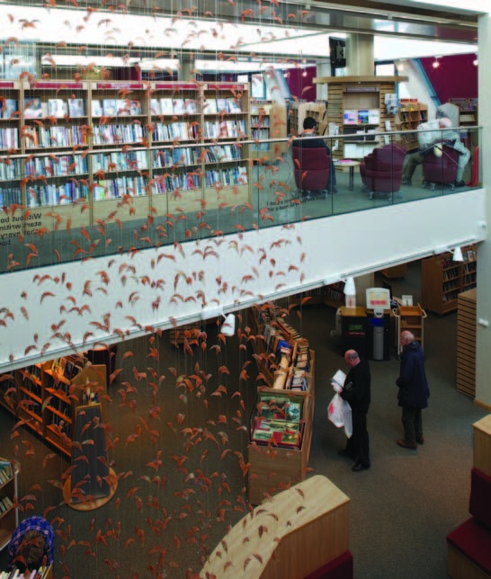
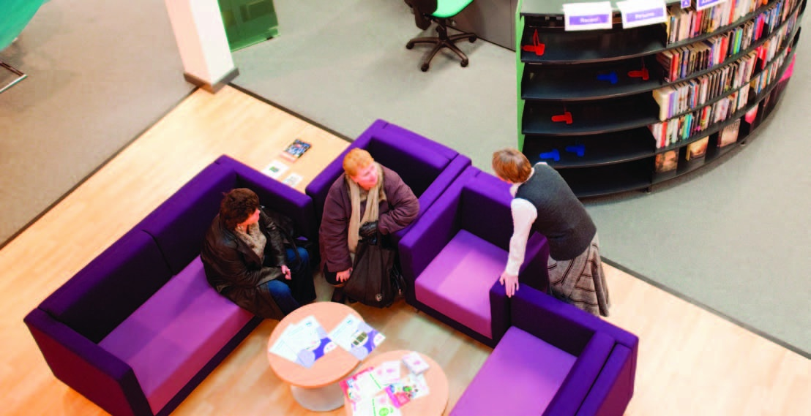
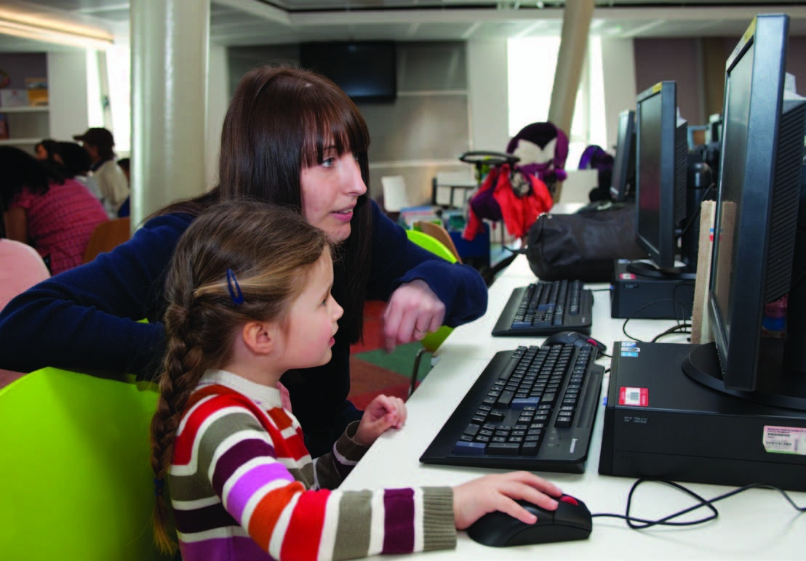
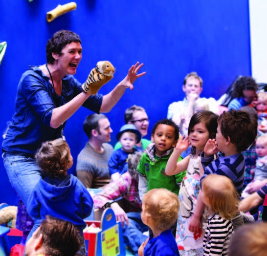
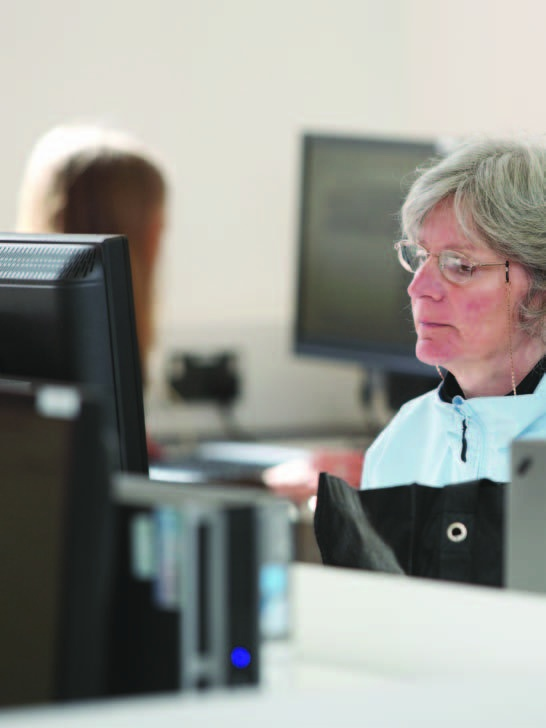
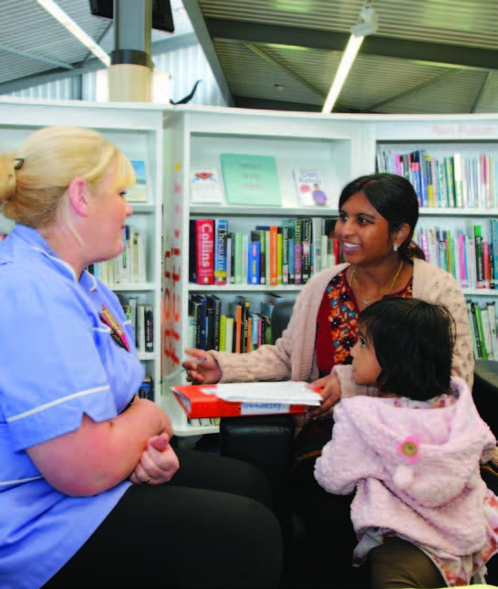
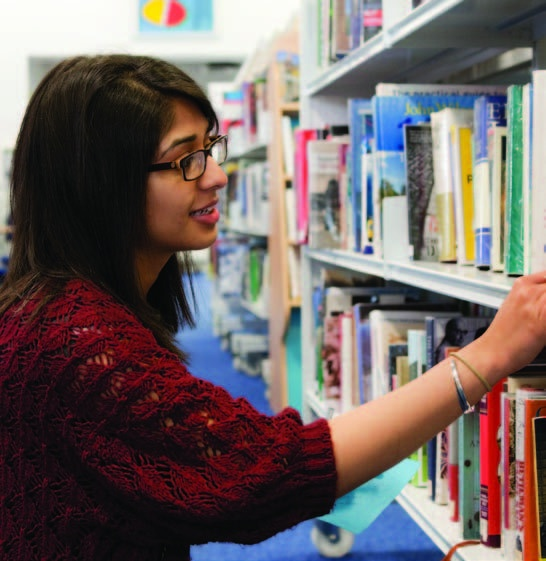

<!-- PAGE: 1 -->

# The library of the future

*A response to Envisioning the library of the future by Arts Council England Chief Executive Alan Davey*

<!-- PAGE: 2 -->

## Introduction

**Public libraries are at a pivotal point. They are much loved and expected to continue offering the same services as they have for many years, but they are also expected to respond to big changes in how people live their lives.**

***Alan Davey, Chief Executive, Arts Council England.* Photo: Philippa Gedge**

More people are living alone, the population is ageing and more varied, technology continues to advance rapidly, and pressure is growing on public expenditure. At the same time people expect and are encouraged to have a greater say in the public services they use.

Recent debate about libraries has been intense. Much of the focus has been on short-term issues of funding, the closure of libraries and a perceived tension between books and digital technology. As a result, an understanding of how libraries will contribute to the future success and well-being of this country hasn't developed.

Public libraries have always adapted and renewed themselves to meet the changing needs of people and communities. Books and information are supplied at speeds that were unimaginable a generation ago, changes from vinyl discs through cassettes and CDs to music downloads have been made, and the comedy stereotype of stern librarians hushing library users has been consigned to history.

So, it is time to re-assert the value, role and purpose of public libraries and point to how they can respond to change in order to remain at the heart of the community.

*Paignton Library, Torbay. Photo: Michael Cameron Photography*

<!-- PAGE: 3 -->

## Arts Council England and public libraries

Arts Council England plays a significant role in supporting and developing public libraries, and local government has the statutory responsibility for providing and funding library services under the 1964 Public Libraries and Museums Act. The long term success of libraries is important to us. So we have undertaken a major research project which we called *Envisioning the library of the future* to understand better what public libraries could and should look like.

**This research examined:**

- recent innovations and trends likely to shape public libraries in the next 10 years
- library experts' ideas about what the impact of these changes is likely to be
- the views of people particularly interested in the future of libraries (for example people who work in libraries, councillors, authors, academics, and campaigners)
- public opinion (users and non-users) voiced through online debate and workshops around the country

The research built on previous work and we tested the emerging findings with our partners, experts and commentators. In total the researchers spoke with over 800 people. The online survey had 1,400 responses and over 10,000 viewed the online conversation.

All of the detailed research reports are available on our *website*.

**That research told us:**

There is a clear, compelling and continuing need for a publicly funded library service.

We heard this from people at every stage of our research. It didn't matter whether they use libraries or not, people are vocal and passionate about their value.

Public libraries are trusted spaces, free to enter and open to all. In them people can explore and share reading, information, knowledge and culture.

**Three essential ingredients define the public library:**

- a safe, creative community space that is enjoyable and easy to use, in both physical and virtual form
- an excellent range of quality books, digital resources and other content
- well-trained, friendly people to help users to find what they want either independently or with support

<!-- PAGE: 4 -->

**Public libraries:**

- develop basic skills and habits of modern literacy and learning with the help of books and digital resources
- support business and economic growth by information and skills development
- help us understand ourselves, our place in the world, and the heritage of the communities in which we live
- encourage us to explore our own culture and creativity, and that of others around us
- improve our health and well-being by helping us to make sense of what is happening to us and how we can shape our lives
- build a healthy democracy by providing free access to reliable information through which we form our opinions

The future public library will be both a physical and a virtual place – somewhere people visit, and also somewhere to be part of wherever they are. The library will not stand alone but will be collaborating with other organisations to give people access to a wide range of services that meet their needs.

We expect to see a shift from a service *provided* to a community to one in which *local people are more active and involved* in its design and delivery. People will be creating new content, having conversations and using new technology for their own benefit, for their community or their business.

High quality leadership, professional skills and experience will remain important but there will be more emphasis given to community, digital and entrepreneurial skills.

Finding the information to answer any question, books to satisfy the never-ending desire for pleasure, learning and knowledge, and the practice of literacy as one of life's basic skills, will remain at the heart of what makes a library, and what will place the library at the heart of the community.

The Arts Council has a big role in developing public libraries in England but we cannot and should not attempt this alone. We want to inspire a collaboration that will allow the public library service to change and develop with confidence, delivering national leadership while respecting local accountability and flexibility.

*Pendleton Library, one of a number of public services co-located in Pendleton Gateway, Salford. Photo: Nick Harrison*

<!-- PAGE: 5 -->

## Four priorities for a 21st century public library service

Based on our discussions with members of the public and the sector, we have identified four priorities to sustain and develop a 21st century public library service.

1. **Place the library as the hub of a community**
2. **Make the most of digital technology and creative media**
3. **Ensure that libraries are resilient and sustainable**
4. **Deliver the right skills for those who work for libraries**

The key issues emerging in this research are similar to those we handle with the wider arts and cultural sector. It is because there is such a close fit with the Arts Council's five long term goals that we will be able to develop solutions to these challenges from which both libraries and arts organisations can benefit.

*Making use of the digital resources at Canada Water Library, London. Photo: Michael Cameron Photography*

<!-- PAGE: 6 -->

### Priority 1: Place the library as the hub of a community

We know that, in future, many people are likely to lead more isolated lives. More will work from home and more will live alone. Opportunities to meet in free public spaces for a wide variety of purposes will be increasingly important. Our findings show that libraries will continue to be valued as trusted, safe, democratic places that offer valuable resources and expertise to support the activities of the people who use them.

Libraries' physical space will be more flexible and integrated with a virtual presence that includes web-based reading groups, social networking and links to other online resources. People will engage in creative and cultural activities as well as reading and learning, exchanging ideas, conversation and knowledge.

Space shared with community based services (such as council, health, business support, and learning organisations) will be better for local people, and will bring benefits such as skills exchanges, reaching more people and cutting costs.

> **Libraries will continue to be valued as trusted, safe, democratic places that offer valuable resources and expertise**

#### The challenge: the use of a library's space

- re-think the way library spaces are used to encourage shared and creative activity while continuing to welcome those who want to explore on their own
- integrate the library's physical and virtual spaces
- sustain enough spaces offered by libraries to meet the needs of their communities

*Storytime at Jubilee Library, Brighton. Photo: Matthew Andrews*

<!-- PAGE: 7 -->

### Priority 2: Make the most of digital technology and creative media

Digital technology is developing rapidly and will continue to have a major impact on the way we obtain and consume information, culture and the written word. Beyond the library building, people will expect a more interactive experience and to be able to gain access to library services all day, every day, particularly while on the move.

> **Libraries should be at the heart of digital innovation.**

Libraries should be at the heart of digital innovation. They should develop their role in actively connecting communities and helping people to experience, experiment with and master new technologies.

Digital technology will be the key to future library service delivery but our research points out that its true potential will not be achieved unless the principle of an open, enabling ICT infrastructure is agreed by local authorities and library services.

This would allow libraries to innovate, and to share or jointly adopt services more efficiently. By making it easier to develop national services and enable local innovation, people will get access to more resources, information and support.

Many assume that digital information sources and online services are accessible to everyone. But a digital divide still exists because a significant number of people lack the confidence, the necessary skills or the desire to make effective use of technology. Some who do, are held back by poor digital connections or can't afford them. Public libraries will ensure that no-one needs to be left behind or excluded.

#### The challenge: using technology

- improve the quality and consistency of the virtual library experience
- develop an open ICT infrastructure that encourages innovation and better service
- enable libraries to lend the full range of e-books, including remotely

*Using the computers at Truro Library, Cornwall. Photo: Michael Cameron Photography*

<!-- PAGE: 8 -->

### Priority 3: Ensure that libraries are resilient and sustainable

Our research, along with reductions in public expenditure, makes clear that libraries will need to reduce costs and find other sources of funding to supplement local authority support. Alongside this, communities are becoming more involved in the design and delivery of library services. To find the right solution, councillors in local authorities are considering whether they should change the way their library service is governed, or whether they can share aspects of their service with others.

> **Communities are becoming more involved in the design and delivery of library services.**

Our research indicates that, as with many other public services, this trend will continue and grow, and the debate about community involvement in public libraries needs to be seen in this wider context. We do not suggest that any one approach is the right one in all circumstances but we have *published guidance*, based on experience to date, that we suggest should be taken into account.

Some library services are already doing this and we believe that they could be role models, not just among libraries, but for all public services. This kind of community involvement will become seen not as a cost-cutting tool but as a normal way of working, with staff and users developing ideas and creating services together.

#### The challenge: cutting costs, finding new sources of funds and new ways of working

- create a positive environment for communities and individuals to become actively involved in the design and delivery of their library services
- encourage the development of new approaches to governing and managing libraries that make it more likely that they will survive and succeed
- equip libraries to be commissioned to deliver other public services, and to commission other organisations to deliver library services

*A healthcare consultation at Hamworthy Library, Dorset. Photo: Michael Cameron Photography*

<!-- PAGE: 9 -->

### Priority 4: Deliver the right skills for those who work for libraries

Our research indicates that one of the major challenges facing public libraries in the future is ensuring that library staff have effective leadership and delivery skills for a rapidly evolving service.

Librarians will need to be active in their communities, encouraging people to get involved with their library. That involvement will include local people identifying what their priorities are as well as volunteering and community managed services.

> **Ensuring libraries have effective leadership and delivery skills for a rapidly evolving service**

Supporting people in using digital resources competently and confidently will become increasingly important. Those who work in libraries will need to improve their skills in organising and helping users to find their way through complicated information sources. They will become more pro-active in inspiring new services in partnership with others, and their leaders will need to be more entrepreneurial and adept in communicating and marketing their services.

Our research indicates that not enough people working in libraries are equipped to tackle these changes and take on these roles, and that current training is not always relevant for the current and future needs of those working in public libraries.

#### The challenge: developing the skills of those who work in libraries

- ensure those responsible for libraries have the right range of skills and experience to lead their services successfully
- encourage those working in libraries to offer creative and innovative ways to use library spaces, books and other resources
- ensure that library staff have the skills to develop and respond to digital developments and to support digital users

*Library user at Oadby Library, Leicestershire. Photo: Michael Cameron Photography*

<!-- PAGE: 10 -->

## The role of the Arts Council in developing the library of the future

The Arts Council has an important role in developing public libraries in England. We will secure national partnerships which open up funding opportunities from which public libraries can benefit. We will encourage libraries in their cultural and creative role (as we are already doing in projects supported by our Grants for the arts funding), and we will continue to involve them in our local conversations with arts and cultural organisations.

We also recognise that to build an effective 21st century library service, we will need to work in partnership with a range of agencies, who have their own distinctive responsibilities:

- Department of Culture, Media and Sport where the statutory oversight of public libraries in England sits
- Local Government Association who represent the local authorities with the statutory responsibility and democratic mandate to ensure public library services are provided
- Society of Chief Librarians who are the leaders of public library services
- Chartered Institute of Library and Information Professionals who are the professional organisation for librarians
- British Library the national hub of knowledge, information and expertise

This is only the start and we will be inviting other partners from across the library, cultural, commercial, voluntary and academic sectors to work with us to make real this ambition for public libraries in England.

We are confident that we now have a robust set of evidence to provide a framework for what happens next. We want this evidence to inspire a collaboration that will make it possible for the public library service to change and develop with confidence.

By combining our resources we expect to be making progress on a shared programme of activity by the end of the year. So we invite all those involved in libraries and those who care about their future to embrace the findings and to work with us on the next stage of their development.

<!-- PAGE: 11 -->

## The library of the future

*Envisioning the library of the future* suggests the public library will be a place where people create, learn, discover and share. Many of the features identified in our research already exist in England's libraries, but they are not consistently present and not all together in one place.

So we can expect to see a shift from a service *provided* to a community to one in which *local people are more active and involved* in its design and delivery. Libraries will be recognised as connecting individuals, communities and organisations to innovate, create and provide new library based services and ideas.

People will be using libraries to do more with each other and this activity will cross over between physical and virtual spaces. They will be creating new content, having conversations and using new technology for their own benefit, for their community or their business.

Those working in libraries will be less occupied in straightforward transactions and more involved in linking people and organisations together in using library spaces and resources for new activities. There will be a greater emphasis given to community, digital and entrepreneurial skills. In this context, volunteers offer new ways to add capacity and skills.

Libraries' role out in the community, reaching vulnerable and excluded people, will extend to popping up temporarily as local circumstances demand and allow. This might involve using vacant spaces, or being invited in to other community services or workplaces to meet particular needs.

If the library of the future will look different from those of the past and present, their enduring role and purpose means that some things will feel familiar. A high value will continue to be placed on the importance of quality leadership, professional skills and experience. Books will sit comfortably alongside digital and other cultural resources in a rich and diverse library collection.

Finding the information to answer any question, books to satisfy the never-ending desire for pleasure, learning and knowledge, and the practice of literacy as one of life's basic skills, will remain at the heart of what makes a library, and what will place the library at the heart of the community.

Our national role means that we are well-placed to stimulate debate and offer support to the development of public libraries, and we want to work with our partners based on the thinking that has emerged in our research. How that is reflected locally will be determined by each council based on their own priorities and the needs of their communities.

It is this combination of enduring values, new thinking, collaborative leadership and flexibility that will equip public libraries to create economic and social benefits for this country and its communities long into the future.

<!-- PAGE: 12 -->

**Arts Council England**
**14 Great Peter Street**
**London SW1P 3NQ**

www.artscouncil.org.uk
Email: enquiries@artscouncil.org.uk
Phone: 0845 300 6200
Textphone: 020 7973 6564
Charity registration no 1036733

You can get this publication in Braille, in large print, on audio CD and in electronic formats. Please contact us if you need any of these formats.

To download this publication, or for the full list of Arts Council England publications, see artscouncil.org.uk

ISBN: 978-0-7287-1534-9

© Arts Council England, May 2013

We are committed to being open and accessible. We welcome all comments on our work. Please send these to Executive Director, Advocacy & Communications, at the Arts Council England address above.
