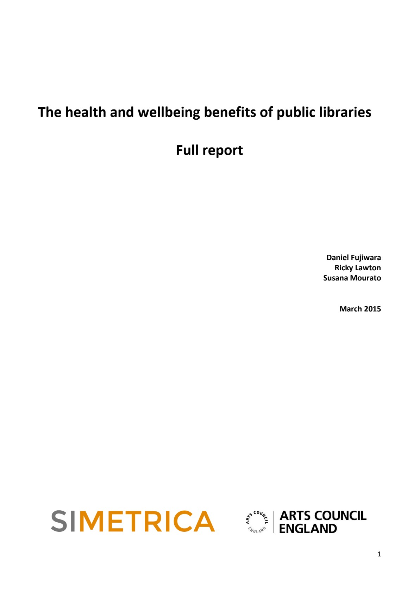
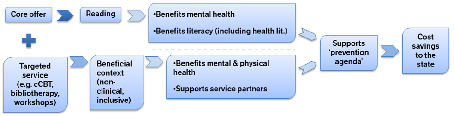

<!-- PAGE: 1 -->

# The Health and Wellbeing Benefits of Public Libraries

## Full report

**Daniel Fujiwara**  
**Ricky Lawton**  
**Susana Mourato**  

*Simetrica*  
*Arts Council England*  

**March 2015** <!-- PAGE: 2 --> ## Contents

- [About the authors](#about-the-authors) (p. 4)
- [Executive Summary](#executive-summary) (p. 5)
  - 1. Background and objectives of the study (p. 5)
  - 2. Methodology (p. 6)
  - 3. Key findings (p. 6)
- [1. Background and objectives of the study](#1-background-and-objectives-of-the-study) (p. 8)
  - 1.1 The value of engagement in library services in terms of the impact on people’s overall quality of life (p. 8)
  - 1.2 The value to society of the health benefits of library services (p. 9)
- [2. Literature review](#2-literature-review) (p. 10)
  - 2.1 Contingent valuation (p. 10)
  - 2.2 Exchequer cost savings (p. 12)
- [3. Study methodology](#3-study-methodology) (p. 13)
  - 3.1 Primary benefits – the impact of library engagement on individual quality of life (p. 13)
  - 3.2 Secondary benefits – the health-related exchequer benefits of libraries (p. 17)
  - 3.3 Variables (p. 18)
- [4. Results](#4-results) (p. 22)
  - 4.1 Primary benefits – the impact of library engagement on individual quality of life (p. 22)
  - 4.2 Secondary benefits – the health-related exchequer benefits of libraries (p. 31)
- [5. Conclusion](#5-conclusion) (p. 34)
- [References](#references) (p. 37)
- [Appendix](#appendix) (p. 40)

<!-- PAGE: 3 -->

### List of Tables and Figures

- Figure 1. Reading services and health logic model (p. 12)
- Table 1. Survey question: Use of library services (p. 13)
- Table 2. Variable descriptions (p. 18)
- Table 3. Association between library usage and subjective wellbeing (p. 23)
- Table 4. Mean and median WTP (p. 24)
- Table 5. Mean WTP by different socio-demographic groups (p. 25)
- Table 6. WTP and library service usage (p. 27)
- Table 7. Prioritisation of library services and WTP (p. 28)
- Table 8. Determinants of WTP for library services (p. 30)
- Table 9. The association between library engagement and good general health (p. 32)
- Table 10. Secondary benefits (NHS cost savings) (p. 33)
- Table A1. General population quota targets and survey sample for gender (p. 40)
- Table A2. General population quota targets and survey sample for age (p. 40)
- Table A3. General population quota targets and survey sample for English region (p. 40)
- Table A4. General population quota targets and survey sample for ethnicity (p. 40)
- Table A5. Sample socio-economic characteristics (p. 41)
- Table A6. Sample region characteristics (p. 41)
- Table A7. Most commonly used library services and satisfaction level (p. 42)
- Table A8. Reasons for using local libraries (p. 43)
- Table A9. Reasons for not using local libraries (p. 43)
- Table A10. Attitudes towards culture and libraries (p. 44)

<!-- PAGE: 4 --> About the authors 
 
Daniel Fujiwara is Director of SImetrica and a member of the Centre for Economic Performance at 
the London School of Economics and Political Science. His research focuses on policy evaluation 
methods and techniques for valuing non-market goods. He has recently published guidelines on 
nonmarket valuation and subjective wellbeing analysis for the UK Government, including an update 
to the HM Treasury Green Book manual. Daniel previously led on cost-benefit analysis at the 
Department for Work and Pensions and was senior economist at the Cabinet Office. He is currently 
scientific advisor to the SROI Network and works with a number of OECD governments and public 
sector organisations on policy evaluation. 
 
Ricky Lawton is Senior Economist at SImetrica. He specialises in econometric analysis, quantitative 
and qualitative survey design and analysis, measuring monetary values for cultural and 
environmental goods through preference methods, such as contingent valuation and choice 
modelling, and wellbeing valuation methods. Prior to joining SImetrica, Ricky worked on a 
secondment with the Wellbeing Team at the Cabinet Office. He has a PhD in Environmental 
Economics and Policy and an MSc in Environmental Economics from the University of York. 
 
Susana Mourato is Professor of Environmental Economics at the London School of Economics and 
Political Science and Scientific Advisor at SImetrica. Susana is an environmental economist with 
over 20 years of professional experience. Her research develops, tests and applies economic 
techniques to the valuation of a wide range of environmental, health and cultural services. Susana 
has over 80 scientific publications, including papers in leading journals of her field. She currently 
leads the economic analysis work package of Climate for Culture, a large interdisciplinary FP7 EU 
project, and recently led the economic analysis of cultural services for the UK National Ecosystem 
Assessment.

<!-- PAGE: 5 -->

Executive Summary 
 
## 1. Background and objectives of the study
In 2014, Arts Council England commissioned SImetrica to conduct a study to value the health and 
wellbeing benefits of public libraries. 
 
Libraries have an important role in society as providers of a range of services from book-lending 
and computer access to children’s activities, training courses and meeting space. But understanding 
the value of libraries is a complex issue due to the wide-ranging services that libraries provide and 
the inherently non-market nature of these services (most are free at the point of use).  
 
This study looks at the value of the health and wellbeing benefits of library engagement measured 
through economic value, using methods that are consistent with the HM Treasury Green Book 
guidance. There are two key research aims of the study.   
 
1. The value of engagement in library services in terms of the impact on people’s overall quality 
of life.  
This is measured through the contingent valuation (CV) method. A large CV study with around 
2,000 respondents is used to ask people directly their willingness to pay (WTP) for library services 
as represented by paying additional council tax.  
 
The values from the CV study represent the value associated with improved wellbeing due to library 
services. Technically speaking, this represents the primary benefits of library services. Primary 
benefits are those that accrue directly to the individual (ie the impact on their wellbeing). We look 
at the value of services in libraries in England and how this value differs by service type and the 
socio-demographic characteristics of the individual. We also look at what factors drive the reported 
values, such as socio-demographic factors and aspects of service use.   
 
This CV study fills an important gap in the literature. Previous related studies on libraries in England 
have sought to place values on individual institutions, such as the British Library (Pung et al., 2004) 
and Bolton libraries (Jura Consultants, 2005), or have examined the value associated with book-
lending and reading services (eg Morris et al., 2002). As far as we are aware, it is the first valuation 
of the broad range of services that are offered by libraries in England.  
 
2. The value to society of the health benefits of library services.  
Libraries may make a contribution to society though their impacts on health. We look at the 
potential savings due to reductions in medical service usage as a result of improvements in general 
health from library service usage. This is estimated using exchequer cost savings estimates. The aim 
is to add to the evidence on libraries and health costs, which BOP Consulting (2014) recognises as 
being weak in some areas in its evidence review.  
 
Exchequer cost savings are known as secondary benefits. They relate to impacts that benefit 
society more widely which at some point may be an indirect benefit to the individual as well. This 
mainly encompasses impacts on the economy and public purse. These are benefits because they <!-- PAGE: 6 --> could lead to reduced public spending on health which could lead to lower tax rates or shifts in 
resources to other important policy areas. These types of benefits are often also known as the 
economic contribution. This forms one element of overall economic value. Economic value is the 
approach taken in the HM Treasury Green Book and Business Case model.  
 
A full review of the literature can be found in the main paper. 
 
## 2. Methodology
We conducted a large online survey with 2,000 adult library visitors and non-visitors, where a 
visitor is defined as someone who has visited a public library in the past 12 months. Details of the 
sampling methodology and questionnaire can be found in the main report.  
 
Respondents were asked how much additional council tax they would be prepared to pay per year 
to maintain the current level of services at their local libraries. This question was asked of library 
users and non-users.  
 
The health-related secondary benefits were estimated using the Taking Part and British Household 
Panel Survey datasets, whereby we estimate the association between library service usage and 
general health and value improvements in general health using GP-related NHS cost savings.  
 
## 3. Key findings
We find that average willingness to pay (WTP) to maintain current library services among library 
users in England is £19.51 per year in increased council tax. As would be expected, non-users 
reported a lower WTP: we find that average willingness to pay to maintain current library services 
among non-users of libraries in England is £10.31 per year in increased council tax, which is around 
half that of the WTP values stated by library users. It is possible to aggregate use value across the 
library-using English population to estimate a national average WTP for library services of £365.3 
million per year. We can also aggregate a value for non-users in the English population to estimate 
a national average non-use WTP for library services of £358.1million per year. In total this provides 
a combined annual WTP for local library services of £723.4million across library users and non-users 
in England. 
 
People who use ‘health services’ at libraries (£39.03), ‘attend lectures and other events’ at libraries 
(£29.08), and those who use their library as a ‘space for socialising’ (£26.44) are willing to pay more 
than the average user to maintain services at their local library (WTP amounts in brackets).  
 
We find that the drivers of WTP were consistent with economic theory: socio-demographic 
characteristics such as higher education, frequent reading (ie interest in reading), having children 
and higher income are associated with higher levels of willingness to pay for library services.  
 
We undertake some additional analysis to look at how different services impact on WTP. We find 
no association between library expenditure at the local authority level (which may be one indicator 
of the level and quality of local library services) and respondents’ willingness to pay for library <!-- PAGE: 7 --> services, although this finding may be influenced by limitations in the data available. However, we 
found separate evidence in the data that certain characteristics or aspects of library service 
provision, in particular good-quality customer service and community-centred services, increase the 
value that users place on their local libraries. 
 
Analysing the health and subjective wellbeing data we find that library use is positively associated 
with subjective wellbeing after controlling for a wide range of other factors. Library usage is 
associated with higher life satisfaction, higher happiness and a higher sense of purpose in life 
(although usage was also associated with higher levels of anxiety). These results suggest that 
libraries generally have an important role in library users’ quality of life and wellbeing, which 
provides supporting evidence that the WTP results from the contingent valuation survey can be 
interpreted in part as reflecting primary benefits stemming from welfare changes associated with 
library engagement. 
 
We also find that library engagement has a positive association with general health. After 
controlling for other confounding factors, being a regular library user is associated with a 1.4 per 
cent increase in the likelihood of reporting good general health. We valued this improvement in 
health in terms of cost savings to the NHS. Based on reductions in GP visits caused by this 
improvement in health, we predict the medical cost savings associated with library engagement at 
£1.32 per person per year. It is possible to aggregate NHS cost savings across the library-using 
English population to estimate an average cost saving of £27.5 million per year. 
 
We note that this is likely to represent just a subset of the secondary health benefits of libraries, 
which may impact upon other medical services and costs aside from GP visits. It is out of the scope 
of this study to assess other medical service usage impacts due to lack of data. However, although 
the financial implications are small on a per person basis, they accumulate once cost savings across 
all library visitors over many years are added up. Similarly, the cost savings identified in this study 
are confined exclusively to medical costs. There are likely to be other areas where the secondary 
benefits of local libraries may be felt, such as social care, education, skills training and employment. 
These figures therefore represent just a subset of the secondary benefits that local libraries 
provide. 
 
Combining aggregate figures for the primary and secondary benefits at the national level gives a 
total value of £748.1million per annum from local library services in England. We note that this 
figure is based on the assumption that people’s stated levels of WTP do not incorporate (i) any 
perceived benefit of avoided costs associated with reduced health service usage, nor (ii) the 
secondary health benefits that libraries provide in exchequer cost savings (ie, we assume that 
people’s WTP is not influenced by the perceived financial benefits to themselves or to the state).

<!-- PAGE: 8 -->

The health and wellbeing benefits of public libraries. 
Full report 
 
## 1. Background and objectives of the study
In 2014, Arts Council England commissioned SImetrica to conduct a study to value the health and 
wellbeing benefits of public libraries. 
 
Libraries have an important role in society as providers of a range of services from book-lending 
and computer access to children’s activities, training courses and meeting space. But understanding 
the value of libraries is a complex issue due to the wide-ranging services that libraries provide and 
the inherently non-market nature of these services (most are free at the point of use).  
 
Economic value, as defined in microeconomic theory and cost-benefit analysis (CBA), is a measure 
of changes in human welfare, where welfare is defined at the broadest level in terms of an 
individual’s overall quality of life (QoL). This goes by the term utility in economics and is usually 
measured through what is known as the preference satisfaction account of welfare, whereby the 
degree to which an individual’s preferences are satisfied is taken as a measure of their utility.  
 
Using these concepts of economic value, this study looks at the value of the health and wellbeing 
benefits of library engagement 1. There are two key research aims of the study. 
 
1.1 The value of engagement in library services in terms of the impact on people’s overall quality 
of life.  
This is measured through the contingent valuation (CV) method. A large CV study with around 
2,000 respondents is used to ask people directly about their willingness to pay (WTP) for library 
services. In CV, respondents complete surveys in which a full description of the goods or service is 
provided and people are asked how much they would be willing to pay for it. Often the payment 
vehicle or method is through increases in general or local taxes. CV has been used on a number of 
occasions before with libraries, including a CV study of the value of the British Library (Pung et al., 
2004) and Bolton libraries, which we discuss in the literature review. 
 
The values from the CV study represent the value associated with improved wellbeing due to library 
services. This represents the primary benefits of library services. Primary benefits are those that 
accrue directly to the individual (ie it is the value of impacts directly on an individual’s wellbeing or 
utility). This could be, for example, improved QoL for the individual as a result of a particular library 
service such as bibliotherapy. 
 
                                                           
1 For the purposes of this study we will use the terms ‘library services’ and ‘library engagement’ interchangeably to 
mean the broad set of services that libraries in England provide.

<!-- PAGE: 9 -->

We look at the overall value of library services in libraries in England and how this value differs by 
service type and the socio-demographic characteristics of the individual. We also look at what 
factors drive the reported values, such as socio-demographic factors and aspects of service use.   
 
This CV study fills an important gap in the literature since only a few studies have looked at the 
primary benefits of library services and these studies have exclusively focused on reading services. 
This study is, therefore, the first valuation of the broad range of services that are offered by 
libraries in England.  
 
### 1.2. The value to society of the health benefits of library services.
Libraries may make a contribution to society though their impacts on health. We look at the 
potential savings due to reductions in medical service usage as a result of improvements in general 
health from library service usage. This is estimated using exchequer cost savings estimates. The aim 
is to add to the evidence on libraries and health costs, which BOP Consulting (2014) recognises as 
being weak in some areas in its evidence review.  
 
Exchequer cost savings are known as secondary benefits. They relate to impacts that benefit 
society more widely which at some point may be an indirect benefit to the individual as well. This 
mainly encompasses impacts on the economy and public purse, for example, reductions in medical 
service usage due to improved health as a result of health-related library services such as 
bibliotherapy. These are benefits because they could lead to reduced public spending in health 
which in turn could lead to lower tax rates or shifts in resources to other important policy areas. 
These types of benefits are often also known as the economic contribution. ‘Economic contribution’ 
and ‘economic value’ are separate. Economic value refers to the broad approach to valuation used 
in economics and economic contribution is one element (the secondary benefits) of this. Overall 
economic value is the approach taken in the HM Treasury Green Book and Business Case model.  
 
The two types of benefit are important for different sectors of society. As individuals, it is highly 
unlikely that we make any personal decisions based on secondary benefits – we go to the doctor to 
get better and not to reduce medical expenditures to the state later on, and we care about safety 
primarily because crime has significant adverse effects on our wellbeing and not because crime 
incurs costs to the state (policing, courts, prisons etc). But as policymakers or as (civic) individuals in 
instances where we are making decisions for the good of the community or society, we also care 
about secondary benefits since this allows us to provide more or better services to people. 
 
Both primary and secondary benefits are important for CBA and policy evaluation because clearly 
both types of benefit have value for the individuals that make up society. We focus on both types of 
benefit in this study.

<!-- PAGE: 10 -->

## 2. Literature review
We review the literature related to libraries on CV and exchequer cost savings. The BOP Consulting 
(2014) evidence review provides an up-to-date meta-analysis of the literature on the economic 
value of libraries. It cites a wide range of international evidence, the most relevant of which we 
summarise here. References to specific studies can be found in the original report (BOP, 2014). 
 
### 2.1. Contingent valuation
The British Library (BL) study (Pung et al., 2004) valued the library’s reading rooms and remote 
services using a sample of 2,030 users and general public non-users. The BL study also collected 
users’ willingness to accept (WTA) data for a scenario where the BL ceased issuing readers’ passes 
but allowed existing readers to sell their pass, asking the minimum amount respondents would be 
willing to accept as a monthly payment in compensation. The study gathered data on the 
incremental cost of alternatives for users, such as travel, accommodation and cost of access to 
materials, and a non-use question using a payment mechanism of raised taxes for the maintenance 
of reading rooms, remote document supply and bibliographic services. The study found a mean 
direct use willingness to pay for reading room users of £116 (£162 present day) and a higher WTA 
value of £273 (£381 present day) in monthly compensation. The general public non-use WTP was 
much lower at £6.30 (£8.80 present day). Direct value amounted to £59 million (£82 million present 
day) and indirect value amounted to £304 million (£424 million present day). This amounted to 
Total Economic Value (TEV) of use and non-use at £363 million per year (£506 million present day).  
 
A similar CV approach was applied to Bolton’s museum, library and archive services, consisting of 
three museums, 15 local libraries and a central archive (Jura Consultants, 2005). The survey 
presented a scenario where funding from the local council would cease, and asked respondents’ 
willingness to pay a donation to support the continuation of the library, archives and museum 
services. The study captured use and non-use value through a sample of 325 face-to-face and 
telephone respondents. They also asked the willingness to accept monthly compensation to give up 
the library/archive/museum pass, and gathered data on travel time and cost of alternatives 
(following Pung et al., 2004). The study found a mean annual WTP for Bolton’s libraries for users of 
£39.96 (£54.03 present day), and archives of £21.96 (£29.69 present day). The total use value was 
calculated as £95.16 (£128.66). For non-users, mean WTP was calculated as £12 for libraries 
(£16.22 present day), and archives as £8.16 (£11.03 present day). Total non-use value was £33.84 
(£45.75 present day). The authors aggregated WTP to £10.4 million (£14.06 million present day), 
divided between direct value to library users of £4.4 million (£5.95 million present day), archive 
users as £0.2 million (£0.27 million present day), museum users of £2.8 million (£3.79 million), and 
indirect value of £3 million (£4.06 million present day). 
 
Aabø (2005) valued the continuation of the public library system in Norway through a hypothetical 
scenario of reallocation of public services funding. The study captured the use and non-use value of 
999 respondents. Half of the sample were asked to state their maximum WTP to continue their 
local public library at today’s activity and service levels, while the other half stated their minimum 
willingness to accept (WTA) compensation if their local library was closed down. Aabø estimated 
aggregate social value within the range of 400-2,000 NOK per household (£46.29-£231.40 present <!-- PAGE: 11 --> day GBP). The lower bound of the range, based on WTP estimates, was close to the average annual 
library costs per household in Norway, providing convergent validity to these results. 
 
Morris et al. (2002) valued library book-lending in the UK. The study surveyed the willingness to pay 
for a book loan of 550 library users across four UK libraries. The hypothetical scenario was that the 
book would not be available from the library service. Mean willingness to pay for adult fiction and 
non-fiction were £0.62 (£0.91 present day) and £0.63 (£0.93 present day) respectively. There were 
no significant links between the purpose of book-lending and respondents’ willingness to pay. 
Aggregate WTP calculations showed that library book borrowers valued the service at £814 million 
(£1,200 million present day). The study modelled the economic value of book-buying compared to 
book-lending in terms of the number of reads of the book, calculated at 70 per cent of the total 
library net costs of buying and administering the book-lending (a bought book enjoyed one read but 
no administrative costs). This produced an average cost of £3.85 (£5.67 present day) per read for a 
bought book compared to £1.41 (£2.08 present day) when borrowed from a library. 
 
The ERS (2012) study for the Archives, Libraries and Museums Alliance UK (ALMA-UK) applied a 
return on investment approach to economically value library services of 4,000 library users across 
27 libraries in Scotland, Wales and Northern Ireland. The study calculated use value through taxes, 
time and travel costs to individuals using the services, local spending by visitors in shops and cafes 
(defined as community benefits), and the cost of alternatives. Mean use value for Scotland was 
calculated at £24.10, with an annual value per user of £1,346. Mean use value for Wales was £26.38 
with an annual value per user of £2,065, and for Northern Ireland £27.72 and £2,598. 
 
Hájek and Stejskal (2014) used willingness to pay and willingness to accept calculations to value the 
Municipal Library of Prague. The survey of 2,200 library users found an average willingness to pay 
of 642 CZK (£19.50 GBP). Willingness to accept was much higher, at 4,000 CZK (£122 GBP) for the 
loss of the library. The results of the survey were undermined by having an unrepresentative 
sample (eg three quarters of the respondents are women and respondents are drawn exclusively 
from the library’s database of users). 
 
A number of substantial meta-reviews of library valuation studies have been undertaken in the last 
decade. Aabø (2009) undertook a meta-analysis of 38 different benefit-cost studies of public 
libraries, of which 24 adopted cost/benefit analysis and CV approaches. The review aggregated 
median and mean ROI at several geographical scales: national, state, county and individual level. Of 
these, the majority were performed on states in the USA (eg Griffiths et al., 2004; Griffiths et al., 
2006; McClure et al., 2001), with one in the UK (Pung et al., 2004). Regression analysis on the 
studies found that CV methods tended to produce a lower valuation than market substitute 
approaches. Aabø explained this finding by the requirement to be conservative when designing 
contingent valuation studies. 
 
Kim (2011) performed a meta-review of library CV studies and found that values range widely in 
terms of benefit-cost estimates, from $0.84 to $10.33 of benefit per $1 invested (£0.60 to £7.41 
present day GBP). The median result across six CV studies was $3.79 (£2.72 present day GBP) of 
benefit per $1 invested, compared with a median result across the revealed preference studies of 
$4.46 (£3.20 present day GBP) of benefit per $1 invested (across nine studies).

<!-- PAGE: 12 -->

### 2.2. Exchequer cost savings
In a forthcoming report Fujiwara et al. (2015) estimate the NHS cost savings due to impacts on 
health from regular library visits.  
 
Library services in Scotland, Wales and Northern Ireland were valued through cost savings made by 
using library services, as identified by a sample of 4,000 respondents across the three countries 
(ERS, 2012). The study identifies values of £24.10 by users per visit in Scotland, £26.38 in Wales and 
£27.27 in Northern Ireland.  
An Australian study (Hutt City Libraries, 2013) used a range of approaches, including financial cost 
savings, to value libraries in Hutt City. The aggregate figure provided for the value of the libraries 
was AUD $10.9m, which translated into AUD $1.44 of benefit per AUD $1 invested. However, this 
was an average taken from across the three different methods (disaggregated values not available).  
The BOP (2014) evidence review develops the following logic model to demonstrate the health-
related cost savings of reading-related library services. In this study we look at a broader range of 
library services. 
 
### Figure 1. Reading services and health logic model

<!-- PAGE: 13 -->

## 3. Study methodology
This study uses secondary and primary data sources to address the two research aims. Secondary 
data sources are used to estimate the value of secondary health benefits of library services to the 
exchequer. Primary data is collected for the contingent valuation (CV) study which values impact on 
quality of life. 
 
### 3.1. Primary benefits – the impact of library engagement on individual quality of life
3.1.1. Data collection 
 
We conducted a large online survey with library visitors and non-visitors, where a visitor is defined 
as someone who has visited a public library in the past 12 months. Respondents were screened 
using quotas for gender, age, region and library usage, which were set using national averages from 
the Office for National Statistics (ONS)’ Annual Population Survey2, and library use in England.3 
General population targets were met (Annex Table A1-3).4 Targets for 60 per cent respondents 
having used local libraries in the last 12 months were slightly oversampled (63 per cent) (Table A4). 
However, this provided a large sample on which to test use of library services (Table 1).  
 
The survey was divided into four sections. Section 1 asked different questions for those who had 
used local library services in the last 12 months and those who had not used their local library in 
the last 12 months. Those who indicated that they had used their local library in the last 12 months 
were asked to provide the name or address of their local library, and whether they had a library 
card for that library. They were asked background questions on their use and enjoyment of local 
library services. We provided an extensive list of services offered by local libraries, developed in 
consultation with Arts Council England, asking respondents to indicate which services they used 
when visiting their local library. Respondents were presented with the following list of 20 library 
services (Table 1). 
 
Table 1. Survey question: Use of library services 
Library services Tick all that apply 
Access to Internet/computer □ 
Accessing information □ 
Adult literacy course  □ 
Adult training course on computer skills □ 
Adult training course on employment skills (eg job-searching and CV writing) □ 
Adult training course on financial skills training (eg managing your money) □ 
Bibliotherapy activities (eg books on prescription, therapeutic reading groups, 
computer-based cognitive behavioural therapy) 
□ 
Borrowing adult or children’s books or e-books □ <!-- PAGE: 14 --> Borrowing other items (CDs, DVDs, computer games, talking books) □ 
Café/shop □ 
Children activities (eg story time, Summer Reading Challenge) □ 
Health services offered in the library (eg health checks, health information and advice, 
exercise classes) 
□ 
Lectures/readings/special events □ 
Photocopying/printing/faxing □ 
Reading group □ 
Room hire □ 
Services for groups with special needs (eg housebound/visually impaired) □ 
Socialising □ 
Space to wait/relax  □  
Space to work or study □ 
Other (please specify)   
 
For each service selected, we asked how satisfied the respondents were with the service, on a scale 
of 1 to 5 where 1 was ‘not at all satisfied’ and 5 was ‘extremely satisfied’. We also asked a general 
satisfaction question on ‘the services offered by your local library’ on the same scale. The non-user 
sample was provided with a set of reasons for not having used their local library in the last 12 
months, and asked if they owned a library card. Some of these responses are used in the statistical 
analysis and some are used to describe the characteristics of the sample population in summary 
statistics. For the remainder of section 1, user and non-user samples were asked identical questions 
about their use of other libraries, as well as alternative forms of entertainment and cultural 
activities in the last 12 months, and their reading habits of books/ebooks or listening to 
audiobooks. 
 
We elicited agreement with a set of statements about the services provided by local public libraries 
in England. We asked respondents to prioritise the top three areas where they felt government 
funding should be allocated, which included ‘heritage, libraries, arts, museums and culture’ 
alongside other areas like health and the economy. In section 2, all respondents were asked four 
SWB questions from the Office for National Statistics’ Annual Population Survey5 and a set of 12 
questions from the General Health Questionnaire.  
 
Section 3 presented respondents with information on the range of services offered by local 
libraries. We outlined current local government funding arrangements for libraries, and asked 
respondents how familiar they were with the information beforehand. 
 
The hypothetical scenario presented respondents with a situation where because of the current 
financial crisis and cuts in Government funding to local libraries, “libraries in your local area would 
no longer be able to offer the extra services, activities and programmes they currently offer unless 
more funds were raised via Council Taxes” (see Box 1). The payment mechanism was an increase in 
annual council tax, even if only a very small amount, for the local library to keep all the services, 
activities and programmes they currently offer.6 <!-- PAGE: 15 --> Section 4 asked a set of standard socio-demographic questions for use in the CV and health 
analysis, including education level, marital status, employment status, self-reported health status, 
annual income, annual council tax and number of dependent children. 
 
 
 
                                                                                                                                                                                                   
(Champ and Bishop 2001; Cummings and Taylor, 1999). Respondents were asked a certainty question on the donation 
amount that they had stated (Carlsson and Martinsson, 2006; Cummings and Taylor, 1999).  
Box 1. Council tax willingness to pay question 
Funding for the services that local libraries offer comes mainly from Local Government, and is raised 
through Council Tax. The current financial crisis has meant that the XX libraries, like all other free 
libraries, has suffered cuts in Government funding, while having to keep up with new advances in 
technology and the associated increase in maintenance and operating costs.  
Now imagine the following hypothetical situation. Suppose that, because of funding cuts, the libraries 
in your local area would no longer be able to offer the extra services, activities and programmes they 
currently offer unless more funds were raised via Council Taxes. Core library services such as a space 
to read and study, book lending and computer/internet access would remain unaffected and would 
still be available.  
Please consider for a moment how much the [LIST OF SELECTED SERVICES] offered by your local 
library is worth to you, if anything.  
Would you be prepared to pay for an increase in your Council Tax (you would pay this rate every 
year), even if only a very small amount, for your local library to keep all the services, activities and 
programmes they currently offer? 
Yes/Maybe/No 
IF YES OR MAYBE: What is the maximum that you would be willing to pay, in extra council tax per 
year, for your local library to keep its current service provision?  
Studies have shown that many people answering surveys such as this one, say they are willing to pay 
more than they would actually pay in reality. So please think about this question as if it were a real 
decision and you were actually making a payment for real. Please do not agree to pay an amount if 
you think you cannot afford it, if you feel you have paid enough already, or have other things to spend 
your money on. Remember also that there may be other things that your council taxes could be spent 
on, such as social care, education, or local infrastructure. Also remember that in some cases you can 
find some of the services provided by libraries elsewhere. 
 
Please focus solely on what your own local library and the services it provides are worth to you.   
□ £0 □ £20 □ £90  
□ £1 □ £30 □ £100  
□ £2 □ £40 □ £120  
□ £5 □ £50 □ £150  
□ £7 □ £60 □ £175  
□ £10 □ £70 □ £200  
□ £15 □ £80 □ Other amount  
  £______  
Note: Using the online survey platform we were able to list the library services they had selected in 
section 1 in the [services] script (this was only possible for the user sample, since non-users were not 
asked this question).

<!-- PAGE: 16 -->

3.1.2. Data analysis 
The CV method is a stated preference survey-based methodology that seeks to elicit monetary 
values for non-market goods by directly asking individuals about their willingness to pay or 
willingness to accept a particular change (Bateman et al., 2002). Respondents are presented with a 
hypothetical market that describes in detail the proposed change under valuation, using baseline 
conditions as a reference point. The hypothetical scenario should be understandable, plausible and 
meaningful to respondents so that they can give valid and reliable values despite possible lack of 
experience with one or more aspects of the scenario (Mitchell and Carson, 1989). Respondents are 
then asked how much they would be prepared to pay (accept) for the change described. 
 
The contingent valuation scenarios were designed to uncover the value of the range of services 
provided by local libraries (via an increase in annual council tax). We assess overall WTP to maintain 
current library services and whether people who use certain services value library services 
differently. This, therefore, covers both use and non-use values. Non-use values incorporate 
altruistic values, bequest values and existence values, which can exist even if an individual does not 
experience a use benefit now or in future. Non-use values will be relevant where an individual 
states a positive WTP for current services even though he or she uses only a few of them or none at 
all.   
 
The valuation questions can be presented in a number of different ways, including open-ended, 
bidding game, payment card and dichotomous choice elicitation formats. We adopted a payment 
card approach, presenting respondents with a range of monetary amounts from which they were 
asked to pick their willingness to pay. This eliminates starting point or anchoring bias and provides a 
visual aid to the cognitive process of valuing the good (Bateman et al., 2002; Maddison and Foster, 
2003; Maddison and Mourato, 2001). However, use of a payment card elicitation mechanism 
means that respondents’ stated values must be taken as a lower bound of their actual willingness 
to pay (Bateman et al., 2002) because the actual amount they are willing to pay will lie somewhere 
in between the amount they choose and the next amount on the payment card. 
 
We calculate non-parametric mean and median WTP from the mid-point between the amount 
chosen on the card and the next amount up. All non-responses were coded as £0 bids. We coded 
unanswered open-space responses as missing. We estimate the average WTP to maintain all library 
services and analyse how this WTP figure is driven by usage of different library services. We look at 
WTP for different population groups broken down by age, gender, education and other socio-
demographic factors. 
 
We test the validity of the WTP responses using the following regression model: 
 
                  (1) 
 
where      is the amount the individual i has stated they are willing to pay,   is the constant 
term and   is the error term containing unobserved factors that determine willingness to pay. In    
we control for the observed determinants of willingness to pay  (Bateman et al., 2002). These 
include those that are theoretically expected to affect WTP (such as income) as well as other factors 
that are known from the literature to have an effect (eg positive attitudes towards libraries and 
cultural institutions). This will allow us to test the validity of the WTP responses by looking at 
whether WTP is sensitive to theoretically relevant factors, such as the individual’s level of income.

<!-- PAGE: 17 -->

We explored possible protest bids by analysing the reasons given by respondents for being willing 
or not willing to pay additional council tax.  
 
The results of the validity testing are discussed below and the statistical output can be found in the 
Annex.   
 
### 3.2. Secondary benefits – the health-related exchequer benefits of libraries
3.2.1. Data sources 
 
Secondary benefits were calculated using existing data collected through the Taking Part survey, a 
nationally representative survey of cultural and sport participation in England from 2005-11, which 
provides data on general health, library engagement and the main determinants of health, 
including age, gender, employment and education. We matched analysis on this data with figures 
on GP visits from Fujiwara et al. (2014), as discussed in more detail below.  
3.2.2. Data analysis 
Secondary benefits are the health-related benefits for society as a whole (rather than benefits 
directly for the individual). We estimate the impact of library services on general health using the 
following type of regression model: 
 
                      (2) 
 
where    is self-reported general health for individual   measured on a scale of 1 = ‘very bad’ to 5 = 
‘very good’ and it is used in (2) as a binary variable which takes on a value of 1 if the individual is in 
‘very good’ or ‘good’ health and 0 otherwise;    is a variable that relates to library engagement;    
is a set of control variables and    is the error term. The general health variable has been used 
extensively in the health literature in the past and we have found it to be strongly correlated with a 
range of cultural activities (Fujiwara et al., 2014).  
 
   in equation (2) is the coefficient of interest: it will provide an estimate of the impact of library 
engagement on general health. We note that    will be biased if there are factors contained in the 
error term that are correlated with  . In order to reduce these selection bias effects we will control 
for the main determinants of health as is standard in the health economics literature. This covers 
age, gender, ethnicity, family status, employment status, smoking, income, housing status, religion, 
education, region and time of year of the survey.  
 
Equation (2) is estimated from the Taking Part dataset, which is a survey commissioned annually by 
the Department for Culture, Media and Sport (DCMS). Taking Part surveys around 14,000 adult 
individuals per year (as of 2011) from 2005 as a repeated cross-section survey and asks a wide 
range of questions on involvement and attitudes concerning arts, culture and sport. It is a 
representative sample of the population in England. Taking Part includes data on 19 different 
library services. We focus on a subset of 10 services. We drop eight services because sample size 
was too low (N<100) and we also drop photocopying services since this is not a service that is 
exclusively the domain of libraries.

<!-- PAGE: 18 -->

The value in terms of savings to the National Health Service and the exchequer can be estimated 
from equation (2) using the results from Fujiwara et al. (2014), where we have estimated how 
improvements in general health translate into cost savings to the NHS in terms of reduced GP visit 
frequency. 
 
Using the British Household Panel Survey (BHPS), Fujiwara et al. (2014) find that good general 
health is associated with lower levels of GP visits (lower likelihood of visiting GPs six or more times 
per year). After controlling for a large range of determinants of medical service usage, people in 
good health are 25.4 per cent less likely to visit GPs frequently (six or more times per year). The 
BHPS data do not provide details of the actual number of visits over the highest visit category (six 
per year) and so as in Fujiwara et al. (2014) we make the simplifying assumption that those visiting 
GPs six or more times per year visit on average 10 times per year.  
 
For GP visit costs we use the conservative lower-bound estimate of £192 per hour (or £3.20 per 
minute) from the healthcare costs data compiled by the Personal Social Services Research Unit 
(PSSRU) at the University of Kent: “Unit Costs of Health & Social Care 2013”. The average length of a 
GP surgery consultation is 11.7 minutes which works out to a cost of £37 per GP visit.  
 
This information can be used to assess the extent to which library engagement leads to reductions 
in NHS cost savings noting the assumptions made during the process.  
 
We note that the analysis presented here for estimating secondary health benefits is, as with most 
studies in this area, necessarily based on observational datasets (ie where people have not been 
assigned to different conditions in a controlled experimental setting). Thus cause and effect 
relationships are approximated using statistical methods such as regression analysis, as causation 
cannot be directly inferred. This is because there are likely to be some unobserved factors 
correlated with library engagement that differ initially between the different groups and which 
influence the outcomes we observe. Notwithstanding this difficulty, we follow best practice in the 
health and wellbeing empirical literature by controlling for all of the main confounding factors in 
the regression analyses. Although definitive statements about causality can only be made in a 
controlled experimental setting, multiple regression analysis of the type employed here has been 
used extensively in the academic and policy evaluation literatures and so the analysis is informative 
for policy purposes.  
 
### 3.3. Variables
Table 2 sets out a description of the variables used in the statistical analysis across both research 
questions. 
 
Table 2. Variable descriptions 
Variable Description 
Library user 1 = used local library in the last 12 months; 0 = not used local 
library in last 12 months 
Gender 1 = male; 0 = female (reference)

<!-- PAGE: 19 -->

Variable Description 
Age Age of respondent as continuous variable (mid-point of intervals) 
Age (log) Age of respondent as log continuous variable (mid-point of 
intervals) 
Ethnicity Ethnicity: 1 = black and minority ethnic (BME) communities; 0 = 
non-BME 
Social housing 1 = Social housing; 0 = otherwise 
Religion 1 = Religious beliefs; 0 = otherwise 
Married 1 = Married; 0 = otherwise  
Civil partnership 1 = Civil partner; 0 = otherwise 
Separated 1 = Separated; 0 = otherwise  
Divorced 1 = Divorced; 0 = otherwise 
Widowed 1 = Widowed; 0 = otherwise  
Former civil partner 1 = Former civil partner; 0 = otherwise  
Cohabiting 1 = Cohabiting; 0 = otherwise 
Employed 1 = Employed; 0 = otherwise  
Full-time employed 1 = Full-time employed; 0 = otherwise 
Part-time employed 1 = Part-time employed; 0 = otherwise  
Retiree 1 = Retiree; 0 = otherwise 
Self-employed 1 = Full-time self-employed; 0 = otherwise  
Student 1 = Student; 0 = otherwise 
Family care 1 = Unpaid family worker; 0 = otherwise 
Excellent general health 1 = Excellent; 0 = otherwise 
Very good general health 1 = Very good; 0 = otherwise 
Good general health 1 = Good; 0 = otherwise 
Fair general health 1 = Fair; 0 = otherwise  
Smoker 1 = Smoker; 0 = non-smoker 
Income (log) Annual household income before tax as log continuous variable 
(mid-point of intervals) 
Children 1 = dependent children under 16; 0 = otherwise 
Education (university) 1 = university degree or higher; 0 = otherwise 
GCSE 1 = GCSE; 0 = otherwise  
High GCSE 1 = GCSE above grade C; 0 = otherwise 
Low GCSE 1 = GCSE grade D-F; 0 = otherwise  
A-level 1 = A-level; 0 = otherwise  
Degree 1 = Degree; 0 = otherwise  
Higher Degree 1 = Higher Degree; 0 = otherwise 
Professional qual 1 = Professional qualification; 0 = otherwise  
Socialise most days 1 = Most days; 0 = Monthly (reference) 
Socialise weekly Socialisation: 1 = Weekly; 0 = Monthly (reference) 
London  1 = London resident; 0 = rest of England <!-- PAGE: 20 --> Variable Description 
East England  1 = East England resident; 0 = rest of England 
East Midlands  1 = East Midlands resident; 0 = rest of England 
Northeast  1 = Northeast resident; 0 = rest of England 
Northwest  1 = Northwest resident; 0 = rest of England 
Southeast  1 = Southeast resident; 0 = rest of England 
Southwest  1 = Southwest resident; 0 = rest of England 
West Midlands 1 = West Midlands resident; 0 = rest of England 
Yorkshire & Humber 1 = Yorkshire & Humber resident; 0 = rest of England 
Reading frequency Likert scale 1-5 where 1 is ‘never’ and 5 is ‘daily’ 
Visits to library in the last year (library 
users only) 
Likert scale 1-5 where 1 is ‘1-2 times a year’ and 5 is ‘weekly’ 
Journey time (log) (library users only) Average journey time to local library log continuous variable 
(minutes) 
Overall satisfaction with local library 
services  (library users only) 
Likert scale 1-5 where 1 is ‘not at all satisfied’ and 5 is ‘extremely 
satisfied’ 
Familiarity with local library services Likert scale 1-5 where 1 is ‘not at all’ familiar, and 5 is ‘very 
familiar’ 
Reason for not using library: get the 
services offered by local libraries 
elsewhere (non-users only) 
1 = yes; 0 = no 
Reason for not using library: get most 
information from the internet (non-
users only) 
1 = yes; 0 = no 
Public spending on heritage, arts, 
museums and culture as priority 
1 = agree that public spending in this area is one of the top 3 
priorities; 0 = no 
Membership of other organisations 1 = a member of a heritage, conservation, environmental or 
other  organisation; 0 = member of no organisation 
Agreement: ‘Local libraries provide a 
very important service for local people’ 
Likert scale 1-5 where 1 is ‘strongly disagree’ and 5 is ‘strongly 
agree’ 
Agreement: ‘Local libraries are not 
important to me’ 
Likert scale 1-5 where 1 is ‘strongly agree’ and 5 is ‘strongly 
disagree’ 
Certainty (very certain) 1 = very certain of stated WTP amount; 0 = not at all certain or 
somewhat certain 
Access to Internet/computer Use of services: 1 = used library service in last 12 months; 0 = 
otherwise 
Accessing information Use of services: 1 = used library service in last 12 months; 0 
otherwise 
Adult literacy course  Use of services: 1 = used library service in last 12 months; 0 = 
otherwise 
Adult training course on computer skills Use of services: 1 = used library service in last 12 months; 0 = 
otherwise 
Adult training course on employment 
skills (eg job-searching and CV writing) 
Use of services: 1 = used library service in last 12 months; 0 = 
otherwise <!-- PAGE: 21 --> Variable Description 
Adult training course on financial skills 
training (eg managing your money) 
Use of services: 1 = used library service in last 12 months; 0 = 
otherwise 
Bibliotherapy activities (eg books on 
prescription, therapeutic reading 
groups, computer-based cognitive 
behavioural therapy) 
Use of services: 1 = used library service in last 12 months; 0 = 
otherwise 
Borrowing adult or children’s books or e-
books 
Use of services: 1 = used library service in last 12 months; 0 = 
otherwise 
Borrowing other items (CDs, DVDs, 
computer games, talking books) 
Use of services: 1 = used library service in last 12 months; 0 = 
otherwise 
Café/shop Use of services: 1 = used library service in last 12 months; 0 = 
otherwise 
Children activities (eg story time, 
Summer Reading Challenge) 
Use of services: 1 = used library service in last 12 months; 0 = 
otherwise 
Health services offered in the library (eg 
health checks, health information and 
advice, exercise classes) 
Use of services: 1 = used library service in last 12 months; 0 = 
otherwise 
Lectures/readings/special events Use of services: 1 = used library service in last 12 months; 0 = 
otherwise 
Photocopying/printing/faxing Use of services: 1 = used library service in last 12 months; 0 = 
otherwise 
Reading group Use of services: 1 = used library service in last 12 months; 0 = 
otherwise 
Room hire Use of services: 1 = used library service in last 12 months; 0 = 
otherwise 
Services for groups with special needs 
(eg housebound/visually impaired) 
Use of services: 1 = used library service in last 12 months; 0 = 
otherwise 
Socialising Use of services: 1 = used library service in last 12 months; 0 = 
otherwise 
Space to wait/relax Use of services: 1 = used library service in last 12 months; 0 = 
otherwise 
Space to work or study Use of services: 1 = used library service in last 12 months; 0 = 
otherwise 
Use other facilities Use of services: 1 = used library service in last 12 months; 0 = 
otherwise 
Visit libraries 1 = used library service in last 12 months; 0 = otherwise 
Contingent valuation variables 
WTP Stated willingness to pay for continuance of local library services 
(mid-point of intervals) 
WTP Lower bound Stated willingness to pay for continuance of local library services 
(low-point of intervals)

<!-- PAGE: 22 -->

## 4. Results
### 4.1. Primary benefits – the impact of library engagement on individual quality of life
4.1.1. Summary statistics 
 
In this section we outline the responses to demographic and background questions in section 1 of 
the survey. This gives an overview of the characteristics of our sample, their reading habits and 
their use of library services. Quotas on age, region and gender were applied to ensure that the 
sample was not biased by higher responses from particular groups. However, the survey was not 
intended as a nationally representative sample. 
 
In our sample, 63 per cent of respondents indicated that they used their local library in the last 12 
months and 37 per cent were classed as non-users. We slightly over-sampled for library users in 
order to maximise information on library service usage, although there is some evidence to suggest 
that library usage in England may be as high as 60 per cent of the population (eg Fisher, 2013). 
More conservative estimates would, however, place this figure at around 35 per cent of the English 
population (DCMS, 2014). 
 
Average income was higher for library users (£30,000) than non-users (£27,000) and above the 
national average (£26,500). Thirty-five per cent of library users had dependent children, compared 
to only 16 per cent non-users. A higher proportion (37 per cent) of library users had university 
education (degree or above) than non-users (30 per cent). Fifty-three per cent of library users were 
in full-time work, compared to 44 per cent of non-users. Seventy-one per cent of library users 
reported their health as good or better compared to 64 per cent non-users (64 per cent) (Table A5).  
 
Ninety-two per cent of the general population had visited their local library at least once in their 
lifetime. Sixty-three per cent had visited at least once within the last 12 months. Eighty-six per cent 
of library users owned a library card, and this figure was unsurprisingly lower for those who had not 
visited a library in the last 12 months (36 per cent). Sixty-one per cent of library users said they 
were likely or very likely to visit their local library in the future compared to only 18 per cent of the 
non-user population. On average library users read books or e-books, or listen to audiobooks 
around three to four times a week, compared to non-users who read books or ebooks on average 
twice a week (Table A6). 
 
Among those who had used their local library in the last 12 months, the average frequency of visit 
was monthly. The average level of satisfaction with their local library overall was 4.2 on a scale of 1-
5, where 1 is not at all satisfied and 5 is very satisfied. The three most commonly used library 
services were borrowing adult or children’s books or e-books (63 per cent of library users used 
these services), using internet/computer services (41 per cent) and accessing information (39 per 
cent) (Table A7). 
 
The three most common reasons given by library users for visiting local libraries were the free 
service (74 per cent), ease of access (66 per cent) and ease of use (63 per cent) (Table A8). Reasons 
given by non-users for not visiting local libraries were not feeling the need to use a local library (63 <!-- PAGE: 23 --> per cent), getting information from the internet instead (42 per cent) and preferring to buy books 
instead of borrowing (37 per cent) (Table A9). 
 
4.1.2. Results  
 
Among library users, 76 per cent of respondents said they would in principle (or would maybe) be 
willing to pay an increase in council taxes to keep all the services, activities and programmes their 
local library currently offers; while among non-users, 63 per cent of respondents said they would 
(or would maybe) be willing to pay something. Therefore, this suggests that most individuals see 
libraries as having an important role in their quality of life. 
 
To test this, we first assessed the extent to which library engagement impacts on the four ONS 
measures of wellbeing after controlling for the main determinants of wellbeing7 using regression 
analysis.8 The results are shown in Table 3.  
 
Table 3. Association between library usage and subjective wellbeing 
  Life satisfaction Happiness Anxiety Worthwhile 
  Coefficient SE Coefficient SE Coefficient SE Coefficient SE 
Library user 0.364⁎⁎⁎ 0.088 0.352⁎⁎⁎ 0.098 0.320⁎⁎ 0.136 0.310⁎⁎⁎ 0.1 
Male -0.159* 0.09 -0.076 0.097 -0.015 0.137 -0.194 0.098 
Age 0.014⁎⁎⁎ 0.005 0.021⁎⁎⁎ 0.005 -0.030⁎⁎⁎ 0.007 0.022⁎⁎⁎ 0.005 
Married 0.643⁎⁎⁎ 0.138 0.564⁎⁎⁎ 0.146 0.536⁎⁎⁎ 0.193 0.602⁎⁎⁎ 0.145 
Civil partnership 0.391 0.534 0.307 0.569 0.19 0.783 0.998 0.471 
Separated -0.49 0.378 -0.518 0.348 -0.243 0.547 0.031 0.402 
Divorced -0.034 0.191 -0.089 0.209 0.289 0.271 0.229 0.194 
Widowed 0.369 0.236 0.207 0.279 0.187 0.358 0.717* 0.264 
Former civil partner 1.309 1.425 1.047 1.308 2.329* 0.712 1.351 1.169 
Cohabiting 0.413* 0.157 0.347 0.171 -0.028 0.218 0.501* 0.18 
Full-time employed 0.685* 0.183 0.645* 0.193 0.273 0.241 0.472 0.19 
Part-time employed 0.547* 0.193 0.478 0.212 -0.188 0.274 0.591* 0.212 
Retiree 1.103⁎⁎⁎ 0.201 0.901⁎⁎⁎ 0.219 -0.720⁎⁎ 0.289 0.900⁎⁎⁎ 0.228 
Self employed 0.410* 0.221 0.298 0.241 -0.463 0.318 0.532 0.251 
Student 0.714* 0.245 0.587 0.259 -0.326 0.329 0.561 0.26 
Family care 0.088 0.271 0.323 0.297 -0.447 0.357 -0.029 0.308  
8 Regression analysis allows us to simultaneously explore multiple relationships between variables, holding all other 
social and demographic factors constant. This allows us to isolate the association between changes in a variable of 
interest, such as library engagement, on an outcome, like health or wellbeing. We say that this association is significant 
if the observed change could not have occurred by chance, within a certain degree of confidence (eg 95 per cent). 
Statistical significance is highlighted with asterisks (*) in our regression tables. The size, or magnitude of the association 
between a unit change in the variable (termed independent variable) and the outcome of interest (termed dependent 
variable) is represented by the coefficient. In a regression model with life satisfaction as the dependent variable, the 
coefficient for the variable library user is 0.36, which means that, all else equal, visiting libraries is associated with a 
0.36 point increase in life satisfaction. This explanation of regression applies to all of our regression results in this paper.

<!-- PAGE: 24 -->

Excellent general health 2.596⁎⁎⁎ 0.237 2.959⁎⁎⁎ 0.249 -1.512⁎⁎⁎ 0.341 2.640⁎⁎⁎ 0.249 
V. good general health 2.130⁎⁎⁎ 0.203 2.457⁎⁎⁎ 0.218 -1.906⁎⁎⁎ 0.276 2.107⁎⁎⁎ 0.213 
Good general health 1.549⁎⁎⁎ 0.194 1.785⁎⁎⁎ 0.21 -1.288⁎⁎⁎ 0.256 1.488⁎⁎⁎ 0.203 
Fair general health 0.609⁎⁎⁎ 0.203 0.808⁎⁎⁎ 0.217 -0.618⁎⁎ 0.264 0.658⁎⁎⁎ 0.213 
Log income 0.162⁎⁎ 0.07 0.117 0.075 -0.381⁎⁎⁎ 0.102 0.1 0.075 
Children -0.088 0.061 -0.114* 0.062 0.227 0.089 0.091 0.063 
GCSE -0.033 0.232 -0.048 0.24 -0.305 0.372 0.025 0.244 
A-level -0.097 0.233 -0.017 0.242 -0.326 0.382 -0.031 0.247 
Degree -0.096 0.235 -0.13 0.242 -0.385 0.378 -0.08 0.244 
Higher Degree -0.027 0.256 -0.048 0.268 0.667 0.425 0.242 0.269 
Professional qual -0.011 0.249 0 0.261 -0.385 0.402 0.057 0.264 
Socialise most days 0.822* 0.117 0.886* 0.126 0.01 0.173 1.021* 0.127 
Socialise weekly 0.548* 0.108 0.558* 0.119 -0.04 0.159 0.678* 0.12 
Constant 2.536⁎⁎⁎ 0.381 2.226⁎⁎⁎ 0.393 7.617⁎⁎⁎ 0.552 2.225⁎⁎⁎ 0.401 
Observations 1962   1962   1962   1962   
R2 0.292   0.275   0.126   0.258   
Notes: OLS regression model. Heteroscedasticity-robust standard errors used. ⁎⁎⁎ <1% significance; ⁎⁎ <5% significance; * <10% 
significance.  
 
We find that library use is positively associated with subjective wellbeing (SWB). After controlling 
for the main determinants of SWB, library users have higher life satisfaction, higher happiness and a 
higher sense of purpose in life compared with non-users. However, library users also have higher 
levels of anxiety. Broadly speaking, therefore, library engagement is associated with a broad range 
of positive wellbeing outcomes. This provides supporting evidence that the WTP results reported in 
Table 4 can be interpreted in part as reflecting welfare changes associated with library 
engagement. 
 
Table 4. Mean and median WTP  
Survey WTP variable N Mean  Median Max  Zeros (%) 
Users Increase in annual council tax 1,250 £19.51 £6 250 26.6 
Non-users Increase in annual council tax 735 £10.30 £3.50 250 40.9 
Notes: Eleven respondents selected ‘other amount’ for the WTP question. Of those, only two gave an actual 
amount (£0 and £6.50). One person responded that libraries were ‘priceless’, whilst the others left the space 
blank. In the latter two cases responses were coded as missing. 
 
Among library users mean annual willingness to pay to maintain current library services is £19.51 
per year in increased council tax. 
 
Among library non-users mean annual willingness to pay to maintain current library services is 
£10.30 per year in increased council tax. WTP by socio-demographic groups. 
 
In Table 5 we report annual mean WTP to maintain current library services broken down by 
different socio-demographic groups to assess how WTP varies across the population.

<!-- PAGE: 25 -->

Table 5. Mean WTP by different socio-demographic groups (sample size in brackets) 
Socio-demographic characteristics User mean WTP Non-user 
mean WTP 
Overall £19.51 £10.30 
(N=1250) (N=735) 
Age: Under 45 £21.39 £8.56 
(N=657) (N=300) 
Age: Above 45 £17.42 £11.50 
(N=593) (N=435) 
Gender: Female £16 £9.23 
(N=655) (N=361) 
Gender: Male £23.37 £11.33 
(N=595) (N=374) 
Parental status: Dependent children £24.54 £8.32 
(N=429) (N=114) 
Parental status: No dependent children £16.84 £10.61 
(N=809) (N=615) 
Health (self-reported): 'Good', 'Very good' or 'Excellent' health 
status 
£20.73 £10.09 
(N=876) (N=468) 
Health (self-reported): 'Fair' or 'Poor' health status £16.94 £10.64 
(N=356) (N=258) 
Education: Degree and above £23.70 £11.68 
(N=454) (N=217) 
Education: Up to degree level £17.18 £9.74 
(N=790) (N=513) 
Income: Above £28,800 per annum £24.90 (N=519) £12.51 (N=261) 
Income: Below £28,800 per annum  £15.64 (N=723) £9.09 (N=469) 
Employed (including self-employed and part-time) £21.44 (N=656) £9.94 (N=322) 
Unemployed £11.78 (N=66) £10.85 (N=50) 
Student £20.57 
(N=121) 
£9.86 
(N=49) 
Retired £17.56 
(N=259) 
£12.36 
(N=213) 
Inactive/unpaid family worker £17.23 
(N=142) 
£6.98 
(N=96) 
Note: Willingness to pay between different income groups was divided at the median income level across the sample. 
 
We find that mean WTP for library services is consistently higher among library users, as would be 
expected. On average WTP for library users is about double that of non-users. The highest 
differences between user and non-user WTP values are among parents with dependent children. 
The highest levels of WTP can be found among library users who are parents with dependent <!-- PAGE: 26 --> children (£24.54). People under 45 and those with higher levels of education also valued library 
services higher. The lowest WTP amounts can be found among library non-users who are inactive or 
unpaid family workers, and among non-users with dependent children. As we discuss below these 
findings are likely to be driven to some extent by the low relative economic status of these groups. 
 
The results in Table 5 represent estimates of how much different types of people are willing to pay 
for library services, but it would be incorrect to conclude that it was solely the socio-demographic 
characteristic that was driving the WTP values. These differences in WTP may be driven by some 
other confounding factor here – for example the higher level of WTP for people with higher levels 
of education may be due partly to a generally higher level of income among this group since income 
drives WTP.  
 
Drivers of WTP – quality and level of service 
The values in Tables 4 and 5 relate to values for maintaining all current library services. We would 
hypothesise that the level of WTP would depend on the presence of the services at the local library 
and their quality. As they are, the values in these tables represent the WTP for maintaining the 
current level of services at the current level of quality found in England.  
 
Here we undertake some additional analysis to look at how different services impact on WTP. We 
first assess how quality and level of service impacts on WTP. We do this by using local authority 
expenditure as a proxy, although we recognise that spend is one of many factors that may 
contribute to library service levels and quality. We matched library names and addresses provided 
by 1,146 respondents in the survey to local authority spending using the UK government public 
library contact information9. To assess the effect of service quality, we ran the WTP equation (1) 
including local authority library expenditure as a continuous log variable. The expenditure variable 
was a positive but insignificant driver of willingness to pay (we excluded this variable from the full 
WTP regression analysis below because of the risk of skew from the missing data for three local 
authorities). Service quality and level, therefore – insofar as it can be measured through library 
expenditure – does not seem to impact on WTP. 
 
Drivers of WTP – types of service usage 
Next we assess how WTP varies depending on the services that the respondent uses. Respondents 
are asked to state all services that they use at their local library. They can choose between 20 
different services. The difficulty in estimating WTP across different service users here is that people 
can use more than one service. We, therefore, estimate a regression model whereby WTP is 
regressed onto all of the services as dummy variables. In this set-up the constant term represents 
the underlying average level of WTP for someone who does not use any of the services and the 
statistically significant coefficients for services represent the additional value of that service. This is 
because they show the increased WTP for maintaining the current services for people who use a 
certain service: if they value that service highly, the respondent will be willing to pay more to 
maintain all services. Table 6 presents the results. 
                                                           
9 For library expenditure data we used the Chartered Institute of Public Finance and Accountancy (CIPFA) Public Library 
Statistics (2012-13: http://www.cipfastats.net/news/newsstory.asp?content=14508). Where data was missing for local 
authorities we supplemented it with 2011-12 CIPFA data. Data was missing for Cambridgeshire, Cornwall and 
Middlebrough across both CIPFA datasets, and hence people from those counties were dropped in this analysis. We 
calculated expenditure per 1,000 of the population by using statistics on net expenditure per local authority (including 
capital charges).

<!-- PAGE: 27 -->

Table 6. WTP and library service usage 
Variable Coefficient Standard error 
Access to internet/computer -0.899 2.133 
Accessing information 0.46 1.942 
Adult literacy course  7.84 7.433 
Adult training course on computer skills 9.488 6.701 
Bibliotherapy activities 0.41 6.213 
Borrowing adult or children’s books or e-books -2.224 2.12 
Borrowing other items (CDs, DVDs, computer games, talking books) 1.717 2.148 
Café/shop -4.093 3.697 
Children activities (eg story time, Summer Reading Challenge) -5.122 3.654 
Health services offered in the library (eg health checks, health 
information and advice, exercise classes) 
20.849 8.486 
Lectures/readings/special events 10.898 5.285 
Photocopying/printing/faxing 0.43 2.212 
Reading group 5.136 5.789 
Room hire 7.749 8.939 
Socialising 8.258* 4.773 
Space to wait/relax -3.103 2.262 
Space to work or study -1.995 2.601 
Other service -3.6 3.928 
Constant 18.182* 2.51 
Observations 1,250  
r2 0.084  
Notes: OLS regression model. ⁎⁎⁎ <1% significance; ⁎⁎ <5% significance; * <10% significance. Sample includes only 
those respondents who have used their local library in the last 12 months (n= 1250). Services with small sample sizes 
(n<50) excluded from the analysis. Heteroskedasticity-robust standard errors. 
 
The results for most services are not statistically significant which means that users of those 
services are willing to pay £18.18 per year to maintain those services. However, users of health 
services are willing to pay £39.03 per year to maintain all services at their local library. For people 
who attend lectures and other events, the WTP is £29.08 per year to maintain all services at their 
local library. And people who use their library as a space for socialising are willing to pay £26.44 per 
year to maintain all services at their local library. Thus, in sum, people who use health services, go 
to lectures and other similar events, and use libraries as a place for socialising have a higher WTP 
to maintain library services. 
 
Drivers of WTP – characteristics of library services  
Table 7 presents the results for multiple regression (see footnote 7) between agreement with 
statements about the services provided by local public libraries in England, on a scale of 1-5, where 
1 was ‘strongly disagree’ and 5 was ‘strongly agree’. The results are divided between library users 
and non-users. 
Agreement with the statements that local library staff are customer-friendly and professional, and 
the local library is the heart of the local community, are significant and positive drivers of WTP for 
library users. This suggests that good quality customer service and community-focused libraries <!-- PAGE: 28 --> increase the value of libraries to people. The statement that local libraries are an important place 
for organising community activities is a significant and positive driver of WTP for non-users. The fact 
that people who do not regularly use their local libraries consider it important for the wider 
community suggests that we are capturing an element of non-use value. This may be driven by an 
altruistic desire for others in the community to improve their welfare through the use of library 
facilities, or an appreciation of the existence of libraries as a facilitator of community engagement 
and cohesion.  
 
The statement that local libraries provide a very important service for local people is a significant 
negative driver of WTP among library users. This would suggest that those who see local libraries as 
important are willing to pay less to support them, which is counterintuitive to our expectations, and 
may be a spurious result given that all other variables are found to impact on WTP in the intuitively 
‘right’ direction. 
 
Drivers of WTP – attitudes towards culture and libraries 
Table 7 also presents the results for multiple regression between prioritisation of top three areas 
where they felt government funding should be allocated, including ‘heritage, libraries, arts, 
museums and culture’ alongside education, environment and the economy, on a scale of 1-5, 
where 1 was ‘strongly disagree’, and 5 was ‘strongly agree’. The results are divided between library 
users and non-users. 
 
Choosing heritage, arts, museums and culture, and the environment among the top three priorities 
for public spending is a significant positive driver of WTP for both library users and non-users. 
Placing the economy amongst the three top priorities for public spending was a significant negative 
driver of WTP among library users. This suggests that the consideration of alternative allocations of 
public funding is being taken into consideration by these respondents. 
 
Table 7. Attitudes towards culture and libraries and WTP 
 Library user Non-user 
 Coefficient SE Coefficient SE 
Heritage, arts, museums and culture among the 
three top priorities for public spending (%) 
9.257* 2.642 7.988* 4.827 
Education among the three top priorities for 
public spending (%) 
2.63 1.998 2.628 1.822 
Environment among the three top priorities for 
public spending (%) 
6.647 2.93 5.260* 3.157 
The economy among the three top priorities for 
public spending (%) 
-3.470* 1.883 -1.713 1.523 
Local libraries provide a very important service for 
local people (on a scale of 1-5, where 1 is strongly 
disagree and 5 is strongly agree) 
-5.680 2.311 -1.652 1.506 
Local library staff are customer-friendly and 
professional (on a scale of 1-5, where 1 is strongly 
disagree and 5 is strongly agree) 
2.473* 1.475 0.83 1.24 
Local libraries offer access to a wide range of stock 
and resources  (on a scale of 1-5, where 1 is 
strongly disagree and 5 is strongly agree) 
0.736 1.631 1.581 1.147 <!-- PAGE: 29 --> Local libraries are an important place for 
organising community activities (on a scale of 1-5, 
where 1 is strongly disagree and 5 is strongly 
agree) 
-0.008 1.663 3.262 1.278 
The local library is the heart of the local 
community  (on a scale of 1-5, where 1 is strongly 
disagree and 5 is strongly agree) 
2.245* 1.221 -0.163 0.803 
Local libraries only have a value for those who use 
them (on a scale of 1-5, where 1 is strongly 
disagree and 5 is strongly agree) 
0.596 0.503 0.517 0.43 
The extra services that libraries provide (such as 
children’s centres, reading groups, jobs advice etc) 
can be found elsewhere (on a scale of 1-5, where 1 
is strongly disagree and 5 is strongly agree) 
0.135 0.553 -0.721 0.519 
Local libraries are not important to me (on a scale 
of 1-5, where 1 is strongly disagree and 5 is 
strongly agree) 
0.679 0.904 0.159 0.537 
Constant -8.392 11.104 -26.989* 7.688 
Observations 1229  723  
r2 0.088  0.091  
Legend: ⁎⁎⁎ <1% significance; ⁎⁎ <5% significance; * <10% significance. Note that we dropped two variables (‘local 
libraries provide safe and trusted space’ and ‘local libraries are a good place to meet people’ because of their similarity 
to/correlation with other statements in the model. All models control for standard socioeconomic variables (not included 
in table). 
 
4.1.3. Validity tests 
In this section we assess the validity of the WTP findings and provide supporting evidence that the 
WTP results can be interpreted as reflecting the welfare changes associated with visiting local 
libraries and the range of services they provide. We discuss content validity and theoretical validity. 
 
Content validity 
Content validity tests look at the adequacy, realism and neutrality of the survey instrument as well 
as at respondents’ understanding, perception and reactions to the questionnaire. Additionally, the 
rate of protest provides valuable information on how respondents reacted to the scenarios.  
 
We conducted stakeholder meetings at the project inception stage with Arts Council England and a 
number of senior library representatives from across England to discuss the contingent valuation 
scenarios. We undertook extensive testing of the draft survey instrument using an online pilot 
survey with cognitive follow-ups on key parts of the questionnaire with 65 panel respondents, 
mimicking the conditions in which the final survey would be implemented.   
 
On the online pilot survey, in terms of difficulty, 97 per cent of respondents found the survey to be 
‘ok’ or ‘easy’, with none describing it as ‘very hard’. Roughly 86 per cent didn’t think there were any 
questions that were too sensitive. Finally, the cognitive debriefing showed that 89 per cent of 
respondents found the survey length to be ‘ok’.

<!-- PAGE: 30 -->

Pilot respondents were asked their views on key and potentially complex parts of the 
questionnaire, such as the valuation. Some 86 per cent of the sample found the scenario of 
government cuts to be ‘realistic’ or ‘quite likely’. When asked about their certainty of paying the 
amount stated, 36 per cent said they would definitely pay, 45 per cent said they would most likely 
pay, and 18 per cent were not sure. Crucially, 97 per cent of the sample did not find it hard to select 
a monetary value that they would be willing to pay as an additional council tax to support the 
services provided by their local library.  
 
In terms of the valuation section, 95 per cent of respondents agreed that the survey provided 
enough information about the services offered by local libraries to answer the CV questions, and 67 
per cent found the library photos used in the survey instrument helpful for picturing its work and 
activities.  
 
These findings indicate that our pilot survey instrument was generally well received and was not 
difficult to understand. Only minor changes were deemed to be required at this stage. 
 
Theoretical validity 
The credibility of estimated values from CV studies is commonly assessed by examining their 
theoretical validity (Bateman et al., 2002). Theoretical validity examines whether the relationship 
between WTP and other indicators is in accordance with expectations. Some of these indicators are 
predictors from economic theory, while others reflect empirical regularities, which seem intuitively 
correct, from introspection and reasoned thought, and which hold across a large number of studies 
(Bateman et al., 2002). The former typically include examining the relationship between WTP and 
income. The latter concerns the effect on responses of indicators such as use of libraries or 
attitudes towards libraries. 
  
We tested the main determinants of the general research population’s willingness to pay extra 
council tax, controlling for a range of factors. The results of estimating the WTP model in equation 
(1) are reported in Table 8. We find that the WTP responses are affected by theoretically relevant 
factors, such as income, and in the right direction, providing support for the theoretical validity of 
our findings.  
 
Table 8. Determinants of WTP for library services 
Variable Coefficient 
Library user 2.871 
Gender (male) 6.163* 
Age (log) -0.839 
Education (university) 2.614* 
Income (log) 3.271* 
Children 4.286 
London resident 2.362 
Reading frequency 2.292* 
Familiar with library services 3.212* 
Membership of other organisations 2.851 
Agreement: ‘Local libraries provide a very important service for local people’ -1.214 
Agreement: ‘Local libraries are not important to me’ 0.472 <!-- PAGE: 31 --> Public spending on heritage, arts, museums and culture as priority 8.378* 
Constant -12.893* 
Observations 1,947 
r2 0.101 
Notes: OLS regression model. ⁎⁎⁎ <1% significance; ⁎⁎ <5% significance; * <10% significance. Sample includes 
users and non-users.  
 
 
Income was a significant and positive driver of higher willingness to pay. This is an expected result 
and consistent with theoretical expectations (Bateman et al., 2002; Carson, 2012; Mourato et al., 
2002). This provides validity to our results, since we would expect those who have higher income to 
be willing to pay a higher figure in the hypothetical scenario. 
 
The differences in WTP between users and non-users conform with our prior expectation that those 
who use their local library should value its services more. Being a library user was a significant 
positive driver of willingness to pay. Having dependent children was a significant positive driver of 
willingness to pay. This supports the idea that a large part of the value that local libraries offer is in 
the provision of children’s books and other children’s activities that they organise. It may also be 
that we are capturing an element of non-use value behind the general public’s valuation of 
libraries, specifically a bequest value for the next generation. We also found that being male was a 
significant positive driver of willingness to pay for libraries.  
 
Those who were more familiar with the services offered by their local library were, other things 
being equal, more willing to pay a hypothetical increase in council tax to support those services. 
People who read more frequently were significantly more likely to be willing to pay to support their 
local library.  
           
### 4.2. Secondary benefits – the health-related exchequer benefits of libraries
4.2.1. Results 
Table 9 shows the association between library engagement and good general health conditioning 
on the main determinants of health estimated from the Taking Part dataset. This is the empirical 
estimation of the health model in equation (2). The statistically significant libraries variables are 
highlighted in blue. This shows that visiting libraries in the past 12 months is positively associated 
with good general health after controlling for the main determinants of health10. However, this 
does not explain how use of different library services affects general health. Out of the 10 library 
services in Table 9, only attending events/exhibitions at libraries is positively associated with good 
general health after controlling for the main determinants of health. No other library services were 
significantly associated with health and on some occasions this may be due to small sample sizes. 
There is reason to believe, however, that this single positive result is spurious, given that no other 
library service is significant and that the size of the coefficient on attending events/exhibitions is 
very large (eg it is more than twice the size of the impact of important factors such as employment 
                                                           
10 These are gender; age; ethnicity; marital status; parental status; employment status; smoker; income; housing 
tenure; religion; education; region; month of survey.

<!-- PAGE: 32 -->

on health). We, therefore, do not recommend using the library services variables to estimate 
secondary benefits.  
 
Table 9. The association between library engagement and good general health 
Variables Coefficient SE Coefficient SE 
Constant 2.494⁎⁎⁎ 0.191 2.606⁎⁎⁎ 0.497 
Male 0.012 0.046 0.063 0.118 
Age  -0.079⁎⁎⁎ 0.007 -0.090⁎⁎⁎ 0.02 
Age2 0.001⁎⁎⁎ 0 0.001⁎⁎⁎ 0 
Ethnicity -0.181* 0.058 -0.16 0.135 
Children 0.206* 0.051 0.095 0.135 
Employed 0.869⁎⁎⁎ 0.048 0.869⁎⁎⁎ 0.116 
Married 0.101* 0.061 0.182 0.151 
Separated 0.149 0.093 0.473 0.234 
Divorced -0.002 0.071 0.064 0.175 
Widowed 0.101 0.124 0.196 0.339 
Smoker -0.528⁎⁎⁎ 0.045 -0.555⁎⁎⁎ 0.111 
Income 0.071⁎⁎⁎ 0.011 0.067⁎⁎ 0.027 
Social housing -0.236⁎⁎⁎ 0.047 -0.300⁎⁎ 0.117 
Religion 0.046 0.051 0.003 0.141 
Higher education 0.236 0.093 0.135 0.24 
Some higher education 0.156 0.101 0.136 0.258 
A-level 0.048 0.089 0.037 0.241 
Professional qual -0.079 0.117 -0.113 0.344 
High GCSE 0.061 0.088 0.033 0.237 
Low GCSE -0.058 0.095 0.13 0.262 
Northeast -0.108 0.091 0.128 0.233 
Northwest -0.087 0.087 0.049 0.223 
Yorkshire & Humber -0.081 0.087 -0.084 0.216 
East Midlands -0.169* 0.091 -0.482 0.221 
West Midlands -0.102 0.084 -0.182 0.204 
East England -0.098 0.088 -0.157 0.212 
Southeast 0.004 0.084 -0.076 0.201 
Southwest -0.041 0.088 0.043 0.219 
Feb 0.03 0.101 0.133 0.242 
Mar 0.121 0.098 0.192 0.239 
Apr 0.205 0.103 0.417 0.274 
May -0.01 0.098 0.219 0.245 
Jun 0.021 0.098 0.301 0.238 
Jul 0.079 0.098 0.083 0.225 
Aug 0.132 0.095 0.621* 0.229 
Sep 0.085 0.099 0 0.235 
Oct 0.077 0.097 0.263 0.243 
Nov -0.02 0.095 0.347 0.252 
Dec 0.08 0.111 0.216 0.29 
       
Library visits <!-- PAGE: 33 --> Visit libraries 0.077* 0.043    
 
Library services 
     
Borrowing adult or children’s books or 
e-books 
 -0.005 0.118 
Borrowing other items (CDs, DVDs, 
computer games, talking books) 
 -0.043 0.167 
Children activities (eg 
story time, Summer 
Reading Challenge) 
  0.202 0.162 
Access to 
internet/computer 
  -0.085 0.132 
Passing by   0.482 0.487 
Accessing information   0.121 0.202 
Lectures/readings/special 
events 
  1.104* 0.674 
Reading group   0.078 0.147 
Use other facilities    -0.7 0.509 
Space to work or study     0.292 0.266 
Sample size 
R2 
13,353 
 
  2,321 
 
  
Notes: Logit model. Coefficient represents impact on log-odds ratio. * <1% 
significance;  <5% significance; * <10% significance. Statistically significant library 
variables highlighted in blue. Reference case for library users is non-library users. 
Heteroscedasticity-robust standard errors used.  
 
Instead we estimate the secondary benefits of general library usage. The results in Table 9 relate to 
the impact on the log-odds ratio. This is converted into a probability impact at the sample average 
values for the other independent variables in the logit model. We find that being a library user is 
associated with a 1.4 per cent increase in the likelihood of reporting good health. 
 
We ran some additional analysis to look at how associations for the library visit variables change 
across different population groups. This was undertaken using interactive variables in equation (1), 
whereby the library usage variable was interacted with age, income and education. We found that 
interacting with income and education did not have an effect and therefore there is no sign of 
difference in health impacts of library engagement across different income and education groups. 
However, we found a statistically significant effect for the age-library use interactive variable: the 
positive association between library visits and general health is being driven to a large extent by 
the older population (60 years of age and above). 
 
As discussed in section 3.2. improvements in general health are associated with reductions in GP 
visits, which lead to a cost saving. Fujiwara et al. (2014) found that people who report good health 
are 25.4 per cent less likely to visit GPs six or more times per year. Under the assumption that on 
average people who visit six or more times per year visit the GP 10 times per year and that each GP 
visit has an average cost of £37 to the NHS, we can calculate the predicted cost savings associated 
with library engagement. Being a library user is associated with a reduction in GP-related medical <!-- PAGE: 34 --> costs of £1.32 per person per year.11 These results are consistent with the findings in Fujiwara et al. 
(2014), which were based on the Understanding Society dataset. 
 
We note that this is likely to represent just a subset of the secondary health benefits of libraries if 
other medical services and costs are also impacted upon. It is out of the scope of this study to 
assess other medical service usage impacts due to lack of data. However, although the financial 
implications are small on a per person basis, they accumulate once cost savings across all library 
visitors over many years are added up. It is possible to aggregate NHS cost-savings across the 
library-using English population to estimate an average cost saving of £24.7million per year12. 
## 5. Conclusion
In this study we estimate two types of benefit related to library services and library engagement. 
The primary benefits of library services are those that accrue directly to the individual in terms of 
the value associated with improvements in the individual’s quality of life. The primary benefits of 
engagement in library services are measured through a large contingent valuation study of around 
2,000 respondents. This value captures the primary benefits that individuals (both users and non-
users) receive directly from library services.  
 
The secondary benefits relate to impacts that benefit society more widely which at some point may 
be an indirect benefit to the individual as well. This mainly encompasses impacts on the economy 
and public purse. We look at the health-related secondary benefits of library engagement. We 
valued the secondary benefits to society using exchequer cost savings estimates of the health 
benefits of library services. We calculated the potential savings due to reductions in medical service 
usage from improvements in general health.  
 
Table 10. Summary valuation results  
Survey Benefits Valuation variable Mean Median  
User Primary Increase in council tax £19.51 £6 
Non-user Primary Increase in council tax £10.30 £3.50 
User Secondary (health) Reduction in GP-related medical costs £1.32 - 
 
Annual mean willingness to pay (WTP) to maintain current services among library users is £19.51 
per year in increased council tax. The amount that library users stated they were on average willing 
to pay represents just over 1.3 per cent of the average annual council tax payment in England.13 It is 
possible to aggregate use value across the library-using English population to estimate a national  
12 Using ONS 2013 estimates of English population and conservative estimates that 35 per cent of the UK population 
visit libraries on an annual basis (DCMS, 2014). This is calculated as (53,493,600 * 0.35)*£1.32 = £24,714,043.20. 
13 The average council tax band is Band D and for England in 2014-15 the average level of council tax in this band is 
£1,468 (Department for Communities and Local Government, July 2014: 
https://www.gov.uk/government/uploads/system/uploads/attachment_data/file/335851/Council_Tax_Levels_set_by_
Local_Authorities__Revised__August_2014.pdf).

<!-- PAGE: 35 -->

average WTP for library services of £365.3 million per year.14 We can also aggregate a value for 
non-users in the English population to estimate a national average non-use WTP for library services 
of £358.1million per year.15 In total this provides a combined annual WTP for local library services 
of £723.4million across library users and non-users in England. 
 
People who use health services, attend lectures and other events, and who use their library as a 
space for socialising are willing to pay more than the average user to maintain all services at their 
local library. Libraries are valued for the range of services they provide, but these services in 
particular contribute to the value of libraries to quality of life.  
 
We also find evidence that local libraries are valued more highly by certain sections of the 
population. In particular, among library users, those with dependent children were willing to pay 
more to support the maintenance of their local library services. People under 45 and those with 
higher levels of education also valued library services higher. The lowest WTP amounts can be 
found among library non-users who are inactive or unpaid family workers, and among non-users 
with dependent children. Low willingness to pay may be driven by a combination of library non-use 
and the low relative economic status of these groups. The fact that some of these groups are those 
who were found to gain most value from library services among regular users suggests that efforts 
designed to extend use of local libraries to these groups would yield greater quality of life benefits.  
 
Future research should focus on why certain groups benefit from and value library services 
differently.  
 
When assessing library service quality we find no association between library expenditure at the 
local authority level and respondents’ willingness to pay for library services, although this finding 
may be influenced by limitations in the data available. However, we found separate evidence in the 
data that certain characteristics or aspects of library service provision, in particular good-quality 
customer service and community-centred services, increase the value that users place on their local 
libraries.  
 
Library use is positively associated with subjective wellbeing after controlling for a wide range of 
other factors, with library users having higher life satisfaction, higher happiness and a higher sense 
of purpose in life compared to non-users (although they also had higher levels of anxiety too). 
These results suggest that libraries generally have an important role in users’ quality of life and 
wellbeing, which provides supporting evidence that the WTP results from the contingent valuation 
survey can be interpreted in part as reflecting primary benefits stemming from welfare changes 
associated with library engagement. 
 
Those who had not used their local library in the last year report a lower willingness to pay to 
maintain current services at £10.30 per year, around half that of library users. This figure captures 
the non-use value that members of the general public attach to local libraries, even though they 
use the services very rarely or not at all. The reasons that libraries carry considerable non-use 
values may be altruistic in nature, meaning that individuals consider the services that libraries offer 
                                                           
14 Using ONS 2013 estimates of English population and conservative estimates that 35 per cent of the UK population 
visit libraries on an annual basis (DCMS, 2014). This is calculated as (53,493,600 * 0.35)*£19.51 = £365,281,047.60. 
15 Using ONS 2013 estimates of English population and conservative estimates that 65 per cent of the UK population do 
not visit libraries on an annual basis (DCMS, 2014). This is calculated as (53,493,600 * 0.65)*£10.30 = £358,139,652 <!-- PAGE: 36 --> to others in the local community to be important, even if they do not themselves use them. They 
may also be influenced by a desire to bequest the resources and services that libraries offer to 
other generations, and the option value of maintaining local libraries for use now or in the future. 
These results conformed with prior expectations from the contingent valuation literature that those 
who use their library should value its services more.  
We valued the secondary benefits of libraries to society using an established method of exchequer 
cost savings due to reductions in medical service usage through improvements in general health. 
Visiting libraries in the past 12 months was positively associated with good general health 
compared to non-users. Based on reductions in GP visits caused by this increase in the likelihood of 
reporting good health, we calculate the predicted medical cost savings associated with library 
engagement at £1.32 per person per year. Secondary benefits are important to policymakers 
because they demonstrate the wider societal impacts of local libraries. This contributes to the 
current political debate around allocation of public resources, and the impacts of public funding 
decisions on other policy areas. The cost savings identified in this study are confined exclusively to 
medical costs. There are likely to be other areas where the secondary benefits of local libraries may 
be felt, such as social care, education, skills training and employment. These figures therefore 
represent just a subset of the secondary benefits that local libraries provide. 
Combining aggregate figures for the primary and secondary benefits at the national level gives a 
total value of £748.1million per annum from local library services in England.16 We note that this 
figure is based on the assumption that people’s stated levels of WTP do not incorporate (i) any 
perceived benefit of avoided costs associated with reduced health service usage, nor (ii) the 
secondary health benefits that libraries provide in exchequer cost savings (ie, we assume that 
people’s WTP is not influenced by the perceived financial benefits to themselves or to the state). 
In sum, library services play an important role in the quality of life of both library users and non-
users. As for society as a whole, library usage is associated with reduced medical expenditures. 
Ultimately these benefits should be assessed against the costs to society of running and 
maintaining library services, but the evidence presented here suggests that extended or increased 
provision of library services should have a valuable positive effect on the lives of people in England.  
 
  
                                                           
16 This is calculated as primary benefits (library user WTP (£365,281,047.60) + library non-user WTP (£358,139,652) = 
£723,420,699.60) + secondary benefits ((53,493,600 * 0.35)*£1.32 = £24,714,043.20) = £748,134,742.80 <!-- PAGE: 37 --> References 
Aabø, S. (2005). Are public libraries worth their price?: A contingent valuation study of Norwegian 
public libraries. New Library World, 106(11/12), 487–495. doi:10.1108/03074800510634973 
Bateman, I. J., Carson, R. T., Day, B., Hanemann, M., Hanley, N., Hett, T., et al. (2002). Economic 
valuation with stated preference techniques: A manual. Cheltenham, UK: Edward Elgar. 
BOP. (2014). Evidence review of the economic contribution of libraries (p. 62). London, UK: Arts 
Council England. 
Carlsson, F. & Martinsson, P. (2006). Do experience and cheap talk influence willingness to pay in an 
open-ended contingent valuation survey? In Working Papers in Economics 109. 
Carson, R. T. (2012). Contingent valuation: A practical alternative when prices aren’t available. 
Journal of Economic Perspectives, 26(4), 27–42. doi:10.1257/jep.26.4.27 
Champ, P. A. & Bishop, R. C. (2001). Donation payment mechanisms and contingent valuation: An 
empirical study of hypothetical bias. Environmental and Resource Economics, 19(4), 383– 402. Accessed 28 May 2014 
Cummings, R. G. & Taylor, L. O. (1999). Unbiased value estimates for environmental goods: A cheap 
talk design for the contingent valuation method. The American Economic Review, 89(3), 
649–665. Accessed 2 June 2014 
DCMS (2010) Taking Part 2013/2014 Quarter 4 Statistical Release. London, UK: Department for 
Culture, Media and Sport. 
ERS. (2012). The economic value of library services (p. 55). Bristol, UK: ERS Research Consultancy. 
Fisher, B. (2013). Libraries and learning resource centres. London, UK: Routledge. 
Fujiwara, D., Kudrna, L., Cornwall, T., Laffan, K. & Dolan, P. (2015). Further analysis to value the 
health and educational benefits of sport and culture (DCMS Research Report). London, UK: 
Department for Culture, Media and Sport.

<!-- PAGE: 38 -->

Fujiwara, D., Kudrna, L. & Dolan, P. (2014). Quantifying and valuing the wellbeing impacts of culture 
and sport (p. 45). London, UK: Department for Culture, Media and Sport. 
Griffiths, J. M., King, D., Harrington, J., Lynch, T. & Tomer, C. (2004). State of Florida taxpayer return 
on investment in public libraries. Chapel Hill, NC: University of North Carolina. 
Griffiths, J.-M., King, D. W. & Aerni, S. E. (2006). Taxpayer return-on-investment in Pennsylvania 
publiclLibraries. Chapel Hill, NC: University of North Carolina. 
Hájek, P. & Stejskal, J. (2014). Modelling public library value using the contingent valuation method: 
The case of the Municipal Library of Prague. Journal of Librarianship and Information 
Science, 0961000614525217. doi:10.1177/0961000614525217 
Hutt City Libraries. (2013). Social return on investment analysis. Hutt City, Australia. 
http://www.huttcity.govt.nz/Documents/a- z/SROI%20Libraries%20Report.pdf 
Jura Consultants. (2005). Bolton’s Museum, Library and Archive Services; An economic valuation (p. 
85). London, UK: Museums Libraries and Archives Council. 
Kim, G. (2011). A critical review of valuation studies to identify frameworks in library services. 
Library & Information Science Research, 33(2), 112–119. doi:10.1016/j.lisr.2010.09.006 
Maddison, D. & Foster, T. (2003). Valuing congestion costs in the British Museum. Oxford Economic 
Papers, 55(1), 173–190. doi:10.1093/oep/55.1.173 
Maddison, D. & Mourato, S. (2001). Valuing different road options for Stonehenge. Conservation 
and Management of Archaeological Sites, 4(4), 203–212. doi:10.1179/135050301793138182 
McClure, C. R., Fraser, B. T., Nelson, T. W. & Robbins, J. B. (2001). Economic benefits and impacts 
from public libraries in the State of Florida. Final report. http://eric.ed.gov/?id=ED449805. 
Accessed 12 December 2014 
Mitchell, R. C. & Carson, R. T. (1989). Using surveys to value public goods: The contingent valuation 
method. Resources for the Future.

<!-- PAGE: 39 -->

Morris, A., Sumsion, J. & Hawkins, M. (2002). Economic value of public libraries in the UK. Libri, 
52(2), 78–87. doi:10.1515/LIBR.2002.78 
Mourato, S., Kontoleon, A. & Danchev, A. (2002). Preserving cultural heritage in transition 
economies: A contingent valuation study of Bulgarian monasteries. Cheltenham, UK: Edward 
Elgar. 
Pung, C., Clarke, A. & Patten, L. (2004). Measuring the economic impact of the British Library. New 
Review of Academic Librarianship, 10(1), 79–102. doi:10.1080/13614530412331296826 <!-- PAGE: 40 --> Annex 
 
Table A1. General population quota targets and survey sample for gender 
Gender Target 
population 
% Survey 
sample 
% 
Female 1016 50.8 1,024 51.3 
Male 984 49.2 972 48.7 
Total 2000  1,996  
 
Table A2. General population quota targets and survey sample for age 
Age Target 
population 
% Survey 
sample 
% 
16-19 120 6.0 126 6.4 
20-24 166 8.3 182 9.2 
25-29 167 8.4 164 8.3 
30-34 166 8.3 159 8.0 
35-39 152 7.6 157 7.9 
40-44 173 8.6 170 8.6 
45-49 180 9.0 182 9.2 
50-54 167 8.3 160 8.1 
55-59 144 7.2 138 7.0 
60-64 136 6.8 136 6.9 
65-69 135 6.7 137 6.9 
70-74 98 4.9 105 5.3 
75 and over 197 9.8 169 8.5 
Total     
 
Table A3. General population quota targets and survey sample for region 
Region Target 
population 
% Survey 
sample 
% 
London 166 8.3 175 8.3 
East England  238 11.9 250 11.9 
East Midlands  180 9.0 191 9.1 
Northeast  98 4.9 108 5.1 
Northwest  278 13.9 296 14.1 
Southeast  299 15.0 331 15.8 
Southwest  290 14.5 285 13.6 
West Midlands 221 11.1 226 10.8 
Yorkshire & 
Humber 224 11.2 238 11.3 
Total     
 
Table A4. General population quota targets and survey sample for library use in the last 12 months 
Library use Target 
population 
% Survey 
sample 
% 
Library user 1200 60 1,254 62.8 
Library non-user 800 40 742 37.2 <!-- PAGE: 41 --> Table A5. Sample socio-economic characteristics 
 Library users Library non-users English 
population 
(ONS) 
 Mean Sample  Mean Sample  Mean 
Male (%) 47 1330 50 770 49 
Age (mean) 45 1330 49 770 44 
Household income (£, mean) 30,000 1246 27,000 735 26,500 
Council tax (£, mean) 1,339 1243 1,120 735 1,468 
Dependent children under 16 years (%) 35 1242 16 734 13 
Married/with partner (%) 44 1249 41 736 43 
University level education (%) 37 1248 30 735 31 
In employment (full-time, part-time, self-employed) (%) 53 1248 44 735 51 
Living in London (%) 10 1330 6 770 8.3 
Health (good, very good, excellent) (%) 71 1236 64 731 - 
Member of the British Library Trust (%)   7 1330 1 770 - 
Member of National Trust (%) 12 1330 8 770 8 
Member of other conservation or environmental org (%) 6 1330 5 770 - 
Ever campaigned for local library (%) 5 1330 1 770 - 
Ever volunteered for local library (%) 2 1330 0 770 - 
Notes: Gross annual household income; averages computed using the midpoints of the income and age categories.  
 
Table A6. Library visits information 
 User Non-user 
Visited their local library at least once in the last 12 months 
(%) 
100 0 
Owns library card (%) 86 36 
Likely or very likely to visit their local library in the future  61 18 
Frequency of visit to the library (on a scale of 1-6 where 1 is 
once or twice a year and 6 is weekly) 
4 - 
Satisfaction with overall library services (on a scale of 1-5 
where 1 is not at all satisfied and 5 is very satisfied) 
4.20  
Familiarity with basic library information (very or extremely 
familiar) (%) 
31 10 
Visited other libraries in last 12 months (%) 28 13 
Use of books/ebooks/audiobooks (on a scale of 1-5 where 
1 is never and 5 is daily) 
4 3 
Total 1,330 770 <!-- PAGE: 42 --> Table A7. Most commonly used library services and satisfaction level (library user sample) 
 Number 
selecting 
service as one 
they have 
used at their 
local library 
% Mean 
satisfaction 
on a scale of 
1-5, where 1 
is not at all 
satisfied, and 
5 is 
extremely 
satisfied 
Rank 
by 
satisf
action 
Borrowing adult or children’s books or e-books 842 63 4.36 7 
Access to internet/computer 545 41 4.23 16 
Accessing information 518 39 4.38 3 
Borrowing other items (CDs, DVDs, computer games, talking 
books) 317 24 4.27 13 
Photocopying/printing/faxing 319 24 4.29 12 
Space to wait/relax 109 18 4.26 14 
Space to work or study 221 17 4.13 21 
Socialising 149 11 4.23 16 
Café/shop 121 9 4.16 20 
Children activities (eg story time, Summer Reading 
Challenge) 116 9 4.46 1 
Lectures/readings/special events 119 9 4.24 15 
Reading group 85 6 4.31 11 
Adult training course on computer skills 60 5 4.37 6 
Bibliotherapy activities (eg books on prescription, 
therapeutic reading groups, computer-based cognitive 
behavioural therapy) 
60 5 4.22 18 
Health services offered in the library (eg health checks, 
health information and advice, exercise classes) 63 5 4.17 19 
Other  59 5 4.32 10 
Adult literacy course  53 4 4.42 2 
Adult training course on employment skills (eg job-searching 
and CV writing) 47 4 4.38 3 
Adult training course on financial skills training (eg 
managing your money) 47 4 4.36 7 
Room hire 42 3 4.38 3 
Services for groups with special needs (eg 
housebound/visually impaired) 30 2 4.33 9 
Sample size 1,290 <!-- PAGE: 43 --> Table A8. Reasons for using local libraries (library user sample) 
 % 
Free service  74 
Easy to access/get to  66 
Easy to use  63 
Range of books or other resources available  60 
Staff are helpful/friendly  49 
Comfortable, nice place to visit 44 
Likely to meet friends  15 
Other reason17 4 
Sample size 1,282 
 
Table A9. Reasons for not using local libraries (non-user sample) 
 % 
I have not felt the need to use a local library 63 
I get most of the information I need from the internet 42 
I like to buy my own books or e-books 37 
I don’t read much 19 
My local library is not in a convenient location 12 
I don’t need to use any of the services offered by local libraries 11 
I used the local library in the past with children but now they have 
grown up 9 
I can get the services offered by local libraries elsewhere 6 
Inconvenient opening hours 5 
I use other types of libraries 4 
I don’t know where my local library is 4 
Poor stock 3 
I don’t like my local library 2 
Sample size 765 
 
  
                                                           
17 Other reasons for visiting the local library included ‘quiet’, recorded n=6 times, ‘friendly/welcoming’ n=4 
times, and support for the existence of the library, such as ‘use it or lose it’ and ‘Wanting to use service so it 
will exist in future too’ (n=6).

<!-- PAGE: 44 -->

Table A10. Attitudes towards culture and libraries  
 Library user Non-user 
Heritage, arts, museums and culture among the three top 
priorities for public spending (%) 
23 9 
Local libraries provide a very important service for local people 
(on a scale of 1-5, where 1 is strongly disagree and 5 is strongly 
agree) 
4.5 4 
Local libraries provide a very effective service (on a scale of 1-5, 
where 1 is strongly disagree and 5 is strongly agree) 4.3 3.8 
Local libraries provide safe and trusted space (on a scale of 1-5, 
where 1 is strongly disagree and 5 is strongly agree) 4.3 4 
Local library staff are customer-friendly and professional (on a 
scale of 1-5, where 1 is strongly disagree and 5 is strongly agree) 4.2 3.8 
Local libraries offer access to a wide range of stock and 
resources  (on a scale of 1-5, where 1 is strongly disagree and 5 
is strongly agree) 
4.2 3.8 
Local libraries are an important place for organising community 
activities (on a scale of 1-5, where 1 is strongly disagree and 5 is 
strongly agree) 
3.9 3.6 
Local libraries are a good place to meet people (on a scale of 1-
5, where 1 is strongly disagree and 5 is strongly agree) 3.8 3.3 
The local library is the heart of the local community (on a scale 
of 1-5, where 1 is strongly disagree and 5 is strongly agree) 3.8 3.1 
Local libraries only have a value for those that use them (on a 
scale of 1-5, where 1 is strongly disagree and 5 is strongly agree) 3.5 3.5 
The extra services that libraries provide (such as children’s 
centres, reading groups, jobs advice etc) can be found elsewhere 
(on a scale of 1-5, where 1 is strongly disagree and 5 is strongly 
agree) 
3.3 3.2 
Local libraries are not important to me (on a scale of 1-5, where 
1 is strongly disagree and 5 is strongly agree) 2.2 2.8 
Sample size 1,274 757 <!-- PAGE: 45 --> Arts Council England 
The Hive 
49 Lever Street 
Manchester M1 1FN 
 
 
 
Email: enquiries@artscouncil.org.uk 
Phone: 0845 300 6200 
Textphone: 020 7973 6564 
artscouncil.org.uk 
@ace_national 
Facebook.com/artscouncilofengland 
 
 
 
Charity registration no 1036733 
 
 
 
You can get this publication in Braille, in large print, and on audio CD. 
To download this publication, or for the full list of Arts Council England publications, 
see artscouncil.org.uk 
 
 
ISBN: 978-0-7287-1554-7 
 
 
© Arts Council England, March 2015 
 
 
 
We are committed to being open and accessible. 
We welcome all comments on our work. Please send these to: 
National Director, Advocacy & Communications, at Arts Council England, address 
above.

## Footnotes

[^1]: For the purposes of this study we will use the terms ‘library services’ and ‘library engagement’ interchangeably.
[^2]: Annual Population Survey: <http://data.gov.uk/dataset/annual_population_survey>
[^3]: Fisher, B. (2013). *Libraries and Learning Resource Centres*. Routledge.
[^4]: General population targets for gender were closely met (51 per cent female). General population targets for age (Table A2) and region (Table A3) were loosened slightly to allow us to capture target quotas elsewhere, but are broadly representative of the general population.
[^5]: Understanding Society: <http://discover.ukdataservice.ac.uk/series/?sn=200002>
[^6]: Respondents were provided with cheap talk scripts asking them to be realistic, reminding them of the household budgetary constraints, and the existence of other cultural institutions that they may wish to spend their money on.
[^7]: Controls were included for gender, age, education level, income, dependent children and region.
[^8]: Regression analysis allows us to simultaneously explore multiple relationships between variables, isolating the specific effect of library usage on WTP while controlling for confounding factors.
[^9]: For library expenditure data we used the Chartered Institute of Public Finance and Accountancy (CIPFA) Public Library Statistics (CIPFA, 2014).
[^10]: These are gender; age; ethnicity; marital status; parental status; employment status; smoker; income; education; and region.
[^11]: This is calculated as (0.014*0.254)*(£37*10) = 1.32.
[^12]: Using ONS 2013 estimates of English population and conservative estimates that 35 per cent of the population use libraries.
[^13]: The average council tax band is Band D and for England in 2014-15 the average level of council tax was £1,468 per household per year (DCLG, 2014).
[^14]: Using ONS 2013 estimates of English population and conservative estimates that 35 per cent of the population use libraries.
[^15]: Using ONS 2013 estimates of English population and conservative estimates that 65 per cent of the population are non-users.
[^16]: This is calculated as primary benefits (library user WTP (£365,281,047.60) + library non-user WTP (£358,139,652)) + secondary benefits (exchequer savings (£24,714,043.20)) = £748,134,742.80.
[^17]: Other reasons for visiting the local library included ‘quiet’, recorded n=6 times, ‘friendly/welcoming atmosphere’ (n=4), and ‘local history’ (n=3).
