<!-- PAGE: 1 -->

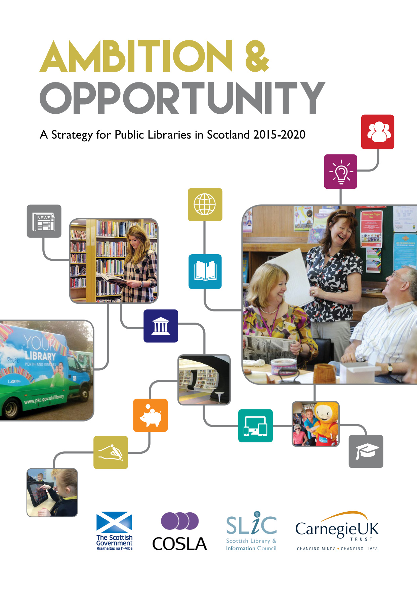

# Ambition & Opportunity

## A Strategy for Public Libraries in Scotland 2015–2020

<!-- PAGE: 2 -->

### About the Scottish Library and Information Council

The Scottish Library and Information Council (SLIC) is the independent advisory body to the Scottish Government on library and information services. SLIC offers leadership focus and support to the Scottish library and information sector, coordinating and promoting national service developments to benefit Scotland’s people and enrich our cultural, educational and economic landscape. [www.scottishlibraries.org](http://www.scottishlibraries.org)

Scottish Library and Information Council  
Suite 5.5, 5th Floor, 180 West Regent Street, Glasgow G2 4RW  
Tel: 0141 202 2884  
Email: info@scottishlibraries.org

Published by the Scottish Library and Information Council, June 2015.

<!-- PAGE: 3 -->

## Contents

- [Chair’s Introduction](#chairs-introduction)
- [About the National Strategy for Public Libraries in Scotland Strategic Group](#about-the-national-strategy-for-public-libraries-in-scotland-strategic-group)
- [Developing the National Strategy](#developing-the-national-strategy)
- [Visual Executive Summary](#visual-executive-summary)
- [1. 2015–2020: Challenges & Opportunities](#1-20152020-challenges--opportunities)
  - [1.1 Libraries now and in the future](#11-libraries-now-and-in-the-future)
  - [1.2 Why we need a national strategy](#12-why-we-need-a-national-strategy)
- [2. Vision, Aims and Objectives](#2-vision-aims-and-objectives)
  - [Strategic Aim 1: Libraries promoting reading, literacy and learning](#strategic-aim-1-libraries-promoting-reading-literacy-and-learning)
  - [Strategic Aim 2: Libraries promoting digital inclusion](#strategic-aim-2-libraries-promoting-digital-inclusion)
  - [Strategic Aim 3: Libraries promoting economic wellbeing](#strategic-aim-3-libraries-promoting-economic-wellbeing)
  - [Strategic Aim 4: Libraries promoting social wellbeing](#strategic-aim-4-libraries-promoting-social-wellbeing)
  - [Strategic Aim 5: Libraries promoting culture and creativity](#strategic-aim-5-libraries-promoting-culture-and-creativity)
  - [Strategic Aim 6: Libraries as excellent public services](#strategic-aim-6-libraries-as-excellent-public-services)
- [3. Leading the Delivery of the Strategy](#3-leading-the-delivery-of-the-strategy)
- [4. Recommendations](#4-recommendations)
- [5. References](#5-references)

<!-- PAGE: 4 -->

## Chair’s Introduction

### Map and Compass

A strategic approach to the future of public libraries in Scotland needs to provide both a map and a compass: a map to show the terrain we are currently operating in; and a compass to give a sense of strategic direction and purpose.

The strategy builds on the high regard which people in Scotland have for public libraries. Most people in Scotland recognise libraries as essential civic resources, which act both as a foundation of communities and a catalyst for personal development and enrichment.

Scotland is rightly proud of its strong tradition of public library provision, with the Leadhills Library (1741) and the Wanlockhead Miners’ Library (1756) among the first subscription libraries in the UK.

Libraries and local government have built on this tradition over many decades, continually developing and modernising services to meet changing needs and expectations. We know that in 2013/14 there were over 28 million visits to Scotland’s public libraries, equivalent to every Scot visiting a public library five times. The latest Scottish Household Survey reports that 61% of adults in Scotland use public libraries, higher than in any other home nation, and that users express very high levels of satisfaction (91%) with the service.[^1]

### Beyond ‘Warehouses for Books’

The 21st century public library has to position itself beyond an historic idea of libraries as simply ‘warehouses for books’. Scotland’s libraries are transforming themselves into vibrant community hubs. Today, libraries are as much about digital connectivity, access to high-quality public information, employment and business support, promoting health and wellbeing, and cultural activities as they are about lending books.

The library promise, their social contract with the public, now needs to be refreshed and restated in terms that people understand and can support: libraries are trusted community assets where people go to meet others, to learn and explore, to find and research information, to develop new skills and ideas, to create, and to be entertained.

We need to accelerate this progress, to promote effectively and then replicate the extraordinary innovation that is to be found across the library service in Scotland.

Some people have told us that the future of libraries lies in physical books. The evidence that we have received says that this is far from the whole truth: in an increasingly digital world, the challenge is how the physical and digital offers from libraries complement and reinforce each other.

### Most Popular Civic Resource

Public libraries constitute an extensive network of physical and digital assets, with over 600 libraries across all 32 local authority areas.[^2] That the network remains so strong at a time of severe pressure on public finances <!-- PAGE: 5 --> is of great credit both to the stewardship of local government and to the culture generated by library staff. Local government has by a combination of deliberate design and happy accident created and maintained these spaces and library staff have in turn innovated and developed new services within them.

### Outcome Focus

My hope is that an agreed and widely supported national strategy for public libraries in Scotland will:

- Reinvigorate advocates for public libraries and encourage them to forge links with new partners.
- Ensure that the substantial contribution that libraries make to local and national outcomes is fully recognised by decision-makers.
- Support local authorities and library services to develop services that respond to local priorities and community needs.
- Enable library services to anticipate and adapt to changing consumer behaviour and digital advances.
- Underpin continuous improvement in services and provide support for innovation and leadership.
- Provide a platform for greater collaboration across library services, local authorities and wider public services.

**Martyn Evans**  
Chair, National Strategy for Public Libraries in Scotland Strategic Group  
Chief Executive, Carnegie UK Trust

---

### A Strategic Approach to Public Libraries in Scotland

> **VISION statement**  
> Scotland’s public libraries are trusted guides connecting all of our people to the world’s possibilities and opportunities.

> **MISSION statement**  
> Scotland’s public libraries are part of a shared civic ambition to fulfil the potential of individuals and communities.

> **Outcome statement**  
> Every step individuals and communities take towards fulfilling their potential adds to Scotland’s social, economic and cultural wellbeing.

<!-- PAGE: 6 -->

## About the National Strategy for Public Libraries in Scotland Strategic Group

The Scottish Library and Information Council (SLIC) was asked by the COSLA Arts and Culture Working Group and the Scottish Government to produce the first national public library strategy for Scotland.

To oversee the development of the strategy, SLIC convened an independent advisory group of key stakeholders, chaired by Martyn Evans, Chief Executive of the Carnegie UK Trust.

### Strategic Group Members

- **Martyn Evans (Chair)** – Chief Executive, Carnegie UK Trust
- **Jeanette Castle** – President, Chartered Institute of Library and Information Professionals in Scotland (CILIPS)
- **Pamela Tulloch** – Chief Executive, Scottish Library and Information Council (SLIC)
- **Gillian Daly** – Head of Policy and Projects, Scottish Library and Information Council (SLIC)
- **Councillor Harry McGuigan** – COSLA Spokesperson for Community Wellbeing
- **Gillian Findlay** – Head of Cultural Services, East Lothian Council
- **Bill Maxwell** – Chief Executive, Education Scotland
- **Aminatta Forna** – Writer and Professor of Creative Writing, Bath Spa University
- **Colin Cook** – Director for Digital, Scottish Government
- **David Martin** – Key Sector Manager for Creative Industries, Skills Development Scotland
- **Chris van der Kuyl** – Chairman, 4J Studios

<!-- PAGE: 7 -->

## Developing the National Strategy

The national strategy has been informed by a process of engagement including independent deliberative research, a questionnaire to gather views from the public, and an open call for evidence from library services and stakeholders.

### Research and Evidence Gathering

- **Deliberative research:** Independent deliberative focus groups with users and non-users across Scotland, conducted by Rocket Science.
- **Public consultation:** Over 2,000 responses to the online and paper questionnaire on library use and future priorities.
- **Call for evidence:** Over 40 submissions from local authorities, library leaders, professional bodies, third sector organisations, and partner agencies.
- **Study visits:** Visits by the Chair and Strategic Group to library services across Scotland, exploring rural, urban, branch, mobile, and co-located models.

<!-- PAGE: 8 -->

## Visual Executive Summary

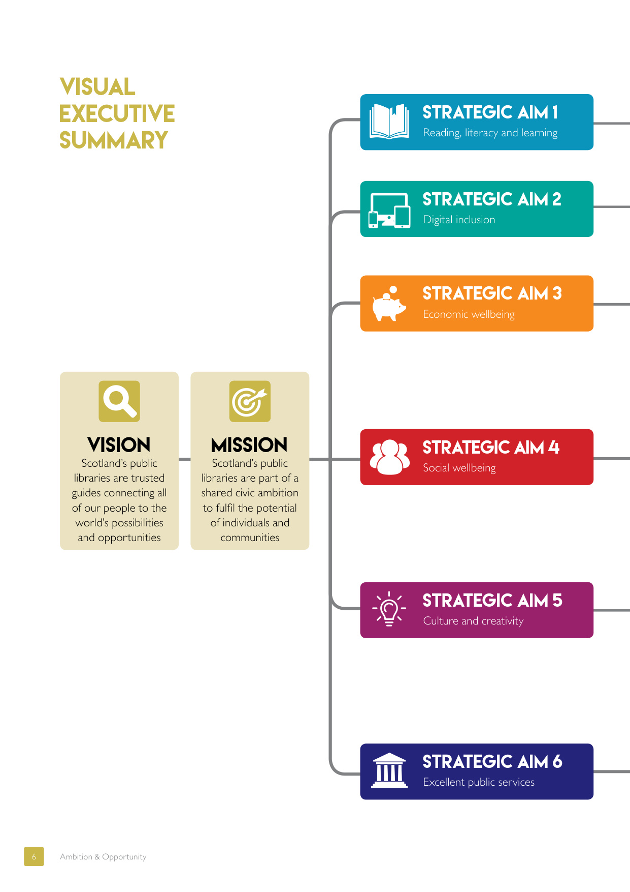

### Core Strategic Framework

| Element | Description |
| :--- | :--- |
| **Vision** | Scotland’s public libraries are trusted guides connecting all of our people to the world’s possibilities and opportunities. |
| **Mission** | Scotland’s public libraries are part of a shared civic ambition to fulfil the potential of individuals and communities. |
| **Outcome** | Every step individuals and communities take towards fulfilling their potential adds to Scotland’s social, economic and cultural wellbeing. |

### The Six Strategic Aims

- **Strategic Aim 1 (Reading, Literacy and Learning):** Public libraries promote education and learning for all, supporting early years, school pupils, adults and families.
- **Strategic Aim 2 (Digital Inclusion):** Public libraries provide free access to technology, digital skills support, and trusted digital content.
- **Strategic Aim 3 (Economic Wellbeing):** Public libraries contribute to economic growth, supporting jobseekers, business startups, and enterprise.
- **Strategic Aim 4 (Social Wellbeing):** Public libraries tackle inequalities, combat loneliness and social isolation, and support community health.
- **Strategic Aim 5 (Culture and Creativity):** Public libraries celebrate local cultural identity, foster creative expression, and provide platforms for writers and artists.
- **Strategic Aim 6 (Excellent Public Services):** Public libraries continuously improve through innovative service delivery, workforce development, and robust standards.

<!-- PAGE: 9 -->

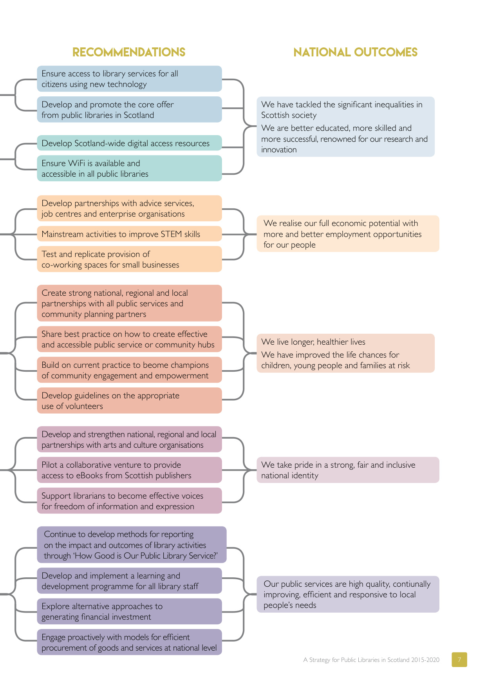

### Recommendations & National Outcomes Alignment

| Strategic Aim | Key Recommendations | Relevant National Outcomes |
| :--- | :--- | :--- |
| **1. Reading, Literacy & Learning** | Ensure access to library services for all citizens using new technology. Develop and promote the core offer from public libraries in Scotland. | We have tackled the significant inequalities in Scottish society. We are better educated, more skilled and more successful. Our young people are successful learners. Our children have the best start in life. |
| **2. Digital Inclusion** | Provide free high-speed Wi-Fi in all public libraries. Develop a national digital platform and consortium model for digital content and eBooks. Support digital participation through digital skills training. | We have tackled inequalities. We live in well-designed, sustainable places. Our public services are high quality, continual improving, efficient. |
| **3. Economic Wellbeing** | Develop partnerships with advice centres and enterprise organisations. Mainstream activities to improve STEM skills in young children. Test and replicate co-working spaces for small businesses. | We realise our full economic potential with more and better employment opportunities. We have tackled inequalities. |
| **4. Social Wellbeing** | Position libraries as key delivery partners in Community Planning and Health & Social Care Partnerships. Expand health literacy and social prescribing initiatives. Support volunteers to complement trained professional staff. | We live longer, healthier lives. We have tackled inequalities. Our people maintain their independence as they grow older. |
| **5. Culture & Creativity** | Broaden cultural programming in libraries. Accelerate digitisation of local studies and historical archives. Strengthen collaboration with Creative Scotland and National Library of Scotland. | We take pride in a strong, fair and inclusive national identity. We live in well-designed, sustainable places. |
| **6. Excellent Public Services** | Establish a robust quality improvement framework building on *How Good is Our Public Library Service?* Invest in workforce development and leadership programmes. Adopt standard impact measurement metrics. | Our public services are high quality, efficient and responsive to local people’s needs. |

<!-- PAGE: 10 -->

## 1. 2015–2020: Challenges & Opportunities

### 1.1 Libraries Now and in the Future

Scotland’s public libraries have adapted and evolved for over 150 years to connect individuals and communities with knowledge, ideas and information.

Public libraries provide a highly valued universal service to the people of Scotland. They are free at the point of access and open to all, offering safe, welcoming spaces in urban centres and remote rural communities alike.

Public libraries operate both as social change agents and as a key strand in the cultural and educational life of Scotland. They provide the space in which a very wide range of activities can take place: reading groups, digital classes, author visits, Bookbug sessions, family history research, and citizen advice.

Reading is the most popular form of cultural participation in Scotland, with 68% of people reading for pleasure. The public library service:

- Encourages reading for pleasure and recreation, enables discovery, and promotes literacy from early childhood to later life.
- Provides access to computers, high-speed broadband, and digital technologies.
- Supports learning, training, job searches, and welfare reform transition.
- Acts as a trusted source of unbiased public information.
- Provides a welcoming physical space for civic life, social interaction, and community engagement.

> "Libraries provide a neutral, safe and welcoming space for all members of the community to meet, be informed, research, discover."  
> — *Respondent to Consultation*

<!-- PAGE: 11 -->

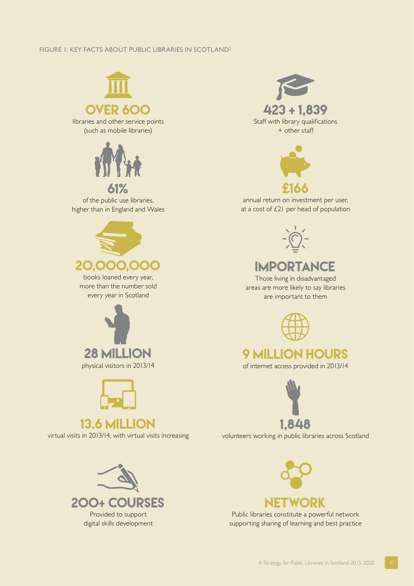

### Key Facts About Public Libraries in Scotland

- **Over 600** libraries and service points (including mobile libraries).
- **28 million** physical visits in 2013/14 (an average of 5 visits per resident).
- **13.6 million** virtual visits in 2013/14 (virtual visits increased 1,848% between 2007/08 and 2013/14).
- **61%** of the public use libraries — higher than in England and Wales.
- **20,000,000** books loaned each year — more than the number sold in Scotland.
- **£166** annual return on investment per user, at a cost of £21 per head of population.
- **423 + 1,839** staff with library qualifications plus other staff.
- **9 million** hours of internet access provided annually.
- **200+** courses provided to support digital skills development.
- **Disadvantaged areas:** Those living in disadvantaged areas are more likely to say libraries are important to them.

<!-- PAGE: 12 -->

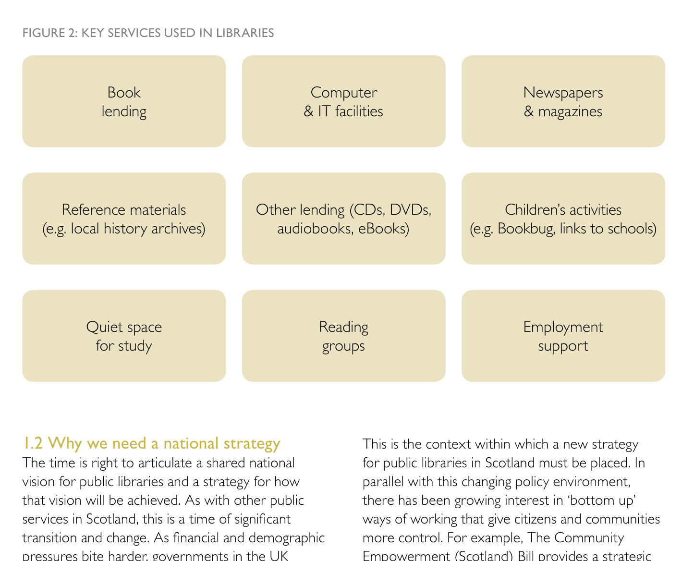

### Key Services Used in Libraries

- **Book lending**
- **Children’s activities** (e.g. Bookbug, links to schools)
- **Reference materials** (e.g. local history archives)
- **Computer & IT facilities**
- **Other lending** (CDs, DVDs, audiobooks, eBooks)
- **Newspapers & magazines**
- **Employment support**
- **Quiet space for study**
- **Reading groups**

### 1.2 Why We Need a National Strategy

The time is right to articulate a shared national vision for public libraries and a strategy for how that vision will be achieved. As with other public services in Scotland, this is a time of significant transition and change. As financial and demographic pressures bite harder, governments in the UK and in other OECD countries are realising that traditional models of public service delivery require rethinking if we are to ‘weather the storm’.[^3]

In response to these challenges, and in the wake of the Christie Commission, the Scottish Government set out its approach to public service reform as follows:

- A decisive shift towards prevention.
- Greater integration of public services at a local level driven by better partnership, collaboration and effective local delivery.
- Greater investment in the people who deliver services through enhanced workforce development and effective leadership.
- A sharp focus on improving performance, through greater transparency, innovation and use of digital technology.[^4]

This is the context within which a new strategy for public libraries in Scotland must be placed. In parallel with this changing policy environment, there has been growing interest in ‘bottom up’ ways of working that give citizens and communities more control. For example, The Community Empowerment (Scotland) Bill provides a strategic framework for empowering Scotland’s people, improving outcomes and further enabling local level decision-making, and the purpose of COSLA’s Commission for Strengthening Local Democracy is to identify a route map to deliver a shift in power towards local people in Scotland.[^5]

Public services continue to face financial pressures and it is a welcome fact that local government spend on libraries has dropped by only 2% between 2007/08–2013/14.[^6] It is likely that Scottish local authorities will face increasing financial pressure <!-- PAGE: 13 --> over the next few years, and there is no room for complacency that there will not be further, potentially more severe reductions in spending capacity. This strategy is based on the expectation that there will be increasing pressure on local authorities to reduce their spending levels, and to prioritise the services they fund. This is a challenge which library authorities have already begun to face, and the strategy seeks to help them meet this challenge by demonstrating the impact of libraries and identifying new and better ways of working.

Libraries have an extraordinary capacity to adapt and innovate, but they cannot do it alone. The digital revolution is changing how people read, learn, work, and communicate. As public services move online by default, public libraries are the essential safety net ensuring that nobody is left behind.

<!-- PAGE: 14 -->

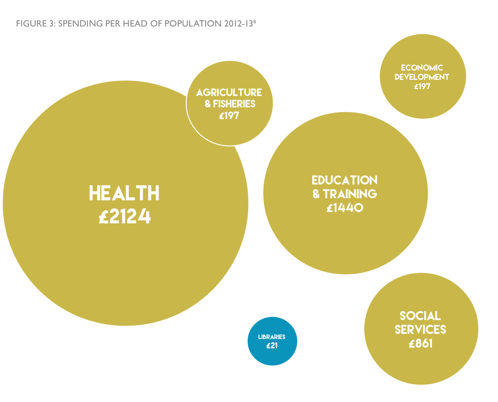

### Public Expenditure Comparison: Spending per Head of Population (Scotland 2012–13)

| Service Area | Spend per Head |
| :--- | :--- |
| **Health** | £2,124 |
| **Education & training** | £1,440 |
| **Social services** | £861 |
| **Agriculture & fisheries** | £197 |
| **Economic development** | £197 |
| **Public Libraries** | **£21** |

*Source: Scottish Local Government Financial Statistics / CIPFA Public Library Statistics.*[^8]

and maximise the benefits that it offers. Libraries have a critical role in supporting people to do this. Librarians must have an increasingly important role as visible and vocal champions of freedom of information and free expression at both local and national levels. This can be a difficult and challenging responsibility to fulfil and librarians need peer and professional association support to be effective.

This time of transition and change will involve developing exciting opportunities for libraries to contribute to the economic and social health of their communities, and to make and demonstrate this contribution in new and powerful ways. The future success of public libraries will be determined by how successfully they respond to the changing needs and aspirations of its community, and to the constantly evolving digital world.

Our strategy shows how the service can move to this endpoint: outlining the kind of measures which will need to be taken to create an efficient, effective, people-centred public library service in the digital age. The vision, strategic aims and recommendations are set out in section 2. Section 3 outlines some of the mechanisms and processes which will be needed to achieve these ambitions.

<!-- PAGE: 15 -->

## 2. Vision, Aims and Objectives

This strategy begins with a shared, consistent and convincing vision about what libraries can achieve and their unique and vital contribution in a modern, progressive, democratic society. The National Strategy for Public Libraries in Scotland Strategic Group took evidence from the public, libraries, experts and professional bodies. In taking this evidence we were interested in discerning the different perspectives on what libraries could and should be in the future. From this evidence we set out a vision for public libraries in Scotland.

This vision is aligned to the National Performance Framework supported by six strategic aims which outline the key areas for development over the next five years. In taking forward the strategy, the National Strategy for Public Libraries in Scotland Strategic Group also makes a number of recommendations to deliver the strategic aims (see Figure 4).

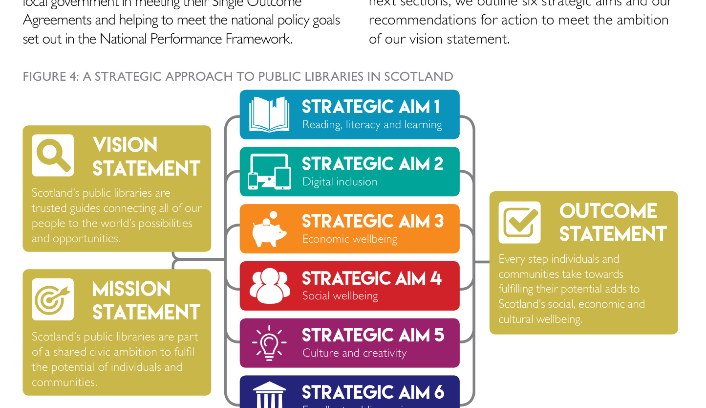

### Alignment with the National Performance Framework

This strategy is a catalyst for the changes which are necessary to ensure that the service remains meaningful and useful to citizens, is cost-effective and reflects the policy aims of local and Scottish Government. By addressing the particular needs of their communities, public libraries contribute to the effectiveness of local government in meeting their Single Outcome Agreements and helping to meet the national policy goals set out in the National Performance Framework.

As well as alignment between local and national policy goals, Scotland also benefits from alignment between different public services and the third sector through Community Planning Partnerships (CPPs). Evidence received by the Group and our study trips to libraries around Scotland consolidated for us the important role of CPPs in leading public service change in local areas. Our ambition is that this strategy helps local library services advocate for the important role that they can and do play in meeting local and national outcomes.

The Scottish Library and Information Council’s *How Good is our Public Library Service?*[^9] refers to the role of whole library services within a local government area in relation to the Scottish Government’s National Performance Framework. The overarching purpose of the Scottish Government is linked with 16 national outcomes, many of which are directly relevant to the work of the library strategy. In our deliberations, we found it useful to locate the aims of a national strategy for libraries in relation to the relevant national outcomes. We were also influenced by the Scottish Digital Strategy.[^10] In the next sections, we outline six strategic aims and our recommendations for action to meet the ambition of our vision statement.

<!-- PAGE: 16 -->

### Strategic Aim 1: Libraries Promoting Reading, Literacy and Learning

> **STRATEGIC AIM**  
> Public libraries in Scotland promote education and learning for all, supporting early years, school pupils, adults and families.

#### Recommendations

- **1.** Ensure access to library services for all citizens using new technology.
- **2.** Develop and promote the core offer from public libraries in Scotland.

#### Relevant National Outcomes

- We have tackled the significant inequalities in Scottish society.
- We are better educated, more skilled and more successful, renowned for our research and innovation.
- Our young people are successful learners, confident individuals, effective contributors and responsible citizens.
- Our children have the best start in life and are ready to succeed.

#### Relevant National Indicators

- Improve the skills profile of the population.
- Improve levels of educational attainment.
- Increase the proportion of young people in learning, training or work.

#### Universal Access in the 21st Century

It is one of the fundamental defining characteristics of public libraries that they are free and open to all. They are one of the few civic institutions that do not require an entry fee, a commercial purchase, or a specific qualifying condition.

Promoting reading for pleasure remains the core heartbeat of public libraries. The evidence is overwhelming that reading for pleasure improves educational attainment, mental health, vocabulary, empathy, and social mobility. The Bookbug programme, delivered in partnership with the Scottish Book Trust, local authorities, and NHS Scotland, provides free book bags and free song and rhyme sessions to every baby and young child in Scotland, building early language and bonding.[^7]

<!-- PAGE: 17 -->

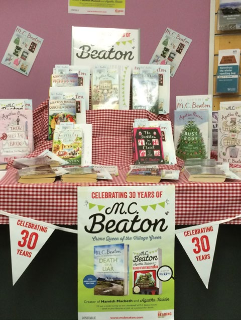

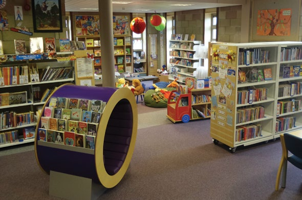

> #### Case Study: Orkney Library and Archive
>
> Orkney Libraries have been nominated for the prestigious Bookseller Industry Awards and have gained global recognition for their innovative and humorous use of social media to engage the public with reading and library services. With exceptionally high lending figures per capita, Orkney demonstrates how a remote island service can achieve world-class engagement through strong community roots and creative outreach.

<!-- PAGE: 18 -->

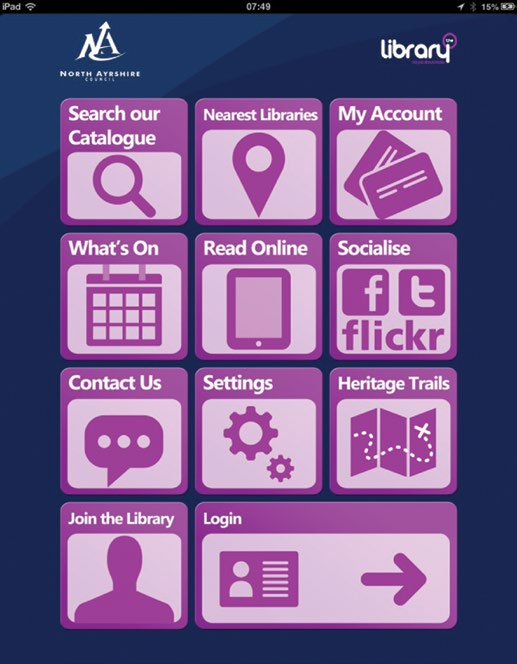

> #### Case Study: Appiness (North Ayrshire)
>
> North Ayrshire’s Appiness project, funded by the Public Library Improvement Fund (PLIF), supports literacy, numeracy, and digital skills development in early years children and their families. By introducing interactive tablet apps alongside traditional storytelling, the project bridges digital play and early literacy, helping parents gain confidence in supporting their children's learning.

<!-- PAGE: 19 -->

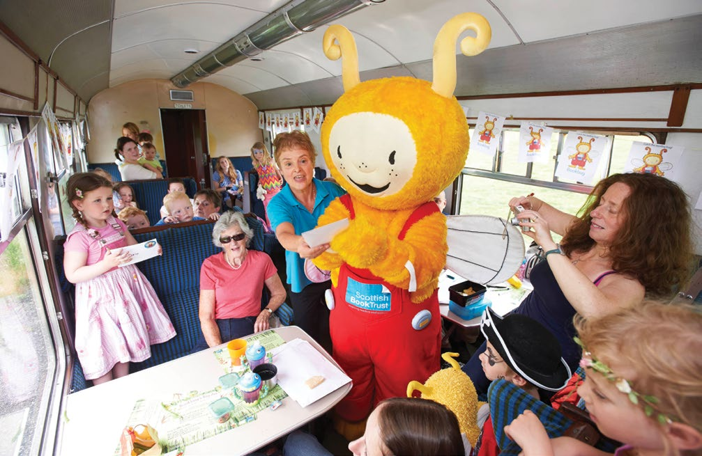

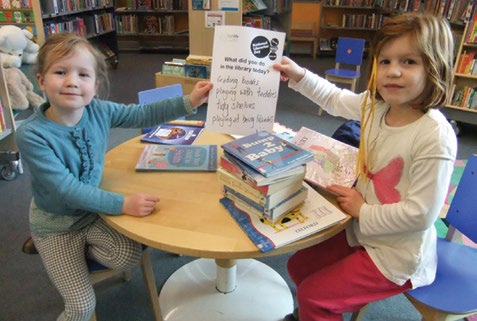

Public libraries in Scotland also provide essential support for adult literacy, numeracy, and English for Speakers of Other Languages (ESOL). By offering welcoming, stigma-free learning environments and one-to-one coaching, libraries help thousands of adult learners build vital foundation skills.

<!-- PAGE: 20 -->

### Strategic Aim 2: Libraries Promoting Digital Inclusion

> **STRATEGIC AIM**  
> Public libraries in Scotland are champions of digital inclusion, providing free high-speed broadband, digital devices, and skilled staff assistance to enable all citizens to participate fully in modern society.

#### Recommendations

- **3.** Provide free high-speed Wi-Fi in all public libraries in Scotland.
- **4.** Develop a national digital platform and consortium model for digital content and eBooks.
- **5.** Support digital participation by expanding digital literacy training and assisted digital access for public services.

#### Relevant National Outcomes

- We have tackled the significant inequalities in Scottish society.
- We live in well-designed, sustainable places where we are able to access the amenities and services we need.
- Our public services are high quality, continually improving, efficient and responsive to local people’s needs.

#### Relevant National Indicators

- Increase broadband coverage and uptake across Scotland.
- Increase the number of people with basic digital skills.

#### Bridging the Digital Divide

In Scotland, approximately one in five households still lacks internet access, with non-users heavily concentrated among older people, low-income households, and disabled people. As government and commercial services shift to digital-by-default, the lack of digital access and skills reinforces existing social and economic disadvantage.

Public libraries are Scotland's primary public digital network. Every day, thousands of citizens use library computers and Wi-Fi to search for jobs, claim benefits, communicate with family, study, book healthcare appointments, and access information.

<!-- PAGE: 21 -->

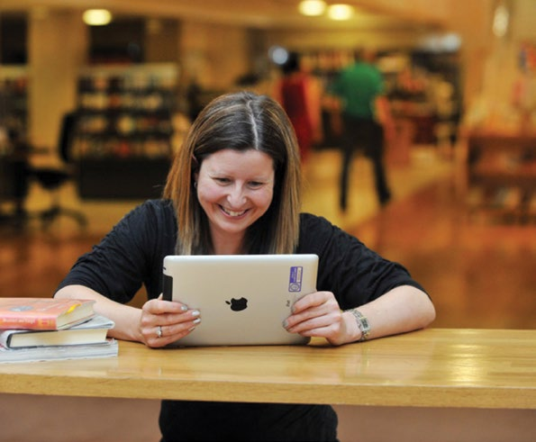

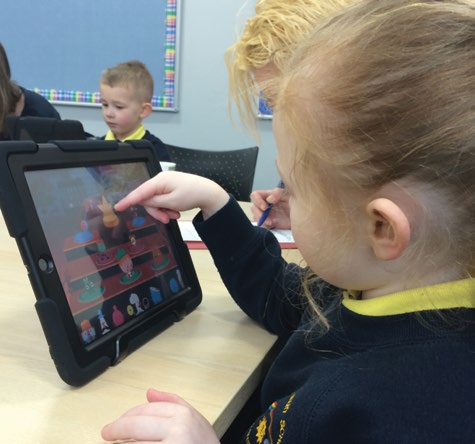

> #### Case Study: Channel Shift (North Ayrshire)
>
> The development of online services in North Ayrshire makes it possible for residents to access local authority services 24/7. To ensure no citizen is left behind by channel shift, library staff act as digital mentors, guiding users through online forms, council tax portals, and housing applications, transforming potential digital exclusion into an opportunity for skills building.

<!-- PAGE: 22 -->

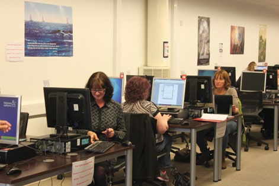

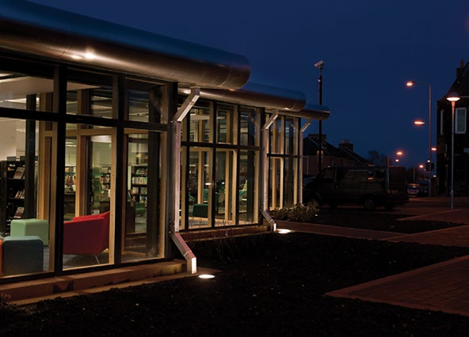

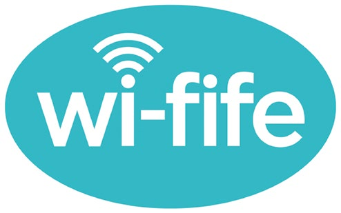

> #### Case Study: Wi-Fife (Fife Cultural Trust)
>
> Fife Cultural Trust identified growing demand for mobile internet connectivity among library visitors bringing their own devices. Through a targeted investment programme, public Wi-Fi was installed across all Fife library branches, leading to an immediate surge in study visits, student usage, and flexible community working.

<!-- PAGE: 23 -->

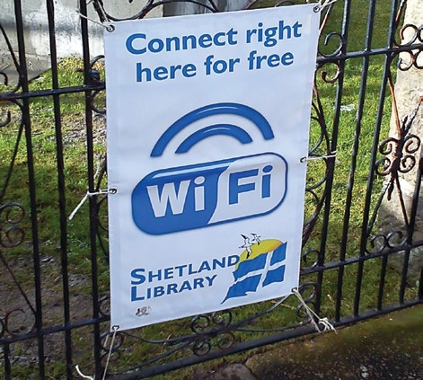

The Strategic Group believes that the provision of free Wi-Fi in all public libraries is essential. Installing public Wi-Fi allows users to bring their own smartphones, tablets, and laptops into libraries, significantly increasing connectivity capacity without requiring expensive hardware upgrades by local authorities.

<!-- PAGE: 24 -->

### Strategic Aim 3: Libraries Promoting Economic Wellbeing

> **STRATEGIC AIM**  
> Public libraries in Scotland contribute to Scotland’s economic wellbeing, supporting jobseekers into work, providing business intelligence for enterprises, and fostering entrepreneurship.

#### Recommendations

- **6.** Develop national, regional and local partnerships with advice centres, enterprise agencies, and Chambers of Commerce.
- **7.** Mainstream activities to improve STEM skills (Science, Technology, Engineering, and Mathematics) in young children and communities.
- **8.** Test and replicate co-working spaces and maker spaces in public libraries for small businesses and entrepreneurs.

#### Relevant National Outcomes

- We realise our full economic potential with more and better employment opportunities for our people.
- We have tackled the significant inequalities in Scottish society.
- We are better educated, more skilled and more successful.

#### Relevant National Indicators

- Increase the proportion of young people in learning, training or work.
- Increase business startup and survival rates.
- Improve digital participation in enterprise.

#### Supporting Jobseekers and Entrepreneurs

Libraries play a pivotal frontline role in welfare reform transition, notably with Universal Support – Delivered Locally (USDL). With Universal Credit requiring digital claims and online job searches, libraries provide the essential computers, connectivity, and assisted digital support.

Furthermore, public libraries are democratising access to business information and enterprise tools. By providing access to high-value market research databases (COBRA, Mintel, FAME) and meeting spaces, libraries enable budding entrepreneurs to research business plans and launch enterprises with minimal startup overheads.

<!-- PAGE: 25 -->

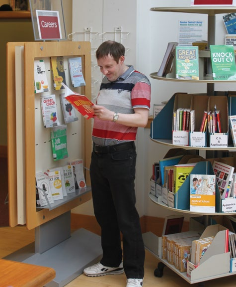

> #### Case Study: Edinburgh City Libraries Business Hub
>
> Edinburgh City Libraries established a dedicated Business Hub at the Central Library, providing business advice, intellectual property clinics, and access to premium company intelligence databases. The Hub works closely with Business Gateway, helping hundreds of local entrepreneurs develop business plans, protect their ideas, and start new businesses.

<!-- PAGE: 26 -->

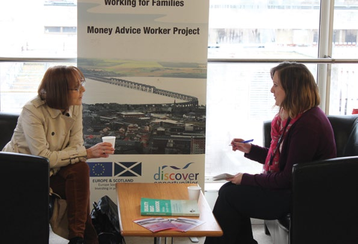

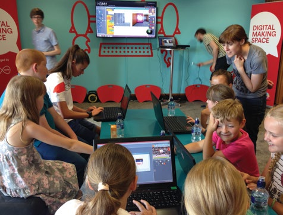

> #### Case Study: Dundee Opportunities Hub & The Mitchell Library Digital Making Space
>
> - **Dundee Opportunities Hub:** Located in Dundee Central Library, the Opportunities Hub co-locates employment support, housing advice, and literacy tutors under one roof, providing joined-up support for individuals seeking work or training.
> - **Mitchell Library Digital Making Space (Glasgow):** Glasgow Life partnered with CoderDojo and digital creatives to establish a digital maker space at the Mitchell Library, offering free access to 3D printers, coding clubs, robotics kits, and digital design software for young people.

<!-- PAGE: 27 -->

### Strategic Aim 4: Libraries Promoting Social Wellbeing

> **STRATEGIC AIM**  
> Public libraries in Scotland promote social wellbeing and tackle loneliness and social isolation, acting as trusted community anchors that support mental health, community cohesion, and social capital.

#### Recommendations

- **9.** Position libraries as key delivery partners in Community Planning Partnerships (CPPs) and Health and Social Care Partnerships (HSCPs).
- **10.** Expand health literacy and social prescribing initiatives, providing approved health information and therapeutic reading.
- **11.** Recognise and support the role of volunteers to complement, but not replace, trained professional library staff.

#### Relevant National Outcomes

- We have tackled the significant inequalities in Scottish society.
- We live longer, healthier lives.
- We live in well-designed, sustainable places where we are able to access the amenities and services we need.
- Our people are able to maintain their independence as they grow older and are able to access appropriate support when they need it.

#### Relevant National Indicators

- Improve mental wellbeing.
- Reduce health inequalities.
- Increase social capital and community cohesion.

#### Tackling Isolation and Health Inequalities

Public libraries are open, non-stigmatising spaces where anyone can spend time without needing to spend money. For older people, people living alone, carers, and new migrants, libraries offer vital human connection and community warmth that combat chronic loneliness.

<!-- PAGE: 28 -->

> #### Case Study: Family Futures (Glasgow Libraries & NHS)
>
> The Family Futures project is a pioneering partnership between Glasgow Libraries and NHS Greater Glasgow & Clyde. Operating in areas of high deprivation, the project embeds health visitors, speech and language therapists, and library staff into joint family support sessions, supporting maternal mental health, child development, and early literacy simultaneously.

<!-- PAGE: 29 -->

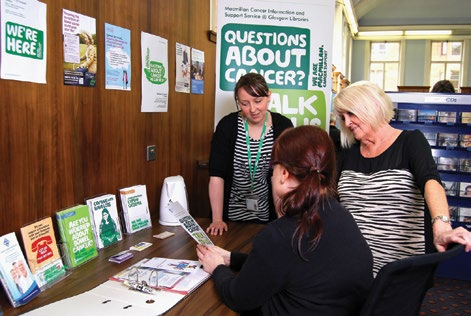

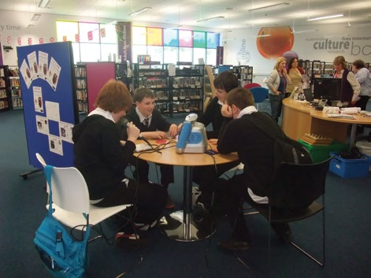

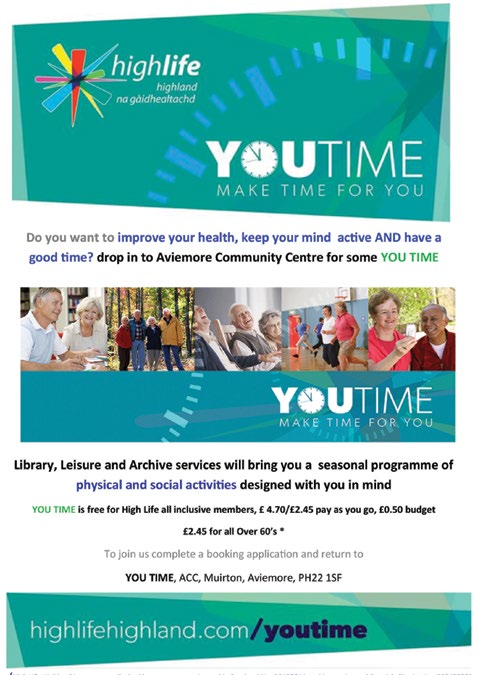

Libraries also actively promote health and wellbeing through bibliotherapy and social prescribing initiatives (such as *Healthy Reading* schemes), dementia-friendly memory boxes, autism-friendly quiet sessions, and partnerships with local NHS boards.

<!-- PAGE: 30 -->

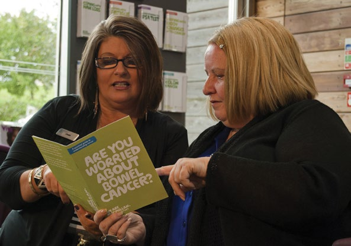

> #### Case Study: The Volunteer Perspective
>
> "When I became unemployed, finding a volunteering role at my local library gave me structure, purpose, and confidence. Supporting older people to get online showed me how much libraries mean to the community, and the skills I gained helped me secure full-time employment."  
> — *Library Volunteer, Scottish Borders*

<!-- PAGE: 31 -->

> #### Case Study: Aviemore Community Library (Highland)
>
> Aviemore Library is integrated within the Aviemore Primary School and Community Centre. By combining school library facilities, public library services, and community leisure spaces into a shared hub, the facility delivers extended opening hours, multi-generational learning, and efficient shared infrastructure in a rural Highland community.

<!-- PAGE: 32 -->

### Strategic Aim 5: Libraries Promoting Culture and Creativity

> **STRATEGIC AIM**  
> Public libraries in Scotland are vibrant cultural venues, celebrating local identity, safeguarding historical memory, and nurturing contemporary creative expression.

#### Recommendations

- **12.** Broaden cultural programming in libraries, establishing them as recognized venues for author tours, musical performances, visual arts, and literary festivals.
- **13.** Accelerate the digitisation of local studies and historical archives, ensuring open public access to Scotland's rich cultural heritage.
- **14.** Strengthen collaboration with Creative Scotland, the National Library of Scotland, and national cultural bodies.

#### Relevant National Outcomes

- We take pride in a strong, fair and inclusive national identity.
- We live in well-designed, sustainable places where we are able to access the amenities and services we need.

#### Relevant National Indicators

- Increase cultural engagement and participation across all demographic groups.
- Increase public participation in creative activities.

<!-- PAGE: 33 -->

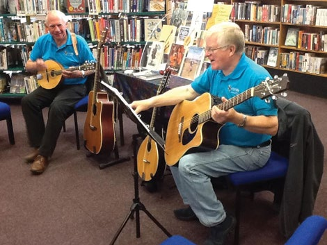

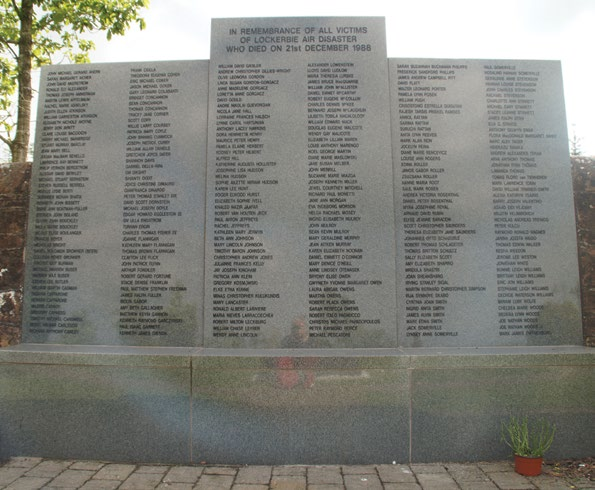

> #### Case Study: Dumfries & Galloway Local Heritage Projects
>
> Dumfries & Galloway Libraries developed community digitisation projects allowing local residents to digitise family letters, WW1 memorabilia, and historic photographs. The resulting online digital archive preserves irreplaceable local social history while engaging volunteer groups and schools across the region.

<!-- PAGE: 34 -->

Libraries hold the memory of their communities. Local studies collections, photographic archives, and oral histories safeguard the distinctive stories and traditions of Scotland's towns, villages, and islands. In addition, public libraries provide accessible stages for live literature, book festivals, poetry slams, drama, and musical performances, democratising cultural participation and bringing world-class artists directly into community neighbourhoods.

<!-- PAGE: 35 -->

### Strategic Aim 6: Libraries as Excellent Public Services

> **STRATEGIC AIM**  
> Public libraries in Scotland are continuously improving, efficient, high-performing public services with dynamic leadership, a skilled workforce, and evidence-based standards.

#### Recommendations

- **15.** Establish a robust national public library quality improvement framework building on *How Good is Our Public Library Service?*
- **16.** Invest in workforce development and leadership programmes across the library and information sector.
- **17.** Adopt standard impact measurement metrics to capture social and economic return on investment.

#### Relevant National Outcomes

- Our public services are high quality, continually improving, efficient and responsive to local people’s needs.
- Our people are able to maintain their independence as they grow older and are able to access appropriate support when they need it.

#### Continuous Improvement and Workforce Development

Delivering the ambitions of this strategy requires an agile, motivated, and well-trained library workforce. As the role of the library evolves to encompass digital navigation, business advice, health support, and cultural curation, library staff require continuous professional development.

<!-- PAGE: 36 -->

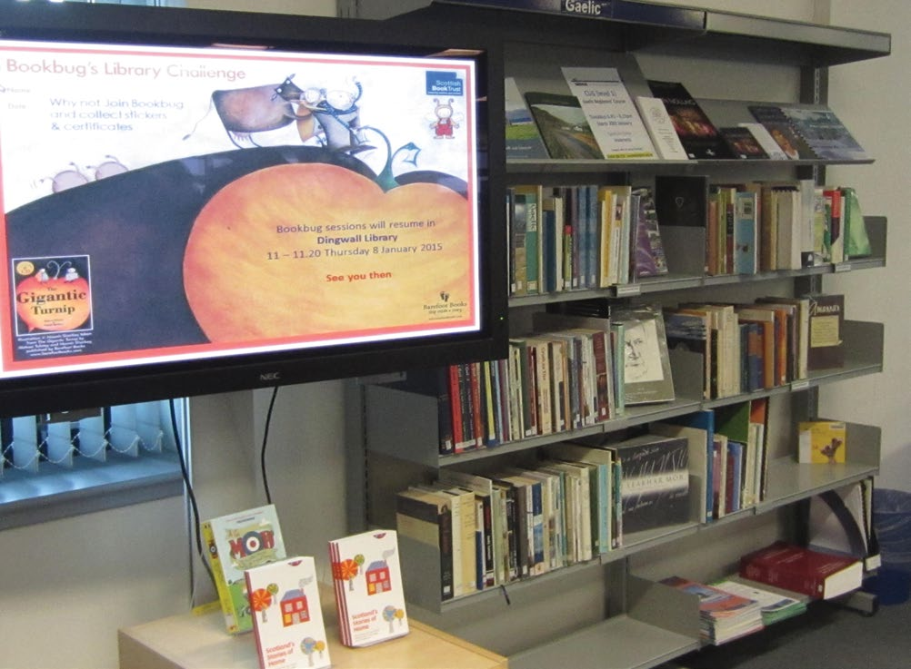

Library authorities must embed robust self-evaluation and quality frameworks, building on SLIC's *How Good is Our Public Library Service?* (PLQIM) to demonstrate measurable outcomes to funders and communities.

<!-- PAGE: 37 -->

There are examples of leadership development programmes, including the Clore Fellowship, which develop strategic and cultural leadership skills. Similar targeted leadership opportunities should be made available across the public library network in Scotland.

<!-- PAGE: 38 -->

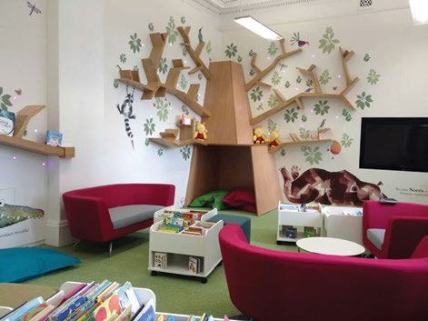

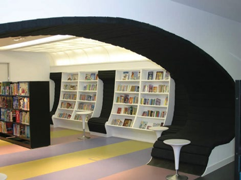

With the increase in the number of library services being provided by arms-length charitable trusts and community models, developing consistent professional standards, peer mentoring, and shared training networks becomes even more vital.

<!-- PAGE: 39 -->

## 3. Leading the Delivery of the Strategy

### Leadership and Governance

The strategy is designed to help library services, and the local authorities who provide them, chart a course for the future. Public library services have had a pride in their local focus, and this will continue to be a source of strength. However, the challenges and opportunities facing libraries in the digital era require national coordination and collective leadership.

Implementing this strategy will require:

- The enthusiastic support of COSLA and local government.
- Clear support from the Scottish Government and national partners.
- An effective delivery mechanism to coordinate implementation across all 32 Scottish local authorities.

<!-- PAGE: 40 -->

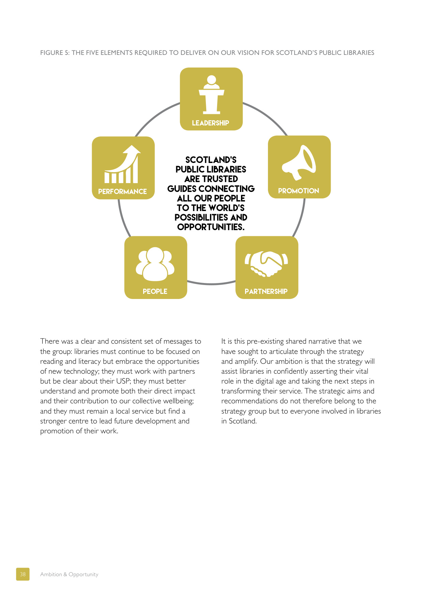

### The Five Essential Delivery Elements

1. **Leadership:** A clear national body providing strategic oversight, advocacy, and national co-ordination.
2. **Partnership:** Strong collaboration across local government, COSLA, the Scottish Government, NHS boards, and national cultural agencies.
3. **Innovation:** Sustained investment in testing and scaling innovative models of service delivery through the Public Library Improvement Fund (PLIF).
4. **Workforce Development:** A continuous investment in the skills, digital literacy, and leadership capacities of library staff.
5. **Quality & Impact:** Robust evidence frameworks demonstrating the value, social return, and community impact of public libraries.

<!-- PAGE: 41 -->

### Role and Functions of the Leadership Body

The Strategic Group recommends that SLIC, in close partnership with COSLA and the Scottish Government, leads the implementation of the National Strategy:

- **1.** **Lead the implementation** of the National Strategy for Public Libraries in Scotland.
- **2.** **Advise the Scottish Government** and ministers on all matters concerning library and information services.
- **3.** **Monitor progress and performance** against the strategic aims and recommendations.
- **4.** **Coordinate national procurement and consortium initiatives**, such as national digital platforms and content licensing.
- **5.** **Manage the Public Library Improvement Fund (PLIF)** to stimulate innovation and test new service delivery models.
- **6.** **Act as a national champion and advocate** for the public library sector across Scotland and internationally.

<!-- PAGE: 42 -->

## 4. Recommendations

The National Strategy for Public Libraries in Scotland Strategic Group puts forward the following coordinated package of recommendations:

### Strategic Aim 1: Reading, Literacy and Learning

- **1.** **Ensure access to library services** for all citizens using new technology.
- **2.** **Develop and promote the core offer** from public libraries in Scotland.

### Strategic Aim 2: Digital Inclusion

- **3.** **Provide free high-speed Wi-Fi** in all public libraries in Scotland.
- **4.** **Develop a national digital platform** and consortium model for digital content and eBooks.
- **5.** **Support digital participation** by expanding digital literacy training and assisted digital access for public services.

### Strategic Aim 3: Economic Wellbeing

- **6.** **Develop national, regional and local partnerships** with advice centres, enterprise organisations, and Chambers of Commerce.
- **7.** **Mainstream activities to improve STEM skills** in young children.
- **8.** **Test and replicate a model** of public libraries providing co-working spaces and maker facilities for small businesses.

### Strategic Aim 4: Social Wellbeing

- **9.** **Position libraries as key delivery partners** in Community Planning Partnerships (CPPs) and Health and Social Care Partnerships (HSCPs).
- **10.** **Expand health literacy and social prescribing** initiatives across all library services.
- **11.** **Recognise and support the role of volunteers** to complement, but not replace, trained professional library staff.

### Strategic Aim 5: Culture and Creativity

- **12.** **Broaden cultural programming** in libraries, establishing them as recognised community venues for literary, cultural, and artistic events.
- **13.** **Accelerate the digitisation of local studies and historical archives**, ensuring open public access to Scotland's rich cultural heritage.
- **14.** **Strengthen collaboration with Creative Scotland, the National Library of Scotland, and national cultural bodies.**

### Strategic Aim 6: Excellent Public Services

- **15.** **Establish a robust national public library quality improvement framework** building on *How Good is Our Public Library Service?*
- **16.** **Invest in workforce development and leadership programmes** across the library and information sector.
- **17.** **Adopt standard impact measurement metrics** to capture social and economic return on investment.

<!-- PAGE: 43 -->

## 5. References

1. Scottish Government, *Scotland’s People Annual Report: Results from 2013 Scottish Household Survey*, Edinburgh: The Scottish Government, August 2014, p. 148. [www.gov.scot/Resource/0045/00457570.pdf](http://www.gov.scot/Resource/0045/00457570.pdf)
2. Over 600 libraries and other service points: Scottish Library and Information Council (SLIC) internal survey data and Scottish Local Government statistics, 2014.
3. Organisation for Economic Co-operation and Development (OECD), *Public Governance Reviews: Scotland*, Paris: OECD Publishing, 2014.
4. Scottish Government, *Renewing Scotland’s Public Services: Priorities for reform in response to the Christie Commission*, Edinburgh: Scottish Government, 2011.
5. Commission for Strengthening Local Democracy, *Effective Democracy: Reconnecting with Communities*, Edinburgh: COSLA, 2014.
6. Scottish Local Government Financial Statistics (SLGFS), Edinburgh: Scottish Government, 2008–2014.
7. Scottish Book Trust, *Bookbug Annual Evaluation Report 2013/14*, Edinburgh: Scottish Book Trust, 2014.
8. CIPFA (Chartered Institute of Public Finance and Accountancy), *Public Library Statistics: 2012–13 Actuals*, London: CIPFA, 2013.

<!-- PAGE: 44 -->

9. Scottish Library and Information Council (SLIC), *How Good is our Public Library Service? A Public Library Improvement Model for Scotland*, Glasgow: SLIC, 2014.
10. Scottish Government, *Scotland’s Digital Future: Delivery of Public Services*, Edinburgh: Scottish Government, 2012.
11. Carnegie UK Trust, *A Blueprint for the Future of Public Libraries*, Dunfermline: Carnegie UK Trust, 2012.
12. Carnegie UK Trust, *Speaking Volumes: The Impact of Public Libraries in the 21st Century*, Dunfermline: Carnegie UK Trust, 2014.

<!-- PAGE: 45 -->

## Notes

*(Blank notes page in original publication)*

<!-- PAGE: 46 -->

*(Blank notes page in original publication)*

<!-- PAGE: 47 -->

*(Blank page in original publication)*

<!-- PAGE: 48 -->

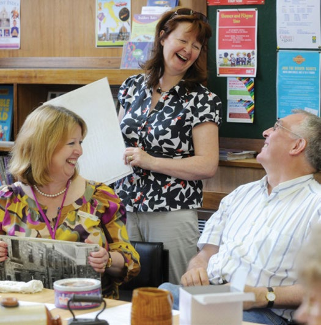

Scottish Library and Information Council  
Suite 5.5, 5th Floor, 180 West Regent Street, Glasgow G2 4RW  
[www.scottishlibraries.org](http://www.scottishlibraries.org)

Carnegie UK Trust  
Andrew Carnegie House, Pittencrieff Street, Dunfermline, Fife KY12 8AW  
[www.carnegieuktrust.org.uk](http://www.carnegieuktrust.org.uk)

Convention of Scottish Local Authorities (COSLA)  
Verity House, 19 Haymarket Yards, Edinburgh EH12 5BH  
[www.cosla.gov.uk](http://www.cosla.gov.uk)

Scottish Government  
St Andrew's House, Regent Road, Edinburgh EH1 3DG  
[www.gov.scot](http://www.gov.scot)

## Footnotes

[^1]: Scottish Government, *Scotland’s People Annual Report: Results from 2013 Scottish Household Survey*, Edinburgh: The Scottish Government, August 2014, p. 148.
[^2]: Scottish Library and Information Council (SLIC) internal survey data and Scottish Local Government statistics, 2014.
[^3]: Organisation for Economic Co-operation and Development (OECD), *Public Governance Reviews: Scotland*, Paris: OECD Publishing, 2014.
[^4]: Scottish Government, *Renewing Scotland’s Public Services: Priorities for reform in response to the Christie Commission*, Edinburgh: Scottish Government, 2011.
[^5]: Commission for Strengthening Local Democracy, *Effective Democracy: Reconnecting with Communities*, Edinburgh: COSLA, 2014.
[^6]: Scottish Local Government Financial Statistics (SLGFS), Edinburgh: Scottish Government, 2008–2014.
[^7]: Scottish Book Trust, *Bookbug Annual Evaluation Report 2013/14*, Edinburgh: Scottish Book Trust, 2014.
[^8]: CIPFA (Chartered Institute of Public Finance and Accountancy), *Public Library Statistics: 2012–13 Actuals*, London: CIPFA, 2013.
[^9]: Scottish Library and Information Council (SLIC), *How Good is our Public Library Service? A Public Library Improvement Model for Scotland*, Glasgow: SLIC, 2014.
[^10]: Scottish Government, *Scotland’s Digital Future: Delivery of Public Services*, Edinburgh: Scottish Government, 2012.
