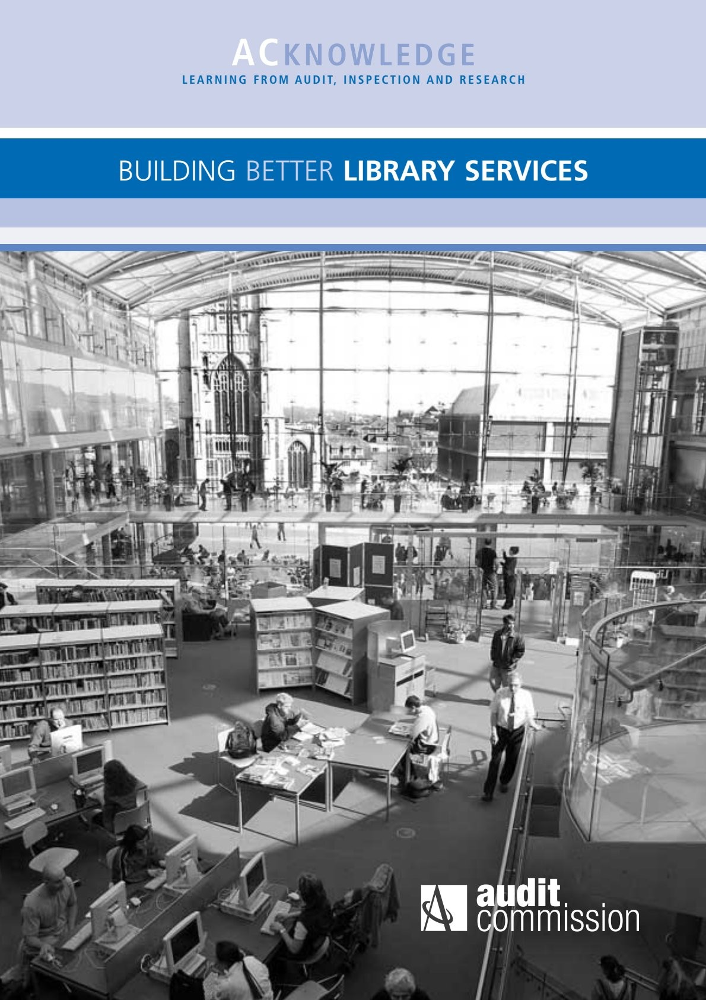
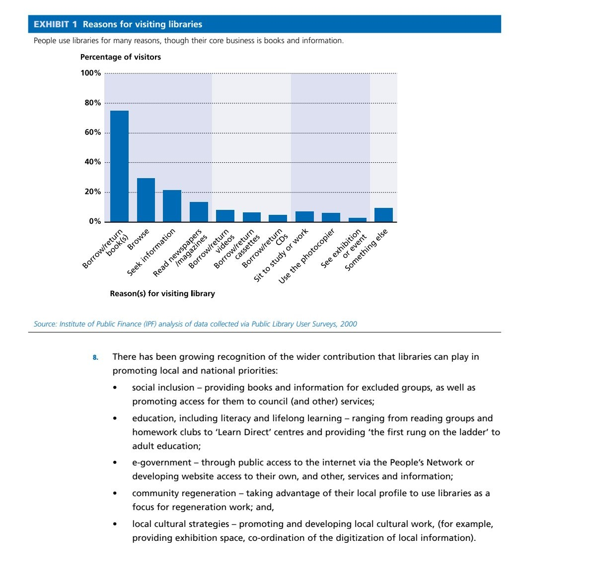
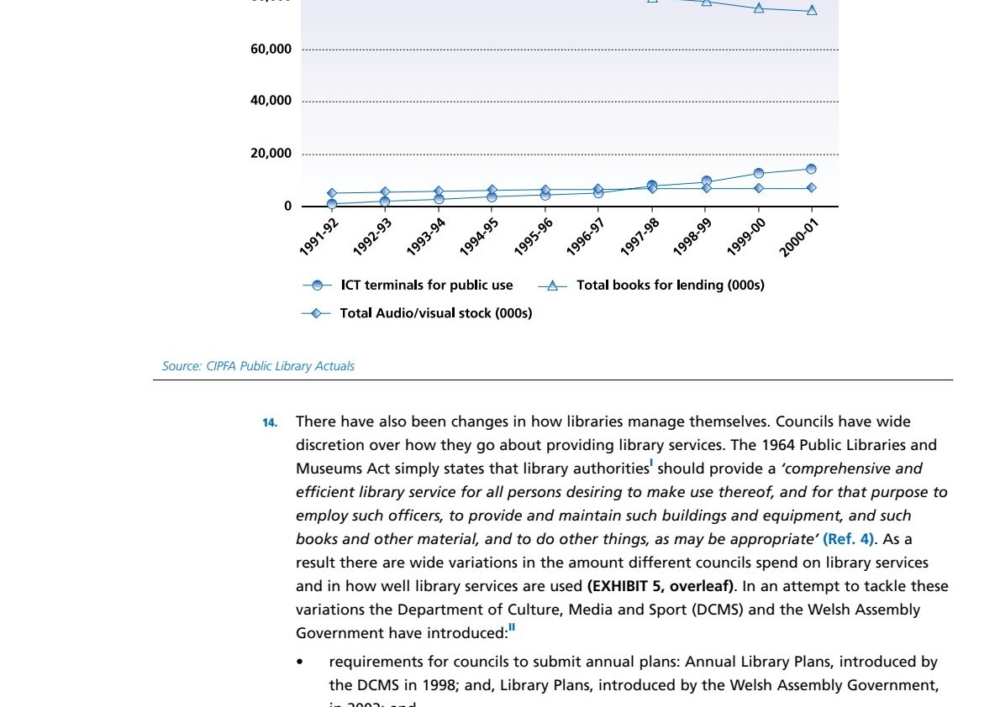
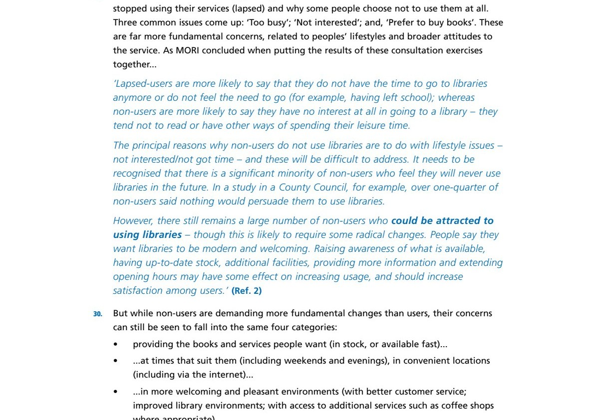
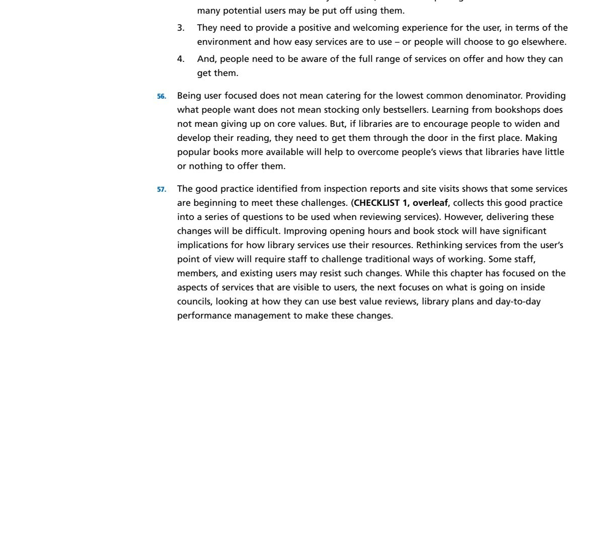
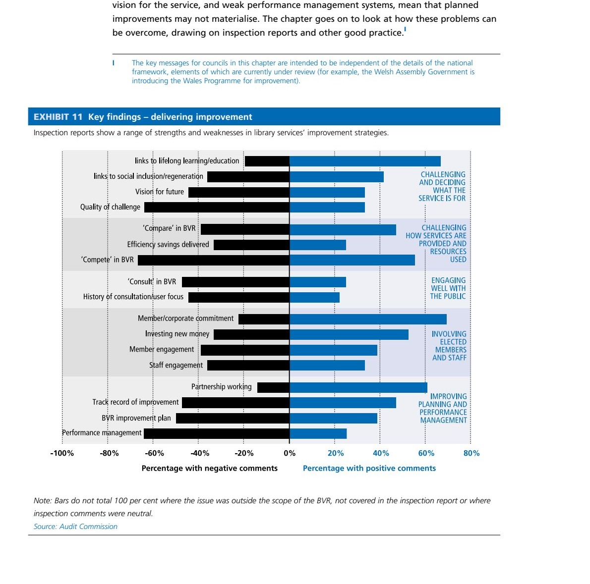
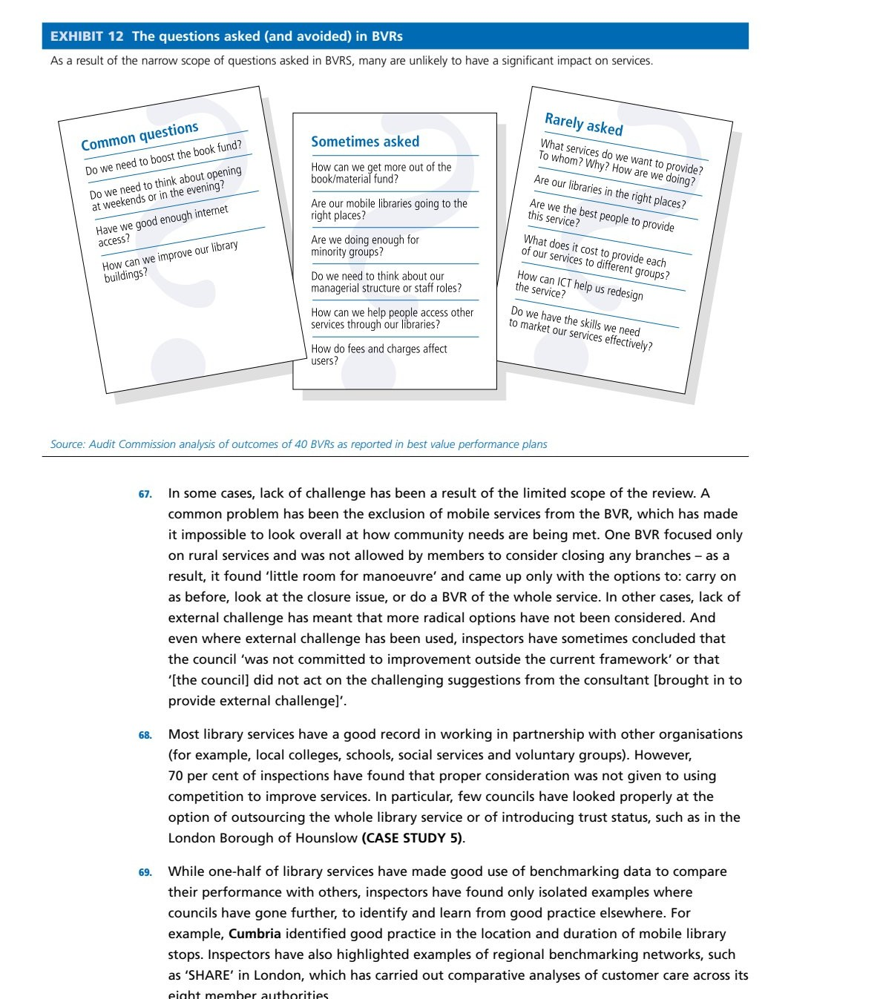

# Building Better Library Services

## Learning from Audit, Inspection and Research.

<!-- PAGE: 1 -->

**Audit Commission**

**Building Better Library Services**

Learning from audit, inspection and research.

National Report — May 2002.

<!-- PAGE: 2 -->

The Audit Commission promotes the best use of public money by ensuring the proper stewardship of public finances and by helping those responsible for public services to achieve economy, efficiency and effectiveness.

For more information on the work of the Commission, please contact:  
Sir Andrew Foster, Controller, The Audit Commission, 1 Vincent Square, London SW1P 2PN.  
Website: `www.audit-commission.gov.uk`.

<!-- PAGE: 3 -->

## Contents

- Summary (Page 1 / Page 5)
- Preface (Page 2 / Page 6)
- 1. The Library Service in Context (Page 3 / Page 7)
  - Why libraries are important (Page 3 / Page 7)
  - Changes to the library service (Page 5 / Page 9)
  - Other changes and pressures (Page 8 / Page 12)
  - Changes in use (Page 9 / Page 13)
  - Conclusions (Page 10 / Page 14)
- 2. How Good Are Library Services? (Page 11 / Page 15)
  - What do people want from their library service? (Page 11 / Page 15)
  - How user-focused are library services? (Page 15 / Page 19)
  - How services need to change (Page 24 / Page 28)
- 3. Delivering Improvements in Library Services (Page 27 / Page 31)
  - Challenging and deciding what the service is for (Page 29 / Page 33)
  - Challenging how services are provided and how resources are used (Page 31 / Page 35)
  - Engaging with the public (Page 36 / Page 40)
  - Involving elected members and staff (Page 38 / Page 42)
  - Improving planning and performance management (Page 40 / Page 44)
  - Conclusion (Page 43 / Page 47)
- 4. Moving Forward (Page 45 / Page 49)
  - Recommendations (Page 47 / Page 51)
- Appendix 1: Research and acknowledgements (Page 48 / Page 52)
- Appendix 2: National standards (Page 49 / Page 53)
- Appendix 3: Quality of book stock (Page 50 / Page 54)
- References (Page 52 / Page 56)

<!-- PAGE: 4 -->

*(Page left intentionally blank)*.

<!-- PAGE: 5 -->

## Summary

Libraries are an important, valued council service, with the potential to contribute to priorities for learning, inclusion and e-government:

- There were 290 million visits to libraries in 2000/01.
- Almost 30 per cent of the population use libraries for borrowing books or other items.
- Many more people visit libraries to study, use PCs and the internet, make enquiries or for community activities.

But, despite growing demand for books and information (and broadly stable resources of £770 million) traditional library services are in decline:

- Total visits have fallen by 17 per cent over the last decade, and book loans by 25 per cent.
- In some inner city and deprived areas fewer than one in five people now borrow books from libraries.
- The condition of library buildings is generally poor, with an estimated maintenance backlog of over £100 million.
- Public dissatisfaction, though low, is rising and public satisfaction has fallen from 70 per cent in 1993 to 64 per cent in 2000.

If the decline in use is to be reversed libraries need to rethink services from the user’s point of view:

- Providing more of the books and information services that people want.
- Improving accessibility by opening at times that suit people, sharing facilities with other services, and using the internet.
- Ensuring that services are easy and pleasant to use – learning, in particular, from bookshops.
- Building awareness among non-users of the services that libraries offer.

Councils also need to make effective use of best value reviews and library plans to fundamentally challenge why and how they provide library services:

- Clearly defining the local purpose and vision for the service.
- Finding innovative ways to provide services and allocate resources.
- Engaging more effectively with users and non-users.
- Developing elected member and managerial leadership.
- Improving performance management and staff development.

<!-- PAGE: 6 -->

## Preface

**1.** Public libraries hold a special place in English and Welsh cultural life. They provide free access to literature, knowledge and learning. They are popular and trusted, and have established a physical presence in every community across the country.

**2.** Yet public libraries face a profound challenge. While overall consumer spending on books and information has expanded rapidly over the past decade, library usage has fallen. The arrival of digital technology and the internet presents huge opportunities for libraries, but also creates alternative channels through which people access information.

**3.** This report draws on the findings of Best Value inspections, financial audit, and national research to evaluate the state of public library services. It identifies the barriers holding services back and sets out practical recommendations for councils, library authorities and central government to build better library services that are modern, relevant and responsive to the needs of 21st-century users.

<!-- PAGE: 7 -->

## 1. The Library Service in Context

### Why Libraries Are Important

**4.** Public libraries hold an important place in people’s hearts. Unlike many of the other services that are provided by councils, they are used out of choice rather than necessity. People come to them for information, recreation and advice, rather than to settle disputes or to resolve problems. And they are popular. During 2000/01, public libraries in England and Wales received 290 million visits and loaned around 400 million books and other items.[^1] Almost 30 per cent of the population are active borrowers from libraries, and many more use them for reference, study, computing, or community activities.

**5.** Libraries are also one of the few universally accessible public spaces remaining in town and city centres and suburban neighbourhoods. They provide a safe, neutral, welcoming environment where everyone is treated equally, without commercial pressure to make a purchase.

**6.** Furthermore, libraries have a unique ability to bridge generational, cultural and socioeconomic divides. They support early years development through children’s storytelling sessions, provide study and revision spaces for secondary and higher education students, offer internet access and job-seeking resources for unemployed residents, and combat loneliness among retired and older people.

**7.** As local authorities modernise their services, libraries offer an established civic network through which councils can engage with local residents, deliver joined-up public services, and promote social cohesion.

<!-- PAGE: 8 -->

#### Exhibit 1: Reasons for Visiting Libraries

People use libraries for many reasons, though their core business remains books and reading material:

- Borrowing / returning fiction books: 64%
- Borrowing / returning non-fiction books: 32%
- Reference and information search: 21%
- Reading newspapers and periodicals: 14%
- Borrowing audio-visual items (CDs, videos, audiobooks): 12%
- Using computers / internet access: 8%
- Studying / quiet work space: 7%
- Attending an event, meeting, or community activity: 5%

*(Source: Institute of Public Finance (IPF) analysis of data collected via Public Library User Surveys, 2000)*.

**8.** There has been growing recognition of the wider contribution that libraries can play in promoting local and national priorities:

- **Social Inclusion**: Providing books and information for excluded groups, as well as promoting access for them to council (and other) services.
- **Education and Literacy**: Supporting reading for pleasure, family literacy, homework clubs, and lifelong learning.
- **Economic Regeneration**: Offering business information, company directories, patent databases, and local employment support.
- **E-Government and Digital Access**: Delivering public internet access through the People’s Network, supporting digital literacy and online government transactions.

<!-- PAGE: 9 -->

### Changes to the Library Service

**9.** Over the last ten years there have been significant changes in the way that library services are provided and resourced. Total resources, excluding earmarked funding, have remained broadly stable – rising slightly in the early 1990s, before falling back. However, there has been an increase in the proportion of funding raised locally through fees, charges and other grants – up from 6 per cent of total funding in 1992/93 to 10 per cent in 2000/01.

**10.** Net expenditure on public libraries in England and Wales was approximately £770 million in 2000/01, representing around £15 per resident. However, spending per head varies significantly across authorities, ranging from under £10 per resident in some county authorities to more than £30 in inner London.

<!-- PAGE: 10 -->

**11.** The level of service provision has also seen reductions over the decade:

- 9 per cent fewer libraries are open for 30 or more hours per week than in 1992/93.
- There are 8 per cent fewer mobile libraries in operation.
- There are 7 per cent fewer static service points overall.

**12.** On the other hand, the provision of ICT services in libraries has increased significantly. The public now have access to over 14,500 ICT terminals in council libraries, up from 4,500 in 1995/96 – providing access to the internet, CD-ROMs, word processing, and digital learning packages funded largely by the National Lottery through the New Opportunities Fund (NOF).

<!-- PAGE: 11 -->

### Changes in Use

**13.** Despite stable expenditure, traditional library usage has experienced a sharp, sustained decline across England and Wales over the past decade:[^2]

- Total book loans dropped by 25 per cent between 1990/91 and 2000/01 (from 540 million to 400 million items per year).
- In-person visits to public libraries fell by 17 per cent over the same period (from 350 million to 290 million visits per year).
- Active borrowers declined from 36 per cent of the population to under 30 per cent.

**14.** This decline cannot simply be dismissed as an inevitable consequence of competition from television or commercial retail. Over the exact same decade, UK consumer spending on retail books surged by 45 per cent, and book buying became a mainstream leisure activity. The decline in library borrowing reflects a widening gap between customer expectations and public library provision.[^3]

<!-- PAGE: 12 -->

**15.** The drop in usage has been unevenly distributed across the country. In some rural counties, active membership has remained above 40 per cent. However, in several inner-city metropolitan boroughs and deprived urban areas, fewer than 18 per cent of residents are active library members, and book borrowing has fallen by more than 35 per cent.

**16.** Furthermore, the profile of library users has changed:

- Children’s borrowing has held up relatively well, supported by early-years book gifting schemes and summer reading initiatives.
- Adult fiction borrowing has experienced the steepest decline, dropping by more than 28 per cent.
- Non-fiction borrowing has fallen as users migrate to online search engines and CD-ROM references for factual inquiries.

<!-- PAGE: 13 -->

**17.** In addition, demographic trends show that library users are aging. Over 35 per cent of regular library visitors are aged 55 and over, compared to 27 per cent of the general population.[^4] Libraries have had less success in attracting teenagers, young adults (aged 16–24), and working-age men.

**18.** The development of library websites and online catalogues offers new opportunities for virtual engagement. While remote website visits were not systematically measured across all authorities in 2000/01, early data indicates that online catalogue searches, electronic renewals and online reservation requests are expanding rapidly.[^5]

<!-- PAGE: 14 -->

### Conclusions: Chapter 1

**19.** Public libraries in England and Wales stand at a pivotal crossroads. They enjoy strong community goodwill, an enviable physical branch presence, and dedicated staff. The rollout of the People’s Network has demonstrated that libraries can successfully implement nationwide technological transformation.

**20.** However, the steady erosion of core book borrowing and visits threatens the viability of the service. Maintaining static budgets while branch hours are reduced and book funds are squeezed creates a vicious cycle of falling quality and falling use.

**21.** To arrest this decline, councils must modernise their vision for public libraries. They must understand why users are turning elsewhere, realign their collections with contemporary tastes, invest in staff skills, and transform tired branches into vibrant, attractive community destinations.

<!-- PAGE: 15 -->

## 2. How Good Are Library Services?

**22.** Under the Best Value regime introduced by the Local Government Act 1999, all council services are subject to rigorous inspection by the Audit Commission’s Best Value Inspection Service (BVIS). Between April 2000 and February 2002, 35 public library services in England were inspected.[^6]

**23.** These inspections assessed two key dimensions:
- How good is the service currently provided to local residents? (Rated: Poor / Fair / Good / Excellent).
- What are the prospects for improvement? (Rated: Unlikely to improve / Uncertain / Promising / Excellent).

<!-- PAGE: 16 -->

### What Do People Want from Their Library Service?

**24.** Extensive research commissioned by the Audit Commission from MORI examined public perceptions and expectations of library services across England and Wales.[^7]

**25.** The MORI findings demonstrate that the public have very clear priorities for what makes a high-quality library service:

- A wide, up-to-date selection of books and media (78% rated as essential).
- Convenient opening hours, particularly on weekends and evenings (68% essential).
- Knowledgeable, friendly and helpful staff (65% essential).
- A clean, comfortable and attractive physical environment (58% essential).
- Good access to computers and the internet (52% essential).
- Convenient location close to shops and public transport (49% essential).

<!-- PAGE: 17 -->

**26.** Overall satisfaction with public libraries remains high compared to many other council services, but has shown a steady downward trend:

- In 1993, 70 per cent of residents were satisfied with their local library service.
- By 2000, satisfaction had fallen to 64 per cent.
- Among frequent users, satisfaction remains high (over 85%), but among non-users and lapsed users, dissatisfaction with book stock, opening hours and building condition is growing.

<!-- PAGE: 18 -->

### Best Value Inspection Findings

**27.** The 35 Best Value inspections conducted to date reveal a mixed picture of performance across England:

- **Current Quality**: 9 per cent of services were rated *Poor* (0 stars); 57 per cent were rated *Fair* (1 star); 31 per cent were rated *Good* (2 stars); and only 3 per cent (1 authority) achieved an *Excellent* (3 stars) rating.
- **Prospects for Improvement**: 6 per cent were judged *Unlikely to improve*; 49 per cent were *Uncertain*; 40 per cent were *Promising*; and 5 per cent were judged to have *Excellent* prospects for improvement.

**28.** These findings indicate that while serious failure is rare, mediocrity is widespread. The majority of library services are operating as ‘fair’ or ‘adequate’ services that struggle to meet the expectations of modern consumers or to articulate a compelling strategic direction.[^8]

<!-- PAGE: 19 -->

### How User-Focused Are Library Services?

**29.** The Best Value inspections revealed that many library authorities remain service-driven or producer-led rather than truly customer-focused. Traditional professional assumptions about what libraries should offer often take precedence over what local communities actually need and desire.

**30.** This lack of user focus manifests across four critical areas:
- Book stock and media selection.
- Opening hours and accessibility.
- The physical environment of library buildings.
- Promotion and community outreach.

<!-- PAGE: 20 -->

**31.** The condition of public library buildings is a major concern. Decades of deferred maintenance have left many branches run-down, dingy and poorly lit. Inspection reports noted peeling paint, worn carpets, cramped shelving, inadequate heating, and poor disabled access.

**32.** The total capital maintenance backlog across the library estate in England and Wales is estimated to exceed £100 million. Many buildings are physically inflexible and ill-suited to modern ICT cabling, group activities, or retail-style merchandising.

<!-- PAGE: 21 -->

### Stock Selection and Availability

**33.** Book stock is the core business of public libraries, yet book purchasing has borne the brunt of past budget cuts. Between 1990/91 and 2000/01, spending on books in real terms fell by nearly 20 per cent.

**34.** To evaluate stock quality, the Audit Commission commissioned Opening the Book Ltd to analyse book collections across a representative sample of library authorities:[^9]

- **Depth and Range**: While libraries maintain broad backlists, popular bestsellers and contemporary fiction are frequently under-stocked.
- **Availability of 2001 Bestsellers**: When researchers checked for 15 prominent 2001 bestsellers across 12 authorities, over 60 per cent of copies were either on loan with extensive waiting lists or completely absent from shelf stock.[^10]
- **Duplication and Reservation Charges**: Many authorities restrict the purchase of multiple copies of high-demand titles, forcing users onto waiting lists and charging reservation fees of up to £1 per item.[^11]

<!-- PAGE: 22 -->

**35.** The retail book sector operates on the principle that customers expect to find popular titles immediately available on the shelves. In contrast, many library authorities continue to view reservations and waiting lists as an acceptable rationing mechanism.

**36.** When readers cannot find current books on the shelf, they become discouraged and turn to commercial bookshops or online retailers, accelerating the decline in active library borrowing.

<!-- PAGE: 23 -->

### Opening Hours and Access

**37.** Inconvenient opening hours remain one of the most frequently cited reasons for non-use in public surveys. Over the past decade, opening hours have been cut in many authorities to balance operational budgets.

**38.** Key access barriers identified by the Commission include:

- **Lunchtime and Evening Closures**: Many suburban and rural branches close during lunch hours or shut at 5:00 PM on weekdays, excluding commuters and working residents.
- **Weekend Availability**: Sunday opening remains extremely rare, and many branches close at 1:00 PM on Saturdays.
- **Inconsistent Timetables**: Complex, staggered opening patterns across neighbouring branches confuse users and make service planning difficult.

<!-- PAGE: 24 -->

**39.** Modern retail and commercial leisure providers have expanded opening hours to match seven-day consumer lifestyles. Public libraries that remain closed when people are free to visit inevitably marginalise themselves.

**40.** Several innovative authorities have restructured staffing rotas to extend weekend and evening hours without substantial budget increases. Authorities that introduced Sunday opening have reported that Sundays quickly became one of their busiest borrowing and study days.

<!-- PAGE: 25 -->

**41.** Furthermore, the co-location of library branches with customer service centres, health clinics, schools and leisure centres has enabled extended operating hours and shared staffing, demonstrating a viable model for sustainable local access.

<!-- PAGE: 26 -->

### Physical Environment and Presentation

**42.** Walking into a modern retail bookstore is an inviting, sensory experience: comfortable seating, clear genre signage, attractive face-out book displays, coffee facilities, and vibrant promotional tables.

**43.** In contrast, all too many public library branches present an intimidating, institutional atmosphere. Books are shelved spine-out on towering metal stacks; signage is confusing; Dewey decimal categories are impenetrable to casual browsers; and rigid ‘quiet’ rules discourage families and teenagers.

<!-- PAGE: 27 -->

**44.** Library design research shows that more than 70 per cent of library users browse without a specific title in mind. However, library shelving is typically designed for inventory storage rather than browsing encouragement.

**45.** Progressive authorities have demonstrated that applying retail visual merchandising principles—low display units, front-cover displays, themed reading promotions, and comfortable seating—results in dramatic increases in borrowing across all demographics.

<!-- PAGE: 28 -->

### How Services Need to Change

**46.** To transform from producer-led institutions into vibrant, customer-centred community hubs, public libraries must fundamentally rethink their service model:

- Rebalance spending towards high-demand, current book stock.
- Align opening hours with contemporary leisure and working patterns.
- Invest in welcoming, comfortable and flexible interior design.
- Proactively promote services to non-users and under-represented community groups.

<!-- PAGE: 29 -->

#### Exhibit 10: Developing User-Focused Library Services

A user-focused library service aligns four pillars around the customer:

1. **What is Provided**: High-quality, modern collections, responsive book stock, digital access, and diverse formats.
2. **When it is Provided**: Accessible opening hours, late nights, weekends, Sunday opening, and 24/7 online services.
3. **Where it is Provided**: Convenient, accessible locations, co-location with public and commercial services, and digital channels.
4. **How it is Delivered**: Welcoming customer care, pleasant physical environments, retail-style displays, and active community outreach.

<!-- PAGE: 30 -->

**47.** Achieving this transformation requires more than cosmetic changes. It demands clear corporate vision, robust performance management, and effective leadership from council leaders, portfolio holders and chief librarians.

<!-- PAGE: 31 -->

## 3. Delivering Improvements in Library Services

**48.** Delivering sustainable improvements in library performance requires local authorities to apply the principles of Best Value with rigour and imagination.[^12]

**49.** Best Value reviews (BVRs) provide councils with a structured framework to challenge existing assumptions, consult communities, compare performance, and explore competitive delivery models.

<!-- PAGE: 32 -->

### The Change Management Model

**50.** The Commission’s inspection evidence demonstrates that successful library transformation relies on five interrelated components:

1. **Strategic Leadership**: Strong political and managerial commitment to modernising libraries.
2. **Rigorous Challenge**: Willingness to question traditional models and reallocate resources.
3. **Genuine Community Engagement**: Meaningful consultation that shapes service design.
4. **Effective Performance Management**: Setting clear targets, monitoring outcomes, and benchmarking costs.
5. **Staff Development and Culture Change**: Equipping frontline staff with commercial and customer care skills.[^13]

<!-- PAGE: 33 -->

### Challenging and Deciding What the Service Is For

**51.** The first step in any successful library review is to establish absolute clarity regarding the purpose and priorities of the service. All too often, library authorities attempt to be ‘all things to all people’, spreading static resources thinly across an ever-widening list of responsibilities.

**52.** Councils must make deliberate strategic choices about their core priorities. Is the primary goal promoting literacy and reading for pleasure? Supporting educational attainment? Providing free digital access? Delivering community information? Or acting as a social inclusion safety net?

<!-- PAGE: 34 -->

**53.** These priorities will vary according to local circumstances. An inner-city borough facing high deprivation may prioritise homework clubs, English language support, and digital literacy. A rural county with an aging population may focus on mobile library delivery, large-print collections, and local history services.

**54.** Once corporate priorities are clearly defined, councils can align budgets, staffing and performance targets behind them.

<!-- PAGE: 35 -->

### Challenging How Services Are Provided

**55.** Best Value requires authorities to challenge the traditional model of direct, in-house provision. While most library services continue to be managed directly by council departments, alternative operating models are emerging:

- **Trusts and Non-Profit Entities**: Establishing charitable trusts or non-profit distributing organisations to operate libraries alongside leisure and arts facilities (e.g. Wigan Leisure and Culture Trust).
- **Public-Public Partnerships**: Sharing management, procurement or ICT infrastructure across neighbouring authorities (e.g. consortium book purchasing and shared LMS).
- **External and Commercial Partnerships**: Working with private providers for specialised technical, facility management, or retail operations.
- **Community Partnerships**: Devolving small community branches to volunteer groups, parish councils or development trusts.

<!-- PAGE: 36 -->

#### Exhibit 12: The Questions Asked (and Avoided) in Best Value Reviews

Inspection evidence shows that many library BVRs avoid the tough, fundamental questions:

| Questions Often Asked | Questions Often Avoided |
| :--- | :--- |
| How can we cut 5% from our existing budget? | Why do we provide libraries in their current form? |
| Should we reduce opening hours at small branches? | Does our branch network match current population distribution? |
| Can we increase fines and reservation charges? | Should we close poorly used branches to reinvest in flagship hubs? |
| How can we purchase more books with less money? | Could another provider or trust deliver better outcomes? |
| How many people visited last year? | Why are 70% of local residents not using our service? |

<!-- PAGE: 37 -->

**56.** Addressing these challenging questions requires political courage. Closing an under-used, dilapidated branch to invest in a state-of-the-art town centre facility often generates fierce vocal opposition from a small group of existing users, while the prospective benefits to the wider community remain unseen.

**57.** Councils must base their decisions on robust data, comprehensive needs assessments, and transparent public communication.[^14]

<!-- PAGE: 38 -->

### Procurement and Stock Management

**58.** Stock selection and purchasing procedures in many library authorities are inefficient, bureaucratic and slow. In some councils, newly published books take up to three months to appear on library shelves after their retail release date.

**59.** By streamlining procurement, using supplier selection, and embracing electronic data interchange (EDI), progressive authorities have drastically cut overhead costs and shortened turnaround times to mere days.

<!-- PAGE: 39 -->

**60.** In addition, regional purchasing consortia have secured substantial volume discounts on book purchases. However, wide variations persist: some consortia negotiate discounts of up to 40 per cent off retail prices, while individual authorities purchasing independently receive less than 20 per cent.

<!-- PAGE: 40 -->

### Engaging with the Public

**61.** Consultation in public libraries has often been limited to passive customer surveys administered to existing visitors. This approach inherently skews feedback towards the preferences of current, frequent users while ignoring the views of the 70 per cent of residents who do not visit.[^15]

**62.** Effective community engagement must proactively reach out to non-users, lapsed borrowers, young people, and minority ethnic communities using focus groups, online panels, and street interviews.

<!-- PAGE: 41 -->

**63.** When councils engage honestly with communities about financial constraints and trade-offs—for example, asking whether residents prefer five rundown branches open 20 hours a week or two modern, well-stocked hubs open 60 hours a week including Sundays—public support for modernisation increases substantially.

<!-- PAGE: 42 -->

### Involving Elected Members and Staff

**64.** Library transformation cannot be driven from within the library department alone. It requires passionate, visible leadership from elected members and corporate directors.

**65.** Elected portfolio holders must champion libraries across the council, ensuring that libraries feature prominently in community strategies, regeneration schemes, and corporate capital programmes.

<!-- PAGE: 43 -->

**66.** Frontline staff are the public face of the service. Staff morale has suffered from years of budget uncertainty and negative media narratives about library closures.

**67.** Investing in staff development, customer care training, retail merchandising skills, and ICT proficiency is vital to creating an enthusiastic, customer-focused workforce.

<!-- PAGE: 44 -->

## 4. Moving Forward

**68.** Public libraries provide immense social, educational and cultural value. They are uniquely positioned to deliver on central and local government agendas for lifelong learning, social inclusion, and digital citizenship.[^16]

**69.** However, the status quo is unsustainable. Continued decline in borrowing and visits will inevitably undermine political and financial support for the service.

<!-- PAGE: 45 -->

**70.** Reversing this decline is entirely achievable. Local authorities that have embraced bold reform—investing in flagship facilities like the Norfolk and Norwich Millennium Library, modernising book stock, opening seven days a week, and embedding ICT—have witnessed massive surges in public visits and community pride.

<!-- PAGE: 46 -->

**71.** Delivering this modernisation requires action across all tiers of government: central departments (DCMS, DfES), national advisory bodies (Resource: The Council for Museums, Archives and Libraries), local council leadership, and frontline library managers.

<!-- PAGE: 47 -->

**72.** By placing the customer at the centre of service design and managing resources with efficiency and imagination, councils can build public library services that flourish in the 21st century.

<!-- PAGE: 48 -->

## Recommendations

### Recommendations for Central Government (DCMS and Resource)

- **National Vision and Policy Framework**: Establish a clear national framework defining the modern purpose and core standards of public library services.
- **Funding and Capital Investment**: Support capital modernisation through targeted funding streams, private finance initiatives (PFI), and lottery allocations.
- **Performance Framework**: Refine the Public Library Standards (PLS) to focus on customer satisfaction, social impact, and book stock relevance rather than purely process-based inputs.
- **Research and Good Practice**: Disseminate proven innovation in stock management, procurement consortia, and alternative delivery models.

<!-- PAGE: 49 -->

### Recommendations for Local Authorities and Library Services

- **Define Strategic Purpose**: Clearly identify what the library service is for and align it with corporate community, education and inclusion strategies.
- **Conduct Rigorous Best Value Reviews**: Challenge traditional delivery models and question outdated network configurations.
- **Rethink Services from the User's Perspective**: Prioritise spending on popular, modern book stock and reduce waiting times for high-demand titles.
- **Expand Opening Hours**: Match opening times to modern lifestyles, focusing on weekend, evening, and Sunday opening.
- **Modernise Library Environments**: Adopt retail merchandising principles, upgrade signage, provide comfortable seating, and eliminate unnecessary physical barriers.
- **Consult Proactively with Non-Users**: Use targeted research to identify barriers preventing under-represented groups from using libraries.
- **Invest in Workforce Skills**: Equip frontline staff with customer service, merchandising, and digital technology skills.

<!-- PAGE: 50 -->

*(Page left intentionally blank)*.

<!-- PAGE: 51 -->

*(Page left intentionally blank)*.

<!-- PAGE: 52 -->

## Appendix 1: Research and Acknowledgements

The national study was conducted between October 2001 and February 2002 by the Audit Commission's public services research directorate.

The study team comprised:
- **Irene Bews** (Study Manager)
- **Matthew Brown**
- **David Hunter**
- **Paul Raynes**
- **Alison Russell**

The study was supported by an external Advisory Group of senior sector professionals and policymakers:
- **David Cracknell** (Chief Education Officer, Cheshire County Council)
- **Mark Wood** (Chairman, Resource: The Council for Museums, Archives and Libraries)
- **Chris Heinitz** (Local Government Association)
- **John Dolan** (Head of Libraries, Birmingham City Council)
- **Grace Kempster** (Director of Information, The British Council)
- **Andrew Stevens** (Department for Culture, Media and Sport)

<!-- PAGE: 53 -->

## Appendix 2: National Standards

In January 2001, the Department for Culture, Media and Sport (DCMS) introduced statutory Public Library Standards (PLS) for England, setting targets to be achieved by March 2004 across 19 performance indicators:

1. Proportion of households living within specified distances of a library (e.g. 100% within 1 mile in inner London; 100% within 2 miles in outer London; 100% within 3 miles in metropolitan areas).
2. Aggregate opening hours per 1,000 population (target: 128 hours per 1,000 population).
3. Percentage of opening hours outside 9:00 AM – 5:00 PM on weekdays (target: 30%).
4. Proportion of libraries providing public access internet workstations (target: 100%).
5. Total number of electronic workstations available per 1,000 population (target: 6).
6. Annual number of library visits per capita (target: 6.8 visits per year).
7. Annual number of book issues per capita.
8. Annual expenditure on book acquisitions per capita.
9. Time taken to supply requested books (targets: 50% within 7 days, 70% within 15 days, 85% within 30 days).

<!-- PAGE: 54 -->

## Appendix 3: Quality of Book Stock

### Range of Adult Fiction

Analysis of adult fiction stock across 12 inspected authorities revealed substantial disparities in the depth and variety of collections available to local readers. Authorities with centralised, supplier-led selection processes maintained broader genre diversity and higher stock turnover than authorities where book selection was fragmented across individual branch librarians.

### Availability of 2001 Bestsellers

Surveys assessing shelf availability of 15 major 2001 titles (including fiction by Ian McEwan, Nick Hornby, and Marian Keyes, and non-fiction by Naomi Klein and Pamela Stephenson) demonstrated that in 8 out of 12 authorities, less than 30 per cent of copies were available on the open shelves, with the majority trapped in reservation queues.

<!-- PAGE: 55 -->

*(Page left intentionally blank)*.

<!-- PAGE: 56 -->

## References

1. Audit Commission, *Due for Renewal: A Report on the Library Service*, Audit Commission, London, 1997.
2. Department of National Heritage, *Reading the Future: A Review of Public Libraries in England*, DNH, London, 1997.
3. Library and Information Commission, *New Library: The People's Network*, LIC, London, 1997.
4. Department for Culture, Media and Sport, *Comprehensive, Efficient and Modern Public Libraries: Standards and Assessment*, DCMS, London, 2001.
5. Audit Commission, *Change Here: Managing Change in Local Authorities*, Audit Commission, London, 2001.
6. MORI, *Perceptions of Public Libraries*, Research report for the Audit Commission, London, 2002.
7. Opening the Book Ltd, *Stock Quality and Merchandising in Public Libraries*, Research report for the Audit Commission, 2002.
8. Chartered Institute of Public Finance and Accountancy (CIPFA), *Public Library Statistics: 2000-01 Actuals*, CIPFA, London, 2001.

<!-- PAGE: 57 -->

## Audit Commission Information

© Audit Commission 2002.  
First published in May 2002 by the Audit Commission for Local Authorities and the National Health Service in England and Wales, 1 Vincent Square, London SW1P 2PN.

Printed in the UK for the Audit Commission by Holbrooks Printers Ltd, Portsmouth.  
ISBN: `1 86240 351 1`.

Front cover picture: The Norfolk and Norwich Millennium Library, J Wyatt Photography Partnership (with thanks to Norfolk County Council).

<!-- PAGE: 58 -->

**Audit Commission**

1 Vincent Square  
London SW1P 2PN  
Telephone: `020 7828 1212`  
Website: `www.audit-commission.gov.uk`

## Footnotes

[^1]: The figure for loans counts renewals as extra loans (and so overestimates the number of separate items borrowed).
[^2]: Those councils charged with running library services: London Boroughs, Metropolitan Boroughs, Unitary Authorities, and County Councils.
[^3]: As well as other concerns about the management of library services as expressed in the 1997 DNH report *Reading the Future*.
[^4]: The proportion of people over 55 in the general population (27 per cent) has remained stable over this period.
[^5]: As library websites become more established, the opportunity to make ‘virtual visits’ will become a more significant part of library services.
[^6]: Thirty-three of these reviews focused on the whole library service; two focused on specific aspects (services to children and branch libraries).
[^7]: The report from MORI, *Perceptions of Libraries*, is available from the Audit Commission website.
[^8]: The improvement judgement has recently been amended. Services are now judged as ‘unlikely to improve’, ‘uncertain’, ‘promising’, or ‘excellent’.
[^9]: A sample output from this tool, which was commissioned from Opening the Book Ltd, is included in Appendix 3.
[^10]: Including *Atonement* by Ian McEwan, *No Logo* by Naomi Klein, *Learning to Fly* by Victoria Beckham, and *Billy* by Pamela Stephenson.
[^11]: Stock management is discussed further in Chapter 3, as well as in the Commission’s management briefing.
[^12]: These five areas are closely related to the ‘building blocks’ introduced in the Commission’s report *Change Here*.
[^13]: The key messages for councils in this chapter are intended to be independent of the current review of public library policy by DCMS.
[^14]: Detailed figures on discounts are not nationally collated due to commercial sensitivity.
[^15]: For a guide to effective community consultation see *Listen Up! Effective Community Consultation*, Audit Commission, 1999.
[^16]: The Welsh Assembly Government will be carrying out its first assessment of the Welsh public library standards in Autumn 2002.
