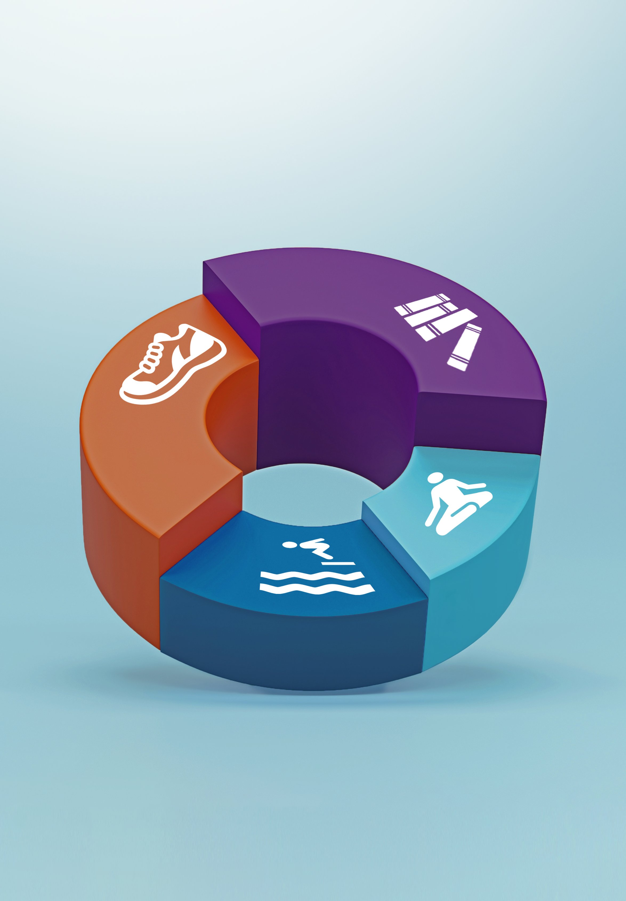

<!-- PAGE: 1 -->

# Local government performance: Spotlight on culture and leisure services

**Prepared by Audit Scotland for the Accounts Commission**  
**October 2025**

<!-- PAGE: 2 -->

## Contents

- [Key facts](#key-facts) (page 3)
- [Key messages](#key-messages) (page 4)
- [Commission expectations](#commission-expectations) (page 5)
- [Introduction and methodology](#introduction-and-methodology) (page 6)
- [Culture and leisure services](#culture-and-leisure-services) (page 8)
- [Endnotes](#endnotes) (page 23)

### Accessibility

You can find out more and read this report using assistive technology on our website: <https://www.audit.scot/accessibility>.

<!-- PAGE: 3 -->

## Key facts

- **13** Councils with a single trust delivering leisure and culture services
- **10** Councils with either a leisure trust, a culture trust or both
- **£675m** Council net revenue spending on culture and leisure services in 2023/24, a three per cent decrease in real terms since 2018/19
- **£118m** The amount of money councils raised by charging for culture and leisure services in 2023/24, a 27 per cent increase in real terms since 2018/19
- **£9.9m** Culture and leisure savings approved by councils for 2025/26
- **44m** The number of visits to libraries in Scotland in 2023/24, the same as in 2018/19
- **43m** The number of visits to sports facilities in 2023/24, a 21 per cent decrease since 2018/19
- **15m** The number of visits to museums in 2023/24, a 25 per cent increase since 2018/19

<!-- PAGE: 4 -->

## Key messages

1. **Despite councils now spending more on delivering services, spending on culture and leisure services, such as libraries and sports facilities, reduced by three per cent in real terms between 2018/19 and 2023/24.** The level of services offered, and how they are provided, is a decision for individual councils, with most choosing to provide some services using an arm’s-length external organisation (ALEO).

2. **There is an increasing reliance on charging people to use these services, and a mixed picture of community consultation and the use of Equality Impact Assessments when considering service changes**, such as potentially closing facilities or increasing charges.

3. **The provision of culture and leisure services is important to help improve longer-term physical and mental wellbeing**, linked to activity across a range of other services, and reducing them risks deepening inequalities.

4. **There is a general lack of comprehensive and comparable data available to assess the performance of culture and leisure services.** Limitations within the Local Government Benchmarking Framework data, beyond attendance and satisfaction indicators, currently makes it difficult to monitor how effectively culture and leisure services are contributing to improving outcomes.

<!-- PAGE: 5 -->

## Commission expectations

Culture and leisure services play an important role in supporting positive outcomes, supporting health and wellbeing, and in prevention. Reducing these services can have a disproportionate impact on vulnerable members of society.

As a Commission, we place reliance on the Local Government Benchmarking Framework (LGBF) to inform our view of how councils are performing across key services. We welcome the work the sector is currently undertaking to strengthen indicators and improve its usefulness.

It is already apparent that financial pressures and rising demand have begun to impact the performance of frontline services. Without a better understanding of how individual services interact to support longer-term outcomes, it becomes increasingly difficult to make informed budgetary decisions that support the sustainability of council services.

In order to make informed decisions about the longer-term costs that may be associated with reducing accessible culture and leisure services, councils must work collaboratively with the wider public sector, as well as partners in the private and third sectors. They must strengthen their understanding of the possible longer-term effects of the decisions they are taking now to address financial pressures.

### Councils should:

- **ensure that public consultations and effective Equality Impact Assessments, that appropriately consider longer-term outcomes, are undertaken** when considering proposed changes to eligibility criteria for accessing services, and new or existing service charges (paragraphs 32 and 34).
- **continue to proactively engage with the Improvement Service and other partners to expand the range of culture and leisure service indicators** beyond satisfaction, attendance and cost metrics, better reflecting the important role these services play in prevention and in support of health and wellbeing outcomes (paragraph 43).
- **ensure council services are supported by clear, balanced and transparent local performance reporting and monitoring** that can respond to, and capture the impact of, service transformation and wider reform (paragraph 49).

<!-- PAGE: 6 -->

## Introduction and methodology

### Introduction

**1.** This report is part of a series of outputs produced by the Accounts Commission that, taken together, provide an independent overview of the local government sector. It follows our annual briefing on local government budgets, looking at the decisions councils took when setting their annual budgets; and will be followed by our annual financial bulletin, looking at the financial performance and position of councils.

**2.** The report focuses on a particular council service area, this year providing a spotlight on culture and leisure services. It looks at how councils are delivering these services, including the use of culture and leisure trusts, and considers performance in this important service area over time. Privately operated culture and leisure services are not considered within the report.

### Methodology

**3.** To analyse spending we are making use of the Scottish Local Government Finance Statistics (LGFS) that are published annually by the Scottish Government. Previously, councils used pre-defined service categories to record their spending, but council accounts are now prepared in-line with their own corporate structures, so some services may be shown together in the accounts. By using the standardised LGFS information to analyse spending across specific service areas, we hope to provide a consistent national trend of spending on specific services, and to aid comparability across councils. The service level expenditure within LGFS also more closely and consistently aligns to the service categories defined within the LGBF. The funding councils receive from external sources, such as sportscotland or Creative Scotland, are reflected within overall council spending on culture and leisure services.

**4.** Within this report we also make use of information previously submitted to us by councils and auditors when preparing the *Local government in Scotland: Financial Bulletin 2023/24* and *Local government budgets 2025/26* briefing. Alongside Provisional Outturn and Budget Estimates (also submitted to the Scottish Government by councils) this allows us to consider the decisions taken by councils, and the impact on specific services, when setting their 2024/25 and 2025/26 budgets. Auditors are currently carrying out audits of councils’ 2024/25 accounts.

<!-- PAGE: 7 -->

**5.** When looking at financial trends, we convert some figures to real terms. The most recent LGFS relate to 2023/24 and we have adjusted financial information from past years into 2023/24 prices to take account of inflation so that trend information is comparable. To do this we use gross domestic product (GDP) deflators, which are published quarterly by HM Treasury. GDP deflators are the standard approach adopted by both the UK Government and Scottish Government when analysing public expenditure.

<!-- PAGE: 8 -->

## Culture and leisure services

### Background

**6.** The Accounts Commission regularly reports on the financial challenges facing councils across Scotland. Our *Financial Bulletin 2023/24* and *Local government budgets 2025/26* briefing outlined the challenging financial climate that all councils are operating within. In recent years, councils have been consistently reliant on implementing measures to balance their budgets, including increasing council tax. Asking the public to pay more for local services raises a greater expectation on the performance of councils in delivering local services. At the same time, councils have been identifying savings, closing public facilities, and raising the fees and charges for accessing some services such as culture and leisure facilities.

### Culture and leisure services play an important role in prevention

**7.** Councils deliver a range of culture and leisure services. While offerings such as museums, galleries, and other cultural programmes often reflect the unique traditions of local communities, services like libraries and leisure facilities are commonly provided across council areas. As part of our first service spotlight report, we have decided to look at these services given the important contribution they provide in supporting longer-term outcomes, promoting wellbeing and preventing health issues.

**8.** High-quality culture and leisure services align with the Scottish Government’s and Convention of Scottish Local Authorities’ (COSLA’s) *Scotland’s Population Health Framework 2025-2035*, which prioritises taking preventative action to improve health outcomes. Culture and leisure services help improve physical and mental wellbeing through promoting physical activity and cultural participation. A reduction in the accessibility and affordability of these services risks deepening health inequalities across communities.

**9.** Councils are operating in an increasingly demanding operating environment, with high levels of need across key areas, such as education, homelessness and social care. A key challenge is that culture and leisure services are preventative and have cross-cutting impacts that are captured by other measures, such as health and social care indicators. This can make it difficult to directly attribute changes in performance to individual budget and spending decisions.

> [!NOTE]
> **Balancing the Budget**  
> In 2024/25 and 2025/26 councils used a range of measures to address budget gaps. These included raising council tax rates, identifying savings, drawing on reserves and increasing or introducing charges for accessing some services.

<!-- PAGE: 9 -->

### Councils must ensure adequate leisure, culture and library services, but the level of provision is decided locally

**10.** Councils have statutory responsibilities to deliver some services, such as education, social care and housing, to a defined standard. They also receive specified funding to support national outcomes and priorities. But the exact proportion of spending on individual services will vary across councils. This reflects local priorities, commitments and decisions, as well as wider factors such as rurality and the demographics of local populations.

**11.** There is less clarity over how councils must meet their statutory requirement to ensure there is an adequate provision of leisure, cultural and library services. Several reports explain the impact of this lack of clarity, including variation in the level of services provided across Scotland and the differing ways these services are delivered.[^1]

**12.** Whereas some statutory services have been prioritised when councils set their budgets, others like culture and leisure have been expected to contribute proportionately more to delivery of the savings required. Our *Local government budgets 2025/26* briefing explains how councils are implementing savings measures to ease their financial pressures, and we explore this further in paragraph 31.

> [!NOTE]
> The Improvement Service (IS) and Society of Local Authority Chief Executives (Solace) are leading on work to clarify the statutory services that councils must provide and the discretionary services that many also deliver. This work is being carried out as part of the wider transformation programme they are leading, and aims to inform a future operating model for councils as they respond to wider financial challenges. This work is due to conclude in late 2025.

### Spending on culture and leisure services has reduced, despite overall spending increasing

**13.** Overall, there has been an increase in councils’ day-to-day spending on services over the last six years. Councils’ net revenue expenditure increased in real terms by £1.7 billion (13 per cent) between 2018/19 and 2023/24.

**14.** In 2023/24, councils spent £14.8 billion across key council services with spending on education and social work representing around 78 per cent of this total. Councils’ spending on education increased by 13 per cent in real terms between 2018/19 and 2023/24, with spending on social work services increasing by 17 per cent over the same period. Much of this increased spending, however, can be attributed to increasing staff costs, with these accounting for around 70 per cent of total expenditure, and recent high inflation contributing to other costs increasing (Exhibit 1, page 10).

**15.** Spending on culture and leisure services, referred to as culture and related services within the LGFS, represents a relatively small proportion of overall council spending, approximately five per cent in 2023/24.

> [!NOTE]
> Net revenue expenditure refers to the amount of money councils spend on delivering services from their funding or reserves, adjusted for any spending supported via other means, such as income from fees and charges. It excludes any capital spending.

<!-- PAGE: 10 -->

**Exhibit 1: Councils’ net revenue expenditure, in real terms, has been increasing**  
*Most of councils’ spending is on providing education and social care services, in line with statutory responsibilities.*

| Service Area (£ millions) | 2018/19 | 2019/20 | 2020/21 | 2021/22 | 2022/23 | 2023/24 |
|:---|:---|:---|:---|:---|:---|:---|
| Culture and Related Services | 699 | 657 | 675 | 671 | 689 | 675 |
| Roads and Transport | 460 | 434 | 529 | 458 | 455 | 452 |
| Environmental Services | 824 | 812 | 842 | 815 | 798 | 811 |
| Building, Planning and Development | 251 | 226 | 254 | 284 | 261 | 263 |
| Central Services | 421 | 931 | 449 | 411 | 360 | 691 |
| Non-HRA Housing | 383 | 307 | 316 | 329 | 341 | 339 |
| Trading Services | -42 | -42 | -33 | -33 | -26 | -41 |
| Social Work Services | 3,943 | 4,106 | 4,104 | 4,324 | 4,543 | 4,604 |
| Education Services | 6,146 | 6,328 | 6,046 | 6,645 | 6,852 | 6,960 |
| **Total General Fund** | **13,085** | **13,757** | **13,541** | **13,904** | **14,273** | **14,755** |

*Note: Net revenue expenditure reflects day-to-day spending funded by general funding or reserves. Real-terms analysis, with financial information adjusted to 2023/24 prices. Source: Local Government Finance Statistics 2018/19 to 2023/24, Scottish Government.*

<!-- PAGE: 11 -->

Net revenue spending on culture and leisure services, however, reduced by £24 million in real terms between 2018/19 and 2023/24 (three per cent), despite overall expenditure on council services increasing.

**16.** Some service areas within culture and leisure services have faced more significant funding cuts than others:

- **Total council spending on library services reduced by around six per cent in real terms from 2018/19 to 2023/24**, whereas spending on museums and galleries increased by nine per cent over the same period. Satisfaction levels for libraries and for museums and galleries have declined over the long term.
- **From 2018/19 to 2023/24, council spending on sport and recreation reduced by three per cent.** Spending on sports facilities increased by six per cent over this period, but, at the same time, less was spent by councils on parks and open spaces and countryside management. Satisfaction levels with leisure services have declined over the long term and attendances are still below pre-pandemic levels (paragraphs 38 and 39).

### Many councils use an arm’s-length external organisation (ALEO) to deliver services, which can impact how they monitor performance

**17.** How councils choose to deliver culture and leisure services is decided locally, and different councils adopt different models of delivery, reflecting local circumstances:

- **Twenty-three councils use ALEOs to help deliver either their culture services or leisure services.** Thirteen councils have a single trust helping to deliver both and ten councils have either a leisure trust, a culture trust or operate both separately. The council pays a management fee and transfers the management of facilities, and the employment of staff, over to the ALEO.
- **Other culture and leisure services are delivered directly by councils.** This ‘in-house’ delivery model provides councils with direct control and management in delivering local services.[^2]

**18.** As outlined in the Accounts Commission’s *Councils’ use of arm’s-length external organisations* report published in 2018, there were a range of financial benefits that influenced the decisions made when ALEOs were established (Exhibit 2, page 12). All ALEOs are different, with a range of factors impacting oversight arrangements including how they were initially set up and the council’s own governance and committee structures.

> [!NOTE]
> An arm’s-length external organisation (ALEO) is a term used to describe an organisation that a council has set up to deliver certain services. They are separate from the council but are still subject to its control and influence. Culture and leisure ALEOs were set up as charitable trusts to allow them to benefit financially from charitable grants and donations, and certain tax exemptions, such as non-domestic rates reliefs.
>
> In 2017, the Barclay Review of non-domestic rates recommended an end to the rates relief offered to ALEOs. The Scottish Government retained this for existing ALEOs, but introduced measures to prevent automatic exemptions for any newly created ALEOs, and any existing ALEOS that were subsequently expanded.

<!-- PAGE: 12 -->

**Exhibit 2: Factors that may influence a council’s decision to set up an ALEO**

| Business case assumption | Factors for councils to consider | Points to bear in mind |
|:---|:---|:---|
| **ALEOs bring financial benefits through tax advantages, commercial trading and new funding opportunities** | ALEOs bring financial benefits through NDR relief, new funding and wider commercial trading. Charitable status encourages donations and volunteering. The ALEO model safeguards against contract over-pricing as any surpluses can be retained in the public sector. | There are uncertainties about whether new sources of income will continue over the longer term. For example: taxation benefits (e.g. NDR and VAT) are subject to change; future income is affected by market forces; grants and new funding tend to be one-off, time limited or project specific, with increasing competition. |
| **ALEOs bring strong identity, focus and responsiveness** | Direction through an ALEO board can be more immediate and responsive than through a larger council body that has competing demands for attention. An ALEO's defined purpose, separate identity, and contractual obligations give a clear focus on performance. ALEO boards bring greater diversity and specialist expertise; ALEOs can compete to attract workforce talent. | Councils can achieve similar benefits without establishing an ALEO, for example by changing in-house management arrangements. A stronger identity for the ALEO may reduce public awareness that the council is responsible for funding the service. Terms and conditions of employment may differ between ALEO staff and council staff, leading to workforce tensions. |

*Source: Councils’ use of arm’s-length organisations: Are you getting it right?, Accounts Commission, May 2018.*

<!-- PAGE: 13 -->

**19.** Governance structures must ensure the council retains a degree of oversight and control over services delivered on their behalf by an ALEO. Common ways for councils to retain oversight over an ALEO include:

- **ALEOs having elected members that serve on their boards.** All culture and leisure ALEOs include council representation on their boards. The level of council representation, however, varies and depends on how the organisation was established. For example, East Ayrshire Leisure has seven council representatives on its 13-member board, five of whom are councillors and two of whom are senior officers (with no voting rights, therefore maintaining their independent advisory role to the council). On the other hand, High Life Highland has four council representatives on its 12-member board.
- **Requiring ALEO representatives to regularly attend council committees.** Having regular opportunities for council committees to review the performance of an ALEO provides councillors with an opportunity to scrutinise its performance and question its leaders. Councils take different approaches to this with some requiring ALEO representatives to attend all relevant committee meetings and others requiring attendance on an ad hoc basis.
- **Service level agreements (SLAs).** SLAs outline the responsibilities of both parties, key performance indicators (KPIs) and the financial arrangements, such as the management fee.

**20.** A small number of councils have recently decided to reverse the decision to deliver services using an ALEO, bringing the delivery of culture and leisure services back in-house. For example:

- **Midlothian Council** brought its leisure services back in-house in 2021/22.
- **North Ayrshire Council** announced its decision to bring culture and leisure services back in-house in 2024.
- In 2024, **East Lothian Council** confirmed that the services delivered by Enjoy East Lothian will be transferred back in-house when the current contract ends. The council expects this to deliver annual savings of £0.5 million, through reducing management costs and removing the management fee paid to the ALEO. A previous saving from non-domestic rates (NDR) relief will also no longer apply as there are no buildings associated with the contract.

<!-- PAGE: 14 -->

**21.** Councils must provide an objective assessment on costs, performance and quality when reviewing the use of the ALEO model to deliver culture and leisure services, ensuring any decision aligns with Best Value principles.

### Culture and leisure services are funded through direct funding, based primarily on population, and by charging for access

**22.** Funding to councils for culture and leisure services comes from a variety of sources including from the Scottish Government. Total Scottish Government revenue funding to councils in 2025/26 is £14.1 billion, with £0.4 billion distributed on the basis of the Grant Aided Expenditure (GAE) for the provision of leisure and recreation services (2.9 per cent). As this forms part of the General Revenue Grant, it is not ringfenced, and councils have autonomy when setting their budgets for these services.

**23.** GAE calculations for culture and leisure services typically take into account population size and age distribution, usage rates of cultural and leisure facilities, and geographic and socio-economic factors. Within leisure and recreation services for 2025/26:

- **Parks and Open Spaces** received the highest amount of GAE at 31.3 per cent (£129.1 million).
- **Sports Facilities and Swimming Pools**, and **Libraries** both received around 20.8 per cent (at £85.8 million and £85.4 million respectively).
- **Museums and Galleries** received 7.2 per cent (£29.8 million), of which Glasgow City Council receives 43 per cent (£12.7 million).

**24.** The Scottish Government also provide capital funding to councils through capital grants, and councils also finance investment in physical assets through a mixture of borrowing, revenue transfers and capital receipts. The *Financial Bulletin 2023/24* explains how councils are borrowing more to compensate for long-term reductions in capital funding from the Scottish Government.

**25.** In 2023/24, councils’ total capital expenditure was £3.7 billion, of which 5.8 per cent (£209 million) was used to invest in culture and leisure services. Overall, capital expenditure within culture and leisure related services increased by 7.7 per cent from 2018/19 (£194 million) to 2023/24, although there was a 12.9 per cent annual decrease between 2022/23 (£240 million) to 2023/24.

> [!NOTE]
> The Scottish Government issues councils with a General Revenue Grant (GRG) on an annual basis to support councils’ day-to-day spending. The individual council allocations of the total GRG funding are largely determined by aggregating Grant Aided Expenditure (GAE) calculations and projections.
>
> GAE is a needs-based methodology used by the Scottish Government to distribute funding. It is calculated using a client-group approach which estimates the relative need for services in each council area. GAE service allocations are not spending targets or budgets and councils have discretion to allocate the majority of their GRG across services in-line with local needs and priorities.

<!-- PAGE: 15 -->

### Fees and charges have been increasing as spending has been falling, and culture and leisure services are increasingly reliant upon these

**26.** Councils and ALEOs retain the right to generate income by charging for access to certain culture and leisure services. The income generated from increases in fees and charges has helped to offset reductions in budgeted funding and to support overall spending. The Scottish Local Government Finance Statistics (LGFS) provides information on the income from fees and charges raised by charging people to access culture and leisure services.

**27.** Income from fees and charges to service users increased by 26.9 per cent in real terms from 2018/19 (£92.7 million) to 2023/24 (£117.6 million). This is despite councils electing to increase charges at lower rates than the historically high inflation seen in recent years, suggesting that real terms increases are also attributable to an increase in the number of users being charged and the introduction of new charges. Despite these increases, income from fees and charges still make up a relatively small proportion of the money used to provide these services (Exhibit 3).

**Exhibit 3: The contribution of fees and charges to the funding of culture and leisure services has been increasing, but still represents a relatively small proportion of total spending**

| Financial Year | Income from fees and charges (£m) | Other funding (£m) | Total funding (£m) |
|:---|:---|:---|:---|
| 2018/19 | 92.7 | 785.4 | 878.1 |
| 2019/20 | 95.1 | 750.2 | 845.3 |
| 2020/21 | 22.4 | 740.1 | 762.5 |
| 2021/22 | 55.6 | 760.3 | 815.9 |
| 2022/23 | 98.2 | 775.1 | 873.3 |
| 2023/24 | 117.6 | 768.4 | 886.0 |

*Note: Other income sources mean that the amount shown within ‘Other funding’ is higher than the net expenditure figures in Exhibit 1. Source: Local Government Finance Statistics 2018/19 to 2023/24, Scottish Government.*

<!-- PAGE: 16 -->

**28.** The sportscotland 2024/25 report on sport facility charges provides a summary of current fees and examines trends back to 2017. This is based on 31 out of 32 data submissions and used the ten most popular activities to enable comparisons over time, which gives 19 benchmark charges for comparison. It includes a range of charges for adult, juvenile and senior citizen users. The report found that most charges have seen an increase in the most recent year which continues the trend of price increases, although the rise was lower compared to previous years. In 2024, average prices within the ten most popular activities increased by 3.9 per cent compared to 2023.

**29.** Councils are increasingly reliant on fees and charges, and they play an important role in balancing budgets. Generating additional income through fees and charges can help to support and maintain local services, but, at the same time, this can lead to people being excluded from accessing these services. There is a risk that increasing charges, during a time of high living costs, may disproportionately impact vulnerable or low-income households.

**30.** Councils and ALEOs use concessions to help mitigate the impact on vulnerable users and encourage participation, but the eligibility criteria for concessions vary. Councils should evaluate the impact of changes to fees and charges on access to services, and ensure concessions are targeted at those who need them most.

**31.** In 2024/25, councils identified £9.9 million in approved culture and leisure savings. Examples of approved savings measures across councils included:

- **Aberdeen City Council** agreed £2.2 million in culture and leisure savings as part of its four-year savings programme from 2024/25 to 2026/27. The savings target for 2024/25 included £0.7 million from reducing opening hours and library staffing.

<!-- PAGE: 17 -->

- **Clackmannanshire Council** reported that community councils, who play an important role in supporting culture and leisure services by using facilities, would see their funding reduce by 50 per cent. There are proposals to close local libraries and for library services to be centralised at the Speirs Centre in Alloa.
- In October 2023, following public opposition, **North Lanarkshire Council** reversed its decision to close 12 sport and leisure facilities it considered to be underused. In 2024 as part of a wider efficiency programme, however, the council closed one facility (Birkenshaw Sports Barn), discontinued the mobile library service, and relocated some services from Iain Nicolson Leisure Centre to a new community sports hub at Chryston High School.

### Councils differ in how effectively they consult with and consider equality impacts when planning changes to services

**32.** An Equality Impact Assessment (EIA) is a process used by councils to examine the potential impact of policies, for example, the decision to increase the fees and charges to access a local culture and leisure facility. Public bodies must complete an EIA when proposing changes to the delivery of both new and existing services. Not adequately considering the equality impacts of such a decision, at an early stage, risks the possibility of the council exacerbating inequalities, damaging outcomes or facing a judicial review.

**33.** The quality of EIAs in assessing the potential impact from changes to culture and leisure services varies:

- **Clackmannanshire Council’s** EIA for its 2024/25 budget noted the impact from increasing fees for leisure services by ten per cent, and its review of libraries, may have on vulnerable individuals. The EIA led the council to pause the decision to review libraries for 12 months to enable further consultation with groups affected. The council continued with the decision to increase fees and charges.
- **Glasgow City Council’s** 2024/25 budget included a savings measure to review secondary school library services. The council only had limited information on the impact of the possible outcomes of this on those with a protected characteristic, but recognised they will require further information on the equalities impact as the process advances.
- **Angus Council’s** EIA for its 2025/26 budget provided minimal information on the impact on certain groups through ANGUSalive’s review of their fees and charges to access services. No prior consultation had been carried out before preparing the EIA.

**34.** The Accounts Commission’s *Local government budgets 2025/26* report underlined the importance of councils consulting with <!-- PAGE: 18 --> communities to explore solutions for their financial challenges. Failure to engage effectively with groups over proposed changes to services, including changes to eligibility criteria to access services, exposes councils to substantial risks, including the need to withdraw proposals or to defend legal challenges. Councils vary in the extent to which they have consulted on proposed changes to their services:

- **Aberdeenshire Council** announced its intention to deliver efficiencies within its library services, which was met with community opposition. The council engaged with affected communities and five of these libraries will remain in their existing buildings. Library services will be retained within the other eight local areas, either by locating them elsewhere or in partnership with community groups and associations.
- **Campaigners submitted a judicial review to challenge Aberdeen City Council’s decision to close six libraries and a swimming pool.** This led to the council carrying out further consultation on the saving proposals and to reverse the decision to close the swimming pool in Bucksburn.
- **South Lanarkshire Council** announced a proposal to reduce funding to South Lanarkshire Leisure and Culture (SLLC) by £1.5 million in 2024/25. Following community and stakeholder feedback, the level of reduction was reduced to £0.75 million. South Lanarkshire Council also created a £1 million Community Fightback Fund to help keep facilities open and a £150,000 Future Libraries Fund to support facilities while alternative service models are explored.

**35.** Several councils are currently reviewing their estates, often including their sport and leisure facilities. A range of options are being considered, including facility closures, consolidation of services into a central building and community asset transfers.

### There are examples of communities taking ownership of culture and leisure facilities

**36.** Community asset transfers (CATs) involve transferring the ownership or management of a public asset, such as a building or land, to a community organisation. Under the Community Empowerment (Scotland) Act 2015, community bodies have a right to request the transfer of local authority assets:

<!-- PAGE: 19 -->

- **Fife Council** are planning for the vacant Cowdenbeath Town House to be used as a community and cultural hub which will align with their asset management strategy to divest non-operational buildings and promote community ownership.
- **West Dunbartonshire Council** agreed to an asset transfer, via a lease agreement, of Dalmuir Golf Course to a community-led consortium after previously announcing its closure in the 2025/26 budget.

**37.** It is important that councils undertake a thorough appraisal of the business case and associated risks before transferring a culture or leisure facility to a community group. This includes ensuring the group has the financial capacity and capability to manage the asset sustainably over the long term.

### Visits to libraries and museums have recovered to pre-pandemic levels, but leisure facility attendances remain lower

**38.** The pandemic had a profound impact on culture and leisure service usage. As lockdown restrictions were lifted, attendances began to recover, but the pattern of recovery varies across services and geographic areas:

- **Libraries:** Total visits to libraries in Scotland (in-person and virtual) recovered to **44 million visits in 2023/24**, reaching the same level as 2018/19. However, the picture varies significantly across local authorities: in four council areas library visits have more than halved since 2019/20, whereas in two council areas library visits have more than doubled over the same period.
- **Museums and galleries:** The pandemic significantly impacted on visitor numbers to museums and galleries with fewer than four million visits across Scotland in 2020/21. Nationally, visits have now recovered, increasing by nearly 20 per cent compared to 2019/20. The picture, however, varies across Scotland, with just under half of councils recording an increase in museum visits and the rest showing decreases compared to 2019/20.
- **Leisure facilities:** Attendances at leisure facilities reduced significantly across Scotland when lockdown restrictions were in place. Although attendances have increased over the last three years, at a national level they remain 17 per cent lower than in 2019/20. Compared to 2019/20, leisure facility attendances in 2023/24 were lower in 24 council areas, with a quarter of councils still showing a decrease of 30 per cent or more (Exhibit 4, page 20).

<!-- PAGE: 20 -->

**Exhibit 4: Visits to culture and leisure services and public satisfaction with those services**

*Visits to all culture and leisure services dropped during Covid-19; while visits to libraries and museums have recovered, visits to sports facilities are still much lower than pre-pandemic.*

| Service category | 2010/11 | 2012/13 | 2014/15 | 2016/17 | 2018/19 | 2020/21 | 2022/23 | 2023/24 |
|:---|:---|:---|:---|:---|:---|:---|:---|:---|
| **Libraries** (Visits, millions) | 48.2 | 47.5 | 46.1 | 45.3 | 44.1 | 18.2 | 40.5 | 44.0 |
| **Sports facilities** (Attendances, millions) | 52.1 | 54.3 | 55.0 | 56.2 | 54.8 | 12.1 | 38.6 | 43.1 |
| **Museums and galleries** (Visits, millions) | 12.5 | 13.1 | 13.8 | 14.2 | 12.1 | 3.8 | 13.9 | 15.1 |

*Public satisfaction with culture and leisure services has declined over the long term (Scottish Household Survey / LGBF):*

| Service category (% adults satisfied) | 2010/11 | 2012/13 | 2014/15 | 2016/17 | 2018/19 | 2022/23 | 2023/24 | Change (pp) |
|:---|:---|:---|:---|:---|:---|:---|:---|:---|
| **Parks and open spaces** | 86.0% | 85.5% | 86.2% | 87.0% | 85.8% | 84.1% | 84.0% | -2.0 pp |
| **Museums and galleries** | 76.5% | 75.8% | 76.0% | 75.2% | 74.0% | 70.8% | 70.0% | -6.5 pp |
| **Leisure facilities** | 74.1% | 73.8% | 74.0% | 73.5% | 72.1% | 66.2% | 64.5% | -9.6 pp |
| **Libraries** | 78.5% | 76.2% | 74.0% | 71.5% | 68.2% | 63.0% | 61.0% | **-17.5 pp** |

*Note: Survey data collected during the Covid-19 pandemic (2020/21 and 2021/22) is not directly comparable to other years due to differences in the way it was collected, therefore it has been excluded from this chart. Source: Improvement Service and Audit Scotland.*

<!-- PAGE: 21 -->

### LGBF indicators show that public satisfaction with libraries and leisure facilities has declined significantly over the long term. However, additional data is needed to fully understand the reasons for this

**39.** Public satisfaction with key culture and leisure services has declined, with libraries experiencing a significant 17.5 percentage point drop in satisfaction between 2010/11 and 2023/24. Satisfaction with leisure facilities and museums and galleries has also decreased since 2010/11 (by 9.6 and 6.5 percentage points respectively). In contrast, parks and open spaces have maintained high levels of satisfaction, with 84 per cent of adults expressing approval in 2023/24 (Exhibit 4).

**40.** LGBF satisfaction indicators, however, are based on survey data that estimate levels of satisfaction among all adults regardless of whether they use certain services. Satisfaction rates for service users are consistently higher than for the public in general, but these estimates are based on much smaller groups of survey respondents. This means that it is not possible to confidently assess service user satisfaction at council level based on the available data.

### There is a lack of national culture and leisure performance data

**41.** While the LGBF includes some cost and satisfaction indicators for culture and leisure services, there are currently no formal national indicators on performance. Councils tend to use internally collected data, tailored to meet their own structures, to assess the performance of local culture and leisure services. It is, therefore, challenging to assess at a national level how well councils are delivering these services, where services can improve and how effectively culture and leisure is supporting agreed local and national priorities around health and wellbeing.

**42.** A lack of appropriate national performance information also means it is not possible to assess if the adoption of the ALEO model has positively or negatively impacted the performance of culture and leisure services, compared to the council-led delivery model (paragraph 17).

**43.** Work is ongoing between the LGBF board, COSLA, professional associations and councils to identify indicators that will provide a better understanding of local government’s contribution to physical activity and health and wellbeing outcomes in Scotland.

**44.** More than ever, ongoing financial constraints, growing demand and workforce challenges underline the importance of clear, transparent and effective public reporting of council performance and decision-making. Best Value Statutory Guidance[^3] and our Statutory Performance <!-- PAGE: 22 --> Information (SPI) Direction[^4] set out the duties that councils have regarding this and the important role that the LGBF plays in supporting this process.

**45.** In March 2023, the Improvement Service launched a publicly available dashboard that allows councils to explore their LGBF indicator data and compare performance against other similar councils over time. It is currently developing new dashboard functionality to provide councils with even greater flexibility in how they view this data, allowing more nuanced exploration and analysis. This new functionality is expected to be available to users of the dashboard in late 2025. Councils should support and embrace these new developments to help improve knowledge of their local area and performance reporting in general.

**46.** In order to support better informed decision-making in the short-, medium- and long-term, councils should work to strengthen their outcomes indicators to help clearly demonstrate the impact of their decisions on local communities. Given the cross-cutting impact of services on people and their families, it is important to take a whole-systems approach to developing these indicators. This is also key given the focus of the Verity House Agreement on better outcomes for communities with structures in place which provide accountability for delivery of these outcomes.

### The need for transformation

**47.** The Accounts Commission’s *Transformation in councils* report highlights the urgent need for councils to rethink and redesign how they deliver services, in order to meet growing financial pressures and rising public demand. Transformation activity is happening across all councils, with auditors currently preparing reports on this activity across all 32 councils as part of their 2024/25 audits. This work will form the basis for our next Best Value national report in 2026.

**48.** In the face of an increasingly difficult operating environment, councils need to consider the role services such as culture and leisure play in prevention and supporting longer-term outcomes. Councils should also be considering their role in directly providing services, and how they might encourage innovation through supporting communities to take greater ownership of culture or leisure facilities.

**49.** Councils’ activities must be supported by clear, balanced and transparent performance reporting. This will allow councils to systemically evaluate the impact of reform and transformation of services and contribute to the wider transformation agenda being led by Solace and the Improvement Service, as well as help identify areas where the LGBF could be further improved.

<!-- PAGE: 23 -->

## Endnotes

See [Footnotes](#footnotes) at the end of the report for citations.

<!-- PAGE: 24 -->

## Publication details

**Local government performance: Spotlight on culture and leisure services**

- **Publisher:** Audit Scotland, 4th Floor, 102 West Port, Edinburgh EH3 9DN
- **Phone:** 0131 625 1500
- **Website:** <https://www.audit.scot>
- **ISBN:** 978 1 915839 85 5

## Footnotes

[^1]: *A Review of the Scottish Sporting Landscape*, Scottish Government, September 2019; *Review of Culture and Leisure Services in Scotland*, ekos, August 2024; *Sports and Culture in Scotland*, The Jimmy Reid Foundation, April 2025.
[^2]: Shetland Islands Council manages and delivers its leisure and culture services in partnership with external charitable trusts that are not classified as ALEOs.
[^3]: *Best Value: revised statutory guidance 2020*, Scottish Government, March 2020.
[^4]: *The Publication of Information (Standards of Performance) Direction 2021 Statutory Performance Indicators*, and *Accounts Commission Statutory Performance Information Direction 2024*, Accounts Commission, December 2021 and December 2024.
