<!-- PAGE: 1 -->
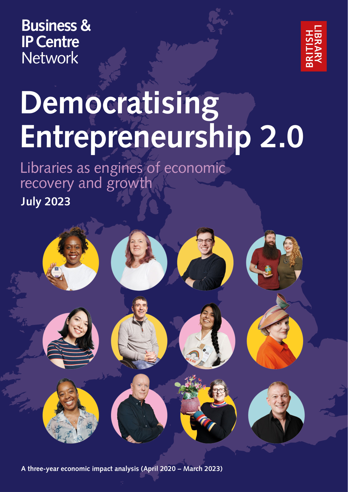

# Democratising Entrepreneurship 2.0

## Libraries as engines of economic recovery and growth

**July 2023**

*A three-year economic impact analysis (April 2020 – March 2023)*

**Business & IP Centre Network**

<!-- PAGE: 2 -->

## Contents

- **3** Introduction
- **4** Background to the Business & IP Centre National Network
- **5** Case study: Tas Jennings, founder of Very Craftea, Peterborough
- **6** Driving economic recovery and growth
- **8** Case study: BIPC Devon, Bedroom to Business Programme
- **9** Case study: BIPC National Network, Reset. Restart programme
- **10** Case study: Suki Pantal, founder of Suki’s Curries and Spices, Worcestershire
- **11** Case study: Vicky Armitage, founder of Meraki Cacao, Northumberland
- **14** Dynamic and diverse businesses
- **15** Case study: Carolynn Bain, founder of Afrori Books, Brighton
- **16** Purpose-driven businesses
- **18** Strong and productive businesses
- **20** Innovation and improved productivity
- **24** National Network, local reach
- **25** Case study: BIPC North East
- **26** Why libraries?
- **29** Case study: Adeola and Ronke Jane Adelakun, founders of Cultureville, Manchester
- **30** Case study: Simon Evans, Head of Product, Castrads, Manchester
- **31** Case study: Natalee Onyeche, founder of Skin Solace, Nottingham

---

The British Library and the Business & IP Centre Network are grateful to the following supporters and partners:

- **Department for Culture, Media & Sport**
- **Intellectual Property Office** (an operating name of the Patent Office)
- **Arts Council England**

*Their support is vital in helping us to deliver programmes and services that democratise entrepreneurship and help people, from all walks of life, to start up and grow sustainable businesses.*

<!-- PAGE: 3 -->

## Introduction

In 2019 we released *Democratising Entrepreneurship: Libraries as engines of economic growth*, an evaluation report of the Business & IP Centre (BIPC) Network and our impact on local business communities and economies across the country. We learned that our services were reaching more people from diverse and disadvantaged backgrounds than ever before. Located in public libraries on or near high streets, we were delivering proven social and economic impact, and crucially, our customers were creating robust businesses. Using BIPC services to research their markets, understand and protect their intellectual property assets, and invest in their skills to learn the ‘nuts and bolts’ of running a small business, they were positioning themselves to be sustainable for the long-term.

Little did we know, that within a year, the world would change considerably, and our customers would face the hardest challenge of their business lives. Many were forced to completely change their business model, to step back, reevaluate and proceed with caution. Slowly, they reemerged: changed, more resilient and open to new ways of doing things.

During this time many more people were choosing, for the first time, to pursue their long-held dreams of setting up a business. Whether they identified with the term entrepreneur, freelancer, small business owner, self-employed, side-hustler, hobbyist or, more often than not, simply ‘shopkeeper’ or ‘designer’, we welcomed and encouraged them, and helped them find the answers they were looking for.

We too, changed. We rapidly expanded our online offer, and established bespoke programmes to help small business owners who were struggling with the effects of the pandemic. We were pleased to discover that the strength of libraries need not be restricted to bricks and mortar. More people were accessing library services than ever before [around three in ten adults in the UK, or fifteen million people, engaged with public library services during lockdown[^1]], in part because our core principles remained the same whether online or offline – accessible, free and impartial support, delivered by dedicated information professionals and trusted business experts.

As libraries began to reopen their doors and customers returned – ready for real life interaction once again – BIPCs were prepared. With investment of £13 million from the Department for Digital, Culture, Media and Sport in 2020, the Network expanded to over 100 locations, bringing on board new Centres and supercharging the existing BIPCs, enabling them to deliver their offer through a hub and spoke model in more urban, rural and coastal locations than ever before.

This report, *Democratising Entrepreneurship 2.0* reviews the impact of BIPC services over the past three years. Why 2.0? Like our customers, the BIPC Network has grown, adapted, become more resilient and better connected.

<!-- PAGE: 4 -->

## Background to the Business & IP Centre National Network

Helping businesses to innovate and grow is one of the British Library’s six core public purposes[^2]. Since 2006, our BIPC has created a unique model, providing targeted help to aspiring entrepreneurs and early-stage businesses, and helping established SMEs to scale. During this time, over 122,000 entrepreneurs have benefited from the BIPC support in London.

In 2012, with seed funding from the Intellectual Property Office (IPO), we began working in partnership with the UK’s great city and central libraries, embarking on a major expansion to replicate the BIPC model across the country.

The BIPC offers a comprehensive, impartial service to help people through every stage of their business journey:

- **Free access to world-class business databases and market research reports**, worth over £5 million, including industry guides, company directories, consumer trends, financial reports and market forecasts.
- **Expert intellectual property guidance**, helping users identify, protect and commercialise their IP, including trade marks, copyright, designs and patents.
- **One-to-one business clinics and advice sessions**, delivered by library staff and trusted local business professionals, such as accountants, lawyers and marketing experts.
- **Workshops, webinars and networking events**, covering practical topics such as business planning, marketing, website building, financial management, funding and pitching.
- **Inspiring events and panel discussions**, featuring high-profile entrepreneurs, industry leaders and successful business founders sharing practical insights and lessons learned.
- **A welcoming, supportive physical and digital community**, rooted in public libraries, where entrepreneurs can work, collaborate and connect with like-minded individuals.

In 2020, the UK Government announced a £13 million investment from HM Treasury, allocated through the Department for Digital, Culture, Media and Sport (DCMS), to expand the BIPC National Network to more locations across England and Scotland. This funding supported the expansion to 22 Regional Centres and the creation of over 80 BIPC Locals in suburban, rural and coastal areas, creating an accessible hub and spoke infrastructure across public library services.

*Economic impact analysis conducted by ERS Research & Consultancy, based on monitoring data and a comprehensive survey of 1,137 BIPC users.*

<!-- PAGE: 5 -->

## CASE STUDY: Tas Jennings

### Founder of Very Craftea, Peterborough

Tas Jennings is the founder of Very Craftea, a tea and craft kit online retailer based in Cambridgeshire.

> “I started Very Craftea in January 2017. Before that, I worked in the construction industry my whole life, have two degrees (one in Construction Management and one in Architectural Venue Design and Digital Innovation) and decided to change it all for a life of tea and crafts.”

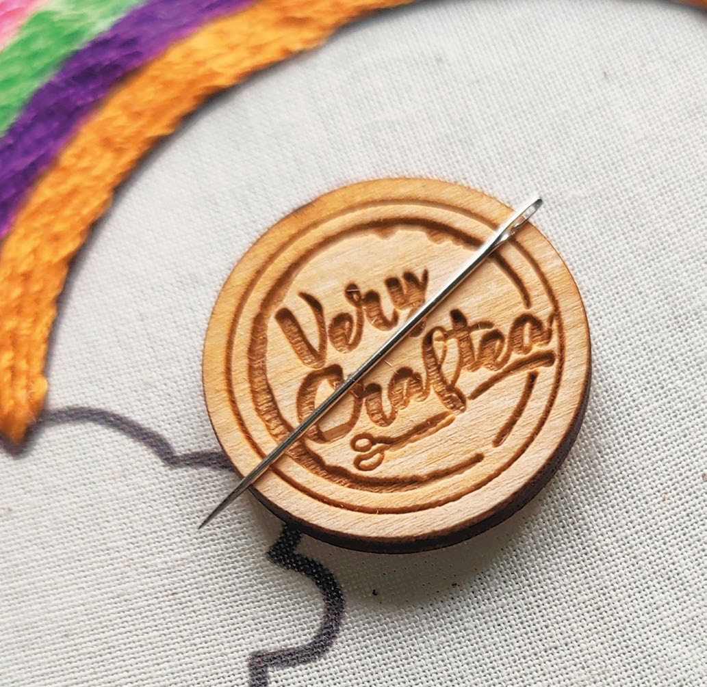

Tas used the services at BIPC Cambridgeshire & Peterborough to research the market, understand intellectual property, and attend business training workshops.

> “The BIPC was a massive help when I was first starting out. Being able to access free market research databases like Mintel and COBRA that would otherwise cost thousands of pounds was invaluable. I also attended webinars on intellectual property and trade marking which gave me the confidence to protect my brand.”

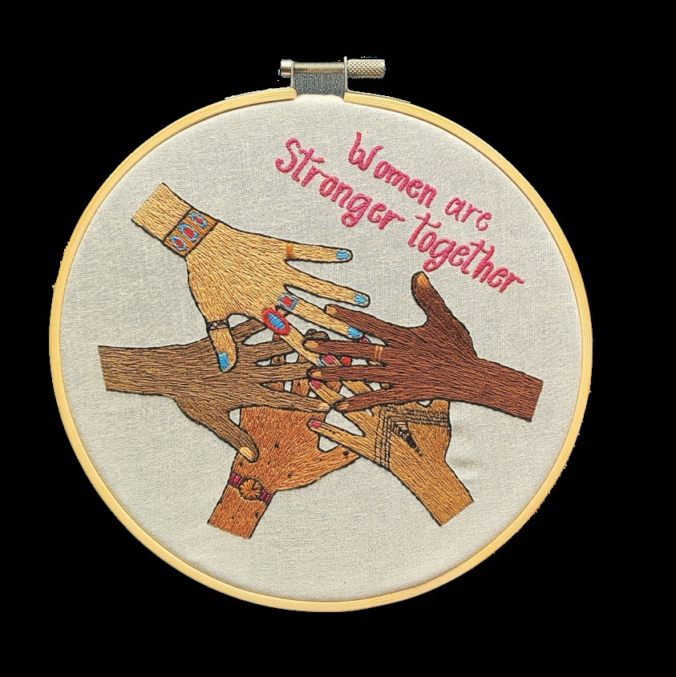

> “Running a small business can be lonely, but knowing there is a free, welcoming support service in the library makes a huge difference. I would encourage anyone with an idea to go and speak to them.”

<!-- PAGE: 6 -->

## Driving economic recovery and growth

In the three-year period, April 2020 to March 2023, the BIPC supported a total of **62,876 individuals**, through a combination of:

- **17,831** in-person and online one-to-ones
- **4,314** workshops or webinars
- **1,121** in-person, online or hybrid events

In addition, BIPC Network staff responded to **51,591 business enquiries**, providing aspiring entrepreneurs and established business owners with key information.

The evaluation found that the Network is:

- **Creating enterprises**: over the last three years supported the creation of **18,175 new businesses**, equivalent to **24 new businesses every working day**.
- **Creating jobs**: services helped new and established businesses to create an estimated total of **6,124 FTE jobs**.
- **Increasing turnover**: net additional sales growth was an estimated **£248 million**.
- **Boosting local economies**: net additional GVA (Gross Value Added) for BIPC supported businesses was an estimated **£168 million**.
- **Delivered excellent value for money**: with a Benefit Cost Ratio (BCR) of **£6.63 for every £1 invested**.

The survey found that, of those that started a business, **25% had been unemployed or made redundant** when they started their business.

Businesses that used the services demonstrated strong survival rates. For those supported in 2020/21, the 12-month survival rate was **96%**[^3] and for those in 2021/22, the 12-month survival rate was **95%**[^4].

*Laura Curling, founder of Higham Refill, BIPC Northamptonshire customer.*

> “BIPC Oxford has been there for me at a tough time and at each turn have provided me with vital advice and contacts and support to keep my business developing.”
>
> — *E-survey respondent, Oxford*

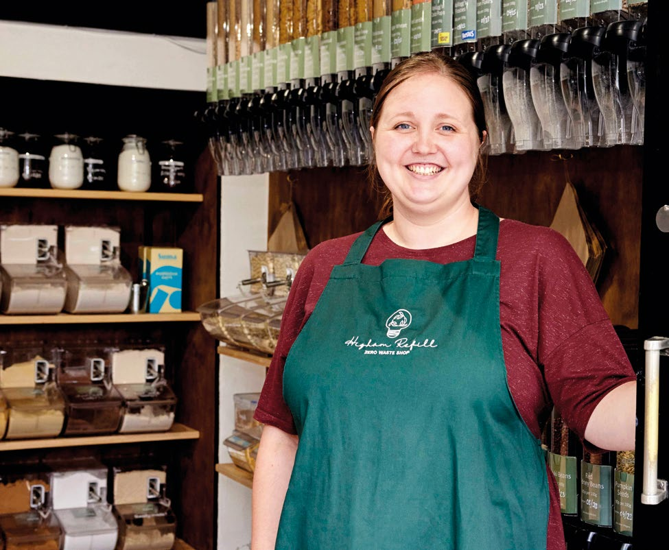

*Photos: Luca Sage.*

<!-- PAGE: 7 -->

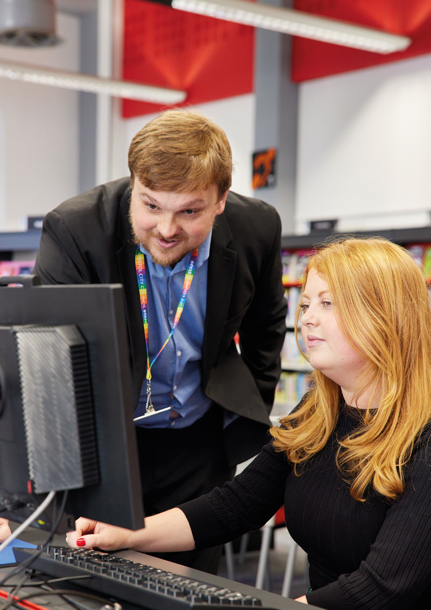

*BIPC Bristol, Bristol Central Library.*

<!-- PAGE: 8 -->

## CASE STUDY: BIPC Devon

### Bedroom to Business Programme

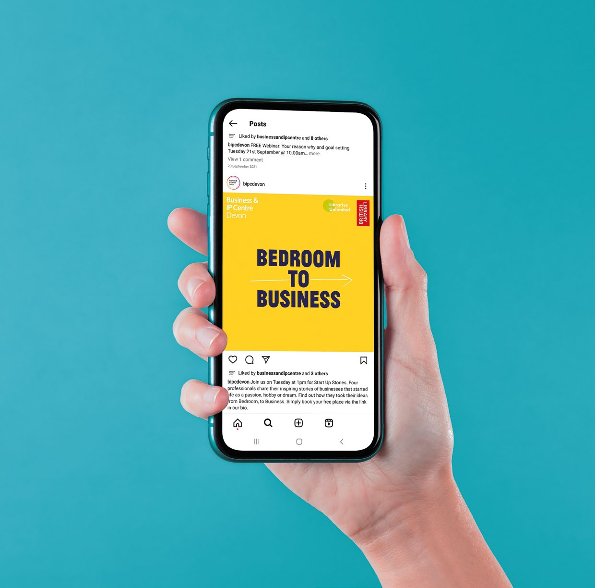

Launching in September 2021, BIPC Devon’s *Bedroom to Business* programme was a 13-week course of webinars delivered by local delivery partners. Covering a diverse range of topics such as exploring the motivation to become an entrepreneur, researching business ideas, writing a business plan, intellectual property, digital marketing, finances, and pitching, the course was specifically designed to support individuals who had conceived business ideas from home during the pandemic.

Delivered across Devon’s library network via Libraries Unlimited, the programme reached hundreds of participants across urban and rural communities, providing structured pathways from kitchen table concepts to registered, viable enterprises.

Participants reported significant growth in commercial confidence, business knowledge, and practical readiness to trade.

<!-- PAGE: 9 -->

## CASE STUDY: BIPC National Network

### Reset. Restart Programme

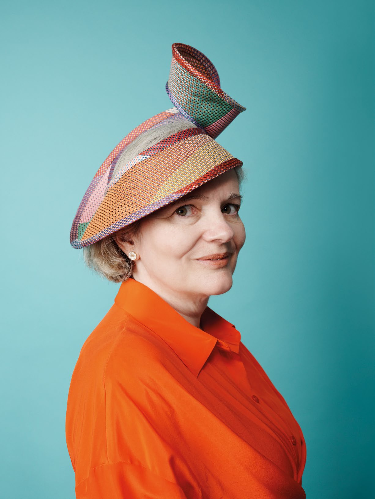

The *Reset. Restart* programme launched in October 2020, in response to the Coronavirus pandemic, and the need, identified by the BIPC, for SMEs and aspiring entrepreneurs to pivot their businesses to meet the challenges posed by the pandemic.

Running initially for six months, the programme comprised a series of eleven webinars delivered by expert practitioners covering core business resilience topics:

1. Digital marketing and online presence
2. Diversifying revenue streams
3. Protecting intellectual property in changing times
4. Financial planning and cash flow management
5. Mindset and managing stress
6. Creative problem solving
7. Customer retention and communication
8. Exploring new markets and customer segments
9. Refining products and service delivery
10. Supply chain resilience
11. Developing sustainable business models

Delivered centrally online by the British Library and complemented by bespoke local sessions across regional BIPCs, *Reset. Restart* provided immediate, high-quality, practical intervention during the height of economic disruption.

<!-- PAGE: 10 -->

## CASE STUDY: Suki Pantal

### Founder of Suki’s Curries and Spices, Worcestershire

Suki decided to have a career change during the pandemic and used BIPC Worcestershire at the start of her business journey. Suki does cook-alongs to teach people how to make Indian dishes from scratch, pop-up kitchens as well as exclusive catering services for small parties. She has appeared as a food demonstrator and chef at food festivals across the Midlands and beyond.

> “I went to the BIPC at The Hive in Worcester. They were amazing from the start. They helped me with trademarking my name and logo, understanding my market, and helped me with social media and marketing strategy.”

Suki has since built a loyal following, published recipe books, and expanded her catering and culinary teaching enterprise.

<!-- PAGE: 11 -->

## CASE STUDY: Vicky Armitage

### Founder of Meraki Cacao, Morpeth, Northumberland

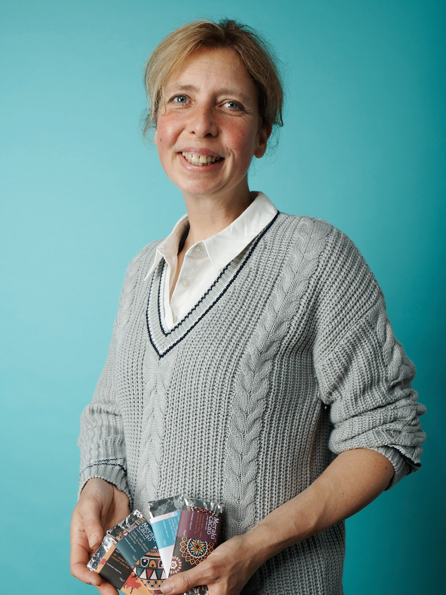

Vicky Armitage is the founder of Meraki Cacao, which started in 2018. Vicky produces raw cacao bars made from organic and nutritious ingredients. The bars are a healthier alternative to mass-produced chocolate; they’re all free from dairy, refined sugar and ingredients containing gluten.

Vicky engaged with BIPC North East through the Morpeth Library BIPC Local:

> “The BIPC has been fantastic for my business. I’ve attended several webinars and workshops, had one-to-one sessions on intellectual property and packaging compliance, and used the library’s market research tools to understand nutritional trends.”

Meraki Cacao has expanded its retail presence across independent delis, health food shops, and online across the UK.

<!-- PAGE: 12 -->

*Inspiring Entrepreneurs, British Library.*

*Photo: AO Photography.*

<!-- PAGE: 13 -->

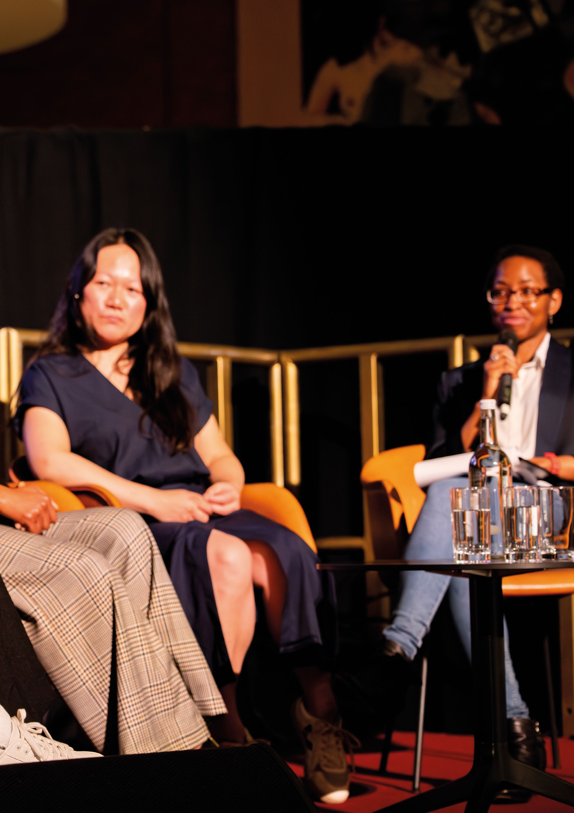

*Inspiring Entrepreneurs event: business founders in discussion at the British Library.*

<!-- PAGE: 14 -->

## Dynamic and diverse businesses

Overall the demographics of the BIPC National Network are little changed by the expansion and rollout to new areas across the country. Similar to the 2019 evaluation, the survey revealed that **21% of BIPC users come from the 20% most deprived areas** in their towns and cities.

The results of the survey also showed that **47%** of our customers were existing business owners and **53%** had not yet started their business when they first used the BIPC Network services. **57% of users went on to start a business**, mostly within a year.

The Network is reaching people who are under-represented in business. According to figures published by the Department for Business, Energy and Industrial Strategy only 20% of businesses (without employees) are owned by women and only 5% are owned by individuals of Black, Asian and minority ethnic origin[^5].

- Of the BIPC users who went on to start a new business:
  - **72% were women** (60% in London)
  - **26% identified themselves as from a minority ethnic community** (e.g. Black British, British Asian, British Chinese, etc.) (43% in London)
  - **10% had a disability** (14% in London)
- Almost half of BIPC users were already running a business when they used the services. Of these:
  - **66% were owned by women**
  - **28% were owned by people who identified themselves as from a minority ethnic community**
  - **13% were disabled**

The highest proportion (**27%**) of businesses supported by the BIPC were in the creative, media and technology sectors; this is more than double the proportion of businesses in the UK as a whole, where these sectors make up just 11%[^6].

### Businesses supported by market sector

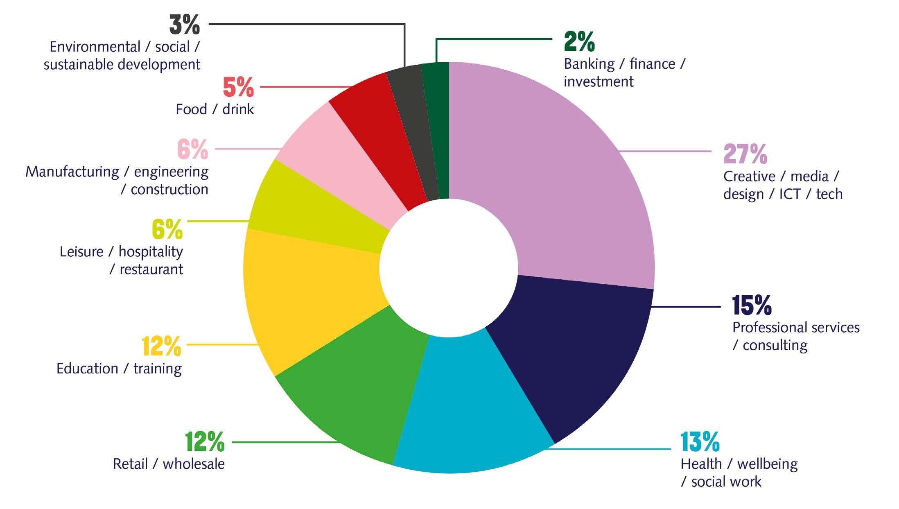

| Market Sector | Proportion |
| :--- | :--- |
| Creative / media / design / ICT / tech | 27% |
| Professional services / consulting | 15% |
| Health / wellbeing / social work | 13% |
| Retail / wholesale | 12% |
| Education / training | 12% |
| Leisure / hospitality / restaurant | 6% |
| Manufacturing / engineering / construction | 6% |
| Food / drink | 5% |
| Environmental / social / sustainable development | 3% |
| Banking / finance / investment | 2% |

*Source: BIPC Monitoring Information.*

<!-- PAGE: 15 -->

## CASE STUDY: Carolynn Bain

### Founder of Afrori Books, Brighton

Carolynn Bain is the founder of Afrori Books, the UK’s biggest supplier of books by black authors. Started amid the protests of 2020, Carolynn was looking for funding to expand her business into a physical shop.

> “The BIPC in Brighton & Hove supported me when I was looking to open our high street bookstore. They gave me access to databases to research retail demographics, helped me understand commercial leases, and provided IP advice. Having that free, safe, supportive space in Jubilee Library gave me the backing I needed to turn a digital vision into a thriving community bookstore.”

Afrori Books opened its flagship store in Brighton, combining a specialist bookstore with community events, author signings, and workshops.

<!-- PAGE: 16 -->

## Purpose-driven businesses

With the impact of the climate and environmental crisis being felt globally and locally, research has shown that consumers hold companies most responsible, i.e. more responsible than governments or themselves, for a host of environmental and social targets and standards[^7].

No matter how small the business or what industry it is in, a commitment to sustainability could make a real difference – to the planet, to customers and to the business’ bottom line.

The survey showed that BIPC-supported businesses are distinctly purpose-driven:

- **67%** of businesses stated that social, environmental or ethical goals were important to their mission.
- **52%** actively implemented sustainable practices, such as reducing single-use plastic, using local suppliers, or adopting circular economy principles.
- **34%** committed to ethical trading and fair wages within their operations.

<!-- PAGE: 17 -->

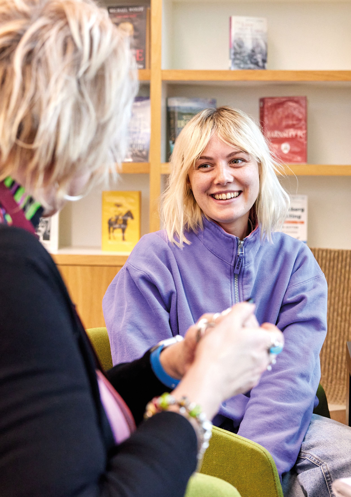

*BIPC South Yorkshire, Barnsley Library.*

*Photo: Luca Sage.*

<!-- PAGE: 18 -->

## Strong and productive businesses

Among the reasons that businesses fail is a lack of planning and research, a lack of skills, and a lack of knowledge about their sector and the consequent failure to make informed decisions[^8]. Conversely, people who seek advice and information either before setting up their business or at a very early stage are better able to assess the viability of their business idea, protect their IP assets and get the essential building blocks in place.

The survey revealed that BIPC users consulted a wide variety of information sources to strengthen their enterprises:

### Information sources used by BIPC customers

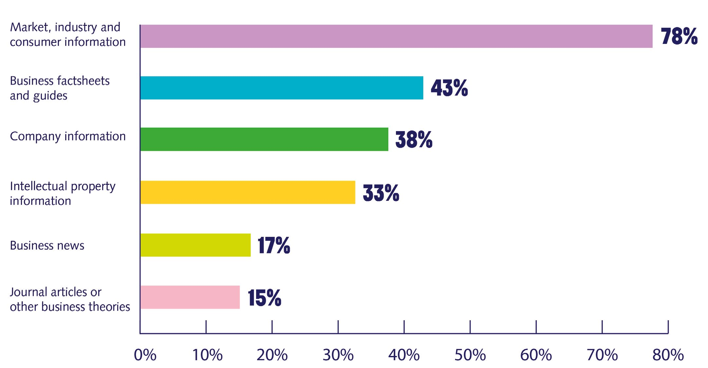

| Information Source | Proportion |
| :--- | :--- |
| Market, industry and consumer information | 78% |
| Business factsheets and guides | 43% |
| Company information | 38% |
| Intellectual property information | 33% |
| Business news | 17% |
| Journal articles or other business theories | 15% |

<!-- PAGE: 19 -->

## Most popular topics of support

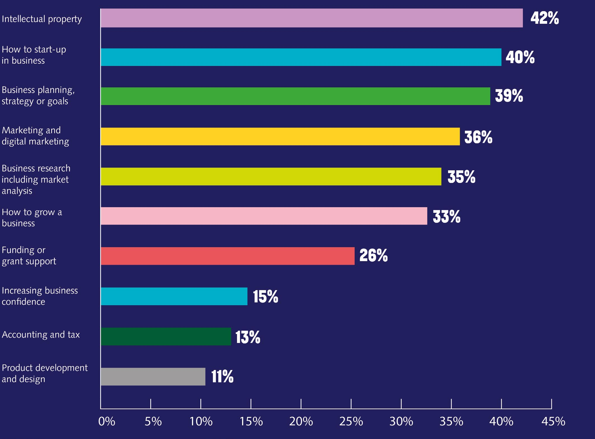

| Topic of Support | Percentage |
| :--- | :--- |
| Intellectual property | 42% |
| How to start-up in business | 40% |
| Business planning, strategy or goals | 39% |
| Marketing and digital marketing | 36% |
| Business research including market analysis | 35% |
| How to grow a business | 33% |
| Funding or grant support | 26% |
| Increasing business confidence | 15% |
| Accounting and tax | 13% |
| Product development and design | 11% |

*Source: ERS Survey of 1,137 respondents, February 2023.*

> “The start-up session provided me with more confidence to move forward with my business idea. It has saved me a lot of time researching what to do next so was very worthwhile for me.”
>
> — *E-survey respondent, Leeds*

> “I was made to feel so welcome… this opened the doors to the wonderful support and breadth of valuable services the BIPC Brighton & Hove has to offer. I look forward to using more of the services in 2023 now that I have registered my company. Thank you for making this information and service available to people like me.”
>
> — *E-survey respondent, Sussex, Brighton & Hove*

<!-- PAGE: 20 -->

## Innovation and improved productivity

For established businesses, BIPC support was associated with a number of positive outcomes. The most frequent outcomes cited related to innovation, including improved processes (46%), launching new products or services (29%) and entering new markets (24%).

### Business outcomes

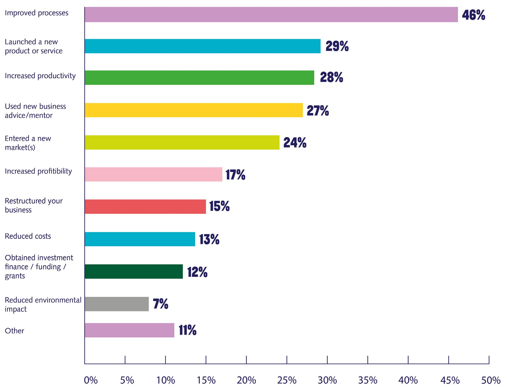

| Business Outcome | Percentage |
| :--- | :--- |
| Improved processes | 46% |
| Launched a new product or service | 29% |
| Increased productivity | 28% |
| Used new business advice/mentor | 27% |
| Entered a new market(s) | 24% |
| Increased profitability | 17% |
| Restructured your business | 15% |
| Reduced costs | 13% |
| Obtained investment finance / funding / grants | 12% |
| Reduced environmental impact | 7% |
| Other | 11% |

*Source: ERS Survey of 1,137 respondents, February 2023.*

Most of the outcomes represent improvements in business performance such as productivity, profits or costs. As a result of BIPC support, **28% of users attributed productivity increases**, **17% increased profitability**, and **13% achieved direct cost reductions**.

<!-- PAGE: 21 -->

## Actions taken to protect / invest in intellectual property

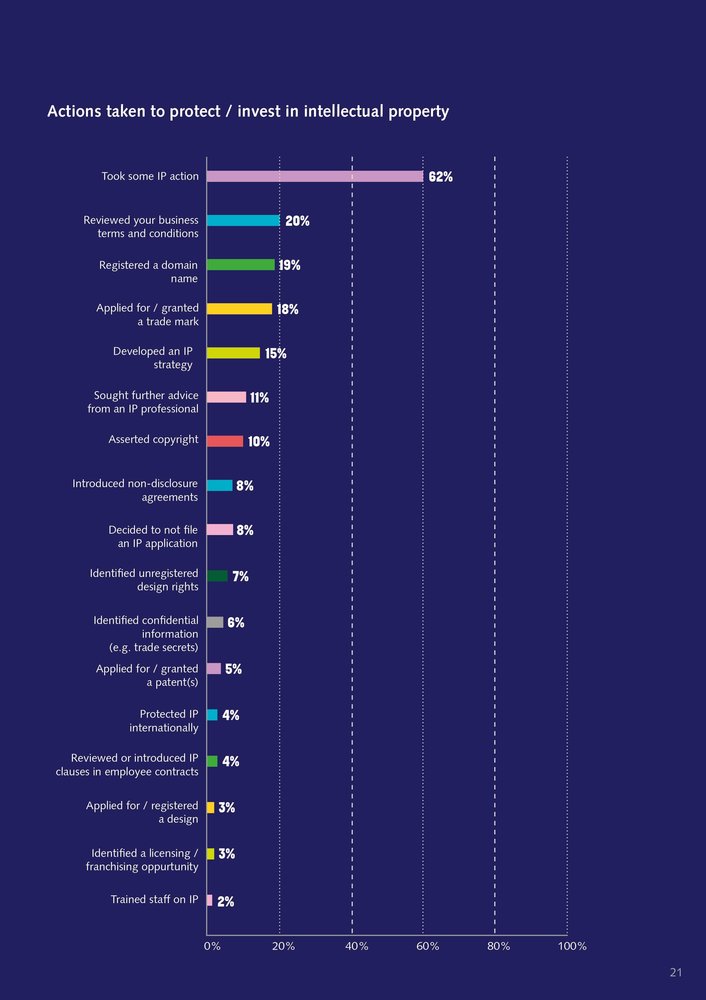

| Action Taken | Percentage |
| :--- | :--- |
| Took some IP action | 62% |
| Reviewed your business terms and conditions | 20% |
| Registered a domain name | 19% |
| Applied for / granted a trade mark | 18% |
| Developed an IP strategy | 15% |
| Sought further advice from an IP professional | 11% |
| Asserted copyright | 10% |
| Introduced non-disclosure agreements | 8% |
| Decided to not file an IP application | 8% |
| Identified unregistered design rights | 7% |
| Identified confidential information (e.g. trade secrets) | 6% |
| Applied for / granted a patent(s) | 5% |
| Protected IP internationally | 4% |
| Reviewed or introduced IP clauses in employee contracts | 4% |
| Applied for / registered a design | 3% |
| Identified a licensing / franchising opportunity | 3% |
| Trained staff on IP | 2% |

<!-- PAGE: 22 -->

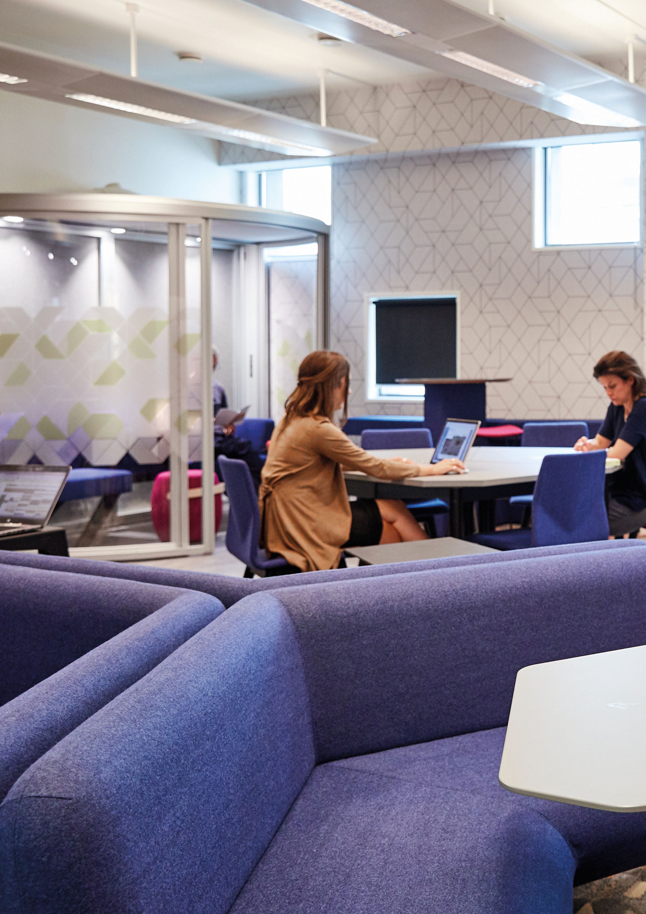

*BIPC Brighton & Hove, Jubilee Library.*

*Photo: Luca Sage.*

<!-- PAGE: 23 -->

*Co-working and business study space in the BIPC Network.*

<!-- PAGE: 24 -->

## National network, local reach

Business & IP Centres are located in 22 city or central libraries in England and Scotland, harnessing the public library infrastructure to offer support in cities, towns and rural areas. Each Centre operates to a standard service level and a blueprint acts as a guide on all aspects of setting up and running the service.

BIPC staff are trained to meet the needs of small businesses by both the British Library and the Intellectual Property Office. The programme of activities for each Centre is tweaked according to local needs, opportunities and sector clusters. Each Centre works within the local business support ecosystem, partnering with public and private sector organisations to co-deliver the services and ensure effective cross-referrals to relevant support.

Across the Network, libraries have rolled out their offer to **80 BIPC Locals** – a hub and spoke model of service delivery, broadening the reach of their library-based business support offer to even more communities in towns and villages.

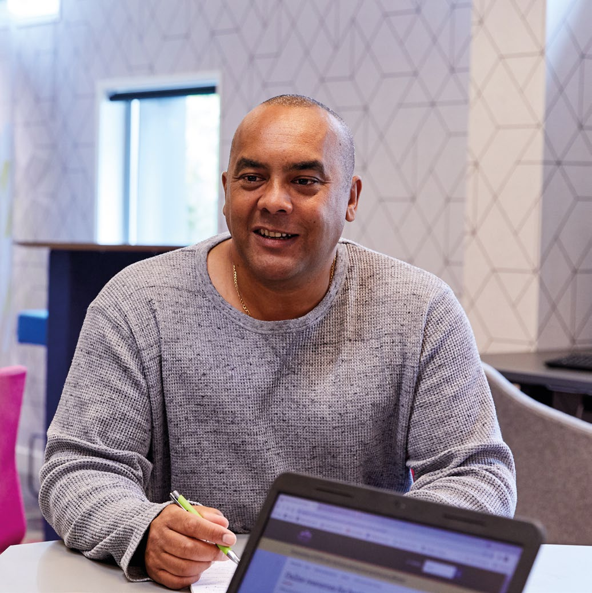

*BIPC Sussex, Jubilee Library. Photo: Luca Sage.*

Regional hubs provide support to their BIPC Locals to deliver core aspects of the BIPC service, ensuring effective cross-referrals to further support between sites. The offer has further expanded to **500 BIPC Business Information Points** in branch libraries, offering access to business databases, with staff trained to answer basic business enquiries and provide materials to direct customers to further support from their nearest regional or local hub.

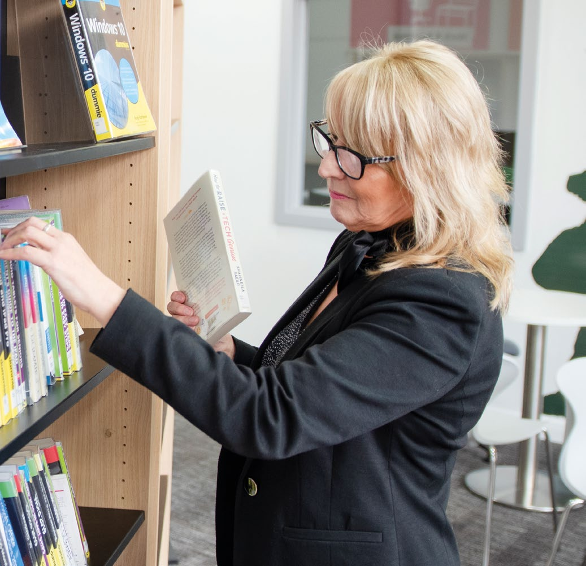

*BIPC Nottinghamshire, Mansfield Library. Photo: Neil Pledger.*

At each level, BIPC staff are on-hand to signpost customers to further support within their own region, harnessing the power of an interconnected network of business support and ensuring that customers are able to access the support that they need.

### Local hub and spoke models

Regional BIPC teams across the network approached the hub and spoke model in different ways, to reflect and respond to the local economic and political landscape of their area. In some instances, Centres partnered with neighbouring local authorities to establish BIPC Locals. In other areas, where a single library service covers a large geographical area, they established BIPC Locals within their county boundaries. In some instances, Centres have developed a mixed approach of a district, city and county hub and spoke offer.

<!-- PAGE: 25 -->

## CASE STUDY: BIPC North East

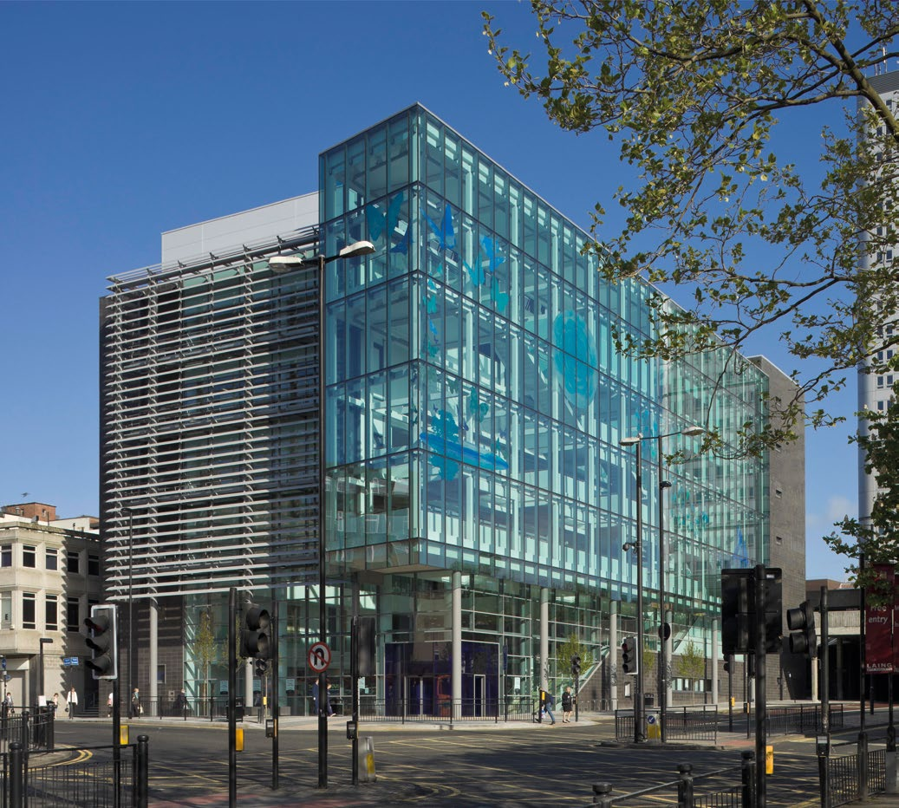

Operating as BIPC Newcastle for ten years, primarily out of Newcastle City Library, in 2021 the service successfully launched seven BIPC Locals across the region and rebranded as BIPC North East. The BIPC Locals provide a front door to business support within North Tyneside, South Tyneside, Sunderland, Gateshead, and Northumberland (Berwick, Hexham and Morpeth).

By working in close partnership with local authority economic development teams, regional universities, and business networks, BIPC North East has extended enterprise and IP guidance across former industrial, coastal, and rural communities throughout the region.

<!-- PAGE: 26 -->

## Why libraries?

The last three years have shown how the Business & IP Centre Network is highly scalable and offers excellent value for money, capitalising on the existing public library infrastructure (c.2,900 libraries in England alone) and knowledge resources, with the potential to bring business and innovation support to every high street.

The Network provides unprecedented reach for business support services into urban, rural and coastal communities, supporting job creation and business resilience. While growth of the Network has accelerated in recent years, this is also a story of long-lasting impact, with the BIPC Network reaching its 10th anniversary in 2022. Indeed, many libraries have offered business information and support to industry for well over 100 years[^9].

For those who are part of the recent expansion, developing a new BIPC Regional or Local service, some are serving business customers for the first time. Similarly, many BIPC customers (**43%**) were accessing business support for the first time, through their library. The BIPC Locals attracted a higher percentage of aspiring entrepreneurs (**60%**) compared to the regional Centres, with customers citing an increase in their general awareness of business support, and a developed business confidence as their top two outcomes from the services.

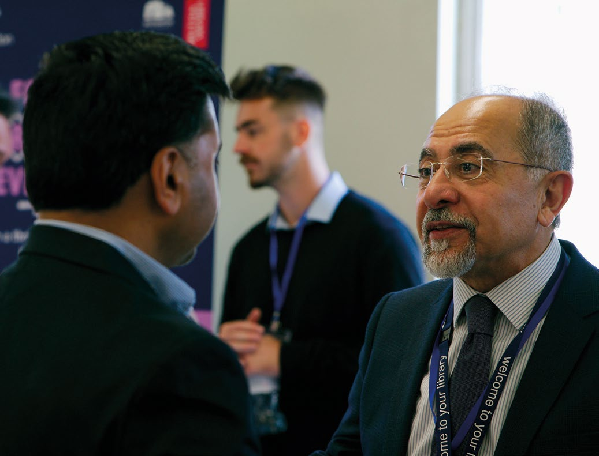

*BIPC Southampton, Southampton Central Library. Photo: Wayne Cee.*

Regardless of their size or longevity, one of the great successes of the BIPC Network is its co-location and signposting to other support services. Working closely with their local authority Economic Development departments, Adult Education Services, and Youth Education services as well as external support services such as Jobcentre Plus (Department for Work and Pensions) and Growth Hubs, they ensure beneficiaries from a variety of backgrounds and needs are signposted and supported effectively.

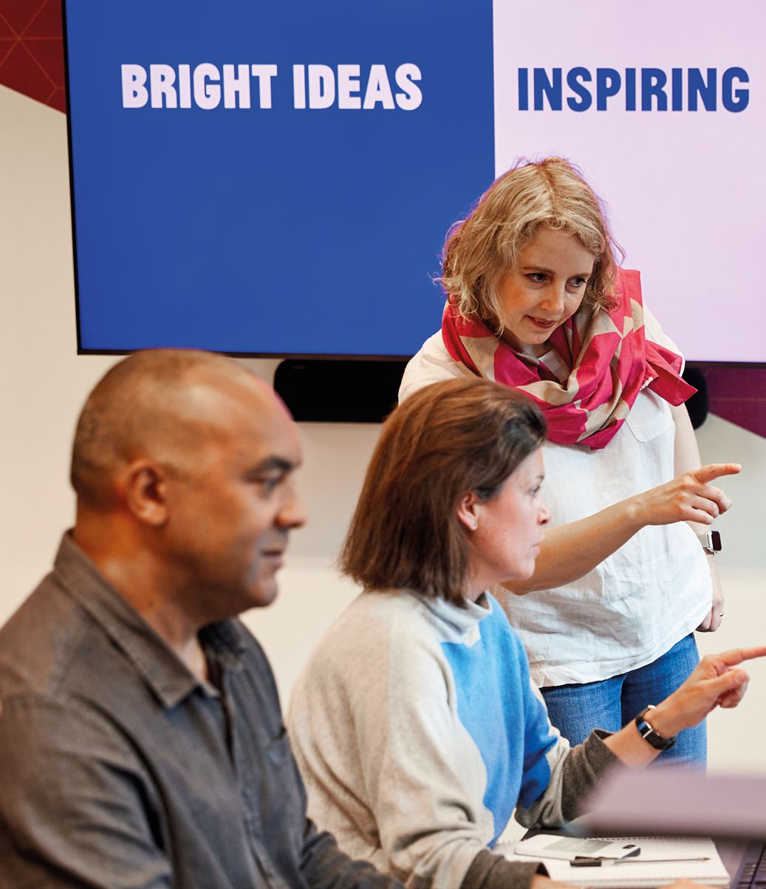

*BIPC Sussex, Jubilee Library. Photo: Luca Sage.*

The pandemic has shown that libraries are not just about physical spaces, they are about community – whether online or offline. They are about being warm spaces, places for families, especially those parents with young children who are looking to self-employment as a return to work option. With flexible opening hours and accommodating spaces and staff, BIPCs make it possible for parents to grow their business skills while juggling parenting responsibilities.

<!-- PAGE: 27 -->

## BIPC National Network Directory

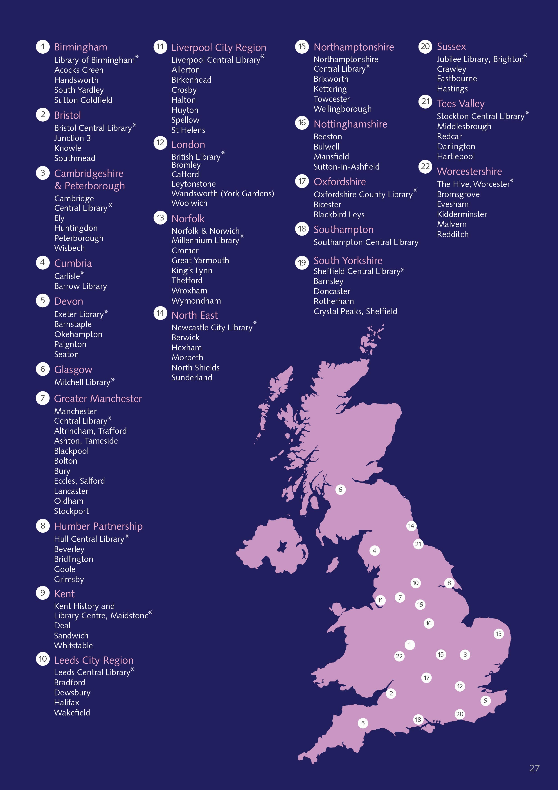

The Business & IP Centre Network spans 22 Regional Centres across England and Scotland, supporting a network of over 80 BIPC Locals and 500 Business Information Points.

### Regional Centres and BIPC Locals

1. **Birmingham**: Library of Birmingham\*, Acocks Green, Handsworth, South Yardley, Sutton Coldfield
2. **Bristol**: Bristol Central Library\*, Junction 3, Knowle, Southmead
3. **Cambridgeshire & Peterborough**: Cambridge Central Library\*, Ely, Huntingdon, Peterborough, Wisbech
4. **Cumbria**: Carlisle\*, Barrow Library
5. **Devon**: Exeter Library\*, Barnstaple, Okehampton, Paignton, Seaton
6. **Glasgow**: Mitchell Library\*
7. **Greater Manchester**: Manchester Central Library\*, Altrincham, Trafford, Ashton, Tameside, Blackpool, Bolton, Bury, Eccles, Salford, Lancaster, Oldham, Stockport
8. **Humber Partnership**: Hull Central Library\*, Beverley, Bridlington, Goole, Grimsby
9. **Kent**: Kent History and Library Centre, Maidstone\*, Deal, Sandwich, Whitstable
10. **Leeds City Region**: Leeds Central Library\*, Bradford, Dewsbury, Halifax, Wakefield
11. **Liverpool City Region**: Liverpool Central Library\*, Allerton, Birkenhead, Crosby, Halton, Huyton, Spellow, St Helens
12. **London**: British Library\*, Bromley, Catford, Leytonstone, Wandsworth (York Gardens), Woolwich
13. **Norfolk**: Norfolk & Norwich Millennium Library\*, Cromer, Great Yarmouth, King's Lynn, Thetford, Wroxham, Wymondham
14. **North East**: Newcastle City Library\*, Berwick, Hexham, Morpeth, North Shields, Sunderland
15. **Northamptonshire**: Northamptonshire Central Library\*, Brixworth, Kettering, Towcester, Wellingborough
16. **Nottinghamshire**: Beeston, Bulwell, Mansfield, Sutton-in-Ashfield
17. **Oxfordshire**: Oxfordshire County Library\*, Bicester, Blackbird Leys
18. **Southampton**: Southampton Central Library
19. **South Yorkshire**: Sheffield Central Library\*, Barnsley, Doncaster, Rotherham, Crystal Peaks, Sheffield
20. **Sussex**: Jubilee Library, Brighton\*, Crawley, Eastbourne, Hastings
21. **Tees Valley**: Stockton Central Library\*, Middlesbrough, Redcar, Darlington, Hartlepool
22. **Worcestershire**: The Hive, Worcester\*, Bromsgrove, Evesham, Kidderminster, Malvern, Redditch

*\* denotes Regional Centre*

<!-- PAGE: 28 -->

## Local economic development

BIPC services deliver proven economic impact both nationally and locally. The Network helped to create over **18,175 new businesses** and over **6,124 FTE jobs** over the three-year analysis period of this report. The businesses supported generated **£248m in extra sales**, an estimated **£168m GVA** (Gross Value Added) for the economy.

### Value for money

Libraries deliver unrivalled value for money and return on investment, standing at **£6.63 generated for every £1 of public funding**.

### Libraries as placemakers

Libraries already exist in cities, towns and villages across the UK. They anchor major urban redevelopment projects, they appear in shopping centres and on high streets and sympathetically remodelled landmark libraries exist as proud civic icons in our major cities.

> “The team are very welcoming and dispelled any nervousness etc. on arrival. A great environment that encourages people to flourish.”
>
> — *E-survey respondent, Oxfordshire*

### Reinvigorating the high street

Libraries are community assets, on or near high streets across the country. As inspiring spaces and hubs for interaction, BIPCs offer part of the solution for local government to transform their high streets and town centres into viable and vital spaces for their communities. BIPCs provide informal co-working spaces for customers to set up and run their business (**12%** of BIPC-supported businesses operated in shared workspaces, including libraries) combined with proven support to start up and run viable businesses.

### Leading the way in diversity and inclusion

Libraries have unique reach into diverse and disadvantaged communities, and are vehicles for social mobility. **14% of BIPC users who went on to start a business were unemployed and 11% had been made redundant**.

BIPCs have unparalleled reach and engagement with diverse audiences, when compared with other business support providers, supporting a high percentage of women (**66%**) and customers from diverse ethnic communities to realise their ambitions to start up and grow their business. **33% of customers identified themselves as from a minority ethnic community** (e.g. Black British, British Asian, British Chinese, etc.). Further **43% of customers had never used another business support service**.

### Trusted, impartial information and support

Libraries are widely acknowledged as open and accessible spaces, trusted hubs of information offering impartial advice, with no agenda other than to provide the best service possible to their users.

Now more than ever, with changing global markets, shifting consumer behaviour, the rise of fake news, and intellectual property theft and infringement, small businesses need access to reliable and trusted information.

The OECD found that the total volume of lost sales by UK IP rights owners amounted to £8.6 billion, or 1.95% of their total sales in 2013[^10]. Our unique intellectual property support, and access to world-class business and market intelligence, empowers our customers to make informed decisions, and avoid the losses that could have a devastating impact on their business.

### Making all areas of the UK the best place to start and grow a business

With sustained investment, matched by local authority budgets and private sector investment, the BIPC Network could work with many more library services to continue the expansion of the BIPC offer to communities across the UK, further propelling the evolution of libraries as hubs of innovation and enterprise.

<!-- PAGE: 29 -->

## CASE STUDY: Adeola and Ronke Jane Adelakun

### Founders of Cultureville, Manchester

Cultureville was created by sisters, Adeola and Ronke Jane Adelakun, who were born in Nigeria and brought up in the UK. They longed to walk into a store and see clothes that reflected their African heritage in designs that they could incorporate into their day-to-day wardrobes.

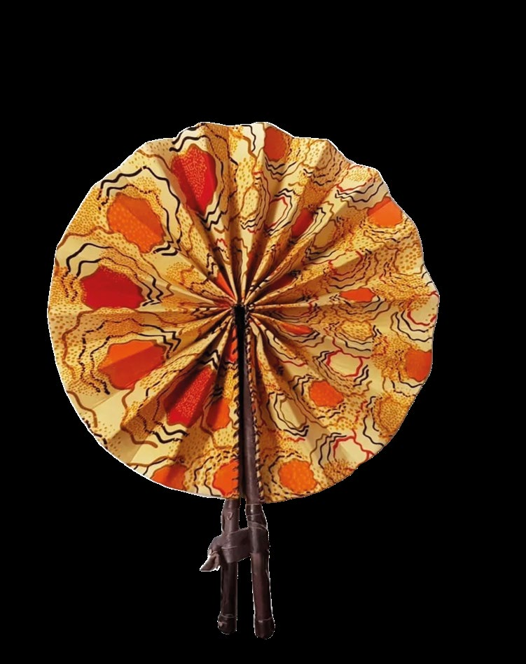

> “We design and handcraft modern African print fashion and accessories. Starting a business can be daunting, but the BIPC in Manchester Central Library was an absolute lifeline. We attended workshops on intellectual property, marketing, and accounting, and tapped into databases that helped us map our customer base and build retail partnerships.”

> “Support from the BIPC has been instrumental in giving us strong foundations on which to sustain and grow our business.”

*Photos: Elliott Wilcox.*

<!-- PAGE: 30 -->

## CASE STUDY: Simon Evans

### Head of Product, Castrads, Manchester

Castrads was founded in 2006 and makes bespoke cast iron radiators. Head of Product at Castrads, Simon Evans, is responsible for the design and development of the product range and used BIPC Greater Manchester for help with IP.

> “Initially Castrads was a small five man team, based on a farm in Cheshire. Now, we have showrooms in Manchester, London, New York and Poland. A family-run-turned-international company, we continually seek to innovate improved products and methods, whilst keeping our carbon footprint small and our approach personal and tailored to each customer, new and old.”

Sustainability is at the heart of Castrads’ ethos.

> “Over the last five years, we’ve shifted our focus from manufacturing heating products that are widely available on the global market to creating a line of radiators that is entirely our own. We pride ourselves on making radiators that will last centuries rather than decades. One of our company’s core values is to manufacture with a positive impact on the planet and we abhor the inbuilt obsolescence practised by so many companies and the throwaway culture that has come from making low cost goods. This ethos runs very much through my day-to-day life as well, I believe very strongly in trying to fix something and often take things apart to fix them rather than sending it straight to landfill.”

Simon used the BIPC to help with expanding into international markets, as well as IP.

> “BIPC Greater Manchester was incredibly useful in helping us get in contact with law firms that specialise in IP protection. This has been especially useful as we have begun to expand our product offerings into America and Europe. By ensuring that we have control over our intellectual property as we expand into further markets, we can ensure there are no imitations and the customer knows that what they have purchased is a quality product.”

*Photos: Elliott Wilcox.*

<!-- PAGE: 31 -->

## CASE STUDY: Natalee Onyeche

### Founder of Skin Solace, Nottingham

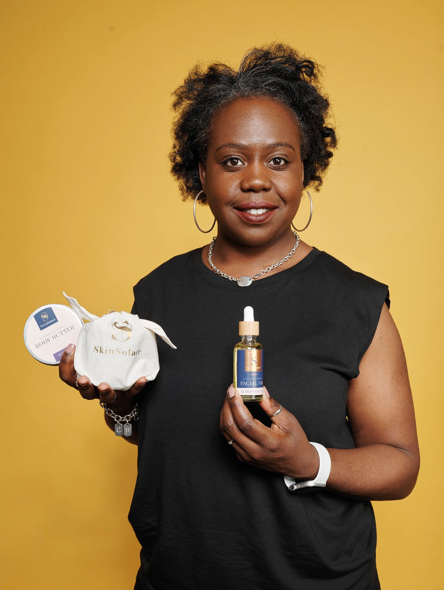

Originally from Nottingham, after a successful career in London, Natalee moved back to her home city. Natalee originally ran Skin Solace as a side hustle alongside her other business as a psychotherapist, but has turned the business into her main income stream and opened a shop in Nottingham.

> “We are a handmade skincare business. I make soaps, candles, body butters, all those kinds of things, and it really has a keen focus on self-care through skincare.”

Natalee came to BIPC Nottinghamshire as she was looking for funding opportunities to upscale her business.

> “I didn’t quite meet the criteria for other business support organisations, so was forwarded to the BIPC. Through them I’ve been able to sort out my intellectual property and trade marks, and I’ve been able to develop a business plan. If there are any problems or questions, I can sort them out through my business coach; we can think about them together and come up with the best possible solutions.”

The survey identified a small group of users (4%) that described themselves as operating a side hustle, while being primarily employed. One quarter of this group turned their side hustle into their main income as a result of BIPC support.

> “There are also loads of databases that they provide access to. There’s a huge database of every fund that’s going on in the UK. We’re currently going through all of those to see which ones are the most appropriate and going to be the most successful for Skin Solace.”
>
> “The BIPC in the local area has been really brilliant. It’s an invaluable resource because you look at the charges for business coaches etc, and sometimes it’s beyond your reach. Having the BIPC there and their huge amount of resources has been a godsend to me. If I need some information, I can go to them and get that support. Having that available, for free, in my local community is brilliant. It’s on my doorstep, literally.”

<!-- PAGE: 32 -->

## Driving economic growth

### Headline Impact Summary (April 2020 – March 2023)

- **18,175** new businesses helped to create
- **6,124** additional FTE jobs created
- **£168m** Gross Value Added (GVA) created
- **96%** of businesses created in 2020/21 still trading after 12 months
- **£6.63** payback for every £1 of public money spent

### Supporting diverse entrepreneurs

Of those who started a new business through the BIPC Network:

- **72%** were women
- **26%** were from a minority ethnic community (e.g. Black British, British Asian, British Chinese, etc.)
- **25%** were aged 35 and under
- **25%** were previously unemployed or made redundant
- **12%** were from the most deprived areas
- **10%** were disabled

---

### Citation and Methodology

**Citation**: British Library Business & IP Centre (2023). *Democratising Entrepreneurship 2.0: Libraries as engines of economic recovery and growth*. Available at: <https://doi.org/10.23636/wbk4-7b32>.

**Source**: ERS Research Services, based on monitoring data and 1,137 responses to an e-survey, conducted between 5 December 2022 and 23 January 2023.

[^1]: Libraries Connected / Redshift Research (2020), *Libraries in Lockdown: Connecting Communities in Crisis*.
[^2]: British Library Board, *Living Knowledge: For Everyone and Anyone* (2015–2023 strategic plan).
[^3]: BIPC Annual User Survey (2021).
[^4]: BIPC Annual User Survey (2022).
[^5]: Department for Business, Energy & Industrial Strategy (BEIS), *Business Population Estimates for the UK and Regions 2022*, businesses with no employees.
[^6]: Department for Business, Energy & Industrial Strategy (BEIS), *Business Population Estimates for the UK and Regions 2022*.
[^7]: Deloitte (2021), *Shifting sands: Are consumers still prioritising sustainability?*
[^8]: CB Insights (2021), *The Top 12 Reasons Startups Fail*.
[^9]: Manchester Commercial Library opened its doors in 1919.
[^10]: Organisation for Economic Co-operation and Development (OECD), *Trade in Counterfeit Products and the UK Economy* (2019 update).
