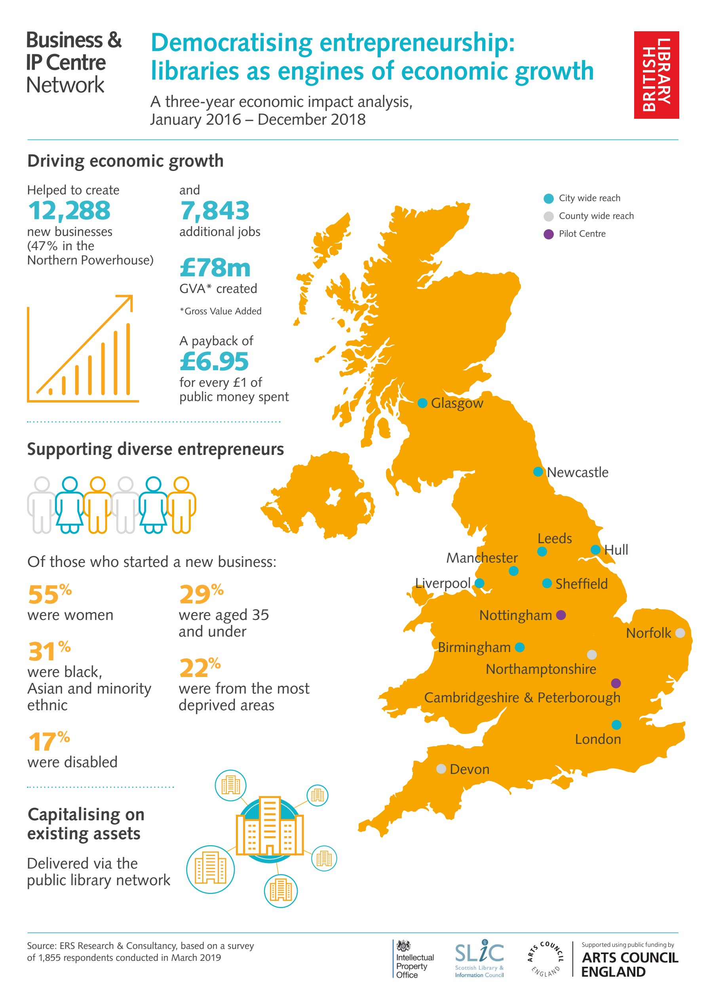

<!-- PAGE: 1 -->

# Democratising Entrepreneurship: Libraries as Engines of Economic Growth

**A three-year economic impact analysis, January 2016 – December 2018**

*Source: ERS Research & Consultancy, based on a survey of 1,855 respondents conducted in March 2019.*

---

## National Network Reach

Capitalising on existing assets, delivered via the public library network:

### City-Wide Reach
* **Glasgow** (The Mitchell Library)
* **Newcastle** (Newcastle City Library)
* **Leeds** (Leeds Central Library)
* **Hull** (Hull Central Library)
* **Manchester** (Manchester Central Library)
* **Liverpool** (Liverpool Central Library)
* **Sheffield** (Sheffield Central Library)
* **Nottingham** (Nottingham Central Library)
* **Birmingham** (Library of Birmingham)
* **London** (The British Library / London Network)

### County-Wide Reach
* **Northamptonshire**
* **Devon**
* **Cambridgeshire & Peterborough**
* **Norfolk**

---

## Driving Economic Growth

* **12,288** new businesses helped to create (47% in the Northern Powerhouse)
* **7,843** additional jobs created
* **£78m** Gross Value Added (GVA) created
* **£6.95** payback for every £1 of public money spent

---

## Supporting Diverse Entrepreneurs

Of those who started a new business through the BIPC network:

* **55%** were women
* **31%** were Black, Asian, and minority ethnic
* **17%** were disabled
* **29%** were aged 35 and under
* **22%** were from the most deprived areas
