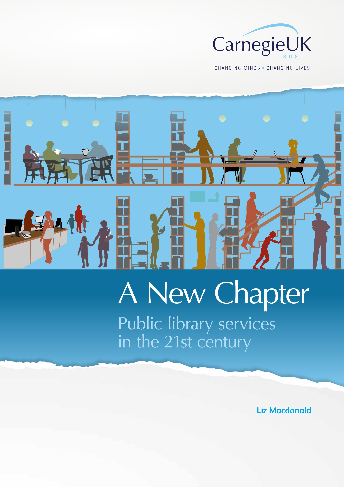
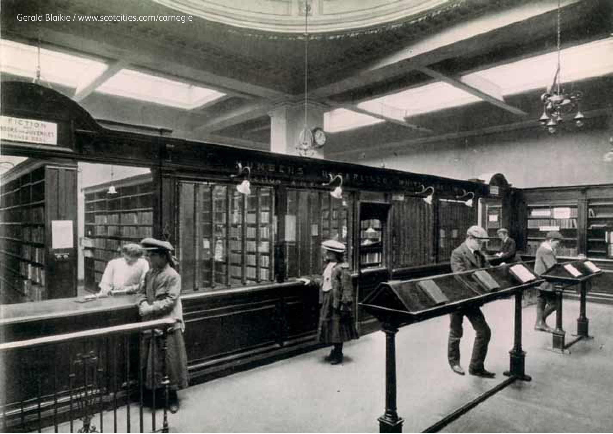
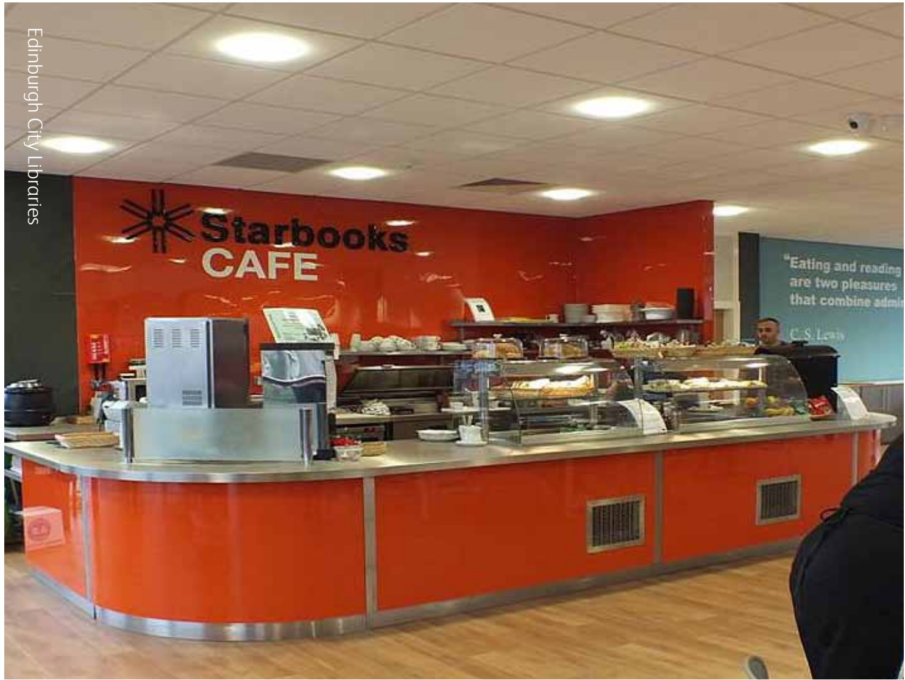

<!-- PAGE: 1 -->

# A New Chapter: Public library services in the 21st century

**Liz Macdonald**  
**Carnegie UK Trust**  
May 2012.

<!-- PAGE: 2 -->

## Acknowledgements

This report is partly based on research carried out by Ipsos MORI for the Carnegie UK Trust. This research was carried out in two phases, and included a secondary analysis of national data from England, Scotland, Wales and Northern Ireland, as well as five omnibus polls carried out in all five jurisdictions covered by the Trust in its work. The Trust thanks staff at Ipsos MORI for their advice, expertise and enthusiasm in carrying out this work.

The Trust also thanks the many library professionals, policymakers, researchers, local authority and third sector representatives who have helped develop the thinking behind this report, through a range of individual meetings, focus groups, and round table discussions. The Trust is grateful to the members of the Advisory Group who have given their time to guide the Trust in developing this programme of work.

The Trust is grateful to Professor Alistair Black, Department of Library and Information Science at the University of Illinois for his comments and advice on Appendix 2.

The research was carried out and this report was written by Liz Macdonald, Senior Policy Officer at the Carnegie UK Trust.

---

Published by the Carnegie UK Trust  
Andrew Carnegie House  
Pittencrieff Street  
Dunfermline  
Fife KY12 8AW  

- **Tel:** +44 (0)1383 721445  
- **Fax:** +44 (0)1383 749799  
- **Email:** info@carnegieuk.org  
- **Web:** [www.carnegieuktrust.org.uk](http://www.carnegieuktrust.org.uk)  

ISBN: 978-0-900259-86-9  
Scottish charity SC 012799  

© Carnegie UK Trust 2012.

<!-- PAGE: 3 -->

## Contents

- **Chapter 1 – Introduction** (p. 3)
- **Chapter 2 – The changing context** (p. 5)
- **Chapter 3 – Government policy** (p. 9)
- **Chapter 4 – Current challenges and opportunities** (p. 15)
- **Chapter 5 – Public views on and use of public libraries** (p. 23)
- **Chapter 6 – Towards a shared vision of the library service of the future** (p. 41)
- **Chapter 7 – Conclusions and next steps** (p. 55)
- **Appendix 1 – Questions asked across each jurisdiction in the omnibus survey** (p. 61)
- **Appendix 2 – The history of public libraries and the contribution of Andrew Carnegie and the Carnegie UK Trust** (p. 64)
- **Appendix 3 – About the Carnegie UK Trust** (p. 68)
- **References and Linked Publications** (p. 70).

<!-- PAGE: 4 -->

<!-- PAGE: 5 -->

## Chapter 1 – Introduction

This report sets out the findings of research carried out by the Carnegie UK Trust over the last six months, which provides clear evidence about the current use of public libraries and public attitudes to libraries in all five jurisdictions covered by the Trust (England, Scotland, Wales, Northern Ireland and the Republic of Ireland). This is the first time that consistent and comparable data has been obtained from all five jurisdictions. The political, economic and structural context of these library services are different, and have become increasingly divergent as a result of devolution. In particular, the situation in the Republic of Ireland is quite distinct, and caution must be taken in drawing comparisons between the jurisdictions. The report highlights interesting differences between library use, as well as attitudes to libraries in different parts of the UK and in Ireland.

The report describes the policy context and the changing social, economic and technological context within which the discussion about the future of libraries is taking place, both in general terms and in relation to each jurisdiction covered by the research. It presents the current challenges faced by the public library service, as well as the opportunities which exist. Within this context, the report draws some conclusions about the role of public libraries in the 21st century.

<!-- PAGE: 6 -->

*(Chapter 2 Opener illustration)*

<!-- PAGE: 7 -->

## Chapter 2 – The changing context

Any debate about the future of the library service has to ask what it is for, and this must be answered in 21st century. when the context of the Andrew carnegie made grants to 20th century, libraries at the start of the he described libraries as ‘instruments for the elevation of the masses of the people’. they were seen as providing access to learning and advancement for people who would otherwise have limited opportunities for education or self-improvement. their purpose was clearly educational, and they were open to everyone in a community who wanted access to books and to learning.

Public libraries today retain these characteristics − they provide a universal service open to all through around 5,000 premises in the UK and Ireland, and they provide access to books and learning, although increasingly in alternative formats, using information technology.

The Carnegie UK Trust, in continuing Andrew Carnegie’s work on public library provision, never assumed that one model of public library provision would meet all needs, and it was constantly considering how the service could be improved, how unmet need in particular areas could be met, and how the service could develop. In 1915, the Trust considered whether the need for libraries in rural areas could be met by providing library services in local schools with

teachers acting as librarians, and very early on recognised that simply building a library could create as many problems as it solved, with questions about the capacity of local authorities to staff and stock these buildings − known as ‘over-building’. This led the Trust into a wide range of activity, including funding the first professional librarian training course at University College London, schemes to distribute books to boys and girls clubs, support to the National Library for the Blind, the Seafarers Education Service, and the British Sailors’ Society.

In 2000, when the Trust provided evidence to a House of Commons select committee on the future of library provision, as well as arguing for <!-- PAGE: 8 --> 

<!-- PAGE: 9 -->

There has been a vociferous campaign against library closures over the last few years, with 5 February, 2011, designated as ‘Save Our Libraries Day’, and an estimated 100 events taking place across England. In Scotland, there was a lobby of the Scottish Parliament, with many Scottish authors involved. These campaigns attract a wide range of supporters, including those, as our research shows, who value libraries as community assets, but no longer use the library service themselves. For some of those involved, the focus of the campaign is very much on the importance of the traditional role of libraries in providing access to books, reading and knowledge, and on particular buildings.

2.2 A changed environment There are several defining features of the current context within which the role of libraries needs to be located:

• the knowledge economy and the UK, Ireland and devolved governments’ visions for the digital future • the public service reform agenda with its emphasis on more effective cross-sectoral working • the aspiration to put citizens and communities at the heart of public services • the changing needs of citizens and communities • the importance of strong communities supported by and building on community assets.

The challenges associated with this changing context are dealt with in more detail in section 4. It is important to recognise that people’s behaviour both as readers and as information seekers has been dramatically changed by technology and by changed lifestyles. In the 21st century people increasingly seek information and knowledge from a computer or a smartphone, and many read books in an electronic format which no longer relies upon a physical product. The library of the future has to respond to these changes, or, as Peter Preston has argued in the Guardian, the public library is in danger of being ‘innately conservative’ in the age of the Kindle, smartphone.1 iPad and “And the point, however unwelcome, is that time and infinite possibilities are passing Andrew Carnegie’s legacy by. We can’t embrace something fresh without leaving older ways behind.” There may also be wider social trends which affect the behaviour and expectations of library users. The increase in people buying rather than borrowing books may be related to other preferences, such as preferring private ownership over shared resources, preferring home ownership to renting, private housing to social housing, personal and individualised music and reading resources held on iPods or Kindles rather than communal shared resources. People seek knowledge and entertainment through a wide range of products and services, including the media, television and cinema, which had a more limited role in the early days of public library provision.

1 Preston P, ‘Make way for the new in the book world’, Guardian, 6 February 2011 <!-- PAGE: 10 --> *(Chapter 3 Opener illustration)*

<!-- PAGE: 11 -->

## Chapter 3 – Government policy

3.1 National or territorial strategies In England over the last 10 years, the Department of Culture, Media and Sport has taken an active interest in the development of policy on the future of libraries, producing a strategic vision for the public library service in 2003, consulting on the modernisation of the library service in 2008, and launching a support programme for libraries in 2010.

The Scottish Government has no single articulated policy on public library provision. However, it has shown its support for libraries by announcing recently that it would be supporting libraries in Scotland by providing £500,000 to the Scottish Library and Information Council which will be disbursed to local authorities through the Public Library Quality Improvement Fund for improving library services and digital participation. The Welsh Assembly Government has had a national programme for libraries for a number of years. The current strategy is called ‘Libraries Inspire’, and builds on the previous strategy ‘Libraries for Life’. These strategies have been accompanied by significant financial investment (£10.5 million over three years from 2008-11). Wales has developed a set of entitlements for library users, which is a distinct feature not found in the other jurisdictions covered by this paper. The fact that CyMAL (Museums Archives and Libraries Wales) is a policy division of the Welsh Assembly Government may have encouraged clear policy development in Wales. The Chartered Institute of Public Finance & Accountancy (CIPFA) statistics show three consecutive years in which visitor numbers have increased in Welsh libraries between 2008-9 and 2010-11, although our research shows lower levels of use in Wales than in other jurisdictions.

In Northern Ireland, the Department of Culture, Arts and Leisure (DCAL) leads policy development, and there is a single library authority, Libraries NI, a non-departmental body created by the Libraries (Northern Ireland) Act 2008, which provides the service. DCAL’s vision for the public library service is to provide ‘a dynamic focal point in the community and assist people to fulfil their potential’. The policy framework is contained in Delivering Tomorrow’s 2006.2 published in Libraries The Irish Government has a national strategy for the Branching out – Future Directions development of the library service. This strategy is presented in slightly different terms from those used in other jurisdictions. Rather than focusing internally on the aims of the library service, the document promises:

• a greater role for the library service in promoting integration of the ‘new Irish’; • a greater role for library buildings as cultural centres; • continued development of new libraries, particularly as part of a new emphasis on sustainable integrated developments; and • a new emphasis on protecting and enhancing the stock of architecturally important library buildings.

Ireland also provides a wide range of national services, many of them accessible on-line. Other jurisdictions have also introduced national online services in recent years.

2 D epartment of Culture, Arts and Leisure, Libraries, Delivering Tomorrow’s Belfast 2006.

<!-- PAGE: 12 -->

3.2 Public expenditure on public library Data collected by CIPFA provides a useful overview of revenue expenditure on the service in the four UK jurisdictions. This data shows the consistently higher levels of expenditure on library service in Scotland over more than 10 years.

Total expenditure per 1,000 population £25,000 £20,000 £15,000 £10,000 £5,000 £0 2 1 2 2 2 2 2 0 9 0 0 0 0 0 0 0 9 0 0 0 0 4 5 9 0 1 2 3 -0 -2 -0 -0 -0 -0 5 0 1 2 3 4 0 0 In addition, there is a varying amount of capital funding in library services in the different areas. 3.3 Implementing strategy:

standards and regulation The development of standards provides a framework for measuring the performance of public library authorities, and a mechanism for central government to be assured that local authorities are fulfilling their statutory requirements. Independent or arm’s length advisory bodies have been involved in the development and supervision of standards in the different jurisdictions.

services England Wales Scotland Northern Ireland 2 2 2 2 2 0 0 0 0 0 0 0 0 0 1 6 7 8 9 0 -0 -0 -0 -0 -1 -1 6 7 8 9 0 1 There were early attempts to set out recommendations for public library services, including the Bourdillon Report in 1962, which set out the basic requirements for an efficient public library service and focused on stock and staffing levels, as well as the accessibility of services, in service.3 terms of physical distance from the In England, public library standards were launched in 2001 and set out what was meant by a ‘comprehensive and efficient service’.

They were revised in 2004 and 2006, and the latest edition was produced in June 2008, but the use of these 10 standards has been discontinued. A Library Benchmark is in use, which is described as a voluntary improvement and performance management tool rather than 3 M inistry of Education, The basic requirements for an efficient public library The Bourdillon Report, 1962 service, <!-- PAGE: 13 --> standards.4 setting out minimum This reflects the ambivalence about central government interfering in what is seen as essentially a local service, and an antipathy on the part of the current UK government to imposing a burden of regulation on local services. The House of Commons Culture and Sport Select Committee is currently investigating what is meant by a comprehensive and efficient service, as well as the impact of library closures on this.

There is a concern in England that services are quite variable in quality, but without a clear evidence base to demonstrate this. The Arts Council of England’s recent review of literature and research commented that it had not found any literature examining how much quality varied, in what respects it varied, or what factors were variation.5 associated with this In Scotland, the Public Library Quality Improvement Matrix (PLQIM) developed by the Scottish Library and Information Council took the place of standards drawn up by the Convention of Scottish Local Authorities (CoSLA) in 1986 and 1995, which focused more on inputs than outcomes. This was part of a £1 million programme designed to help local authorities offer a more modern and improved range of services6. library The intention is that this matrix will form part of the Strategic Quality Assurance Framework being developed for local authorities in monitoring and assessing the performance of their cultural services.

In Wales, public library standards were developed and revised from 2002. The Welsh Assembly Government issued a Fourth Framework for Public Library Services covering the period 201114 which contains eight performance indicators standards7. and an updated set of nine This was accompanied by the publication of an updated user’s guide to the framework − How good is your 8 − for the use of councillors public library service? who have responsibility for libraries, or members of the public who wish to find out how the performance of their library service is monitored. CyMAL monitors the outcomes.

In Northern Ireland, 10 library standards were contained in a policy document Delivering Libraries, very similar to those Tomorrow’s developed for use in England.

In the Republic of Ireland, they use standards developed by the International Federation of Library Associations (IFLA).

The following table sets out the areas covered by benchmarks or standards in the different jurisdictions, excluding Ireland.

<!-- PAGE: 14 -->

Access Community and personal participation Meeting readers’ needs (S); responsiveness to user views (W); quality (E) Learners’ experiences Ethos and values Organisation and use of resources and space (S); adequate investment in buildings staff and materials (W); resources (E); stock (NI); ICT provision (NI) Leadership Providing services for those with special needs Providing materials in traditional and new formats and languages Satisfaction Level of use, participation Efficiency

England Scotland Wales Northern Ireland x x x x x x x x x x x x x x x x x x x x x x x x <!-- PAGE: 15 --> 

<!-- PAGE: 16 -->

*(Chapter 4 Opener illustration)*

<!-- PAGE: 17 -->

## Chapter 4 – Current challenges

and opportunities The challenges facing the public library service come from various sources:

• The implications of cuts in public spending • The public sector reform agenda • The impact of new technology and digital services This section sets out these challenges and opportunities in more detail.

4.1 The implications of public spending cuts The Institute for Fiscal Studies has stated that the planned cuts in public spending over the five years from April 2011 will be larger in real terms than the UK has experienced in any other five-year period War14. since the end of the Second World As a result of the coalition government’s Comprehensive Spending Review of November 2010 English local authorities face cuts of the order of 27% to their grant from central government over the next four years. Overall spending power will be reduced by an average of 9%, but with variation between different areas.15 This has led to the introduction of austerity budgets, in which difficult decisions are being made about prioritising local services.

Similar challenges exist for the other jurisdictions. The draft Scottish budget for 2012-13 proposes cuts to local government spending of 3%, followed by cuts of 6% and 6.2% in the two following years. This level of cuts is dependent on local authorities agreeing to observe certain priority areas for

funding, including maintaining the current number of police officers, continuing to provide free personal numbers.16 care, and maintaining teacher There are cuts of 7.5% over four years for the Welsh Assembly Government, but it has decided not to protect NHS funding which will prevent deeper cuts in other budgets. Local authority revenue budgets have been cut by 1.4% in 2011-12, with capital 19.7%.17 budgets cut by Northern Ireland grants from central government will be reduced by 6.9% over the four years from 2011, which will affect all public services, including libraries.

In the Republic of Ireland, the impact of public spending cuts has been particularly severe, with an announcement in December 2011 that more than €1bn will be saved in the 2012 budget. Cuts have also led to the closure of the Library Council with the transfer of its functions to the Local Government Management Agency.

Over £1bn a year is spent on public library provision in the UK which represents 1% of local authority expenditure. In the Republic of Ireland, total local authority expenditure on public libraries was million.18 Local authority spending on library €143 provision in Ireland has decreased in recent years − by 11.6% on library services in 2010, and by 25% on library stock in the same year. In contrast to other jurisdictions, the Irish Government provides capital grant aid for new and refurbished library buildings, with over €6m available in 2010.

16 The Scottish Government, Scottish Spending Review 2011 and Draft Budget Scottish Government, Edinburgh 2011 2012-13, <!-- PAGE: 18 --> Responses to the cuts in England have varied, with some local authorities proposing deep cuts in library services, some creating new business structures to reduce the costs of taxation and rates, some turning to Private Finance Initiative to fund developments, while others are experimenting with the use of volunteers and developing a model for community managed services.

There are varying estimates for the numbers of libraries at risk, but the Chartered Institute of Librarians and Information Professionals (CILIP) forecasts that 600 libraries are under threat libraries).19 A number (including 20% of English of judicial reviews have taken place in England, with differing outcomes in Gloucestershire and Somerset, and in Brent. This is one way of challenging the legitimacy of library closures in relation to the local authority’s legal responsibilities under library legislation.

There has been less direct threat so far to the library service in other parts of the UK or the Republic of Ireland. Local authorities in Scotland and Wales have still had to make significant savings, and a number of local authorities in Scotland have set up arm’s length bodies to provide the library service, while others have reduced opening hours or cut staff numbers. An impact study of funded projects in Scotland in 2006-2007, found that one of the common themes was the impact of tight local authority budgets, limiting the capacity of local authorities to build on projects.20 successful Alternative funding streams Library authorities are limited in their ability to charge for services, with charges for core services such as book lending not possible under the library legislation. The Adam Smith Institute proposed 198621, greater use of charges for library services in

but this is not generally popular and considered by many to be inappropriate in library services, and legislation.22 possibly illegal in terms of library The Adam Smith argument depends on seeing library services as being in the business of leisure and recreation rather than education or social inclusion. Charging for access to internet services has been introduced by some local authorities, particularly in England, but runs contrary to the government’s policy on digital inclusion, which for many may depend on public access at their library. It also raises the question of whether information is a commodity or a right of citizenship, as has been argued by the National Consumer Council in the past.23 There has, however, been an injection of funding into the library service from other sources in the fairly recent past, principally from the New Opportunities Fund for the installation of the People’s Network IT provision. The House of Commons Select Committee in 2005 estimated that well over £200 million in total had been invested from heritage, community, new opportunities and Millennium lottery funds to projects relating to libraries.

Between 2006 and 2007, the Big Lottery provided funding through its Community Libraries Programme, which has resourced 58 local authorities in England with a total of £80 million. The local authorities received grants to renovate, extend or build new libraries in order to provide a broader range of activities to their communities. One of the key features of this programme was the requirement to involve the community in the development, delivery and management of their services.24 library 22 A Goulding, ‘Information: commodity or social good’, Journal of vol 38 (1) pp1-4, 2001 Librarianship and Information Science <!-- PAGE: 19 --> There has been ongoing capital investment in libraries in Ireland for several years, and between 2007-8 and 2012-13 the Welsh Assembly Government will have invested around £11.6m in modernising existing library buildings.

4.2 Public sector reform Partly in response to these spending cuts, there are, in all five jurisdictions, proposals for the reform of public services, which vary in emphasis and content.

In Scotland, the report of the Christie Commission on the Future Delivery of Public Services makes no explicit reference to library services, but several of the key points made in the report are relevant service.25 These include the to the public library following:

• recognising that effective services must be designed with and for people and communities − not delivered ‘top down’ for administrative convenience • driving continuing reform across all public services based on outcomes, improved performance and cost reduction • making provision in the proposed Community Empowerment and Renewal Bill to embed community participation in the design and delivery of services • implementing new inter-agency training to reduce silo mentalities, drive forward service integration and build a common public service ethos.

There is a section in the report on community empowerment, and the term ‘co-production’ is referred to at several points in the report. There is, however, no reference in the report to the Big Society which is such an important strand in English work on public service reform since the 2010 UK election.

Prime Minister David Cameron has announced his ambition for the achievement of the ‘complete modernisation of our public services’, which he describes as involving opening them up, making them competitive, more local and more transparent26. Cameron reiterates his commitment to the role of the Big Society in this agenda and refers to the possibility of service providers taking over a service and providing it as a co-operative or mutual organisation. The Open Public Services 201127 White Paper published in July sets out five principles on which public sector reform in England will be based:

• increased choice wherever possible • public services decentralised to lowest appropriate level • public services open to a wide range of providers • fair access to public services • public services accountable to users and to tax-payers.

While the focus of the white paper is on education and health, there are also examples of other service areas, including one example of decentralisation which is of a parish council taking responsibility for the local library. The community right to buy is described as including giving communities or local people the right to buy community assets including public libraries, under the Localism Bill.

26 David Cameron, Speech on public service reform, 17 January 2011, http:// www.number10.gov.uk/news/prime-ministers-speech-on-modern-publicservice/ <!-- PAGE: 20 --> CILIP has analysed what Big Society means for libraries in terms of the support which libraries can provide to people who want to engage in civil society and local democracy. It argues that libraries should be seen as:

. . . enablers of the Big Society through their support for community development, learning and as impartial providers of the information necessary to take an active part in local affairs (and actually manage or hold to account local services).28 In Wales, the Simpson report ‘Local, Regional, National: what services are best delivered where’ libraries29. refers specifically to The report refers to: • the existing facility of reserving or requesting any book within Wales for free • the possibility of borrowing and returning books to any library in Wales • the proposal to carry out procurement on a national basis • other back services which could usefully be provided on a national basis such as stock management and shared reserve stock facilities • the development of a national online reference library • possible future development of shared specialist staff.

In Northern Ireland, much of the focus of public service reform relates to addressing the legacy of direct rule from Westminster, the structure of local government and the plethora of public unelected time.30 bodies set up at that Libraries NI is an NDPB providing a single consistent service which replaced five Education and Library Boards.

The government in the Republic of Ireland has a Programme for Government which includes an ambitious programme of public service reform. It includes a range of reform issues, including legislative change to create more open and transparent government, an increased focus on eGovernment and shared services, giving citizens greater choice and input into service delivery, improving regulatory design and practice, and a more empowered, skilled and focused Public changes.31 The creation of Service to deliver these the Local Government Management Agency will contribute to this reform agenda.

In all five jurisdictions, it appears inevitable that public libraries will need to be seen to be contributing to providing a wider range of services, as well as contributing to achieving government objectives across the public sector. This will include contributing to education through providing support to children, students and lifelong learning; to social inclusion; and through the support they can offer to the digital services and new ways of providing services.

In all five jurisdictions, it appears inevitable that public libraries will need to be seen to be contributing to providing a wider range of services, as well as contributing to achieving government objectives across the public sector.

<!-- PAGE: 21 -->

4.3 Developments in information and communications technology Developments in information and communications technology (ICT) affect libraries in four main ways:

• They introduce new ways in which people can access knowledge and reading for leisure, for example using smartphones and eBooks.

• They allow libraries to provide their services in new ways, for example using self-service machines for issuing and returning books or providing online reference facilities.

• They provide an opportunity for libraries to play a key role in promoting access to IT and the digital economy more generally.

• They can support greater efficiency in the way the service is provided, and make it easier for library authorities to share functions and services.

Other possibilities are opened up by new technology. CILIP has identified the potential for libraries to provide access to local archive material, special collections and community information online or in digital format. CILIP has also suggested that it will be possible to provide some services on a national basis, such as a national enquiry service, or a website directory of recommended sources. CILIP also emphasises that libraries will have a key role in engaging with citizens and supporting them to use the new 32 technology.

The Future Libraries Programme identified some additional opportunities, including the use of texting, emails and social media as a way of engaging with library users, using technology to combine or consolidate services, and using ICT to services.33 reconfigure

4.3.1 New ways of accessing knowledge Two studies funded by the Laser Foundation explored the potential of new technology in libraries34. These studies showed that people were beginning to use e-services from 2006, with benefits including widening access to resources, and 24/7 access to information.

Many libraries now offer online catalogues and online renewals, but data from England in 2010 suggested that fewer than 10% of libraries were available.35 This is a rapidly making e-books changing field, and libraries are at different stages of development in their response. A local authority like Edinburgh has embraced new technology, creating what they call a virtual library, and using social media to promote the service and to communicate with users. They have developed a library app which helps to locate libraries, has links to bus information and provides updates on library events and activities. They provide a range of downloadable content including e-books and e-audiobooks and they are using social media to engage with users.

In Wales, 14 out of 22 library authorities are cooperating with support from CyMAL to provide a national ‘eBooks for Wales’ service which allows library users to download e-books for specified periods. In Northern Ireland, an eBook borrowing service is available to all library users. In Scotland, South Ayrshire was the first library authority to introduce this service in 2010, and some other authorities have now followed suit, including Edinburgh, Aberdeenshire and Dundee. Some authorities provide downloadable audio books. In Ireland, several authorities provide downloadable 34 Loughborough University/Co-East, Electronic books in public libraries: study, Laser Foundation 2004; Loughborough University/ a feasibility <!-- PAGE: 22 --> eBooks. Most of these services are provided by a private sector provider such as Overdrive, Askews or Bolinda Digital.

EBook lending services are currently held back by the fact that many publishers are not making content available in this format for lending. There are ongoing discussions about copyright in this area.36 4.3.2 Providing access to IT and IT skills (digital participation) The Digital Britain white paper produced by the Labour Government in 2009 identified three key areas in which the Government wanted to improve access to IT. These were through:

• improving affordability of equipment • ensuring citizens have the skills and confidence they need and • ensuring wide availability of broadband services37.

There are continuing challenges associated with the digital ambitions of governments and service providers in relation to those who are at risk of exclusion from services as a result of their exclusion from the necessary IT infrastructure. Public libraries have a particular role to play in tackling this through opening up and supporting access to IT for those who do not have access to this in their own homes.

Public libraries have been involved in enabling digital participation among those at risk of exclusion from on-line services, such as older people. There is evidence from England that half of those who do not have access to the internet at home, but use the internet in public places, library.38 do so in a public Libraries have a clear role in supporting life-long learning through their involvement in IT support for library users. In Wales, all public libraries offer free taster sessions in the use of IT.

Research for the MLA published in 2010 found that in England there were more than 3000 service points, with 79% of libraries providing free access to the internet; that 72% of library staff had received training in IT, and that most library authorities helped people to get online. The report concluded that libraries were a key delivery mechanism in digital participation. It did also suggest that there was a need for more research to explore the level of digital provision at local level, as well as the level of customer demand and the nature of digital participation. Libraries currently provide half of the UKonline centre network in England. Three quarters of UKonline centre users are socially excluded, and the footfall in libraries as UKonline centres is considerably higher than other centres (300 per week, as week).39 opposed to 40 per 38 Department for Culture, Media and Sport, The modernisation review of London: Department for Culture, Media public libraries − a policy statement and Sport 2010 <!-- PAGE: 23 --> The situation is very similar in the US where a large-scale survey carried out with support from the Gates Foundation showed that:

The wiring of public libraries has transformed one of the nation’s most established community resources into a critical digital hub, where patrons can compete more effectively for jobs, improve their health, find key government services, and manage finances.’40 their There may be scope for libraries to make use of technology to extend their role in local communities, for example by providing facilities for video-conferencing, providing Wi-Fi services, providing elearning facilities, or providing netbased workspaces. There is some evidence that librarians see themselves as ‘information enablers’, supporting members of the public to on-line.41 access information Through its involvement in Scotland’s Digital Participation Charter, the Trust has indicated its belief that digital participation is key to achieving many of its current policy goals − in relation to its work on media and civil society, its work on supporting rural communities, and its interest in the future of public libraries.

However, it would be wrong to assume that simply because libraries can provide access to IT and digital services, that they are key to the solution of those currently excluded from IT. There is debate about the most effective response to digital exclusion: for example, whether it is to focus primarily on getting the technology into people’s homes, using schools, or facilitating access through community resources such as libraries, which have the advantage of being able to provide training and personal support.

The Danish experience In Denmark, ‘citizen services’ is the term used to refer to services through which the state and citizens interact, such as social security, tax, passports, driving licences, change of address, and change of GP. Local authorities in Denmark are encouraged to work through libraries to provide these services. This is described as decentralisation, and is closely linked to the digitisation of public services, with librarians seen as having the skills to facilitate and support services.42 It appears that this move to online librarians like this development as they feel it is of value to the local community. Library visitors have generally welcomed this, although there is a fairly low level of use. The services are not thought to form a particularly important part of library services.

<!-- PAGE: 24 -->

*(Chapter 5 Opener illustration)*

<!-- PAGE: 25 -->

## Chapter 5 – Public views on

and use of public our research has involved a secondary analysis of recent national surveys of wellbeing in england, scotland, wales and northern Ireland; and an omnibus survey of 5330 people in the five jurisdictions, asking a consistent set of questions. the sample size in each of the five jurisdictions was over 1000 which allowed us to analyse it in greater detail than would be possible with a smaller sample size. the survey questions from the omnibus survey are attached in Appendix 1.

Table 1 – How important or unimportant do you public libraries are as a service to the community? Scotland 5% 4% 19% 19% 36% 40% 46% Ireland Northern 5% 3% 8% 15% 29% 20% 51% Base: All adults in each territory: Scotland (1,002) August 25-29; England (1,301) (1,009), September 30-October 14; Ireland (1,000) September 13-22; Wales (1,018)

5.1 Importance of libraries to the community and to the individual People in all five jurisdictions viewed libraries as being more important as a service to the community than to them personally. More than two thirds said that libraries are either essential or very important to the community, ranging from 65% in Northern Ireland to 80% in Ireland. If you include people who said they were fairly important, the responses in most jurisdictions are over 90% – with 85% in Northern Ireland and 94% or 95% in Wales, Scotland and Ireland.

In comparison, less than half said that libraries were essential or very important to them personally, ranging from 38% in Wales to 47% in Scotland.

think % Essential % Very important % Fairly important 28% % Not very important % Not at all important % Don't know Wales Ireland 18% 17% 37% 39% 47% 2-8; Northern Ireland September 16-25 <!-- PAGE: 26 --> Table 2: How important or unimportant do you community and to you personally?

% Community Scotland Personally 47 Community England Personally 47 Community N.Ireland Personally 39 Community Ireland Personally 45 Community Wales Personally 38 Base: All adults in each territory: Scotland (1,002) August 25-29; England (1,301) (1,009), September 30-October 14; Ireland (1,000) September 13-22; Wales (1,018) Two thirds of people who use libraries said that they were either essential or very important to them, whereas this was the case for only a fifth of non-users. Even people who had not used a library in the previous year believed that libraries were important to the community. In all five jurisdictions, half or more of non-users said that libraries were either essential or very important to the community. These findings are broadly in line with research carried out by MLA in 2010 which showed that 74% in England described libraries important.43 as essential or very It is worth noting that these findings are similar to findings in offices.44 research on post

think public libraries are as a service to the important 76 74 65 29% 79 77 September 2-8; Northern Ireland September 16-25 5.2 Library usage Alongside what people say they value, either for the community or for themselves as individuals, it is useful to have data about how people actually use the service. The key findings from the surveys are that:

• between 40% (N Ireland) and 61% (Scotland) had used or contacted a public library service at least once in the preceding 12 months • in line with other studies, around a quarter in each jurisdiction said they used libraries at least once a month • usage was more common among women, people who had children in the household, and people who were prolific readers (those who read at least one book every 6 weeks)

<!-- PAGE: 27 -->

• people working part-time or not working (excluding retired people in some jurisdictions) are more likely to use the service.

The context for these statistics is that there have been changes in the pattern of use of public libraries over the last 20 years. There was a period of falling use between 1992 and 2002, with both use of falling.45 Visits to libraries and spending on books libraries in England fell by 17% and loans by 25%. Spending on books fell by one third, and the number of libraries open for 30 or more hours a week fell by 9%, while the average cost of a visit increased by 18%. There was, however, an increase in numbers between 2002 and 2006 following the installation of the People’s Network providing internet access in UK libraries.

Statistics about the total book stock, book acquisitions and book issues all show a steady 2006.46 During the same decline between 1997 and period, book buying by the public increased by around 25%, with book retailers improving the shop environment, and increased competition between retailers47. on-line and high street The publishing industry has total annual sales in the region of £20bn. The value of digital publishing (including 201048. eBooks) increased by 20% in the year to There was a fourfold increase in sales of eBooks, audiobooks and downloads bought by members of the public. In April 2011, Amazon announced that it was selling more digital than printed books.

There are, however, some encouraging trends in library use. For two consecutive years, 2008-2009 and 2009-10, there were increases in the number of library 2009-2010.49 visitors in Wales, with a 5.4% increase in Figures from CIPFA show that a 21.8% increase in library users in Wales between 2001 and 2006 was attributable to the use of IT facilities in libraries. Wales is the only part of the UK to record an increase in book stocks, up 4.4%. This performance was achieved on the basis of an almost static budget – currently £52.2 million.

5.2.1 Library use The table below shows the percentages of people who had used any kind of library service in the previous 12 months. This shows that more people had used the service in the previous 12 months than the percentage who said that libraries were essential or very important to them personally.

Table 3: Thinking about all types of public library, have you used or contacted a library service in the last 12 months % Yes 61 51 50 45 40 Wales Scotland England Northern Ireland Ireland Base: All adults in each territory: Scotland (1,002) August 25-29; England (1,301) September 2-8; Northern Ireland (1,009), September 30-October 14; Ireland (1,000) September 13-22; Wales (1,018) September 16-25 <!-- PAGE: 28 --> It is also interesting to note that these percentages are higher than those suggested in our secondary analysis of national survey data, which suggested that over a third of adults had months.50 used a library in the previous 12 5.2.2 Use by gender In all jurisdictions, more women than men use the service. There is less variation in Wales (48% compared to 42%) and England (53% compared to 46%) and most variation in Scotland (68% compared to 54%).

Table 4: Thinking about all types of public in public buildings, on-line library services, and or contacted a public library in <country> in the Scotland England 61% 54% 51% 50% 46% 45% 40% All Base: All adults in each territory: Scotland (1,002) August 25-29; England (1,301) (1,009), September 30-October 14; Ireland (1,000) September 13-22; Wales (1,018)

5.2.3 Children in the household Households with children use the library service more than those without children. This seems to make more difference in Northern Ireland (54% as opposed to 31%) and least difference in Scotland (67% as opposed to 59%). In Ireland, there is particularly high usage by households with primary school age children (70%). This is higher than any other jurisdiction and considerably higher than use by households without children (46%), as well as by households with pre-school age children (49%). This may be a reflection of the commitment of An Chomhairle Leabharlanna (the Irish Library Council) to ensuring access for children, and also the Irish Department of Education and Science’s Literacy and Numeracy Strategy which recognises the role of libraries in literacy.51 supporting There is also a dedicated Primary School Library Service in Ireland.

including libraries provided libraries, have you used last 12 months?

Wales Ireland Ireland 68% 56% 53% 48% 45% 45% 42% Women September 2-8; Northern Ireland September 16-25 <!-- PAGE: 29 --> 5.2.4 Usage by employment status In all five jurisdictions, people who work part-time, or who are not working, use the service more than those who are in full-time work. The pattern is less clear for retired people. In Northern Ireland, only 23% of retired people have used the library in the last year, considerably below the average usage level of 40%. In the other jurisdictions the usage by retired people is close to or slightly below the average. It is possible that these figures indicate greater difficulty with accessing the service for retired people, particularly in Northern Ireland. 5.2.5 Impact of socio-economic status There have been those who have argued that the public library has primarily served the needs of the white middle classes, and that the service has been passive and not really attempted to assess and meet the needs of those who do not use service.52 the Our research suggests that in some jurisdictions, the service is more valued by those in higher socio-economic groups, particularly in Northern Ireland and England. In Northern Ireland, those in semi or unskilled occupations were most likely to feel that libraries were not important to them personally. In Scotland, those in the most deprived communities were more likely than those in the least deprived communities to feel that libraries were important to them personally (40% compared with 28%).

In some jurisdictions, there appears to be less use by lower socio-economic groups (Ireland, Wales and Northern Ireland) while there is little difference between these groups in Scotland. In England this general pattern is counteracted by a slightly greater use by lowest social group.

5.2.6 Impact of rurality While use of the service is slightly lower in rural areas, the differences are small, and in Wales there is no difference. The only jurisdictions where there is a noticeable difference are Ireland − with 54% in urban areas and 47% in rural areas using the library service in the last year − and Northern Ireland (42% compared to 35%). This is an interesting finding, which reinforces the finding that accessibility of the service is not something which needs to be improved in most of the jurisdictions.

5.2.7 Age The omnibus survey suggests that there are no consistent relationships between age and library use, and it is hard to draw any clear conclusions about the impact of age. One notable finding is the low level of use by the over-55 age group in Northern Ireland (30% compared with the average of 40%). This is in line with the finding that retired people in Northern Ireland are also low users of the service. In the other jurisdictions, usage by the over-55s is not very far from average usage.

Our findings are not in line with some other research. For example, a report for the Laser Foundation, Public libraries: Destination Unknown53, researched the attitudes of 14-35 year olds in England, the group which showed the lowest, and still reducing, level of library use. The researcher found a ‘deeply entrenched negative perception’ of libraries; that the majority of libraries were viewed as dirty, uncared for, with old and poor stocks; and an oppressive atmosphere.

<!-- PAGE: 30 -->

Our findings are much less negative about use by those under the age of 35. The research shows that use by this age group is broadly in line with average use across all age groups − in Scotland and Wales usage is a few percentage points lower than the average, while in England, Northern Ireland and the Republic of Ireland, it is a few points higher. This may suggest that since 2006, there has been an increase in those using libraries primarily for access to computers and IT services. 5.2.8 Use by readership There is a clear relationship between how many books people read and how often they use a library in all jurisdictions, as can be seen in table 5. Table 5: Relationship between number of books % Use England Ireland 90 80 70 60 50 40 30 20 10 0 Rarely or About one About never read book every one book books 6 months 2 to 3 a year Number of books read or Base: All adults in each territory: Scotland (1,002) August 25-29; England (1,301) (1,009), September 30-October 14; Ireland (1,000) September 13-22; Wales

5.2.9 Comparison of the five jurisdictions Logistic regression allows greater insight into the factors associated with library use. For example, an apparent relationship between being a frequent reader and library use may be explained by another factor, such as age. Logistic regression enables these factors to be separated out.

The analysis of the data, using logistic regression, shows that being a regular reader was the only factor found to be associated with library use across the five jurisdictions. We might have expected that having children in the household would also be strongly associated with library use in all five areas, but this was not the case, with Wales not showing this association. Table 6 shows the differences between the jurisdictions.

read and library use Wales Northern Ireland one About one About More than every book every one book one book 3 months 2 to 6 weeks a week a week listened to, in any format September 2-8; Northern Ireland September 16-25 <!-- PAGE: 31 --> 

Table 6 Factors which have a significant effect on Territory Factors which have a significant have used a library in the past Scotland People with children were more ‘Prolific’ readers were more likely Women were more likely than men People not working full time were England People with children were more ‘Prolific’ readers were more likely Ireland People with children were more ‘Prolific’ readers were more likely Those living in urban areas were People not working full time were Northern People with children were more Ireland ‘Prolific’ readers were more likely Wales ‘Prolific’ readers were more likely 5.3 Frequency of use As well as gauging the level of use of the service, the omnibus poll also showed how many people use the service frequently. Of those who have used a library over the last year, more than half in each jurisdiction said they were ‘frequent’ users, which we have defined as using a library at least once a month in the previous 12 months.

Frequent users were mostly people with children in the household − particularly if the children are 11 years Edinburgh old or younger – women, and ‘prolific’ readers.

City Libraries

library usage effect on the likelihood of respondents to 12 months than people without than the rest more likely than full time workers than people without than the rest than people without than the rest more likely than those in rural areas more likely than full time workers than people without than the rest than the rest <!-- PAGE: 32 --> Table 7: % of users who used a library at least % of users who used a Scotland England Northern Ireland Ireland Wales Base: All who have used or contacted a public library in the last 12 months Ireland (404); Ireland (510); Wales (460) It is interesting to note that while levels of use appear to be higher in Scotland, frequency of use is not. Scotland also has the biggest difference between male and female users, with 63% of women being frequent users compared with 47% of men. Whether an area was urban or rural appeared to make little difference to frequency of use: Wales was the exception with only 48% of library users in rural areas being frequent users compared with 59% of urban users. This data is in line with the secondary analysis of national survey data we carried out earlier in 2011, which showed that among users, around half use libraries at month.54 least once a Some of our data suggests more frequent use by those in higher social groups, but also shows relatively high frequency levels in the most deprived group in Wales, with 30% of those in this group using the service once a week and a further 33% using it at least once a month. In Scotland, those in the most deprived category were relatively frequent users of the service.

a month at least once a month 56 52 51 57 57 (612); England (651); N.

In all five jurisdictions, there is a clear relationship between being an active reader and using the library service frequently.

The result of using logistic regression shows that this is the only factor across all five jurisdictions related to the frequency of use. In some jurisdictions, other factors have a significant effect. 5.4 Readership While obtaining material for reading is only one of the activities supported by public libraries, our research shows quite clearly that it is people’s reading status which has the most direct bearing on whether they use the public library service and how frequently they use it. This is supported by our secondary analysis of national survey data which showed that the most common reason for using a library was to borrow or return books, while other reasons were much less common.

<!-- PAGE: 33 -->

Table 8: Relationship between frequency of use % Frequent users England Ireland 90 80 70 60 50 40 30 20 10 0 Rarely or About About one never read one book book every book books a year 6 months 2 to 3 Number of books read or Base: All who have used or contacted a public library in the last 12 months Ireland (404); Ireland (510); Wales (460) Table 9: Factors which have a significant effect on Territory Factors which have a used a library frequently (at Scotland People with children were more ‘Prolific’ readers were more likely Women were more likely than People not working full time England People with children were more ‘Prolific’ readers were more likely Ireland ‘Prolific’ readers were more likely Northern Ireland ‘Prolific’ readers were more likely Wales Those living in urban areas were ‘Prolific’ readers were more likely

and level of readership Wales Northern Ireland one About one About More than every book every one book one book 3 months 2 to 6 weeks a week a week listened to, in any format (612); England (651); N.

on frequency of use effect on the likelihood of respondents having least once a month) likely than people without than the rest men more likely than full time workers likely than people without than the rest than the rest than the rest more likely than those living in rural areas than the rest <!-- PAGE: 34 --> Table 10: On average, how many books, if any, do not include any books that you read for paid work Scotland England …more than one book a week 9% …about one book a week …about one book every 2 to 6 weeks …about one book every 2 to 3 months 5% …about one book 7% 8% every 6 months 6% 9% 4% 6% …about one book a year 5% 6% 7% 5% …rarely read books 5% 7% 7% …never read books Base: All adults in each territory: Scotland (1,002) August 25-29; England (1,301) (1,009), September 30-October 14; Ireland (1,000) September 13-22; Wales These figures show that those who read at least one book every six weeks, make up between 43% (Northern Ireland) and 67% (Scotland) of the public. It is interesting that the percentage of those who say that they rarely or never read books is much higher in some jurisdictions than others − with almost one third in some areas (29% in Wales and 31% in Northern Ireland). This compares with only 12% in Scotland, 17% in Ireland and 21% in England. Including those who say they read about one book a year, this data shows that around a third say they read one book or less in a year, with the exception of Scotland where the figure is only 16%.

There does not seem to be much relationship between readership and whether or not there are children in the household. Across the five jurisdictions, those most likely to be prolific readers are women and retired people.

you read or listen to in any format? Please do or academic study.

Wales Ireland Ireland 14% 13% 12% 12% 22% 14% 12% 20% 12% 31% 24% 20% 26% 22% 12% 13% 12% 13% 10% 1 4 % 1 4 % 14% 16% 12% 15% September 2-8; Northern Ireland September 16-25 The Trust’s support for the Carnegie Medal for children’s literature and the shadowing scheme which encourages groups of children to engage with the short-listed books, shows our recognition of the continuing importance of books and reading to education and wellbeing. The shadowing scheme allows children and young people to post their comments on a website which provides access to a range of support materials such as interviews with authors. The think tank Demos has argued that libraries can play a crucial part in encouraging reading among young people, and that this can be an essential underpinning for creativity which is increasingly terms.55 important in economic 55 Holden J, libraries, Creative reading: young people, reading and public London: Demos 2004 <!-- PAGE: 35 --> Many of those campaigning to save the public library service focus primarily on the question of access to books. For example, the campaigner Tim Coates has outlined how the number of books in libraries had fallen in the previous 10 years, the costs of providing books had increased, with the book budget representing only 9% of the library budget.56 He proposed a range of ways of making the service more efficient so that more money could be spent on books, and called for more dynamic leadership from elected councillors to provide a service which adequately served their community. Coates has been criticised as having an unduly narrow view of what libraries are for, with other commentators seeing the potential of libraries lying more in the other services they can provide, or the possibilities of using their premises for a wider range of services or functions. His critics argue that it is important to recognise that social change and modern lifestyles have had a significant effect on public library use. The public do not necessarily want libraries as they have always been, and it is important to attract non-users. This may require a more radical approach and a larger injection of funds than the redistribution suggested by Coates would provide.57 58 However, our data does suggest the enduring importance of libraries as places to support reading.

5.5 Factors which might increase use In our omnibus survey, respondents were asked which of 10 factors would be most likely to increase their use of the public library service. In each jurisdiction, more information on the services provided by libraries was most commonly selected. The other three most popular factors were being able to reserve books online,

improving the range and quality of books and providing other services in library buildings. It is not clear whether this last point means that people would be more likely to enter library buildings, or whether, having come to the library for another service, they would then be more likely to use the library. This is important in relation to what the primary benefit of libraries is seen to be, and whether this is access to books, reading material and information, or whether their value is seen more in terms of being a community or neighbourhood centre, with a range of activities and services provided there.

Improving the accessibility of the service (for example, by making buildings more accessible, or by providing more mobile library services) did not appear to make a difference to whether people thought they would use their library more. This is supported by our secondary analysis of national surveys which showed that the reasons for not using the service were more about personal preference rather than because of particular barriers to access.

Table 11 shows the overall response levels to these 10 factors for each jurisdiction.

This table shows that people in Ireland are more likely to be encouraged by most of these improvements, and that people in Wales are least likely. For all the jurisdictions, the least popular changes were modernising or improving library buildings and offering more mobile services, which would appear to have little impact on people’s pattern of use. However, these expressed attitudes need to be balanced against research which shows clearly that new or refurbished buildings lead to significant increases in use. This is discussed in more detail below in section 5.5.4.

<!-- PAGE: 36 -->

Table 11: Attitudes towards factors which might Q. I’m going to read out a number of potential For each, please tell me if it would encourage you to or would it not make any difference to you?

% Would encourage Providing information on 60 Offering more 50 mobile services 40 30 Modernising or improving 20 the library building 10 0 Being able to access library services in other locations Improving the IT facilities Longer opening Base: All adults in each territory: Scotland (1,002) August 25-29; England (1,301) (1,009), September 30-October 14; Ireland (1,000) September 13-22; Wales (1,018) Comparing the responses of users, non-users, frequent users and infrequent users to the most popular improvement (providing better information about services) shows that users are more likely to be in favour of this than non-users, with little difference between frequent users and infrequent users.

Views were more mixed about having a coffee shop or café on site, longer opening hours and being able to access library services in other locations. Broadly

encourage use of library services or improvements to public library services.

make more use of library services, Scotland England Northern Ireland Ireland services Wales Being able to reserve books online Improving the range and quality of books Providing other council services in library buildings A café or coffee shop on site hours 2-8; Northern Ireland September 16-25 speaking, users were more likely than non-users to say that each of these improvements would encourage them to make more use of services. The majority of non-users said that these improvements would not encourage them to make more use of libraries.

Significant proportions of non-users in each jurisdiction said that none of these improvements would encourage them to use libraries.

<!-- PAGE: 37 -->

Table 12: % of people who said that none of the encourage them to make more use of the library % of people who said that none of would encourage them to make % Scotland 13 England Ireland 14 Wales Northern Ireland Base: All adults in each territory: Scotland (1,002) August 25-29; England (1,301) (1,009), September 30-October 14; Ireland (1,000) September 13-22; Wales (1,018) 5.5.1 Improving the core service The general responses to the three factors which relate the core library service are shown in the table below: Table 13 Would improvements to the core service Being able to reserve books 60 % Would encourage 50 40 30 20 10 0 Improving the IT facilities Base: All adults in each territory: Scotland (1,002) August 25-29; England (1,301) September (1,009), September 30-October 14; Ireland (1,000) September 13-22; Wales (1,018) September

changes or improvements would service the changes or improvements more use of the library service Users Non-users % % 25 4 42 13 27 24 4 55 16 38 40 5 26 2-8; Northern Ireland September 16-25 to encourage greater use?

online Scotland England Northern Ireland Ireland Wales Improving the range and quality of books 2-8; Northern Ireland 16-25 <!-- PAGE: 38 --> This table shows that people in Ireland are more likely to be encouraged to use the library service if each of these three aspects of the core service were improved with between 50 and 60% responding positively. This contrasts with people in Wales, with between 30% and 40% responding positively.

Of these possible improvements, some are likely to already be in place, such as the ability to reserve and renew books online. The high positive response to this may suggest that a lot of library users as well as non-users are not aware that they can do this. Users are much more positive about all these factors than non-users, and again, while frequent users are slightly more positive than infrequent users, there is less difference between these two groups.

Attitudes to these improvements varied depending on people’s working status. Students were significantly more likely than others to say they would increase their use if the IT facilities were better (64%), if they were able to look for or reserve books online (66%), or if the range and quality of books was improved (62%).

Attitudes were also affected by socio-economic status. In Ireland, Wales and England, higher socioeconomic status was linked with being attracted to being able to search for, reserve or renew books online. In contrast, in Northern Ireland, it was those in lower groups who were more likely to say they would increase their library use if they could do more online.

In Ireland, those in lower socio-economic groups were significantly more likely to report that they would increase their library use if libraries provided other services. Those in higher groups were significantly more likely than others to say that they would increase their use if the library had longer opening hours.

In Scotland, there was a difference between those in the most deprived and the least deprived areas in their attitudes to improvements in IT, with 52% of those in the most deprived areas saying that this would encourage their library use, compared with 38% in the least deprived areas.

In Northern Ireland, those with primary school children (5-11 years), and in Wales those with preschool children, were significantly more likely than those in other parental categories to increase library use if the range and quality of books on offered was improved, and if they were able to look for or reserve books online. Those with pre-school age children in Northern Ireland and England were also more likely be in favour of being able to look for or reserve books online.

5.5.2 Improving accessibility None of the three factors related to improving accessibility received much more than 50% support from all respondents. Respondents in Northern Ireland were a bit more positive about these factors than people in other jurisdictions (see table 14).

<!-- PAGE: 39 -->

Table 14: Would improvements to accessibility Longer opening hours Users Non-users % % Scotland 51 30 England 53 30 Ireland 61 35 Wales 51 19 Northern Ireland 60 26 Total – all 55 28 jurisdictions Once again, there was less difference between and infrequent users than between users and Table 15: Would improvements to accessibility among frequent and infrequent users?

Longer opening hours Frequent Infrequent % % Scotland 51 51 England 61 45 Ireland 63 58 Wales 54 47 Northern Ireland 66 56 Total 58 51

greater use among users and non-users?

Being able to access Offering more mobile in other locations services Users Non-users Users Non-users % % % % 43 30 27 23 41 28 34 24 57 40 39 28 39 20 34 16 55 31 55 31 47 30 37 25 greater use Being able to access Offering more mobile in other locations services Frequent Infrequent Frequent Infrequent % % % % 46 41 31 24 48 35 41 27 56 58 43 34 40 37 34 33 62 48 55 54 50 43 40 34 <!-- PAGE: 40 --> 

Students were significantly more likely than those in other employment categories to be influenced by longer opening hours and by being able to access services in other locations (56% as opposed to 26% of retired people, and around 40% of other categories). Those who were not working were significantly more likely to be attracted by more mobile services than other groups.

In England, unemployed people and those working part-time were significantly more likely to be in favour to being able to access libraries in other locations. In Wales, parents of pre-school children were more in favour of this than other parental categories. Edinburgh City Libraries

5.5.3 Service ‘add-ons’ Of these three factors (providing other council services in library buildings, having a café or coffee shop on site, and modernising or improving the library building), modernising or improving the building is the least likely to encourage greater use, and would make little difference to non-users in particular. Providing other council services in library buildings was most attractive to those who were working parttime, not working because they were looking after the home, or unemployed. In relation to parental status, parents of pre-school age children in England were more likely than others to be in favour of other council services being available in libraries.

<!-- PAGE: 41 -->

Having a coffee shop on-site was most attractive to students (59%) and those working part-time (51%), with the lowest level of interest from retired people (31%). In relation to parental status, parents of pre-school children were more likely to favour this than others.

In relation to employment status, students were the most likely to be influenced by modernising or improving library buildings, with the least interest in this from retired people and those working full- time. In Wales, those with primary school children (5-11 years) were significantly more likely than those without to increase library use if library buildings were modernised or improved.

5.5.4 New or modernised library buildings Although this was not rated highly by our respondents, there is evidence that new or refurbished buildings can have a significant effect on levels of use. Research by CyMAL in Wales to inform a marketing strategy for public libraries from 2006-2011 found that there was a public view that:

‘. . . the estate for public libraries is old and under funded. This is reflected in the public perception of the buildings and the experience they expect to have when they visit. Efforts must be made to secure funding to update the estate where possible experience.’59 and improve the perceived customer

As a result, a programme of capital grants for new buildings was introduced in Wales, leading to significant rises in usage levels. For example, a recent project converting a chapel into a multi-facility community hub has led to over 100% increase in visitor numbers to the new library facility. Similar experiences have been found in Newcastle, where the new Newcastle City Library led to a 200% use,60 increase in and in Tower Hamlets where the number of library visits has quadrupled from 1998 to 2011, following the creation of four Idea Stores, a rebranded library service within new or refurbished buildings. Interestingly, one of these new Idea Stores has also led to a 20% increase in footfall in local shops near the library, showing how a new library can provide a focus for community regeneration.

<!-- PAGE: 42 -->

*(Chapter 6 Opener illustration)*

<!-- PAGE: 43 -->

## Chapter 6 – Towards a shared vision

of the library to encourage the development of a shared vision of the public library service in the 21st century, it is necessary to answer some key questions. these include the following:

• What is the library service for in the 21st century? • Should the library service continue to be a universal public service?

• Is it possible to define a core or ‘floor level’ service which should be universally available, leaving flexibility for local service providers or alternative providers to build the additional or complementary services needed in different communities?

• How should this service be provided?

• Are there alternative ways of providing this service which would meet the needs of users more effectively?

• Would the public library service be strengthened by a clear link to national policy?

6.1 What is the public library service for?

Many people and organisations have attempted to define what the core aims of the library service should be. These can be described in very general terms, for example, promoting well-being, or supporting the information, educational, cultural and recreational communities61, needs of local but it is probably more helpful to describe them more specifically. They generally fall within the following broad areas:

of the future • to provide support for reading and learning • to provide information and advice about a wide range of services and issues • to support lifelong learning • to provide access to IT • to promote information and digital literacy by supporting and facilitating access to IT • to provide space for community activities.

In addition, some commentators have suggested additional more specific aims such as:

• to provide employment and self-employment spaces62 by providing working • to provide cultural space for arts activities materials63 • to provide access to local heritage • to provide learning grids, learning cafes and information commons (though this is more libraries).64 relevant to academic Although the Da Vinci Institute has presented alternative options and challenges for library services, its executive director, Thomas Frey, is very clear that libraries will continue to exist and have a role in the future, arguing that even though the role and function of libraries may change, they will continue to be ‘powerful entities around which gather’.65 communities will 62 Da Vinci Institute, future, http://www. Visualising the library of the davinciinstitute.com/papers/the-future-of-libraries-interview-with-thomas-frey/ 63 CILIP, England, 2010 Response to Modernisation of the Library Service in 64 Brewerton A, ‘Future librarians: how today’s young professionals see tomorrow’s profession’, Spring 2007 SCONUL Focus <!-- PAGE: 44 --> 6.2 Should the public library service continue to be a universal service?

The services provided by public libraries appear to have the potential to contribute directly to individual and community wellbeing. If this is the case, they should continue to be provided to all, with the core service provided free of charge. There is a strong link between library services and education, digital participation, access to information, the promotion of literacy and social inclusion which support the argument for this service remaining a universal public service. 6.3 What is the ‘core’ library service?

In its public consultation on the modernisation of library services in England in 2010, the Department of Culture, Media and Sport proposed a core library service which should be guaranteed on a national basis. This included the following elements:

• library membership from birth; and opportunity to be a member of all libraries in England • opportunity for the public to help shape the service; and services that reach out to local people • free access to a range and quality of book stock and online resources and information; 24-hour access through online catalogues and services; and access to the national book collection • connecting a community of readers though reading groups, activities and recommendations • free internet access for all and help to get online • commitment to customer service and expert, helpful staff • a safe local space that is accessible and convenient; and flexible opening hours to suit local need links to other public services and opportunities66.

6.3.1 Core services and other services The definition of a ‘core’ service is taken to mean that part of the service for which there are no charges. The Laser Foundation sponsored a report in 2005 which sought the views of young library middle managers about the future of the service years67. over the next 15 They were quite positive, believing that there was a continuing need for a free public library service, but that premium services such as home delivery and professional research should be provided on a cost recovery basis.

6.3.2 Entitlements Another approach to defining the core public library service is to define the core entitlements which members of the public have in relation to the library service. This is the approach which has been taken in Wales. The Chartered Institute of Library and Information Professionals (CILIP) support this approach, and believe that it would be helpful to define user entitlements. This would constitute a minimum universal library entitlement for all citizens, and help define what is meant by a comprehensive service.

In Wales, these entitlements are:

• libraries are free to join • members can borrow books for free • free reservation of requests for books within Wales • people can borrow anywhere and return anywhere in Wales • there are no overdue charges for children • free use of the Internet and computers • free use of online information resources help68. • friendly staff on hand to 67 The Futures Group, 2015, Libraries: a vision. The public library service in London 2005 68 http://www.wlga.gov.uk/english/press-releases/customers-come-first-at- <!-- PAGE: 45 --> In 2007, the Scottish Government published a list of 10 public entitlements in Building On Success: matrix, some a public library quality improvement of which are similar to the Welsh entitlements, but also include access to local authority policies as well as access to a range of Scottish authors and Scottish publishers.

6.4 How the public library service is provided: practical considerations The question of how the public library service should be provided can involve considerations about • the type of building or setting within which the service is provided • the kind of skills librarians should have • how staff interact with members of the public • the impact of IT on how the service is provided • opening hours and accessibility.

6.4.1 Physical location Libraries can be provided in different settings, including:

• single purpose library buildings • community hubs bringing together different services69 local authority • community hubs bringing together libraries, museums, local archives and performing or exhibition spaces, as in Wales and some Scandinavian countries • as electronic outposts in community gathering spaces, containing gaming stations, cybercafés rooms70 and reading • through mobile services.

The physical assets available in particular communities will affect decisions about where library services are provided. There is no right or wrong model, but if public libraries are believed to be an essential community service, there will need to be enough outlets to meet the needs of these communities.

Many new libraries are located in community hubs where citizens can access a range of different services. These hubs provide access to traditional media such as books, CDs and information services, as well as access to computers and IT, and finally a shared community space which can be used by local groups for a range of activities. The hubs can be backed up by online services provided on a national, regional or shared basis with other local authorities. But alongside these ‘library services’ the hubs provide access to other services, such as healthcare, day care centres, job centres and adult education.

The places which currently demonstrate the strongest commitment to public libraries, with new openings and renovations, appear to be those where the role of libraries has been very closely identified with the other key objectives of local authorities, such as regeneration, access to employment, education, and access to digital services. This was one of the key findings of the 10 pilots carried out in England under the Future Programme71. Libraries <!-- PAGE: 46 --> 6.4.2 Providing services virtually This can involve providing access to services on a 24/7 basis; providing online services such as reserving and renewing loans; and providing some services such as national enquiries on a national basis. Most libraries in the UK and Ireland already provide services on this basis, with many also providing free Wi-Fi access.

6.4.3 Librarians If, as CILIP proposes, the public library service aims to meet new wider social goals including: information and digital literacy; • preserving and providing access to local documentary heritage; • community development; and • promoting personal well-being, especially with partners in social care; they will need to acquire or develop new skills, or para-professionals.72 even new roles for Developing new ways of working can include encouraging greater interaction between users73; librarians and library encouraging librarians to work in different settings like schools, care homes and prisons; and developing new roles of para-professionals.

6.5 Services designed around the needs of users It is clearly essential, as part of any proposals to change or develop public services, that there is effective public and community engagement.

Between 2006 and 2007, the Big Lottery provided funding through its Community Libraries Programme which resourced 58 local authorities in England with a total of £80 million. The local authorities received grants to renovate, extend or build new libraries in order to provide a broader range of activities to their communities. One of the key features of this programme was the requirement to involve the community in the development, services.74 delivery and management of their library This programme was evaluated by ERS Ltd which published their evaluation in June 2010. The evaluation showed among other things that:

• the effort of engaging with non-users had made a positive impact on perceptions of local libraries; • new or refurbished libraries led to higher levels of use and a more diverse user profile, particularly where volunteers were involved in service provision, and where staff had been appropriately trained; • community engagement was more effective when community development staff were involved; • existing partnerships with other agencies were strengthened and new partnerships were created, particularly where library facilities were able to provide appropriate venues for voluntary and community groups; • evidence of more participation in learning activities; • particular increases of use amongst children people75. and young The findings of the first phase of the Future Libraries Programme include guidance on public engagement, stating that:

74 B ig Lottery Fund, 2007 http://www.biglotteryfund.org.uk/prog_community_ <!-- PAGE: 47 --> An effective service can only be achieved by understanding community needs in general and specifically in relation to particular sections of the community.

It was a particularly clear finding of the Charteris enquiry into the decision of Wirral to close some of its libraries, which was found to be in breach of its duties under the Public Libraries and Museums Act 1964, as a result of its failure to make an needs.76 assessment of local Sue Charteris, the local reporter in the enquiry, states that:

‘. . . the implicit and explicit interpretation of the 1964 Act that a comprehensive and efficient service is one that is based on local needs (hence why there can be no single definition which is true to all library authorities in England), and if those needs are not fully assessed and taken into account, it becomes a rational impossibility for a library authority to design a service which comprehensively and efficiently meets those needs in a demonstrable way.’ 6.6 Alternative models of provision The following alternative models of providing the public library service are currently being pursued in different parts of the UK:

• creation of arm’s length companies or trusts; • the use of volunteers; • community-managed services; • shared services with other local authorities; and • use of the private sector • providing the library service as a single regional/national service.

The use of volunteers and community-managed services, both of which are being pursued primarily in England, can be seen as part of the Big Society initiative. CILIP has organised a number of wellattended executive briefings looking at alternative governance and outsourcing for public libraries. CILIP thinks that as many as a third of the public library authorities in England have either commissioned or undertaken an analysis of their options. Suffolk County Council has described this move away from direct local authority provision as ‘divestment’, with the local authority seen as having an enabling role.

6.6.1 Arm’s length companies or trusts This model has been developed primarily to reduce costs by obtaining tax advantages, and has been adopted for leisure services as well as for library services. A number of library authorities in Scotland and England have used this model. Glasgow led the way in Scotland by establishing a new arms-length body in 2007, now called Glasgow Life. Other authorities in Scotland have followed suit, despite the failure of the Scottish Government to introduce legislation which would clearly allow local authorities to delegate their powers and responsibilities in this area77. In England, in 2003, Wigan Council set up Wigan Leisure & Culture Trust (WLCT) as a charitable trust and social enterprise working on behalf of Wigan Council to manage and support leisure and cultural facilities. WLCT is funded by a combination of external funding and income generation, and an annual grant from Wigan Council.

<!-- PAGE: 48 -->

As well as uncertainty about the impact on the statutory responsibilities of local authorities to provide library services, there are concerns about the impact of this model on accountability to the local population, and on the extent to which the new organisation engages with the community, as well as about the legal position in relation to paying councillors, and audit. There has so far been no evaluation of these new bodies.

6.6.2 Community-managed services The findings of the first phase of the Future Libraries Programme show that a range of approaches are underway in England. These include:

• transfer of the library asset to an existing community development trust, voluntary body or social enterprise • transfer of the library asset to a newly created community organisation or social enterprise • transfer of library management to a new or existing community organisation • increased use of volunteers to work alongside professionals78. library The main concerns about community-managed services focus on the reduced accountability of the service, the possibility that a fragmented service will be created, and the difficulty of transferring responsibilities.79 CILIP has said that it assets and is not clear whether community-managed libraries would be part of, or outside the local library network, and what level of support these libraries service.80 would get from the library It would not be possible for these libraries to introduce charges to cover their costs if they are part of the public

library network, and CILIP has called on the government to provide guidance on best practice libraries.81 for community-managed The learning from the Future Libraries Programme pilots suggests that councils which follow this path need to develop a strong commissioning model that provides a framework setting out how the council will discharge its statutory duty to provide a library service. This will require both legal advice, and community involvement to encourage creative solutions and engagement with more disadvantaged communities.

Buckingham County Council has pioneered handing libraries over to communities to run, with several libraries now run by volunteers. The council will have some continuing involvement with the library service. They have differentiated between the community part of the model, and the support which will come from the centre. The ‘community’ aspects would involve introducing new ideas and ways of working with the local communities where the libraries are based. The service would continue to provide IT support for all libraries and ensure that excluded and isolated residents can access services through the mobile and home library services. Online services would remain a part of the model.

Lewisham has followed a similar model, with five of its libraries having become community services, managed and delivered by community organisations. This includes two Carnegie buildings which are being run by a social enterprise whose main business is computer recycling, and which appears to be securing the continuance of a library service in those buildings while also developing the wider use of the buildings by community groups, and by running income-generating activities such as IT training.

<!-- PAGE: 49 -->

The Plunkett Foundation has been involved in developing enterprise models for community-run assets such as community shops, cafes and pubs, as well as multi-purpose hubs bringing together a range of services in local communities. This experience and expertise would transfer readily to community-managed libraries. Locality, the network of community-led organisations, has set up a Community Knowledge Hub for libraries to support.82 provide advice and 6.6.3 Use of volunteers CILIP, while recognising that volunteers can contribute a great deal to the public library service, has taken the view that the library must continue to be professionally managed with sufficient paid staff at the core to ensure the direction, provided.83 development and quality of service The use of volunteers raises many issues for those responsible for the library service, including: • how to ensure a commitment to social inclusion if volunteers are drawn predominantly from one social group • the extent to which volunteering is viable in areas with different socio-economic composition • how to incentivise people to volunteer • how to ensure good relationships between volunteers and permanent staff.

Library authorities currently using volunteers have produced some guidance on the use of volunteers which makes it clear that this is not a simple option. There are many considerations to be addressed including legal requirements in relation to data protection, disclosure requirements, insurance, and health and safety, among others.

The Plunkett Foundation has experience and expertise in the use of volunteers in managing community assets which could be drawn on.

6.6.4 Shared services The MLA produced a guidance note on shared 2011,84 library services in March and shared services are one of the key features of the 10 pilot projects which form the Future Libraries Programme currently running in England. The guidance draws on the experience of existing practice, such as Yorkshire Libraries and Information (YLI) to which all the local library authorities subscribe, and has led to a reduction in library costs.

A particularly ambitious project, the SPINE project in the East of England, covered library management services for seven authorities, including four counties. The initial partner councils were Cambridgeshire, Essex, Hertfordshire, Norfolk, Southend, Suffolk and Thurrock. They hoped sharing services would improve the efficiency of service delivery and reduce costs, whilst maintaining or improving standards of service to the customer. These authorities worked together in hope of making minimum savings of between 20 and 30%. This attempt ran into difficulties with three of the authorities leaving the project for various reasons.

The results were relatively modest: they agreed to support the option of sharing back-office and support functions − as opposed to options which involved the creation of a single library service as a separate legal entity. This delivered a 71% saving on those items but this only represented 4% of the total budget over four years. Original expectations were that shared services might save up to 70% of spend in scope, after a transition 84 MLA, March 2011 http://www.lgyh.gov. Guidance on shared library services, <!-- PAGE: 50 --> period of up to two years. There is now recognition that the involvement of a commercial company to provide services may bring greater savings. When Suffolk withdrew from the partnership for stock management, it opted to start to negotiate with a major book provider which would bring similar benefits to those expected from the SPINE project. The SPINE project focused on engaging key stakeholders, considering how to involve local communities, councillors, and the business and voluntary sectors in the design and delivery of services. This required extensive consultation between the parties involved, with cost and resource implications. TUPE transfer issues also became a major block, leading to an alternative to the original delivery model being developed.

There are various considerations involved in moving to a shared model. These include:

• concerns about the loss of political control • the possible need to close some services and make staff redundant • loss of branding and local identity of the service • harmonising pay scales and terms and conditions of employment • need for investment in single library management systems.

The experience of the pilots in the Future Libraries Programme suggest that to be effective, shared services need a convenor to lead the process. Emerging evidence suggests that merging back office functions can save 5-10%, while full service merger across a number of services can produce savings of 10-25% depending on the number of councils involved. There is, however, a suggestion emerging from this work that shared services should not be considered as the first option, because of the difficulties involved in terms of quantifying the benefits and of aligning the culture of different organisations.85

6.6.5 Alternative providers Alternative providers can come either from the private or public sector. Slough Borough Council has contracted with Essex County Council which will provide libraries services to the small number of libraries in Slough. This has created savings of 15% and an improved service. While the new provider, Essex, is in the public sector, it is providing the service as an external contractor.

While there has been considerable debate about the role of the private sector in public service delivery, it has generally been agreed that the public library service should remain in the public sector. Two major private sector consultancies, KPMG and PricewaterhouseCoopers, have done work in this field, commenting on the failure of any marketisation in the library sector, or any development of market area86. In 1995, KPMG argued that solutions in this although compulsory competitive tendering (CCT) was possible in relation to library provision, it was unlikely to produce either cost savings or service improvements.87 quality However, a study carried out more recently for the MLA explored the potential for out-sourcing and externalisation in libraries. A weighted decision matrix was produced which aimed to support decision making about whether services could be outsourced.88 PricewaterhouseCoopers has suggested that the library service can usefully be divided into four main functions for the purposes of consider the scope for outsourcing. These are:

• core library service • library ‘back office’, book purchasing, support services and finance 86 Davies S, London: Taking Stock: the future of our public library service, Unison 2008 p39 87 D epartment of Natural Heritage, DNH study: contracting out in public libraries, KPMG/ CPI 1995 <!-- PAGE: 51 --> • the library property portfolio • community functions, including links to lifelong learning, community support and wider service information.89 PricewaterhouseCoopers has argued that there are three possible new models of library service provision, which should be considered along with the proposals for integrated stock procurement and supply chain management, which in themselves might increase the possibility of involvement90. private market These three models are as follows:

• joint working, inter-authority ‘trading’ and shared services; • an increased contribution from the private or voluntary sector in service delivery; and • increasing neighbourhood ownership and/or libraries.91 management of local branch By 2010, one English local authority, the London Borough of Hounslow, had contracted their public libraries to a private sector company (John Laing Integrated Services) for a 15-year period. This remains the sole example of private provision in the UK, and has not been immune from the need to make savings, and this model is unlikely to remove the threats of redundancies or closures of particular branches.

While there has not been extensive use of the Private Finance Initiative for libraries, there are examples of imaginative new-build projects which have led to increased use of libraries and which would not have happened without PFI. In 2005, the House of Commons Select Committee estimated that £90 million of its PFI credits had

gone to library projects, with a further £130 million being available for projects over the following two priority.92 years, with libraries being a Edinburgh Libraries are opening two new community hub libraries in 2012 which are part of centres providing a range of services. These projects have been financed by the Scottish Futures Trust. The community hub in Craigmillar brings together council staff from different departments, while the Drumbrae Library and Community Hub will contain a day care centre and library as well as space for other community activities.

6.6.6 Providing the library service as a single regional/national service This is the model which has been adopted in Northern Ireland, and has enabled significant savings to be made in the library budget and also ensures a consistent and equitable approach to provision across the country.

6.7 Would the public library service be strengthened by a clear link to national policy or national direction?

One of the challenges facing libraries is that they are essentially a local service. Unlike education or housing services, which local authorities provide within a clear national policy context, there is less national policy or leadership for public libraries. This has the potential to weaken their position, and while they are statutory services which local authorities must provide, they are not enshrined in any particular national policy.

There is a degree of national oversight, with a varying amount of national policy development, which operates in different ways in the different jurisdictions, but the predominant model is <!-- PAGE: 52 --> through arms’ length advisory bodies. There is often more than one government department with an interest in the service, and other arm’s length national bodies with an advisory or supportive role.

6.7.1 Current national advisory bodies Until the end of September 2011, the Museums Libraries and Archives Council (MLA) provided strategic leadership to the library, museums and archives organisations in England, and advice to government as an arm’s length body. MLA was abolished on 1 October 2011 when its responsibilities for museums and libraries passed to the Arts Council of England (ACE). The MLA provided support for valuable pilot work which potentially was of great benefit to the service as a whole. ACE has recently commissioned research to underpin ‘an inspiring and challenging vision for the purpose, value and potential of modern public library services’ and ‘to build a shared sense of the purpose, value and potential of libraries’.

In Wales, this function is provided by CyMAL (Museums Archives and Libraries Wales), which is a policy division of the Welsh Assembly Government. CyMAL identifies and provides financial support to assist the development of museums, archives and libraries in Wales. It produced the first funded strategic development programme for libraries in Wales, ‘@YourLibrary’. It led to the creation of the library portal www. library.wales.org and the first all-Wales libraries marketing campaign called ‘Libraries − Something To Shout About!’.

In Scotland, these functions are provided by the Scottish Library and Information Council, an independent advisory body to the Scottish Government which is closely linked with CILIP

in Scotland, and is partly funded by affiliation fees from library services. In Northern Ireland, the leadership of the sector is provided by a government department – the Department of Culture, Arts and Leisure.

In the Republic of Ireland, the Library Council, An Chomhairle Leabharlanna (ACL), has advised the department and the library authorities on public library development and co-operation since its creation by the Public Libraries Act 1947. Its functions as set out in the Local Government Act 2001, included advising the local authorities and the Minister, the promotion of library co-operation 93 ACL and the operation of the central library. will close in 2012 with its function passing to a new government agency, and leaves a significant question about national leadership in Ireland in the future.

6.7.2 Clear link with national policy Public libraries can contribute to different national policy agendas. Commentators like Charles Leadbetter have argued that in England, with different government departments involved, there was a lack of strategic direction in the sector.94 He argued that there were too many library authorities in England, funded by different departments each with its own agenda. At that time, the DCMS was responsible for the library policy, but had no money; the Office of the Deputy Prime Minister was the major funder, but set no goals; the Department for Education and Skills and the National Lottery provided finance but had little influence over the national network: 93 http://www.librarycouncil.ie/about/ 94 Leadbetter C, Laser Overdue: how to create a modern library service, Foundation report, London: Demos 2003 <!-- PAGE: 53 --> Public service renewal requires strong political leadership to challenge complacency, set ambitious goals and legitimise innovation. Libraries lack such leadership.

He called for a National Library Development Agency in England with a ten-year public service agreement with the Treasury to deliver:

• policy making and funding; • standards; • the taking over by other bodies of persistently failing services; • workplace development planning; and • investment in innovation.

The Chartered Institute of Librarians and Information Professionals (CILIP) has also argued that there may be a need for a national agency to lead on the services which may be most effectively provided or co-ordinated on a national basis. It also suggests the rationalisation of advisory bodies in England into one, and proposes that the British Library and CILIP should be seen as having a leadership role in relation to the management and delivery of public library services.

Some commentators have suggested that the library service sits most comfortably alongside services such as cultural services or museums. Others have argued that the natural home for libraries is within the broad setting of social services. The MLA in England placed libraries within this broader social setting, stating in 2008 that libraries:

. . . make a measurable and substantial contribution to local economies and help to bridge social divides. They support well-being, encourage reading, spread knowledge, contribute to learning and skills and help foster identity, community and a sense of place for people of all ages, cultures.’95 backgrounds and 6.7.3 Inter-library cooperation The Trust recognised fairly early in its existence that the essentially local library service needed to have some national coordination to obtain best value and that this was unlikely to happen without some external support. This led to the creation of central libraries: the National Central Library, now part of the British Library, was founded in 1916 as a central library for adult learners, and in 1931 it became the central clearing house for inter-library lending. The Scottish Central Library and the Irish Central Library came into existence in the early 1920s to fulfil similar roles in Scotland and Ireland. The Trust had ‘taken the place of the State by providing the bulk of the money to enable the 96 develop’. National Central Library to There is, in all five jurisdictions, some national co-ordination of library services, focusing on practical improvements to create more integrated or consistent services. These national initiatives are not addressing the more challenging question of how to provide leadership in the sector, but do demonstrate varying levels of success in strengthening the services provided through greater integration.

95 MLA, 2013’, MLA, 2008 Action plan for public libraries ‘towards 96 Newcombe L, 1937 p48. This source Library Cooperation in the British Isles, estimates that the Carnegie trustees gave a total of no less than £244,000 to the National Central Library.

<!-- PAGE: 54 -->

Ireland has provided particularly strong evidence of the impact which a national agency can have. The Library Council (ACH), a statutory body, managed several programmes with funding from different government departments, providing services which are consistently available throughout Ireland. These include:

• a national book search facility (Borrow a book), allowing readers to order a book online from any part of the Irish library system, with the library97; book being delivered to their local • an online digitised resource containing unique, unusual and local material from library and museum archives to create a national internet resource for culture; • an online environmental resource, managed by the Library Council on behalf of the Department of the Environment, Community and Local Government; • a Europe direct service providing access to EU information and documents at eight libraries; • an online database of library buildings in Ireland which includes some examples of very well restored or extended Carnegie libraries; and • a Pathway to Learning programme operating in two libraries in Ireland.

In addition, in Ireland there is a body known as COLICO, the Centre on Library Co-operation in Ireland, set up in 1977, whose function is to maximise the collective value of the libraries of Northern Ireland and the Republic for their users. A report from the Library Council in Ireland in 1999 emphasised the necessity for co-operation amongst libraries, and one of its recommendations was ‘a public access network to connect all libraries and information services in Ireland’.

‘Our users want the right information, book or service in the right place at the right time. It should not matter who is supplying the service and how the provided.’98 service is COLICO is currently running a programme, PAL (Pathways to Learning), in Cork which provides wide access to all the library resources in Cork, including those of further and higher education institutions, to those who can show a need, related to education or interests. A MusicPAL scheme provides access to music resources throughout Ireland, aimed at students, performing musicians, amateur musicians and composers. The scheme allows access to the libraries of conservatoires and other higher and further education institutions. PAL promotes the visibility and relevance of library resources. It helps to reduce unnecessary duplication of resources. A similar service covering England and Northern Ireland called Inspire (Information Sharing Partners in Resources for Education) links 3500 libraries in England and Northern Ireland. Their Findit! website provides access to collections held in higher education libraries, public libraries, health libraries and others.

In Scotland, there are several national projects which aim to bring together library and information resources. These include the Scottish Consortium of University and Research Libraries (SCURL), CAIRNS – the Co-operative Information Retrieval Network for Scotland – which provides descriptions of information resources of all kinds held in libraries in Scotland, and online resources of interest to Scotland and its people, and SCONE – the Scottish Collections Network – which provides access to all kinds of collections held in libraries, museums and archives.

98 L ibrary Council, Joining forces: delivering library and information services in <!-- PAGE: 55 --> In Wales, the Libraries for Life programme proposed that people in Wales should be able to search public and academic libraries throughout Wales, and be able to have books delivered to their local library. A bilingual website www. library.wales.org allows access to a wide range of websites which have been quality assured by librarians. This also provides access to the websites of all public and academic libraries across Wales. Cat Cymru allows Welsh citizens to research across public and academic library catalogues and request that books are delivered to their local library.

6.8 Measuring what matters As the public library service develops, it will be essential to be able to measure the impact and benefit of the service in relation to the most important criteria, which are likely to be wide range of indicators of wellbeing for different groups in society, and not just the narrow measures which have traditionally been used for this service such as spending on books, and levels of borrowing.

The Laser Foundation funded PricewaterhouseCoopers (PWC) to produce a report on the value and impact of public libraries99. As part of its work, PWC developed methodologies to allow libraries to measure their impact in four areas: children, education, health and older people. This showed that libraries had an impact on cross-cutting agendas such as learning, health, social inclusion and community cohesion, and that library services boosted educational attainment and supported lifelong learning. The work set out methodologies for measuring the impact of libraries on their local communities. This shows the wider role of libraries in relation to promoting social wellbeing rather than simply being about books and reading.

A major study was carried out in the state of Victoria, Australia, into the socio-economic value of public libraries. The report demonstrated the value of libraries in four main areas:

• free public access to computer and information technology resources • creating better informed communities • promoting lifelong learning and literacy • building connections between individuals, government.100 groups and It showed that for every dollar invested in library services, the community received at least 3.6 times as much value in return. This is consistent with findings in other jurisdictions, including the British Library (£4.40 benefit for invested).101 In Wales, research on the every £1 modernisation of one library showed a social £3.42.102 return on investment of However, there are debates about how to measure value and return on investment, and different approaches to this, which mean that these studies are not necessarily directly comparable.

100 SGC Economics and Planning, State Dollars, Sense and Public Libraries, Library of Victoria 2011 101 Spectrum Strategy Consultants and Independent Consulting, Measuring London: British Library 2003 the economic impact of the British Library, 102 http://wales.gov.uk/topics/cultureandsport/museumsarchiveslibraries/ cymal/researchandevidence/lflevaluation/?lang=en <!-- PAGE: 56 --> *(Chapter 7 Opener illustration)*

<!-- PAGE: 57 -->

## Chapter 7 – Conclusions and next steps

7.1 General conclusions Our research demonstrates clearly the importance which people in all five jurisdictions attach to public libraries and their importance as community services.

This high level of support is not matched by an equally high level of personal use, but libraries are still used by around half the population at least once a year, and around a quarter of the population use libraries at least once a month. Current use of public libraries is strongly associated with higher levels of reading books, and in most jurisdictions with having children of school age. Our research does not show clearly which changes to the service would attract nonusers to make more use of it. Of the possible improvements which we suggested, some appealed more to some social groups or life stages than others, while the one which attracted most support was the proposal that public libraries should provide more information about their services.

It will be important not to lose the important connection with books, reading and creativity. Our research clearly demonstrates the continuing importance of books and reading to those who currently use public libraries. For this group of service users it will clearly be important to maintain access to the services they value and use.

Our research may reflect a traditional view of what libraries are for. People who do not currently use public libraries regularly are probably unaware of some of the services available, or of some of the new ways in which services are provided, such as online reference facilities which are available

It is clear from our wider research in this field that there are many examples of innovative and creative practice in providing library services in all five jurisdictions, at a time when all five jurisdictions face similar challenges in terms of public spending cuts, public sector reform, digital participation and community engagement.

One of the most valued aspects of libraries is the neutral community space they provide, which people can use without having to buy anything or even speak to anyone if they don’t want to. However, they are currently one among many similar services which are valued as community assets, and which have the potential to be used more widely. These include post offices, pubs, churches, art centres and community shops. The strength which libraries have is in the extensiveness of the network, and the size of the premises, although sometimes this size may itself constitute a weakness.

There are strengths, weaknesses, opportunities and threats associated with public libraries and their future as core public services, which have been discussed throughout this report. Exploring these will help to clarify how this future should be defined. They include the following:

<!-- PAGE: 58 -->

Strengths Weaknesses Extensive network of Many premises require premises modernisation and refurbishment Many spacious Not closely aligned to premises with room national policy for other services to be provided or developed Qualified staff Difficult to develop responses to public spending cuts without more shared services and cross-authority activity Premises may be intimidating to some excluded groups 7.2 Specific conclusions and proposals Drawing together the findings from our research and other literature, in the current political, economic and social context, the following conclusions and proposals can be drawn:

1 There is a continuing and important link between the services provided by public libraries and individual wellbeing.

• Public libraries provide services to people who might otherwise be excluded from opportunities to read books, newspapers, journals and other reference material.

• Library services can support citizens to access information which can support independent and fulfilling lives.

Opportunities Threats Capacity to contribute In prioritising services to digital participation for cuts, libraries may be fairly low on the agenda Capacity to contribute Falling levels of use to achieving wider make it easier for social goals local authorities to cut services Capacity to contribute to education policy, information literacy and other types of literacy, eg health literacy.

• Public libraries can provide access to IT and online services and support to use these for those who would otherwise be excluded from these services. • Public libraries can provide one of several key access points for public services.

• Public libraries can become particularly important at different life stages, for example, families with young children.

• Public libraries provide safe, neutral spaces within communities which can be used by people without any requirement to spend money or communicate with others.

<!-- PAGE: 59 -->

2 There is at least a potential link between libraries and community wellbeing.

• Public libraries are valued as community assets. • Public libraries represent a very extensive network of buildings and spaces which can be used to provide a wide range of social services. • Libraries provide spaces within which communities can create and provide their own services and organise community activity.

• Public libraries can contribute to social cohesion and the integration of new communities.

• Public libraries can contribute directly to many of the social priorities and agendas of local and national government.

3 The enduring link between public libraries and individual and community wellbeing means that the public library should continue to be a core public service, provided on a universal basis to all citizens. 4 This core needs to be redefined for the 21st century, but all citizens in the UK and Ireland are entitled to a core library service to be provided free of charge.

• The core or ‘floor’ service should be defined on a national basis in each jurisdiction to ensure that citizens are entitled to the same level of provision and quality of service wherever they live.

• This core should be defined in terms of individual entitlements.

• Agreeing this core service across the five jurisdictions could have added benefits in terms of the ease of communicating it.

• It would be reasonable for additional , ‘premium’ or innovative services beyond the core service, developed in response to particular needs or demands to be provided on a different basis, for example with appropriate charges being made, or involving alternative providers.

5 Encouraging reading through the provision of books and other information should remain a core part of the library service.

• This role would be strengthened by stronger links to the education service.

6 There is a need for national policy and leadership in the area of library provision in each jurisdiction. This is important in relation to the following:

• agreeing what the core library service should consist of • setting out criteria for library services which relate directly to measures of individual and community wellbeing • ensuring appropriate engagement and involvement of local communities in decisions about proposed changes or developments of public library services • providing guidance on alternative models of provision such as arm’s length trusts, community managed services and the use of volunteers • promoting the role of public libraries in promoting digital inclusion and participation, alongside other approaches • promoting the development of effective ways of responding to spending cuts across local authority boundaries • promoting the most effective use of IT to improve efficiency and the way in which library services are provided • exploring services which can most effectively be provided on a national basis.

<!-- PAGE: 60 -->

7 Local authorities need to consider how to communicate more effectively and more creatively about the services they provide, particularly to those who do not currently use the service, but might benefit most from it.

• This may also involve considering where services can be provided, and how they can be opened up to more people, for example by open shop fronts or cafes in the front of premises.

• The lower levels of use by retired or older people in some of the jurisdictions covered by our research needs to be addressed.

8 Library buildings, and their place in their communities, must be considered separately from the public library service itself.

• The impact of new or refurbished buildings as locations for library services should not be underestimated, as shown in various pieces of research.

7.3 Next steps During 2012, the Carnegie UK Trust aims to support and facilitate joint learning across the five jurisdictions to develop better shared understanding of the threats to the public library service, the opportunities which exist, and the kind of solutions which will contribute to the long term sustainability of the public library service.

The aim of our work is to reach a consensus on the key issues of how to create and sustain effective national leadership, and how to support local provision of the service to meet the needs of local communities in the most efficient way.

All five jurisdictions have examples of good practice to share. As discussed in section 6.6 above, pilot programmes of alternative and innovative approaches to improving the service or the way it is provided have been run in England. While the other jurisdictions have also been involved in taking a national overview of the service, England has devoted more resource to testing new approaches through the Future Libraries programme led by the MLA. There are also now several examples of alternative methods of providing library services in England, including community provision by social enterprises, volunteer-run libraries, and private provision, as described in section 6.6. There is much to be learned from these examples.

<!-- PAGE: 61 -->

At the same time, the other jurisdictions can demonstrate aspects of alternative approaches to library provision. For example, Northern Ireland can show the impact of having a single library authority, bringing possible benefits of scale and greater efficiencies. Ireland can demonstrate the impact that a strong central organisation (the ACL) has had on policy and service delivery. Wales can show how the development of ambitious national strategies can support the delivery of services at a local, regional and national level. Finally, the experience in Scotland can demonstrate the advantages and disadvantages of a continuing tradition of local authority provision, as well as several examples of arm’s length trusts providing the service on behalf of local authorities.

An attempt to share learning across the five jurisdictions could result in a stronger shared vision for the future of library services, and more effective advocacy in all five jurisdictions.

The Trust can make the following contributions to this debate:

• facilitate and support the development of a shared vision of the role of the public library service in the 21st century; • facilitate and support the development of a definition of a ‘core’ public library service; • bring together experience and learning from the five jurisdictions in which the Trust works in such a way as to challenge and stimulate thought and action in all five jurisdictions; • support and promote innovative practice as models for further development or replication; and • contribute to the debate about public service reform by using public libraries as a test case.

The Trust will carry out a programme of work in consultation with key stakeholders in each jurisdiction.

We hope that our work will contribute to:

• a better understanding of the role of public library services in relation to individual and community wellbeing amongst policy makers at national and local level; • the development of clear national policies on public library provision in each jurisdiction; • the encouragement of forward thinking by local authorities about services such as public libraries, and of joint working between local authorities and between services within local authorities; • greater involvement in and acceptance by local communities of decisions about the redesign of public services, including public library services. In carrying out this work, the Trust will not be constrained by a historic model of the library service, or by the historic legacy of buildings created with support from Andrew Carnegie or the Trust. Library services will not be considered on their own, but as part of a local authority’s response to the needs and priorities of particular communities.

<!-- PAGE: 62 -->

# Appendices

<!-- PAGE: 63 -->

### – Questions asked across

each jurisdiction in Ask all I’d now like to ask you some questions about public Randomise order in which QCA1A and QCA1B are Appendices CA1a (And) Generally speaking, how libraries are as a service to the READ OUT. SINGLE CODE CA1b (And) How important or unimportant READ OUT. SINGLE CODE a b Essential 1 1 Very important 2 2 Fairly important 3 3 Not very important 4 4 Not at all important 5 5 Don’t know 6 6 CA2 Now thinking about all types of public buildings, online library services and public library in (insert country) in the SINGLE CODE Yes 1 No 2

the omnibus survey libraries in (insert country) or unimportant do you think public are public libraries to you personally?

libraries, including libraries provided in public mobile libraries, have you used or contacted a last 12 months?

<!-- PAGE: 64 -->

Ask all who have used library in last 12 CA3 And how often in the last 12 months (insert country)?

READ OUT. SINGLE CODE ONLY At least once a week 1 Less often than once a 2 week but at least once a month Less often than once a 3 month but at least 3-4 times Twice 4 Once 5 Don’t know 6 Ask all CA4 On average, how many books, if any, do not include any books that you By any format we mean traditional Kindle, and audio books) Would you say that you read… READ OUT. SINGLE CODE ONLY …more than one book 1 a week …about one book a 2 week …about one book 3 every two to six weeks …about one book 4 every two to three months …about one book 5 every six months

months (code 1) at QCA2 have you used or contacted a public library in do you read or listen to in any format? Please for paid work or academic study. (If asked:

paper books, on an e-reader, for example a <!-- PAGE: 65 --> …about one book a 5 year …rarely read books 6 ..never read books 7 Don’t know 8 CA5 I’m going to read out a number of (insert country). For each, tell me if it library services, or if would not make READ OUT. SINGLE CODE ONLY. ROTATE A Improving the range and quality of books B Modernising or improving the library building C Being able to access library services in other locations, for example shopping centres, or community centres D Improving the IT facilities provided in libraries E Being able to look for or reserve books online F Providing other council services in library buildings, for example, adult education classes or benefits advice G Providing better information on what services libraries offer H Longer opening hours I A café or coffee shop on site J Offering more mobile library services in your area

changes to public library services in it would encourage you to make more use of any difference to you?

ORDER.

Would Would not make Don’t know encourage a difference 1 2 3 1 2 3 1 2 3 1 2 3 1 2 3 1 2 3 1 2 3 1 2 3 1 2 3 1 2 3 <!-- PAGE: 66 --> ### – The history of public libraries and the

contribution of Andrew ‘Libraries are entitled to a first place as instruments for the elevation of the masses of the people.’ Andrew Carnegie, Carnegie UK Trust deed, 1913 1 Before 1950 Although there were commercial lending libraries, private subscription libraries and tradesmen’s libraries from as early as the 17th century, the beginning of public libraries really dates from the Public Libraries Act of 1850. By ‘adopting’ the Act, local authorities of a certain size could levy a halfpenny rate to establish a library. At the time the first Carnegie library was opened in 1883 in Dunfermline, very few local authorities had adopted the Act, with only 23% of the population being covered by a library service. Some of the larger towns in England had established libraries, but 20 years after the legislation only two libraries had been set up under the Act in Scotland, one in Wales and one in Ireland.

From the 1880s, Andrew Carnegie began to give money to build libraries – the most widely recognised feature of his philanthropy. From that date, he devoted himself to providing the capital for the building of public libraries and the development of library services. Between 1883 and 1929, 2,509 libraries were built, including 1,689 in the USA, 660 in the UK and Ireland, 125 in Canada, and others in Australia, New Zealand, the Caribbean and South Africa.

and the Carnegie UK Trust Before the creation of the Carnegie UK Trust in 1913, 348 Carnegie libraries in the UK and Ireland opened.103 From 1901, Carnegie began to were set up foundations to deliver his philanthropic aims, and, in relation to libraries, this was mainly done through the Carnegie Corporation of New York and the Carnegie UK Trust. The Carnegie UK Trust continued to prioritise library development for many years: partly to honour promises already made by Carnegie, and partly to respect Carnegie’s conviction of the importance of libraries. In the first 50 years of the Trust, more than a third (35%) of the Trust’s funds was allocated to libraries.

One of the first acts of the infant Carnegie UK Trust was to consider its attitude to further support for libraries. By the time of the Adams report in 1915, which reviewed the impact of Carnegie’s grants prior to the setting up of the UK Trust, 40% of the population was covered by a library service, largely due to Carnegie’s intervention.104 Adams reported that the Carnegie grants had ‘a far-reaching influence’ on the library movement in the UK; libraries had been built in places where they might not otherwise have been provided; and led to the recognition of a free public library “as an important local institution”. Carnegie’s offer of grants in aid for library provision offered a very clear incentive for local councils to adopt the conditions of the Public Libraries Act, and equivalent legislation in Scotland, and go ahead with library building. Local authorities were required under the terms of 103 B efore the creation of the CUKT, the grant assessment and grant giving process was done through Carnegie’s staff in America: see Grimes B, Irish Libraries, Dublin 1998, chapter four. Carnegie 104 William Robertson, Trust, Dunfermline 1964, p25 Welfare in <!-- PAGE: 67 --> the grant to provide the site, and adopt the Act in order to be able to levy a rate for the provision of books and the day-to-day running of the library. Adams made various recommendations which the Carnegie trustees acted on. Building grants were time-limited and a number of county councils were invited to establish county library schemes on the basis of full capital expenditure and maintenance costs being met for a period of five years to 105 encourage more provision in rural areas.

Between 1920 and 1926, 57 out of 62 counties adopted the Acts, with 96.3% of the population of England and Wales living in library areas. The Kenyon report on public libraries in England and Wales in 1927 commented that ‘it would be unbecoming not to express here the sense of the debt which the country owes Carnegie and the established’.106 trustees whom he Although there were many initial difficulties in Ireland because of the turbulent political situation in the years after the Easter Rising, the Trust did eventually come to help the development of the Irish library system in a broadly equivalent, but somewhat opportunistic, manner. Carnegie libraries were often seen as multi-functional community buildings in Ireland, anticipating perhaps some of the wider uses of libraries which are now commonplace.

In addition to funding library buildings and providing book grants, the Trust made provision for the training of librarians, for the development of qualifications in librarianship, for specialist library services such as those for adult students and for blind people, and also the establishment of schemes of inter-library co-operation. There were numerous smaller initiatives such as schemes to distribute books to boys and girls clubs, support to the National Library for the Blind, the Seafarers Education Service, and the British Sailors’ Society.

The Trust recognised that the essentially local library service needed to have some national co-ordination to obtain best value and that this was unlikely to happen without some external support. This led to the creation of central libraries − the National Central Library, now part of the British Library, was founded in 1916 as a central library for adult learners, and in 1931 it became the central clearing house for inter-library lending. The Scottish Central Library and the Irish Central Library came into existence in the early 1920s to fulfil similar roles in Scotland and Ireland. The Trust had ‘taken the place of the State by providing the bulk of the money to enable the 107 National Central Library to develop’.

With the completion of work on the Scottish Central Library, the total expenditure of the Trust on library services amounted to over £ 1.5 million pounds, a sum which represented slightly more than two-fifths of the grant payments made by the Trust. Rightly feeling that the Trustees had carried out the wishes of the founder, the 1949 annual report summed this up as follows:

‘There has, in 36 years, been created a library system which, to borrow some words used by King George V when he opened the new building of the National Central Library, ‘constitutes a National University which all may attend and none need ever leave’.

By 1950, the centenary of the first Public Libraries Act, the Trust was bringing its library policy to a close, having supported the creation of an extensive library infrastructure involving a network of buildings and a complement of library professionals. The Earl of Elgin, who was chairman of the Carnegie United Kingdom Trust between 1923 and 1946, stated in 1950 that:

<!-- PAGE: 68 -->

‘The matter is not now where the reader lives, in crowded city, in village or hamlet, in farm or cottage, in lonely lighthouse or shepherd’s hut upon the moor, the whole resources of the service asking.’108 are open and available – for the Professor Adams recognised the links between education, democratic participation, and the role of libraries stating that:

‘There has thus grown up within 10 years what is nothing else than a university of the workers, and this body of men and women, constantly increasing, is destined to exercise a far-reaching influence on the whole well-being of the community.’109 2 Trust involvement since 1950 2.1 Select Committee investigation 2000–2001 After 1950, the Trust did not play a central role in the debate about library provision. However, an investigation by the Select Committee on Culture, Media and Sport into Public Libraries in 20002001 prompted the Trust to take a position and to give written evidence to the committee.

The CUKT’s evidence was based on the steady stream of correspondence from members of the public about the potential loss or reduction of service in various areas. The key points made were: • the reduction in opening hours, which resulted in less usage and therefore a vicious circle of further reduction hours; • reduced expenditure on book buying and building maintenance making libraries less attractive, especially for young people; and • changes in where people lived had meant that libraries were not necessarily in the most relevant places.

The Trust suggested that the library service was becoming a Cinderella service that had not been adequately updated or considered in the wider context of social change. The Trust commented that the response of local communities tended to be limited, focusing on the need to relocate or modernise services. The Trust suggested that a more wide-ranging response was needed with the library service being seen as one of a number of key community access points along with museums, health centres, arts centres, community centres, and schools, and that libraries should work more closely with other community services. This kind of approach would potentially make services more accessible, and the Trust also encouraged greater community involvement and the use of volunteers. The Trust criticised the Lottery for providing funding on a topic basis (sports, heritage, leisure etc) rather than enabling communities to take a more holistic view their needs.

The Trust called for libraries to include improved reading facilities, homework centres, communal access to computers, special activities related to books and learning, such as reading clubs, and the provision of food, coffee, tea and a café service to develop a congenial, social environment.

Libraries could be located in other places, such as museums, galleries, or community centres. The Trust called for an expansion of libraries to include amenities which would expand their appeal to the wider community, and opposed any further closure of libraries or reductions in service. 2.2 Other involvement The Trust has continued to engage with key stakeholders in the area of library services, particularly the Chartered Institute of Library and Information Professionals (CILIP) through its support of the Carnegie Medal for children’s literature, and of the shadowing scheme for <!-- PAGE: 69 --> 3 The philosophy underpinning this legacy There are certain features of this historical legacy which are important in understanding why libraries were considered important, but also in understanding the role of philanthropy as exemplified by Carnegie and the Carnegie UK Trust in this area.

• The library was seen as providing access to education and learning, and through this, to increase social mobility. At the time, setting up a library was the single most effective way of promoting access to information and knowledge for people who might otherwise be unable to access it.

• The policy was not an unconditional gift: it required local authorities to play their part by levying a library rate which allowed them to staff and resource the building which the Carnegie money helped to build. This was building in the future responsibility of local authorities for library provision, and aiming to ensure the sustainability of the service.

• The success of the policy depended on people wanting to use the service. It was not a gift presented to people, but an offer which people had to respond to and make some effort to gain the benefit, by joining the library and taking on the responsibilities of a library user.

• The Trust recognised that a service provided by local authorities would benefit from some degree of national co-ordination and support, and as a result the initial funding of local services was followed up with the creation of national structures which would promote inter-library cooperation.

• As it has done in other areas, the Trust almost took on the role of the state in implementing its policy on library provision in the hope that the responsibility for the service being continued would lie with other agencies, whether national or local government, or voluntary sector organisations.

<!-- PAGE: 70 -->

## About the Carnegie UK Trust

The Carnegie UK Trust is an independent, endowed charitable trust incorporated by Royal Charter. We seek to improve the lives and wellbeing of people throughout the UK and the Republic of Ireland through influencing public policy and demonstrating innovative practice.

The Trust has a long-standing interest in public libraries. In its first 40 years the Trust supported public libraries in many ways: for example by fulfilling promises made by Andrew Carnegie for library building grants, funding rural library services, setting up central libraries for adult learners, supporting the first courses for librarians in the UK, and continually identifying gaps in the public library service and attempting to fill them.

The Trust also has a strong history of support for adult education – starting in the 1920s and 1930s with its support for Newbattle Abbey and Coleg Harlech, through the creation of the Bureau of Current Affairs in the 1940s, and the development in the 1920s of the concept of rural community councils which were to have a key role in providing adult education and skills development in rural communities. Many of the initiatives funded by the Trust throughout its history have an educational element.

More recently the Trust’s programme of work on rural development between 2006 and 2010 has pursued an asset-based approach to rural community development, with recognition that community assets can be either tangible (like public buildings) or intangible (such as people’s skills). Library buildings can be viewed as community assets in this context.

<!-- PAGE: 71 -->

## Linked publications

The Trust has also published:

- factsheets on each of the five jurisdictions covered by the Trust, which provide more detail about the research findings in each jurisdiction;
- a discussion paper setting out the Trust’s view of the key issues which need to be addressed on the future of public libraries.

All these are available from the website: [www.carnegieuktrust.org.uk](http://www.carnegieuktrust.org.uk).

<!-- PAGE: 72 -->

**The Carnegie UK Trust** works to improve the lives of people throughout the UK and Ireland, by changing minds through influencing policy, and by changing lives through innovative practice and partnership work.

The Carnegie UK Trust was established by Scots-American philanthropist Andrew Carnegie in 1913.

Andrew Carnegie House  
Pittencrieff Street  
Dunfermline  
KY12 8AW  

- **Tel:** +44 (0)1383 721445  
- **Fax:** +44 (0)1383 749799  
- **Email:** info@carnegieuk.org  
- **Web:** [www.carnegieuktrust.org.uk](http://www.carnegieuktrust.org.uk)  

*This report was written by Liz Macdonald, Senior Policy Officer, May 2012.*  
Carnegie United Kingdom Trust  
Scottish charity SC 012799.

## Footnotes

[^1]: Preston P, ‘Make way for the new in the book world’, Guardian,

[^3]: M inistry of Education, The basic requirements for an efficient public library

[^5]: Arts Council of England, A review of research and literature on museums and leisuredrs2/2011/librarystandards/?lang=en

[^6]: February 2011

[^7]: http://wales.gov.uk/publications/accessinfo/drnewhomepage/

[^8]: http://wales.gov.uk/docs/drah/publications/110223howgoodisyourlibrary

[^9]: Davies S, Taking Stock: The Future of Our Public Library Service, London:

[^10]: McMenemy D, ‘What is the true value of a public library?’ Library Review

[^11]: Audit Commission, Building Better Library Services, Wetherby, 2002 13 SLIC, Response to Scottish Parliament petition PE 1148

[^14]: Institute for Fiscal Studies, The Green Budget 2011, chapter 6, February

[^15]: Financial Times, 22 March 2011, http://www.ft.com/cms/s/0/f11f1a48- 18 http://www.librarycouncil.ie/about-public-libraries-in-ireland/public-libraries-

[^16]: The Scottish Government, Scottish Spending Review 2011 and Draft Budget

[^19]: Public Library News http://www.publiclibrariesnews.com/

[^20]: Scottish Library and Information Council, Public Library Quality independent advice agencies, London: NCC 1978

[^21]: Adam Smith Institute, Ex libris, London 1986 community_libraries?tab=1&

[^23]: National Consumer Council, The fourth right of citizenship: a review of

[^24]: Big Lottery Fund, 2007 http://www.biglotteryfund.org.uk/prog_

[^25]: Christie Commission, Commission on the Future Delivery of Public Services, 27 http://files.openpublicservices.cabinetoffice.gov.uk/OpenPublicServices-

[^30]: Derek Birrell, Public sector reform in Northern Ireland and a comparison with

[^31]: http://www.taoiseach.gov.ie/eng/Publications/Publications_2011/

[^32]: CILIP, Response to Modernisation of the Library Service in England, 2010 Dr James Dearnley, e-serials in public libraries, Laser Foundation, 2004

[^33]: MLA, Local Government Group, Future libraries: change, options and how

[^36]: http://communities.cilip.org.uk/forums/p/23538/87144.aspx

[^37]: BIS, DCMS, Digital Britain, 2009 participation, London: Museums, Libraries and Archives Council 2010

[^38]: Department for Culture, Media and Sport, The modernisation review of

[^39]: CFE, Role of public libraries in supporting and promoting digital

[^40]: Becker et al, Opportunity for all: how the American public benefits from

[^41]: CILIP, Defining our professional future: report to CILIP Council, London: 42 Pors N O, ‘Citizen services and public libraries: an analysis of a new service

[^43]: MLA, What does the public want from public libraries, London 2010

[^44]: http://www.consumerfocus.org.uk/scotland/files/2011/08/Accessing-Local-

[^45]: Audit Commission, Building Better Library Services, Briefing paper, 2002

[^46]: Davies S, Taking stock: the future of our public library service, London:

[^47]: The Publishers’ Association, Book Trade Yearbook 2000

[^48]: http://www.guardian.co.uk/media/2011/may/03/ebook-sales-amazon-kindle 49 W elsh Assembly Government, Libraries Inspire: draft strategic framework for

[^50]: Scottish Household Survey; Taking part: the national survey of culture,

[^52]: Muddiman D, Images of exclusion − user and community perceptions of the 53 D efine Research and Insight, Destination Unknown: a research study of

[^54]: Scottish Household Survey; Taking part: the national survey of culture,

[^55]: Holden J, Creative reading: young people, reading and public libraries,

[^56]: C oates T, Who’s in charge? Responsibility for the public library service, Libri 2004

[^57]: Goulding A, ‘Who’s afraid of Who’s in charge?’ Journal of Librarianship and

[^58]: Khan A, ‘Who’s in charge?’, Open access, vol 47 (3), July 2004 http://www.

[^59]: h ttp://www.worldarchitecturenews.com/index.php?fuseaction=wanappln. 60 http://www.worldarchitecturenews.com/index.php?fuseaction=wanappln.

[^61]: S tate Library of New South Wales, Bookends Scenarios: alternative futures for 65 Da Vinci Institute, Visualising the library of the future, http://www.

[^63]: CILIP, Response to Modernisation of the Library Service in England, 2010

[^64]: Brewerton A, ‘Future librarians: how today’s young professionals see

[^66]: DCMS, The modernisation review of public libraries, London 2010 welsh-libraries/

[^67]: The Futures Group, Libraries: a vision. The public library service in 2015,

[^68]: http://www.wlga.gov.uk/english/press-releases/customers-come-first-at-

[^69]: Kentwood Associates, A strategic review of the library, archive and

[^70]: Da Vinci Institute, The Library of the Future, part 3 http://www. 71 M LA and Local Government Group, Future Libraries: change, options and

[^72]: C ILIP, The Modernisation Review of Public Libraries: the response of CILIP, libraries?tab=1&

[^73]: B rewerton A, ‘Future librarians: how today’s young professionals see an evaluation of the Big Lottery Fund’s Community Libraries Programme,

[^74]: B ig Lottery Fund, 2007 http://www.biglotteryfund.org.uk/prog_community_

[^75]: ERS Research and Consultancy, Community engagement in public libraries:

[^76]: D epartment of Culture, Media and Sport, A local inquiry into the Public

[^78]: MLA, Local Government Group, Future libraries: change, options and how

[^79]: Conway P, Professional Standards of Service: a report for CILIP, 2008

[^80]: C ILIP, A CILIP statement on the position of the public library service in

[^82]: http://locality.org.uk/

[^83]: Daines G, Head of Policy at CILIP, CILIP NEWS 22 March 2003 March%202011.pdf

[^84]: MLA, Guidance on shared library services, March 2011 http://www.lgyh.gov.

[^85]: M LA, Local Government Group, Future libraries: change, options and how 88 Ball D, Barton D, Earl C, Dunk L, A study of outsourcing and externalisation

[^87]: D epartment of Natural Heritage, DNH study: contracting out in public

[^90]: As above

[^91]: As above Sport Committee, session 2004-5. Cmd 6648, Norwich: TSO

[^92]: DCMS, Government Response to the Third Report of the Culture Media and

[^93]: http://www.librarycouncil.ie/about/

[^94]: Leadbetter C, Overdue: how to create a modern library service, Laser

[^95]: MLA, Action plan for public libraries ‘towards 2013’, MLA, 2008

[^96]: Newcombe L, Library Cooperation in the British Isles, 1937 p48. This source

[^97]: http://www.librarycouncil.ie/what-we-do/borrowbooks/ a digital age, Dublin 1999, p 121

[^98]: L ibrary Council, Joining forces: delivering library and information services in

[^99]: PricewaterhouseCoopers, Libraries impact – measuring up, London: 2005

[^101]: Spectrum Strategy Consultants and Independent Consulting, Measuring

[^102]: http://wales.gov.uk/topics/cultureandsport/museumsarchiveslibraries/

[^103]: B efore the creation of the CUKT, the grant assessment and grant giving

[^104]: William Robertson, Welfare in Trust, Dunfermline 1964, p25

[^105]: R eport on Public Libraries in England and Wales, Cmd.2868, (Kenyon

[^106]: As above to the National Central Library.

[^107]: Newcombe L, Library Cooperation in the British Isles, 1937 p48. This source

[^108]: Scottish Library Association, Public Libraries Centenary, 1850 to 1950, p 11

[^109]: WGS Adams, A Report on Library Provision and Policy, Dunfermline: CUKT
