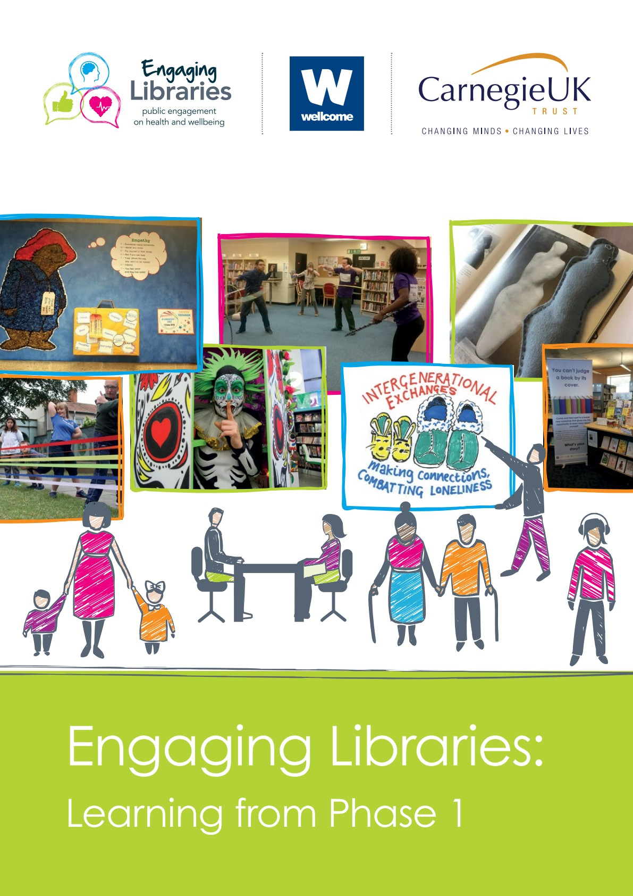

<!-- PAGE: 1 -->

# Engaging Libraries: Learning from Phase 1

**Carnegie UK Trust & Wellcome Trust**.

<!-- PAGE: 2 -->

### Acknowledgements

I would like to thank Jenny Peachey, Senior Policy and Development Officer at the Carnegie UK Trust and Douglas White, Head of Advocacy at the Carnegie UK Trust who read and commented on drafts of this report; Greer Roberts, Funding and Direct Activities Lead, Public Engagement Team at the Wellcome Trust for her insightful comments and Andy Wright, Carnegie Associate and Libraries Manager, Wakefield for his support throughout the Engaging Libraries programme.

I would also like to thank Blake Stevenson who carried out the evaluation of the Engaging Libraries programme, on which much of this report is based. Finally, thank you to all the library services, partners and participants who were involved in Engaging Libraries.

Rachel Heydecker, Policy and Development Officer, Carnegie UK Trust.

<!-- PAGE: 3 -->

# Contents

- **Foreword** (p. 2)
- **Executive Summary** (p. 3)
- **Introduction** (p. 5)
- **The programme** (p. 6)
- **The wider context** (p. 7)
- **The projects** (p. 8)
- **Highlights from Engaging Libraries** (p. 12)
- **Learning** (p. 13)
- **Enablers to success** (p. 14)
- **Inhibitors to success** (p. 15)
- **Reflections** (p. 16)
  - Working with partners (p. 16)
  - New skills, knowledge and approaches (p. 22)
  - The benefits of a network (p. 26)
- **Summary** (p. 28)
- **Appendix 1: Public Library Strategies** (p. 29).

<!-- PAGE: 4 -->

## Foreword

Engaging Libraries was an experiment: a pilot programme designed to support public libraries to work in collaboration with others and to move beyond health promotion to explore new and dynamic ways to spark curiosity and conversation about health and wellbeing in communities. As a pilot, Engaging Libraries was intended to be a learning process for all involved. That is, a learning process not just for our successful participants and broader public library sector, but for philanthropic organisations such as ours to explore the best role we can play where there is overlap between our goals and those of the library sector. We were struck by the things that we learned through Engaging Libraries in terms of what public libraries bring to public engagement endeavours:.

- Taboo breaking: Engaging Libraries demonstrated that libraries can be a space for discussion and debate about subjects which can be taboo or difficult to talk about such as death, body image and mental health. As safe, trusted spaces public libraries were the ideal venue for engaging people on tricky or touchy subjects.

- Experimentation and risk: Engaging Libraries revealed that public libraries embraced the opportunity and have the appetite to experiment and be creative with public engagement activities. Libraries also worked in diverse partnerships across different sectors and disciplines.

- Safe space: Engaging Libraries showed that funding opportunities can be valuable in giving public libraries the space and permission to forge new partnerships as well as build on existing links, reaping benefits for the library, its community and partners. Public libraries have a great deal to offer their communities, philanthropic organisations and potential partners whose goals overlap with their own. There is clearly scope to think carefully about how modern philanthropy can better support staff and the sector to be more assertive in their value, bold in their partnerships and to be forward-thinking about what they deliver for their communities and how they do so. Simon Chaplin, Douglas White, Director of Culture and Society, Wellcome Trust Head of Advocacy, Carnegie UK Trust.

<!-- PAGE: 5 -->

Executive Summa This report outlines learning and reflections from the Engaging Libraries programme, a partnership programme between the Carnegie UK Trust and the Wellcome Trust. The report draws on information collated by Blake Stevenson as part of an evaluation conducted on behalf of the Carnegie UK Trust, as well as conversations with project staff and visits by Carnegie UK Trust staff to project activities. Engaging Libraries was a pilot programme, aimed at giving public libraries in the UK and Ireland the opportunity to test out creative public engagement projects on health and wellbeing. It did so through providing project funding and by encouraging and facilitating participating libraries to engage with one another while developing and delivering their projects. Engaging Libraries worked with 16 public library services over the course of a year to deliver 14 projects. These projects were delivered by library services in collaboration with a wide range of partners. Public libraries and public engagement Engaging Libraries showed that, as safe and trusted spaces at the heart of their communities, public libraries are well suited to acting as a space for discussion and debate about “tricky” subjects which can be taboo or difficult to talk about (for example , death, body image and mental health). Moreover, it showed that services were open to experimenting in creative ways to engage with communities on these subjects, and to working in diverse partnerships across different sectors and disciplines in order to do so. ary Working in partnership Engaging Libraries required libraries to deliver their activities in partnership with a person or organisation from outside the sector. There were a broad range of partnerships formed across the 14 projects, from academics and artists to youth groups and residential homes, and many new partners for the library services involved. Key reflections from the programme were that libraries need to be clear and confident in how they describe the value of their project, the benefits of working with a public library and the ask of their partner. Clearly defining the roles of the library and partners and clarifying expectations of each other at the outset is also very helpful. New skills, knowledge and approaches Engaging Libraries enabled staff to increase their knowledge, undertake training and learn new skills. Facilitation training was offered by the Wellcome Trust, and other training was provided by some partners or councils, with staff encouraged to share learning within their library and service. Key reflections from the programme were that staff should proactively seek out opportunities to learn from partners through training, and look into other training opportunities that could be available. Staff involved in projects should also share skills and knowledge with others within the library service to help sustain activity. Strong support and buy in from senior staff within the service is critical for opening up training opportunities and avenues for sharing learning within the library service.

<!-- PAGE: 6 -->

Benefits of a network As part of the Engaging Libraries programme, project staff were part of an online network and attended face-to-face events, providing a forum to share ideas, experiences, problems and solutions. This helped to foster a sense of project staff being part of a wider network of people going through a similar experience. Key reflections were that by connecting to those in similar situations and doing similar work, staff can share learning and best practice and support one another. Moreover, that existing library service networks can help to build relationships and make connections. Inhibitors and Enablers The report identifies factors which acted as barriers to success, as well as those which helped to facilitate successful projects. Inhibitors to success included logistics, reaching intended audiences, and conveying a clear understanding of their project to others. Engaging Libraries also highlighted the need for continuing support and skills development around evaluation, data capture and impact assessment. A key factor which enabled the success of projects was libraries’ USP as a safe and trusted space that connects people to ideas as well as to one another. This played a crucial role in enabling and encouraging people to engage with challenging topics that they may not have in another setting. Some success factors came from the programme’s format, such as the way in which additional funding opens up the opportunity to be innovative and take risks and the cultural capital of having external funders’ backing. Again, the requirement to work in partnership also led to libraries making ‘unusual friends’ with new partners. Successful projects also embraced opportunities for gaining new knowledge and skills, had strong buy in from senior managers and effectively used marketing and promotion to attract participants to their activities. The projects that make up the Engaging Libraries programme have provided a wealth of learning for the sector. Some of these projects are described through case studies in the report. The programme has produced projects that could be replicated or scaled up - which we hope will be explored.

<!-- PAGE: 7 -->

## Introduction

Public libraries are trusted, safe civic spaces at the heart of their communities that connect people to ideas and to one another. Public libraries increasingly play a vital role in delivering activities designed to support the health and wellbeing of their local community, as demonstrated in both national library strategies and Libraries Connected’s Universal Health Offer. Appendix 1 provides a summary of how public libraries across the UK and Ireland seek to deliver on safe community space, knowledge and ideas, and health. Engaging Libraries was a pilot programme that sought to build on these strengths and attributes of public libraries as trusted spaces for ideas and connection with an interest in health and wellbeing. The aim of the programme was to support public libraries across the UK and Ireland1 to deliver creative and imaginative public engagement projects on health and wellbeing in collaboration with a person or organisation from outside the library sector. The programme was run by the Carnegie UK Trust in partnership with the Wellcome Trust, from October 2017 to October 2018. 1 Engaging Libraries was open to applications from across the UK and Ireland. The Carnegie UK Trust received a number of applications from Ireland and one from Libraries NI in Northern Ireland, and the Local Government Management Agency in Ireland and Libraries NI were part of the Advisory Group. However no projects from Ireland or Northern Ireland were funded by Engaging Libraries. The Wellcome Trust’s mission is to improve health by helping great ideas to thrive and the public play an important role in that mission. Public engagement through Engaging Libraries sought to extend the way in which people could find out about health in their libraries. It went beyond health and wellbeing information to libraries being a space where people could explore, connect and think critically about health issues, research and the role they play in society. Engaging Libraries sought to build on libraries’ USP of being a safe, trusted space; connecting people to ideas and one another as well as providing a focus on health and wellbeing. Engaging Libraries’ emphasis on public engagement meant that whilst improved health or wellbeing could be an outcome of activities, it was not the primary aim of the projects the programme sought to support. Again, the requirement to work in collaboration with others came from the understanding that it can be good to build new relationships and expand networks, and that working with others can bring benefit and insight. This report seeks to highlight the innovative work of the Engaging Libraries projects and set out the key learnings and reflections from the programme to help support future, high quality public engagement practice.

<!-- PAGE: 8 -->

## The programme

Engaging Libraries was open to applications from public libraries in the UK and Ireland. The programme offered participants:.

- £5,000 – £15,000 to deliver a public engagement project on a health or wellbeing theme. More ambitious projects could bid for up to £25,000.

- A package of support from library and public engagement experts.

- A Kickstarter Day with the opportunity to meet other project staff, share project ideas, get advice about public engagement and support to think about evaluation.

- Peer learning through a series of online and in person sharing and learning events.

- An external evaluation to ensure the capture of learning and experience with a view to sharing this more widely.

The programme had a range of selection criteria: The project engaged with members of the community in creative and imaginative ways. This engagement was a two-way process which involved activities like participation, conversation, interaction, and listening. The project was focused on themes relating to health and wellbeing. The project enhanced or enabled libraries to use existing assets. The project delivered an unmet need for a community or helped a community explore an issue of interest to them. The project was delivered in collaboration with a person(s) or organisation(s) from outside the library sector. The project created learning – the project idea had the potential to generate learning for other libraries or was scalable. The project was feasible – the application showed an understanding of what is needed to make the proposed activity happen and demonstrated that the project could be delivered successfully with the support of the programme.

<!-- PAGE: 9 -->

In addition there were three balancing criteria: A geographical spread of projects across the UK and Ireland. A mix of libraries participating (in terms of their size and setting). Some variation in the scale, focus and type of projects. The 14 successful projects were selected with the input of an expert Advisory Group including representatives from Carnegie UK Trust, Libraries Connected, CILIP The Library and Information Association, Arts Council England, Scottish Library and Information Council, Welsh Government, the Local Government Management Agency in the Republic of Ireland and Libraries NI. The programme originally envisaged supporting 8-10 projects. However as a result of the high standard of applications received, additional funding was provided by the Wellcome Trust to allow another four projects to take part in the programme. The wider context The Engaging Libraries programme ran while many library services across the UK faced significant challenges. Some library services running Engaging Libraries projects were restructured during the programme, which presented challenges in terms of staffing levels and time constraints on staff. Some projects found that partners they had planned to work with were facing funding challenges of their own, and were no longer able to take part in the project. However, feedback from some library staff going through service restructure was that receiving funding as part of the Engaging Libraries programme gave them confidence and a positive focus. Engaging Libraries gave services the financial means to spend time focussing on a specific project, and to deliver activities which allowed them to get to know their service users in new ways. The programme enabled activity to take place that went beyond what would have otherwise been possible, both financially and by working with partners.

<!-- PAGE: 10 -->

## The projects

Comics and Cosplay; Caring for Young Minds: Oldham Comics and Cosplay brought together art, theatre and comics to open up discussions about mental health among young people in Oldham. The library service commissioned a play focussing on mental health issues experienced by young people, which was followed by facilitated workshops to discuss the play and the themes it raised. These themes inspired a comic, which was launched at a comic con at Oldham Library. Partners: Oldham Theatre Workshop, Positive Steps (charitable trust), Youth Out in Oldham (youth group), Oldham Sixth Form College, Sara Kenney (Wellcome Trust Comics Engagement Fellow), Rachael Smith (writer), Jacob Phillips (artist), Tim Pilcher (editor), Jim Devlin (colourist), Healthy Young Minds (Child and Adolescent Mental Health Services), Sarah McNicol (Manchester Metropolitan University), Tony Pickering (Manchester Metropolitan University) and Dennis Whittle (owner, Comic Den). The Final Party – Celebrating Death through Celebrations of Life: Redbridge The Final Party positioned the library as a safe place to talk about and plan for death without fear or embarrassment. This project used Death Cafes, talks, performances, workshops and art installations as means to encourage discussion about a subject which can remain a taboo. The project also involved an animation documentary created by library participants which promoted positive discussions about death and dying in multi-cultural communities; and a celebratory arts and death festival which took inspiration from the Mexican Day of Dead traditions. Partners: Compassionate Funerals (funeral service), Salmagundi Films (creative film organisation), The Corpse Project (research and engagement project), Mandinga Arts (arts organisation), University of Greenwich Faculty of Liberal Arts and Sciences, University of Bath Centre for Death & Society, Life. Death. Whatever (end of life doula and funeral director) and Redbridge Council End of Life Team. Brainworks: East Dunbartonshire Brainworks encouraged people to explore aspects of neuroscience and brain research within their local library, through a variety of intergenerational activities reaching a wide range of people from birth to 90 and including new parents, school students, older library members and people with autism. In addition, Brainworks Days and Fun Palace events enabled the public to take part in experiments and interactive demonstrations, listen to talks and enjoy themed Science Ceilidhs or drumming workshops within library settings. Partners: Lewis Hou (science and arts educator, Science Ceilidh), Dr. Evelyn McElhinney (Glasgow Caledonian University), Dr. Alan Gow (Heriot-Watt University), Dr. David Simmons (Glasgow University), Big Groove Promotions (Drumming workshops).

<!-- PAGE: 11 -->

You Can’t Judge a Book by its Cover: Norfolk You Can’t Judge a Book by its Cover allowed the public to explore the concept of self-reflection and how this can link to mental health and wellbeing. Participants developed personalised book covers using mixed media arts to express themselves on the front cover, and creative writing to generate back cover biographies that were either aspirational, fictional or reflected reality. Partners: Science Art and Writing Trust, University of East Anglia School of Psychology, Becky Tough (artist) and Heidi Williamson (writer). Teddy Bears Picnic: London Borough of Bexley Teddy Bears Picnic sparked discussions between pre-school children and their parents or carers about what a healthy lifestyle means. Through teddy bears picnic themed sessions with songs, lyrics and dances linked to exercise and healthy eating, the project aimed to tackle childhood obesity. Partners: Francesca Beard (spoken word artist), London Vegetable Orchestra (band), Public Health Bexley, psychologist and Council dietitian. Body Image and Mind: Leeds Body Image and Mind encouraged people to explore the theme of body image and the impact it has on self-confidence, mental and physical health and wellbeing. The project worked with communities, groups and individuals using participatory activities with artists and used the library’s art collections to spark conversations about body image. Partners: Leeds Public Health, Leeds Art Gallery and a range of artists. Release the Pressure: City of London Release the Pressure created a sanctuary space for anyone living or working in the City of London to open up discussions and prompt thinking about mental health and to support wellbeing. A range of activities were held on fortnightly Thursdays in Shoe Lane Library at a ‘Dragon Café in the City,’ which introduced different tools, from creative arts to physical exercise, to help people better engage with their mental wellbeing. Partners: Output Arts (arts organisation), Business Healthy (Public Health in the City of London Corporation), Mental Fight Club (creative mental health charity) and ThriveLDN (movement aiming to improve mental health and wellbeing for Londoners).

<!-- PAGE: 12 -->

Library Takeovers: Creating a Space for All: Somerset Library Takeovers engaged the wider community in talking and thinking about learning disabilities. The Library service worked with people with learning disabilities to discover how libraries and other public spaces can be more inclusive for those with learning disabilities. ‘Library Takeover’ days allowed people with learning disabilities to volunteer at libraries, followed by creative workshops and a public exhibition of the work created. Partners: Creativity Works (arts and health organisation) and Somerset Film. Empathy Day: Essex, St. Helens, Libraries Unlimited in Devon and Sheffield Libraries This joint project experimented with involving communities in empathy- focused activities, culminating on Empathy Day (June 12th). Empathy Day facilitated exploration of how communities engage with the concept of empathy, and the impact of empathy on participants’ wellbeing and that of their communities. The activities focused on fostering intergenerational understanding and relationships and celebrating difference. Library services collaborated with children’s authors and held Empathy Cafés with the communities to co-develop activities around the issues that the communities had identified. Partners: Empathy Lab, and children’s authors Gillian Cross, Helen Moss, Bali Rai and Sita Brahmachari. Slipper Talk: Torfaen Slipper Talk used the concept of gifting slippers to begin conversations about ageing and to hold intergenerational events to foster respect between citizens. In the run up to Christmas, the library encouraged younger users to nominate older people they knew to receive a pair of safe slippers, and local schools visited the library to discuss children’s perception of older people while wrapping slippers and reading shoe-themed books. In the New Year, those who had received slippers and their nominators came together at celebratory tea party events, where people of all ages enjoyed storytelling, games, arts and crafts alongside conversations about independent living, falls prevention and the ageing process. The project ended with a multi-agency event called ‘Give Winter Blues The Boot’ which continued and reinforced the theme of falls prevention. Partners: Memory Lane Alzheimer’s Society group, Torfaen Carer’s Centre, local schools, Social Services, Ageing Well in Wales, Torfaen Community Connectors, Torfaen Care & Repair, Stroke Association, Age Connects Torfaen.

<!-- PAGE: 13 -->

#ExpressYourself: Essex #ExpressYourself explored the use of creativity to open up conversations about mental health and wellbeing among young people. Participants were encouraged to embrace creativity as a form of self-help and improved wellbeing, and to help them feel more connected and included in their community. Creative workshops allowed children to discuss wellbeing and mental health as well as explore self-expression and creativity through dance, animation, filmmaking and video game making. Partners: Signals (arts & education charity), Colchester Borough Council’s Livewell (campaign about healthy living in Colchester) and Firstsite (arts organisation). Talking ‘Bout Teddies: Dundee Talking ‘Bout Teddies worked with Dr. Suzanne Zeedyk to highlight the importance of teddy bears for children’s emotional wellbeing and resilience. Library users, aged from two to 92, were filmed in libraries across Dundee talking about their childhoods through their teddy bears, with a public lecture from Dr Suzanne Zeedyk highlighting the scientific evidence showing that teddies matter. The films were shown across libraries in Dundee and at the city’s Science Festival. Partners: Dr Suzanne Zeedyk (Developmental Psychologist), Connected Baby (organisation promoting the science of connection). Great Minds!: Lancashire Great Minds! engaged 12 – 14 year olds with cultural activities and experiences through their local library to enrich their lives and benefit their mental wellbeing. The project culminated in a festival take over by young people in two library branches. Partners: Natalie Flynn (author), Culturapedia (creative organisation) and Ludus Dance. The Travelling Happiness Bar: Bolton The Travelling Happiness Bar provided an informative signposting installation to introduce and provoke conversation about ‘the five ways to wellbeing’. The Travelling Happiness Bar was staffed by ‘Bartenders’ who had undertaken training in engaging with people in conversations about wellbeing. The Travelling Happiness Bar is available to borrow across Bolton and Greater Manchester. Partners: Bolton at Home (Housing provider), Breakdown Bolton CIC (creative organisation), Neo:artists (arts organisation) and Bolton CVS (Community and Voluntary Services).

<!-- PAGE: 14 -->

## Highlights from Engaging Libraries

Over 17,000 people were reached across 14 projects* Recognition Engagement Funding Libraries won local Libraries engaged Library services awards, secured the public through have attracted additional funding outputs including further funding to and saw their a comic based on continue to outputs embedded theatre workshops, deliver project in mainstream local festivals, animations activities authority activities and short films Sharing Partnerships New projects An online network Partnerships were Partnerships made provided an forged with authors, through Engaging opportunity to share scientists, arts Libraries have led to ideas, experiences organisations and additional projects for and learning academic institutions library services Participants New topics Impacts A wide range of were introduced to Positive impacts from participants were library users including projects including engaged in activities, brain development, increased self-awareness, including those with body image, end of increased social learning difficulties, life, the ageing process interaction, improved older people and and empathy confidence and changed young children perception of others.

Audience figures will be higher than cited here, with data capture not in place across all projects and evaluation identified as an area where more support would be welcomed. Again, some projects were designed to be a more participatory experience for small groups rather than for large numbers, however we have data from some projects showing that Engaging Libraries events drove a substantial increase in attendance for the.

<!-- PAGE: 15 -->

## Learning

We have identified several factors which facilitated the successful delivery of Engaging Libraries projects. These are briefly described here, with further detail and case studies in the following chapter. These factors provide important learning for future projects and work in the sector. Additional funding Opportunity Monitoring and to be evaluation innovative or risky Effective New awareness- partnerships Enablers raising developed to success Libraries’ New skills USP for staff Bridging Commitment capital of at senior external level funders Funding Project environment management Challenges Logistical Inhibitors reaching target challenges audiences to success Challenges Partner around engagement evaluation.

<!-- PAGE: 16 -->

## Enablers to success

Additional Funding Most project staff felt that their project would not have happened without the Engaging Libraries funding, or that it would not have happened to the same scale. Opportunity to be innovative or risky Engaging Libraries gave libraries the permission to try new, creative and innovative activities, which they may not have been able to secure funding for internally. New partnerships developed The requirement of the Engaging Libraries programme for library services to work in partnership with others outside the sector led to libraries making ‘unusual friends’. It also provided valuable learning around managing and maintaining relationships with partners. New skills for staff Project staff across the Engaging Libraries portfolio have learnt new knowledge and skills, and some library services have extended this learning to other staff and partners. Library services will be in a better position to implement engagement activities in the future. Bridging capital of external funders The Carnegie UK Trust and the Wellcome Trust provided practical support such as branding resources and networking opportunities, which was important to the success of the projects. Some project staff felt that the Carnegie UK Trust and the Wellcome Trust ‘brand’ and the credibility this gave to the projects was invaluable, and opened doors that had been previously closed to them. Commitment at senior level Strong buy in from senior managers was an important enabler to success, with projects in a library service where a senior manager was highly engaged with, or supportive of, the project being most successful in implementation. Libraries’ USP Libraries’ USP as a safe, trusted space was key to many projects’ successes. Members of the public have a high level of trust in the library sector and library staff are recognised as a reliable source of information and advice. This encouraged people to participate in activities and engage on challenging topics that they may not have in another setting. Effective awareness-raising Taking a multi-faceted approach to marketing and awareness-raising about projects was an enabler to success, particularly where projects made links with external activities such as awareness weeks for specific issues. Projects that used social media, promotion within the library and their partner organisations’ networks successfully attracted participants to their activities. Monitoring and evaluation Project staff who planned how to evaluate their projects, and implemented methods to capture feedback and visitor numbers, were able to demonstrate the success of their project and share this learning with others. They were also able to learn from feedback and adapt activities if necessary.

<!-- PAGE: 17 -->

## Inhibitors to success

Library services also shared the issues that some projects found acted as barriers to success. These are shared here to inform future projects and identify areas where support for the sector would be beneficial. Project management For some project staff, managing projects and external funding of the nature and scale of Engaging Libraries was new. While the programme offered these staff the opportunity to develop project management skills through designing and delivering a project, it should be recognised that this learning experience impacted on the scope of some projects. Challenges reaching target audiences Some projects found it difficult to reach some of their intended audiences, such as young people through schools and men aged 25-54. Some difficulties occurred as projects only had a short amount of time to promote their activities before they were delivered, and others found their activities difficult to explain succinctly for marketing purposes. Projects looked to mitigate difficulties by experimenting with different ways to promote their project, and adapting timelines where possible to provide a longer lead-in period for audiences such as schools. Attracting particular target audiences was identified as an area where it would be helpful to share awareness and experiences within the sector. Challenges around evaluation Some projects faced challenges around evaluation, as they had less understanding of how to measure the impact of their activities and placed less importance on the collection of data. Support around evaluation methods was offered to projects during the programme, and best practice was discussed on the online forum. Evaluation has been identified as an area where more support would be welcomed across the sector. Partner engagement A few project staff faced challenges in managing their relationships with partner organisations, including challenges with differing expectations, unreliability of partner contacts, and changes in staff in partner organisations part-way through the programme. Project staff found that communication was key when working with partners, and that it was helpful to clarify ways of working and expectations from the outset. Logistical challenges Some projects faced logistical challenges such as storage of project equipment, as well as scheduling events at times and dates to suit the target audience as well as the library’s existing activities. Difficulties around scheduling of events could be mitigated by embedding the project in a library’s existing activities; seeing it as an integral part of the service offer, rather than a free-standing project. Funding environment A number of projects in the Engaging Libraries programme experienced service restructures, changes in staff and reductions in overall levels of funding within their library services, which affected the delivery of their project.

<!-- PAGE: 18 -->

## Reflections

## Working with partners

## Overview

The Engaging Libraries programme required projects to deliver their activities in collaboration with a person(s) or organisation(s) from outside the library sector. The aim was for library services to use Engaging Libraries as an opportunity to build new relationships and expand their networks.

## New partners

The range of partners involved in the Engaging Libraries programme was broad, from academics and artists to youth groups and residential homes, and included many new partners for the library services involved. Some projects were designed by libraries and partners together at the application stage, while other library services did not approach potential partners until after their application was successful. In these cases, staff needed to ‘sell’ their project idea, the benefits of working with the library and the idea of public engagement to an external partner. The Engaging Libraries branding and its links to the Wellcome Trust and the Carnegie UK Trust helped projects in their approaches to potential partners. Some library services have continued to work with new or existing partners following the Engaging Libraries programme. This demonstrates the strength of relationships forged during the programme and the mutual benefits for libraries and partners of working together. Some projects have also seen the partners they have worked with make links with each other, and become advocates for the library service in their local area.

## Working with academics

A number of Engaging Libraries projects worked with academics, many for the first time. Working with higher education institutions enabled projects to have scientific activities delivered by academics, who brought their expertise to a different audience. Projects also made links with academics with experience in public engagement, who could offer advice on delivering activities which were two-way. Other projects made links with departments within academic institutions, which brought them into contact with a range of individuals that they would not have otherwise connected with. Working with academics provided learning for library staff and academics. Some library services did not know what expectations to have of academics, such as their ways of working, whether they would charge for their time, how they would use the library space and how much they would expect of the library service and staff. The Engaging Libraries programme allowed libraries to experience working with academics to better inform their expectations.

## Working with young people

Many projects worked with children and young people through partners. Some libraries were able to take advantage of existing relationships with local schools to involve children in their project. However other projects faced difficulties working with schools, including finding the correct person to approach in a school about the project or explaining the purpose of their project. A key learning is that library services need to ensure that library staff can articulate the purpose of their project or activity, as well as how the project will be delivered, confidently and clearly when engaging with partners such as schools. Staff also need to be able to communicate clearly the benefits for a school in partnering with the library service. It is also helpful to make links between the project and the curriculum or vision of the school. Some library services worked with young people through partnerships with youth groups and other organisations rather than schools. Some projects were able to take advantage of existing relationships with youth groups and continued to work with these groups.

<!-- PAGE: 19 -->

New audiences Projects found that their partnerships brought new audiences to the library, as their partners sometimes had a different reach and connections within communities. Some Engaging Libraries projects targeted particular groups in their communities, such as those with learning difficulties, and were able to take advantage of their partners’ existing connections to attract those participants. Promotion by partners for project activities, rather than the library service, also encouraged new participants to attend an activity in the library. Engaging Libraries provided opportunities for libraries and their partners to bring together different groups of participants, such as projects with intergenerational activities. Managing relationships Working with partners required library services to manage new or existing relationships in order to deliver their project. Many partnerships were very successful, and brought benefits for both the library service and partner organisations.

> “Working with.

different people is what has made it for us”

> “Working.

in partnership has amplified the value of pounds and pence” A key learning from working with new partners was to clearly define roles and expectations at the beginning of the project. As Engaging Libraries required collaboration between partners and libraries, some projects faced challenges when partners were not able to deliver on their commitments or fulfil expectations they had set. The Engaging Libraries programme encouraged library services to collaborate with partners rather than commissioning them. Projects found that this led to a positive relationship, as both parties had a stake in the outcome of the activities. Partners also offered new perspectives to libraries – both for the projects they were working on and for their work overall.

## Key points

- When approaching prospective partners, have a strong ‘elevator pitch’ for the project and the benefits of working with a public library.

- Be clear and confident in the ask of the partner.

- Define the roles of the library and the partner at the outset, and discuss expectations of one another at the outset.

- Seek to understand and work through any differences in ways of working or delivering.

<!-- PAGE: 20 -->

Case study Oldham Libraries: Comics and Cosplay; Caring for Young Minds Oldham Libraries’ project, Comics and Cosplay, brought together a range of partners to open up discussions about mental health among young people in Oldham. The library service used local theatre and workshops to engage with young people about issues that were important to them, and used these ideas to inspire a comic, which was launched at a Comic Con at the Central Library. The Comics and Cosplay project team engaged with young people at many points during the project. Young people were invited to attend the performance of A Standard Day by Oldham Theatre Workshop, a play which was commissioned by the library service which covered mental health issues experienced by young people. Workshops were held following the performance to further explore the play’s themes. These workshops were promoted to the public, and the library service also invited youth groups who they had existing relationships with, including Youth Out in Oldham and Oldham Young Carers. Working with existing partners allowed the library service to take advantage of good relationships, and the workshops were well attended. The library service also worked with new partners to produce their comic, Jack and Lucy. Once the project was underway it became clear that more input than first thought was needed to produce a comic – the project required a writer, editor and colourist in addition to an artist. Project staff were introduced to Sara Kenney, a Wellcome Engagement Fellow focussing on comics and an experienced broadcaster and comic creator, who helped to connect them with others to produce the comic. These new partnerships helped to create a high quality, professional comic and created a strong relationship between the project staff and Sara Kenney. The fact that the comic writer and artist also attended the theatre workshops ensured the comic was informed by the issues raised by young people in Oldham. Comics and Cosplay also worked with an academic from the School of Childhood, Youth and Education Studies at Manchester Metropolitan University, Dr Sarah McNicol, to produce an exhibition exploring the use of comics in supporting mental health. Dr Sarah McNicol has worked on how comics can be used as.

<!-- PAGE: 21 -->

a health information medium.2 The exhibition was shown at the Central Library’s Comic Con, and also toured other libraries within the library service. Around 6,000 people attended Oldham Libraries’ Comic Con in May 2018. Over 10,000 copies of the comic Jack and Lucy were distributed, and the comic writer and artist attended the Comic Con to sign copies and take part in a panel discussion. The Comic Con attracted new audiences to the library, and the library used this as an opportunity to promote their Shelf Help collection, graphic novels and BorrowBox resources. Following the Comic Con project partners continued to promote Jack and Lucy and their partnership with the library service by taking the comic to Comic Cons and exhibitions they were attending, including international events. The comic was also distributed in libraries across the North West, at Healthy Young Minds clinics and in schools. The comic is available online through Oldham Libraries’ website.3 The partnerships in Oldham Libraries’ project were very successful, with clear benefits for the library service. The project team acknowledged that they had to get used to working with partners from other sectors, namely the artistic sector, as they sometimes had a slightly different way of working or worked to different timescales. However these relationships were managed well and a high quality project was delivered. A positive relationship between project staff and Dr McNicol at Manchester Metropolitan University meant that further comic storytelling projects were planned to engage with underserved audiences in Oldham. The library service’s experience from Engaging Libraries also enabled them to work with Manchester University NHS Trust through their Radiotherapy project.4 Staff have been able to use contacts from Engaging Libraries to bring in partners to this new project, and have benefited from a better understanding about the role of ‘lived experiences’ in health information.

<!-- PAGE: 22 -->

Case study East Dunbartonshire: Brainworks East Dunbartonshire Libraries’ project, Brainworks, aimed to get people from across generations exploring aspects of neuroscience and brain research in their local library, and inspire curiosity through practical activities and lively discussions. Activities in the library service had previously focused largely on the arts, and the Engaging Libraries programme presented an opportunity to adopt a more scientific focus for activities. The library service collaborated with Lewis Hou, a science education specialist with a research background in neuroscience, who led a number of activities throughout the project. These activities involved comparing brain scans to see the effect of learning a musical instrument, with older library users coming together with school pupils. Lewis also held a number of Science Ceilidhs during the project. A Science Ceilidh combines science, storytelling and music to look at questions such as the benefits of dance to cognitive ageing and benefits of music to learning. It also aims to make scientific concepts more accessible by using ceilidh dance steps to simulate processes such as the immune system and DNA base pairs. The Science Ceilidhs held in the library received particularly positive feedback from participants of all ages. The project staff also worked with academics from universities for the first time. They worked with D r Evelyn McElhinney from the Department of Nursing and Community Health at Glasgow Caledonian University to explore the virtual world ‘Second Life,’ and how virtual communities can influence people’s ability to live with long term health conditions. The sessions with Dr McElhinney were attended by invited groups: senior pupils from local high schools and older participants who attended existing activities in the library. Users of ‘Second Life’ were invited to speak to the groups in the library about their use of the virtual community. A researcher from the Psychology Department at Heriot-Watt University, Dr Alan Gow , also took part in a day of activities at the library called.

> ‘Brainworks Day,’ by giving a talk to explore brain.

anatomy and how well people age. Project staff worked with colleagues from the Social Work department at the Council to hold a.

> ‘learning lunch’ which combined a scientific talk.

about autism with a drumming workshop. The scientific talk was given by Dr David Simmons from the School of Psychology at Glasgow University, who spoke about his research on sensory aspects of autism. The Social Work department used their networks to invite attendees. The majority of those who attended were parents of individuals with an autism spectrum disorder, and the audience also included social and educational workers. Dr Simmons’ talk was followed by a drumming workshop which was open to all, with participation from an inclusive music performance group.

<!-- PAGE: 23 -->

As they had not worked with academics previously, project staff initially did not know how much to ask of academics. However, once underway the partnerships worked well; the library service gained experience in working with academics and received valuable input into the project from them, and academics had the opportunity to work with a library which they had not done before. None of the academics charged for their time during this project, as it counted as public engagement which fitted within the aims of their institutions. Brainworks successfully worked with young people through schools in the local area, and felt that their existing relationships with schools were key in raising awareness of their project. The project topic aligned with the national curriculum in Scotland, the Curriculum for Excellence, which helped when approaching schools about the activities. The project publicised their first ‘Brainworks Day’ through local primary schools which resulted in good attendance. Classes were also invited to take part in activities before they were included in the ‘Brainworks Day’ programme. Primary 7 children took part in experiments involving writing wearing reversing goggles for five minutes a day, demonstrating how the brain learns and how performance at a task can improve with practice. Young people who volunteered at the library also had the opportunity to be involved in the project. The Brainworks project brought together different audiences through intergenerational activities. Project staff specifically invited participants from different age groups for some activities, such as the ‘Second Life’ sessions, and the ‘Brainworks Day’ attracted a wide range of ages. The project also provided the opportunity for individuals in the local area to attend science-related events and ask questions of experts, which was not something that they were often able to do. The positive partnerships fostered through Engaging Libraries has meant that the library service will consider widening their offer to include more scientific engagement, including through future Fun Palace events and a Science Week to tie in with the Summer Reading Challenge. Although continuing to work with academic partners depends on staff time within the library service, the academics involved felt the relationships created with the project staff were sustainable and were keen to work with the library sector again in the future.

<!-- PAGE: 24 -->

New skills, knowledge and approaches.

## Overview

Engaging Libraries projects enabled library staff to increase their knowledge of public engagement. A number of project staff also undertook additional training in order to deliver project activities. Even when additional training was not undertaken by projects, Engaging Libraries encouraged staff involved to deliver new types of activities and attract new audiences, by focussing on two-way, creative public engagement. Public engagement Engaging Libraries invited projects to be creative and experimental in their approaches to public engagement. The public engagement element of the programme pushed staff boundaries; with new skills and knowledge being acquired, diverse activities programmed and a focus on two-way participation. There was a clear focus at the beginning of the programme on ensuring projects understood the idea of public engagement. During the application process for Engaging Libraries, three workshops were held for potential applicants to give an insight into public engagement projects funded by the Wellcome Trust. The Kickstarter Day held shortly after the successfu l projects had been selected provided staff with a taster session of public engagement methods at Wellcome’s Reading Room, and further facilitation training at the Wellcome Trust was offered to all participants. Many projects trialled approaches and activities that were innovative for their library service in order to undertake public engagement, which required staff to learn new skills and in some cases act beyond their usual roles and activities in the library. Engaging Libraries required staff to move from delivering activities which provided health information to activities which encouraged discussion and debate between individuals, allowing them to explore, connect and think critically about health issues. The focus on two- way public engagement also widened the skill set of staff, as some library staff were more used to delivering activities ‘to’ an audience without an element of discussion or debate ‘with’ the audience. Additional training Facilitation training from the Wellcome Trust was offered to all participants, and around half of projects took up this offer. Feedback from participants was that the training was useful. A number of projects organised training around mental health, to give staff the skills to be able to interact with people attending project activities. Projects in Leeds and Bolton had mental health training from their Council’s Public Health department. Where projects were running activities on a theme which was new to them, such as more science focussed projects, it was important for staff to feel confident in delivering activities and promoting their project. Additional training helped to provide this confidence by giving them knowledge in a particular area, or an understanding about how to deliver a public engagement activity. In some projects, staff were also trained by partners to undertake the project activities. This aimed to allow staff to continue to run activities after funding for partners came to an end, however this will be dependent on staff resource. Project and budget management Some staff involved in Engaging Libraries did not have experience of managing projects, and so went through a learning curve during the programme. Other staff had not previously handled budgets of the size that they received for their Engaging Libraries project, which required them to learn about their local authority’s policies and procedures in areas such as procurement and contracting. The Engaging Libraries programme also demonstrated that libraries have the ability to deliver projects that have clear positive outcomes with relatively small amounts of funding. This reflects the Carnegie UK Trust’s experience with other library programmes such as Carnegie Library Lab and the Trust’s experience of working in the library sector.

<!-- PAGE: 25 -->

Some projects were also able to lever in additional funding to expand on their activities, through partners or their local authority. The project in the City of London, Release the Pressure, attracted additional funding from the City of London Corporation which enabled them to double the number of sessions they were able to offer. Buy in from Library Service The scope of Engaging Libraries projects often required staff input in addition to the original applicants. Some library services were able to dedicate a team of staff to their Engaging Libraries project, while other projects were managed and run by an individual or small numbers of staff. Where projects were run by small numbers of staff, this had an impact on the time they could dedicate to the project and what they were able to achieve. Some projects struggled with staff resources for the project, particularly in services where staff numbers had reduced and delivering the daily library service was the priority. Support and buy in from the library service for Engaging Libraries projects was important, and evident where the dissemination of learning from projects was encouraged. In some library services, staff working on an Engaging Libraries project passed on knowledge to other staff who were not directly involved in the project, sharing skills and learning within the library service. This also aimed to ensure new learning and skills were not lost when the funding came to an end. A number of Engaging Libraries projects were also showcased within their wider library service, demonstrating buy in and support from the senior library team. Staff were able to present their projects at internal meetings, external conferences and in publications.

## Key points

- Seek opportunities to learn from partners through training, and remain open to other training opportunities that may be available.

- Aim for sustainability of the activity by sharing skills and knowledge from project staff to others within the library service.

- Seek strong support and buy in from senior managers for the project and for staff training opportunities.

<!-- PAGE: 26 -->

Case Study Leeds Libraries: Body Image and Mind Leeds’ project, Body Image and Mind explored the theme of body image and the impact it has on self-confidence, mental and physical health and wellbeing. The project worked with community groups and individuals using participatory activities with artists, and used the library’s art collections to spark conversations about body image. Body Image and Mind project staff used new approaches to engage with the public through various artistic methods, such as model making, sculpture, photography, illustration and sewing. Workshops were led by professional artists, and the project staff complemented activities using items from the library’s art collections to spark conversations about body image. The project was able to take advantage of Leeds Central Library’s dedicated area, the Drawing Room, which provided an inspiring and safe space for most of the workshops with artists. The space was also beneficial as discussion around body image, a sensitive topic, could take place in a separate part of the busy Central Library. Participants reported that the library had successfully provided a ‘safe space’ for people to participate in art. Leeds Public Health were a partner in the Body Image and Mind project, and while the library service as a whole had worked with Leeds Public Health before, it was a new relationship for the library staff involved in Engaging Libraries. Early on in the project, Leeds Public Health offered to provide ‘Making Every Contact Count’ training to library staff involved with no charge. This training on mental health awareness helped staff to respond to participants disclosing information about mental illness. Leeds Public Health also provided resources on mental health awareness and helped to make connections with some of the groups of participants who attended project workshops. The Body Image and Mind project secured buy in from senior staff in the library service by presenting the project to them before applying for funding, and again after their application was successful. The project lead kept the Head of Service informed of the dates of key activities, ensuring they were aware of the project’s development. Outputs were shared with the public through an exhibition and celebration event held in January 2019, demonstrating support from the senior library team. The project involved 10 members of staff, including 5 librarians, who worked on the activities consistently. The team updated staff within the wider library service through regular submissions to the library service’s weekly briefing, sharing information about the project and the public engagement activities. Two project staff also gave a presentation about the project in June 2018 to key stakeholders at the Libraries Connected Annual Seminar, sharing learning about public engagement with the wider library sector.

<!-- PAGE: 27 -->

Case Study Norfolk Libraries: You Can’t Judge a Book by its Cover Norfolk Libraries’ project You Can’t Judge a Book by its Cover encouraged participants to explore the concept of self-reflection and how this can link to mental health and wellbeing. Individuals developed personalised book covers using mixed media arts to express themselves on the front cover, and creative writing to generate back cover biographies that were aspirational, fictional or reflected reality. The project allowed staff to work with scientists, artists and an author, and run creative workshops which combined elements of science and arts. The workshops were in library locations chosen to reflect the diversity of communities in Norfolk, including coastal towns, large market towns, rural villages, city centre and suburban library settings. In the library-based workshops, participants designed book covers which reflected different aspects of their life. The activity involved a psychology element using Q methodology, where participants were asked to sort a series of personality trait cards into piles which were most like and least like them. This activity aimed to help participants to think about what they wanted to include on their book cover. The three words that participants felt were most like them and three that were least like them were taken forward to use in the writing element of the workshop. This activity was initially run by Dr Neil Cooper from the University of East Anglia School of Psychology, and his students. In the writing part of the workshop, participants wrote their ‘biography’ for the back cover of the book jacket based on the Q sort activity, and created a front cover using a range of artistic methods. These elements were delivered in conjunction with an author and artist, with the author providing guidance on writing descriptive text and the artist demonstrating different techniques. The range of activities allowed for self-reflection and discussion, with the Q sort activity providing the opportunity for individuals to learn about themselves. The project involved a combination of existing groups who used the library, as well as public drop-in sessions. There was a training day held for library staff early on in the project, to give staff the skills to contribute to workshops, particularly in the Q sort activity. A sustainable legacy for the project was a goal for the project lead from its inception, and the training was designed to give staff the ability to run workshops.

> ‘in house’ in the future, as the necessary materials.

and equipment had been purchased. The library service underwent a restructure during the Engaging Libraries programme. This affected staff numbers, and initially meant that it was more difficult for the project to get buy in from library staff. However as changes bedded in, staff buy in became easier.

<!-- PAGE: 28 -->

## The benefits of a network

## Overview

As part of the Engaging Libraries programme, project staff were invited to two face to face events, and were part of a private online network on Facebook. This provided the 14 projects across 16 library services with a forum to share ideas, experiences, problems and solutions. Some library services were also part of regional networks which offered further opportunities to share knowledge. Connecting online Peer learning and support was an important part of the Engaging Libraries programme, and the Carnegie UK Trust and the Wellcome Trust designed the programme to include opportunities for learning as well as peer support to projects. The online network was facilitated by the Carnegie Associate, Andy Wright, and project staff from Carnegie, with at least one library staff member from all of the projects part of the network. The network ‘met’ at set points for one hour each month, with discussions on pre-determined topics such as marketing, articulating value and sharing success. After three months the ‘meetings’ provided project staff with the opportunity to give short presentations to the network on their progress through videos and images. Throughout the programme, projects were invited to share updates on activities, ask advice of the group and seek help for situations. This peer learning and support network received positive feedback from project staff, with some commenting that it provided them with an impetus to work on their project after seeing the progress made by other library services. It was also seen as rewarding to share ideas with staff working on other public engagement projects, as well as exchange feedback about engagement ideas which worked or did not work. While there are clear opportunities for senior library staff to meet and share best practice, there may not be as many opportunities for more junior staff. The success of the Engaging Libraries online network could provide an example for the sector. All of the Engaging Libraries projects engaged with the network at least once, and there were a number of projects which regularly posted and actively took part in the monthly ‘meetings.’ The online network also provided a relaxed, informal way for the Carnegie UK Trust to keep in touch with projects regularly. Connecting in person Library staff from Engaging Libraries projects met twice during the year-long programme, once at the beginning and once at the end. The Kickstarter Day was held shortly after projects were selected, and provided an opportunity for two staff members from each library service to meet the Carnegie UK Trust and the Wellcome Trust teams, as well as each other. The day involved introductory presentations from the Carnegie Associate, each project, a presentation about evaluation from the external evaluators and group discussions with Carnegie, Wellcome and evaluators. Bringing together staff involved in a new programme, who were all working on public engagement activities which were new to their library services, encouraged them to exchange information and share ideas. It also helped to make them aware of opportunities which were available through Carnegie and Wellcome. It also fostered a sense of being part of an innovative network, rather than just running an isolated project within a library. The projects also came together for a celebratory event at the end of the programme. Project staff shared their achievements and learnings around public engagement, and heard talks from key library stakeholders and the Wellcome Trust. The face to face meetings demonstrated the benefits of bringing staff together working on different projects as part of the same programme. The events allowed for open and frank sharing of achievements and limitations faced by projects, particularly at the end of the programme when relationships between projects had been established. It is hoped that sharing between these Engaging Libraries projects continues beyond the lifetime of the programme.

<!-- PAGE: 29 -->

Sharing across library services Some library services that were part of regional networks had opportunities to share knowledge and learning. Staff working on Engaging Libraries projects gave presentations at internal meetings, regional staff conferences and larger scale conferences such as the CILIP Conference and the Libraries Connected Annual Seminar. Regional networks, such as in Greater Manchester, also offered opportunities for project outputs to be circulated. Oldham Libraries were able to take the exhibition created as part of their Comics and Cosplay to a number of other libraries across Greater Manchester, and the comic created by the project was distributed widely through libraries across Greater Manchester.

## Key points

- Connect with others who have done similar work to share learning and best practice.

- Make use of library service networks, such as regional networks to build relationships and make connections. Comments from project staff.

> “I..found it [the online network] unexpectedly.

supportive. It was interesting to be in regular contact with such a varied number of public library organisations from across the UK and to see projects developing with hugely different audiences but driven by very similar core values… I hope to incorporate aspects of at least two of the projects in the near future.” Project staff.

> “Representing the Engaging Libraries project with.

some of the other project members [at Libraries Connected Annual Seminar] was great, I felt part of a team and it helped to strengthen relationships with the other members. I enjoyed having the opportunity to share knowledge and experience and promote the project.” Project staff.

> “By delivering the Engaging Libraries workshop.

[at the Libraries Connected Annual Seminar], I re-gained confidence in presenting ideas and projects to other professionals. I haven’t had the opportunity to do this for some time, and it was excellent to have the experience of delivering a workshop.” Project staff.

<!-- PAGE: 30 -->

## Summary

Engaging Libraries has contributed to the ongoing journey to change the outdated perceptions that people have of public libraries. Library users were able to participate in activities and engage on topics that they might not have otherwise, due to the library’s position as a safe, trusted space. Many participants found the library to be a positive place to learn, discuss and engage on a variety of health and wellbeing topics. The additional funding provided through Engaging Libraries enabled the sector to trial innovative, creative approaches to public engagement, and in some cases to lever in additional resources. Project staff were able to increase their own knowledge, improve their project management skills, think differently about how library spaces can be used and experience working with new partners. Engaging Libraries has confirmed that the library sector is well-placed to deliver significant outcomes with relatively small amounts of money. However, libraries should not shy away from applying for funding amounts which adequately cover staff costs, development opportunities and effective marketing materials. Engaging Libraries has shown what can be done with relatively small sums of money, and the hope is that more substantial grants would lead to more substantive impact across the sector. Some project staff focused on building a sustainable project, in order to embed it in their library service. Other Engaging Libraries projects have the potential to replicate or scale up their activities, which we hope will be explored. Some projects encountered challenges, including with partners, logistics, reaching some of their intended audiences, and conveying a clear understanding of their project to others. Engaging Libraries highlighted the need for continuing support and skills development around evaluation, data capture and impact assessment in particular. The learning involved in overcoming these challenges has been valuable to the staff and their service, and has been shared more widely through the Engaging Libraries network. We hope this learning will continue to be helpful for them in the future. Engaging Libraries has highlighted the importance of strong backing from senior staff within the library service for externally funded projects. Where projects had buy in from senior staff, it helped to integrate the project within the service’s other activities and the wider council agenda, as well as encourage staff buy in at all levels. Support from within their library service also encouraged projects to share their findings with a wider audience, and seek opportunities for publicity. Engaging Libraries demonstrated that support mechanisms and opportunities for sharing learning were very useful for the staff involved in projects. The ability to share information and experiences was mentioned as a positive aspect of the programme by many participants, and it allowed for relationships between different library services to be built. We hope that the success of the Engaging Libraries online network will provide an example of one way of bringing staff together to share learning and support one another for the sector.

<!-- PAGE: 31 -->

# Appendix 1: Public Library Strategies Across the UK and Ireland

| Theme | England (*Libraries Deliver 2016–2021*) | Wales (*Connected and Ambitious Libraries 2017–2020*) | Northern Ireland (*Libraries NI Corporate Plan 2016–2020*) | Ireland (*Our Public Libraries 2022*) | Scotland (*Ambition and Opportunity 2015–2020*) |

| :--- | :--- | :--- | :--- | :--- | :--- |

| **Mission of libraries** | Libraries are vital community hubs – bringing people together and giving them access to the services and support they need to help them live better. | Libraries provide everyone with a wealth of resources, opportunities and activities which provide cultural and learning experiences to inspire and foster lifelong learning. | Libraries connect people with information, ideas and experiences that contribute to health and wellbeing. | Public libraries are attractive, welcoming spaces where all members of the community can access knowledge, ideas and information, and where people can reflect, connect and learn. | Scotland’s public libraries are trusted guides connecting all of our people to the world’s possibilities… part of a shared civic ambition to fulfil the potential of individuals and communities… adding to Scotland’s social, economic and cultural wellbeing. |

| **Community space focus** | Libraries are safe, welcoming environments freely open to all, which encourage participation, mutual support and creativity. | Libraries offer a neutral, safe place within the community which provides opportunities for people to connect with each other. | Public libraries are widely recognised as welcoming, accessible, trusted shared spaces, embedded in communities. | The library is a centre of community activity. It is a catalyst for encouraging imagination, inspiring creativity and acquisition of new skills. | Libraries are essential agents of their local communities. Effective community engagement is part of their core business. A shared civic ambition will ensure that the services provided are meeting the needs of local people. |

| **Knowledge and ideas focus** | Libraries allow everyone to be introduced to new ideas and opportunities, then given confidence and easy access to tools, skills and information they need to improve their quality of life. | Development of a well educated, skilled and informed population is a fundamental aspect of public libraries’ activity. | Libraries enable people to access a wide variety of learning, information and social resources and foster lifelong learning. | Public libraries provide access for people in all communities throughout Ireland to information and cultural resources, and support the Government priority of inspiring people of all ages, backgrounds and abilities. | Public libraries in Scotland promote education and learning, develop a culture of reading for pleasure, offer support for everyone from early years to older communities, and enable people to make informed choices. |

| **Health and wellbeing focus** | Libraries offer safe, welcoming non-clinical spaces where health and wellbeing groups can work with the community in a trusted and non-threatening venue. | Physical and mental wellbeing is a key offer of public libraries, not only by providing information on which to base informed choices for the benefit of health in the future, but also through designated collections and schemes such as Book Prescription Wales. | Libraries provide information, programmes and services that contribute to health and wellbeing. | Improving health and wellbeing resources… to have access to high quality and trusted health and wellbeing information resources, to pursue leisure and learning and strengthen communities, in both the short and long term. | Public libraries in Scotland contribute to social wellbeing, tackling social isolation, inequality, fractured communities, disadvantage, and ill health. |

<!-- PAGE: 32 -->

The Carnegie UK Trust works to improve the lives of people throughout the UK and Ireland, by changing minds through influencing policy, and by changing lives through innovative practice and partnership work.

The Carnegie UK Trust was established by Scots-American philanthropist Andrew Carnegie in 1913.

---

Andrew Carnegie House, Pittencrieff Street, Dunfermline, KY12 8AW.  

Tel: +44 (0)1383 721445.  

Email: [info@carnegieuk.org](mailto:info@carnegieuk.org).  

Website: [www.carnegieuktrust.org.uk](https://www.carnegieuktrust.org.uk).

This report was written by Rachel Heydecker, March 2019.  

Carnegie United Kingdom Trust.  

Registered Charity No: SC 012799 operating in the UK | Registered Charity No: 20142957 operating in Ireland.  

Incorporated by Royal Charter 1917.

## Footnotes

[^2]: <https://www2.mmu.ac.uk/cyes/staff/profile/index.php?id=1243>

[^3]: <https://www.oldham.gov.uk/downloads/file/4931/jack_and_lucy>

[^4]: <https://publicprogrammes.co.uk/radiotherapy-and-me>
