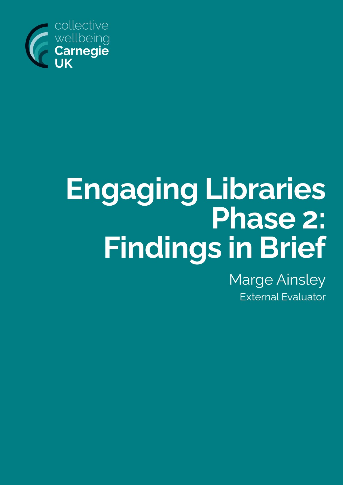
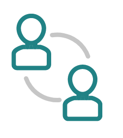
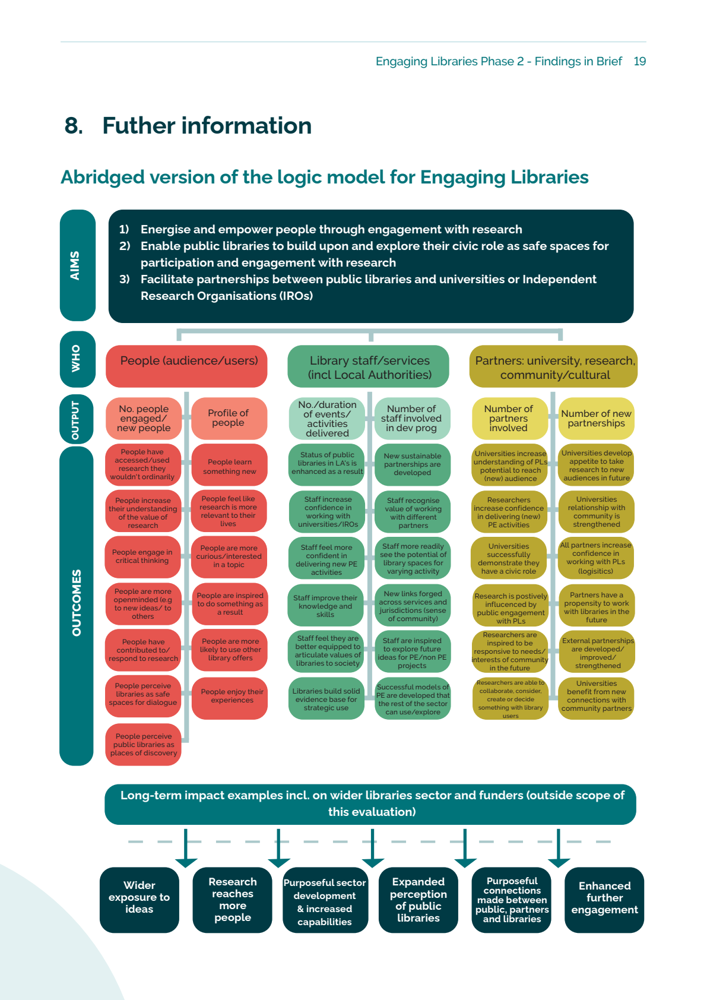
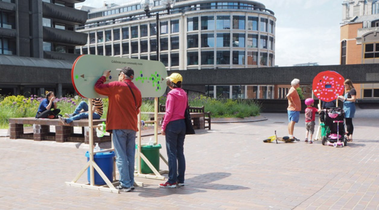
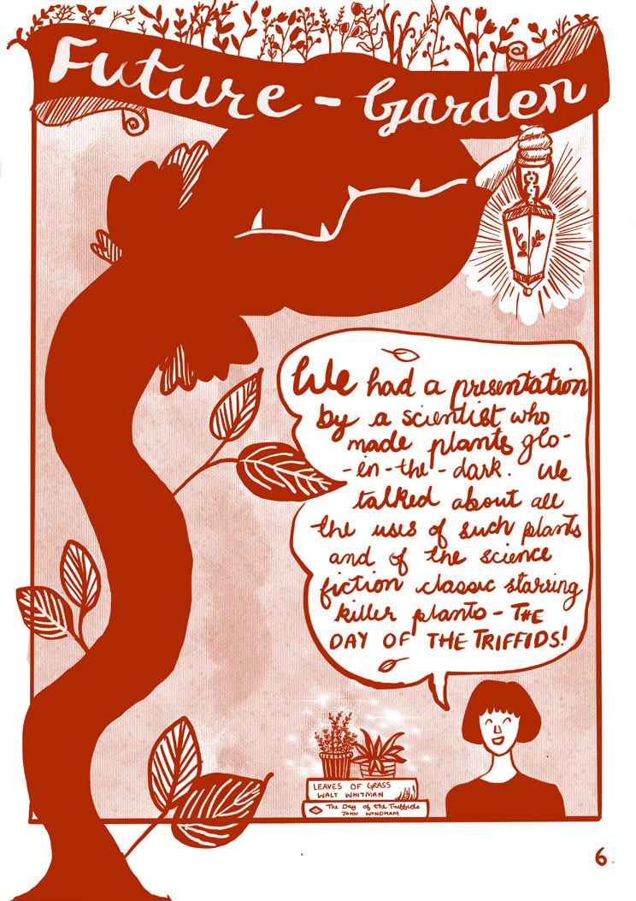
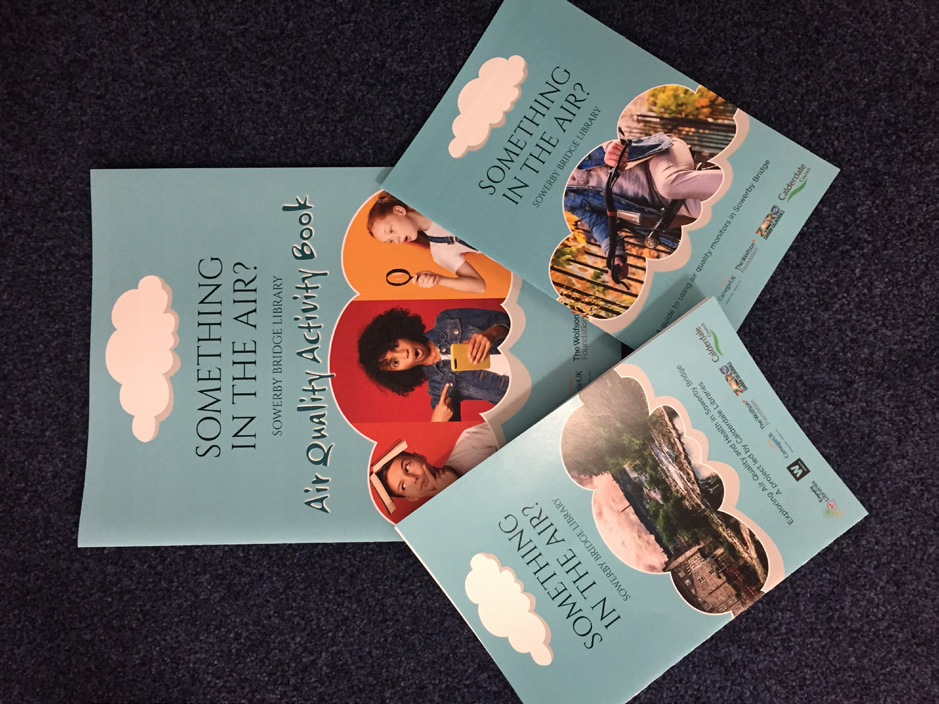
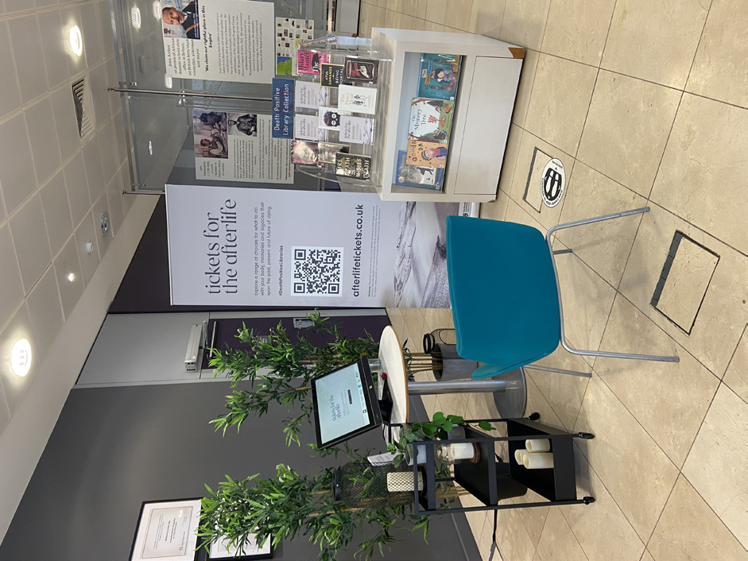
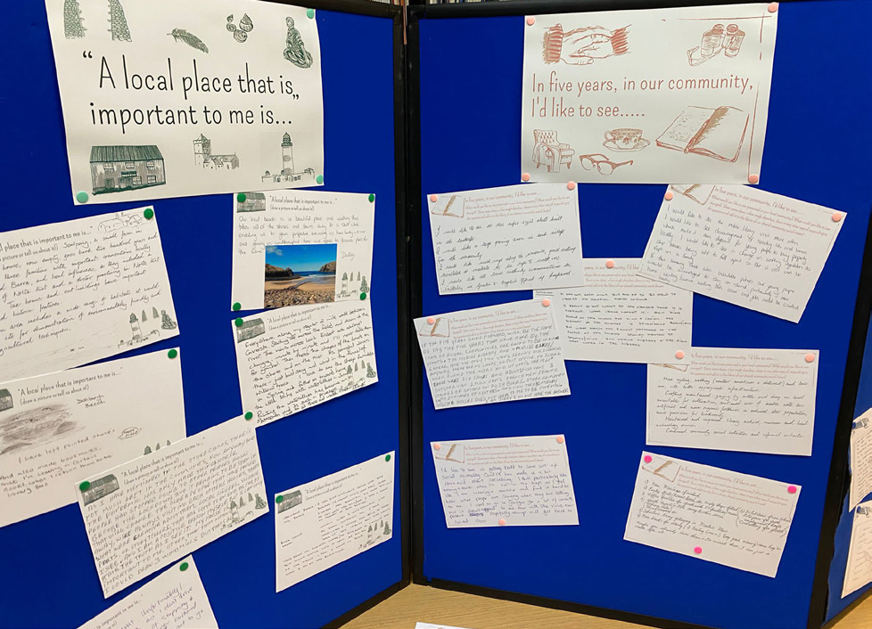

<!-- PAGE: 1 -->

# Engaging Libraries Phase 2: Findings in Brief

**Marge Ainsley**  
External Evaluator.

<!-- PAGE: 2 -->

This report is a summary of an independent evaluation of Engaging Libraries Phase 2 carried out by Marge Ainsley. The findings relate to evidence captured and made available between November 2019 and November 2021. As with any evaluation there are limitations, and further information about the method can be supplied on request.

The text of this work is licensed under the Creative Commons Attribution-ShareAlike 3.0 Unported License. To view a copy of this license visit, http://creativecommons.org/licenses/by-sa/3.0/ or send a letter to Creative Commons, 444 Castro Street, Suite 900, Mountain View, California, 94041, USA.

Any enquiries should be directed to Rachel Heydecker: rachelh@carnegieuk.org.

<!-- PAGE: 3 -->

## Contents

1. Overview (page 2)
2. About the Engaging Libraries programme (page 2)
3. Covid-19 context (page 3)
4. What did the evaluation set out to measure? (page 4)
5. Headline facts and figures (page 5)
6. Key findings (page 6)
   - 6.1 Public (page 6)
   - 6.2 Library staff (page 8)
   - 6.3 Partners (page 11)
   - 6.4 Process evaluation (page 13)
7. Recommendations (page 16)
   - 7.1 Project aims summary (page 18)
8. Further information (page 19)
9. Engaging Libraries Phase 2 projects (page 20)

ISBN: 978 1 912908 83 7.

<!-- PAGE: 4 -->

## 1. Overview

Engaging Libraries Phase 2 (herein known as Engaging Libraries) supported public libraries to work with higher education partners to deliver public engagement activities. This report provides an overview of the independent evaluation findings of the programme, funded by Carnegie UK, Wellcome and the Wolfson Foundation. It draws on data collected by 14 participating projects (16 different library services) between November 2019 and November 2021.[^1]

## 2. About the programme

Engaging Libraries provided public libraries across the UK with the opportunity to develop and deliver public engagement projects on research in health, society, and culture in collaboration with others. The following definition of public engagement was used:

> Public engagement involves creating an opportunity for people to consider, participate and debate ideas. It is a two-way process, which may involve activities like participation, conversation, interaction and listening. It can take many forms but is often made up of projects, activities, or events, ranging from a family fun make-and-take activity, right through to an artist performing a new piece of work exploring an issue or concern to a public audience.

Projects were asked to engage people in creative and imaginative ways, which were two-way involving activities like participation, conversation, interaction and listening. It was recognised that applications and successful projects would offer activities which varied in how 'two-way' they were. However, the Carnegie UK team clearly advised that activities involving an 'expert' and passive listeners such as talks or lectures in a presentation style and explanation format were not viewed as public engagement for the Engaging Libraries programme. Funders' expectations were for a range of activities across this public engagement spectrum to be delivered, with an encouragement for projects to move towards the most interactive two-way engagement appropriate for their theme, context, or audience.

Successful projects therefore represented a variety of public engagement methods and outputs. These ranged from information sharing through question-and-answer sessions, to art projects involving shared experiences, performances based on workshops and co-produced experiments.

Engaging Libraries required libraries to work in partnership with researchers or a university department, where ideas and activities were developed and delivered collaboratively. The type of collaborations could vary, from those which allowed people to access and respond to research, to those which were more co-produced, enabling people to play a role in formulating research. In order to make the application process as open as possible, Carnegie UK accepted applications where research partnerships were not yet established, as well as where they were already in place, and recognised that selected projects would vary in terms of their stages of development. The programme had an ethos of experiment, risk, and innovation, and the Carnegie UK team encouraged a flexible approach, where ideas and activities could continue to be developed into the initial stages of the programme.

<!-- PAGE: 5 -->

As well as funding, Engaging Libraries also offered a development programme for the library staff. This was a key strand and reflected the aim of Engaging Libraries to develop the ability of library services to generate and sustain support for relevant, dynamic, and proactive library services. This skills development programme delivered information and training sessions, alongside informal cohort-wide and project-specific catch-up sessions, on various topics including public engagement, partnerships, communications, creative evaluation, and project management.

## 3. Covid-19 context

The Engaging Libraries Phase 2 cohort met together in Birmingham for the first face-to-face development programme day in January 2020. Two months later, the World Health Organisation declared Covid-19 a pandemic, leading to the UK going into a nationwide lockdown. Library services closed, staff were furloughed or redeployed to frontline local authority services, and all face-to-face public engagement and evaluation activity was halted. University staff were also working from home and learning how to adapt and prioritise teaching online, whilst dealing with the ongoing and resulting impacts on their own workloads and research programmes.

In response to the pandemic, Carnegie UK paused the programme schedule between March and September 2020. During this period, the project team supported library services on a one-to-one basis and planned how best to provide a flexible and supportive environment for when projects were in a position to restart. In conversation with the participating library services, a revised timeline and a package of responsive support was developed, including additional funding to support the redesign and delivery of activity in alternative formats.

Activities restarted between autumn 2020 and spring 2021, meaning that project redesign and re-planning took place within a shifting, uncertain landscape of UK government-wide guidelines, changing restrictions and newfound variants. It is worth noting that library buildings remained shut until July 2020 but even when restrictions started to be lifted and some libraries reopened, services were limited e.g. provision of click and collect and some digital services only. The introduction of various tiered systems and lockdowns in November 2020 and January 2021 further disrupted library services, staff, and engagement with Engaging Libraries. It was challenging for the project team to project manage and implement a new programme schedule due to these changing timelines but also variations in guidelines and legal rules between the nations (and in some cases, within regions - such as in the Northwest of England - where specific localised lockdown rules were brought into force).

<!-- PAGE: 6 -->

All library teams worked to a completion date of November 2021; however, they did not follow the same design and delivery trajectory as would have originally been the case due to having different restart dates. In addition, the loss of face-to-face activity meant that – as with many other cultural and creative organisations – activity had to be reimagined and, in many cases, completely changed. In addition to Covid-19, some of the services within the cohort were also having to deal with the wider challenges that perpetuate within the libraries sector environment more broadly – such as cuts and threats of/actual library closure, restructures, and staff losses through redundancy or redeployment.

The evaluator recognises that the ability to design and deliver Engaging Libraries activity was substantially compromised. Participating libraries rose to the challenge of finding solutions to deliver their Engaging Libraries projects, and it is testament to the hard work of the library staff, partners, and project team that none of the participating libraries withdrew from the programme.

## 4. What did the evaluation set out to measure?

An evaluation framework and overarching strategy was put in place to monitor and evaluate Engaging Libraries Phase 2. Based on a logic model and created collaboratively with the project team, it provided a roadmap for achieving the programme aims which were:

1. To energise and empower people[^2] through engagement with research about health, society and culture in one of the following ways:
   - Enable people to access, use and respond to research;
   - Enable people to value and think critically about research;
   - Enable people to play a role in formulating research.
2. To enable public libraries to build upon and explore their civic role as safe spaces for participation and engagement with research.
3. To facilitate partnerships between public libraries and universities or Independent Research Organisations (IROs).

An abridged version of the logic model can be found in further information on page 19 which outlines the series of intended outputs and outcomes[^3] (mapped against Generic Learning Outcomes or GLOs) that the programme intended to collectively deliver for people, library staff and partners. The evaluation assessed whether these outputs and outcomes were met, to review whether the programme ultimately achieved its overarching aims. The evaluation also included a process evaluation where the aims, ambitions, selection process, project design and management during a pandemic was considered.[^4] The evaluation draws upon best practice guidelines for evaluating public engagement projects, including NCCPE's Common Standards.[^5] This included evaluating the design,[^6] delivery and impacts of engagement.

<!-- PAGE: 7 -->

## 5. Headline facts and figures

**321**  
public events/activities delivered.

**12,393**  
number of people engaged.

**3,470**  
estimated number of non-library users engaged.

**302**  
library staff engagements in the development programme.

**57**  
partners across academia and community/culture engaged.

<!-- PAGE: 8 -->

## 6. Key findings

The below narrative provides an overview of the top-level findings, highlighting what worked well and less well - structured by the public, library staff and partners.

### 6.1 Public

High levels of satisfaction and enjoyment were reported, with 97% rating their experience of participating in an Engaging Libraries project as either 'excellent' or 'good'; and the public commonly describing their experience as powerful, informative, insightful, illuminating, and invaluable. This is attributed to the quality of the speakers, technical delivery, ease of access (online) and inspiring, engaging, or relevant content.

88% of people are more likely to try other events or activities at (or organised by) a library as a result of their experience. These results demonstrate the satisfaction and enjoyment of the programme by the general public and is testament to the work of the library staff and partners in creating reportedly engaging and quality events and activities during a pandemic.

One of the most striking outcomes of the programme is the influence it has had on learning, with 88% of those surveyed either strongly agreeing or agreeing that they had learned something new as a direct result of participation. A wide range of individual examples were cited, for example: how to use an air quality monitor and interpret the data, how to better manage their own menopause symptoms, how to spot misinformation, plan for a death, or be better informed about how to deal with their own or someone else's grief, and how to use Zoom/digital tools to access events.

Similarly, the programme has had a positive influence on inspiring people: it has made them curious (84%) and think differently about a topic (89%). Members of the public indicated they would talk to others about their experience (65%) and described a range of future plans (such as attending further events, doing more reading into the subject matter, joining networks, hosting their own events, making changes to their lifestyle) which suggests that participants have a propensity to take some form of direct action in their personal or professional lives.

Indeed, 77% of respondents either strongly agreed or agreed that what they learned would have a direct impact on their life in some way. There are several unintended outcomes related to this, for example a parent attending Glasgow's Sharing Stories sessions decided to change her career path to work in Early Years settings as a direct result of the sessions they attended.

The shift to digital for some of the participating services - perhaps unsurprisingly - increased reach, with the programme attracting participants from across the UK and beyond including Poland, Germany, Canada, South Africa, Hungary, Australia, Denmark, Ireland, USA, Dubai, and South Africa. This allowed teams to successfully open up their library brand and content to more people than initially anticipated, including those whose volunteering or work professional development commitments linked with the topic.

<!-- PAGE: 9 -->

On the flip side, where activities were held in face-to-face settings when restrictions lifted, face-to-face numbers of attendees were not as high as they would originally have been due to restrictions on numbers in the space due to social distancing, or audiences not being confident in re-engaging with activities at point of delivery.

Holding public engagement activities online offered several benefits to face-to-face alternatives - including greater confidence in active participation, convenience, and intimacy. Engaging Libraries events – whether online or in person – were delivered during a time where people needed connection the most. This was especially pertinent for those who were shielding and unable to leave their homes (who gained enjoyment and a sense of connection from online activities) and those in isolated or rural communities. As currently debated more widely in the cultural sector,[^7] this indicates that there is a demand (and potentially an accessible, equitable need) for online digital events to continue running alongside face-to-face options.

It should be noted that digital exclusion was a concern across the programme. This was addressed wherever possible by offering onboarding advice and by reducing barriers to accessing kit and data by seeking additional funding sources such as Connecting Scotland[^8] to support this.

The variety of creative ways that information was conveyed, the reportedly welcoming environments created by library teams and partners, and the opportunity to co-create approaches to public engagement gave audiences agency and opened up access to information or research often for the first time. These approaches also made research or complex information more relevant to peoples' lives (with 67% strongly agreeing or agreeing that had been the case). In turn, this encouraged the public to be more open-minded and understand the value of research more readily.

Through Engaging Libraries, members of the public have had the chance to discuss topics in a perceived safe environment (with three quarters either strongly agreeing or agreeing that they felt more comfortable exploring them in a 'library held space' than elsewhere) and as a result are more likely to try similar events and activities both inside and outside a library environment in the future (88%).

The programme has also contributed to changing perceptions about what libraries offer (including a broader product range) with just under two-thirds strongly agreeing or agreeing with the statement 'I've changed my views on what libraries offer as a result of my experience.' Although it is difficult to robustly evidence, the shift to digital access may have played a role in this change of mindset.

As a result of the pandemic, the public programme was redesigned by the majority of projects and in certain circumstances this led to completely different (and potentially more sustainable) products being developed. This may unexpectedly lead to longer lasting legacies than originally intended for audiences, with products made available beyond the life of the programme. For example, websites that will continue to be used beyond the lifetime of the programme, rather than a temporary exhibition on-site.

<!-- PAGE: 10 -->

Where criticism was made by members of the public, this mainly related to technical issues such as a need to make improvements to onboarding across a range of online platforms and allowing more time to socialise in those spaces.

Engaging Libraries attracted predominantly older, female, highly educated, White participants with 14% self-describing as having a disability or chronic illness (of which 50% experienced mental health issues) and 24% who were unpaid carers. This profile is not unusual for cultural and creative activities, however it is worth noting that some projects specifically targeted under-represented groups and non-library users; and as a whole, an estimated 28% of the public who engaged with the programme were not previously library users.

Projects which made conscious efforts to engage new and diverse audiences - including taking activity out to the community and working directly with community gatekeepers - yielded good results. Conversely, where activity was delivered online with the hope of attracting specific demographic or diverse groups, this was rarely successful and reinforced previous evaluation findings that targeted activity requires careful planning and a bespoke, tailored approach.

### 6.2 Library staff

The evaluation evidence demonstrates that the staff development programme has had a significant and positive influence on staff skills and capabilities. Taking part has noticeably increased participants' knowledge, understanding and confidence in how to deliver public engagement activities (with 94% strongly agreeing or agreeing that this had been the case).

Library staff identified that their confidence had grown in a wide range of specific areas. These included: delivering public engagement, presenting, facilitating, managing relationships with partners, problem solving, strategic planning, teamwork/managing staff, digital skills, working on complex projects, and creativity.

Aside from developing a specialist knowledge in the topics delivered, an unexpected benefit of the pandemic in terms of learning has been the need to digitally upskill and make radical <!-- PAGE: 11 --> changes to delivery models in a short space of time. For example, staff are more digitally literate as a result and have fast-tracked learning new digital skills which they will be able to use across other project and service areas. It is suggested that without the pandemic, this may not have happened.

Staff rated their experience highly, with this attributed to: the quality, style and knowledge of the consultants delivering the development programme; the opportunities to connect with the project team and cohort; and the content, tone, and practical advice shared. Many staff also mentioned that the programme provided validation that they were 'doing a good job'. This is particularly heartening given the extreme stress and anxiety that staff were under personally and professionally during the pandemic.

Library staff particularly appreciated having space and time away from delivery to reflect and connect with peers, with the vast majority rating the opportunity to connect with peers and the project team as excellent. While peer-learning worked well for some and was valued, for others, there was a feeling of 'cohort fatigue' due to the project's extended duration, which was especially noticeable when the project restarted.

Staff highlighted several critical success factors (key ingredients) which supported the delivery of the programme within their service:
- Securing buy-in and establishing a strategic fit for the project within the wider library service and their local authority.
- The dedication, passion and drive of the project leads and wider delivery team.
- An open, collaborative relationship with their partner, taking time to understand each other's ways of working, strengths and weaknesses, and establishing a regular pattern of communication.
- Taking time to get to know their partners personally rather than formally, and finding a common interest in the topic.

Partnership working is valued by library staff, even if their relationship did not turn out as initially planned. 88% strongly agreed or agreed that they have specifically increased their confidence in working with universities/IROs as a direct result of the programme.

<!-- PAGE: 12 -->

Whether partnerships were described as successful or not, staff learnt what ingredients are needed for a successful partnership and have gained confidence in knowing how to work with these kinds of partners in the future. Staff also commonly reported that they had shifted perception about the valuable contribution that libraries could make to a partnership and their local communities.

Engaging Libraries has built the capacity and raised the profile of participating library services. Many library services have won or been nominated for awards or received press coverage for their work, including Manchester's project in the prestigious Manchester Culture Awards, Redbridge's project in the Guardian,[^9] and Kirklees being nominated for a Libraries Connected award.[^10]

There is strong evidence that Engaging Libraries has helped to strengthen the civic role that libraries play within their communities and as safe spaces for participation and engagement with research. 82% of library staff strongly agreed or agreed that their service's civic role had been enhanced, with teams giving examples of:
- Being seen as a community anchor and trusted space for difficult, sensitive, or challenging conversations (such as death and dying, fake news, air pollution, and menopause).
- Challenging perceptions of what a library does and who it is for, both internally within the council and externally among the public and academic partners.
- Connecting communities to research that directly impacts their health and wellbeing, enabling them to make informed choices.
- Providing a platform for community voices to be heard by researchers and decision-makers.

There were limited suggested improvements around the Engaging Libraries programme, which reflects the project team's hard work in providing open lines of communication, ongoing <!-- PAGE: 13 --> support and a relevant, Covid-responsive, development programme for library staff. Where suggestions were made these typically related to the choice of cohort-wide communication method, for example some services had problems using Yammer (the social media platform chosen originally); the disappointment of being unable to have a 'natural' networking environment that would ordinarily have happened in the planned face to face development programme sessions; or the need to streamline support materials and toolkits.

### 6.3 Partners

A total of 57 external partnerships[^11] were developed through Engaging Libraries and 40 of these were completely new. Library staff and partners suggested common critical success factors for partnerships which can be used within the 'Engaging the public with research' toolkit.[^12]

Six specific library services experienced difficulties with their academic partner, and this was attributed to impacts on the university and/or researchers due to Covid-19, staff leaving or no longer being in their role, and finding little common ground. These factors led to delays in project design and delivery, however the library services were resilient: they adapted and found new academic partners or different ways to continue delivering despite their setbacks. The project team helped all libraries experiencing challenges with their partners, and the support and flexibility shown with this was very much appreciated by library staff.

Some projects have enabled researchers to engage the public in collaborative ways, however, there are also examples where a more advisory role has predominantly been held by the academic partner. Delivering two-way engagement at the more interactive end of the scale was a challenge for some of the cohort. Notwithstanding this, 71% of academic partner survey respondents strongly agreed or agreed that they had been able to collaborate, create or decide something with library users as a direct result of the project. This is particularly positive given the restrictions in place and challenges that arose with social connections as a result of the pandemic.

Alongside examples where the design of the public engagement activity was co-created between partners, library staff and the public, there are also examples where new community partner connections were brought in to help sense-check content and help deliver an audience-focused product.

It is evident that like their library staff counterparts, partners enjoyed being involved in Engaging Libraries, with the majority of suggested improvements attributed to the pandemic rather than anything within the project team's control. One particularly reoccurring comment was the impact of Covid-19 delays on 'squeezing' the delivery time of the programme. This resulted in it being delivered at a busy time for academic staff, reduced the available time for promotion, and increased the pressure on delivery. Partners also commonly suggested that they would have benefitted from greater networking opportunities with the full programme cohort or direct contact with the funder.

<!-- PAGE: 14 -->

Having the opportunity to collaborate with libraries and essentially work across different disciplines has opened up access to new audiences, helped test and explore the civic role of universities, and supported higher education partners to consider how to take their research out to communities in different ways in the future.

There is strong evidence that participating in Engaging Libraries has benefited academic partners in various ways:
- Improving researchers' confidence and skills in communicating and translating complex research into accessible, non-academic language for diverse public audiences.
- Challenging preconceptions about public libraries, demonstrating that libraries are dynamic civic hubs with skilled, creative staff and established community reach.
- Providing evidence of public engagement and research impact for the Research Excellence Framework (REF).[^13]
- Fostering long-term relationships and networks with public libraries and community organisations that will extend beyond the lifetime of the grant.

Critical success factors highlighted by partners for working with public libraries include:
- Establishing shared values, mutual respect, and clear expectations early in the partnership.
- Valuing the unique expertise and community insights of library staff as equal partners, not merely as hosts or venue providers.
- Building in flexibility to adapt to changing institutional constraints and community needs.
- Maintaining frequent, informal, and transparent communication.

<!-- PAGE: 15 -->

There is also some evidence to show that researchers/universities see value in building an ongoing relationship with their library partner, with 88% saying they were likely to partner with their library service again in the future.

### 6.4 Process evaluation

The process evaluation reviewed the effectiveness of the programme's operational design, selection process, management, and adaptability during the pandemic.

#### Selection and application
- Spending time carefully creating the application form paid dividends in clarifying programme aims, although some applicants found the distinction between public engagement and audience development/arts programming challenging.
- An expression of interest phase is likely to have led to greater work for the project team but may have lowered expectations/disappointment for unsuccessful applicants and enabled any concerns or issues to be identified at an earlier stage.
- Carnegie UK's decision to accept applications where academic partnerships were not yet finalised enabled innovative grassroots ideas to come forward, though it required substantial additional matchmaking support when projects began.

#### Programme management and funder relationship
- Grantees praised Carnegie UK's supportive, empathetic, and flexible approach throughout the disruption caused by Covid-19. The funder's willingness to pause, listen, provide additional financial resources for digital pivots, and extend delivery deadlines was considered exemplary practice across the funding sector.
- Open and honest dialogue fostered high levels of trust. Grantees felt empowered to admit difficulties, change project direction, and adapt their delivery models without fear of penalty.

<!-- PAGE: 16 -->

#### Cohort development and peer learning
- The structured staff development programme was a critical component of the programme's success, building skills in public engagement design, partnership management, creative evaluation, and digital delivery.
- While the online transition allowed continuity of training, participants noted that virtual meetings could not fully replicate the spontaneous networking, informal bonding, and peer-to-peer solidarity of in-person residential gatherings.
- The extended timeline led to some cohort fatigue and uneven momentum, as individual library services restarted activities at different speeds depending on local council restrictions and reopening schedules.

#### Creative evaluation
- Designing an evaluation framework tailored to public engagement in libraries provided valuable scaffolding, but the operational pressures of the pandemic meant that library staff had to prioritise immediate delivery over complex evaluation data capture.
- Embedding creative evaluation did not therefore happen across the board as had originally been the intention, although there is evidence within the data to show that certain services developed new evaluation skills which will leave a lasting legacy.

<!-- PAGE: 17 -->

- Aims and outcomes were kept the same; projects were reassured about quality rather than quantity of public engagements given Covid-19 restrictions.
- Some projects finished earlier than others and the variation of timelines made it difficult to plan evaluation around a mid and end point as these differed between projects.
- Whilst quality was reported as high, the volume of data collected was less than originally anticipated due to lower attendance at in-person events and the challenge of collecting survey feedback online.
- The project team and evaluator provided substantial 1:1 troubleshooting and bespoke guidance, which helped library staff maintain perspective and celebrate achievements under adversity.
- The funder's approachable, non-bureaucratic style and clear, human-centred communication set a very different tone to other funders, which in turn led to a different type of relationship with grantees.
- Further support from Carnegie UK would be welcomed by library services to help raise the profile of the innovative work that has been delivered.

<!-- PAGE: 18 -->

## 7. Recommendations

The Engaging Libraries project was successfully delivered under incredibly difficult conditions for library staff, partners, the project team, and consultants. The findings demonstrate the ultimate impact that the programme has had on various intended beneficiaries, but perhaps unexpectedly, it has exemplified the resilience of library services and their ability to adapt and deliver innovative work during times of crisis.

Based on the independent evaluation findings, the following recommendations are made for library services, funders, and higher education institutions:

1. **Strategic positioning**: Library leaders should actively use the evidence and case studies from Engaging Libraries to demonstrate their civic role, secure internal local authority support, and advocate for the contribution libraries make to health, wellbeing, and public dialogue.
2. **Partnership development**: Future partnerships between libraries and universities should be built on mutual understanding, equal status, and shared values. Academic institutions should recognise libraries as expert civic connectors, while libraries should articulate their unique assets and audience reach.
3. **Staff development**: Comprehensive training programmes should accompany future innovation funds. Providing protected time, expert mentoring, and peer learning cohorts is essential to building lasting confidence and capacity in library workforces.
4. **Community co-creation**: Taking activities out of traditional library buildings into local community spaces and working in partnership with trusted community gatekeepers yields the strongest results for reaching new, diverse, and under-represented audiences.
5. **Blended delivery**: Library services should retain online and blended delivery models alongside in-person programming. Digital engagement provides accessible, convenient options for those shielding, isolated, or balancing caring responsibilities, widening participation beyond geographical boundaries.[^14]

<!-- PAGE: 19 -->

It is beneficial (and essential) to run a staff development programme alongside the delivery of a public engagement project such as this to increase confidence and model best practice, as it ultimately impacts the success of delivery. This should be built into any future public engagement projects on this scale with multiple partners, whether libraries or otherwise.

Libraries continue to be reliant on one-off funding grants to continue delivering public engagement to this standard and variety. Ongoing support for libraries (and partners) to source such funds may be required if it is not centrally invested by their governing organisations. Expectations of the general public also need to be managed, especially where the same level of activity is no longer able to be offered.

Embedding evaluation as a core activity and encouraging library teams to utilise the evaluation resources supplied during Engaging Libraries may support services to more readily measure what matters and demonstrate their value in future projects. Utilising the latest sector support resources, such as the Centre for Cultural Values Evaluation Principles[^15] along with the NCCPE's online guides to evaluating public engagement[^16] should be encouraged. A guide to the available latest evaluation support tools is provided as part of the 'Engaging the public with research' toolkit.

At the time of writing, the legacies of partnerships may not be reflective of the ultimate eventuality. The project team could consider contacting participating library services in six months' time to more accurately assess whether partnerships have indeed continued, and in what ways. This would be particularly useful and interesting to monitor with the Death Positive Library movement, and the impact to which this proliferates the sector as a direct result of the work undertaken by Redbridge/Newcastle/Kirklees and their academic partners should their AHRC bid be successful.

The funders should draw on the evaluation findings including the critical success factors (key ingredients) for successful partnerships for the 'Engaging the public with research' toolkit.

Engaging Libraries was a large investment in the delivery, capacity, and capability (upskilling) of staff in the sector. The resulting learning from the programme should therefore not only sit within an internal-facing environment, but should be selectively shared through sector think-pieces, conferences, and papers both in the UK and internationally to demonstrate the potential of libraries and the impact they can have on public, library staff and partners.

<!-- PAGE: 20 -->

There are opportunities to take the evaluation findings and use them for advocacy and lobbying purposes. Equally, where particular approaches have failed and been learnt from, these can be shared to improve delivery within the wider sector.

### 7.1 Project aims summary

| Project aim | Status |
| :--- | :--- |
| **Energise and empower people through engagement with research about health, society and culture** in one of the following ways: a. Enable people to access, use and respond to research b. Enable people to value and think critically about research c. Enable people to play a role in formulating research | **Achieved** |
| **Enable public libraries to build upon and explore their civic role** as safe spaces for participation and engagement with research. | **Achieved** |
| **Facilitate partnerships between public libraries and universities** or Independent Research Organisations (IROs). | **Achieved** |

<!-- PAGE: 21 -->

## 8. Further information

### Abridged version of the logic model for Engaging Libraries

#### Logic model summary matrix

| Category | People (Audience / Users) | Library Staff / Services (incl Local Authorities) | Partners: University, Research, Community / Cultural |
| :--- | :--- | :--- | :--- |
| **Aims** | 1) Energise and empower people through engagement with research 2) Enable public libraries to build upon and explore their civic role as safe spaces for participation and engagement with research 3) Facilitate partnerships between public libraries and universities or Independent Research Organisations (IROs) | | |
| **Who** | People (audience/users) | Library staff/services (incl Local Authorities) | Partners: university, research, community/cultural |
| **Outputs** | • Number of people engaged / new people • Profile of people | • Number / duration of events / activities delivered • Number of staff involved in development programme | • Number of partners involved • Number of new partnerships |
| **Outcomes** | • People have accessed/used research they wouldn't ordinarily • People learn something new • People increase understanding of value of research • People feel research is more relevant to lives • People engage in critical thinking • People are more curious/interested in a topic • People are inspired to act or learn more • People perceive libraries as safe spaces for dialogue • People enjoy their experiences • People perceive public libraries as places of discovery | • Status of public libraries in local authorities is enhanced • Staff increase confidence in working with universities/IROs • Staff feel more confident in delivering new public engagement activities • Staff recognise value of working with different partners • Staff more readily see potential of library spaces for varying activity • Staff improve skills across creative evaluation, digital, and project management • Libraries build solid evidence base for strategic use | • New sustainable partnerships are developed • Universities increase understanding of public libraries' potential to reach new audiences • Universities develop appetite to take research to new audiences in future • Researchers increase confidence in delivering public engagement activities • Universities' relationship with community is strengthened • Universities successfully demonstrate civic role • Partners increase confidence in working with public libraries • Successful models of public engagement developed for sector use • Researchers collaborate and co-create with library users |
| **Long-term impact** | • Wider exposure to ideas • Research reaches more people | • Purposeful sector development & increased capabilities • Expanded perception of public libraries | • Purposeful connections made between public, partners and libraries • Enhanced further engagement |

<!-- PAGE: 22 -->

## 9. Engaging Libraries Phase 2 projects

| Library service/s | Partner | Topic | Project overview |
| :--- | :--- | :--- | :--- |
| **Manchester** | Multilingual Manchester (University of Manchester) Manchester City of Literature Manchester Museum | Multilingualism / language diversity | This project celebrated language diversity in Manchester - one of the most linguistically diverse cities in Europe. The aims were to bring people together to learn about the wealth of languages and cultures that make up the city, to share their own experiences and to promote understanding and empathy across communities. The project was designed to reach new communities, people who hadn't used the library before, and post Covid lockdowns, to re-engage with local communities bringing people back into the library. |
| **Libraries NI** | Armstrong Storytelling Trust University of Ulster Beyond Skin | Hair as culture and identity | Turning Heads aimed to explore the theme of hair as an important part of our identity and culture. Hair can say a lot about who we are, whether we have it or not, choose to colour or not, cover it or not. Hair can identify our taste in music or fashion and can carry our DNA. Turning Heads aimed to spark conversation and challenge stereotypes while exploring the cultural and societal significance that hair has. |

<!-- PAGE: 23 -->

| Library service/s | Partner | Topic | Project overview |
| :--- | :--- | :--- | :--- |
| **Redbridge / Kirklees / Newcastle** | University of Northumbria CHOL Theatre The Good Grief Project Kirkwood Hospice Marie Curie The Loss Project | Death and dying | *Tickets to the Afterlife* was a jointly delivered project in three library services which explored the role of public libraries as death positive spaces where conversations, debates, and explorations about death take place. By using books, creative activities and social events organised by libraries the project team aimed to create deeper public engagement into questions about death and dying in an accessible and non-threatening way. See more at https://afterlifetickets.co.uk |
| **West Lothian** | Heriot-Watt University Education Services | Co-creation with communities: brain health, robotics, AI | The aim of *Lothian Lugs* was to listen to communities to explore how to share cutting edge research with them, and how they can help shape future research, covering brain health, body representation, social interaction, robotics, and artificial intelligence. See more at https://www.westlothian.gov.uk/Lothian-Lugs |
| **Calderdale Libraries** | Calderdale Council Air Quality Management Strategy Group University of Manchester Bolton Brow Primary Academy Sowerby Bridge | Air quality | *Something in the Air?* engaged members of the public in the West Yorkshire town of Sowerby Bridge with research and issues around air quality and health, empowering them to make a response. See more at https://www.youtube.com/watch?v=7rOpkbCgdr8 |

<!-- PAGE: 24 -->

| Library service/s | Partner | Topic | Project overview |
| :--- | :--- | :--- | :--- |
| **Fife** | University of Bristol Tricky Hat ONFife Programming Team NHS Fife Let's Talk Menopause Menopause Café Bread in Fife 5 x freelance individual practitioners | Menopause | *Pause not Full Stop* aimed to break down the taboos surrounding the menopause and start conversations, making achieving the menopause a natural part of the lifecycle through sharing experiences. The team hoped this would give those transitioning through the menopause the confidence to seek out help if required. See more at https://www.onfife.com/libraries-archives/pause-not-full-stop/ |
| **London Borough of Hammersmith and Fulham** | Imperial College London (SCARU) Richard Neville Storyteller London Institute of Medical Sciences Mother and Child Welfare Organisation Addison Community Champions | Self-care | The library service wanted to work with a diverse audience to create exploratory and creative conversations about life-science research and self-care between library audiences and scientists. They also wanted to use the conversations to create new ideas, new partnerships and a 'street corner' engagement with science. |
| **Treorchy Library** | The University of Liverpool Parc and Dare Theatre Treorchy Primary School | Fake news | The project aimed to raise awareness of the topic of Fake News and to promote and develop critical thinking among participants, who included Year 6 school children and other members of the local community. See more at http://www.fakenewsimmunitywebsite.co.uk/ |

<!-- PAGE: 25 -->

| Library service/s | Partner | Topic | Project overview |
| :--- | :--- | :--- | :--- |
| **Falmouth, Cornwall** | FoAM (now known as Then Try This) ECEHH | Climate, environment, and health | Falmouth Libraries worked in collaboration with Then Try This (previously known as FoAM) to learn how to deliver AccessLab workshops, a workshop designed to demystify the world of academic research and show people how to access peer reviewed articles and information. The aims were to reach new library users and to provide new, challenging and quality learning experiences for regular library users and volunteers. |
| **Western Isles** | Division of Rural Health, University of Highlands and Islands Science Ceilidh Alice Macleod, project artist Fiona Rennie, photographer and podcaster | Culture and connectivity in rural and socially isolated areas | This project aimed to connect with communities in a meaningful way and give them a voice to express their feelings and hopes for the future through social dreaming. The focus of engagement was the importance of local place, culture, creativity, and community in a rural and remote area. See more at https://lecheiletogether.wordpress.com/ |
| **City of London - Barbican Library** | Made by Play Goldsmiths University | Social isolation | This project aimed to engage the community with research on the concept of 'bumping spaces' as an antidote to social isolation by encouraging informal, playful interactions that might spark connection. They also wanted to encourage people to think of the library as a bumping space. |

<!-- PAGE: 26 -->

| Library service/s | Partner | Topic | Project overview |
| :--- | :--- | :--- | :--- |
| **Glasgow** | University of Edinburgh University of Dundee Connecting Scotland Education Services – Early Years Claire Mills / Listen Think Draw | Children's literacy | *Sharing Stories* enabled parents/carers of children aged 3–5 years to engage with and critically assess the research around early brain and literacy development, to deepen their knowledge and understanding of the subject and to produce a practical resource to share their learning with other parents/carers. |
| **London Borough of Sutton** | University of Birmingham Adam Dixon Glenthorne High School Stanley Park Junior School Lucas Maxwell | Misinformation | In an ever-increasing digital age, *Newsflash!*'s core aim was to explore how young people experience and react to fake news. The project team wanted to create a digital platform where this specific target audience could explore the topic of fake news / news misinformation, and which would also reinforce the civic role libraries hold as safe spaces for participation and engagement with research. View the game at https://www.newsflashgame.org/ |
| **London Borough of Camden** | UCL Artist Richard DeDomenici | Place shapers / Yourtopia | The project sought to engage people from three local areas in Camden to discuss the past, present and future of their communities. The aim was to draw this together with events and exhibitions that could be shared with a wider audience. See more at http://yourtopia.uk/ |

<!-- PAGE: 27 -->

## Project activity gallery

Images from Engaging Libraries project activities: City of London, Hammersmith and Fulham, Redbridge/Newcastle/Kirklees, Calderdale and Western Isles.

<!-- PAGE: 28 -->

## Publishing Information

**Carnegie UK**  
Andrew Carnegie House  
Pittencrieff Street  
Dunfermline  
Fife, Scotland  
KY12 8AW  

Tel: +44 (0)1383 721445  
Web: [www.carnegieuk.org](https://www.carnegieuk.org)  

Published: March 2022  
Carnegie United Kingdom Trust  
Registered Charity No: SC 012799 operating in the UK  
Registered Charity No: 20142957 operating in Ireland  
Incorporated by Royal Charter 1917.  

---

## Footnotes

[^1]: All data collected, analysed, and reported took place during the Covid-19 pandemic. Two projects (Redbridge/Kirklees/Newcastle and Falmouth) continued to deliver activity digitally and did not pause their activity.
[^2]: For the purposes of this evaluation, the HEFCE definition of 'public' as 'individuals and groups who do not currently have a formal relationship with an HEI [higher education institution] through teaching, research or knowledge transfer' is used (i.e. this may include existing library users or those who are new to the library and drawn in by the public engagement event – both adults and children).
[^3]: Outcomes are defined as the benefit, difference or change the project team want to make for beneficiaries (public, library staff, partners) as a result of Engaging Libraries.
[^4]: Whilst each project was not expected to achieve every single outcome, the project team believed that collectively working towards these would lead to the successful achievement of the overall project aims.
[^5]: Reed et al., *A common standard for the evaluation of public engagement with research* (2018): http://www.apenetwork.it/application/files/4315/9972/1332/2018_Reed_et_al._A_common_standard_for_the_evaluation_of_public_engagement_with_research.pdf
[^6]: Evaluation of initial design and redesign was intended to be undertaken by the library services in the design phase, with the independent evaluator focusing on the delivery and impacts of engagement.
[^7]: For example, in the data shared in The Audience Agency's Cultural Participation Monitor, and in Indigo/Baker Richards 'Missing Audiences' findings: https://www.indigo-ltd.com/research-programmes/missing-audiences
[^8]: This fund is a Scottish Government initiative which was set up in response to coronavirus. Glasgow Libraries successfully applied for a grant which meant that families could continue to take part in activity when it moved from face-to-face sessions. See https://connecting.scot/for-organisations/welcome-pack
[^9]: https://www.theguardian.com/books/2021/jul/25/uk-libraries-become-death-positive-with-books-and-art-on-dying
[^10]: https://www.librariesconnected.org.uk/news/libraries-connected-awards-winners-announced
[^11]: Partners include those who are academic/IROs, cultural and community. Note that multiple researchers from one academic institution are counted as one partner.
[^12]: A libraries toolkit for public engagement is being developed by the development consultant and many of these practical recommendations would be useful to include or draw upon within the content. The 'Engaging the public with research' toolkit is available on the Libraries Connected website at https://public-engagement.librariesconnected.org.uk/
[^13]: The Research Excellence Framework (REF) is the UK's system for assessing the excellence of research in UK higher education providers (HEPs). The REF outcomes are used to inform the allocation of around £2 billion per year of public funding for universities' research (source: UKRI). Researchers are encouraged to submit case studies featuring public engagement as a route to evidencing impact within their REF submission.
[^14]: Delivering Public Engagement Digitally: https://d1ssu070pg2v9i.cloudfront.net/pex/carnegie_uk_trust/2020/12/08112724/Delivering-Public-Engagement-Digitally.pdf
[^15]: Centre for Cultural Value Evaluation Principles: https://www.culturalvalue.org.uk/our-work/evaluation/evaluation-principles/
[^16]: NCCPE Guides to Evaluating Public Engagement: https://www.publicengagement.ac.uk/do-engagement/evaluating-public-engagement
