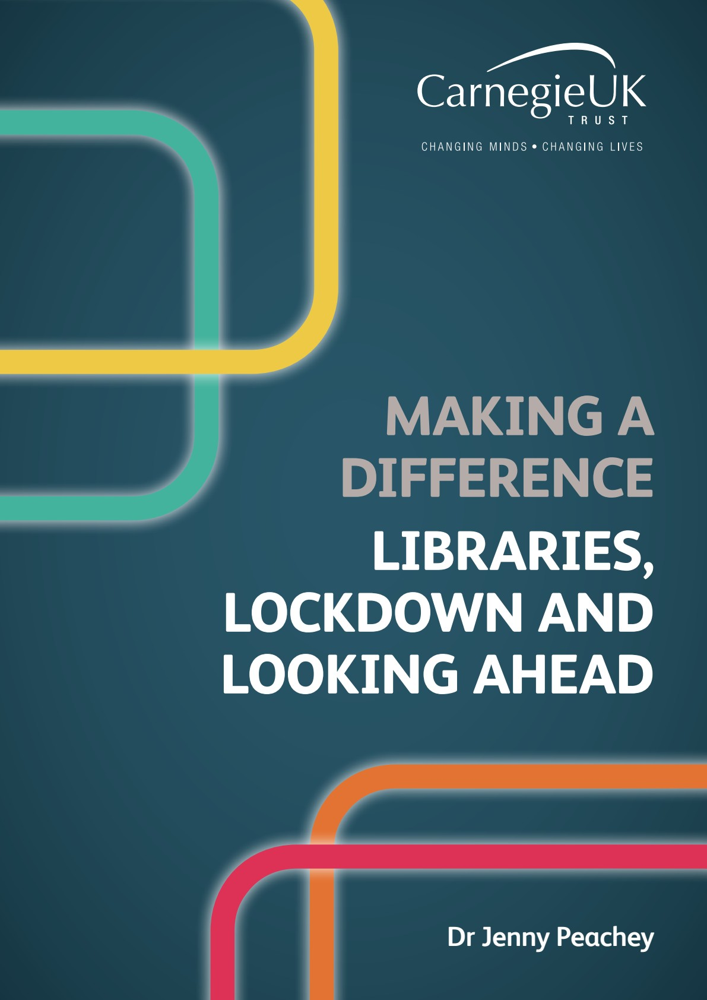

<!-- PAGE: 1 -->

# MAKING A DIFFERENCE

## LIBRARIES, LOCKDOWN AND LOOKING AHEAD

**Dr Jenny Peachey**

*Carnegie UK Trust — October 2020*

<!-- PAGE: 2 -->

2 ===
b
The Carnegie UK Trust works to improve the lives of people throughout the UK and
Ireland, by changing minds by influencing and by changing lives through innovative
practice and partnership work. The Carnegie UK Trust was established by Scots-
American philanthropist Andrew Carnegie in 1913.
This report was made possible thanks to the members of the public who
participated in the poll and the 1,196 public library staff and the 22 Heads of Service
who, at an extremely pressured time, made time to respond to the survey or speak
with us. We are hugely grateful to everyone for their time, their openness and
their willingness to engage. Heartfelt thanks also to CILIP the Library Association,
Libraries Connected, Libraries NI, SLIC and the Welsh Government who kindly
supported the dissemination of the survey across England, Scotland, Northern
Ireland and Wales, and provided their thoughts on the initial research findings and
this report. Finally, thank you to Sarah Davidson, Douglas White, Katie Pekacar,
Rachel Heydecker and Georgina Bowyer for their input into this draft and to Rebecca
Munro, Alison Manson and Lucy Smith for their administrative support at various
stages of this research.
The text of this work is licensed under
the Creative Commons Attribution-
ShareAlike 3.0 Unported License.
To view a copy of this license visit,
http://creativecommons.org/licenses
by-sa/3.0/ or send a letter to Creative
Commons, 444 Castro Street, Suite 900,
Mountain View, California, 94041, USA.

<!-- PAGE: 3 -->

3 ===
Executive Summary 2
Foreword  5
Introduction 6
Key Message 1: Public library services had a positive impact
on those who engaged with them during lockdown 8
Key Message 2: Public library staff made a valuable contribution
to the Covid-19 response 17
Key Message 3: Public library services and their staff could have
delivered much more – but faced barriers in doing so 23
Key Message 4: Public library services have huge potential to support
individuals and communities as they navigate the short, medium and
long-term impacts of the Covid-19 pandemic  37
Action Areas: What the sector needs to fulfil its potential
and deliver for the UK public 44 <!-- PAGE: 4 --> 4 ===

The Covid-19 pandemic saw the vast majority of library buildings close their doors to the UK public during
lockdown.1 Yet whilst the building is a core part of the library service offer, it is not the whole of it. This research
sought to capture the role that public library services and their staff played during lockdown; the barriers faced in
delivering services during lockdown; the role public library services and their staff can play in supporting individuals
and communities affected by the Covid-19 pandemic and lockdown; and what needs to change to enable public
library services to continue to deliver at their full potential in service of their communities. To gather new data
on these issues we conducted public polling of 2,196 UK adults, analysed 1,196 responses to a public library staff
survey and carried out in-depth interviews with 22 Heads of Service.
Four key messages and eight action areas emerged from the research. They are outlined below in more detail.
KEY MESSAGES

Public library services had a positive impact on those who engaged with them
during lockdown
Around three in ten people in the UK engaged with public library services during lockdown. Whilst the doors
of library buildings were closed to the public, staff worked hard to provide digital as well as physical services
in order to provide as full a service to their community as possible within the restricted context. Digital
services included access to e-books, e-resources and a wider range of online activities. Physical services
included welfare and keeping in touch calls, home delivery services, information provision and a handful of
buildings-based services. Some library services also worked hard to tackle digital exclusion during lockdown
through tablet lending or distribution schemes and providing support over the phone.
Over 60% of those who engaged with public library services pointed variously to a range of benefits they
derived from their engagement with it: from being provided with useful information to experiencing a
positive impact on their wellbeing, from feeling more connected to their community or feeling less alone, to
being supported to develop an interest or hobby.

<!-- PAGE: 5 -->

5 ===
Public library staff made a valuable contribution to the Covid-19 response
The survey drew on the skills listed in CILIP the Library Association’s Professional Skills and Knowledge Base
(PKSB) framework to gauge which skills, if any, came to the fore during lockdown. The findings reveal that
some of the specialist outreach services implemented by local authorities in lockdown required or mirrored
the core skill set that library staff deployed day-to-day pre-Covid-19.
Staff that were redeployed to support the local authority response to Covid-19 drew heavily on: customer
service skills, learning and support skills, information and knowledge management skills, and skills relating
to adaptability and working in new teams. In this way, the transferability of the core public library service
skill set enabled staff working outside of the library service to support communities across the UK during an
intense and challenging time.
Adaptability and innovation were also key for staff working within the library service, enabling staff to
respond to need as it arose in their communities. For example, some services provided PPE for local NHS and
care home staff by utilising the 3D printers in their Makerspaces, or worked with local groups to deliver new
services.
Public library services and their staff could have delivered much more –
but faced barriers in doing so
Despite the positive impact that public library services had on those who engaged with them, and the
important contribution that library staff made to the broader response to Covid-19, it was widely felt that
there were significant gaps in how library staff were able to support their communities during lockdown. The
root causes of these gaps fall into the following categories: the limitations of a digital mode of delivering
services; factors external to the sector; and factors internal to the sector.
The limitations of digital delivery included: digital exclusion impacting upon reach; digital formats having
a negative impact on services’ ability to provide quality interaction and support; and services’ inability to
provide access to physical resources. Of particular note is how digital versions of in-person library activities
were not like-for-like replacements and did not deliver the same outcomes as the in-person offer. The loss of
a civic, agenda-free space that could be entered without payment or permission, providing the potential but
not the obligation for interaction and encounters, was also felt. These limitations were problematic in that
they curtailed library services’ ability to deliver a curated social experience and wider range of benefits to
their communities.
In terms of factors external to the sector, the following items had the potential to enable or inhibit service
development and delivery: finances; differing attitudes to risk within local authorities; the extent of
understanding within a local authority of what the library service does and how it can contribute; and the
extent to which the library service has a voice in local authority structures.
Factors internal to the sector included: consistency and visibility of the library offer during lockdown;
organisational culture; effective communication and engagement with the public; preparedness and
contingency planning; partnerships; and digital skills.
The impact of these various barriers meant that public library services were unable to act as a service of
first resort in the way they did before lockdown: a safety net for communities, the lonely or isolated, and
‘borderline’ or ’hidden’ vulnerable people. In some cases, it also meant that staff were unable to draw on
their valuable skill set to support communities and local authorities in the most effective way.

<!-- PAGE: 6 -->

6 ===
Public library services have huge potential to support individuals and
communities as they navigate the short, medium and long-term impacts
of the Covid-19 pandemic
Public library services are a vital part of social infrastructure. The best of them enable, empower and equalise.
Covid-19 has not changed the strategic priorities of library services so much as sharpened their focus. It has also
made staff acutely aware of the levels of need and vulnerability in communities. Looking ahead, public library
services have tremendous potential to support individuals and communities across a range of local authority
and government priority areas, made evermore pressing by the impact of Covid-19 and lockdown. The issues
that public library services can help tackle include:
Strengthening communities
Employment and financial wellbeing
Education
Digital inclusion
Physical and Mental Health
Knowledge and information
Cultural engagement
Literacy
Equality, diversity and inclusion
It is clear that public library services have tremendous potential to support individuals and communities as the
UK navigates the considerable challenges ahead. It is, however, equally clear that the sector needs to continue
to adapt and innovate and requires adequate funding and support in order to fulfil its potential and deliver for
individuals and communities across the UK.
Action areas: what the sector needs to fulfil its potential and deliver for the
UK public
The action areas below draw on the strengths, weaknesses, opportunities and threats that were identified by
those who participated in the research directly, through analysis, or through the Trust’s broader experience
of working with the sector over the past eight years. Many of the action areas will feel familiar to the sector –
albeit to lesser or greater degrees across England, Northern Ireland, Scotland and Wales and across different
local authorities. In many cases, work is being conducted across a range of the areas identified below. It is a
matter of increasing urgency and importance that the barriers and issues highlighted in the action areas,
long-standing or otherwise, are overcome in order to enable public library services to fulfil their potential and
deliver for individuals and communities across the UK.
Given the differences in how governments and the library sector in England, Northern Ireland, Scotland and
Wales are progressing library-related agendas and the ever-shifting external environment, the items listed are
broad areas and ideas that we believe should be taken into consideration by local and national governments,
sector support bodies and the sector itself in developing public library services during the next period.
Deliver a sustainable financial settlement.
Strengthen status and voice in local authority structures.
Value and invest in skilled and confident staff.
Build a positive organisational culture that supports leadership at all levels.
Recognise the digital future is here and deliver a high quality blended service.
Resolve the longstanding, complex issues around e-books.
Balance coherent and consistent national offers with the power of the regional and the appeal and
benefits of the hyperlocal.
Advocate effectively and powerfully.

<!-- PAGE: 7 -->

7 ===
“Do real and permanent good in this world.”
ANDREW CARNEGIE
This report acknowledges success and offers a challenge.
It draws on a range of new evidence to make the
case that public library services across the UK had a
positive and supportive role to play during the Covid-19
lockdown, and illustrates the significant contribution
these services can make in mitigating and overcoming
the short, medium- and long-term impacts of the
pandemic.
It also points to the fact that they could have done
more. It challenges local and national governments,
sector support bodies and the sector itself to go
further to ensure that everyone in the UK has an equal
opportunity to experience the enabling impact of the
best public library services.
As a welcoming space at the heart of communities,
free at the point of access and open to all, with a
network of physical spaces and skilled staff, public
library services have incredible potential as social
infrastructure. Too often we refer to ‘libraries’
rather than ‘library services’, conjuring up images of
buildings as static objects, rather than the dynamism,
connection and potential that the combination of
people, ethos and skill invokes.
Urgent conversations are happening all around
us about how the state can empower individuals
and communities to achieve positive change for
themselves, to participate fully and to help each other.
There is real potential to harness the potential of public
library services as enablers in this context.
But for this potential to be realised, the sector requires
a sustainable financial settlement; a stronger voice
in local authority structures; an excellent blended
physical and digital service – including, but not only,
outstanding provision of both physical books and
e-books; and investment in staff and organisational
culture. To stand still is to fall behind, and there will
always be a need to be constantly alert, to listen
and adapt, to work with communities, and form
partnerships with others in order to innovate and meet
local needs. There will be further, unknown disruptive
events ahead, and investment in staff and culture are
as critical as funding and status in creating a resilient
and flexible service to meet the demands of both
today and tomorrow.
Many of the identified areas for action will feel familiar
to those who know the public library sector. In light of
the new ways of working that we have seen emerge
during lockdown and the challenges that arise from it,
this now feels a critical moment to address these issues
once and for all. The context is already set by the
multiple calls to action for a new settlement between
central and local, for outcomes-based budget setting,
and for holistic place-based approaches. It is vital that
our public library network takes its place at the centre
of this conversation.

Sarah Davidson
CEO, Carnegie UK Trust <!-- PAGE: 8 --> 8 ===

The Carnegie UK Trust has long recognised the
significant and enduring contribution public library
services make to improve the wellbeing of individuals
and communities. Given that the Covid-19 pandemic
saw the vast majority of library buildings close their
doors to the UK public during lockdown,2 we were
keen to understand the impact this had on the library
offer at this time. The rationale for the research was
two-fold. First, whilst the building is a core part of the
library service offer, it is not the whole of it. Second,
lockdown appeared to trigger a growing need for the
type of support that public library services and their
staff can provide.
The research sought to capture: the role public library
services and their staff played during lockdown; the
barriers faced in delivering services during lockdown;
the role public library services and their staff can play
in supporting individuals and communities affected by
the Covid-19 pandemic and lockdown; and what needs
to change to enable public library services to deliver at
their full potential to the benefit of their communities.
To gather new data on these issues we conducted
public polling of 2,196 UK adults,3 analysed 1,196
responses to a public library staff survey and carried
out in-depth interviews with 22 Heads of Service.
Four key messages and eight action areas emerged
from the research. The report is structured around
these key messages with the action areas being
detailed at the end of the report. It is perhaps worth
noting that many of the action areas will feel familiar
to the sector – albeit to lesser or greater degrees across
England, Northern Ireland, Scotland and Wales and
across different local authorities.

<!-- PAGE: 9 -->

9 ===
This report, its findings and recommendations are
based on new research that comes from the three
methods outlined below.
### Action Area 1: Public poll
Savanta ComRes conducted a public poll of 2,196
UK adults aged 18+ across the UK on behalf of the
Carnegie UK Trust. The poll looked at: the use of
the public library service pre-lockdown and during
lockdown; the level and type of interaction with the
public library service during lockdown; the impact
of engaging with the public library service during
lockdown; and views on reopening and restarting
services.
The survey was issued online between 31st July and
2nd August 2020.4 The sample size of the poll makes it
possible to make inferences about the demographics
at UK level. Data was weighted to be nationally
representative of all UK adults by key demographics
including gender, age, region and social grade.
Research was conducted in line with British Polling
Council rules.
### Action Area 2: Public library service staff survey
The Carnegie UK Trust issued a survey to public
library staff across the UK asking questions about: the
library services offered during lockdown; the potential
role of public library services in the post-lockdown
environment; the skills staff did (or did not) utilise
during lockdown; and the experience of staff during
this time.
The survey was made available on Survey Monkey
for 14 days, from 19 June 2020 – 3 July 2020. It
received 1,196 responses from staff across the UK.
The staff survey was analysed by jurisdiction, role
of respondent and whether they were redeployed,
remained in the library service or were not working. Key
differences in responses were pulled out against these
characteristics.
An inductive, grounded-theory approach was taken
to open-ended questions: responses were reviewed
to derive and determine appropriate codes and then
themes from these codes.

<!-- PAGE: 10 -->

10 ===
“[We] launched a new ‘Libraries Direct’
service providing home delivery of
books and toys, friendship calls and
digital support by phone to isolated and
vulnerable individuals and families.”
SENIOR MANAGER, SCOTLAND
Around one in two people in the UK are library users5
and three in ten engaged with public library services
during lockdown. Those that used the service during
this difficult period pointed to a range of benefits they
derived from their engagement with it, from being
provided with useful information to experiencing a
positive impact on their wellbeing, from feeling more
connected to their community or feeling less alone, to
being supported to develop an interest or hobby.
Whilst the doors of library buildings were closed to the
public during lockdown, staff worked hard to provide
digital as well as physical services in order to offer as
full a service to their community as possible, within <!-- PAGE: 11 --> 11 ===

How the public library service was used during lockdown6
Access e-books, e-audio books or e-magazines 18%
32%
used e-resourcesAccess resources other than e-books, e-audio books or e-magazines 16%
Online activity for babies and toddlers aged 0-3 17%
39%
engaged in
online activities
Online activity for children aged 4+ 15%
Online activity for adults aged 18+ 16%
Contacted by staff 19% 30%
contacted for
information or supportReceived books or resources7 14%
Contacted library service with a question/for information 11% 21%
engaged with
physical serviceContacted library service for support with digital skills 13%
Other 1%
Don’t know 5%
How the public library service helped people during lockdown8
Provided me with useful information 68%
Had a positive impact on my wellbeing in lockdown 64%
Helped me feel more connected to my community 63%
Helped me feel less alone 60%
Helped me follow/develop an interest or a hobby 64%
Helped me/my child(ren) avoid boredom 63%
Helped me in some other way 62% <!-- PAGE: 12 --> 12 ===

DIGITAL OFFER: E-BOOKS,
E-RESOURCES AND ACTIVITIES
Public library services offer the opportunity for people
in their communities to engage in a range of reading-
related resources and activities, with a view to educate
and entertain, provide enjoyment and escape, and
improve wellbeing. With many services being unable
to offer physical reading materials during lockdown,
public library services amplified their digital offer. All
the services that engaged in this research increased
availability of e-books, online newspapers, comics
and magazines and e-audio books.9 In some cases,
considerable effort was required behind the scenes
to support people to access the wider digital offer.
For example, work was required to enable multiple
borrowing of a single e-book or to expand online
services usually only available from within the library
building to be offered from home. Many also provided
online activities such as story and rhyme sessions,
craft or Lego sessions and book groups. Support on
accessing and making the most of e-resources was
often provided over the phone or social media, or via
video tutorials.
Almost 1/3 of people who engaged with public library
services during lockdown used its digital resources. This
is perhaps reflected in how lending of e-books widely
increased by three figure percentages across the UK.
For example, in one service, e-book loans increased
by 242% and e-audio loans by 109%, in comparison
with the equivalent time period in 2019.10 Again, many
services also saw increases in the use of specific online
offers: one library service saw use of PressReader – the
software through which e-newspapers are accessed
– go up by 350% whilst others reported increases in
use of their online archive and family history resources
as well as in their e-loans.11 Whilst the usage of the
e-resources by most demographic groups was broadly
similar, those aged 18-24 were significantly more likely
to use e-resources than others (40% versus 32%).

<!-- PAGE: 13 -->

13 ===
In some cases, there were more activities being
delivered digitally than would usually be offered in a
face-to-face environment. For example, one library
service ran five scheduled activities a day, each for a
different age group (pre-school, school-age and adults)
called ‘What’s on today’. Delivering digitally led to new
services and groups emerging, including: new online
language conversation groups which hadn’t been
offered previously; teatime and bedtime rhyme and
storytime sessions; and new home learning resources
for families and teachers to access. One library service
that engaged with this research created information
literacy curricula for local schools. The resulting lesson
content was delivered via Google Classroom as part of
remote schooling provision during lockdown.
Some library services offered specific health and
wellbeing offers through their digital services. For
example, one service issued specific content on mental
health and wellbeing, developed in partnership with
mental health charities at a service-wide level, whilst
staff at local branch libraries would put out content
like ‘wellbeing thought of the day’ or ‘strategies for
being well’. Others invested in more e-titles aimed
at supporting mental health and wellbeing for
the e-library or supporting national festivals and
awareness events such as ‘Empathy Day’ or ‘Mental
Health Awareness Week’ by drawing attention to
online collections that could support people and/or
delivering facilitated online events that people could
participate in.12
The growth in take-up of e-resources and the large
audiences for social media activities suggest that
there was a need for these services among the general
public during lockdown and that library services
stepped up and responded to that need.

<!-- PAGE: 14 -->

14 ===
PHYSICAL SERVICES
Telephone support: Welfare and keeping in
touch calls
“I’ve been involved in the [library
service’s] friendship calls and I know
from feedback that this has made
a big difference to people. On one
call, a girl with several health issues
mentioned she had no electricity. She
lived alone with care workers visiting
at different times. I was able to pass
this information to the council hub ...
When I spoke with her the next day she
was like a different person. She hadn’t
known who to contact so the fact of this
problem being sorted for her lifted her
mood.”
FRONTLINE STAFF, ENGLAND
“We know that many of our customers
have appreciated being kept in touch
with and can’t wait to come back into
the library.”
FRONTLINE STAFF, ENGLAND
Public library services use the space their buildings
provide to connect communities and individuals.
Many provide services targeted at people that are
older or perhaps living on a low income, shielding or
lonely. During lockdown, with a very few exceptions,
public library buildings closed. As such, to continue to
connect with their communities and support wellbeing,
a number of public library services sought to engage
with their older, vulnerable or home delivery library
users through phone calls.13 Around 1 in 5 people who
engaged with library services during lockdown were
contacted by staff.14
Staff called individuals for a range of purposes: to
keep in touch, provide wellbeing support, provide
a befriending service and/or to check if they
required support of any kind. Calls also provided
the opportunity for staff to inform members about
the digital offer and support them to access it, or <!-- PAGE: 15 --> 15 ===

Home delivery service
Pre-Covid-19, public library services offered a home
delivery service for people who did not leave the
house or found it hard to get to their nearest library
due to illness, mobility issues or carer responsibilities.
A few library services were able to continue their
home delivery service, or resume it with very little
interruption, during lockdown. Others found ways of
distributing books via partners. 14% of people who
engaged with the library service during lockdown
received books in some form from the library service.
Given that reading for pleasure has been linked
to reductions in symptoms of stress, depression
and dementia, improved wellbeing and improved
relationships with others15 it is unsurprising that those
who received books from library services reported this
service as having a positive impact in some way.

<!-- PAGE: 16 -->

16 ===
Book Bags to Target Families:
Glasgow Life
“I see you have included sensory/
touch books, books that I can read
to my daughter and easy books
she can try to read herself. She is
going to love each and all of them.
This is so helpful to get through
the summer months.”
HOME DELIVERY SERVICE USER
Glasgow Libraries worked with Education
Services to deliver book bags to 3,000 target or
priority families. They received funding from two
major donors to provide gift books in the packs
and they also provided library books on loan
and activities for children. This was just a small
proportion of the vulnerable families in Glasgow,
but it was those who had been identified as not
able to support their children’s learning from
home. The service also distributed 600 Summer
Reading Challenge book packs to vulnerable
families.17
Ready Reads: Hampshire Library
Service
Staff in Hampshire Library Service developed
a book bag service called ‘Ready Reads’. They
designed and built a system whereby people
could request a bag of books over the phone or
online and the contents of the book bags were
curated for them by library staff. ‘Ready Reads’
was a hugely popular service, attracting over
4,000 subscribers in the first three weeks, with
41,500 books and other items being distributed
in the first four weeks of the scheme.

<!-- PAGE: 17 -->

17 ===
Building-based services
Buildings are a core part of the public library service.
They provide a safe, welcoming space, open to all
and free at the point of entry. As such, they act as
a valuable civic resource and ‘third space’ – neither
home, nor work. With a few notable exceptions, public
library buildings were shut during lockdown and access
to them was often difficult for library staff. However,
in some cases library buildings were used in new ways
to support the Covid-19 response. In one instance, the
library provided a wellbeing space for care-at-home
and care workers who were feeling pressured by the
situation in which they were working. This use of the
building made the most of public libraries as a safe
‘third’ space.
Health and Wellbeing Hubs:
North Ayrshire
Five library buildings in North Ayrshire were
set up as health and wellbeing hubs for care
home staff and care-at-home staff. These hubs
provided a bridge between work and home
life, a space where staff could take time out to
recharge their batteries, talk to colleagues and
line managers about the impact of the Covid-19
pandemic on themselves and their service users
and access support information on a range of
health and wellbeing topics. Feedback from Feedback from
the carers has been very positive and they have the carers has been very positive and they have
enjoyed the light, airy and calm library spaces enjoyed the light, airy and calm library spaces
situated within their own locality. Library staff situated within their own locality. Library staff
have been very supportive and empathetic have been very supportive and empathetic
with the carers and have seen many repeat with the carers and have seen many repeat
visits – around 560 each week – with new visits – around 560 each week – with new
relationships being forged.relationships being forged. The use of the public
library buildings in this way reflects the safe,
non-judgmental third space that these buildings
provided communities pre-lockdown.
Some other library buildings were used as a call centre
for information lines or shielding calls, as a community
response hub where it was possible to get mental
health support and order prescriptions, and where staff
took calls from the community, a vulnerable families or
children’s hub – providing access and support only to
this limited group, an education hub for children of key
workers.
DIGITAL ENABLEMENT AND
TACKLING DIGITAL EXCLUSION
“Most of our customers are vulnerable and
unable to access online offers so [we’re]
missing a huge part of our client base.”
MIDDLE MANAGER, SCOTLAND
Many public library services work to tackle digital
exclusion through supporting access to technology and
skills development. Library staff were acutely aware of
the impact of digital exclusion on their communities
during lockdown and reported that the digital divide
meant that the reach of their offers was curtailed.
Some services shifted the way in which they sought to
overcome digital exclusion and worked with partners
to continue to address this challenge during lockdown.
Those that engaged in this area worked with partners
to run tablet lending or distribution schemes to
deprived and digitally excluded families or those who
were shielding. For example, one service, working with
colleagues in education, delivered 14,000 chrome
books to vulnerable families. Another worked with
health and social care partners to provide a lending
library for devices, casting out WiFi to homeless
accommodation and lending books to them.
Other services continued to provide digital skills
support, but did so over the phone rather than in
person. This enabled the service to continue to support
those who had the technology, but lacked the skills to
make the most of it.
Tackling Digital Exclusion:
Powys Library Service
In the beginning of May, Powys entered a
partnership to support those that are digitally
excluded through a device loan scheme that also
addressed connectivity issues. The service worked
with Accessibility Powys, Supporting People,
Scope and housing support agencies, considering
how best to support the most vulnerable with
access to technology. Working in partnership
was helpful as Accessibility Powys was able to
procure WiFi dongles and prepaid cards with
ease, whereas council procurement would have
made this more challenging for the library
service. Powys library service also registered with
the DevicesDotNow scheme for devices and
developed a system for gifting this technology.

<!-- PAGE: 18 -->

18 ===
Two library services in England that engaged with
this research managed to keep a few buildings open
in order to provide access to public PCs in a safe
environment for those who did not have tech at home.
The impact of this cannot be underestimated; one
Head of Service in Scotland noted that as their service
began to reopen, they saw users coming in who were
deeply stressed and anxious, having been unable to
check their email for bills or important correspondence
– or contact family members abroad – for a three-
month period. Given that 7m people in the UK do not
have access to the internet at home and 9m cannot
use the internet without help,19 it is likely that many
people across the UK were in a similar position.

<!-- PAGE: 19 -->

19 ===
“We have loaned some staff to other
council essential services … and
our staff have been commended for
displaying … excellent customer service
and teamwork skills.”
FRONTLINE STAFF, ENGLAND
Some of the specialist outreach services implemented
by local authorities in lockdown required or mirrored
the core skill set that library staff utilised day-to-day
pre-Covid-19. In particular, there was considerable
overlap between the customer service skills, learning
and support skills, information and knowledge
management skills and adaptability skills that staff
previously relied upon to support their communities,
and the key skills required in new hubs and centres set
up during lockdown.
Almost 1 in 5 (18%) staff who responded to the
staff survey were redeployed during lockdown.
Those who were redeployed to roles co-ordinating or
delivering phone lines to support vulnerable people;
general customer service phone lines; food or other
parcel distribution; care home support; or volunteer
management and so forth, drew heavily on their
existing skill set to contribute to wider efforts to
support communities across the UK during an intense
and challenging time.
Key Message 2: Public library staff
made a valuable contribution to the
Covid-19 response
Place of work during lockdown: redeployed staff
Redeployed staff worked across a wide range of service areas, with a particular focus on supporting
vulnerable people and co-ordination of services.
Phone lines supporting
vulnerable individuals/
shielding team
Food or other parcel
distribution
General/other customer
service phone lines
Care homes support
Volunteer management
Co-ordination and monitoring
of local authority Covid19
response
Crematorium, mortuary,
funeral and bereavement
services
Schools and Childrens
Services
Registrations
PPE distribution
Other
Q [^24]: To which area of the council were you redeployed
and what was your role?
Base: All redeployed (153)
57%
22%
10%
10%
5%
5%
3%
3%
3%2%
10% <!-- PAGE: 20 --> 20 ===

CUSTOMER SERVICE AND
LEARNING AND SUPPORT SKILLS
“You work in libraries because you’re
interested in people… you want to
help them… and provide information…
We are able to drill down into what it
is that people need… You need a real
sort of sensitive ear, asking [personal
questions] in as unobtrusive manner as
possible.”
SENIOR MANAGER, SCOTLAND
Of those that were redeployed, over 90% of library
staff drew on the core library skill sets of empathy and
general customer service. Around 2/3 drew on core
skills relating to identifying and supporting vulnerable
people and community engagement. It came through
strongly in the qualitative responses to the staff survey
and interviews with Heads of Service that library staff
were very well placed to handle calls on Covid-19,
shielding or council support phone lines – asking
sensitive questions about debt or health conditions –
and often requiring little additional training for these
roles.
“I spoke to one lady for one hour on
the [council] COVID-19 line …. She
thought I was a trained mental health
nurse, which was really complimentary.
Working in a library we are used to
listening to vulnerable, lonely people.”
FRONTLINE STAFF, SCOTLAND
“One of the greatest skills library staff
have is to tease out what people need:
do you want a book on vases because
you want to paint them, make them, or
collect them?”
SENIOR MANAGER, SCOTLAND
“Many library staff were redeployed to
the Council’s shielding response team
and helpline. Their skills in talking to
people, gaining their confidence and
offering help and support were highly
valued.”
SENIOR MANAGER, ENGLAND
Similarly, around 7 in 10 redeployed staff drew on
core library skills of supporting people to navigate
services and supporting people to understand and use
information, whilst almost 6 in 10 drew on the core
skills of providing digital literacy support or helping
people to find information.
KNOWLEDGE AND
INFORMATION SKILLS
“I think that the way that library
colleagues have responded to lead,
shape and deliver a new service ie.
food delivery and contact centres has
been great. It has demonstrated staff’s
ability to be adaptable and that library
work has key transferable skills.”
MIDDLE MANAGER, ENGLAND
The skillset pertaining to knowledge and information
management is integral to the work of public library
staff. 81% of redeployed staff drew on their prior
skills of organising and managing knowledge and
information in their new roles, whilst 61% drew on
prior skills of information governance and compliance.
Meanwhile, around half of redeployed staff drew on
pre-Covid-19 skills of using knowledge and information;
records management; and archiving during lockdown.
This reflects the work that some staff did to set up
response hubs and call centres – work that included
setting up databases, organising teams and rewriting
scripts for calls developed by the local authority.
In this way, the findings show the transferability
and importance of knowledge and information
management skills and the importance of core library
skills in organising responses to crises.

<!-- PAGE: 21 -->

21 ===
Customer service skills: redeployed staff
Empathy
General customer service skills
Identifying and supporting
vulnerable people
Community engagement/
consultation/facilitation
Q [^26]: Please tell us whether you used these
skills or not during lockdown and whether you
had used them in your role in libraries before
lockdown or not. Community engagement
and customer service skills
Base: All redeployed (153)
This was a new skill that I needed to use in lockdown
I used this skill during lockdown and I had been using it before lockdown
I didn’t need to use this skill during lockdown but I used it before lockdown
I didn’t need to use this skill during lockdown or before
Don’t know
1%  9 4 %  3%1% 1%
5% 63% 14% 10% 8%
1% 92% 5% 1% 1%
16% 65% 14% 3% 3%
Learning and support skills: redeployed staff
Supporting people to
navigate services
Supporting people to under-
stand and use information
Other skills development
Digital literacy support/helping
people find information online
Literacy support/reader
development
Q [^28]: Please tell us whether you used these
skills or not during lockdown and whether you
had used them in your role in libraries before
lockdown or not: learning and support skills
Base: All redeployed (153)
This was a new skill that I needed to use in lockdown
I used this skill during lockdown and I had been using it before lockdown
I didn’t need to use this skill during lockdown but I used it before lockdown
I didn’t need to use this skill during lockdown or before
Don’t know
5% 73% 19% 3%1%
19% 46% 17% 3% 13%
1% 20% 62% 14% 4%
3% 69% 25% 3%
4 % 57% 34% 3% 3%
Knowledge and information skills: redeployed staff
Organising/managing
knowledge and information
Information governance
and compliance
Research skills
Using knowledge and
information
Records management
and archiving
Collections management and
development
Q [^32]: Please tell us whether you used these skills
or not during lockdown and whether you had
used them in your role in libraries before lockdown
or not: knowledge and information skills
Base: All redeployed (153)
This was a new skill that I needed to use in lockdown
I used this skill during lockdown and I had been using it before lockdown
I didn’t need to use this skill during lockdown but I used it before lockdown
I didn’t need to use this skill during lockdown or before
Don’t know
3% 81% 10% 4% 3%
1% 5 4% 2 9% 12% 3%
3% 47% 2 0% 2 3% 7%
2% 16% 33% 3 6% 13%
2% 61% 12% 12% 12%
3% 4 8% 2 0% 2 1% 7% <!-- PAGE: 22 --> 22 ===

Setting up the County Council Shielding
Call Centre – Denbigshire
“My manager knew [we] had the
skill set of talking to people and
helping to solve problems.”
HEAD OF SERVICE, DENBIGSHIRE
In April 2020, Denbighshire County Council
decided to develop a proactive phone call
support service for those that were shielding.
The County Council recognised the skill set of
library staff. As such, managers were involved
in the shaping and management of the
new service, alongside other local authority
colleagues. Work included adapting the scripts
sent from Welsh Government, setting up the
database and organising the teams. 85%
of Denbighshire library service staff were
redeployed to undertake the phone calls.
The team originally conducted 3,500 interviews
with people that were shielding and went on to
contact everyone in the Council area aged 70+.
This equates to 8,500 people, or 10-15% of the
total population.
A core team of 20-40 people from the library
service were involved in delivering the service
until the end of May/early June when library
staff were released to develop and deliver the
‘reintroduction’ process for the library service
itself.
Speaking of her staff team, the Head of
Service at Denbighshire reflected that, “They
were brilliant, they wanted to contribute
to the Covid-19 response and support their
community”.
Setting up Help Boro Hub –
Middlesbrough
“Libraries were an obvious
service to redeploy because they
have detailed knowledge of
communities.”
HEAD OF SERVICE, MIDDLESBROUGH
Middlesbrough library service was responsible
for running the ‘Help Boro Hub’. This included
setting up a call centre in the Central Library
(and later organising working from home) and
working alongside public health, and health and
safety teams to manage the volume of calls.
The Help Boro Hub offered delivery of shopping
and prescriptions and referred residents to
services such as dog walking available in their
local areas. Staff both fielded calls and fulfilled
requests for support. They received hundreds
of calls a day, often from people with complex
needs. The Hub delivered 1,900 food parcels
and collected over 500 prescriptions.

<!-- PAGE: 23 -->

23 ===
ADAPTABILITY SKILLS
“Half the library service (myself
included) have been working on the
Covid-19 National Helpline part-time,
plus I have been helping my colleague
with Social Media. My line manager has
been working with senior staff to co-
ordinate ways in which we can help the
community. This has included providing
digital equipment to hubs that teach
key workers’ children, supplying PPE via
our 3D printer, delivering school meals
and maintaining our online social media
presence to advertise our services,
stay in contact with customers, help
customers with technical enquiries via
email, social media.”
FRONTLINE STAFF, SCOTLAND
Lockdown was generally felt to be ‘unprecedented’
and ‘unfamiliar’, with decisions having to be taken at
pace and in uncertain circumstances. This meant that
Heads of Service and library staff were often devising
a new service and delivery mode ‘on the hop’, without
the ability to engage in planning and infrastructure
development that would usually accompany such
significant changes both to the way the public engage
with the service and the way that staff deliver it.
Adaptability and flexibility were key skills for all those
involved in responding to Covid-19, including library
staff irrespective of whether or not those staff worked
in the library service or were redeployed.
In terms of redeployed staff, working in new services
and with new people was a core part of their work. It is
worth noting that library staff were well suited to this
with almost 3/4 of redeployed staff drawing on the
core library skill of adapting to new ways of working
(with the remaining 1/4 developing this skill during
lockdown) and 83% drawing on their skill of working
in new teams, with 12% developing this skill during
lockdown.
Adaptability – and indeed innovation – were also key
for staff working within the service, with some services
responding to need as it arose in their communities.
For example, some services provided PPE for local NHS
and care home staff by utilising the 3D printers in their
Makerspaces. Staff were also able to draw on their
local knowledge to create new services. One example
of this is how staff in a local branch library in Suffolk
worked with its Friends Group to provide fruit and
vegetable boxes to families in a deprived area.
Adaptability skills: redeployed staff
Learn new areas of
knowledge/specialisms
Adapt skills gained from
working in public libraries
into new contexts
Adapt to new ways of working
Work well in new teams
Q [^27]: Please tell us whether you used these
skills or not during lockdown and whether you
had used them in your role in libraries before
lockdown or not: adaptability
Base: All redeployed (153)
This was a new skill that I needed to use in lockdown
I used this skill during lockdown and I had been using it before lockdown
I didn’t need to use this skill during lockdown but I used it before lockdown
I didn’t need to use this skill during lockdown or before
Don’t know
42% 51% 5% 1%   1%
25% 73% 1%
27% 64% 3% 1% 4%
12% 83% 4% 1% <!-- PAGE: 24 --> 24 ===

Producing PPE: Gateshead Library
Service
Early on in lockdown, the Head of Gateshead
Library Service received an email from his
manager, a Director of Public Health, asking
if the service could help overcome the critical
shortage in PPE equipment. By the time the
local authority received 1,000 visors from the UK
Government, the library service had produced
5,000. The library service went on to deliver
scuba mask valves to the local hospital and
visors to paramedics, over 60 care homes, the
Red Cross and undertakers. The library service
has been depicted among the photographs
selected for the Historic England national
archive of ‘100 pictures representing lockdown’.
The flexibility, creativity and resilience of staff were
often identified by Heads of Service in interviews
as a key factor that enabled them to deliver library
services during lockdown. These skills, combined with
an attitude of ‘not fearing failure’ enabled services
to adopt a ‘test and learn’ approach to developing
services.
“People stepped up to the plate in ways
that necessity required, but they were
nevertheless going for it!”
SENIOR MANAGER, ENGLAND
Adaptability skills: staff in the library service
Learn new areas of
knowledge/specialisms
Adapt skills gained from
working in public libraries
into new contexts
Adapt to new ways of working
Work well in new teams
Q [^41]: Please tell us whether you used these
skills or not during lockdown and whether you
had used them in your role in libraries before
lockdown or not: adaptability
Base: All who continued working in the
library service (656)
This was a new skill that I needed to use in lockdown
I used this skill during lockdown and I had been using it before lockdown
I didn’t need to use this skill during lockdown but I used it before lockdown
I didn’t need to use this skill during lockdown or before
Don’t know
23% 57% 13% 3% 3%
3 1 %  6 5 %  2% 1% 1%
22% 50% 11% 10% 7%
4% 63% 24% 6% 2% <!-- PAGE: 25 --> 25 ===

Despite the positive impact that public library services
had on those who engaged with them and the
important contribution that library staff made to the
broader response to Covid-19, it was widely felt by
library staff that there were significant gaps in their
ability to support their communities during lockdown.
The root causes of these gaps fall into the following
categories: the limitations of a digital mode of
delivering services; factors external to the sector; and
factors internal to the sector. Whilst some of these
were new barriers, many were already well known
and experienced within the sector – albeit to lesser
or greater degrees across England, Northern Ireland,
Scotland and Wales.
Crucially, these barriers meant that public library
services were unable to act as a service of first resort
in the way they did before lockdown; as a safety
net for communities, the lonely or isolated, and the
‘borderline’ or ‘hidden’ vulnerable. In some cases it
also meant that staff were unable to draw on their
valuable skill set to support their communities and
local authorities in the most effective way.
THE LIMITATIONS OF DIGITAL IN
DELIVERING LIBRARY SERVICES
“Ours is quite a deprived area and
my contact with the community is
[currently] through our Facebook page;
I’m not convinced I’m seeing the same
people … I see in the library itself. Users
of the library on a day-to-day basis are
not simply coming for books...For those
who are looking for reading material,
online resources are great and we can
guide people with online interaction.
But this isn’t a direct equivalent to what
we do in our library from day to day. I
do feel overall that the readers are well
served and the online provision has
been responsive and generous. However,
our own community and probably others
like it are unlikely to find the ‘safe
space’, the human interaction and the
help they often look for when they come
into the branch.”
FRONTLINE STAFF, SCOTLAND
Although many library services worked hard to provide
interactive services online similar to those offered in
library buildings, the above quote encapsulates many
of the limitations staff felt in delivering library services
digitally during lockdown: reach, quality interaction
and support, and access to physical resources. These
limitations were felt to curtail library services’ ability
to deliver a curated social experience and wider range
of benefits to their communities. This was particularly
felt in relation to opportunities for structured and
unstructured forms of interaction and engagement.
(Structured opportunities being offered through
‘doing’: providing activities, events and interest
groups run by the service or its partners. In contrast,
unstructured opportunities are offered through ‘being’:
providing an agenda-free space that can be entered
without payment or permission, that enables people
to simply co-exist alongside others, providing the
potential for meeting and speaking with others.)
Reach
Although 1/3 of the UK public made use of
library services’ digital offer during lockdown, an
overwhelming number of public library staff who
responded to the staff survey expressed concern about
whether they engaged a broad audience.
In particular, staff voiced concern about the effect
of digital exclusion on the reach of their services.
Staff were anxious that those who were poorer, more
vulnerable or elderly were missing out on the digital
Key Message 3: Public library services
and their staff could have delivered
much more – but faced barriers in
doing so <!-- PAGE: 26 --> 26 ===

library offer. They described the various facets to
exclusion including: those who could not access tech;
those who did not have good internet/connectivity;
those who lacked skills or confidence; those who simply
didn’t want to use, or were unfamiliar with, the social
media platforms that the library service was relying on
at this time (eg. Facebook or Twitter); and those who
simply didn’t want to use services or engage online.
It was clear from the research that some library
services predominantly serve disadvantaged
communities where digital exclusion is widespread.
For example, in one area, the fact that there was a
relatively high proportion of the population with no
access to either fixed broadband or paid-for internet
via their mobile phones, and a high proportion of
Covid-19 cases, made it challenging for staff to
develop a service with the hoped-for reach. One survey
respondent from a different service lamented that
the videos and resources they had created to support
learning and school readiness were unlikely to reach
the families who might get the most out of them.
“Some of our customers have no
machines or phones of their own and
use ours a great deal. They have been
distressed at no contact with friends
and family in other countries.”
FRONTLINE STAFF, ENGLAND
“Many of our customers won’t use
digital resources so will be missing
out on any kind of service we’ve been
offering throughout lockdown. Some
customers rely on our Active IT service,
having no computer access at home and
will potentially be very isolated.”
FRONTLINE STAFF, SCOTLAND
“We know we’re not reaching a large
part of our members and users – those
who either don’t use social media or
aren’t interested in following the library
there.”
MIDDLE MANAGER, ENGLAND
“I work in a community that may not
connect so easily with the bulk of library
output [at this time]. It’s hard to know
what the service could do to address this
directly because it relies on being there
‘in person’.”
FRONTLINE STAFF, SCOTLAND
“People here are not interested in a
virtual world – it’s an ageing population
in a remote to very remote rural
geography … they want real physical
contact and that’s where the service can
make a difference to people’s lives.”
FRONTLINE STAFF, SCOTLAND
”There are so many people in Scotland
who are not digitally enabled. The
digital offer doesn’t cut it for them.
They are completely ignored. Not ‘hard
to reach’ but ‘easy to ignore’.”
SENIOR MANAGER, SCOTLAND
Some staff also expressed concern for those excluded
from predominantly digital offers such as those with
visual impairments, people with English as a second
language or new arrivals who, pre-Covid-19, would be
welcomed and supported in the library building. Before
lockdown, these latter groups were supported with
ESOL or conversation classes in the library building, but
struggled to engage with these offers online.
Concerns relating to the reach of the library service
during lockdown are perhaps reflected in the fact
that, whilst e-loans of reading material increased
substantially for all library services that participated
in the interviews for this research, overall loans
were much lower than like-for-like annual issues. For
example, one library service recorded an average of
108% increase in e-book loans over the period April-
July 2020 but an average reduction of 75% in terms of
total volume of loans due to the fact that the service
was not able to issue physical book stock during that
time. A similar trend was observed for library service
membership. For example, one service recorded an
increase of 1,540% in online joiners over the same
time period in the previous year. However due to
the reduction in traditional library joiners, this still
represents a 71% reduction in total new memberships.

<!-- PAGE: 27 -->

27 ===
The loss of the library building as a space led some
staff and interviewees to express their concern about
their ability to reach those that were ‘just’ coping
but would have been ‘pushed over the edge’ into
vulnerability by lockdown. For example, those who
were lonely or isolated but not on any at-risk registers;
homeless people who were not engaging with support
networks; new arrivals; refugees and asylum seekers;
and some vulnerable children and young people.
Again, staff were also concerned about those with
hidden vulnerabilities who used the library service
for support or to access support groups in the library
building run by partners. These were library users who
were not on any official risk or vulnerability registers.
“Being vulnerable isn’t as clear cut
as you think. I always explain it, like,
there’s a routine that keeps people
going, contact that improves wellbeing
and mental health. Libraries are part
of that routine and contact for many
people. Libraries are a safety net that
catches people before they really begin
to struggle.”
SENIOR MANAGER, WALES
“Although we supported vulnerable
families through the vulnerable hubs,
there are several children and young
people that we haven’t seen and we
don’t know where they are.”
HEAD OF SERVICE, SCOTLAND
“The really vulnerable people who
would call into the library just for some
company [are missing out].”
FRONTLINE STAFF, ENGLAND
It is perhaps worth noting that whilst, overall, nearly
3 in 10 people in the UK engaged with public library
services during lockdown, those aged 45-54, 55-64
and 65+; those in social grade grouping DE; and those
that were not working were significantly less likely to
do so. However, as these groups were also less likely
than the UK average to be library users pre-lockdown,
it is unclear how far the lack of engagement of these
groups stems from the digital mode of delivery.
Structured Interactions: events
and activities
“Communities have missed physical
libraries, we have a place in supporting
our communities that cannot be filled
digitally.”
MIDDLE MANAGER, SCOTLAND
“You can deliver online events but
nothing beats ‘live’ events.”
FRONTLINE STAFF, SCOTLAND
Survey respondents and Heads of Service interviewees
alike reflected on the difference between the physical
and digital provision of rhyme and story times for
children. They noted that in a physical space, this
activity would enable children to engage with one
another and with physical objects and books – all of
which are important for early years’ development.
Again, parents or carers would be able to chat with
each other during and after a session, something that
was regarded as important for the mental health of
parents and (in particular) first time parents’ ability to
build relationships and social networks.
Whilst the benefits of the in-person activity are
three-fold (learning and entertainment; parent/
carer wellbeing; and social interaction for early years’
development), the digital offer was seen as delivering
on the first of these benefits alone. In this way,
whilst the digital and physical versions of this activity
appeared to be ‘the same offer’, they were not, in fact,
commensurate in what they were able to deliver.
“There’s nothing like a room of
under 4s....”
SENIOR MANAGER, NORTHERN IRELAND
Despite the benefits of digital, there was therefore
a sense that the richness of interaction and the
additional benefits brought by social interaction in a
given space were compromised by the digital format.
It is perhaps worth noting that in some services, the
average engagement with digital appeared to be
much shorter than face-to-face activities.20 <!-- PAGE: 28 --> 28 ===

Unstructured Interactions: a welcoming
space with skilled staff as an outreach service
“It’s about community, connection –
how do you translate those things?”
SENIOR MANAGER, ENGLAND
As a non-judgemental space, free at the point of
entry and where all are welcome, public libraries can
provide ‘bumping places’ in which it is comfortable to
linger, strike up conversation and interact, or simply
enjoy being with others. With the buildings closed,
this opportunity was shut off for those who depended
on it, curtailing public library services’ ability to tackle
loneliness and act as a ‘service of first resort’. There
were also some concerns about the digital spaces
offered not being able to replicate the neutral,
welcoming ethos of the public service.
Some staff reflected on how being a safe physical space
offers the opportunity for encounters and conversations
that enable staff to identify someone who needs support
and to offer appropriate support or else signpost them
to another service. This perhaps reflects the way in which
the public library building is an outreach service in itself,
where staff can approach and support those who are
unsure, uncertain or unwilling to approach other services
for help – and that this did not adequately translate
across into the digital service provided during lockdown.
The fact that one in four of respondents to the staff
survey that continued to work for the library service during
lockdown felt they were unable to draw on their general
customer service skills, and almost 3 in 10 did not draw
on their skills in identifying and supporting vulnerable
people, community engagement or supporting people to
navigate services, would support this view.
Likewise, some interviewees and survey respondents
reflected that during normal times, the offer of
physical resources such as newspapers, ‘give people
the excuse’ to come in and chat, or have something
to hold while they enjoyed being among other people,
without having to say they are lonely or that they want
help. As with the rhyme and story times, the digital
and physical versions of the provision of newspapers
and books are, to some extent, different services.
“In theory, offering newspapers online
and physically are the same thing, but
in practice you are reaching different
audiences… They …are meeting two
different but important needs.”
SENIOR MANAGER, ENGLAND
Linked to these observations are staff statements that
combatting loneliness and social isolation, especially
among older people, did not translate well to the
online context. This is perhaps reflected in the fact
that, of all the age groups, those aged 55+ were the
least likely to say that engagement with the service
over lockdown helped them feel more connected to
their community (50% compared to the UK average
of 63%) or that it helped them feel less alone (48%
compared to the UK average of 60%).
“There is something about reaching out
and having a conversation – taking the
edge off loneliness for someone who is
outside the health service.”
SENIOR MANAGER, SCOTLAND
“[We usually help by] talking someone
through something, helping them find
the right resource for self-directed care
or being able to encourage people to
come to a group event or activity.”
SENIOR MANAGER, SCOTLAND
As mentioned, public library services also offer spaces
which allow us to be ‘alongside’ one another. One senior
manager, whose service works in partnership with their
local NHS Foundation Trust, relies on the effectiveness
of being with, and alongside, people in order to deliver
an open space mental health model that encourages
living positively. This simply wasn’t possible to translate
into a digital context.
Access to physical space and resources
“There has been a loss of the public
realm in Covid.”
SENIOR MANAGER, SCOTLAND
The closure of library buildings was noted by many
staff survey respondents as a key reason why they
were unable to fulfil community need: the lack of a
space where physical resources such as books or IT
equipment and the lack of a safe civic space for all
that is free at the point of entry was keenly felt.
The nature of the interactions a free civic space make
possible have been outlined in the previous section.
However, it is worth noting that by virtue of being
this type of space, the public library service is an
important equaliser, providing access to computers,
printers, books and other resources to all, irrespective <!-- PAGE: 29 --> 29 ===

of someone’s background. The two library services that
were able to keep their public PC access running during
lockdown were very much the exception. Heads of
Service that were interviewed for this research reported
an increase in enquiries about ICT usage. This came
after the DWP announcement that people claiming
Jobseekers Allowance and Universal Credit were no
longer exempt from demonstrating that they are
actively seeking work.
“I’m worried about supporting people
around employment and claiming
benefits.”
SENIOR MANAGER, ENGLAND
Interestingly, reading groups and Lego clubs were two
activities that were mentioned a few times in the staff
survey as not translating well in some library services.
(Although this was not universal and they appeared
to work very well in some services.) Some of the other
reasons given for this include how regular attendees of
book clubs don’t have digital access, issues with tech and
copyright permissions – and that it was hard to establish
a new group during lockdown itself. There is perhaps also
something particularly appealing about physical books
and Lego, as the following quotes suggest:
“During my time manning the Covid-
line, which is to get food to shielding
and vulnerable people, I’ve had them
ask, ‘Where can I get books? Books
are what keep me young, and my mind
awake.’ These are people who DO NOT
want an e-Book.”
FRONTLINE STAFF, SCOTLAND
“Though we posted a weekly [Lego club]
challenge, we got very little response
– which leads me to think that it’s the
access to actual Lego that makes this
activity popular in our physical libraries.”
SPECIALIST ROLE, ENGLAND
“E-books are good but we need to give
people access to books and literacy
because some parents may not be
literate themselves and cannot read
to their children – those children need
schools and libraries to access reading
and books – this should be a human
right and not just for those who have
access to digital resources.”
FRONTLINE STAFF, ENGLAND
Again, some library services appeared to have
struggled to engage children through e-loans and
e-memberships. For example, one service noticed that
fewer than 300 children were using the digital library
offer in May. They improved the stock but then realised
that e-books were less likely to engage children than
physical books. This indicates that there is something
of value in the physicality of a resource that cannot
always be replicated in its digital counterpart.
It is clear that the public have missed the physical
service and are looking forward to library buildings
reopening. Staff reflected on how members of the
public who initially embraced digital services are felt
to be experiencing ‘Zoom fatigue’ and to be looking
forward to the reintroduction of face-to-face services,
whilst others are mindful of the impact of screen time
on children.
“People are still engaging but asking
when will this be over – I just want to
talk to a human or go into the library.”
SENIOR MANAGER, ENGLAND
“I’ve been shouted at in Tesco – when
are the libraries opening?!”
SENIOR MANAGER, WALES
“People get in touch to say they miss
physically coming to the library – we are
a small community and a big part of it.”
FRONTLINE STAFF, SCOTLAND
Some staff also reflected on the impossibility of
replicating the neutral, welcoming space of the
physical library building in an online context, with
anxieties being expressed about the solutions that
public library services have used to provide space
for public interactions during Covid-19. Social media
platforms are all owned by private, commercial
companies whose business model runs on targeted
advertising. The public library building offers a totally
different kind of space. Given this fact, and the work
public library services engage with around digital
literacy and data privacy, one senior manager in
England reflected, “I wonder what we’re asking people
to do by inviting them into that space.”

<!-- PAGE: 30 -->

30 ===
FACTORS EXTERNAL TO THE SECTOR
“It’s always easier to see things in
hindsight and this is an unprecedented
event and we also had to protect staff
and public, so it [the nature of response]
shouldn’t be seen as a failing – just a
learning curve.”
FRONTLINE STAFF, ENGLAND.
The following items had the potential to be either
enabling or inhibiting factors on service delivery during
lockdown: finances; differing attitudes to risk within
local authorities; the extent of understanding within a
local authority of what the library service does; and the
extent to which the library service has a voice in local
authority structures.
Finances
One of the first measures that most library services
took following lockdown was to improve their e-book
and e-audio stock and to ensure they provided a range
of magazines and newspapers online. In addition,
several library services had to purchase equipment
required for remote working from their own budgets
and were not provided with additional resource for this
by the local authority.
In England, Arts Council England provided £1,000
to every library service (£150,000 total) to purchase
new e-resources as part of lockdown service delivery.
In Wales, the Welsh Government invested £250,000
in the National Digital Library Service for Wales. In
Northern Ireland, the government provided £800,000
of additional funding to invest in e-books and other
digital stock and services at the start of the pandemic.
Several individual library services described ways in
which they secured adequate investment in addition
to this support, including using private endowments/
bequests or discretionary funds; using capital
investment to purchase IT equipment and e-book
stock; and bidding into local authority Covid-19 crisis
funding.
Library services that were able to invest in e-books
at the beginning of the crisis reported that this had
paid off in providing a much better e-book lending
service experience in terms of the quantity of titles and
provision.
Where library services were unable to secure enough
additional funding to support the rapid service
transformation they had to undertake, this made
it harder for them to deliver against customer
expectations and the digital transformation process
could take longer.
“You promise something but can’t follow
it through.”
SENIOR MANAGER, ENGLAND
More broadly, public library services that relied on
substantial earned income or subsidy through activities
offered, felt the financial impact of Covid-19 during
lockdown, with the need to furlough staff and reduce
staff to a skeleton team because of being motivated
by cash-flow crises. As one Head of Service put it,
“financially, the charity ‘fell off a cliff’”. Those services
that operated as trusts or outside local authority
control and had made use of the furlough scheme
often felt that it had made the difference that allowed
their organisation to survive during lockdown.
“Without the job retention scheme, we
would be out of business or have gone
through all the reserves by September.”
SENIOR MANAGER, SCOTLAND
Those services that operated as trusts and were not
able to make use of the scheme due to decisions
that were taken in government locally or nationally
about their status as government funded services,
felt that this had put them at a significant financial
disadvantage.
Meanwhile, interviewees working in library services
within local authority control were anticipating local
authorities having to make significant budget cuts to
address the costs of Covid-19, with savings potentially
being made through reducing library services.
Where services were already planning for significant
reductions in operating budgets, there was real
concern about public library services’ ability to deliver a
full complement of library offers moving forward.
Moreover, some Heads of Service who participated in
the research noted the financial challenges associated
with restarting services as lockdown eased. These costs
related to reopening buildings that have been closed
for a substantial period of time (eg. electrical and
water checks) and additional costs of reconfiguring
spaces to ensure they are Covid-19-secure.

<!-- PAGE: 31 -->

31 ===
Differing attitudes to risk within a local
authority
Whilst library services, councils and devolved and
national governments assess and handle risk day to
day, the pandemic posed an unprecedented type
of risk for many of those who were dealing with
service delivery at this time. Throughout lockdown
itself, narratives around what did or did not mitigate
risk were sometimes confused or unclear. Given this
context, it is important to recognise that library
services were in very different places in terms of how
risk was interpreted and handled. What they were able
or enabled to deliver differed accordingly.
Local inconsistencies in attitudes to risk around health,
IT and GDPR led to patchy delivery of library services
across the UK. Some library services report having their
access to buildings completely denied or very limited
during lockdown. This has limited the ways in which
the library service has been able to support responses
to Covid-19 in their local authority. Again, attitudes
around whether or not it was possible or desirable to
run a non-contact home delivery service often rested
on how comfortable councils were in allowing library
services to manage risk by supporting staff to work
safely in a building, quarantining stock and ensuring
non-contact delivery. There was a tangible sense of
frustration among many library staff who felt they
were being denied the ability to offer this type of
service – despite other library services delivering books
and local volunteer groups doing book drops and book
shares. Where a very risk-averse attitude was adopted,
it has been difficult for library services to offer any
physical service at all and has delayed reopening and
reintroduction of physical services.
“We have tried three to four times to
get the home library service up and
running but we haven’t been able to
pass the risk assessments.”
SENIOR MANAGER, SCOTLAND
Inconsistency in the appetite for risk in relation to the
delivery of digital services across local authorities also
affected library services’ ability to deliver interactive
services. For example, some library services did not
have permission to use interactive platforms such as
Zoom and others were unable to secure permission to
use free broadcasting software.
“We were hampered by the public
favouring Zoom [in delivery of digital
services] but our local authority did not
permit us to use this.”
MIDDLE MANAGER, SCOTLAND
Yet Heads of Service also observed that some barriers
to IT use came down rapidly during Covid-19, raising
the question of whether the rules that were in place
before were necessary.
“If you can go from having all of these
rules in local government – and then the
next day because of this crisis you get
rid of 50% of them – does that mean
you needed them? And do we need to
put them back?”
SENIOR MANAGER, ENGLAND
Different approaches to managing risk in relation to
GDPR was also an area where differing attitudes made
it either possible or impossible for a service to be able
to identify and contact potentially vulnerable library
users over the phone.
“We were not allowed to contact
vulnerable members of the community
for fear of breaching GDPR. We were
not allowed to offer a home delivery
service for fear of contamination. All we
were allowed to do was post activities
and information on our Facebook pages,
mostly directed at children. No effort
was made to provide services for people
who do not engage with us online or
have no online access.”
MIDDLE MANAGER, SCOTLAND
A palpable sense of frustration and a feeling of having
been restricted in being able to deliver a library service
during lockdown came through a number of staff
responses to the survey conducted as part of this
research. Consideration about what could have been
better led to a few reflections about ‘next time’, such
as,
“I would…like to see plans in place
for real books to be distributed…and
customers visited (from a safe distance)
face-to-face.”
FRONTLINE STAFF, SCOTLAND.

<!-- PAGE: 32 -->

32 ===
Extent of understanding within a local
authority of what the library service does
and how it can contribute
Whether or not library services were enabled to
manage and navigate risk in order to deliver a variety
of physical and digital services during lockdown often
related to the extent to which the council apparently
understood and appreciated what the service and its
staff could offer at this – or indeed any other – time.
“I think the impact libraries have on
our wider community has been largely
ignored. Direction of library staff and
resources into more varied community
roles is an option that doesn’t seem to
have been considered.”
FRONTLINE STAFF, SCOTLAND
“It would have been easier if they [the
council] had said what they needed
and libraries could nominate staff for
it ... But all the council were looking
for was people that were fulltime and
had council owned laptops. This was a
shame as all our staff could have done
welfare calls as they are so involved
in the community and giving a good
service. They [the council] could have
just given that service to the library
service … it’s a bit frustrating knowing
… they weren’t making the best use of
or skills … These are things library staff
could do perfectly.”
SENIOR MANAGER, WALES
The level of recognition of the potential contribution
of public library services also appeared to be reflected
in the extent to which councils supported public
library staff to access remote and homeworking IT
infrastructure or the council intranet, or showcased the
public library offer during lockdown.
“Our IT department have been very
supportive in providing staff with the
ability to work from home, so we have
continued to provide a service digitally.”
SPECIALIST STAFF, SCOTLAND
“I wish our local council could have
supported our efforts by promoting the
service and our lockdown efforts – we
even had a new section built up on the
council’s website – but our services are
not highlighted in updates and press
releases.”
FRONTLINE STAFF, SCOTLAND
“The council doesn’t really support our
efforts in terms of promoting what we
offer and this does make things difficult
at times and continues the difficulties
that the community may experience
accessing information.”
SPECIALIST STAFF, ENGLAND
Extent to which the library service has a
voice in local authority structures
Where Heads of Service had a good relationship with
local decision makers and a voice in wider council
teams during lockdown, the potential of the library
service or its staff was recognised and harnessed.
This led to the library service’s assets being deployed
to continue to support community wellbeing during
lockdown. For example, services being trusted to get on
and deliver for the public in the way they thought best;
library buildings being identified as key community
hubs; library staff being redeployed into appropriate
services which were valued by the public and senior
people in the local authority; or Heads of Service being
able to scope out the way in which library services
could contribute to emerging council services or multi-
agency working to bring added value to these services.
“My role with customer services has
been very key. I wouldn’t have [had the
opportunities] if I was ‘just’ libraries:
I have a place at the table and also
knowledge of what libraries do and can
do. In a lot of authorities that’s not the
case.”
SENIOR MANAGER, SCOTLAND.

<!-- PAGE: 33 -->

33 ===
Some Heads of Service noted that although they
usually had more influence in local decision-making,
during lockdown there was a ‘command and control’
structure from which they were excluded, which made
it harder for the library service to have a voice. This
was exacerbated by the fact that libraries were not
designated as ‘essential services’. This placed them
lower in the priority list for delivery of IT support, risk
assessment and reopening of services.
“It was only once the First Minister
mentioned libraries in her address in
May that the command and control
board started to think about how library
services could be delivered.”
SENIOR MANAGER, SCOTLAND
Where Heads of Service were ‘locked out’ of decision-
making, the skills and resources of the library service
appeared not to be used in the response to Covid-19
and the library service itself was not enabled to
support community wellbeing through delivering more
services.
FACTORS INTERNAL TO THE SECTOR
A range of internal factors also inhibited library
service provision during lockdown. These factors
included: consistency and visibility of the library offer
during lockdown; organisational culture; partnerships;
effective communication and engagement with the
public; digital skills; and preparedness and contingency
planning.
Consistency and visibility of the library offer
during lockdown
The activities and services offered by public library
services during lockdown were developed or delivered
on an ad-hoc basis and were not offered consistently
across the UK. In terms of the digital offer, the highly
localised nature of online activities raise questions
about visibility and reach. In terms of welfare calls
made to the over 70s, this leads to questions about the
how far the library offer penetrated the UK population
as a whole.
In terms of developing digital services, it appears that
the majority of services had branch libraries generate
their own digital content and promote these efforts.
In contrast, only a few respondents mentioned that
their library service reposted others’ digital content.
Decisions to take the second approach included a lack
of resource and capacity, or awareness that others
were creating digital content, thereby freeing up time
to focus on creating a few high-quality video tutorials
on accessing e-resources.
Each approach had pros and cons. Some respondents
felt that there was a ‘pull’ factor for library users who
wanted to see a known and friendly face of the local
library staff – the ‘hyperlocal’ face of the library,
council or public service. Indeed, a few respondents
who did not create their own content felt that reposted
story and rhyme times had limited uptake because
they lacked the community connection a familiar face
could give.
However, others questioned the quality of the
hyperlocal content produced. A few respondents
observed that the poor discoverability of their digital
services meant that the ability of library services to
reach people was compromised. As one member of
staff observed,
“The e-library was not marketed
effectively – only if you happened to go
onto Facebook or the council website
page would you have known [it was
there].”
FRONTLINE STAFF, WALES
Similarly, some pointed to the need to advertise and
advocate for the service beyond their own social
media channels. Another respondent noted that social
media was ‘swamped’ over lockdown with a plethora
of appealing content from a range of organisations,
including storytimes with celebrities, and what the
library produced got a little lost in this.
A few respondents noted that it was hard to benchmark
what constituted ‘good uptake’ of electronic resources
and activities and a few also noted that some video
content didn’t have good uptake. As one survey
respondent from Scotland put it, “feedback has been
great but uptake disappointing in some areas.” Others
noted that there had initially been a huge appetite for
digital but that this had begun to wane.

<!-- PAGE: 34 -->

34 ===
In terms of staff experience of creating digital content,
some appreciated the level of autonomy that they
were given to create, whilst others would have liked
more guidance on what was required and what ‘good’
looked like to ensure a more consistent and ordered
approach.
In terms of moving ahead with the digital offer, one
survey respondent summed up the situation as follows:
“There is balance to be had between
efficiencies of scale and ensuring
quality through national initiatives and
maintaining the digital offer as a local
offer.”
SENIOR MANAGER, ENGLAND
In terms of the welfare calls, just under half (46%) of
survey respondents worked for a service that offered
welfare calls to the over 70s and some services made
in the region of 8,000 calls. However, only 1% of
over 55s who engaged with the public library service
over lockdown stated that they had been contacted
by staff. 21 As such, whilst the welfare calls may have
had a high penetration rate in a given locality and
had a beneficial impact on those who received them
(remembering that local authority areas serve very
different populations), as a UK offer it had limited
reach.
Organisational culture
“Culture is absolutely key … It’s about
trust in every colleague to do this… to
communicate that ‘you’ve got this’, and
‘we’re doing this all together’.”
SENIOR MANAGER, ENGLAND
Some public library services took a collaborative
approach to designing services in order to adapt
rapidly. In these environments, senior managers
ensured staff at all levels had the opportunity and
ability to shape the library service. Staff who worked
in services which enabled ‘leadership at all levels’ felt
that this had given them an advantage in terms of
rapidly developing new services and supporting staff
to adapt to the new scenario.

<!-- PAGE: 35 -->

35 ===
“I think it’s been eye opening for staff
… in terms of seeing some of the
hardship some of the citizens are living
in. That will hopefully help shape some
of the services we are able to offer [in
the future and] more holistically over
the council.”
However, where this inclusive approach was absent,
staff who responded to the survey saw working culture
as impacting negatively on the quality and impact
of the services delivered, as well as staff morale and
wellbeing.
“I hoped that as everything changed
[with lockdown] my ideas for adapting
the service would be considered
seriously and my managers would
present many of their own ideas which I
could feed into. Unfortunately, lockdown
just seemed to magnify the existing
culture in my organisation of saying
that we don’t have time to do anything
and that we cannot [do things].”
SPECIALIST STAFF, ENGLAND
“Some frontline staff members
contacted vulnerable customers off
their own initiative. Not endorsed or
recognised by management.”
FRONTLINE STAFF, ENGLAND
“I have felt limited by the library service
I work for – there is little understanding
or support for use of social media.”
SPECIALIST STAFF, ENGLAND
Strategic leadership and service development skills
Problem solving
Service innovation,
development and design
Strategic thinking, planning
and evaluation
Advocacy and
demonstrating value
Partnership development
Leadership skills
Staff working in library services Redeployed staff
2% 82% 9% 6% 2% 1%  8 4%  9% 4% 3%
3%          56%  10% 25% 5% 1% 40% 22% 32% 6%
2% 42% 25% 26% 5%
3% 48% 12% 32% 5%
3% 33% 27% 30% 6%
1% 39% 20% 37% 3%
5% 51% 11%       26%           7% 2% 27% 26% 38% 7%
1% 45% 16% 26% 12% 1% 28% 24% 36% 11%
Q [^31]: Please tell us whether you used these
skills or not during lockdown and whether you
had used them in your role in libraries before
lockdown or not: strategic leadership and
service development skills
Base: All redeployed (153)
Q [^45]: Please tell us whether you used these
skills or not during lockdown and whether you
had used them in your role in libraries before
lockdown or not: strategic leadership and
service development skills.
Base: All who continued working in the
library service (656)
This was a new skill that I needed to use in lockdown
I used this skill during lockdown and I had been using it before lockdown
I didn’t need to use this skill during lockdown but I used it before lockdown
I didn’t need to use this skill during lockdown or before
Don’t know <!-- PAGE: 36 --> 36 ===

Interestingly, at least a quarter of staff reported not
using skills relating to strategic planning and thinking,
advocacy and demonstrating value, partnership
development and leadership either during lockdown or
before it.
Whilst this does, of course, relate to role it perhaps
also points to a working culture that doesn’t enable
leadership at all levels, or encourage a sense that
advocacy, innovation or partnership development are
collectively owned and jointly-held responsibilities –
or it may reveal a workforce that lacks confidence in
those areas.
Partnerships
Some library services reported that they were able
to maintain and even extend their partnerships with
external organisations during the Covid-19 lockdown.
This enabled them to maintain contact with vulnerable
groups of library users and find new ways to meet
needs during lockdown. For example, one service in
Scotland capitalised on an existing partnership with
the Red Cross. This enabled the library service to
deliver library books via the hot meals delivery service
the Red Cross was providing for vulnerable older
people. In another service in Scotland, pre-existing
relationships with health and social care teams
enabled library services to be ‘on the map’ when it
came to establishing health and wellbeing hubs, of
which there are only five and all of which are in library
buildings.
Other library services felt that their involvement in
redeployment and the local Covid-19 response had
helped them to build new partnerships which they
would be able to develop in the future.
“We were working together with others
in ways we had never done before. The
situation reduced the bureaucracy and
hurdles that had been in our way in the
past and the level of co-operation was
unprecedented… It was a remarkable
period for inter-organisational co-
operation and I hope it has laid the
foundation for future working.”
SENIOR MANAGER, ENGLAND
However, some library services found it difficult to reach
and work with partners during lockdown. They noted that
without buildings as venues for local groups to meet, it
had been difficult to deliver and maintain partnership
relationships. This meant that services and support they
had previously offered to residents were not available.
Effective communication and engagement
with the public
Overall, staff who responded to the survey felt
their service had sought to understand what their
community needed during lockdown. They gave an
average score for effort made of 7.2/10 (0 being poor
effort and 10 being substantial effort).
Staff who responded to the survey pointed to how
their service worked with the community or with
community partners, volunteer and community groups
or the council to understand what was needed in their
communities. Others mentioned how the service was
guided by the uptake of offers, customer requests, or
from feedback gained from phone calls. A couple of
responses pointed to senior management working hard
to understand need or having an intuitive sense of what
communities want, having worked with and for them for
so long. Heads of Service who were interviewed pointed
to the importance of effective communication channels
with the general public so that they were informed
about what services are available.
Those that were less sure that their library service had
worked to understand need fed back that there had
been limited or no engagement with communities
about what services they would like or want during
lockdown. Some reflected that it was hard to get a
sense of what people really want over the phone;
whilst others noted that uptake of services at this time
was not properly measured, making it hard to know
where appetite and need was. Others, understandably,
reflected that it was difficult to communicate with
customers during lockdown; that the speed of change
made it hard to gauge what was needed; and that
gathering views from a representative sample of the
local population would have been very challenging.
Heads of Service reflected that the development of
services on an ad-hoc basis rather than in response
to established need or consultation with the general
public led to some concern about how far the digital
service was able to respond to the needs of the broad
range of the public who use libraries.

<!-- PAGE: 37 -->

37 ===
It emerged from interviews conducted that library
services that adopted a multi-channel approach to
engaging with the public felt most confident that they
have been able to keep their population informed.
Again, those services that consulted with the public prior
to reopening had greater confidence that their service
was meeting public needs than those who did not.
Digital skills
The use of ICT skills among those who continued to
work in library services during lockdown was high, with
93% of survey respondents reporting that they had
used this skill prior to lockdown and during lockdown.
However, it is worth noting that in terms of online
communication and facilitation skills, 60% of staff
working in the service did not have prior experience
of drawing on this skill, with only 31% developing this
skill in lockdown. Some of the qualitative responses
reflected that the lack of staff capacity or staff skills
in relation to digital was an issue during lockdown,
having a negative impact on the speed at which some
services could pivot and on the range and quality of
what could be offered digitally. For example, some
survey respondents noted that engagement was often
broadcast rather than two-way in its nature.
Preparedness and contingency planning
Whilst experts had been warning us of a pandemic
for some time, the outbreak of Covid-19 and lockdown
were nevertheless ‘unexpected’ events for most
concerned. The pre-Covid-19 environment, quality of
business continuity plans, and time spent planning at
the start of the pandemic were identified by Heads of
Service as impacting library services’ ability to adapt
during lockdown or in relation to reopening.
In terms of the pre-Covid-19 environment, one Head
of Service who was interviewed for the research led
a library service that was operating in an area that
was already facing significant recession and hardship.
Here, local services were already on a crisis footing
Digital communication and ICT skills
Media and PR skills (eg.
promoting digital activities)
Online communication or
facilitation skills (eg. presenting
online rhyme times etc.)
Use of social media and
collaborative tools
General ICT skills
Q [^28]: Please tell us whether you used these
skills or not during lockdown and whether you
had used them in your role in libraries before
lockdown or not: digital communication and
ICT skills
Base: All redeployed (153)
Q [^42]: Please tell us whether you used these skills or
not during lockdown and whether you had used
them in your role in libraries before lockdown or
not: digital communication and ICT skills
Base: All who continued working in the library
service (656)
Staff working in library services Redeployed staff
This was a new skill that I needed to use in lockdown
I used this skill during lockdown and I had been using it before lockdown
I didn’t need to use this skill during lockdown but I used it before lockdown
I didn’t need to use this skill during lockdown or before
Don’t know
14% 42% 13% 27% 4% 3% 26% 37% 29% 5%
17% 67% 6% 9% 1%  8% 48% 31% 12% 2%
31% 28% 10% 29% 2%  12% 19% 27% 38% 5%
4 %  9 3 %  1%1% 1% 8 6 %  1 1% 1% 1% <!-- PAGE: 38 --> 38 ===

and support systems such as food banks were already
up and running. As a result, they felt the service was
actually better placed to respond to Covid-19 as they
were already connected to established and relevant
agencies and partners.
In terms of business continuity, one interviewee noted
that their plans enabled a smooth closure but did not
envisage a prolonged closure. The lack of planning for
prolonged closure impacted on preparedness, both
in terms of outward facing provision and support and
planning in relation to significant and prolonged home
working for frontline staff.
Two services that engaged with this research spent
considerable time at the outset in intensive planning
to enable public PC access. This involved considering
the physical layout of the environment, PPE and a
plan for how to use the space safely. This planning
not only made it possible to open the building and
offer PC access during lockdown, but made reopening
reasonably quick as much of the thinking around
safety and staff consultation had been completed.
In terms of preparedness in a more general sense,
there may be something here that relates to the
relatively low use of strategic thinking, planning
and innovation, and service design skills by staff at
different levels across the library service before and
during lockdown. This finding perhaps reflects a wider
organisational culture that does not value horizon
scanning. Given the uncertain and shifting territory
ahead – not to mention the anticipation of further,
extreme events including the climate crisis, horizon
scanning and being prepared to adapt services and
be more resilient will be key for the service moving
forward.

<!-- PAGE: 39 -->

39 ===
“It would be great if the message can
be put forward more strongly with
governments and public bodies about
how central a role libraries can and do
play in mental and economic health.”
SPECIALIST STAFF, SCOTLAND
The best public library services and their staff enable,
empower and equalise. They enable citizens to fulfil
their potential and live fuller lives, empower them
to make informed decisions, and equalise, through
supporting citizens, irrespective of their background.
Meanwhile, the space that library buildings provide
mean that the service can operate as ‘preventative’
service; a ‘service of first resort’ and safety net for
communities. As such, good public library services
are anchor institutions: a vital part of the social
infrastructure that support communities and enable
local authorities to deliver on their priorities and policy
goals. It is worth noting that 7 in 10 people think it is
important that library buildings reopen.
Covid-19 will continue to impact on family and social
relationships, health and mental health, education,
employment and the economy, and continue to deepen
the existing fault lines in our society. It has also placed
primary services under considerable strain. Given what
public library services do, it is unsurprising that staff
at all levels in the library service saw their service as
having an increasingly important role in supporting
communities – and the need for the service to continue
to adapt and develop in order to deliver at its best.
Covid-19 has not changed the strategic priorities of
library services so much as sharpened their focus.
It has also made staff acutely aware of the levels
of need and vulnerability in their communities. The
table below outlines: the most commonly mentioned
areas that staff saw themselves and their service
contributing to their communities moving forward;
the challenges the UK is facing in relation to this area,
especially in relation to the impact of Covid-19; and
the way in which public library services were already
supporting – and can continue to support – people in
relation to that area.
Key Message 4: Public library services
have huge potential to support
individuals and communities as they
navigate the short, medium and long-
term impacts of the Covid-19 pandemic <!-- PAGE: 40 --> 40 ===

Strengthening communities
The challenge How public library services can contribute
Loneliness and isolation are real challenges for the
UK. Around 46% of adults in England experience
loneliness;22 in Scotland one in five adults (21%) felt
lonely some or most of the time the week before being
surveyed,23 66% of people in Wales feel lonely at least
sometimes;24 35.2% of people in Northern Ireland
feel ‘more often lonely’ than not.25 It is worth noting
that loneliness affects people of all ages, with 40%
of younger people (age 16-24) saying they feel lonely
often or very often – more than any other adult age
group.26
During lockdown, almost half of adults across Great
Britain (48.4%) said they felt lonely at least sometimes
or occasionally.27
Many library services offer a range of activities to
engage and connect individuals and communities.
These include community groups such as reading,
knit and natter, early years or reminiscence groups;
coffee mornings; outreach services to disadvantaged
families, linguistic minorities, or care homes; activities
and services for those with special or additional needs.
It is worth noting that 84% of those who engaged in
reading groups said they felt more connected to others
as a result of the activity.28
As a non-judgemental space, free at the point of entry
and where all are welcome, public library buildings also
provide ‘bumping places’ in which it is comfortable to
linger, strike up conversation and interact, or simply
enjoy being present with others.
The public library building is an outreach service in
itself, enabling staff to approach and support those
who are unsure, uncertain or unwilling to approach
staff or other services for help.
Public library services’ capacity to know and engage
with their communities at a hyperlocal level, their role
in hosting local collections and facilitating connections,
and the role both historic and new buildings can play as
icons or in revitalising areas also mean they play a part
in strengthening communities through place-making.

<!-- PAGE: 41 -->

41 ===
Employment and financial wellbeing
The challenge How public library services can contribute
Unemployment is expected to rise significantly by the
end of 2020 due to the economic crisis triggered by
Covid-19, with the Office for Budgetary Responsibility
predicting that unemployment will have risen to
around 12% by the end of 2020.29 Those most at
risk of serious financial difficulty are households with
earned income from part-time work, self-employment
or the gig economy. People with disabilities that limit
their daily activities were at high risk, as were families
with dependent children.30
In terms of small businesses, 41% of small business
owners fear their business is at risk of permanently
closing due to the pandemic, and 4% said they had
already closed permanently because of the pandemic
– an estimated 234,400 closures across the UK.31
The number of those claiming benefits has already
risen due to a combination of factors32, but this is
partly seen as an indication of levels of employment
and household incomes already dropping. People with
disabilities that limit their daily activities will also be at
high risk, as will families with dependent children.33
Public library services can help jobseekers find
opportunities and prepare themselves for interview.
For example, many provide support in job-searching
online, CV writing, basic adult and community
courses and training, job clubs, access to computers
and resources to aid the drafting of tailored job
applications.34 One service that engaged in the
research is part of a wider heritage employability
scheme where working in the library service is part of
a path for young people seeking work in the heritage
sector.
Some public library services provide advice and
support for the development of small businesses,
including support around protecting intellectual
property. Between 2016 and 2018, the British Library
Business and IP Centre National Network supported
the creation of 12,288 businesses: 22% in the most
deprived areas and 47% in the Northern Powerhouse
area. The Network also created an estimated 7,843
net additional FTE jobs.35
Public library services also provide essential support to
people applying for welfare benefits. 87% of frontline
library staff report providing digital assistance on an
ad-hoc basis (for example, setting up an email account
or logging into the Universal Credit website).[^36]

<!-- PAGE: 42 -->

42 ===
Education
The challenge How public library services can contribute
School provision varied significantly during lockdown,
with children’s opportunity to learn being unequally
impacted. 1 in 5 pupils did no schoolwork or managed
less than an hour during lockdown37 and children
in private schools were twice as likely than those in
state schools to be taking part in online lessons every
day.38 15% of teachers in the most deprived schools
reported that over a third of their pupils did not have
adequate access to an electronic device for learning
and 12% said over a third did not have internet
access.39 Meanwhile, while some children and parents
will be affected by ongoing ‘vulnerabilities’ without
access to their usual support; others will have had new
challenges such as the requirement to work from home
with no childcare. There has been speculation that the
attainment gap between disadvantaged children and
their ‘better-off’ peers could widen by 75%.40
Public library services provide access to a range of IT
and information resources and learning activities. They
can also provide a supportive environment for children
after school. Through class visits the service works with
schools to offer learning beyond the classroom.
Some examples of some relevant library offers
include: homework clubs, STEM and code clubs, and
Makerspaces.
Public library services also engage children in national
learning events such as National Numeracy Day,
British Science Week, Summer Reading Challenge and
World Book Day. It is worth noting that almost 2 in 5
library users on free school meals said they used their
library because it was a friendly space and supported
them to do better at school.41
Library services also provide life-long learning
opportunities for adults. As a socially inclusive service,
the library service fills a gap in formal educational
structures. Courses provided can range from digital
and employability skills to flower arranging, from ESOL
to visual arts.

<!-- PAGE: 43 -->

43 ===
Digital inclusion
The challenge How public library services can contribute
Lockdown has brought into sharp focus the fact
that 7m people in the UK do not have access to the
internet at home and 9m cannot use the internet
without help.42 There are up to 559,000 children who
do not have internet access at home; up to 913,000
children who have smartphone only access; and up to
1,777,000 children who do not have home access to
a laptop or a desktop or a tablet.43 There is also the
challenge of ongoing affordability of connectivity –
particularly as the economic crisis deepens. Yet 2 in 3
occupations in the UK require digital skills.44
Public library services support digital inclusion
through providing: access to tech, support with
skills development and by building motivation and
confidence to engage online. In terms of access to
tech, public library services provide around 26 million
hours of supported internet access each year45 and
access to free wifi. For example, many services provide
courses and support for all in relation to a range of
devices and software. Public library staff can be adept
at finding the ‘hook’ that motivates someone to get
online.
Physical and mental health
The challenge How public library services can contribute
In terms of mental health, in any given week pre-
lockdown, 1 in 6 adults in England experienced a
‘common mental disorder’; 46 1 in 3 adults in Scotland
are affected by mental illness in any one year;47 1 in
4 adults in Wales experience mental health problems
or illness at some point during their lifetime;48 and 1
in 5 in Northern Ireland show signs of possible mental
health problems.49
The Mental Health Foundation Coronavirus Study
involving adults across the UK found that as
lockdown eased: almost 1 in 5 felt hopeless; over ¼ of
unemployed felt hopeless; almost 1/3 of 18-24 year
olds felt hopeless; and almost 1/3 of people with pre-
existing mental health conditions felt hopeless.50
People’s health and wellbeing is determined by a range
of factors. Public library services provide a range of
activities and groups that are part of social prescribing,
supporting those with long-term conditions or who are
lonely or isolated, or have complex social needs.
Many public library services work in partnership with
organisations such as Macmillan, Alzheimer’s Society and
Dementia UK to provide support for health conditions.
Reading is a key way to support health: bibliotherapy is
a therapeutic approach to use literature to support good
mental health; books on prescription provides self-help
reading for several common mental and physical health
problems; and reading for pleasure can reduce symptoms
of depression and improve wellbeing throughout life.51
It is worth noting that public library services, through
the building and the services they offer, also provide
the potential for escape and entertainment. This can
have a positive impact on wellbeing.

<!-- PAGE: 44 -->

44 ===
Knowledge and information
The challenge How public library services can contribute
Fake news, fake images and fake numbers have
proliferated during Covid-19.52 This has shone a light
on the extent to which people are unable to critically
assess information and its sources, and to differentiate
between misinformation and disinformation53 and the
potentially harmful consequences of this.
Public library services are for many people the trusted
starting point for finding general information and
information about local services. Library services
provide access to resources and information as well
as information about local and national issues and
services. In this way, library services enable people
to make informed decisions to improve their lives –
to support people to find the answers to their own
questions rather than provide them with the answer.
Public library buildings can also be spaces for creating
and sharing information and exploring ideas more
widely. In relation to this, it is worth noting that the
pandemic has also created space for people across
the UK to reflect on what matters to us personally, to
our communities and to society. There is widespread
appetite for change, with only 12% of people wanting
life to be ‘exactly as it was before’54 and 6 out of 10
of us wanting to prioritise health and wellbeing above
economic growth when/if the pandemic subsides.55
As such, there is a potential role for the public library
service, as a neutral civic space for all, to be a space
in which to hold debates and discussions for what
communities want for themselves and what they
would like the UK to look like. Here, there is the
potential for the public library service to build bridges
and encourage participation, enabling citizens to
engage and discuss ideas with a view to support
understanding, empathy and tolerance.
Cultural engagement
The challenge How public library services can contribute
Creative industries are likely to be significantly
impacted by Covid-19 with a £77bn turnover loss
in 2020 compared to 2019 and job losses of up to
409,000.56 But these industries are important as
culture, creativity and the arts help us understand
ourselves, others and the human world around us.57
Public library services enrich the lives of individuals and
communities through providing local access points to
art and culture. Some services provide creative writing
and support for self-publishing, access to music and
can act as a venue for live music, film clubs, exhibitions,
art, theatre and dance. Public library services also
provide access to local history and heritage resources.

<!-- PAGE: 45 -->

45 ===
Literacy
The challenge How public library services can contribute
1 in 6 adults in England have very poor literacy skills;
1 in 4 adults in Scotland experience challenges due
to lack of literacy skills; 1 in 8 adults in Wales lack
basic literacy skills; and 1 in 5 adults in Northern
Ireland have very poor literacy skills.58 Literacy is
essential for being able to read a food nutritional
label, bank statement or medicine label; fill out a loan
or job application; analyse messages in the media
and advertising; and communicate with others. Poor
literacy levels can lead to being locked out of the job
market or being unable to support a child’s learning.
Literacy is the building block of all other learning.
Research conducted in 2015 found that around 1 in <!-- PAGE: 46 --> 46 ===

“Do you run a smaller, poorer version of
what you have – or change?”
SENIOR MANAGER, SCOTLAND
“It’s [our] job to problem solve, so let’s
… think about the value of the service
for communities rather than just ‘riding
out a storm’ that doesn’t really have
an end date; you could be riding out
a storm forever and end up back in it
… It’s about how we work creatively
to constantly be thinking about
contingency … and spark[ing] a bit of
joy.”
SENIOR MANAGER, ENGLAND
“It is in times of economic recession that
libraries are cut, and that is when they
are needed most.”
SENIOR MANAGER, SCOTLAND
It is clear that public library services have tremendous
potential to support individuals and communities
as the UK navigates the considerable challenges
ahead. The vast majority of staff, irrespective of role,
expressed ambition both for what the service can
deliver and for their own development in order to
help create responsive offers that better serve their
communities over the years ahead.
It is equally clear that library service offers, as
conceived and delivered during lockdown, did not
deliver the full range of benefits seen pre-Covid-19.
Moreover, the context for service delivery will continue
to change due to the ongoing nature of the pandemic,
how the impact of the pandemic on the UK will
continue to unfold and the fact that there will be
future disruptive events such as Brexit and the climate
crisis. It is clear that the service needs to continue to
adapt and innovate in how it delivers, and requires
adequate funding and support if it seeks to deliver
similar benefits as before.
The action areas below draw on the strengths,
weaknesses, opportunities and threats that were
identified by those who participated in the research
directly, through analysis, or through the Trust’s
broader experience of working with the sector over
the past eight years. Many of the action areas will
feel familiar to the sector – albeit to lesser or greater
degrees across England, Northern Ireland, Scotland
and Wales and across different local authorities. In
many cases, work is being conducted across a range of
the areas identified below. It is a matter of increasing
urgency and importance that the barriers and issues
highlighted in the action areas, long standing or
otherwise, are overcome in order to enable public
library services to fulfil their potential and deliver for
individuals and communities across the UK.
Given the differences in how governments and the
library sector in England, Northern Ireland, Scotland
and Wales are progressing library-related agendas and
the ever-shifting external environment, the following
section sets out broad areas and ideas that we believe
should be taken into consideration in developing public
library services during the next period.
Action Areas: What the sector needs
to fulfil its potential and deliver for
the UK public <!-- PAGE: 47 --> 47 ===

“What worries me now is we’ll be
back in austerity and we’ll be fighting
to keep what little we’ve got rather
than developing the service.”
SENIOR MANAGER, WALES
“We only have the capacity to do
the basics and support pre-existing
digital offers. All our recent changes
and reductions will make coming
out of lockdown or developing new
approaches harder.”
MIDDLE MANAGER, ENGLAND
Good public library services are anchor institutions:
a vital part of the social infrastructure that supports
communities and enables local authorities to deliver
on their priorities and policy goals. They strengthen
communities and support individuals and
communities in terms of employment and financial
wellbeing; education; digital inclusion; physical and
mental health; knowledge and information; cultural
engagement; literacy; and equality, diversity and
inclusion. Given the way in which Covid-19 and
lockdown have exacerbated existing fault lines and
inequalities in society, there is arguably a greater
need for these types of services.
Yet public library services have been experiencing
increasing financial pressure for over a decade. This
has been compounded by lockdown. Many services
were already planning for significant reductions
in operating budgets pre-Covid-19. The costs of
reopening and staffing the service as lockdown has
eased have exacerbated their financial challenges.
With local authorities facing what one Head
of Service described as a ‘financial black hole’
following the Covid-19 response, public library
services clearly face very significant risks, given
that the vast majority of services in the UK (with
the particular exception of Northern Ireland) are
funded almost entirely through local authority
budgets. It is now essential for the UK, devolved
and local governments to give serious consideration
to a sustainable long-term funding model for public
libraries. A continued chipping away at library
services is unsustainable and a financial model for
this service that relies on a single stream of public
funding feels increasingly untenable.
One option could be for sector bodies to explore
ways of diversifying funding for public library
services from a range of public bodies. Library
services contribute to the outcomes being
pursued by many government departments and
agencies – including health, education, culture and
employment. There is an argument that this cross-
policy delivery should be matched by cross-policy
funding, with public libraries being provided with
funds from a range of government departments
or public bodies, alongside local government
investment.62
Clearly, any change in funding model would present
complex issues around governance, transparency
and accountability; and serious and thoughtful
consideration is required to explore the benefits,
drawbacks and potential unintended consequences.
But it is increasingly clear that, unless there is
a significant rise in local authority budgets in
the coming years, the current arrangements do
not offer a secure future for library services, and
action is needed now before further irreversible
retrenchment occurs.

<!-- PAGE: 48 -->

48 ===
“Most of the time very senior council
staff do not see the potential for
libraries to help deliver their agenda
at a reduced cost, which will help the
communities we all serve.”
SENIOR MANAGER, ENGLAND
Strong relationships with local decision makers and
a voice within wider council teams during lockdown
led to the potential of some library services and
their staff to be recognised and harnessed. This
maximized the outcomes for citizens, with library
services being able to contribute to emerging
council services or multi-agency working to bring
added value to these services, or library staff being
redeployed into appropriate services which were
valued by the public and senior people in the local
authority.
The experience of lockdown has also shone a light
on the ways in which public library services can be
restricted and inhibited in their delivery of a full
and impactful service by a lack of recognition or
prioritisation within their local authority.
Whilst local authorities were under immense
pressure over lockdown, for a number of library
services it appears that the barriers they
experienced during that period, relating to
understanding, trust, autonomy and IT predate the
Covid-19 crisis. It is essential that levels of status,
priority, trust and permission are recalibrated to
enable public library services to deliver a high
quality offer that meets the needs and wants of its
communities, and helps local authorities to meet
their wider agenda for local outcomes.
The challenge for council leaders and officers is
to engage with Heads of Service to assess how
public library services contribute across the aims
and priorities of the local authority and how
public library services could work more closely
with other services to deliver maximum benefit
to communities in a cost-effective way. A related
challenge is to reassess where Heads of Service
are positioned within council and decision making
structures; the level of autonomy Heads of Service
have to make decisions and balance risk (including
in relation to the type of services to be delivered
during future lockdowns); the quality of IT, tech and
access to systems to which library staff have access;
and the comms support that public library services
have from core council teams.
### Action Area 2: Strengthen status and voice in local authority structures

<!-- PAGE: 49 -->

49 ===
“Libraries need to embrace civic
mobilisation and work with
neighbourhood officers to expand
their roles as places of social
engagement at the heart of
communities.”
SENIOR MANAGER, ENGLAND
“If we can get the partnership right
with those care homes, sheltered
housing, some of our community
organisations that organise the
transport, once we get to the stage
of bringing people back we can
really be at the heart of the planning
of the organisations that support
communities. And really have the
library as a hub for that. So I see that
as an element of real growth.”
SENIOR MANAGER, SCOTLAND
“We need the equivalent of the ‘Use
your head, teach’ adverts that we
had in the nineties to attract high
quality candidates to the sector ...”
SENIOR MANAGER, ENGLAND.
Public library staff are an integral part of library
services and arguably its most vital asset. They
embody the values and ethos of the service. The
development and delivery of the library service
depends on their skills, values and attitude. The
research identified both key strengths and areas
of weakness in relation to staff skills. Investment
in building on or growing certain skills is required in
order to ensure future-fit services that are vibrant
and relevant to their communities.
Areas for focus include:
• adaptability, flexibility and resilience;
• digital skills, including online facilitation skills;
• strategic thinking, planning and evaluation;
• service innovation, development and design;
• partnership development;
• community engagement; and
• advocacy and demonstrating value.
There is a real opportunity to capitalise on the
appetite for skills development among staff63 and
the learning from redeployed staff in relation to the
levels of need and vulnerability in the community.
Ensuring staff have the right skills for services can
be addressed in relation to formal librarianship
courses at universities, on-the-job training for those
working in services and recruitment criteria and
practices.
Some possible ways forward for sector support
organisations could include: developing nationally
co-ordinated workforce development programmes
to ensure a future-ready workforce; working with
HE departments to ensure trainees entering the
sector have the appropriate skill set; working with
HE, free-lancers and other organisations to support
appropriate skills development opportunities
for those working in the sector at present; and
supporting Heads of Service to share best practice
and learning in relation to recruitment and ways of
working.

<!-- PAGE: 50 -->

50 ===
Public library services with an enabling and
collaborative working culture were at an advantage
during lockdown. An inclusive and positive culture
that valued the insight and contribution of staff
at all levels and sought to communicate with
and inform staff appeared to result in stronger
relationships, better morale and a more resilient
service, in which new offers were developed and
staff were supported to adapt to lockdown. Yet this
type of working culture was not an experience that
was shared universally across the sector.
More broadly, the research suggests that
recognising and supporting the responsibilities
listed below as shared or collective responsibilities
was particularly important for supporting
stronger relationships and creating an enabling
organisational culture, ultimately contributing to a
higher quality of service for citizens:
• leadership;
• strategic thinking, planning and evaluation;
• innovative thinking;
• advocacy and demonstrating value; and
• partnership development.
The challenge for Heads of Service is to review and
assess the working culture in their organisation and
develop plans to continually nurture and improve
it. For sector support organisations, the challenge
is perhaps to assess whether developing guidelines
and frameworks to support this process of review
and renewal would be welcome and to actively
think about how to provide advice and support to
public library services across the skills areas listed
above.
### Action Area 4: Build positive organisational culture that supports
leadership at all levels <!-- PAGE: 51 --> 51 ===

Lockdown stimulated innovation and skills
development and heightened awareness within
public library services of the type of offers they
could provide their communities online. A plethora
of engaging activities were developed. Lockdown
also revealed how some of these offers, in their
current formulation, fall short.
Much more can be done in terms of both the
quality and quantity of the digital offer, and there is
a real need to consider digital platforms that better
enable the two-way engagement that staff seek to
have in their physical buildings. The Single Digital
Presence seeks to improve every library’s digital
presence and grow the profile of public library
services in the process. The experience of lockdown
has illuminated the urgency and importance of this
work in terms of its ability to unify the offer and
enhance digital presence.
But digital cannot be the only solution. Lockdown
also showed the limitations of digital provision
in meeting the needs of library users. It has also
highlighted what those library services, who had the
requisite permission, were able to deliver differently
in the physical realm – be that access to PCs,
home delivery book services, outreach services or
request and collect type services. These services
were essential in enabling people to enhance
their wellbeing through reading and there is also
potential to utilise these mechanisms to provide
wider services in partnership with others.
Developing a high quality blended digital and
physical service will mean recognising the strengths
and weaknesses of both modes of delivery – and
developing standards – for a hybrid model of
delivery, where the two modes complement and
enhance each other.
This may feel challenging in a context where at
present, many services feel they have been reduced
to transactional services in light of social distancing
and minimal time allowed in the physical building.
However, there is the opportunity to harness learning
from digital offers and different types of physical
services such as request and collect services. Likewise,
there is the opportunity for branch libraries to learn
from other services and community organisations
delivering at a hyperlocal level in terms of how
they engaged with communities and responded to
need during this time. There is also the possibility of
harnessing the relationships built with others during
lockdown (community organisations or council
departments) to develop more aligned or integrated
services to enhance what is delivered and the most
effective way of doing so. Finally, the way in which
library services are being delivered require staff to
think creatively about how to make their service
available to people and it might be that new or
better ways of doing things could be uncovered as
a result of this (eg. Ready Reads). In this way, there
is the potential to keep learning from good practice
that has emerged, what is different about new
initatives or processes and what makes them work,
with a view to building a better service overall.
The challenges for sector support organisations and
Heads of Service include setting out a framework
or standard for blended delivery; supporting best
practice and learning around innovation in service
delivery; and supporting the work conducted on the
single digital presence to capitalise on the learning
evolved during lockdown.
Given the challenging times ahead, the
expectation, demand and need for a rich service
that empowers, enables and acts as an equaliser
will only increase, so it is important to acknowledge
that there is no ‘going back’ to the way things
were pre-Covid-19 and that work is required now to
envisage and develop the models of delivery that
will work most effectively for library users in the
future.
### Action Area 5: Recognise the digital future is here and deliver a high
quality blended service <!-- PAGE: 52 --> 52 ===

Investment made in the e-lending offer during
lockdown enabled public library services to
expand their reading offer and provide escape,
entertainment and educational content that met
people where they were: at home. However, it
came with the recognition that delivering a more
comprehensive e-lending offer that comes closer
to the physical lending offer and meets public
expectation and demand will require substantial
work.
The current e-lending eco-system poses considerable
challenges to library services in relation to choice, cost
and licensing conditions. There is a real role for UK
Government to support sector bodies to navigate
the deeply complex set of issues that is likely to
require considerable cross-sector and international
collaboration.
### Action Area 6: Resolve the longstanding, complex issues around e-books
The Covid-19 pandemic and lockdown have
revealed the appeal and benefits of a hyperlocal
service: a familiar, friendly face, in-depth knowledge
of communities, a ‘safe’ entry point to wider
systems of support and an ability to respond to
localised need. However, the crisis has also pointed
to a need for stronger national co-ordination of
public library services: the need for members of
the public to have equal access to services and a
consistent library offer, and the need for library
services’ digital and physical offers to be more
visible and maybe a more coherent brand. Whilst it
did not emerge from the research, it may also prove
valuable to consider what a regional perspective
can bring and how it can bridge national and local
or hyperlocal.64
The challenge for sector support organisations and
the sector is how to strike the balance between the
hyperlocal, local, regional and national. Specifically,
how to balance the various strategic, operational
and delivery functions that are required in order <!-- PAGE: 53 --> 53 ===

“It would be great if the message
can be put forward more strongly
with governments and public bodies
about how central a role libraries can
and do play in mental and economic
health.”
SPECIALIST STAFF, SCOTLAND
“We still need to promote our services
more than ever – but we need to
focus on why and not what we do.”
MIDDLE MANAGER, SCOTLAND
The research has evidenced what public library
services and their staff offered during lockdown
(Key Messages 1 and 2) and identified areas that
they have capacity to deliver on moving forward
(Key Message 3). It is worth noting that these
are areas that public library services were already
delivering on pre-lockdown. Yet not all members
of the public or decision makers are aware of the
breadth and depth of library services’ offer.
There is a real need for effective advocacy to shift
outdated perceptions of what public library services
are, and to promote understanding among decision
makers of the multiple contributions public library
services make and the outcomes against which
they deliver. A key challenge for the government
departments that oversee public library services,
sector support organisations and Heads of Service
is to identify the levers for change and build
relationships with the change makers that are not
currently within their purview. Ensuing challenges
may include demonstrating the way in which public
library services are key anchor institutions65 and
ensuring public library services are represented on <!-- PAGE: 54 --> 54 ===

The Carnegie UK Trust works to improve the lives of people throughout the UK and Ireland, by changing
minds through influencing policy, and by changing lives through innovative practice and partnership work.
The Carnegie UK Trust was established by Scots-American philanthropist Andrew Carnegie in 1913.
Andrew Carnegie House
Pittencrieff Street
Dunfermline
KY12 8AW
Tel: +44 (0)1383 721445
Fax: +44 (0)1383 749799
Email: info@carnegieuk.org
www.carnegieuktrust.org.uk
This report was written by Dr Jenny Peachey
October 2020
Carnegie United Kingdom Trust
Registered Charity No: SC 012799 operating in the UK
Registered Charity No: 20142957 operating in Ireland
Incorporated by Royal Charter 1917

---

## Footnotes

[^1]: ‘Lockdown’ is used to reflect the various levels of lockdown measures placed across England, Scotland, Northern Ireland and Wales from the end of March 2020 to June/July 2020. This is the period in which individuals’ ability to leave their homes was restricted; cafes, restaurants and non-essential shops were closed; travel was banned; workers were placed on furlough or required to work from home; and people were instructed to socially distance themselves from those living outside their immediate household.

[^2]: ‘Lockdown’ is used to reflect the various levels of lockdown measures placed across the population in England, Scotland, Northern Ireland and Wales from the end of March 2020 to June/July 2020. This is the period in which individuals’ ability to leave their homes was restricted; cafes, restaurants and non-essential shops were closed; travel was banned; workers were placed on furlough or required to work from home; and people were instructed to socially distance themselves from those living outside their immediate household.

[^3]: This was carried out by Savanta ComRes on behalf of the Carnegie UK Trust. Fieldwork was conducted between 26-28 June 2020 with 2,196 UK adults.

[^4]: This breaks down into 103 respondents from Northern Ireland, 163 from Wales, 222 from Scotland and 1,708 from England.

[^5]: Library user is defined here as someone who engaged with or used the public library service during lockdown.

[^6]: Percentages relate to those who engaged with or used the service during lockdown (unweighted base 668).

[^7]: Through home delivery service or indirectly via another charity or organisation.

[^8]: Percentages relate to those who engaged with or used the service during lockdown (unweighted base 668).

[^9]: In England, Arts Council England provided £1,000 to every library service in England to support their digital activity during lockdown.

[^10]: In the same time period, this service saw an increase of 197% in e-membership registrations, 63% increase in e-book issues, 37% in e-audio and 150% in e-magazines.

[^11]: Despite these very positive figures, it is important to note that in some places, social media platforms and digital channels were not permitted, or it took time to be granted permission to use them (see pages 24-25 for further details).

[^12]: Other digital activities offered during lockdown include: local history talks and surgery; virtual lego club; author interviews; virtual science club; digital literacy support via phone and online; quizzes; creative writing and writing challenges; film clubs; reading challenges; coffee mornings; crafts; dance and fitness sessions.

[^13]: This is different from specific shielding calls or helplines that were set up in many local authority areas. While library staff were redeployed to this work (see page 18), here we refer to proactive calls made by library staff as part of their library role to existing library users.

[^14]: Whilst there is little variation by demographic group in relation to the UK public as a whole, it is possible that there was variation in the demographic profile of who used which services. This level of detail was not captured in the public polling.

[^15]: Reading Agency (2015) Literature Review: The impact of reading for pleasure and empowerment [Online] Available at: https://readingagency.org.uk/adults/impact/research/reading-for-pleasure-and-empowerment.html [Accessed August 2020].

[^16]: This partnership was part of Small Steps Big Change (SSBC), a Big Lottery funded programme in Nottingham.

[^17]: Families were identified in one of two ways: Education Services data about children without access to home learning, or local, on the ground intelligence gathered by voluntary and community sector organisations and youth and family services.

[^18]: The Ask a Librarian service enables people to contact a librarian with a reference question using an online form.

[^19]: Good Things Foundation (2020) Digital Nation [Online] Available at: https://www.goodthingsfoundation.org/digital-nation-2020 [Accessed August 2020].

[^20]: A collaborative group of Scottish library services conducted analysis which revealed that across nine services from 23 March to 10 May 2020, people made 8,639 unsuccessful attempts to borrow an e-audiobook due to lack of licenses, representing a 204% increase on the same period in 2019.

[^21]: Between 17%-26% of other age groups said that they received such a service from their public library during lockdown.

[^22]: Department for Culture, Media and Sport (2019) Community life survey 2018-19 [Online] Available at: https://www.gov.uk/government/statistics/community-life-survey-2018-19 [Accessed August 2020].

[^23]: Scottish Government (2019) Scottish Household Survey 2018 [Online] Available at: https://www.gov.scot/publications/scotlands-people-annual-report-results-2018-scottish-household-survey/pages/8/ [Accessed August 2020].

[^24]: Welsh Government (2020) National Survey for Wales [Online] Available at: https://gov.wales/national-survey-wales [Accessed August 2020].

[^25]: NISRA (2020) Northern Ireland Continuous Household Survey 2018/19 [Online] Available at: https://www.communities-ni.gov.uk/publications/continuous-household-survey-bulletin-2018-19 [Accessed August 2020].

[^26]: BBC Media Centre (2018) ’16-24 year olds are the loneliest age group according to new BBC Radio 4 survey’ [Online] Available at: https://www.bbc.co.uk/mediacentre/latestnews/2018/loneliness-experiment-results [Accessed August 2020].

[^27]: ONS (2020) Coronavirus and Loneliness [Online] Available at: https://www.ons.gov.uk/peoplepopulationandcommunity/wellbeing/bulletins/coronavirusandlonelinessgreatbritain/3aprilto3may2020 [Accessed August 2020].

[^28]: Reading Agency (2020) New survey reveals reading groups offer insight into different cultures and help people feel connected during lockdown [Online] Available at: https://readingagency.org.uk/news/media/new-survey-reveals-reading-groups-offer-insight-into-different-cultures-and-help-people-feel-connected-during-lockdown.html [Accessed August 2020].

[^29]: Office for Budgetary Responsibility (2020) Coronavirus Analysis [Online] Available at: https://obr.uk/coronavirus-analysis/ [Accessed August 2020].

[^30]: Standard Life Foundation (2020) Coronavirus Financial Impact Tracker [Online] Available at: https://www.standardlifefoundation.org.uk/our-work/coronavirus-financial-impact-tracker [Accessed August 2020].

[^31]: Simply Business (2020) Article New Survey: the impact of coronavirus on UK small businesses [Online] Available at: https://www.simplybusiness.co.uk/knowledge/articles/2020/05/impact-of-coronavirus-on-uk-small-business-survey/ [Accessed August 2020].

[^32]: Resolution Foundation (2020) The Truth Will Out [Online] Available at: https://www.resolutionfoundation.org/publications/the-truth-will-out/ [Accessed August 2020].

[^33]: Standard Life Foundation (2020) Coronavirus Financial Impact Tracker [Online] Available at: https://www.standardlifefoundation.org.uk/our-work/coronavirus-financial-impact-tracker [Accessed August 2020].

[^34]: For example, in Battersea, 3 in 10 used the PCs for job seeking and over 50% of PC usage was for work, study, job seeking, benefit claims or communication with government departments.

[^35]: ACE (2019) Democratising Entrepreneurship [Online] Available at: https://www.artscouncil.org.uk/publication/democratising-entrepreneurship-library [Accessed August 2020].

[^36]: Research conducted by CILIP in partnership with CPAG, referenced in article ACE (2019) Poverty and Public Libraries [Online] Available at: https://www.cilip.org.uk/news/442080/Poverty-and-public-libraries-.htm [Accessed August 2020].

[^37]: Green, F. (2020) Schoolwork in lockdown: new evidence on the epidemic of educational poverty [Online] Available at: https://www.llakes.ac.uk/sites/default/files/LLAKES%20Working%20Paper%2067_0.pdf [Accessed August 2020].

[^38]: The Sutton Trust (2020) Covid-19 Impacts: School Shutdown [Online] Available at: https://www.suttontrust.com/our-research/covid-19-and-social-mobility-impact-brief/ [Accessed August 2020].

[^39]: Bailey, G. (2020) Out of sight: how do we protect children in lockdown? [Online] Available at: https://www.childrenscommissioner.gov.uk/2020/04/23/out-of-sight-how-do-we-protect-children-in-lockdown/ [Accessed August 2020].

[^40]: Whittaker, F. and S. Booth (2020) Coronavirus: attainment gap could widen by 75% [Online] Available at: https://schoolsweek.co.uk/coronavirus-attainment-gap-could-widen-by-75/ [Accessed August 2020].

[^41]: Research by National Literacy Trust, referenced in Libraries Connected (2020) Libraries: An essential part of local recovery [Online] Available at: https://www.librariesconnected.org.uk/resource/libraries-essential-part-local-recovery [Accessed August 2020].

[^42]: Good Things Foundation (2020) Digital Nation [Online] Available at: https://www.goodthingsfoundation.org/digital-nation-2020 [Accessed August 2020].

[^43]: Digital Access for All (2020) Ofcom Technology Tracker 2020 [Online] Available at: https://www.digitalaccessforall.org.uk/stats [Accessed August 2020].

[^44]: DCMS (2019) No Longer Optional: Employer demand for digital skills [Online] Available at: https://www.gov.uk/government/publications/no-longer-optional-employer-demand-for-digital-skills [Accessed August 2020].

[^45]: Libraries Connected (2020) Libraries: An essential part of local recovery [Online] Available at: https://www.librariesconnected.org.uk/resource/libraries-essential-part-local-recovery [Accessed August 2020].

[^46]: House of Commons Library (2020) Mental Health Statistics for England: prevalence, services and funding [Online] Available at: https://commonslibrary.parliament.uk/research-briefings/cbp-6988/ [Accessed August 2020].

[^47]: Scottish Government (2020) Mental Health [Online] Available at: https://www.gov.scot/policies/mental-health/ [Accessed August 2020].

[^48]: Welsh Government (2012) Together for Mental Health: A strategy for mental health and wellbeing in Wales [Online] Available at: https://gov.wales/together-mental-health-strategy [Accessed August 2020].

[^49]: Information Analysis Directorate (2020) Health Survey NI First Results 2018/19 [Online] Available at: https://www.health-ni.gov.uk/publications/health-survey-northern-ireland-first-results-201819 [Accessed August 2020].

[^50]: Mental Health Foundation (2020) Millions still feeling hopeless as lockdown eases – study [Online] Available at: https://www.mentalhealth.org.uk/news/millions-still-feeling-hopeless-lockdown-eases-study [Accessed August 2020].

[^51]: Reading Agency (2015) Literature Review: The Impact of reading for pleasure and empowerment [Online] Available at: https://readingagency.org.uk/adults/impact/research/reading-for-pleasure-and-empowerment.html [Accessed August 2020].

[^52]: WHO (2020) Coronavirus disease (Covid-19) advice for the public: mythbusters [Online] Available at: https://www.who.int/emergencies/diseases/novel-coronavirus-2019/advice-for-public/myth-busters [Accessed August 2020].

[^53]: Greenhough, J. (2020) Covid-19: searching for truth in post truth times [Online] Available at: https://www.carnegieuktrust.org.uk/blog-posts/covid-19-searching-for-truth-in-post-truth-times/ [Accessed August 2020].

[^54]: Britain Thinks (2020) Coronavirus Diaries: 10 insights from lockdown [Online] Available at: https://britainthinks.com/news/coronavirus-diaries-10-insights-from-lockdown [Accessed August 2020].

[^55]: Research conducted by YouGov on behalf of Positive Money: Dewhirst, H. A (2020) A green and fair recovery from Covid-19 [Online] Available at: https://positivemoney.org/2020/06/green-and-fair-recovery/ [Accessed August 2020].

[^56]: Oxford Economics (2020) The Projected Economic Impact of Covid-19 on the UK Creative Industries [Online] Available at: https://www.oxfordeconomics.com/recent-releases/The-Projected-Economic-Impact-of-COVID-19-on-the-UK-Creative-Industries [Accessed August 2020].

[^57]: SHAPE (2020) What is Shape? [Online] Available at: https://thisisshape.org.uk/ [Accessed August 2020].

[^58]: National Literacy Trust, Adult Literacy [Online] Available at: https://literacytrust.org.uk/parents-and-families/adult-literacy/ [Accessed August 2020].

[^59]: Reading Agency, Reading Facts [Online] Available at: https://readingagency.org.uk/about/reading-facts.html [Accessed August 2020].

[^60]: World Literacy Foundation (2019) The Economic and Social Cost of Illiteracy [Online] Available at: https://worldliteracyfoundation.org/wp-content/uploads/2019/06/The-Economic-Social-Cost-of-Illiteracy-2019.pdf [Accessed August 2020].

[^61]: IFS (2020) Living standards, poverty and inequality in the UK: 2020 [Online] Available at: https://www.ifs.org.uk/publications/14901 [Accessed August 2020].

[^62]: There is a broader point here in relation to the need for a more fundamental rethink of the library building and its potential within a capital budget, beyond maintenance and repairs, and considering the building as part of a wider community ecosystem.

[^63]: 2/5 of staff respondents who answered questions about skill sets were interested in further training on IT and digital skills, community engagement, and supporting vulnerable people.

[^64]: The rise in the number of consortia seeking to address issues in relation to library management systems (LMS) and procurement demonstrates the potential for shared regional services.

[^65]: For example, the role of the library building as well as digital services in contributing to local economic vitality, mental health and community cohesion.