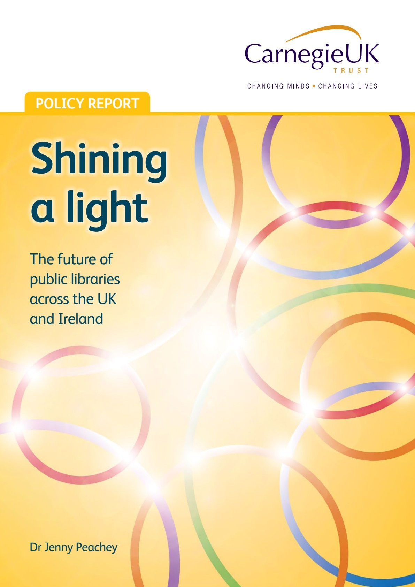
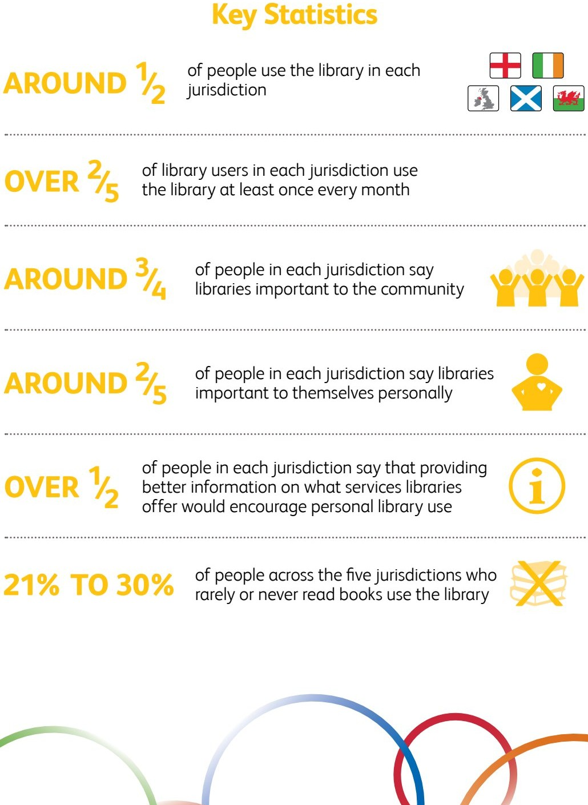
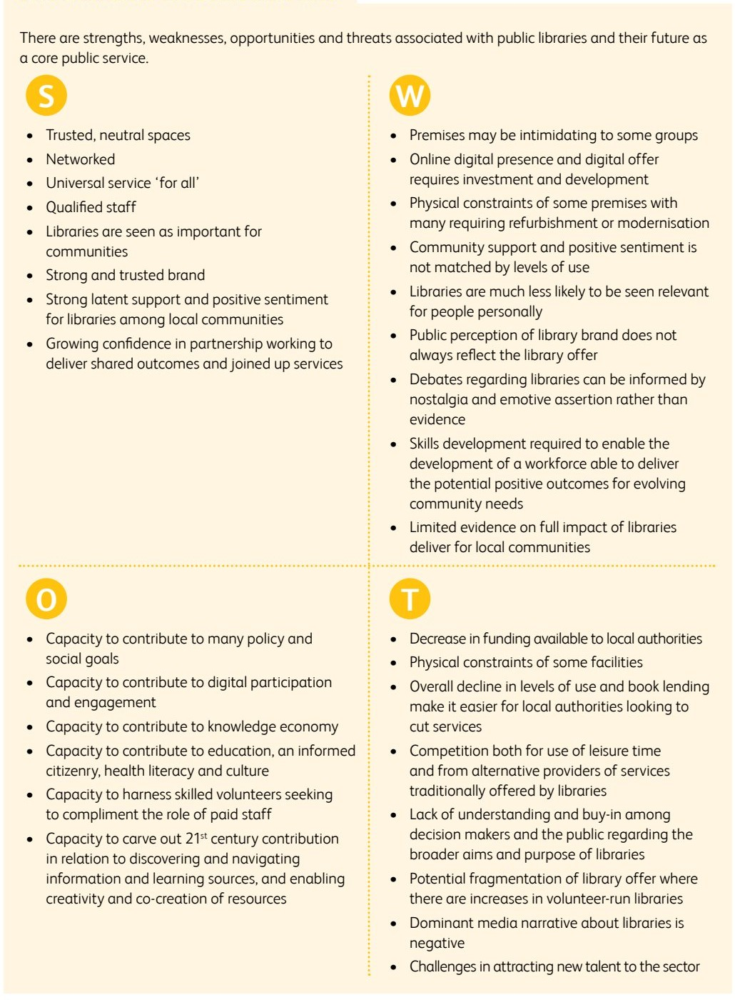
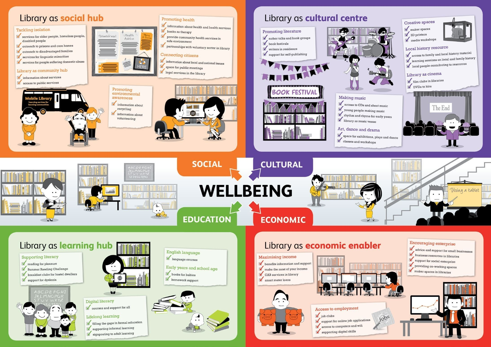
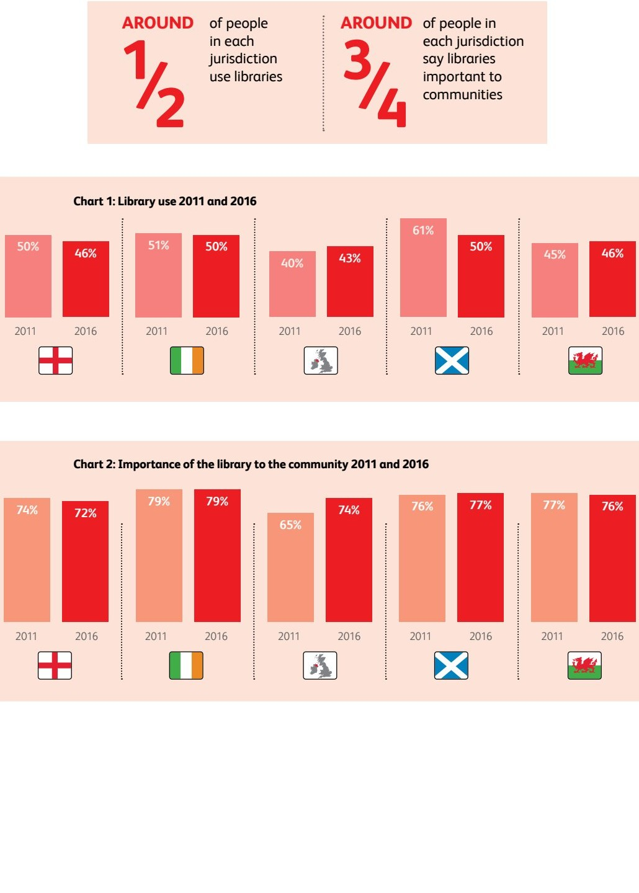
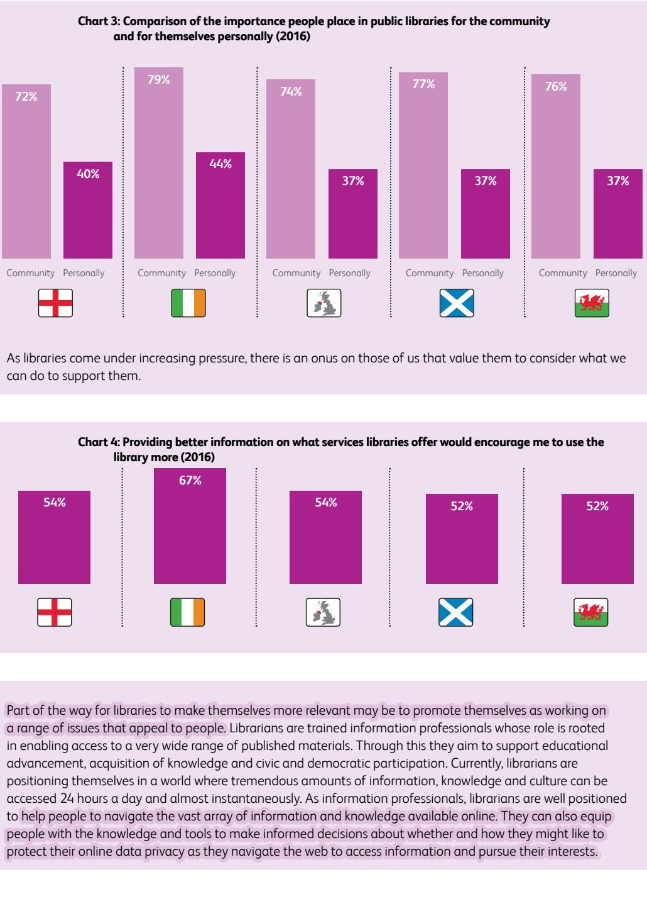
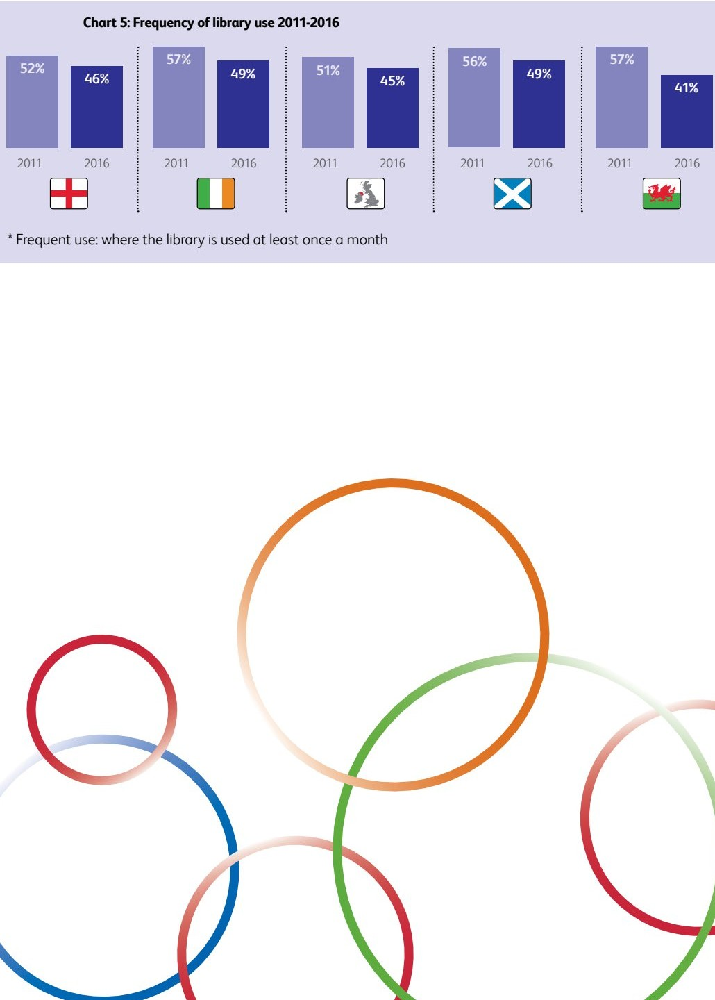
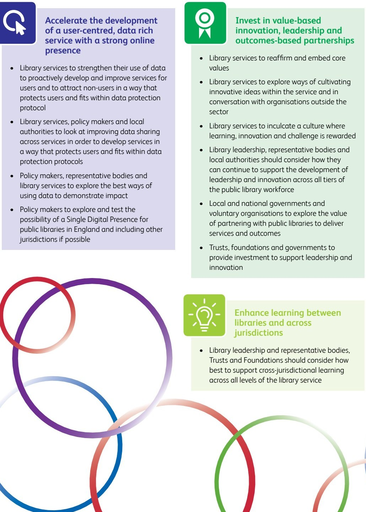

<!-- PAGE: 1 -->

# Shining a Light

## The future of public libraries across the UK and Ireland

### Policy Report

**Dr Jenny Peachey**  
*Carnegie UK Trust*

<!-- PAGE: 2 -->

### About the Carnegie UK Trust

The Carnegie UK Trust works to improve the lives of people throughout the UK and Ireland, by changing minds through influencing policy, and by changing lives through innovative practice and partnership work. The Carnegie UK Trust was established by Scots-American philanthropist Andrew Carnegie in 1913.

### Acknowledgements

This policy report has benefitted from the insight and guidance of an Advisory Group who provided feedback on the research at different stages of the project. The Advisory Group consisted of:

- Ciara Coveney, LGMA, Ireland
- Ciara Eastell, Libraries Connected (formerly SCL)
- Martyn Evans, Carnegie UK Trust
- Ian Leete, Local Government Association (LGA)
- Nick Poole, CILIP
- Jenny Peachey, Carnegie UK Trust
- Irene Peachey, Department for Communities and Local Government (DCLG)
- Pamela Tulloch, Scottish Library and Information Council (SLIC)
- Linda Tomos, National Library of Wales

The author would also like to thank colleagues at the Carnegie UK Trust for their valuable contributions and support throughout the project.

This report is licensed under the Creative Commons Attribution Share-Alike 3.0 Unported Licence.

<!-- PAGE: 3 -->

## Table of Contents

- **Key Statistics** (Page 2)
- **Foreword** (Page 3)
- **1. Introduction** (Page 4)
- **2. Public libraries: what are we talking about?** (Page 6)
- **3. Demonstrate value to policy makers, decision makers and funders to maximise public and other investment** (Page 10)
- **4. Increase focus on tailored, personalised services whilst maintaining a focus on delivering a universal service** (Page 12)
- **5. Accelerate the development of a user-centred, data rich service with a strong online presence** (Page 14)
- **6. Invest in innovation, leadership and outcomes-based partnerships** (Page 16)
- **7. Enhance learning between libraries and across jurisdictions** (Page 17)
- **8. Recommendations** (Page 18)
- **Endnotes** (Page 20)

<!-- PAGE: 4 -->

## Key Statistics

### Headline Survey Findings (2011–2016)

| Metric | England | Ireland | Northern Ireland | Scotland | Wales |
| :--- | :---: | :---: | :---: | :---: | :---: |
| **Around 1 in 2 people** use the library in each jurisdiction | 47% | 51% | 44% | 61% | 49% |
| **Over 2 in 5 library users** use the library at least once every month | 41% | 51% | 47% | 46% | 48% |
| **Around 3 in 4 people** say libraries are important to the community | 72% | 79% | 76% | 77% | 76% |
| **Around 2 in 5 people** say libraries are important to them personally | 40% | 44% | 37% | 37% | 37% |
| **Rarely / never read books** but still use the public library | 21% | 30% | 27% | 23% | 27% |

<!-- PAGE: 5 -->

## Foreword

The Carnegie UK Trust has supported public libraries for over 100 years, recognising the significant and enduring contribution that these valuable public resources make to improving the wellbeing of individuals and communities.

In 2011 we conducted research into public attitudes towards libraries in England, Scotland, Wales, Northern Ireland and Ireland. This research was ground-breaking. For the first time comparable data was generated across the individual jurisdictions of the UK and Ireland. Now, we have rerun this survey to examine whether, five years on, attitudes towards and use of public libraries have changed.

The overall picture is complex. Public libraries continue to be an exceptionally popular public service, used by around one in two citizens and seen as important to local communities by three in four. However, the data also highlights challenges: while library use has remained stable in some jurisdictions, frequent use has fallen, and fewer than half of respondents see the library service as of direct personal importance to themselves.

This Policy Report sets out the strategic lessons from the research. It proposes five core priorities for policy makers, library leaders, and funders to secure a thriving, sustainable future for public libraries across these islands.

**Martyn Evans**  
*Chief Executive Officer, Carnegie UK Trust*

<!-- PAGE: 6 -->

## 1. Introduction

Over the past five years the role, purpose and future of the public library service has been the subject of passionate discussion and intense debate across the UK and Ireland. Reductions in local authority expenditure, austerity measures, and changing public consumption patterns have led to library closures, reduced opening hours, and staff reductions in many areas.[^1] At the same time, there are inspiring stories of library innovation: new flagship central libraries,[^3] new governance and community delivery models,[^4] expanding digital services,[^5] and dynamic programmes supporting enterprise, health, and social connection.

There is, of course, truth in both perspectives. Public libraries are navigating profound structural change while continuing to deliver essential public value. To navigate these choices effectively, policy makers and library leaders need reliable evidence on how the public actually views and uses library services today.

This report draws on extensive omnibus polling commissioned by the Carnegie UK Trust across England, Ireland, Northern Ireland, Scotland, and Wales, comparing public attitudes and behaviour between 2011 and 2016. It offers practical policy recommendations to guide decision makers, funders, and library services in developing resilient, modern services that meet community needs.

<!-- PAGE: 7 -->

## SWOT Analysis of Public Libraries

### Summary Matrix

| Category | Key Factors |
| :--- | :--- |
| **Strengths** | • Trusted, neutral, safe civic space open to all • Universal reach and physical presence at the heart of communities • High public support and recognition of community value (approx. 75%) • Substantial user base (approx. 50% of the population) • Highly skilled, dedicated staff providing professional mediation and support |
| **Weaknesses** | • Personal importance lags community importance (only approx. 40% feel personal value) • Decline in frequency of visits among active users • Inconsistent digital and online offer across authorities • Limited public awareness of the breadth of modern services and activities • Constrained budgets, staffing capacity, and variable data collection infrastructure |
| **Opportunities** | • Expanding role as community wellbeing and social connection hubs • Partnerships with health, education, employment, and voluntary sectors • Delivering digital inclusion, digital literacy, and data privacy advice • Co-location with other community, cultural, and public services • Enterprise and business support through initiatives such as Business & IP Centres |
| **Threats** | • Continued austerity and local authority funding reductions leading to closures or reduced hours • Negative public and media narratives focused exclusively on decline and closures • Rapid pace of technological change outstripping service investment • Failure to attract and retain diverse new talent and leadership into the sector • Risk of losing universal service ethos through uncoordinated retrenchment |

<!-- PAGE: 8 -->

## 2. Public libraries: what are we talking about?

### The ‘What’ of Libraries

Public libraries occupy an unusual place in the public service landscape: an extensive network of known public spaces at the heart of communities, trusted, free at the point of access, and open to all. They provide access to physical and digital books, information resources, computers and high-speed internet access, quiet study spaces, events, activities, and expert guidance from trained staff.

### The ‘Why’ of Libraries

The best public libraries enable citizens to fulfil their potential and act as a trusted and safe civic space that enables engagement and participation. They improve individual and community wellbeing, tackle social isolation, support literacy and lifelong learning, bridge the digital divide, and empower citizens to navigate modern life.

As stated in *Libraries Inspire: The Strategic development framework for Welsh libraries 2012-2016*:

> ‘To inspire the people of Wales through literacy and lifelong learning, to equip them with knowledge and skills, to enrich their quality of life and empower them to realise their full potential.’

<!-- PAGE: 9 -->

### Public Libraries as an Enabler

As an enabler, public libraries contribute to economic, social, cultural and educational policy goals, improving people’s wellbeing in ways that are often unseen or unrecognised.[^6] For example:

- **Economic enabler:** Supporting job seekers with job searches, CV preparation, and online applications; providing workspaces, meeting rooms, and resources for entrepreneurs, micro-businesses, and freelancers; and providing information and training to enhance employability.
- **Learning hub:** Delivering early years literacy (such as Bookbug, Bookstart, and Rhymetimes); supporting school pupils with homework clubs and study spaces; providing adult literacy and numeracy classes; fostering digital skills and coding clubs; and supporting informal lifelong learning.
- **Social hub:** Acting as a warm, welcoming, non-stigmatising community meeting place; combating loneliness and rural isolation through mobile library services and home library deliveries to older and housebound residents; hosting dementia-friendly reading groups; and providing safe spaces for community groups.
- **Cultural centre:** Hosting author talks, exhibitions, poetry readings, craft sessions, and theatre performances; safeguarding local history and community archives; and welcoming new migrants and refugees with language learning resources and cultural orientation.

<!-- PAGE: 10 -->

*(Full-page illustration from Speaking Volumes: The impact of public libraries on wellbeing, Carnegie UK Trust, 2014, illustrating the multidimensional contribution of public library services to social, economic, physical, and emotional wellbeing).*

<!-- PAGE: 11 -->

## 3. Demonstrate value to policy makers, decision makers and funders to maximise public and other investment

Public libraries continue to be a very well-used and highly valued service. Around one in two people in England, Ireland, Northern Ireland, Scotland and Wales use the public library, and around three in four people say libraries are important to their communities.

However, in an era of constrained public expenditure, broad public goodwill is not enough to protect services from budget reductions. Policy makers and funding bodies face competing statutory demands, particularly in adult social care and children's services. To secure sustainable investment, library services must explicitly demonstrate how they contribute to wider strategic outcomes—including public health, educational attainment, economic regeneration, and community cohesion.

Library leaders must develop robust, outcomes-focused evidence frameworks, moving beyond traditional inputs and outputs (such as book issues and footfall) to measure real impacts on individual wellbeing and community resilience. Following from this, delivery of library strategies must be monitored to ensure that library services, decision makers, and funders have a mutual understanding of public value.

<!-- PAGE: 12 -->

### Chart 1: Public library use in the last 12 months (2011 vs 2016)

| Jurisdiction | 2011 (%) | 2016 (%) |
| :--- | :---: | :---: |
| **England** | 49% | 47% |
| **Ireland** | 50% | 51% |
| **Northern Ireland** | 40% | 44% |
| **Scotland** | 61% | 61% |
| **Wales** | 50% | 49% |

### Chart 2: Public agreement that libraries are important to the community (2011 vs 2016)

| Jurisdiction | 2011 (%) | 2016 (%) |
| :--- | :---: | :---: |
| **England** | 74% | 72% |
| **Ireland** | 79% | 79% |
| **Northern Ireland** | 74% | 76% |
| **Scotland** | 77% | 77% |
| **Wales** | 76% | 65% |

<!-- PAGE: 13 -->

## 4. Increase focus on tailored, personalised services whilst maintaining a focus on delivering a universal service

Public libraries are a universal service for all. Whilst this is a great strength, our data demonstrates the challenge inherent in being a universal service: the danger of trying to be "all things to all people" and as a result failing to meet the specific, evolving needs of diverse user segments.

The data reveals a striking paradox: while three in four citizens believe libraries are essential for their community, only around two in five feel libraries are personally important to themselves. Furthermore, between 21% and 30% of non-readers use public libraries regularly, demonstrating that library value extends far beyond traditional book lending.[^10]

To bridge this gap, libraries must adopt more sophisticated, tailored approaches to service design. This means designing targeted services for specific demographic groups—such as digital skills for older people, enterprise support for entrepreneurs, or creative media workshops for teens—whilst maintaining an open, universally accessible physical and digital infrastructure.[^7][^8]

<!-- PAGE: 14 -->

### Chart 3: Importance of public libraries for community vs personally (2016)

| Jurisdiction | Important for Community (%) | Important Personally (%) | Gap (points) |
| :--- | :---: | :---: | :---: |
| **England** | 72% | 40% | -32% |
| **Ireland** | 79% | 44% | -35% |
| **Northern Ireland** | 76% | 37% | -39% |
| **Scotland** | 77% | 37% | -40% |
| **Wales** | 65% | 37% | -28% |

### Chart 4: Proportion of non-readers who use public libraries (2016)

Across the five jurisdictions, between 21% and 30% of people who report that they rarely or never read books nevertheless use the public library service: Ireland (30%), Northern Ireland (27%), Wales (27%), Scotland (23%), and England (21%).[^9]

Libraries can also equip people with the knowledge and tools to make informed decisions about whether and how they might like to protect their online data privacy as they navigate the web to access information and pursue their interests.

<!-- PAGE: 15 -->

## 5. Accelerate the development of a user-centred, data rich service with a strong online presence

Public libraries remain an extraordinarily well-used public service. Our data shows that across England, Scotland, Wales, Northern Ireland, and Ireland, millions of citizens engage with libraries each year. However, frequent use—defined as using the library at least once a month—has experienced downward pressure across several regions.[^11]

To reverse this trend, library services must accelerate their transition towards modern, user-centred service delivery. This requires:

1. **Robust data collection and analytics:** Developing a sophisticated understanding of both users and non-users, capturing usage patterns, demographic shifts, and unfulfilled community needs.
2. **Seamless digital customer journeys:** Providing modern, intuitive online catalogues, reservation systems, digital borrowing platforms, and mobile-friendly websites that match commercial standards.
3. **Ubiquitous physical and digital spaces:** Ensuring that digital services do not merely replicate or replace physical spaces, but complement and enrich them, creating an integrated library experience accessible anywhere, anytime.

<!-- PAGE: 16 -->

### Chart 5: Frequency of library use (2011 vs 2016)

*Frequent use: where the library is used at least once a month by library users.*

| Jurisdiction | 2011 Frequent (%) | 2016 Frequent (%) |
| :--- | :---: | :---: |
| **England** | 57% | 41% |
| **Ireland** | 56% | 51% |
| **Northern Ireland** | 57% | 47% |
| **Scotland** | 56% | 46% |
| **Wales** | 51% | 48% |

<!-- PAGE: 17 -->

## 6. Invest in innovation, leadership and outcomes-based partnerships

There is an ongoing need for public libraries to cultivate their ability to future-gaze, innovate, and test out ideas in order to anticipate and meet community needs. This requires supportive leadership cultures that empower frontline staff to experiment, learn from failure, and scale successful initiatives.

Crucially, modern libraries cannot succeed in isolation. Library authorities must form strategic, outcomes-based partnerships with:

- **Health and social care providers:** Integrating libraries into social prescribing pathways, mental health support, and public health campaigns.
- **Education and skills agencies:** Aligning library learning programmes with local economic priorities and adult literacy strategies.
- **Voluntary and community sector:** Partnering with local charities, arts organisations, and community groups to enrich programming and reach marginalised populations.

Equally, staff recruitment and continuous professional development must be prioritised to attract diverse talent with skills in digital technologies, community engagement, and partnership management:

- **COLLABORATION:** We celebrate the diversity of our experiences and build connections. We trust each other.
- **CREATIVITY:** We encourage innovation, open-minded inquiry, and experimentation.
- **COMMUNITY:** We place community needs and wellbeing at the heart of everything we do.

<!-- PAGE: 18 -->

## 7. Enhance learning between libraries and across jurisdictions

There are similarities in our library data from across the five jurisdictions, but there are also many differences.[^12] Sharing learning and best practice both within and across jurisdictions represents a huge, untapped opportunity for the sector.

For instance, Scotland maintains the highest overall library usage rate across the British Isles (61%), while Ireland has achieved significant success in introducing unified national LMS and online reservation services. Learning from the approaches that have succeeded in one jurisdiction can accelerate improvements in others.

The aim is not to transplant policies mechanically from one place to another, but rather to translate the underlying lessons in ways that local services can act upon. Professional bodies, national development agencies, and independent funders have a vital role to play in supporting structured peer learning, cross-jurisdictional research, and practitioner exchanges.[^13]

<!-- PAGE: 19 -->

## 8. Recommendations

Public libraries have the ability to contribute to individual and community wellbeing and to many of the priorities of local and national government. Despite considerable pressures, public libraries are in a strong position – they continue to be used by about half of the population and are valued as a community service. However, frequency of use is declining and fewer than half see the service as of value to them personally.

To ensure public libraries thrive into the future, the Carnegie UK Trust makes the following recommendations across five core themes:

### Theme 1: Demonstrate Value to Decision Makers
- **Governments and Local Authorities** should ensure that public libraries are embedded within strategic outcome frameworks and corporate plans.
- **Library Services** should articulate their impact in terms of broader policy priorities—health, education, economy, and community cohesion—using robust qualitative and quantitative evidence.

### Theme 2: Balance Universal and Targeted Services
- **Library Services** should develop tailored services addressing specific community needs while preserving the core ethos of universal, barrier-free access.
- **Funders** should invest in initiatives that demonstrate innovative approaches to engaging non-users and under-represented demographics.

### Theme 3: User-Centred, Data-Rich, and Digital
- **Library Services** should invest in audience research and data analytics to better understand user behaviour and non-user barriers.
- **National Bodies and Governments** should support shared digital infrastructure, high-quality broadband, and accessible online platforms.

### Theme 4: Leadership, Innovation, and Partnerships
- **Local Authorities and Trusts** should foster an organisational culture of innovation, providing staff with leadership development and experimentation space.
- **Sector Leaders** should forge cross-sectoral partnerships with health, arts, business, and voluntary organisations to maximise community reach.

### Theme 5: Cross-Jurisdictional Learning
**Governments, Sector Bodies, and Trusts & Foundations** should establish structured mechanisms for cross-border knowledge exchange, peer reviews, and joint research across England, Ireland, Northern Ireland, Scotland, and Wales.

<!-- PAGE: 20 -->

### Strategic Recommendations Matrix

| Actor | Key Actions |
| :--- | :--- |
| **National Governments** | • Recognise public libraries as key delivery partners for national strategic priorities • Ensure statutory frameworks and national standards remain up to date and adequately resourced • Support national digital initiatives and shared infrastructure |
| **Local Authorities & Trusts** | • Embed libraries into local wellbeing, economic renewal, and public health strategies • Protect baseline core funding to sustain professional staffing and quality book/resource stocks • Support flexible, outcome-focused community delivery models |
| **Library Services** | • Implement audience insight and usage analytics to tailor services to emerging community needs • Enhance staff skills in digital technologies, partnership building, and community engagement • Actively communicate the full breadth of library services to both users and non-users |
| **Trusts & Foundations** | • Fund innovative pilots, leadership development, and cross-jurisdictional learning initiatives • Support independent research and evaluation that demonstrates the long-term impact of libraries on wellbeing |

<!-- PAGE: 21 -->

<!-- PAGE: 22 -->

*(Section blank in original publication)*

<!-- PAGE: 23 -->

**Carnegie United Kingdom Trust**  
Andrew Carnegie House  
Pittencrieff Street  
Dunfermline, Fife  
KY12 8AW

Tel: +44 (0)1383 721445  
Email: info@carnegieuk.org  
Website: [www.carnegieuktrust.org.uk](https://www.carnegieuk.org)

Scottish charity SC 012799 operating in the UK and Ireland  
Incorporated by Royal Charter 1917

## Footnotes

[^1]: BBC News, *Library cuts: More than 1,000 libraries in UK face closures, reductions*, March 2016 (http://www.bbc.co.uk/news/uk-england-35707956) [Accessed November 2016].

[^2]: BBC News analysis of local authority library budgets and service reductions across England, Wales and Scotland [Accessed November 2016].

[^3]: Over 50 new libraries opened between 2011 and 2016, alongside high-profile refurbishments including Manchester Central Library, Liverpool Central Library, and Exeter Library.

[^4]: Growing diversification in the governance of library services, including public sector mutuals, charitable trusts, social enterprises, and community-managed library partnerships.

[^5]: A 330% increase in the number of coding clubs run in public libraries between March 2016 and November 2016; partnerships with the Good Things Foundation on digital inclusion; the opening of library-based makerspaces and fablabs; and growing digital privacy workshops.

[^6]: Carnegie UK Trust research reports demonstrating the multifaceted role of libraries: *The Library as Economic Enabler*, *The Library as Learning Hub*, *The Library as Social Hub*, and *The Library as Cultural Centre* (http://www.carnegieuktrust.org.uk/publications/).

[^7]: Searching for and reserving books online became a universal service in Ireland in March 2017 with the introduction of the national single library management system.

[^8]: In England, 48% of people surveyed stated that being able to look for or reserve books online would encourage greater library use (compared with 59% in Ireland, 45% in Northern Ireland, 47% in Scotland, and 42% in Wales).

[^9]: Proportion of non-readers who use public libraries based on omnibus survey data across all five jurisdictions (2016).

[^10]: Excluding books that are read for paid employment or formal academic study.

[^11]: Logistic regression analysis was carried out controlling for gender, age, children in household, working status, readership, and socio-economic classification to identify predictors of library usage and frequency.

[^12]: Northern Ireland presented a mixed picture in terms of support for specific service changes, while Scotland maintained the highest overall participation rates.

[^13]: For example, professional exchange and development programmes facilitated by CILIP, SCL / Libraries Connected, SLIC, and the Welsh Government.
