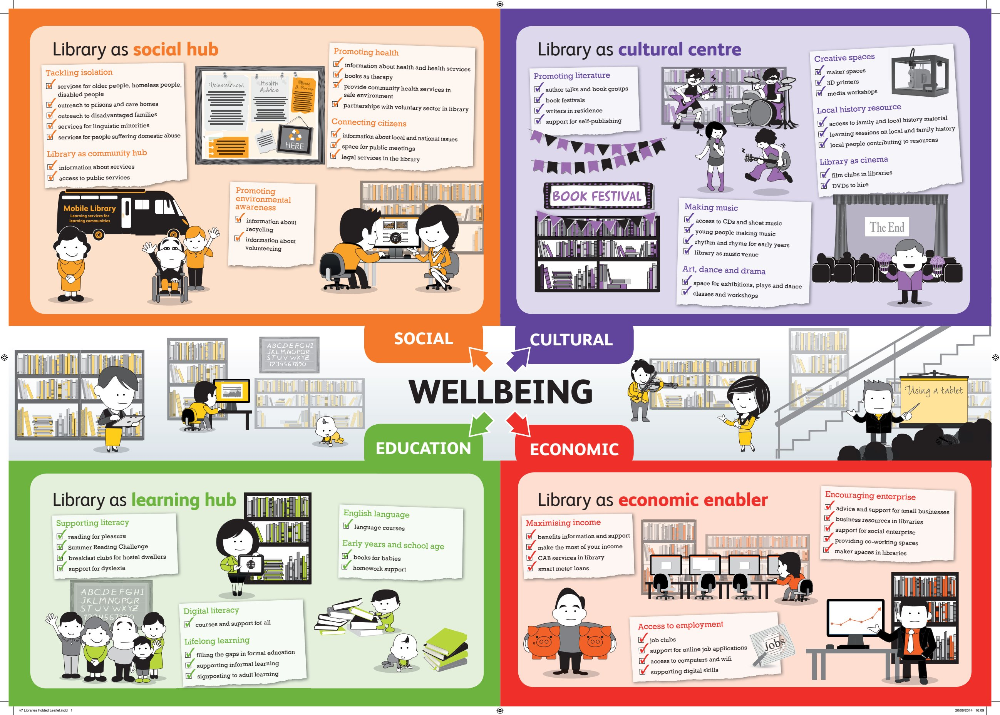
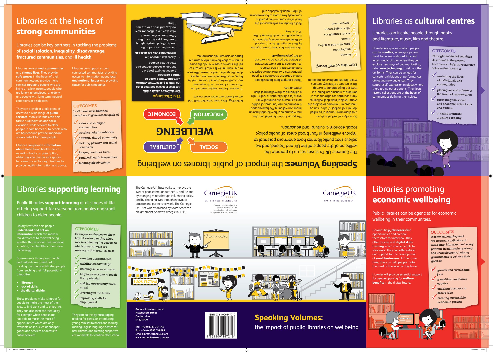

<!-- PAGE: 1 -->

# Speaking Volumes: The Impact of Public Libraries on Wellbeing

**Carnegie UK Trust**

## Public Library Services and Wellbeing: The Illustrated Network

### Mobile Library
- Learning services for learning communities
- Rural outreach and mobile stops
- Tackling geographic isolation
- Bringing library collections and digital access directly to isolated villages, rural schools, and community venues

### Library as Social Hub: Tackling Isolation
- Services for older people, homeless people, disabled people
- Outreach to prisons and care homes
- Outreach to disadvantaged families
- Services for linguistic minorities
- Services for people suffering domestic abuse

### Library as Community Hub
- Information about local services
- Access to public services and assisted digital support
- Promoting environmental awareness:
  - Information about recycling
  - Information about volunteering
- Promoting health:
  - Information about health and health services
  - Books as therapy / Books on Prescription
  - Providing community health services in a safe, non-stigmatising environment
  - Partnerships with voluntary sector organisations hosted in the library
- Connecting citizens:
  - Information about local and national issues
  - Free and accessible space for public meetings
  - Legal advice and advocacy clinics in the library

### Library as Cultural Centre
- Promoting literature:
  - Author talks and reading groups
  - Book festivals and literary events
  - Writers in residence
  - Support for local creative writing and self-publishing
- Creative spaces:
  - Maker spaces and digital fabrication
  - 3D printers and scanners
  - Media workshops and coding clubs
- Local history resource:
  - Free access to family and local history archives
  - Learning sessions and genealogy workshops
  - Local communities contributing oral histories and community archives
- Library as cinema:
  - Film clubs and community screenings
  - Film, documentary, and audiovisual loans
- Making music:
  - Access to recorded music, CDs, and sheet music collections
  - Rehearsal spaces and community music groups

### Library as Economic Hub
- Supporting jobseekers:
  - Job clubs, CV writing, and interview coaching
  - Universal Jobmatch and online application support
  - Free public internet and Wi-Fi access
- Supporting enterprise and small businesses:
  - Intellectual property advice and business databases
  - Hot-desking and networking spaces for start-ups and sole traders

<!-- PAGE: 2 -->

## Policy Briefing: The Impact of Public Libraries on Wellbeing

### About the Carnegie UK Trust

The Carnegie UK Trust works to improve the lives of people throughout the UK and Ireland, by changing minds through influencing policy, and by changing lives through innovative practice and partnership work. The Carnegie UK Trust was established by Scots-American philanthropist Andrew Carnegie in 1913.

- Andrew Carnegie House, Pittencrieff Street, Dunfermline, KY12 8AW
- Tel: +44 (0)1383 721445
- Email: info@carnegieuk.org
- Website: www.carnegieuktrust.org.uk
- Scottish charity SC 012799, Incorporated by Royal Charter 1917

---

### Introduction

The Carnegie UK Trust was set up to promote the wellbeing of the people of the UK and Ireland, and we believe that public libraries have enormous potential to improve wellbeing in four broad areas of public policy: **social, economic, cultural and education**.

Public libraries are safe spaces at the heart of our communities, providing completely free access to huge resources of information, knowledge and technology. They have dedicated staff and are well linked with other local services.

To respond to the changing needs of the 21st century, libraries are changing and must continue to change. Libraries must be brave, innovative and show how they are doing things which really make a difference to their community. It is also important to sell this story to those who hold the purse strings — to show how in the long term the library service can help save money.

### The Challenge

The challenge which public libraries face is to continue to be the kind of places which Andrew Carnegie wanted when he funded libraries:

- Places that give people a chance, a second chance and even a third chance
- Places that improve the communities they are based in
- Places that respond to the needs of local people, giving them the opportunity to live fuller lives, make more of what they have, discover new worlds, and aspire to greater things.

### Domains of Wellbeing

Our analysis of wellbeing shows that there are a number of so-called 'domains of wellbeing' which can be measured or monitored to explore the overall levels of individual wellbeing. Many countries use different sets of domains to measure wellbeing, but there is a huge amount of overlap. These are some of the key domains which libraries can have an impact on:

- **Income**
- **Employment**
- **Education and learning**
- **Health**
- **Social connections**
- **Civic engagement**
- **Environment**

The poster inside this leaflet contains many examples of how libraries have an impact on wellbeing. We have grouped the examples into four areas of public policy, showing the potential which exists for public libraries to really make a difference to the wellbeing of their communities. These examples have been selected from a database of examples of good practice drawn together from across the UK and Ireland.

---

### 1. Cultural: Libraries as Cultural Centres

Libraries can inspire people through books and literature, music, film and theatre.

Libraries are spaces in which people can be creative, where groups can meet to pursue a shared interest in arts and crafts, or where they can explore new ways of communicating, using new technology, music or other art forms. They can be venues for concerts, exhibitions or performances, attracting new audiences. They support self-expression in places where there are no other options. Their local history collections are at the heart of communities defining themselves.

#### Outcomes
Through these activities, libraries help governments achieve goals of:
- Enriching the lives of individuals and communities
- Placing art and culture at the heart of regeneration
- Promoting the social and economic role of arts and culture
- Creating a vibrant creative economy

---

### 2. Education: Libraries Supporting Learning

Public libraries support learning at all stages of life, offering support for everyone from babies and small children to older people.

Library staff can help people understand and act on information which can make a real difference to their wellbeing — whether that is about their financial situation, their health or about new technology.

Governments throughout the UK and Ireland are committed to tackling the things which stop people from reaching their full potential — things like illiteracy, lack of skills, and the digital divide. These problems make it harder for people to make the most of their lives, to find work and to enjoy life. They can also increase inequality, for example when people are not able to make the most of opportunities which are only available online, such as cheaper goods and services or access to public services.

#### Outcomes
Libraries play a key role in achieving government outcomes:
- Creating opportunities
- Tackling disadvantage
- Creating smarter citizens
- Helping everyone to reach their potential
- Making opportunity more equal
- Investing in the future
- Improving skills for employment

They do this by encouraging reading for pleasure, introducing young families to books and reading, running English language classes for new citizens, and creating supportive environments for children after school.

---

### 3. Social: Libraries at the Heart of Strong Communities

Libraries can be key partners in tackling the problems of social isolation, inequality, disadvantage, fractured communities, and ill health.

Libraries connect communities and change lives. They provide safe spaces in the heart of their communities, and provide many services targeting people who are living on a low income, people who are lonely, unemployed, or elderly, and people with long-term medical conditions or disabilities.

They provide a single point of access to a wide range of public services. Mobile libraries help tackle rural isolation and social exclusion, while services to older people in care homes or to people who are housebound provide important social contact. Libraries provide information about health and health services, as well as books on prescription, while acting as safe spaces for voluntary sector organisations to provide health advice.

#### Outcomes
Libraries contribute to government goals of:
- Safer and stronger communities
- Thriving neighbourhoods
- A strong, shared community
- Tackling poverty and social exclusion
- Longer, healthier lives
- Reduced health inequalities
- Tackling disadvantage

---

### 4. Economic: Libraries Promoting Economic Wellbeing

Public libraries can be agencies for economic wellbeing in their communities.

Income and employment are important indicators of wellbeing. Libraries help jobseekers find opportunities and prepare themselves for interview. They offer courses and digital skills training which enable people to seek work. They offer advice and support for the development of small businesses. At the same time, they help people make the most of the income they have. Libraries provide essential assisted digital support for people applying for welfare benefits in the digital future.

#### Outcomes
Libraries help governments achieve goals of:
- Growth and sustainable jobs
- A wealthier and fairer country
- Enabling business to create jobs
- Creating sustainable economic growth
