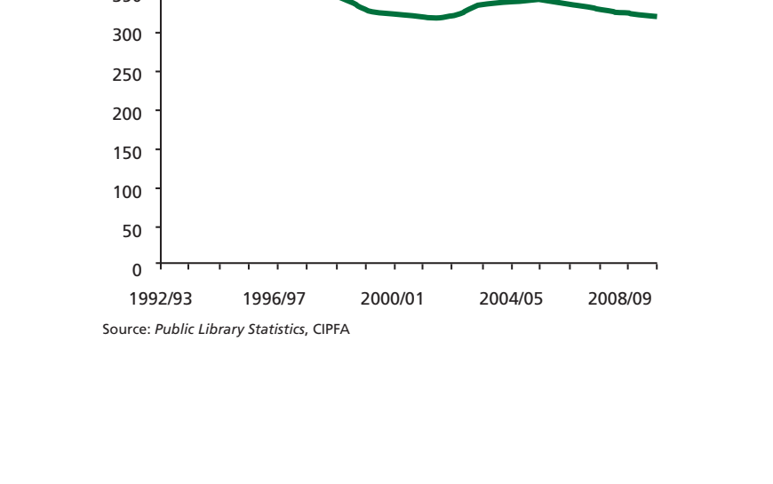
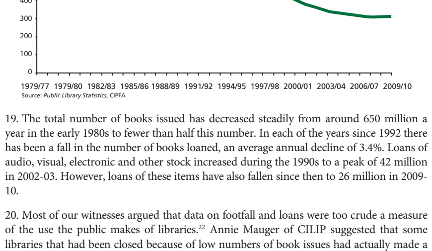
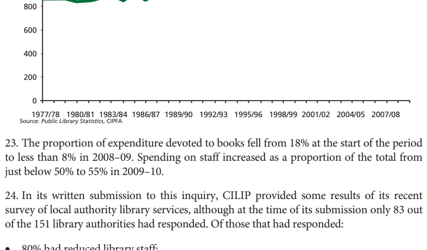

<!-- PAGE: 1 -->
House of Commons
Culture, Media and Sport Committee

# Library Closures

**Third Report of Session 2012–13**
**Volume I**
Report, together with formal minutes, oral and written evidence.

Ordered by the House of Commons to be printed 30 October 2012.

**HC 587.**

<!-- PAGE: 2 -->
## The Culture, Media and Sport Committee

The Culture, Media and Sport Committee is appointed by the House of Commons to examine the expenditure, administration and policy of the Department for Culture, Media and Sport and its associated public bodies.

### Current membership

- Mr John Whittingdale MP (Conservative, *Maldon*) (*Chair*)
- Mr Ben Bradshaw MP (Labour, *Exeter*)
- Dr Thérèse Coffey MP (Conservative, *Suffolk Coastal*)
- Damian Collins MP (Conservative, *Folkestone and Hythe*)
- Philip Davies MP (Conservative, *Shipley*)
- Paul Farrelly MP (Labour, *Newcastle-under-Lyme*)
- Steve Rotheram MP (Labour, *Liverpool, Walton*)
- Mr Adrian Sanders MP (Liberal Democrat, *Torbay*)
- Jim Sheridan MP (Labour, *Paisley and Renfrewshire North*)
- Mr Gerry Sutcliffe MP (Labour, *Bradford South*)

### Powers

The Committee is one of the departmental select committees, the powers of which are set out in House of Commons Standing Orders, principally in SO No 152. These are available on the internet via `www.parliament.uk`.

### Publications

The Reports and evidence of the Committee are published by The Stationery Office by Order of the House. All publications of the Committee (including press notices) are on the internet at `www.parliament.uk/cmscom`.

### Committee staff

The current staff of the Committee are Elizabeth Flood (Clerk), Grahame Danby (Second Clerk), Kevin Candy (Inquiry Manager), Sarah Heath (Assistant Inquiry Manager), Victoria Butt (Senior Committee Assistant), Keely Bishop (Committee Assistant) and Jessica Bridges-Palmer (Media Officer).

### Contacts

All correspondence should be addressed to the Clerk of the Culture, Media and Sport Committee, House of Commons, 7 Millbank, London SW1P 3JA. The telephone number for general enquiries is 020 7219 6188; the Committee’s email address is `cmscom@parliament.uk`.

<!-- PAGE: 3 -->
## Contents

| Section | Page |
|:---|---:|
| Summary | 3 |
| 1 Background | 5 |
| Introduction | 5 |
| This Inquiry | 6 |
| The Public Libraries and Museums Act 1964 | 6 |
| The Wirral Inquiry and the Charteris Report | 7 |
| Library usage and the impact of funding cuts | 8 |
| Visitor numbers and book loans | 9 |
| Local authority expenditure on libraries | 11 |
| Number of Libraries | 12 |
| Opening hours | 13 |
| Staff numbers | 14 |
| 2 A comprehensive and efficient service | 15 |
| Defining a ‘comprehensive and efficient service’ | 15 |
| Assessing local needs | 18 |
| Library buildings | 22 |
| Library staff | 25 |
| 3 A library service for the 21st century | 28 |
| Co-operation and mergers | 29 |
| Community libraries and the role of volunteers | 32 |
| Responsibility for ensuring a comprehensive and efficient service | 35 |
| Role of the Secretary of State | 35 |
| Role of the Arts Council | 39 |
| Conclusions and recommendations | 41 |
| Formal Minutes | 44 |
| Witnesses | 45 |
| List of printed written evidence | 45 |
| List of additional written evidence | 46 |
| List of Reports from the Committee during the current Parliament | 49 |

<!-- PAGE: 4 -->

<!-- PAGE: 5 -->
## Summary

Public libraries providing free access to books and other sources of information are a vital and much-loved service. Recent campaigns against the closure of local libraries have demonstrated the passion felt for them. Local authorities in England are under a statutory duty to provide a “comprehensive and efficient” library service under the Public Libraries and Museums Act 1964, overseen by the Secretary of State for Culture, Media and Sport, but there is no agreed definition of what this means. The lack of clarity around the 1964 Act has led to local authorities’ plans being challenged through judicial review rather than through the formal intervention of the Secretary of State. This is not cost-effective for councils and undermines democratic accountability. The Secretary of State should be much more willing to investigate local services and be more active in using his powers of intervention.

Library authorities are facing very difficult decisions as a result of reductions in local authority funding. Cuts to library services must be based on a robust assessment of local needs. While closing library buildings may be the only option for some councils, all options must be explored to find innovative ways of delivering the service. Local authorities should look at co-locating libraries with other services and sharing management across local authority boundaries, following the example of the Tri-borough library service in London. Transferring the running of libraries to volunteers from the community should only be considered as a last resort, as the long-term sustainability of community-run libraries has yet to be proved. Local authorities must also take account of the needs of the children and young people, for whom the local library and its specialist staff can open up the joy of reading.

Libraries need to evolve to meet the challenges and opportunities of the 21st century, and we welcome the work being done by Arts Council England to support them. In particular, libraries must grasp the opportunities presented by digital technology. The DCMS and the Arts Council must urgently resolve the issues surrounding the remote e-lending of books by public libraries to ensure that libraries are not left behind in the digital age.

<!-- PAGE: 6 -->

<!-- PAGE: 7 -->
## 1 Background

### Introduction

**1.** Public Libraries have been an important element of local life since 1850, when the first Public Libraries Act gave power to town councils to levy a small rate for the establishment of public libraries and museums in all municipal towns. (The rate was intended only for buildings: no provision was made for the purchase of books.) This—to modern eyes— modest measure raised considerable concerns, and the debate on Second Reading of the Bill threw up a number of arguments familiar to those interested in the public library service today: the utility of libraries in spreading literacy and the love of learning; the benefits of voluntarism over public provision; even disagreements about the use of library facilities for other purposes, such as lectures.[^1] Certainly, the provision of public libraries has been a subject of controversy from the beginning.

**2.** The most recent legislation governing the provision of public libraries is the Public Libraries and Museums Act 1964 (the 1964 Act). This was introduced mainly because of the proliferation of library authorities under the then statutory regime: the Government of the day wished to reduce the total number of authorities (there were more than 600 by 1942), and in particular to merge or dissolve the smallest and least efficient authorities. In addition to sweeping away several hundred authorities, the Act imposed duties on both local library authorities and the relevant Minister in respect of delivering a free and effective library service to the public.[^2]

**3.** Currently, the Department for Culture, Media and Sport (DCMS) has overall responsibility for national library policy and individual local authorities are responsible for the library service in their areas. There are 151 library authorities in England, running nearly 3,500 libraries and spending more than £900 million each year on library services.[^3] Central Government funding for local libraries comes from the local government finance settlement and is administered by the Department for Communities and Local Government (DCLG). It is not ring-fenced. Local authorities are responsible for deciding how to allocate core funding to public libraries in the light of their statutory duties under the 1964 Act and local priorities.

**4.** Since the Comprehensive Spending Review instituted by the new Government in 2010, the grants given by central government to local authorities have reduced significantly while restrictions on the ability of local authorities to increase council tax for their residents and local businesses remain in place. Local authorities face a decrease of, on average, 28% in

<!-- PAGE: 8 -->
### This Inquiry

**5.** After receiving numerous letters and emails from campaigners, we decided to launch an inquiry into library closures and, on 23 November 2011, asked for written evidence on the following terms of reference:

• what constitutes a comprehensive and efficient library service for the 21st century

• the extent to which planned library closures are compatible with the requirements of the Public Libraries and Museums Act 1964 and the Charteris Report[^5]

• the impact library closures have on local communities

• the effectiveness of the Secretary of State’s powers of intervention under the Public Libraries and Museums Act 1964.

**6.** We took oral evidence from three organisations representing those campaigning for maintenance of the library service (The Reading Agency, Voices for the Library and The Library Campaign); the Chartered Institute of Library and Information Professionals; three representatives of local authorities, one of whom also represented the Local Government Association; the Arts Council; Sue Charteris, who in 2009 carried out the most recent inquiry into a local authority’s library service; and Ed Vaizey MP, Parliamentary Under- Secretary of State for Culture, Communications and the Creative Industries at the Department for Culture, Media and Sport. As well as being familiar with library provision in our own constituencies, we visited two libraries in London, in Pimlico and at Canary Wharf, to see two different approaches to providing new and imaginative library services in a time of financial stringency. We also received 136 written submissions to this inquiry. We would like to record our thanks to all who submitted evidence to us and who welcomed us during our visits.

### The Public Libraries and Museums Act 1964

**7.** The Public Libraries and Museums Act 1964 imposes a duty on the Secretary of State to promote the improvement of the public library service provided by local authorities in England and Wales and sets out the statutory duty for all local authorities to provide a

<!-- PAGE: 9 -->
• encouraging adults and children to make full use of the library service.[^7] The Act contains provisions allowing the Secretary of State to hold an inquiry into any local authority’s library service if there is a complaint to the effect that the authority is running an inadequate service and is therefore in breach of the Act. It also states that if, following an inquiry, a local authority is found to be in breach of the Act, the Secretary of State can take direct control of the public libraries in that area.[^8]

**9.** The view of the DCMS is: The closure of one or even a small number of library branches is not necessarily a breach of the 1964 Act. Sometimes a local authority will close a library to ensure a better, more efficient service across its whole area. We judge such cases on the basis of the authority’s overall provision. We would be concerned if libraries were closed, or their services disproportionately reduced, just to save money.[^9]

**10.** Successive Secretaries of State have used their powers under the Act sparingly. In the last 21 years, they have been used only twice: in the form of a threat to investigate library closures in Derbyshire in 1991 and, more recently, an actual inquiry in 2009 in the Wirral.[^10]

### The Wirral Inquiry and the Charteris Report

**11.** In February 2009, Wirral Metropolitan Borough Council (Wirral MBC) was asked to work with the Museums, Libraries and Archives Council—the non-departmental public body then holding responsibility for the development and improvement of libraries—on the MBC’s proposals to restructure its library services. The Council’s plans to close 11 of Wirral’s 24 public libraries had been the subject of a large volume of correspondence to the DCMS, mainly from the public, but also from professional bodies.

**12.** On 3 April 2009, the then Secretary of State for Culture, Media and Sport, Andy Burnham MP, exercised his power under section 10(1) of the 1964 Act to commence a local inquiry into Wirral MBC’s compliance with the duties imposed upon it by section 7

<!-- PAGE: 10 -->
• On assessment of local needs, did Wirral MBC act reasonably in meeting such needs through their proposals in the context of available resources and their statutory obligations?[^12]

**13.** In its final Report in September 2009, the inquiry found the Council’s decision to restructure its Library Service to be in breach of its statutory duties to provide a “comprehensive and efficient” service.[^13] Wirral MBC revoked its decision to close the 11 library branches. On 30 November 2009, DCMS issued a press release explaining that the Secretary of State had concluded that, since the closures had been revoked, it was no longer appropriate to rule on whether the decision to close them had been in breach of the 1964 Act.[^14]

**14.** There is renewed interest in the Wirral Inquiry and the Charteris Report in light of possible implications for public library services following the Comprehensive Spending Review. In January 2011, in an interview for the Chartered Institute of Library and Information Professionals’ (CILIP’s) Update magazine, the current Minister with responsibility for libraries, Ed Vaizey MP, said that he had “told councils to base their decisions on the guidance set out for Wirral by Sue Charteris in 2009.”[^15] In another article in the same publication, he described the report as “an immensely important influence on library provision in that authority, but also on how we speak about the statutory duty at national level”.[^16]

### Library usage and the impact of funding cuts

**15.** It has been suggested that fewer and fewer of the public are making use of the library service, and—by inference—that the service is less valued and valuable than it was 40 or 50 years ago. Our witnesses considered this was not a complete or accurate picture. The DCMS told us that its ‘Taking Part’ survey showed adult visits to libraries had declined steeply between 2005/06 and 2010/11 from 48.2% to 39.7% of the adult population,[^17] but there had been no statistically significant decrease over the last few years, and children’s visits remained at a very high level (75.6%).[^18] We were also informed that lending of children’s books had risen for seven years in a row.[^19] Alan Davey of the Arts Council England told us that 90% of the adult population thought libraries were important or <!-- PAGE: 11 --> a correlation with reduction in budget.” In support of this argument, she told us that in 2011 there were 314 million visits to libraries and 300 million loans of books, a decline of, respectively, 2.3% and 2.9% over the previous year. She contrasted this with the fact that loans of children’s books had slightly increased, and that there had been a cut of 6.3% in library budgets and 14% in stock acquisitions.[^21]

**16.** In order to provide a longer perspective of use of library services, we commissioned the House of Commons Library to produce some statistics about recent library use. The following tables are based on those statistics, which the Library compiled using data from the Chartered Institute of Public Finance and Accountancy (CIPFA).

#### Visitor numbers and book loans

**17.** In 2009–10 there were 322 million visits to libraries, but slightly fewer book loans at 309 million. The number of visits exceeded book issues in each of the last seven years. Figure 1 shows that visitor numbers fell in each year between 1993–94 to 2001–02, from 391 million to 318 million. There was an increase between 2003 and 2005, but numbers declined again subsequently.

#### Figure 1: Number of visits to the public libraries

*Source: Public Library Statistics, CIPFA.*

<!-- PAGE: 12 -->

**18.** Figures on the number of books loaned by libraries are available for a longer time period and trends are illustrated in Figure 2 :

#### Figure 2: Books issued by all public libraries

*Source: Public Library Statistics, CIPFA.* <!-- PAGE: 13 --> international competitiveness and social deprivation is seen. We need only look at the fact that 80% of August rioters arrested had poor literacy levels.[^27] Similarly, many of our witnesses emphasised the importance of the free access to the internet and information technology provided by libraries, particularly for the unemployed and socially excluded. The Minister said that library staff and volunteers based in libraries had helped 2.5 million people to “get online” as part of the Government’s Race Online 2012 initiative to help tackle the ‘digital divide’.[^28]

**21.** We were given a wealth of other examples of the uses made of library facilities (homework groups, social groups for older people, craft groups and many more),[^29] and we return to this issue later in this report. Those representing local authorities emphasised the importance of surveys and the local knowledge of councillors in providing the sort of ‘soft’ data on how people actually used libraries that could not be captured by mere visitor numbers.[^30] Annie Mauger of CILIP suggested that there was still too little information about the broader impact of libraries on communities; she therefore welcomed the research being commissioned by the Arts Council to fill this gap.[^31]

#### Local authority expenditure on libraries

**22.** As already stated, the income of local authorities is set to decrease by about 28% over the course of the current Comprehensive Spending Review period. Although the provision of libraries is a statutory duty for local authorities, the funding for libraries is not ring- fenced, and libraries have to compete with other services provided by authorities, both statutory and non-statutory, for shrinking resources. The House of Commons Library provided us with information about trends in real levels of spending on libraries in England and Wales. Spending has varied little year-on-year over the last 35 years. After around a decade of stable expenditure, there were real increases in the late 1980s and early 1990s, but expenditure fell back in the mid 1990s. Increases in spending from 1997–98 have been only partially reversed in recent years.

<!-- PAGE: 14 -->
#### Figure 3: Revenue expenditure on libraries in England and Wales

*Source: CIPFA.* <!-- PAGE: 15 --> mark”, and that a truer picture would be about a tenth of that.[^35] In fact, leaving aside mobile libraries, the total number of public libraries has remained fairly constant from the late 1970s to the present day, at between 3,300 and 3,400. The only exception was a short dip in the late 1980s/early 1990s when numbers fell to just over 3,200, but the total increased by more than 200 in the following two years.

**26.** The most widely reported proposed library closures recently are as follows:

• Brent Council made a decision in April 2011 to close six libraries, half of the libraries in the borough. This sparked a series of campaigns under the umbrella group Brent SOS Libraries, which sought a judicial review of the council’s decision. The High Court ruled on 13 October 2011 that Brent Council’s decision had been lawful. On the same afternoon as the court ruling, all six libraries were closed and boarded up. The campaigners appealed the decision, but the appeal was rejected in December 2011.

• Gloucestershire and Somerset County Councils initially planned to close (in Gloucestershire) 10 out of 38 and (in Somerset) 11 out of 34 libraries in 2010. Friends of Gloucestershire Libraries campaign group took joint legal action with Somerset campaigners against their respective councils’ decisions in November 2011. The High Court found that neither council had carried out a sufficiently comprehensive and detailed analysis of local needs—especially those of disadvantaged groups—for library services and it overturned both councils’ decisions to close the libraries. Both councils are now exploring alternative approaches.[^36]

• Initial media reports in 2010 suggested that Isle of Wight Council proposed to close nine out of its 11 libraries. However, the council conducted a public consultation and evidence-gathering exercise and eventually proposed the closure of five libraries. Campaigners sought a judicial review, but the request was rejected. The council has now closed the five libraries and is establishing community libraries in place of the five closed sites.

• In January 2011 Dorset County Council proposed the closure of 20 of its 34 libraries. In June 2011, after protests and petitions from campaigners, it revised its proposal in favour of a compromise of nine closures.

#### Opening hours

**27.** While there was no major change in the number of public libraries over 30 years, there has been a significant change in the availability of library services, in that more libraries extended their opening hours: according to CIPFA, over the decade to 2010 the number of libraries open for fewer than 45 hours per week fell by around 470, while the number open for 45 or more hours per week increased by around 440. On the other hand, CILIP’s research indicates that the trend to longer opening hours is now being reversed. As the Chief Executive of the Arts Council said, if cuts in opening hours resulted in people being <!-- PAGE: 16 --> unsure whether or not their local library would be open, then that would have an effect on library usage.[^37]

#### Staff numbers

**28.** A less immediately obvious change to the library service has been the decrease in the number of library staff. We were interested to see whether this was a new phenomenon. The House of Commons Library provided statistics which show that the long term trend in the number of staff employed in libraries is downward. Their total full-time equivalent number in England and Wales fell from just over 25,000 in the late 1970s and early 1980s to 21,300 in 2009–10. Short term trends have varied over this period, but the total has fallen in each year since 2004–05, and the 2009–10 figure was the lowest of any during this period. Within this total the full-time equivalent number of professional posts fell from 6,700 in March 1999 to just under 5,000 in March 2010. Most of this fall occurred between 2004 and 2009.

<!-- PAGE: 17 -->
## 2 A comprehensive and efficient service

### Defining a ‘comprehensive and efficient service’

**29.** The 1964 Act requires local authorities to provide a “comprehensive and efficient” library service for local people.[^38] Neither of these terms is defined in the Act, and both are open to widely varying interpretation.[^39] In 2005 our predecessor Committee conducted an inquiry into public libraries and in its Report said that there was “need for more clarity as to what constitutes ‘comprehensive and efficient’ service and what action will be taken when this criterion is not met”.[^40] The 2005 Report went on to recommend that the DCMS should review the case for new library legislation.[^41] However, in its response to the Report, the DCMS said that it did not see a compelling need for new legislation.[^42] Currently, as a number of judicial challenges are being brought against local authorities’ decisions to close libraries and/or make other cuts to library services, the definition of ‘comprehensive and efficient’ is becoming a legal minefield.[^43]

**30.** Opinions among our witnesses differed, however, as to whether it was desirable to have a clearer definition of the core criteria for a comprehensive and efficient service and, if so, whether it should be provided through statute, through guidance from the Secretary of State, or left to local authorities themselves (with the backstop of judicial review). Andrew Coburn, of The Library Campaign, argued that, while the final decision had to rest with the local authority, “Nationally there needs to be assistance, guidance and possibly something stronger than that”. He lamented the demise in England of the public library standards drawn up by the DCMS (they have been retained in Wales).[^44] Our predecessor Committee summarised the library standards in its 2005 Report, and suggested some additions. An outline of the then standards is set out in the textbox below. Library service standards in 2005 The top ten Public Library Service Standards with which library authorities had to aim to comply in 2005 related to:

i. the proportion of households living within a specified distance of a static library;

ii. aggregate scheduled opening hours;

iii. the percentage of static libraries providing access to electronic information <!-- PAGE: 18 --> resources connected to the internet;

iv. the number of electronic workstations with access to the internet and the libraries catalogue;

v. dealing with requests;

vi. number of library visits;

vii. adults' satisfaction rates;

viii. children's satisfaction rates;

ix. number of books and other items acquired annually; and

x. time taken to replenish the lending stock. Standards which were omitted in 2005, but had been incorporated in those published in 2001, referred to: book issue periods; the number of books permitted to be borrowed at any one time; the number of visits to library websites; levels of success in finding a specific book or gaining information; and other types of satisfaction rates. Our predecessor Committee said it had sympathy with those who wished to see the standards strengthened and the list extended. It recommended that the list of standards should be extended and/or revised to include measures of: the number of adult and children's book loans; the provision of material for users with disabilities; extended opening times; value for money and the three Es (efficiency, effectiveness and economy—including the balance of management and frontline staff); free access to the internet; and the quality of user consultation (and subsequent action).[^45]

**31.** The Public Library Service Standards shared the flaws of those imposed elsewhere in the public sector, in that they concentrated on the measurable rather than giving a rounded indication of the quality of service—let alone its responsiveness to changing customer needs and demands. It is noteworthy that most of our witnesses wanted a broader and more permissive approach on the interpretation of ‘comprehensive and efficient’.

**32.** CILIP argued in its submission that the Government should set out a “fresh vision for <!-- PAGE: 19 --> already, given the cumulative effect of the Charteris Report, the guidelines published by the Museums, Libraries and Archives Council and CILIP’s advice.[^49] Despite this, a number of library authorities have had to curtail their plans for changes to their local services in the light of judicial reviews and discussions with DCMS officials.

**33.** Sue Charteris and the representatives of the local authorities argued for greater confidence in the ability of local authorities to judge local needs.[^50] The Local Government Association emphasised that not only did local needs differ widely, but also any attempt to give a detailed statutory definition of service standards would soon fail to reflect changes in technology and broader social changes: the example often cited was that the 1964 Act required libraries to supply gramophone records, while, unsurprisingly, there is no requirement in the Act in respect of digital material or services.[^51] Local authorities therefore regarded the prospect of central government defining ‘comprehensive and efficient’ as imposing a “straitjacket” and “immediately building in obsolescence”. They argued that councils must ultimately take the decisions; accountability for those decisions would be through the ballot box. They accepted that this model required individual councils to make it very clear what they considered a ‘comprehensive and efficient service’ to comprise, so that they could be held fully to account.[^52]

**34.** In February 2012, the Arts Council launched a consultation called Envisioning the Library of the Future , which was intended to discover the value which the public placed on library services, to provide an overview of trends in society, and to provide information about best practice—and, indeed, innovative developments that, for some reason, it had been difficult or impossible to implement. The consultation included desk research, interviews with a carefully selected cross-section of professionals and users, seminars and workshops, and an online public consultation. Interim conclusions were published in March and May, and the final report will be published this autumn.[^53] The Chief Executive of the Arts Council admitted that it would have been very useful to have completed this work before local authorities had had to start making decisions about the future of their library services, but “we are where we are”.[^54]

**35.** The professional librarians have also given serious consideration to what constitutes a good library service: CILIP distributed a leaflet on the subject to all local authorities and <!-- PAGE: 20 --> on the definition of ‘comprehensive and efficient’. They also appear to lack information about the requirements emerging from multiple judicial reviews. It is not cost-effective for policy to be made by judicial review and it undermines democratic accountability. While we are firmly of the view that decisions ultimately are for local authorities in the light of local needs, the provision of public libraries is mandatory and local authorities should be assisted to understand what is expected of them under the Act and subsequent guidance. We recommend that the Secretary of State provide all local library authorities with the guidance arising from the Arts Council’s consultation exercise as swiftly as possible, and to take that opportunity again to remind local authorities of the recommendations of the Charteris Report.

### Assessing local needs

**37.** When asked what they want of libraries, the public tend to answer more access (which is a question partly of the location of services and in part of opening times) and more books.[^56] However, all our witnesses were of the view that libraries provided a number of benefits to the community in addition to access to books and reference materials, and those championing library services were especially anxious that these wider considerations should be taken into account in assessing local needs.

**38.** It was failure to make adequate needs assessments that led the High Court to rule against Gloucestershire and Somerset County Councils’ library closures in November

**2011.** In his ruling, Judge McKenna said that, in order for the councils to have known whether they would still be compliant with Section 7 of the 1964 Act after closing libraries, they would have had to properly analyse: the library related needs of people living in particular areas, the needs of particular groups of people and the particular ways in which people use libraries in different contexts. Further, in order to design a comprehensive and efficient service it was necessary to assess such factors as who used libraries in particular areas, what they use them for, when they use them and how they travel to them.[^57] Judge McKenna went on to say that this assessment must also take into account “persons with specific needs such as the elderly, the disabled, the poor, the unemployed and parents <!-- PAGE: 21 --> further considered that the Council had taken the decision to close 11 of its libraries “in the absence of a strategic plan or review of the Library Service” and “without a clear understanding of the extent and range of services [then] being provided in the libraries”. She found there had been a further breach in relation to the needs of deprived communities, and a key concern was that there had been no adequate plan for and commitment to a comprehensive outreach service. Without an assessment of needs and a strategic Library Service review, the Council had “displayed a lack of logic around why some facilities were recommended for closure and not others”.[^60]

**40.** She concluded that there was a strong case for reviewing the decision to close 11 libraries and for retaining at least some physical presence at some sites earmarked for closure. The criteria for selecting sites where some physical presence should be maintained were that the library was located in an area of significant deprivation; and/or had inter- dependent links with schools or children’s centres; and where the Council had:

• changed its decision on which libraries to close; and/or

• identified an area of need but “subsequently chose to ignore this information”; and/or

• failed to meet its own standards in terms of a reasonable distance to travel.[^61]

**41.** The Charteris report set out proposals for the sort of analysis local authorities should be doing to assess local need. We reproduce the relevant passages in the textbox below. In her written evidence to us, she highlighted several key principles, drawn from her practical experience of working with local authorities:

• Comprehensiveness did not mean “a library on every corner” or “blanket coverage”—it depended on a needs assessment matched against the resources available for the service;

• The needs assessment would enable the council to show it had acted reasonably in drawing up new plans for its services. This did not mean that it would not still have to make difficult and/or unpopular decisions;

• The analysis should be made in accordance with the Equality Act 2010, particularly the requirement for a thorough equalities impact analysis of any proposed changes to that model of delivery and evidence that the authority had sought to mitigate any adverse impact identified on protected groups;

• The assessment of local need should cover the existing service configuration and any proposed changes. It was highly unlikely that the existing pattern of delivery fully met local needs and the analysis was therefore helpful in drawing up potentially different <!-- PAGE: 22 --> Charteris Report paras 6.26 – 6.28 While the analysis of local needs may involve a shifting set of circumstances and a developing methodology over time, I would currently reasonably expect an analysis of needs to be based on:

• consideration of the wide range of those needs caught by the definition of all those who live, work and study in the area, and the specific needs of adults and children and young people of all ages;

• an assessment of accessibility—drawing on travel data including car usage data, public transport routes and the cost of services;

• consideration of the views of existing users, and an attempt to analyse the reasons and motivations of non users and how their use could be encouraged;

• an assessment as to whether there is any differential impact (via an equalities impact assessment) on whether any specific communities or groups would suffer any adverse impacts as a result of the changes to the service; and

• consideration of information from partner organisations and other departments, including reference to learning strategies for children and adults, links with social and adult care, and employment initiatives. I would also expect there to be a consideration of new and or amended ways of operating the service that might be more efficient . Currently, this might reasonably include an assessment of:

• whether the library buildings are fit for purpose, and/or in the right place to serve the needs of the community;

• whether there is scope for more effective use of resources, through for example flexible staffing arrangements, self-issuing, or the Community Asset Transfer model or partial model;

• whether there is scope to provide the service more efficiently via delivery partnerships within and outside of the authority, for example through Service Level Agreements (SLAs) with other council functions;

• whether there is demand for the services in the way that they are currently offered;

• whether the buildings are beyond their useful life and what the scope of shared facilities might be;

• whether a physical presence is necessary, taking into account the particular needs <!-- PAGE: 23 --> of that community, and if it could be replaced by other means such as a mobile service; and

• whether steps are needed to encourage use of library provision. While this is not an exhaustive or definitive set of criteria, I would expect a ‘reasonable’ authority to use such evidence, together with an assessment of resources available , to devise a comprehensive vision and development plan for the service, which addresses these considerations within the development plan. It may, having done this, still draw different conclusions than those others might draw, and it might make decisions that are unpopular, but importantly, these decisions would be based on evidence which could be used to demonstrate the comprehensiveness and efficiency of the service provided by reference to demonstrable need and resources.

**42.** We were told that further guidance on how to undertake a needs analysis had been produced recently by the Arts Council which had updated the recommendations from the Future Libraries Programme initiated by its predecessor.[^63] These recommendations include the preparation of Equality Impact Assessments to ensure the rights of protected groups, as required under the Equalities Act 2010.

**43.** When she gave evidence to us, Sue Charteris’s concern was that the current situation made it more difficult for councils to take rational decisions based on a thorough assessment of local needs and a wide consideration of options. Given the pressure on local authorities to make budgetary decisions swiftly, and without more guidance to them from the Secretary of State and possibly the Arts Council (particularly on the conclusions to be drawn from the various judicial reviews), she feared that some councils would decide it was too difficult to close library buildings and would look to reduce funding to other elements of the library service, without regard to whether this was more damaging to the principles <!-- PAGE: 24 --> resources by local authorities[^67] — but they were far more sceptical about the willingness and the ability of all local authorities to carry out such an assessment of local needs.[^68] Abigail Barker of Voices for the Library said: Lots of cuts have been made with no thought of the needs of local residents. There have been consultations that were basically, “If you do not step forward and run your libraries, they will close.” People were not asked, “How and when do you use your library? How could we improve it? If we closed earlier in the week and it meant we could open at the weekend, how would you use it?” In Suffolk, there are libraries that open in schools on a Saturday and Sunday that nobody uses. Of course cuts need to be made, and we are not saying that the library service should be immune from cuts, but why not close those libraries that are not used at the weekend and save or put the money elsewhere?[^69] She also implied that some councils did not sufficiently consider that they would have to provide some services whether or not libraries were kept open, noting, for example, the need to provide access to online reference databases, which would still have to be paid for whether or not they were part of the library budget.[^70] Andrew Coburn of The Library Campaign emphasised that local users and campaign groups had to be given access to information about the existing service in order to make a rational decision about options and to suggest alternatives. Anything less, he said, was not true consultation.[^71]

**45.** The representatives of local authorities agreed that a needs assessment and proper consultation with the public and library professionals were crucial.[^72] Nigel Thomas gave us a good example of how a library authority should go about assessing local needs. He said that, when Leicestershire wished to relocate a library branch or operate it in a different way: “In order to make that final decision, I think we have to have a very clear idea of what the nature of that locality is, what its transport links are, what the levels of literacy and employment are and so on, and then we are better informed to make a strategic and informed decision.”[^73] While the Leader of the Isle of Wight Council—whose decision to close five public libraries unless volunteers were willing to run them led to vociferous protests—placed emphasis on sustaining the service ,[^74] campaigners have often focused on the retention of individual library buildings .

### Library buildings

**46.** Proposals to close a local library often cause considerable protest. Apart from questions of the ease of access to library and other services in alternative locations, the buildings themselves may have a symbolic value: older ones have been community hubs for a century <!-- PAGE: 25 --> or more and may be handsome buildings in themselves.[^75] Moreover, as one of our witnesses said, “Sometimes the library is the only public building left in the locality.”[^76] In all these ways, the current proposals to close some library branches are reminiscent of recent programmes of post office closures, and have provoked similar reactions.

**47.** Our witnesses recognised that library buildings often acted as hubs in the community. One described them as “sort of indoor parks”, a safe environment for both the young and the isolated old.[^77] Another pointed out that a relationship of trust developed between the staff in local libraries and the population, encouraging and enabling the population to use the library as a general source of information and support not just somewhere to borrow a book.[^78] Local libraries were places to hold homework clubs, reading groups, baby rhyme times: all ways to use the library’s resources and to make reading and study a more ‘social’ activity, while also providing a quiet and secure environment.[^79] The Association of Senior Children’s and Education Librarians (ASCEL) argued that, while electronic services were changing some of the focus of library services, the building itself was “still a compelling and significant part of a community”, adding “In times of economic hardship, it could be argued that more people will need libraries to learn new skills, seek employment, apply for jobs, write CVs etc.”[^80]

**48.** A number of those who submitted written evidence believed that libraries earmarked for closure were often smaller, branch libraries. This was summed up by Sue Charteris: As part of the mapping of local need against current usage data it will inevitably become clear that some library facilities are so optimally located that they act as centres of gravity or because of the quality of its offer or both (for example, Newcastle and Norwich Central libraries and the forthcoming new/refurbished libraries in Birmingham and Liverpool would qualify on both counts). Others may serve the community in a medium sized town and others still serve a specific community, for example, a village, suburb or inner city housing estate. It is this last group of libraries ... that are most under threat; yet they often meet highly localised need.[^81] Friends of Gloucestershire Libraries said that the libraries earmarked for closure were in the more deprived areas of their county, and therefore that the impact of their closure

<!-- PAGE: 26 -->

**49.** While accepting that the benefits of a distributed library network did not require the retention of every existing library building, Annie Mauger issued the warning that, when a library in a local community closed, 44% of the children in that community who had used that branch did not transfer to another library.[^84] This was not only a loss for the local population but could also have an impact on national policy objectives, for example by reducing the ability to deliver the Summer Reading Challenge for young people.[^85] The study that she was citing found also that 18% of those affected by library closures did not transfer their custom to another library facility; 35% of respondents said their children were using library facilities less; and 36% of respondents felt their children were reading less.[^86] This was not a recent study—it was conducted by Sheffield University in the late 1990s—but CILIP said that the lack of more recent data was because “it is some time since there has been anything like the scale of library closures currently happening”.[^87]

**50.** On the other hand, many library buildings are not being used to the full, are difficult to maintain or situated in the wrong place, or do not have enough space to develop services beyond book lending.[^88] Brent Council said that the six libraries that it closed were “poorly located and poorly used”, and that this was true in many areas of London where libraries had been built in response to 19 th or early 20 th century population profiles and habits of life. It added: “Brent Council finds that 21st century public libraries flourish if they are located in town centres close to public transport and this view has long been proven correct. Brent is a London borough that is exceptionally well served by public transport.”[^89]

**51.** Whether or not Brent Council’s analysis proves correct in the longer term, our visit to Tower Hamlets demonstrated the value in reviewing library facilities: the Borough Council had closed a number of old, crumbling, under-used buildings in less accessible locations in order to focus resources on a number of purpose-built libraries with meeting rooms and facilities for many types of events, with the result that library use had significantly increased across the borough.

**52.** One of our witnesses cited Swindon, where a campaign to retain the old town library had failed, but a new building had opened nearby: although it was not exactly what the campaigners had hoped for, they had had some influence on retaining part of the service <!-- PAGE: 27 --> Council and Derbyshire County Council—which explained how they had avoided closing libraries.[^92]

**53.** We noted that, while many local campaigns focus on buildings, one of the areas of expenditure under particular pressure was the provision of mobile libraries: about one in ten of all ‘library service points’ in England and Wales (350 out of about 3600) were mobile libraries, but we were told that many of these services were being removed on the grounds that the cost per person served by a mobile library was considered too high.[^93] Despite this, the Arts Council assured us that it thought mobile libraries were still an important element in the provision of a good service, though it was also looking at alternative ways of getting books to people who did not have easy access to ‘static’ libraries.[^94] As far as simple access to books was concerned, witnesses cited village halls, churches and pubs as being possible alternatives to under-used library buildings or infrequent visits by mobile libraries.[^95]

**54.** It may not be possible or even desirable to retain every existing library building, but wholesale closures are unlikely to facilitate an appropriate level of service. The key to ensuring that an adequate—and preferably a good— library service is available to the whole local population appears to be the retention of a distributed service, in accessible locations, but with flexibility over whether the service is provided in dedicated library buildings, in other locations, via mobile libraries, or in any other way that best fits local needs.[^96]

**55.** While concerned about the geographical spread of library services, CILIP was of the view that “where buildings are not closed, cuts to services, resource funds, opening hours, building maintenance and staffing are equally significant”.[^97] CILIP told us that significant cuts had been made in staff numbers and opening hours in the 2011–12 financial year.[^98] In the case of opening hours, this would reverse the recent trend to have libraries opening for longer periods, especially in the evenings and at weekends, which has been intended to encourage access by previously excluded groups.[^99] It also tends to confirm Sue Charteris’s fears that local authorities may be tempted to opt for a programme of cuts in areas less obvious than library closures, even if these cuts damage the overall service more than a closure would have done.

### Library staff

**56.** A number of our witnesses argued that professional librarians were critical to delivering a comprehensive and efficient library service. Not only do they assist the public with finding the books and information they want, help them to use technology with which they <!-- PAGE: 28 --> are unfamiliar, ensure that the stock of books and other materials are kept up to date and meet the varied needs of different sorts of customers, and manage the environment (dealing with health and safety, child protection issues, copyright law and so on), but they also carry out a lot of ‘outreach’ work with the community, especially reading and literacy schemes.[^100]

**57.** CILIP has estimated that in the 2011–12 financial year, there has been a reduction of possibly as many as 700 posts out of the 3,500 staff working in public libraries. UNISON, the public sector trade union that represents many library staff in the UK, told us that the latest figures from the Chartered Institute of Public Finance and Accountancy showed a drop in paid staff numbers of over 4%, whilst the number of volunteers within libraries had increased by 22% since 2010.[^101] Those campaigning for library services said the reduction in paid staff had resulted in the loss in particular of expertise in child literacy (we were told that many reader support posts were being merged so that there were no longer separate posts for adult and child support); and in developments such as the closure of information services or the abandonment of the Summer Reading Challenge, for lack of professional support. More generally, pressure of work on the remaining staff hindered training and staff development, and discouraged co-operation with other services or across authority boundaries.[^102]

**58.** When we asked whether she thought that policymakers understood the role of the librarian, Annie Mauger said “no, I really don’t think many of them do”. She went on to say: “I don’t believe that a service that isn’t professionally delivered is best for anybody’s local area.”[^103]

**59.** The local authority representatives who gave evidence to us were keen to emphasise that job losses were directed away from professional librarians and/or front-line staff. Councillor David Pugh denied that any of those who had lost their jobs when the Isle of Wight divested itself of five libraries were ‘professional staff’: he drew the distinction between professionally qualified librarians and other staff who could, he felt, however experienced they were, be adequately replaced by volunteers.[^104] Local campaigners, however—who had forced the Isle of Wight to backtrack on an even more radical programme of closures—strongly disagreed, given that professional, front-line staff were <!-- PAGE: 29 --> of the view it was unnecessary to have highly qualified, highly trained and therefore highly paid librarians in every library branch. He argued that there was scope for employing the professional expertise of librarians more “creatively”, to train and support volunteers. He suggested that this approach might lead to the opening of more libraries.[^107]

**60.** Staff costs are a significant and have been an increasing proportion of library costs and, if the service is losing up to 35% of its budget,[^108] some staff cuts are inevitable. As with other cuts, however, local authorities need to give careful consideration to how to do least damage to the service provided to the public now and for the future. They must ensure that they retain enough experienced and/or professionally qualified staff to develop the services on offer to the public to reflect changing needs, and to support the growing number of volunteers both within their core library service and in any community libraries that may be established locally.

<!-- PAGE: 30 -->
3 A library service for the 21 st century

**61.** While the core offering of a library service is access to books and other sources of information, especially for those who have little or no access at home to printed or electronically-provided information,[^109] our witnesses were unanimous that much greater value came from linking the resources and facilities available in libraries into wider programmes reaching out into the local community. Many libraries already do this in a variety of ways, but the need for local authorities to prune budgets has increased the urgency of reviewing the library service in the light not only of its own value but also of the value it can add to other services.[^110]

**62.** One area of symbiosis is with education, not least because many school libraries also face considerable funding reductions at present. The local public library provides not only access to information, but also a safe space for study, with the additional advantage of access to the knowledge of trained library staff.[^111] In some cases, local authorities have found that locating a public library within a school or college benefits both the educational establishment and the local community; but we were told that this did not work everywhere.[^112] The Government has recently taken up an idea put forward by the children’s author, Michael Rosen, of automatic library membership for all primary school pupils, to encourage them to use their local library.[^113]

**63.** Other examples of shared facilities are less obvious. Our witnesses referred to combining a library with the registry of births, marriages and deaths (in Sevenoaks) or with a tourist information office (in north-east England).[^114] Those who hosted our visit to the library in Pimlico emphasised the potential for libraries to support the health service, both in the provision of written information and as a place where medical staff could meet the local community in a relaxed environment in order to promote understanding of public health issues.[^115] One of the witnesses to our predecessor Committee drew attention to other government departments whose work was supported by the library service: in providing information and practical support to those seeking work (the Department of Work and Pensions); in helping small businesses (the Department for Business, Innovation and Skills); and in addressing those disaffected from schooling and thus helping to tackle anti-

<!-- PAGE: 31 -->

**64.** Leicestershire has taken the approach of viewing libraries as part of its heritage and arts services, enabling the council to concentrate on medium-term aims for this sector rather than just immediate cuts (for example, it has decided not to close any libraries or museums but to look at redesigning, joining up or, in some cases, reducing services). This approach has enabled significant savings, mainly through staff reorganisation, while retaining the expertise of librarians and curators; and it has also had some collateral benefits in terms of applying the commercial expertise developed in the museums and arts service to exploiting the potential of library facilities.[^118]

**65.** There has also been a renewed emphasis on the role of the library building as a meeting place for the community.[^119] In some places, this has been achieved partly by — for example—locating a privately-run cafe in the library, which has contributed to a rise in the number of visitors to the library.[^120] Such partnerships may provide some additional income, though experience is that this has not been substantial: it is the increase in usage that is more significant for the library service. Bradford Metropolitan District Council has adopted a different approach. Under its ‘Library Links’ initiative, it has located ‘library service points’ in shops.[^121]

**66.** Such relationships with the private sector are not universally welcome, however. We ♥ Libraries, a Hertfordshire-based library campaign group, expressed concern that co- location with private retailers would turn libraries from neutral venues open and welcoming to all into something more commercial and less inclusive.[^122]

### Co-operation and mergers

**67.** One area on which our witnesses agreed was that there were considerable potential benefits to be gained from procurement partnerships for purchasing books, and possibly in other areas where a ‘national’ approach might reap substantial savings and efficiencies.[^123] Miranda McKearney of The Reading Agency mentioned as examples a national digital portal for libraries, and a suite of planned services to be available 24 hours a day.[^124] Other witnesses argued that it would be impossible for libraries to engage with e-books except on a national basis: publishers were not very interested in the concept of lending e-books as licensing difficulties could not be adequately addressed at a local level and significant

<!-- PAGE: 32 -->

**68.** A number of our witnesses were cautious about the idea of forming regional hubs: there was resistance to the idea of ‘mega-libraries’ or ‘destination libraries’ given the difficulty of travelling long distances to them, though some regional hubs (such as in Newcastle) were acknowledged to work well.[^127] Nevertheless, it was acknowledged that there was scope for far more partnership between local authorities, and—in the view of Sue Charteris—such co-operation was vital because the scale of the cuts meant that otherwise there would not be enough professional expertise available to run the library service.[^128]

**69.** Unfortunately, our witnesses reported that, with certain exceptions (one of which we discuss in more detail below), co-operation between authorities had recently become more, not less, difficult: one witness said that the ‘good old days’ where one authority would specialise in books on fine arts and another on 20 th century history had gone as many of “those co-operative systems” had broken down.[^129] Another witness explained that the emphasis on local finances in the last 18 months, and the resulting focus on local library services, had, perversely, made such co-operation ‘politically’ difficult.[^130] While the Library Campaign acknowledged that collaborations could be an effective way for libraries to improve efficiency, it suggested: Shared services may be one way of making more efficiencies but only if the authority—and its users—has/ have the same amount of guarantee that services will be delivered on time, to budget and where required. There is no point in a shared service which simply means shipping books from one huge central depot to the branch if there is no other saving.[^131]

**70.** South Gloucestershire Council told us about the Libraries West Consortium (consisting of itself, North Somerset, Bath and NE Somerset, Bristol and Somerset library authorities) which had managed to make significant savings from shared procurement of ICT and stock, from shared services (IT support, bibliographic services, information provision via an Enquiry Centre, marketing and the development of new services), and shared training and development.[^132] While we were told of other examples of successful cross-boundary co-operation in Warwickshire, Cornwall and Devon, the north-west and potentially Leicestershire,[^133] the most commonly cited example was that of the ‘tri- borough’ project, encompassing the London boroughs of Westminster, Hammersmith & Fulham and Kensington and Chelsea.

**71.** This initiative covers a considerably wider set of services than those relating to public libraries or even the arts in general: it is a project to save money by, wherever possible, combining services in order to rationalise and reduce management structures and simultaneously improve front-line services. The Local Government Association described it as “an integrated libraries and archives service managed as a single service across the <!-- PAGE: 33 --> three boroughs, with local branding and delivery in line with local community needs”. Launched in April 2012, the tri-borough initiative for libraries was intended to produce savings of more than £1 million a year as a result of the single back office/management structure and from introducing best practice in the deployment of operational staff.[^134] Elizabeth Campbell of the Local Government Association and also a councillor in Kensington and Chelsea, described the thinking behind the approach as follows: [We] saw cuts were coming, and thought, “How do we not only safeguard what we have, how do we keep our 21 libraries across three boroughs open, maintain the number of hours, but at the end of the day produce a better library service for our customers?” I suppose that is what has galvanised all our thinking; how are we going to be more resourceful, more ready to modernise at the end of it, at the same time as taking £1 million out of the service? We feel that we will have done that. We will have taken £1 million out over the next couple of years, but we will have one library card serving all our customers. We will have a million books that they can take out. We hope our footfall of 5 million over the three boroughs, coming forward, will mean that we are probably more open to sponsorship or other deals. We may say that this is the first step. We will merge first, make our library service efficient and then think, “What now? What other things can we do?[^135] She added that the library service had always been part of the plan to merge services as the management and back office structures in the three boroughs more or less mirrored one another, so it was easy to rationalise them.[^136] When we asked whether it would be simple to replicate this across England and Wales, she replied that it would be difficult to achieve where the participating authorities were not of the same political persuasion as a lot had to be taken on trust, particularly as each authority would make gains in some areas and losses in others.[^137]

**72.** There have been suggestions that the tri-borough experiment with libraries should be repeated on a larger scale, for example by combining the library services of all 33 London boroughs into a single unit. It was estimated that, by removing administrative duplication, this might save up to £80 million a year.[^138] While making administrative savings on this scale is attractive, such centralisation runs the risk of losing the detailed knowledge of local needs which has, for example, allowed both Westminster and Tower Hamlets to develop their library services in ways which clearly reflect the needs of their local resident and working population.

**73.** While several of our witnesses expressed considerable enthusiasm for the tri-borough <!-- PAGE: 34 --> economies of scale, but she was still of the view that there were significant possible benefits to be had from partnerships even among counties. The vital ingredients, she thought, were real professional expertise and political leadership.[^140]

**74.** Some very good models of co-operation between library authorities already exist. Local authorities must ensure that they maintain and improve co-operation, both across boundaries and nationally, as this will free money for front-line library services. It is short-sighted to reduce co-operation at this time of financial constraint.

### Community libraries and the role of volunteers

**75.** A far more controversial response to funding cuts has been to hand over library facilities to volunteers, with the intention that they should be run as ‘community libraries’. We were told that this phrase covered a wide variety of models and very different levels of consultation, engagement and support from the relevant local authorities. At one end of the spectrum, there is the example where a library has been handed over completely to the community, without any professional support and even (in some cases) with the removal of vital IT equipment such as computers, so that it is impossible to join the library or request a book at that place.[^141] At the other end of the spectrum, the facilities remain intact, there is continued access to the advice and support of professional librarians, but the professional staff are “not necessarily the people who open and close the building every day”.[^142] While acknowledging that libraries had often made good use of voluntary staff in the past to enhance the service, our witnesses were generally of the view that, unless there was access to the advice and support of trained staff, facilities could not be considered to be part of the public library network.[^143]

**76.** Sue Charteris told us about the development of the community libraries programme under the auspices of the Big Lottery Fund. She said that the key determinants of the success of that project were, first, it involved an injection of capital; and secondly, it required slow and painstaking work with the local community to design, deliver and develop the service. She cited as a particularly successful example a healthy living centre on a housing estate in Weston-super-Mare, where the library—run by a social enterprise— <!-- PAGE: 35 --> work if it is a case of “Here are the keys of the building, get on with it, it is up to you whether you use it or not.” The council needs to be part of it.[^145]

**77.** The Isle of Wight Council has been the subject of particular criticism for its decision to reduce the number of public libraries on the island from eleven to six. The other five have been handed over to local volunteers and Councillor David Pugh, Leader of the Isle of Wight Council, made it clear that those five libraries were no longer part of the statutory service.[^146] We examined exactly what this meant in practice for the volunteers. We were told that none of the community libraries was accountable to the local authority; each library had responsibility for recruiting its own voluntary staff and, though the council asked volunteers to agree to comply with certain basic legal requirements, such as data protection, it was for each community to develop its library service as it saw fit. There were no common service standards.[^147] The buildings had been made available on a peppercorn rent, but other costs—in particular utility costs—were the responsibility of the relevant library, albeit that some transitional funding from the Isle of Wight Council was still in place and the local rural community council had some involvement with two of the libraries. This had resulted in some parish councils increasing their precepts, at least in part to support their local community library. Some communities wanted to move their library to a different building to co-locate with other services: Councillor Pugh said that the local authority would support them “to whatever extent they need within reason.”[^148] The community libraries did not have any employees of the local authority working there, with the exception of one part-time person, paid for by a town council, who was the library volunteer co-ordinator. (Councillor Pugh argued that volunteers had not replaced professional librarians as the previous staff, though competent, were not professional librarians.)[^149] The five libraries continued to have access to the council’s library IT service, including the full database of books, and Councillor Pugh expected that stock would be rotated and new books would be able to be ordered via the Isle of Wight’s central stock controls, as previously.[^150]

**78.** The Minister made it clear that an authority that had handed over a large proportion of its library facilities to volunteers would not escape his Department’s scrutiny: “we would still want to see a comprehensive and efficient local-authority-run service in the local <!-- PAGE: 36 --> have on some of the outreach work conducted by libraries, particularly in relation to children and reading. It is clear, however, that community libraries will fail unless given at least some support by the local authority in terms of access to stock (including new stock), retaining computer equipment and IT support, and access to the advice and assistance of professional library staff. It would be very helpful to councils to receive some guidance from the DCMS on best practice in the provision of support. Councils which have transferred the running of libraries to community volunteers must above all, however, continue to give them the necessary support, otherwise they may wither on the vine and therefore be viewed as closures by stealth.

**80.** A different model of devolved library provision is that presented by the Industrial and Provident Society (IPS), currently being piloted in Suffolk. In December 2011, Suffolk County Council decided to adopt an IPS model for its libraries which involved setting up an independent not-for-profit organisation with a Chair. In its written submission, Suffolk IPS Ltd stated that the IPS was still in a transitional phase, becoming fully operational in June 2012. It went on to explain: The County Council retains its statutory responsibilities for providing comprehensive and efficient library services. It will fund the IPS through a contract and service agreement; monitor progress and ensure compliance. All libraries will remain open, and public opening hours will not be reduced. Community management groups are planning to develop the scope and public offer of the new service locally.[^152]

**81.** The Minister told us that the Government had no preference about who ran the statutory library service—whether it was run in-house or under contract with a not-for- profit, mutual or private company—provided it could meet the ‘comprehensive and efficient’ criteria.[^153]

**82.** We will be very interested to follow the development of the Industrial and Provident Society model for library provision in Suffolk. Again, it relies heavily on the goodwill of volunteers, but it has the advantage to the local population that the county council retains overall responsibility for the service. There may be many other potential models for providing library services than those discussed in this report. We urge the DCMS, Arts Council and Local Government Association to evaluate the effectiveness of the different models being developed round the country and to produce an analysis for councils by the end of 2013.

**83.** We very much welcome the commitment given to us by the Minister to produce a report by the end of 2014 on the cumulative effect on library services of the reduction in <!-- PAGE: 37 --> library services—a systematic look at the impact of funding cuts and organisation changes is needed to assess the durability of new approaches over time.

### Responsibility for ensuring a comprehensive and efficient service

**84.** Much of the frustration of those campaigning for the retention of library services has arisen from a perception that the Secretary of State has been refusing to exercise his statutory responsibility for ensuring the provision of a comprehensive and efficient library service.[^155] Appeals to the Secretary of State to initiate Wirral-style inquiries into the decisions of individual authorities have failed: judicial reviews of council decisions have resulted in courts limiting themselves to considerations of process, while referring back the definition of ‘comprehensive and efficient’ to the Minister.[^156] Moreover, with the abolition of the Museums, Libraries and Archives Council, and the transfer (as recently as 1 October 2011) of some of its responsibilities to the Arts Council, there is no longer a body with specific responsibility for maintaining standards within the library service at national level.

#### Role of the Secretary of State

**85.** Section 1(1) of the Public Libraries and Museums Act 1964 states: From the commencement of this Act it shall be the duty of the Secretary of State to superintend, and promote the improvement of, the public library service provided by local authorities in England and Wales, and to secure the proper discharge by local authorities of the functions in relation to libraries conferred on them as library authorities by or under this Act. There is therefore a clear duty on the Secretary of State to “superintend, and promote the improvement” of the library service provided by individual local authorities. It seems reasonable to conclude it is his responsibility to provide at least a framework for judging whether a service is ‘comprehensive and efficient’.

**86.** Under section 10 of the same Act, as subsequently amended, the “default powers” of the Secretary of State are outlined as follows:. (1)If— (a)a complaint is made to the Secretary of State that any library authority has failed to carry out duties relating to the public library service imposed on it by or under this Act; or (b)the Secretary of State is of opinion that an investigation should be made as to whether any such failure by a library authority has occurred, and, after causing a local enquiry to be held into the matter, the Secretary of State is satisfied that there has been such a failure by the library authority, he may make an order declaring it to be in default and directing it for the purpose of removing the <!-- PAGE: 38 --> default to carry out such of its duties, in such manner and within such time, as may be specified in the order. (2)If a library authority with respect to which an order has been made under the preceding subsection fails to comply with any requirement of the order, the Secretary of State, instead of enforcing the order by mandamus or otherwise,— (a)[repealed] (b)[relates to joint boards, which may be dissolved back into their constituent parts and those parts reconstituted as separate library authorities], or (c)in any other case, may make an order providing that the functions of the authority relating to the public library service shall be transferred to the Secretary of State. (3)A power conferred by subsection (2) above to make an order shall be exercisable by statutory instrument, which shall be subject to annulment in pursuance of a resolution of either House of Parliament. (4)Where functions of a library authority have been transferred to the Secretary of State under subsection (2) above he may at any time by order transfer those functions back to the authority, and the order may contain such supplemental provisions as may appear to him to be expedient for that purpose. It is these powers that the Secretary of State has recently declined to use in respect of the half dozen or so cases referred for judicial review, on the grounds that they were not serious enough for him to intervene.[^157]

**87.** We suggested to some of our witnesses that there were good pragmatic reasons for the Secretary of State to refrain from intervening at present: the sheer scale of the budget cuts meant that so many closures and other changes were being proposed that he would simply be overwhelmed if he intervened. The response was that, nevertheless, he had a statutory duty to fulfil.[^158] Andrew Coburn summed up the reason why campaigners thought it appropriate for there to be responsibility at a national level for a service which, they agreed, had to reflect local needs and be delivered locally: it is a de facto national service. I can go into my local library and discover that the nearest copy of the book I want to borrow is in Keswick; I live in Essex, but I can get that book, perhaps not the next day, but very quickly. There are all sorts of other aspects that make it a national service , and, therefore, there is a place for some <!-- PAGE: 39 --> on the role of the Local Government Association in disseminating information, conducting peer reviews, and generally promoting different models of good practice.[^161]

**89.** Alan Davey of the Arts Council explained why, in his opinion, it was wrong to rely solely on the process of judicial review to decide whether local authorities were fulfilling their statutory duty to provide a comprehensive and efficient library service: “the judicial cases all focus on process and no one is talking about policy, about innovation, about where libraries could be going, about why libraries do matter to people, how they could matter to people more.”[^162] Sue Charteris, who had similar concerns, considered that this pointed to a need to amend the 1964 Act, not so much to remove responsibility from the Secretary of State, but to make him more ‘proactive’: to give him a clear role in relation to areas that needed to be addressed at national level (for example, negotiating digital access and using scale to achieve savings in the purchase of goods and services) and to make his supervisory role more akin to that of the relevant Secretaries of State in respect of the health and education services.[^163] To some extent, Ministers are already assuming a more active role in relation to national objectives: the DCMS is now working with other government departments to explore the possibility of providing Wi-Fi in every library in England by 2015.[^164]

**90.** The Minister said that he intended to hold discussions with the Chartered Institute of Finance and Accountancy (CIPFA) about the re-structuring of the statistics they collected from local authorities to ‘flag up’ possible areas of concern relating to expenditure on libraries. He added that he wanted to develop a ‘proper partnership’ between CIPFA and the Arts Council.[^165] Subsequently, he announced that CIPFA had developed ‘comparative profile reports’ to enable fair comparisons to be made between comparable local authorities in the way in which they delivered library services. The Minister denied this was a reimposition of inflexible library standards; it was intended to enable the DCMS to ask questions if, for example, there were wide divergences in the apparent efficiency of expenditure on books. To this end, the DCMS was commissioning reports on all library authorities in England, to be completed in December 2012 and to be made available to the public as well as councillors, MPs and other interested parties.[^166]

**91.** The Minister considered that the role given to the Secretary of State by the 1964 Act was still of value. He said: There is an interesting debate going on, if you like, a perspective certainly from local authorities that would like the Act repealed. They do not want a superintending duty. They do not want it to be a statutory duty. They want complete freedom, so they regard it as frustrating that they have to account to us. I would say it is good that they are frustrated that they have to account to us because it shows that we are taking an active interest in what they are doing. I do not think that superintendent function is <!-- PAGE: 40 --> redundant. I am not sure the exact question was asked in the transcript, but I think it is in the mind of every local authority when it looks at its library service: will we breach our duty? What will happen if we go too far? Will we be called in by the Department?[^167]

**92.** It would be possible to remove the Secretary of State altogether from any role in respect of libraries by repealing sections 1 and 10 of the 1964 Act, and making any consequential amendments; but, though it has the benefits of simplicity and clarity, this is not entirely satisfactory. The more libraries develop their role in order to deliver national goals, whether in education or in promising new areas such as public health, the more they match the model of a ‘national service delivered locally’ rather than just a ‘local service’. Consequently, there is an argument for retaining an element of national oversight. The current situation, however, where the Secretary of State has considerable reserve powers but is unwilling at present to use them, satisfies no one. One of the key problems for those trying to conduct judicial reviews of local decisions is that, since the revocation of the library standards, there is no national definition of ‘comprehensive and efficient’. We have already recommended that the Secretary of State issue guidance on what, in broad terms, constitutes a good library service. We note that the Arts Council’s libraries team is based in all the regions and is intended to advise on best practice. This team could also be used to feed information on potential problem areas back to the DCMS. This system of advice backed up by intelligence should both help councils to adapt their approach to reductions in the library service—which may serve to reduce the recourse to judicial review—and enable the Secretary of State to give a swifter and clearer response to any complaints or judicial referrals. Section 10 of the 1964 Act then really would be a final resort.

**93.** We are attracted by Sue Charteris’s outline of a modern approach to the Secretary of State’s supervisory duty, with its emphasis on developing the service, promoting best practice and supporting the service through intervention at a national level in areas where there are potential efficiencies of scale. This leaves responsibility for both determining and meeting local needs to the local authorities, where it should rest. It also—as we discuss below—fits the stance taken by the Arts Council in respect of its advisory role for libraries. We do not think that adopting this approach would require any amendment to legislation, as the Secretary of State already has the duty of ‘promoting the improvement’ of library services.

**94.** We note one suggestion of a small but significant change to the current procedures and practices relating to the Secretary of State’s powers to call a local inquiry into the actions of a library authority. Sue Charteris argued forcefully that the Public Libraries (Inquiries Procedure) Rules 1992 were virtually unworkable and so adversarial that they hindered, rather than helped, to solve the underlying problem. She believed that they should be <!-- PAGE: 41 --> national funding comes from the Department for Communities and Local Government. Our witnesses were divided on this question, but were generally of the view that the identity of the parent department mattered less than the political commitment to the service.[^169]

#### Role of the Arts Council

**96.** When we heard from its Chief Executive in February, the Arts Council had only recently taken over some of the role and responsibilities of the Museums, Libraries and Archives Council (MLA). The Arts Council saw its role in relation to libraries as two-fold: it had to provide the Secretary of State with information (such as on the extent of closures), and it had to assist with the Secretary of State’s duty to promote the improvement of library services, which it saw mainly in terms of spreading good practice. Formally, it took over from its predecessor responsibility for the Future Libraries programme. The Arts Council did not, however, have the ‘semi-supervisory’ role of the body it replaced, a sort of devolution of the Secretary of State’s statutory duty to superintend the service. This duty was anyway—in the view of the Chief Executive—“not terribly well-defined” and he argued it properly and firmly rested with the DCMS itself.[^170]

**97.** Moreover, as the Chief Executive admitted, the amount of money allocated to libraries within the Arts Council’s budget, was “tiny”: £230,000 or about £76 per library.[^171] This fund, which is part of the Libraries Development Initiative launched in November 2011, is intended to fund 13 projects to “test new approaches to library service delivery.”[^172] The Chief Executive denied that libraries were a low priority for his organisation, arguing that, rather than regarding them as a simple add-on to museums, the Arts Council viewed the role of libraries as popular and trusted local institutions with a strong role to play in encouraging people throughout the country to engage more with culture.[^173] He also said that an area he wished to develop was increasing access by libraries to lottery funds: many library services had been unaware that they were eligible to apply for these, and he thought the Arts Council could help improve both application and success rates for libraries.[^174] After we had finished taking oral evidence, on 28 June, the Minister announced that the Arts Council was allocating £6 million from its Grants for the Arts programme for library authorities to work with arts and cultural organisations on projects to promote art and <!-- PAGE: 42 --> half and had closed its regional offices by 2010; he argued, moreover, that it did not have a separate cadre of library staff. He stated that the Arts Council was spending more on library development projects and its consultation programme than the MLA had.[^176] He hoped that the Arts Council would fulfil the function of a “libraries development agency”, a resource for collecting and disseminating best practice and for providing support where needed, rather than an Ofsted-style inspectorate.[^177]

**99.** Our other witnesses seemed largely satisfied with the part played by the Arts Council so far, with both librarians and local authorities expressing approval of its commitment to the spread of best practice, and with CILIP and Sue Charteris encouraging it to work closely with the Local Government Association and professional bodies to develop advice and support.[^178]

**100.** We have no doubt that the Arts Council will fulfil its duties in respect of libraries efficiently and with enthusiasm. Its decision immediately to start a major consultation on how libraries should look in the future bodes well. However, rightly or wrongly, the demise of the Museums, Libraries and Archives Council—and the transfer of libraries to a much larger body with a more circumscribed responsibility for the service and a very low direct budget allocation for it—contributes to an impression that the library service in general is being afforded a lower priority than in the past. In the current climate, it is inevitable that library services will be asked to bear their share of local authority cuts and in some areas be rationalised, even though others have committed to keeping all libraries open. We believe, however, that all those involved in providing this service to the public—local authorities, Arts Council and the Secretary of State—need to work harder to demonstrate that it is still much-valued and has a promising future.

<!-- PAGE: 43 -->
## Conclusions and recommendations

**1.** The Public Library Service Standards shared the flaws of those imposed elsewhere in the public sector, in that they concentrated on the measurable rather than giving a rounded indication of the quality of service—let alone its responsiveness to changing customer needs and demands. It is noteworthy that most of our witnesses wanted a broader and more permissive approach on the interpretation of ‘comprehensive and efficient’. (Paragraph 31)

**2.** Local authorities are having to take decisions now about the funding and shape of the library service but a number appear insufficiently aware of the available guidance on the definition of ‘comprehensive and efficient’. They also appear to lack information about the requirements emerging from multiple judicial reviews. It is not cost-effective for policy to be made by judicial review and it undermines democratic accountability. While we are firmly of the view that decisions ultimately are for local authorities in the light of local needs, the provision of public libraries is mandatory and local authorities should be assisted to understand what is expected of them under the Act and subsequent guidance. We recommend that the Secretary of State provide all local library authorities with the guidance arising from the Arts Council’s consultation exercise as swiftly as possible, and to take that opportunity again to remind local authorities of the recommendations of the Charteris Report. (Paragraph 36)

**3.** It may not be possible or even desirable to retain every existing library building, but wholesale closures are unlikely to facilitate an appropriate level of service. The key to ensuring that an adequate—and preferably a good— library service is available to the whole local population appears to be the retention of a distributed service, in accessible locations, but with flexibility over whether the service is provided in dedicated library buildings, in other locations, via mobile libraries, or in any other way that best fits local needs. (Paragraph 54)

**4.** Staff costs are a significant and have been an increasing proportion of library costs and, if the service is losing up to 35% of its budget, some staff cuts are inevitable. As with other cuts, however, local authorities need to give careful consideration to how to do least damage to the service provided to the public now and for the future. They must ensure that they retain enough experienced and/or professionally qualified staff to develop the services on offer to the public to reflect changing needs, and to support the growing number of volunteers both within their core library service and in any community libraries that may be established locally. (Paragraph 60)

**5.** Some very good models of co-operation between library authorities already exist. Local authorities must ensure that they maintain and improve co-operation, both across boundaries and nationally, as this will free money for front-line library services. It is short-sighted to reduce co-operation at this time of financial constraint. (Paragraph 74)

**6.** Volunteers have long been a valuable and valued part of the library service, and there are places where their work may help the local community to retain at least some <!-- PAGE: 44 --> ability to borrow books and access reference material. It will require considerable dedication by the volunteers and, as the Isle of Wight example shows, the financial costs may be high, even if buildings are made available at a nominal rent. It is not clear how sustainable some of these community libraries may be, nor what impact the change will have on some of the outreach work conducted by libraries, particularly in relation to children and reading. It is clear, however, that community libraries will fail unless given at least some support by the local authority in terms of access to stock (including new stock), retaining computer equipment and IT support, and access to the advice and assistance of professional library staff. It would be very helpful to councils to receive some guidance from the DCMS on best practice in the provision of support. Councils which have transferred the running of libraries to community volunteers must above all, however, continue to give them the necessary support, otherwise they may wither on the vine and therefore be viewed as closures by stealth. (Paragraph 79)

**7.** There may be many other potential models for providing library services than those discussed in this report. We urge the DCMS, Arts Council and Local Government Association to evaluate the effectiveness of the different models being developed round the country and to produce an analysis for councils by the end of 2013. (Paragraph 82)

**8.** We very much welcome the commitment given to us by the Minister to produce a report by the end of 2014 on the cumulative effect on library services of the reduction in local-authority provision and the growth of alternatives such as community libraries. We look forward to receiving that report. Enthusiasm over the scope for volunteer involvement, and for new models of provision, is fine, but—given the importance of library services—a systematic look at the impact of funding cuts and organisation changes is needed to assess the durability of new approaches over time . (Paragraph 83)

**9.** there is an argument for retaining an element of national oversight. The current situation, however, where the Secretary of State has considerable reserve powers but is unwilling at present to use them, satisfies no one. We note that the Arts Council’s libraries team is based in all the regions and is intended to advise on best practice. This team could also be used to feed information on potential problem areas back to the DCMS. This system of advice backed up by intelligence should both help councils to adapt their approach to reductions in the library service—which may serve to reduce the recourse to judicial review—and enable the Secretary of State to give a swifter and clearer response to any complaints or judicial referrals. Section 10 of the 1964 Act then really would be a final resort. (Paragraph 92)

**10.** We are attracted by Sue Charteris’s outline of a modern approach to the Secretary of State’s supervisory duty, with its emphasis on developing the service, promoting best practice and supporting the service through intervention at a national level in areas where there are potential efficiencies of scale. This leaves responsibility for both determining and meeting local needs to the local authorities, where it should rest. It also—as we discuss below—fits the stance taken by the Arts Council in respect of its advisory role for libraries. We do not think that adopting this approach would <!-- PAGE: 45 --> require any amendment to legislation, as the Secretary of State already has the duty of ‘promoting the improvement’ of library services. (Paragraph 93)

**11.** We note one suggestion of a small but significant change to the current procedures and practices relating to the Secretary of State’s powers to call a local inquiry into the actions of a library authority. Sue Charteris argued forcefully that the Public Libraries (Inquiries Procedure) Rules 1992 were virtually unworkable and so adversarial that they hindered, rather than helped, to solve the underlying problem. She believed that they should be changed. We concur. (Paragraph 94)

**12.** We have no doubt that the Arts Council will fulfil its duties in respect of libraries efficiently and with enthusiasm. Its decision immediately to start a major consultation on how libraries should look in the future bodes well. However, rightly or wrongly, the demise of the Museums, Libraries and Archives Council—and the transfer of libraries to a much larger body with a more circumscribed responsibility for the service and a very low direct budget allocation for it—contributes to an impression that the library service in general is being afforded a lower priority than in the past. In the current climate, it is inevitable that library services will be asked to bear their share of local authority cuts and in some areas be rationalised, even though others have committed to keeping all libraries open. We believe, however, that all those involved in providing this service to the public—local authorities, Arts Council and the Secretary of State—need to work harder to demonstrate that it is still much- valued and has a promising future. (Paragraph 100)

<!-- PAGE: 46 -->
## Formal Minutes

### Tuesday 30 October 2012

Members present:

- Mr John Whittingdale, in the Chair
- Mr Ben Bradshaw
- Dr Thérèse Coffey
- Damian Collins
- Philip Davies
- Paul Farrelly
- Steve Rotheram
- Mr Adrian Sanders
- Jim Sheridan
- Mr Gerry Sutcliffe

Draft Report (*Library Closures*), proposed by the Chair, brought up and read.
Ordered, That the draft Report be read a second time, paragraph by paragraph.
Paragraphs 1 to 109 read and agreed to.
Summary agreed to.
Resolved, That the Report be the Third Report of the Committee to the House.
Ordered, That the Chair make the Report to the House.

<!-- PAGE: 47 -->
Ordered, That embargoed copies of the Report be made available, in accordance with the provisions of Standing Order No. 134.

Written evidence was ordered to be reported to the House for printing with the Report, together with written evidence reported and ordered to be published on 7 February, 21 February, 6 March, 13 March, 24 April and 22 May 2012.

[Adjourned till Tuesday 6 November at 10.00 am.]

## Witnesses

| Date | Witnesses | Evidence Reference |
|:---|:---|:---|
| Tuesday 7 February 2012 | Miranda McKearney OBE, Director, The Reading Agency; Abigail Barker, Voices for the Library; and Andrew Coburn, Secretary, The Library Campaign | Ev 1 |
| Tuesday 7 February 2012 | Sue Charteris, Independent adviser on public policy and author of the Report on Wirral Library Service | Ev 10 |
| Tuesday 21 February 2012 | Alan Davey, Chief Executive, Arts Council England; Annie Mauger, Chief Executive, Chartered Institute of Library and Information Professionals (CILIP) | Ev 16 |
| Tuesday 21 February 2012 | David Pugh, Leader, Isle of Wight Council; Nigel Thomas, Service Delivery Manager, Leicestershire Library Services; and Elizabeth Campbell, Local Government Association (LGA) | Ev 26 |
| Tuesday 13 March 2012 | Ed Vaizey MP, Parliamentary Under-Secretary of State (Minister for Culture, Communications and the Creative Industries), Department for Culture, Media and Sport | Ev 37 |

## List of printed written evidence

| No. | Submitter | Evidence Reference |
|---:|:---|:---|
| 1 | The Reading Agency | Ev 47 |
| 2 | Chartered Institute of Library and Information Professionals (CILIP) | Ev 50 |
| 3 | Councillor David Pugh, Leader of the Isle of Wight Council | Ev 54 |
| 4 | Voices for the Library | Ev 58, Ev 64 |
| 5 | The Library Campaign | Ev 64 |
| 6 | Department for Culture, Media and Sport | Ev 68 |
| 7 | Leicestershire County Council | Ev 72 |
| 8 | Arts Council England | Ev 74 |
| 9 | Local Government Association (LGA) | Ev 78 |
| 10 | Sue Charteris | Ev 81 |

<!-- PAGE: 48 -->
## List of additional written evidence

*(Published in Volume II on the Committee’s website `www.parliament.uk/cmscom`)*

| No. | Submitter | Reference |
|---:|:---|:---|
| 46 | Library Closures
List of additional written evidence
(published in Volume II on the Committee’s website www.parliament.uk/cmscom)
1 S R Sibley, Chief Executive Officer, W F Howes Ltd | Ev w1 |
| 2 | Mr D J Williams | Ev w2 |
| 3 | Simon Barron | Ev w2 |
| 4 | Lechlade & District Civic Society | Ev w3 |
| 5 | Campaign for the Book | Ev w4 |
| 6 | Desmond Clarke | Ev w6 |
| 7 | Alice Lock | Ev w10 |
| 8 | June Winifred Quigley | Ev w11 |
| 9 | David James Quigley | Ev w12 |
| 10 | Shirley Burnham | Ev w14 |
| 11 | Mike Cavanagh | Ev w18 |
| 12 | Colin F Gibb | Ev w19 |
| 13 | Camden Public Libraries Users Group | Ev w20 |
| 14 | Black Country Shared Library Project | Ev w22 |
| 15 | Save Bolton Libraries Campaign (SBLC) | Ev w24 |
| 16 | Association of Friends of Dorset Libraries | Ev w27 |
| 17 | Cornwall Council | Ev w31 |
| 18 | West Midlands Society of Chief Librarians | Ev w34 |
| 19 | Christopher Pipe | Ev w36 |
| 20 | London Borough of Hillingdon | Ev w39 |
| 21 | Hereford Library Users’ Group | Ev w40 |
| 42 | 23 Friends of Gloucestershire Libraries (FoGL) | Ev w46 |
| 24 | Association of Senior Children’s and Education Librarians (ASCEL) | Ev w50 |
| 25 | Nether Stowey Community Library Steering Committee | Ev w53 |
| 26 | Staffordshire County Council | Ev w57 |
| 27 | Bill Welland | Ev w59 |
| 28 | London Borough of Croydon | Ev w60 |
| 29 | The Booksellers Association | Ev w65 |
| 30 | Save Preston Library Campaign | Ev w67 |
| 31 | The Network | Ev w71 |
| 32 | John Holland on behalf of former librarians of Gloucestershire Library | Ev w73 |
| 33 | Professor Robert Usherwood | Ev w77 |
| 34 | Graham Meadows | Ev w80 |
| 35 | Sarah McClennan | Ev w81 |
| 36 | Libraries and Information East Midlands | Ev w81 |
| 37 | Gillian Johnson | Ev w85 |
| 38 | Jules Channer | Ev w88 |
| 39 | Wyre Forest Agenda | Ev w89 |
| 40 | Libraries for Life for Londoners (LLL) | Ev w93 |
| 41 | South Gloucestershire Council | Ev w94 |

<!-- PAGE: 49 -->

| No. | Submitter | Reference |
|---:|:---|:---|
| 47 | 42 Share the Vision (STV) | Ev w96 |
| 43 | Derbyshire County Council | Ev w99 |
| 44 | School Library Association | Ev w102 |
| 45 | Lechlade Town Council Library Working Group | Ev w104 |
| 46 | RNIB (Royal National Institute of Blind People) | Ev w107 |
| 47 | Watchet Library Friends Group | Ev w110 |
| 48 | Users and Friends of Manor House Library | Ev w114 |
| 49 | Mrs J E Orman | Ev w117 |
| 50 | Professor John Irven, Treasurer of Watchet Library Friends and Friends of
Somerset Libraries | Ev w118 |
| 51 | Mrs R G Lawler | Ev w122 |
| 52 | Friends of Waterloo Library | Ev w123 |
| 53 | The Combined Regions Ltd | Ev w124 |
| 54 | Mr Tony Hoare and Mr Mike Bedford | Ev w127 |
| 55 | Councillor Paul Lorber, Liberal Democrat Group Leader, Brent Council | Ev w130 |
| 56 | UNISON | Ev w135 |
| 57 | Friends of Carnegie Library | Ev w138 |
| 58 | Friends of Goring Library | Ev w140 |
| 59 | Society of Chief Librarians (SCL) | Ev w141 |
| 60 | Pam Jakeman | Ev w144 |
| 61 | Upper Norwood Library Campaign | Ev w145 |
| 62 | Friends of York Gardens Library and Community Centre | Ev w149 |
| 63 | Dorset County Council | Ev w151 |
| 64 | National Federation of Women’s Institutes | Ev w152 |
| 65 | Sarah Tanburn | Ev w156 |
| 66 | Lewisham People before Profit | Ev w159 |
| 67 | Alan Goodearl | Ev w161 |
| 68 | Kirsty Braithwaite | Ev w163 |
| 69 | Anne Bennet | Ev w164 |
| 70 | Newnham Library Support Group | Ev w166 |
| 71 | John Laing Integrated Services | Ev w168 |
| 72 | The Publishers Association | Ev w172 |
| 73 | Lynne Coppendale | Ev w174 |
| 74 | Simon Gurevitz | Ev w175 |
| 75 | Alan Dove | Ev w180 |
| 76 | Kent County Council | Ev w183 |
| 77 | Friends of Lambeth Libraries (FOLL) | Ev w186 |
| 78 | Reynolds Family | Ev w189 |
| 79 | The Friends of Wiveliscombe Library | Ev w192 |
| 80 | Save Friern Barnet Library Group | Ev w194 |
| 81 | We Care Foundation | Ev w198 |
| 82 | Simon Randall CBE, Consultant, and Joanna Bussell, Partner of Solicitors,
Winckworth Sherwood LLP | Ev w200 |
| 83 | The Bookseller | Ev w203 |
| 84 | Kirkburton Parish Council | Ev w205 |
| 85 | Alison Hopkins | Ev w206 |

<!-- PAGE: 50 -->

| No. | Submitter | Reference |
|---:|:---|:---|
| 48 | Library Closures
86 Elizabeth Chapman | Ev w207 |
| 87 | Old Coulsdon Library Supporters Group | Ev w210 |
| 88 | Birmingham Library and Archive Services | Ev w211 |
| 89 | Laura Collignon | Ev w213 |
| 90 | Save Croydon Libraries Campaign | Ev w216 |
| 91 | Saleem Yousaf | Ev w218 |
| 92 | Gareth Osler | Ev w219 |
| 93 | Josephine Grahl | Ev w221 |
| 94 | Sara Wingate Gray, Alice Corble, The Itinerant Poetry Librarian | Ev w223 |
| 95 | National Union of Journalists | Ev w225 |
| 96 | Gloucestershire County Council | Ev w225 |
| 97 | Friends of the Durning Library | Ev w227 |
| 98 | John Dougherty | Ev w229 |
| 99 | Tim White | Ev w230 |
| 100 | Save Cricklewood Library Campaign | Ev w231 |
| 101 | Anne Howie | Ev w232 |
| 102 | Newcastle City Council | Ev w233 |
| 103 | Roger Backhouse | Ev w236 |
| 104 | Hugh Paton | Ev w237 |
| 105 | Rosehill Readers on behalf of Save Suffolk Libraries | Ev w238 |
| 106 | Save Oxfordshire Libraries | Ev w243 |
| 107 | Peter Griffiths | Ev w245 |
| 108 | Friends of Kensal Rise Library | Ev w249 |
| 109 | Library Systems and Services UK Ltd (LSSI) | Ev w256 |
| 110 | Executive Committee of the Association of London Chief Librarians | Ev w258 |
| 111 | Brent SOS Libraries Campaign | Ev w259 |
| 112 | Lauren Smith | Ev w264 |
| 113 | The Society of Authors | Ev w268 |
| 114 | Yinnon Ezra MBE | Ev w273 |
| 115 | Christina Burnett | Ev w275 |
| 116 | Barry Gardiner MP | Ev w277 |
| 117 | Richard Shirres | Ev w278 |
| 118 | Doncaster Council | Ev w286 |
| 119 | Public Interest Lawyers | Ev w288 |
| 120 | London Borough of Brent | Ev w290 |
| 121 | Trustees of the North Taunton Partnership | Ev w292 |
| 122 | Martyn Everett | Ev w295 |
| 123 | Suffolk’s Libraries IPS Ltd | Ev w297 |
| 124 | Martin Hext | Ev w300 |
| 125 | Serena Brunke | Ev w300 |

<!-- PAGE: 51 -->
## List of Reports from the Committee during the current Parliament

| Report | Title | Reference |
|:---|:---|:---|
| First Report | Responsibilities of the Secretary of State for Culture, Olympics, Media and Sport | HC 492 |
| Second Report | Support for British film | HC 497 |
| Third Report | Library Closures | HC 587 |

<!-- PAGE: 52 -->

<!-- PAGE: 53 -->
## Oral Evidence

Taken before the Culture, Media and Sport Committee on Tuesday 7 February 2012.

**Members present:** Mr John Whittingdale (Chair), Damian Collins, Paul Farrelly, Mrs Louise Mensch, Mr Adrian Sanders, Jim Sheridan, Mr Gerry Sutcliffe.

Q1 Mrs Mensch: Speaking as an author, sadly, I
know that both book loans and library usage in
general have declined over the last 20 years. If we can
start with a very general question, what do you think
that says about the attitude of the public towards
their libraries?
Miranda McKearney: The problem with looking at
the global statistics is that they mask the growth areas.
There has actually been some really encouraging
growth, particularly in children’s services, and
children’s book issues have actually risen for seven
years now. Some astonishing figure like 77% of five
to 10-year-olds use libraries, and the schemes that we
run as a charity—the biggest is the Summer Reading
Challenge—grow year on year. As with all public
services, patterns of use are changing—web visits are
rising, for instance—so when informing library
strategy, it is really important to look at where the
changes are coming in the statistics and where the
public is showing demand for libraries’ reading
services, for example, because the service is changing
so fast.
Andrew Coburn: I agree with that. There are also a
couple of other things. One is that we should not be
too limited to talking about book issues when we are
discussing library use. Books are clearly important—
arguably the most important thing—but there are all
the other areas of libraries’ work in terms of
information, education, and so on. The second point
is that, in the best library services, there are initiatives
that are raising use and raising issues—perhaps in
particular subject or interest areas is how you would
best describe it, and one of the things that we need to
do is capture some of that and spread it around.
Abigail Barker: A lot of the information and data that
we have is quantitative—it is on footfall and book
issues. It does not take into account how people use
libraries not only to borrow books. There are lots of

that if I wanted. I do not have to leave the comfort of
my house. Online access has grown hand in hand with
the actual physical space of a library.
If you ask the public’s view of libraries, I would say
that they absolutely love them. On National Libraries
day, I took part in a Bookstart Bear reading group with
some under-fives. It was brilliant—their faces just lit
up as they ran in and chose their own books and
handed them to the bear while saying, “Read this one
next! Read this one next!” Their parents got five
minutes to themselves to choose their own books
while their kids learned how to use the library.
Libraries are still very relevant to the public, even if
the usage statistics have gone down.
Q2 Mrs Mensch: I have a couple of questions that
follow on from that. First, you understand that in these
straitened times all local authorities are facing heavy
cuts, and they have to look at what services they can
cut that will impact the fewest people. Many things
that all three of you have advocated in favour of
library services can be delivered through other
methods: for example, electronic data do not have to
be delivered via a library; they can be delivered
through other methods. Places for groups that use a
library to meet can be delivered through other
community services and meeting places. It does not
have to library-specific. What does have to be library-
specific is books, and the withdrawal of books and
footfall. I would be interested to know if you have
calibrated whether the increase in children’s usage of
libraries, to which you referred, compensates for the
general loss of library footfall. Do you not think it is
reasonably natural for local authorities to want to
close services that have declining users, such as
libraries and footfall, in times when they have to
balance their budgets against the needs of their local
residents?

<!-- PAGE: 54 -->
A perennial problem that local authorities appear to
have is that while people, when asked, say that they
love their local library service and want to save it—
they will say that all day long—they do not actually
use their local library service. Is it not reasonable for
a local authority to make a cut based on evidence of
how that service is being used? As a corollary, why
should they specifically target budget towards libraries
when some services you have cited can be delivered
elsewhere?
Abigail Barker: I do not think those services can be
delivered elsewhere. If you are talking about online
reference databases, they would still need to be paid
for from the library budget or certainly from a county
council budget. Those databases are not free.
You talk about the needs of local residents. Lots of
cuts have been made with no thought of the needs of
local residents. There have been consultations that
were basically, “If you do not step forward and run
your libraries, they will close.” People were not asked,
“How and when do you use your library? How could
we improve it? If we closed earlier in the week and it
meant we could open at the weekend, how would you
use it?” In Suffolk, there are libraries that open in
schools on a Saturday and Sunday that nobody uses.
Of course cuts need to be made, and we are not saying
that the library service should be immune from cuts,
but why not close those libraries that are not used at
the weekend and save or put the money elsewhere?
Local needs have not been taken into account and
equality impact assessments have not been carried out.
These cuts have been made as a knee-jerk reaction,
and if they are that concerned that library usage is
going down and they feel the need to make cuts, we
would ask that they make them sensibly and make
sure that they have the information first.
Andrew Coburn: To add to what Abigail said about
the electronic stuff, apart from having to pay for it,
the most effective way of using it is if it is properly
mediated. Yes, we can all google, and probably most
of us do on occasion, but using some sources that
library services can provide, as well as some sources
that are out there on the net, is something for which
you need staff who have some training, insight and
the ability to make effective comparisons.
On meeting places, yes, there are other community
meeting places in many areas, but lots of them—pubs
and so on—are closing down, not only in rural areas.
It is quite difficult where I live to find a room for a
relatively cheap price for a community meeting. I
know because I have tried, and it was nothing to do
with libraries. The other thing is that the events that
libraries hold are very often about the material that is
in the library, or how to make better use of that
material—and, as a spin-off, see if there is a book.
Finally, on closing services, as well as what Abigail
has already said, authorities do need to look quite
closely at their services, how they are running them
and what they could be doing better, cheaper and more
effectively. In many areas, not enough of that is
being done.
Miranda McKearney: Gosh, there is lots in your
question. I do not think anybody here would argue
that libraries should be immune from all cuts, because
clearly everybody is having to take that hit. The

distressing thing is when there is not a strategic
approach to the cuts. There are some examples of
innovation, where less money is being dealt with very
intelligently: the tri-borough project in London, where
three library services are merging and cutting
management costs to preserve the front line, is a
fantastic example of reinventing the delivery of the
service.
Even if there were no cuts, libraries would still have
to change, because they have to move with the times.
The best services that we see are where there is an
intelligent overview from the council of what this
extraordinary network and force for social change
delivers across the wider local authority. A lot of
interesting work is going on in health at the moment,
so sticking to libraries’ fundamental purpose of
promoting reading, learning and information, they can
face that in an intelligent way that capitalises on what
local authorities have to deliver. With public health
coming into local authorities, the best libraries are
looking hard at how their reading and learning work
delivers on those priorities, which brings them into a
different relationship with the council.
I always think that the building thing is a complicated
issue, because clearly the library as a precious civic
space in the community is vital. I wish we could look
again at what the network means in the 21st century
and what is happening internationally, where places
such as Korea are investing heavily in their public
library network. It is about a balance between
ensuring that we have the right places in the right
communities doing the right things, but it is also about
thinking about the library beyond the building as a
force for social change in the community. One of the
things that really concerns me at the moment is the
loss of expert staff. A lot of that expertise is focused
on outreach work in the community—spreading
reading, but not necessarily doing it in a building-
based way.
On your final point about footfall. Although library
use has declined, I think it has held up remarkably
well. If you think about the competitive forces at play,
libraries are largely to be congratulated on moving
their work forward, particularly their work with
children. If we looked at the lessons from children’s
work and thought about how they could be applied to
other areas of work in a really strategic way, we could
look at a more exciting future.
Q3 Mrs Mensch: That leads on neatly to my next
question. When I was a girl, my local bookshop and
library did not have to compete with the internet and
24-hour kids’ TV for my eyeballs, so I read thousands
of books, which led to terrible eyesight but probably
quite a good vocabulary. My own children are playing
computer games; they read books and like books, but,
as a parent, I have to insert reading into the multiple
choices they have for their leisure time. You have
already touched on the encouraging trends in reading
by children—as opposed to teenagers, I suppose—so
I take it that you mean younger children. Do you?
Miranda McKearney: The biggest growth has been in
the areas of primary school children and early years
work, but there is some really interesting teenage
work, too.

<!-- PAGE: 55 -->
Q4 Mrs Mensch: That is very important, because if
one does not catch a child young and instil that love
of reading, it is very difficult to instil it later. What
can libraries offer in an age when they have to
compete with social media, Facebook, free online
games and round-the-clock television? Do you see this
as something that libraries can uniquely provide to
fight that tide of anti-literacy, if you like, and
computer screens—IT as the be-all and end-all?
Perhaps you could answer a supplementary question.
Reading trends are changing, and you have referred to
digital borrowing. On my phone I have a Kindle app
with perhaps 75 books, so my own reading habits are
shifting towards digital reading because it is easier to
carry around. I know that in publishing we are already
seeing in this country what is happening in the States,
where the book market is shifting inexorably towards
e-reading. How do you see that affecting the future
of libraries?
So sum up my two questions: how do you target
young people’s multiplicity of choices; and are
libraries keeping up with changing reading habits in
the shift towards electronic books? I do not know
where that shift will end, but it certainly continues to
grow for the moment.
Andrew Coburn: I’ll go first, although I suspect
Miranda will have a lot to say, possibly on both parts
of the question but particularly on the first part. It
seems to me on children’s participation, that libraries
have a number of things. One is that they are there, in
specific buildings. There is a space there where
somebody can go and study if they want and get the
material that they want. It is not part of this inquiry,
but another part of the library world that is facing
considerable problems is school library services,
which are being closed where they exist, and where
they do not exist some schools are taking a different
view of how they should be providing stuff and doing
it electronically. That is not a view that I suspect we
would share.
A lot of libraries are building on the stuff you talked
about—the television, the internet and all the rest of
it—to try to get children in in a participative way.
They are having sessions around manga, the Japanese
graphic novels, and indeed there are libraries that have
had rock concerts and that kind of thing, which
capitalise on that. Once you get people in the door,
the good libraries will build on that and try to get
them involved in other stuff. The other thing on that
question is that I think libraries are about access.
There are children and families who do not have all
that i-stuff and e-stuff. If they can go to the library
and get access to some of it, they are at least a little
bit closer to some of their peers.
On digital reading, I agree that it is going to make
a difference. At the moment, until the publishers get
themselves sorted out with what they are prepared to
offer libraries and allow libraries to do, we are not
going to have a clearer picture. There are innovations,
and there are plenty of libraries that are offering e-
reading. If Kindle makes its library app available in
this country, that will no doubt expand. The catch will
be that libraries will have to make it attractive to
people to say, “Yes, I will borrow that from the
library,”—free, I hope—“because it is there and it is

a more focused collection. If I want stuff on the
history of the Second World War, the library has got
a more focused collection.”
Q5 Paul Farrelly: On that last point, one of the
striking things for me from the briefing that we have
had is the statistic about children’s visits at a very
high level of 75.6%. That certainly accords with my
experience as a parent. Next week, during half term,
my son would willingly spend his whole week in the
library, not only reading but using the computers. For
many families you have to remember that something
such as iPlayer is not “freePlayer”, because there is a
definite cost in terms of your telephone bill at the end
of the day, which people may increasingly not be able
to afford in these straitened times. I just wanted to
ask the question: do you think there is a danger—
particularly among more affluent, older decision
makers who probably do not use libraries themselves
and, therefore, are possibly not interested in driving
change to outdated libraries—that this notion becomes
fixed that libraries are old-fashioned and old hat
because of the changes in social media? Is that a
danger that libraries face?
Abigail Barker: Absolutely. I am a professional
librarian, so that stereotype of libraries being staid,
boring and dusty places where you should not make a
noise or, heaven forbid, enjoy yourself, really strikes
a chord with me. Libraries have very definitely kept
up, and in some ways are ahead of many other areas
of technology. At the weekend a gentleman—a
pensioner—came in, sat down and watched a
programme on iPlayer with his hour’s free internet,
and off he went home. He did not look at a book and
he did not borrow anything; he went in, watched the
iPlayer, watched his hour’s programme and went
home. I do not have the internet at home, which might
shock some people. If I want to use the internet, if I
do not use it at work, I have to go to my public library
to use it. With the technology that libraries have you
can join online and you can renew your books
online—again, that might lead to a decrease in library
use if you do not physically have to go to the library
to renew your books, which you certainly did when I
was a child; it was a weekly outing to avoid fines—
you can reserve and use reference services online.
Library management systems are all online now. I had
to use card catalogues. I cannot imagine my teenage
self using a card catalogue, but I did to find the books
that I wanted. You do not have to do that anymore.
You can serve yourself in a library in the same way
that you can serve yourself in a supermarket. So they
are certainly not behind the times at all, although I
think you are absolutely right: people have an
outdated opinion of what a library is. I don’t think a
lot of these people who are making these cuts
understand what a library is, what a library does or
even what a librarian can offer.
Miranda McKearney: It is interesting to think about
how museums have had major national investment
and why the decision makers you are talking about
have made that possible, but the library network has
not. The passionate work of the campaigners over the
last 18 months has started to shift the debate about
what the idea of the library means to us all. I would <!-- PAGE: 56 --> love to see that progressed. What about the next
spending round? What about a major investment in
the library network but done really strategically and
an intelligent look at who the big partners for the
library network are nationally as well as locally? We
are doing some work with the BBC—there is huge
potential to join up the BBC’s digital riches around
reading with the library offer—but there is a major
gap in the ability of libraries to act and plan nationally.
There are some things you can only do nationally,
such as create a national digital portal for libraries and
a suite of national, planned 24/7 services. If we could
capture the interest of the people you are talking about
in the possibilities, and by thinking much bigger and
more imaginatively about what nationally, regionally
and locally the network could look like in 10 or 20
years’ time, we might overcome some of those
hurdles. It just drives me bonkers when you hear
people on the radio saying that we do not need
libraries anymore because everybody can afford mass
paperbacks. That does not accord with the experience
of the communities that need them very badly.
Q6 Paul Farrelly: A final quick follow-up question:
that statistic—75.6% of children—seems to me to
speak for itself as to how relevant libraries are. One
of the dangers of ill-thought-out cuts is to make
irrelevance a self-fulfilling prophecy.
Miranda McKearney: Yes, and how do we think
about our ambitions as a nation and factoring libraries
into them? You have one bit of Government today
talking about the importance of reading for pleasure
but that task is seen as located with schools, so what
about taking a more joined-up approach
systematically between the school and the library in
the community as a force for developing children’s
reading? It is remarkably difficult to join up that
conversation.
Chair: Before I call Adrian, we have spent 25
minutes on the first questions. Given that we have
quite a lot of ground to cover, can we try to keep
answers and questions relatively succinct?
Q7 Mr Sanders: Many of the library campaigners
who have written to us seem to have been concerned
with keeping specific library buildings open in their
area. To what extent could these campaigns be
described as sentimental about buildings and the
library of yesteryear?
Abigail Barker: The library building, for some
campaigns, has become a symbol. It is seeing that hub
of the community potentially being closed down that
they are trying to put forward in their campaigns. Not
all campaigns are like that. A lot of campaigns are
based on the service and all the things that the service
can offer. We appreciate that although the library
building is incredibly important, because it brings the
community together, some library buildings that are
not being used or library services that could be moved
to shared buildings—it is not to say that we would not
consider that. I think that there is a sentimentality for
libraries, particularly lovely red-brick buildings—not
so much the portakabins in a car park somewhere—
but the majority of campaigners would agree that it is
the library service that needs saving.

Andrew Coburn: Yes, I would echo that. They are
concerned about having access to a library service. I
said earlier about authorities looking at efficiencies
and different ways of doing things, and part of that
ought to be, “Can we offer this service in a different
place, co-located somehow or offered in a different
way, in a different physical place?” A lot of those
campaigners are also concerned about access and
proximity, which have to be taken into account in
those alternative solutions.
Miranda McKearney: That passion with which
people are fighting for their local library is telling us
something loud and clear, isn’t it? But of course
change has to happen. The key, as we said earlier, is
how that change is planned and whether the council
is addressing that in a systematic way.
Q8 Mr Sanders: To what extent do library
authorities need bricks and mortar in order to promote
literacy and numeracy? Should that not be the task of
the education authority, not the library service?
Abigail Barker: The two are tied hand in hand. The
education service needs libraries as much as libraries
need the education service. I work in a university
library and I quite often see return-to-study students,
who are maybe in their early twenties, who did not
have use of the library and are at a disadvantage when
they start their degrees. They are the most keen, and
they will come and ask how the library service works,
even down to, “How do I borrow a book? What can I
do with this book? Can I take it away with me?”
Students who have used the libraries all their lives are
very much more confident and can jump into their
degree and really enjoy it. Those things are very much
hand in hand. In particular, with the schools library
service I think they need to be invested in. In some
parts of the country they are under threat, and the link
between education and libraries is unbreakable, as far
as I am concerned; they are very much partners
together.
Andrew Coburn: Yes. The other thing is that although
it is clearly the responsibility of the education system
to promote literacy and numeracy, if libraries can offer
an alternative, more leisure-related way in, and almost
certainly a greater range of stock and possibilities—
and possibly more locally—there is still a place for
libraries to be doing that kind of work.
Miranda McKearney: I would argue that the place is
really important. It is interesting, picking up on your
stuff about the digital and how the experience of
reading is changing, if you look at the music industry
the growth of digital has been accompanied by a
growth in the live. In libraries, a lot of their most
successful work is around making reading much more
social and much more engaging. There has been a real
explosion in reading groups, author events and baby
rhyme times. You do need a place to do that. I see
that as being a very important part of libraries’ future.
There is something too about if they are about
promoting reading and literacy, do they have to just
do that in a building? Absolutely not. Partnering
appropriately, nationally and locally, with the
education system and local schools to fuse their skills,
experience and resources into how the community is
tackling those issues seems to me important.

<!-- PAGE: 57 -->
Q9 Mr Sutcliffe: Having been a councillor for many
years and also a Minister, that wonderful phrase
“joined-up government” comes to mind, and you
talked about the strategic nature of what needs to
happen, but there is that diversity around, and—to go
back to Adrian’s point—how important is a fixed
library site in the scale of things?
Abigail Barker: Fixed libraries can be incredibly
important, particularly to rural communities that may
not have a mobile library service. If you are talking
about joined-up thinking in the promotion and future
of libraries, you cannot just open a new library or
improve a library without thinking about things like
public transport. People need to be able to get to the
library. If you are talking about a very rural part of
the country, there could be a mobile library, which is
not fixed except for as long as it stops in the village.
The library service needs to be delivered, and it needs
to be delivered in ways that best fit local needs. If it
is a mobile library service, then it is mobile library
service. If it is a fixed library, then it is a fixed library.
There is all too great a chance that we will get fixated
on the library as a building when we should be
looking at the library as a service as well.
Q10 Mr Sutcliffe: Again, some local authorities have
said to us that libraries are best placed in town centres
because of public transport and their availability. Is
that an issue? You said that it was in terms of public
transport.
Abigail Barker: Yes. I live in Ipswich and very close
to the town centre. My nearest library is 10 minutes
away, and the town centre library is 20 minutes away.
I am young. I do not have any children. I am fit and
healthy. I can walk to the town library if my local one
is closed. If I had children and a buggy or if I was
elderly and could not walk, I could not walk for 20
minutes, borrow a whole load of books, and then walk
back for 20 minutes. It just would not be feasible. The
disabled parking, for example, is nowhere near the
town library, whereas Rosehill, which is my local
library, has a disabled parking space right outside the
door, and it is 10 paces from the door to the issue
desk. There is almost a queue sometimes of people
waiting to use that parking space. Town libraries are
great, and if people can get into them, then brilliant,
but you have to remember branch libraries and that
they have an audience that need to be considered.
Q11 Mr Sutcliffe: Is there an issue about where the
library services fits in local government? Would you
like to see something different happen in terms of
provision of library services? You talked earlier about
how we are promoting museums. What would you
like to see happen?
Miranda McKearney: For me, it is not just locally; it
is nationally as well. It is about how much sense it
makes to have such an important chunk of our
national infrastructure in a small Government
Department with the money in another and what better
arrangements might there be for libraries nationally,
where they would get the proper attention that they
need. Locally, it depends on what political passion is
championing the service, as opposed to which
Department it is in, and on how appropriately the

council is thinking about how it is delivering on its
other priorities, but also from the basis of a real clarity
of purpose about what it is there to do.
Q12 Jim Sheridan: Miranda, can I frustrate you
even more? I am one of the millions of people who
do not use libraries—if you read my speeches, that
will become obvious—and are libraries not just a
luxury that we cannot afford in these difficult times?
Like Gerry, I have been a local councillor, and if I am
faced with a decision of keeping either a local health
centre or a library open, it is a no-brainer. People
would say to me, “Close the library.” Convince me
not to do that.
Miranda McKearney: I am trying not to leap over the
table. [Laughter.] You clearly have access to the
things that you need to live your life without a library,
but there are millions of people who do not. I think it
is easy for those of us who are well-provisioned with
digital access to forget that many people do not own
a computer and do not know how to get online. There
has been some really interesting work going on
recently around libraries getting loads and loads of
people online for the first time, because that whole
thing about the library as an idea and as a communal
asset is very powerful, so people are prepared to do
things by going to their library that they would not
otherwise be prepared to do, because it is seen as a
communal, unintimidating place to go to learn. There
are lots of homes where children have no books
because their parents cannot afford them, and the
library, with its free provision of books, is absolutely
vital for the families that need it most. If we do not
crack some of this country’s literacy problems, which
are shameful for a developed country, and if we do
not think intelligently about how each bit of the
system can do that, we are going to struggle on with
the same kind of figures that we have at the moment.
I would say that you are in a privileged position; there
are those who are in much more disadvantaged
positions in life, and they need their library.
Andrew Coburn: May I add something to that? This
goes back to the point about the buildings. I am not
arguing for keeping all the buildings, but in a small
rural environment, or even a suburban environment,
the local population know the library staff, so they can
come in and ask a question that has absolutely nothing
to do with the library. I was told a story about
somebody whose father or elderly relative had died,
and they did not know what to do next in terms of
how to register it, and all those other things. They
went to the local library and got the answer. They got
more than the answer, because they got some books
about bereavement, and that kind of thing. So there is
a social place, as well as an actual place, but the actual
place is quite important for building communities.
Abigail Barker: Again, as you mentioned, it is
another point where you have to go to your
constituents and say, “It is either the health service or
the library service.” We are often put in an either/or
situation, and, again, there could be more joined-up
thinking. In Suffolk, they have books on prescription,
whereby a GP will recommend a particular book to
help with, say, depression, or they may suggest, “Go
and read a novel. It might give you five minutes’ <!-- PAGE: 58 --> peace.” The Future Libraries programme
recommended that and said that it was best practice.
Library services fit in with health. I refer you to
paragraph 17 of the Voices for the Library submission,
which states that we deal with “physical, mental and
emotional health”. Again, there is another story about
bereavement where a lady whose husband had died
took her children into the library, and the librarian
found them books on bereavement and helped to start
the process. So I think that libraries are entwined in
all aspects of the community, and people do not
necessarily realise that.
Jim Sheridan: I could go on, Chair, but I will not
push my luck any further.
Q13 Paul Farrelly: What is happening with local
government cuts is that local government, particularly
county councils, are now rationalising their estates
and are closing other buildings. I have direct evidence
locally that there is an enhanced need for a library to
remain as a focal point to offer people a warm, lively
and safe place to meet and enhance participation
among the groups that some people might consider to
be fundamental to the Big Society. Do you agree?
Andrew Coburn: Yes.
Q14 Paul Farrelly: Right, thank you very much.
Staffordshire has a Conservative-run county council
and I am a Labour politician, but there is cross-party
agreement that we will maintain our libraries. On the
previous point, if anyone wanted to see a succinct
summary of what a library can offer, I would draw
their attention to the Conservative county council’s
submission 26, which concludes: “When library
provision is withdrawn, individuals are denied access
to more than just books and will lose opportunities to
learn, socialise, participate, contribute and volunteer
within a safe and strong community.” Yes or no, is
that a statement that you would agree with.
Miranda McKearney, Andrew Coburn and Abigail
Barker: Yes.
Q15 Paul Farrelly: Yes, absolutely—thank you very
much. In Staffordshire, there is no doubt that they are
automating more—I need someone in a library to tell
me how to use the automated machine—and cutting
staff. One thing they did in Staffordshire that was not
terribly popular is that they made some older
librarians redundant just before the new legislation
came in whereby they could have carried on working
beyond the retirement age, which denied libraries
some very experienced professionals. Do you agree
that it would to the detriment of libraries if automation
and cuts went too far, and if people like me or children
were stuck in a position as in big superstores, where
you are wandering around for hours trying to find a
number 10 brass Phillips-headed screw, or heaven
forbid, in a massive supermarket, a jar of pickled
ginger? Would it be to the detriment of libraries if
librarians could not show people how to use all the
facilities?
Abigail Barker: Absolutely, you just said yourself that
you needed help with the automated machine. Who
helped you? A librarian. The role of the librarian has
been almost ignored in these cuts. They are focused

on books and buildings and they do not understand
what a librarian can offer. We are not just there to
stamp your books or to help you use the automated
machine—although we will if you can’t, in the same
way that I would expect a supermarket employee to
help me as I am swearing at the machine. We are there
to enhance your visit to the library. We can point you
in the right direction and help you with queries. We
can tell you how to upload an MP3 on to your iPod,
as I have seen in my local library. We can show you
how to rip vinyl to your computer, which was
something else that was going on as well.
Q16 Chair: I hope you give a lecture on copyright
too.
Abigail Barker: Yes, I live in constant terror of the
copyright police, I have to say. Librarians are as
important as the library building.
Q17 Paul Farrelly: I have asked three leading
questions, people might think. A non-leading
question: what do you think will be the impact on
current trends of the reduction in professional
librarians?
Andrew Coburn: In a sense, it is what I talked about
before. A lot of what library staff do—because some
of them are professionals and some are not qualified
librarians, but they have a lot of experience, training
and the rest of it—is about mediation, direction and
assistance. The fewer people you have doing that, and
the fewer of those qualified librarians, with those
qualifications and experience, that you have around,
the more difficult it is for people to find out what they
want to know.
You have been talking about a county council but it
would be equally true in a large urban authority, I am
sure; the fewer of those people there are anywhere in
this system, the more difficult it is to get the answer
from anywhere in the system. There might be a
number of them in the central library and you might
be able to ring in from one of 40 branches to ask what
the capital of—that is not a very good example. I was
about to say, “What is the capital of Venezuela?”—it
still could be an example. However, if all those people
are on the phone dealing with other things, it is much
more difficult to get the answers. I will stop there.
Miranda McKearney: There is certainly evidence in
the work that we do that a lot of children’s expertise
in particular is being lost. A lot of the reader support
posts in libraries are now being merged, so what was
a separate adult and a children’s post is now becoming
a more generic one, which seems extremely short-
sighted to me, when you look at the kind of areas of
growth that I talked about earlier.
One other really big impact is that it makes the service
less able to work in partnership across the local
authority and indeed, nationally. It is very difficult at
the moment to bring librarians to any kind of training
or development opportunity, because there are not
enough of them and they are manning the decks.
Q18 Jim Sheridan: What is the capital of
Venezuela?
Andrew Coburn: Caracas.

<!-- PAGE: 59 -->
Q19 Mrs Mensch: Can I ask you one question that
came up from something you said in your very first
answer, when you praised the example of where local
authorities had merged a library service to save front-
line services? Might there be a trend where local
authorities are trying to do things piecemeal with
small budgets that cannot cope with library services—
I am putting this out to ask your opinions—and might
it not be better for individual, small local authorities
to do cheaper services like a mobile service, let us
say, and then there could be a destination library, in
the same way that we have seen destination shopping
centres, which have revived the fortune of retail?
There could be one large mega-library to which
people would come, an event place, which would be
well-stocked, have excellent librarians and be lit up
like Borders bookshops—perhaps not the best
example, as they have closed—used to be in the
United States with cafes, with everything. So, it is a
destination library that really drives people to it.
It strikes me that local authorities which individually
have very small budgets can only provide small
libraries. One thing we know in bookshops is that it
is the amount of stock that drives usage. You will go
to a bookstore that has a large range of stock even if
you don’t use the more obscure titles because you are
more likely to get what you need. There is some
evidence that mega-libraries—destination libraries—
work very well, but it is not something a local
authority is likely to be able to do within its own
budget. Has research indicated or have your
campaigners ever suggested that shared services and
one very large, well equipped, well stocked and well
served library might be better than the current little
and piecemeal arrangements which local authorities
find it increasingly difficult to justify? Whatever we
may say and however we may gloss over the figures,
that footfall is dropping.
Abigail Barker: In Suffolk, the mega-library is
absolutely not what people want. I saw a report on
“Channel 4 News” last week about the Birmingham
mega-library, which I think is brilliant. But we have
to remember that with destination libraries people
have to be able to get to them. The same with mobile
libraries: the mobile libraries have to be able to get to
the people. People in Suffolk very much value their
local library and their local library staff. It is almost
as though they have a mega-library. No matter how
small the library may be, they can order any book
from anywhere in the county and it will be there
within three days, provided that somebody else does
not have it out on loan. So they do have that selection.
Q20 Mrs Mensch: Forgive me for interrupting, that
is a pool system where somebody goes to the library
and they are looking for a particular book. The
essence of the library experience for me as a girl going
into libraries was that one browsed. You are not going
in to look for “The Gruffalo’s Child” but at what
children’s books are on the shelves. For that to be
attractive requires a wide range of stock and books.
Abigail Barker: I agree with you there. I quite often
go in completely clueless as to what I want to borrow.
I am afraid I do judge books by their cover and I will
pick something that I want to read. But at the same

time if I have a conversation with friends and they
recommend a book to me, the first thing I will do is
go online and reserve it so that I know that in a few
days’ time it will waiting for me at my local library.
There is room for both push and pull to lead to an
effective library service.
Andrew Coburn: The other thing about the
destination library is that I am not sure it is necessarily
the right answer. What the question touched on
tangentially is things like, as I understand it,
Warwickshire runs the mobile library that serves
Solihull, which is in a completely separate local
authority. Miranda mentioned the tri-borough system.
In the north-west there is an awful lot of co-operation
between public library authorities. Those kind of
things, if encouraged and focused, are not quite a
mega-library, but you could go back to the good old
days—he said, as someone who has worked in
libraries for too long—where one library authority
would specialise in books on fine arts and another
would specialise in books on 20th-century history or
whatever. A lot of those co-operative systems have
broken down. If we are talking about access and your
destination library is really about regional or sub-
regional destinations, then that might be another way
of tackling it. But it requires some co-operation and
some thought by the local authority librarians and
leaders.
Miranda McKearney: I guess there are two things
there. The sort of underlying system that allows
services to share or merge has proved politically to be
really hard in the last 18 months. So the case may
have been made but politically it is really hard to
pull off.
Q21 Mrs Mensch: Is that because local authorities
don’t want to share their services?
Miranda McKearney: They might set out wanting to
do so to save the money but then politically it is very
difficult for them to step away from their own
particular library service.
On destination libraries, I agree with the notion of
having a supercharged building that will drive traffic.
Newcastle is an interesting example of a new library
that houses some fantastic regional collections. But
that surely cannot be the only provision there is.
Q22 Mrs Mensch: I was not suggesting that. I was
saying that for those people who could not get to a
large regional library, you would always have the
mobile service—there is a back-up. If, however,
overall usage and footfall will be driven by a large
and successful library—I was on the library taskforce
in opposition and we have seen that some of these
large libraries do very well and drive footfall—I was
wondering what your thoughts were as experts on it:
I was not suggesting that should totally replace a local
library service.
Q23 Steve Rotheram: I visited my local library in
Fazakerley on Saturday for national libraries day. I
witnessed lots of the non-book stuff—the activities
that were mentioned earlier such as the internet, CDs,
DVDs and even a kids’ group who were meeting
there. There were books as well; I saw one by an <!-- PAGE: 60 --> author called Louise Bagshawe, but I did not take it
out. Obviously, the library services in Liverpool are
facing cuts, like they are in the rest of the country,
through the poor central Government settlement that
Liverpool got. I was reading in the notes that the 1964
Act places a statutory duty on local authorities to
provide a “comprehensive and efficient” library
service for local people. Given that libraries are a
local service, to what extent are local authorities best
placed to assess what is a comprehensive and efficient
library service?
Abigail Barker: The problem with “comprehensive
and efficient” is that it is open to interpretation, and
my definition of “comprehensive and efficient” would
not necessarily be the same as Suffolk county
council’s. If there is the potential to be more explicit
with what “comprehensive and efficient” means, this
is the time to do it so that we have some kind of
standard to go by. Local authorities, certainly in my
experience, do not understand the library service.
They do not understand what is needed, so they
cannot begin to imagine what a comprehensive and
efficient library service is, which is why they need
more help. They are making these cuts in very
difficult times, and if you do not have information to
hand it makes it even more difficult. If
“comprehensive and efficient” could be more clearly
defined and more help could be given to local
authorities, they would be making better judgments as
far as the cuts are concerned.
Andrew Coburn: I boil it down to two words:
leadership and standards—leadership at both national
and local level. To answer your question, I think local
authorities are where the final decision should rest, but
there needs to be leadership locally to ask, “What do
we mean by comprehensive and efficient?” and to
look at the sorts of issues that we have talked about,
and some that we have not. Nationally there needs to
be assistance, guidance and possibly something
stronger than that given to local authorities to say,
“These are the kind of things that we are looking at.”
I recognise that in the current climate that will mean
difficult political decisions, but the demise of the
public library standards was unfortunate, to say the
least. The Welsh have retained them, and there needs
to be some consideration given to how something—if
not like that, at least some fairly strong guidance—
can be given from the top.
Miranda McKearney: I agree that “comprehensive
and efficient” needs more definition and guidance, and
I would ask what the point is of something being
statutory if that is never called into question.
Q24 Steve Rotheram: There was an attempt in 2005
to clarify the definition, but I believe that was
unsuccessful. The Local Government Association has
also provided us with some information. It has told us
that local authorities do not take the decision to close
libraries lightly—I know that from my own
experiences—and that local authorities consult local
people and their needs are identified. What else should
local authorities be doing before making such drastic
decisions?
Abigail Barker: That is something I feel quite
strongly about. Local authorities are not consulting the

needs of local people. There are very few
consultations that have asked what people want. The
consultations have been from the top down,
effectively saying, “These are the changes we are
making. If you do not volunteer to run this library,
you will lose it.” For local authorities to say that they
are making changes to fit the needs of their
communities is, as far as I am concerned, a lie.
Andrew Coburn: Right—follow that. [Laughter.] I
am not going to disagree with that, but I think that
consultation—I think we said this in our submission—
has to be about more than just saying, “Here is option
A and here is option B; which one would you like?”
Local users and campaign groups need to be able to
get access to the data and the information about the
service, so that they can make informed decisions.
They need to be consulted on whether things could be
done differently and on whether a library could be
closed if it could be opened up somewhere else.
Swindon is the classic example. The Old Town library
in Swindon had a huge campaign, which was very
well known and which is probably watching us even
now. They have opened a library in a building round
the corner. It may not be exactly what the campaigners
wanted, but it came after campaigning and after at
least some discussion with them. We should be
looking for those kinds of things.
Miranda McKearney: What has really stung recently
is where libraries have been handed over to volunteers
without appropriate negotiations about how those
libraries will stay part of a supported network. It
seems as though they are being cast adrift. Threatened
libraries are often in communities where it is least
likely that volunteers will be able to step forward.
That has been one of the things that have most upset
people.
Q25 Steve Rotheram: Can I suggest to Abigail,
because I think she feels the most strongly about this
having come out with what she did, that she come up
with some criteria or a methodology that might help
us in our understanding of how local authorities could
better do what they are being asked to do?
Abigail Barker: My local campaign came up with a
methodology that we gave to the local county council,
so I could pass that on.
Q26 Chair: Thank you. Can I turn to the backstop
power of the Secretary of State? The ability to have an
inquiry to assess whether the library service is being
properly provided has only very seldom been used,
and the ability actually to take on the direct running
has never really been used. Is there any point in the
Secretary of State having such powers?
Andrew Coburn: Not if he or she does not use them.
Our submission and those of a number of others have
said that the current Ministers, who were very forceful
in arguing for their predecessors to take action in the
Wirral, have been very reluctant to do so themselves
when faced with what are, from my perspective,
equally strong campaigns and cases in a variety of
local authorities. Yes, the argument is that it is a local
authority decision, but the Minister does need to
eventually grasp the nettle.

<!-- PAGE: 61 -->
Abigail Barker: He is offering no guidance at the
moment. Again, the local authorities are stuck in the
middle not quite knowing what to do, which is why
they are making these rash decisions. Campaigners
feel completely ignored by the Secretary of State. We
have numerous examples of people who have written
and received the same pro forma reply, which has
been a bit of a slap in the face for them. We are
working very hard to point out why we need libraries
and the hole that they will leave in our communities,
and we are told that he will intervene when he feels
that it is serious enough. We wonder what his
definition of “serious enough” is when
Gloucestershire, Brent, Somerset, Surrey, and others
are going to court and getting judicial reviews. We
want to know what will make him intervene and help
the local authorities, who need his help.
Miranda McKearney: It is a national service. It may
be locally delivered, but it is a national service and
a national network, and therefore there is a statutory
national responsibility.
Q27 Chair: For example, the Secretary of State does
not have the power to take over the provision of street
cleaning or many other local authority services. You
regard libraries as somehow different to other local
authority services in that they should have this
special protection.
Andrew Coburn: We are where we are, and if he has
that power, there is no reason why it should not be
used. My understanding is that Ministers have, in
effect, taken over or intervened to get things run in the
way that they wish in other services, such as failing
education authorities. Indeed, in Doncaster, which
ironically has serious problems with its libraries, my
understanding is that the Secretary of State for
Communities and Local Government has been
involved there as well. If that is the case, it does not
make libraries unique.
Miranda McKearney: It is not necessarily about
taking over, but calling an inquiry can be very
powerful. The inquiry before Wirral was Derbyshire,
and, if you look at it, the Derbyshire library service is
now absolutely thriving.
Q28 Chair: But the thrust of the Government’s
policy across a range of areas is to try to devolve
responsibility, because people on the ground at local
level are best equipped to determine what is
appropriate. Do you not think that local authorities
should be responsible for deciding what is right for
their communities?
Andrew Coburn: Yes, they should, but, as Miranda
said a couple of seconds ago, it is a de facto national
service. I can go into my local library and discover
that the nearest copy of the book I want to borrow is
in Keswick; I live in Essex, but I can get that book,
perhaps not the next day, but very quickly. There are
all sorts of other aspects that make it a national
service, and, therefore, there is a place for some
national governance, for want of a better word.
Q29 Chair: Where do you think the Secretary of
State should have called an inquiry?

Abigail Barker: Gloucestershire, Somerset—all the
ones that have gone to judicial review. As ordinary
people who work 9 to 5 and campaign in their spare
time feel so powerfully that their library service will
be taken from them that they are willing to spend their
time and money taking their local county councils to
court, the Secretary of State should have intervened.
Q30 Chair: Lastly, there has been a gradual
development of community-offered library services.
Do you think that is a good thing, or do you think it
is a threat to the traditional library model?
Andrew Coburn: The way it has been done—I am
never one to be backward in coming forward—is
likely to be a threat. It is being done piecemeal with
all sorts of different solutions. There are all sorts of
problems: do volunteers who have been asked to run
a library, or who have stepped up to run a library, have
to have CRB clearance? What about data protection?
It comes down to whether some of those libraries are
going to be part of the statutory service. If they are
not going to be part of the statutory service, for all
sorts of reasons—because they are not connected to
the library system, they have no accountability to the
local authority—that diminishes the statutory service
and could be argued to be the thin end of a wedge.
Miranda McKearney: There is a big spectrum, isn’t
there? There are community libraries that have been
completely divested to the community without any
appropriate support from the network and local
authority, and there are others where the arrangements
are very different. When you talk about community-
run libraries, it is important to distinguish between the
different models.
Q31 Damian Collins: In your earlier evidence, as a
group you said that the growth area for access to
libraries seems to be events, such as reading groups
and programmes aimed at young children. I would
imagine that libraries with large local-research
facilities would support activities such as family
history research. I would have thought that
community involvement could be quite successful
with such activities, because it would be designed
around what the community wants and there would be
an absence of similar services elsewhere. I can see
how you might have concerns about the core lending
function and borrowing from other libraries, but, if
anything, that seems to be a diminishing activity. I am
slightly surprised by your level of concern about what
community involvement would bring, because, in
some ways, I think the community is pretty good at
designing the popular new services that libraries offer.
Abigail Barker: Community involvement and
volunteers can help to enhance a library service, but I
do not think they can replace a library service. I find
it quite insulting at times, as a librarian, that my
chosen career and profession is so easily thrown
away—when a retired bank manager can take over. I
would never go into a bank and say, “I am a retired
librarian, let me take over,” so I do not see why it
should be the other way around.
Q32 Damian Collins: Maybe you should.

<!-- PAGE: 62 -->
Abigail Barker: Yes, maybe I should. I think we need
to use volunteers and community groups to their best
advantage. If we have someone who is a local
historian, great. Get them in, and help them to run the
service and enhance the service, but do not ask them
to make stock choices, and do not ask them to come
Examination
Witness: Sue Charteris, Independent adviser on public
Service, gave evidence.
Chair: I welcome Sue Charteris for the second part of
this morning’s session. Your report has already been
mentioned this morning, and it is obviously one of the
key documents in considering this area. I invite
Adrian Sanders to begin.
Q33 Mr Sanders: Do you think it would be helpful
for local authorities to have set criteria against which
to measure whether a library service is comprehensive
and efficient?
Sue Charteris: I think that is quite a difficult thing to
do beyond the advice I have already given, which is
part of my original report and which I have repeated
here. Only the local authority can evaluate what
“comprehensive and efficient” means in its particular
locality, given how different local government
communities are. Key to that is doing a needs
assessment and applying the responsibilities in the Act
as currently drafted to serve the needs of all
communities. That means looking at a number of
issues, particularly those of access, deprivation and so
on. There is some guidance, but local authorities have
to do that decision making themselves and ideally
with local communities.
Q34 Mr Sanders: Isn’t the problem that the terms
“comprehensive” and “efficient” are subjective and,
therefore, open to legal challenge, which is precisely
what has been happening?
Sue Charteris: We are certainly in a situation where
it is becoming a legal minefield. I am worried about
policy making by judicial review, so I understand
some of the concerns that were mentioned earlier
today. The thrust of my advice in my report in looking
at “comprehensive”—I will come back to
“efficient”—is looking at the needs of different
sections of your community. Since I wrote my report
we now have the Equality Act, which is very specific
in terms of protected groups. As a mode of analysis
and as a means of thinking about how well our current
service is meeting those needs, and how any changes
we want to make meet those needs, I think it can be
a very valuable thing to do. It is not an argument for
the status quo. It is not an argument for saying that
you must have a library around every corner, which is
why I am not so keen on more rules and regulations
saying that you must have a library every two miles.
Does that mean as the crow flies and so on? You get
into difficulties there.
What would be helpful to councils at the moment,
given that it is a legal minefield, is more guidance
from the Secretary of State, maybe with the help of

in and do the boring day-to-day, behind-the-scenes,
ignored jobs that librarians have to do to make sure
that you can come in and borrow a book. It is not all
boring, sorry—I should take that back.
Chair: Right. I think that’s all the questions we have.
I thank all three of you very much.
of Witness
policy; and author of the Report on Wirral Library
the Arts Council, on how to navigate your way around
that and what the lessons from the different judgments
are. You have to be really keen and/or have a great
deal of time to read the nuances and all the different
judgments that there have been, to pick your way
through sound decision-making. This is in a context
where there is not a lot of time, where councils are
faced with profoundly challenging decisions. My
concern is that some councils now will decide it is all
too difficult—“Let’s promise to keep all the buildings
open and find a different way of taking money out of
the service”—and that is when we come back to
efficient and what we mean by efficient, which
perhaps I will come back to later.
Q35 Damian Collins: Do you think local authorities
have the latitude to consider how some of these
services can be delivered outside of the library as
well? For example, we heard earlier about the
popularity of children’s reading groups. When
libraries were created, we did not have Sure Start
centres and initiatives like Bookstart, which we now
do, so to what extent should councils consider the
provision of those types of local services alongside
what libraries can provide?
Sue Charteris: If I can answer your question in a
slightly different way, I served on the Lambeth
Libraries Commission, which is an interesting model
for deciding how to review public library services, and
we had evidence from some really good library
change agents from across the country. They all said,
“Don’t try to fix the library service on your own.
Think about it in the round. What facilities are there
in the locality, and which are best placed to run
facilities like reading, or libraries?” Sometimes it will
be the library. Sometimes the library is the only public
building left in the locality. Sometimes it is one of
nine or 10 buildings, one of which is the Sure Start
centre, and one a community centre—I could go on.
Where councils can use money more intelligently is
to have a look at what the stock of physical presence
is in a locality and work out where best to locate
those facilities.
It comes back to needing to know what your service
is currently doing. The good library authorities are
regularly reviewing their service and regularly
advising their elected members how the service is
being used, so when they come to a point of needing
to rationalise the service, they have that information
at their fingertips.

<!-- PAGE: 63 -->
Q36 Damian Collins: Do you think that a
combination of perhaps political pressure and a fear
of judicial review is making libraries too conservative
in the way they plan their library services for the
future?
Sue Charteris: I would rather look at it the other way
round and say, “Actually, there is some really good
practice here. How can we accelerate that good
practice?” It is going to be a love-in for the tri-
borough project today, I think. We have heard about
it already, but it is a model. We do not have years to
get this right. How can we accelerate the partnership
between different local authorities and make it really
worth their while to speed up that inter-borough co-
operation, so that the capacity exists in the service?
There are some very good models around at the
moment.
Q37 Damian Collins: For the library service to be
sustainable in the future, do you think those sorts of
major initiatives like tri-borough in London are going
to be required, otherwise the service will wither on
the vine?
Sue Charteris: It is essential. You cannot take 20%,
25%, or 30% out of the service and expect it to stay
the same. You have to look at how the money is
currently being spent on the service. The more you
can do that in partnership with local communities, the
more robust decision making you will have and the
more likely you are to get a consensus about the way
forward. I know that many leaders of councils think
that the tri-borough approach only works in an urban
area, and I can see that it is much easier where you
have much more economies of scale, but I think that
there are partnership possibilities, even among
counties or different groupings of councils across the
country, to do much more working together. If we do
not do that, the professional capacity will not be in
the service—we have heard today how denuded that
is. Real expertise and professional leadership, as well
as political leadership, is needed.
Very few libraries spend much money on
communications. I can take you past a lot of libraries
where most of the population would not know that
there is a library inside. They certainly would not
know what range of facilities there are going on in it.
That is best done by a proper comms team promoting
and branding the service.
Damian Collins: Counties are not all the same size,
so some counties manage to run large services over
much bigger areas than others. I imagine it is possible
to achieve those sorts of synergies.
Q38 Mrs Mensch: You talked about the digital
revolution and how that has been a driver for change,
but, obviously, digital and IT equipment is pretty
costly. Since upgrading also costs a lot of money, how
is that being stymied by local authority cuts, because
it becomes ever more expensive to upgrade your
services? Perhaps as a secondary question I can ask
you about the proportionate spend on IT and books.
When we did some research on this a few years ago,
I think that we found that the total area of library
expenditure on books was only 9%, which is a tiny
amount of money. As a matter of fact, IT services cost

an awful lot more than books and a wider book stock,
which has been seen to drive footfall and library
visits.
Perhaps you can comment first on the nature of the
costs of the digital revolution as a driver for library
change; and, secondly, whether the balance has tilted
too far in favour of computers, IT and other things,
and too far away from books, which are cheaper and
where the overall spend appears to be very low at a
national level.
Sue Charteris: This is where I come to understanding,
on a service-by-service basis, how you are spending
the money on the service. That gets into some tricky
territory in most local authorities, because quite often
the IT costs of a library service are part of what is
called the central recharges, which is a mysterious
area that takes some unravelling.
I think there is a very sound case to be made for
investing in IT—I am talking about electronic book
issuing and so on. Having broadband available in
libraries is an essential for a modern library service
now, but it does have to go alongside books. I agree
with what you are saying about how the offer has to
be stimulating and exciting enough not only in what
you called the flagship stores, but in the local
community libraries as well.
I remember visiting a wonderful partnership between
a tourist office and a library service in a rural part of
the north-east. I saw this woman looking anxiously
along the shelves; she was looking for something that
she had not read. If you are going to have more
limited stock, you do need to rotate it; you need to
have new opportunities coming forward. Yes, I think
the amount spent on books is embarrassingly low.
There is a much better deal to be struck in purchasing
arrangements and I do not really see why local
authorities are doing that on their own anymore. Other
people have mentioned today that we need to decide
what is best done nationally and what should be done
in big procurement partnerships; that way, we get a
lot more for our money.
Q39 Mrs Mensch: Would you say that libraries have
lost focus on books overall?
Sue Charteris: It is very hard to generalise. A number
of libraries have misunderstood the needs of their
readers and they have had to change tack. For
example, some of the newly opened community
libraries, opened with Big Lottery Fund resources,
deliberately went for wide open spaces, emptier
shelves and more IT and they had to change tack
because people did not find they had enough to
stimulate and excite in the form of reading material.
Again, there are imaginative ways of doing this. You
may have come across the Sutton Bookshare, which
is a giving service administered by the library service
alongside the main lending service. When I have done
work with people who do not use libraries but care
about them, some of them refer to themselves as
guilty book buyers—in other words, they have to have
the latest book. They have gone out and bought it, but
actually they have not messed it up: they have not
spilled coffee all over it or written in the margins. The
Sutton experiment is worth replicating, so that you
can have a mix of books for loan, books for borrowing <!-- PAGE: 64 --> and maybe books for buying in the same place.
Newcastle is a good example of that.
Q40 Chair: Do you think we will one day get to a
situation where the library consists of a large stack of
Kindles through which you can access a central server
and download digital copies, and there will be no need
ever to have any books there at all?
Sue Charteris: We might. I saw a programme that
Alan Yentob made recently about the extent of the
digital revolution, and that is a future scenario. The
whole point is that the library service is in transition;
it is in transition because there is a financial crisis and
because there is a digital revolution. The reason why
people are so exercised and emotional about this is
that their communities are in that transition space as
well. There are sections of our community,
particularly older adults, who are not yet devotees of
the digital revolution. Libraries have a major role to
play in helping older adults and people who are not
technologically confident to access information in that
new way. I cannot say how long it will take, whether
it will be 10 years or 50 years, but we have to straddle
that journey in the library service.
Q41 Chair: The library service could play a key part
in doing this. Kindles may be much easier for elderly
people to use than traditional books. You can enlarge
the print and it is easy to turn the pages. The library
service could be a force to encourage adoption of
these technologies for people who are less familiar
with them.
Sue Charteris: I absolutely agree. To do that we have
to sort out digital licensing. That has to be done
nationally. Individual library authorities trying to sort
that out are wasting their time. Even coming out with
individual policies and innovative ways of doing it—
until we grasp that nationally and get a really good
deal going, then it will be a blighted area. That is
a tragedy.
Chair: That is a whole new Committee inquiry, which
we may well come on to.
Q42 Damian Collins: Just a follow-up to that last
question: do you think there is room for technology
to improve the delivery of library services? For
example, in book retailing Amazon tries to recreate
the browsing experience you get in a bookshop by
recommending things to you based on your
purchasing patterns and what other people buy. Could
you see more innovation like that in the online-
delivered library services and, as the Chair suggested,
the library itself potentially being a smaller building
where people go to pick up the books they have
requested, to attend events or to get other sorts of
information?
Sue Charteris: Yes, and this is where we come back
with the need for a strategic vision for each library
authority in terms of which of its venues are best
placed to be that, “Now here is everything we have—
our showcase, our website”. That whole presence has
to be spot on. It is naive to expect that to be replicated
in every place. How best do you it in a local village
hall, for example? We have to have the debate about
whether the local village hall, with a library as a key

part of its offer, however small, is better than a mobile
service that makes two or three stops in the village for
10 minutes every couple of weeks. We have to look at
the whole provision to get an answer to your question.
Q43 Damian Collins: Is the answer to that question
not inevitably local, rather than national? The way to
save a small library with a lower number of users
could be to involve the local history society, which
currently meets somewhere else, or other groups, and
to provide extra services beyond those that a core
library service will deliver.
Sue Charteris: Yes, I think so.
Q44 Damian Collins: Do you think that one of the
problems the library service across the country has is
that it has an estate of buildings that might not
necessarily be appropriate for what it needs to work
with, and might be expensive to maintain? Buildings
might be too big in some places, or they might be in
the wrong place.
Sue Charteris: Yes. I am not a libraries historian, but
it seems to me we have the Carnegie and the Tate
generation of libraries, and then we have a lot of
libraries that were modern in the 1950s and 1960s,
which are a maintenance nightmare. We have seen
from the newer libraries that have been built what an
attractive and much more cost-efficient model they
are, but yes, we are stuck with a difficult estate and
that means looking on a community-by-community
basis to see how you can best make provision.
Q45 Paul Farrelly: I was pretty lucky growing up
compared with many kids of my age. My granddad
did not have much of a formal education before he
went to serve in the First World War, but he made
sure that I knew the value of an education and that I
did my homework. Weekend after weekend, he took
me to the local Clayton library, which thankfully is
still open. He did not take me to the town centre
library because Clayton library was within walking
distance for a pensioner. What do you think when you
hear councils such as Brent say that libraries are best
situated in town centres with all the public transport
links, possibly to the exclusion of other
considerations?
Sue Charteris: I don’t want to talk about Brent or
any library authority in particular. It is based on the
knowledge that they will have of how people use
facilities in their locality. If a local authority can
demonstrate that it can meet needs in a different way,
the question of what you do about the very local
library might have a different answer. Councils need
to decide whether they still need those very local
libraries to deliver their statutory offer and whether
they can run a comprehensive and efficient service
without them. If they are convinced that they can,
there may be a means of persuading your granddad
that he can have help to go that library or that there is
an offer than can come to him in a different way. The
real challenges are in councils where there is a very
large network of rural provision, where public
transport is not that great and where we need different
models to emerge. That is why I have been giving
some thought to the whole notion of community <!-- PAGE: 65 --> libraries and the role of communities in partnering the
council in a different way.
Q46 Paul Farrelly: In your evidence you say, not
surprisingly, that smaller local community libraries are
the most under threat. You can understand why. Take
Clayton, which is on a bus route. There are so many
scenarios where, if people are going to cut back, the
little libraries are just going to go indiscriminately,
unless a council, as a body, takes what you might call
an emotive decision to protect all its libraries as far as
it can. I am not sure how, without that buy-in—that
emotive decision, “We will protect our service”—how
small and local libraries can be saved by some rigid
set of rules about how you assess local need or not.
Sue Charteris: We could discuss whether it is
emotive, strategic or political, but what it needs is
local leadership to decide what vision there is for the
pattern of community provision and the role that
libraries play in that. It is a bit like the post offices
debate. If the library is the only building left in the
locality, then it gets very challenging and you have
ask yourself whether there is a different way of
running that service, but before you decide, you must
know how much that facility is costing in the first
place—it might be a very small part of the council’s
budget. That comes back to balancing the
comprehensive and the efficient, and how we want to
spend our resources on the library service.
Q47 Paul Farrelly: “Emotive” is a very emotive
word.
Can I now talk about librarians and move us to
Newcastle town centre library? While my son was
busy hovering up acres of shelves of books to borrow
in 2010, I decided that a requisite holiday read for
Mrs Farrelly was a book called “Sparkles”, and that I
should find it. It was by a certain author of a certain
genre, and I am sure that that gesture will be cited in
the divorce papers in the future. Without a
professional librarian, I would not have known which
genre it was. Was it for children? Was it for adults?
Was it a classic, like a Dickens—we are celebrating
the anniversary of his birth today—or was it a new
wave book? I would not have known without a
professional librarian to show me. Also, if it were a
community library, without a professional librarian to
order the book and to stock it, I fear that “Sparkles”
would not have been there in the first place. What
do you think about what is happening to professional
librarians at the moment?
Sue Charteris: There has to be a prominent role for
professional librarians in deciding what good service
looks like, curating the service properly, deciding
what needs to go where, and how to stimulate. I am
as frustrated as you are when I go into some local
libraries and try to find my way around. I do not
necessarily want to have to go to the catalogue; I want
to be stimulated. I may not even find the book I want
in alphabetical order, but I am playing to prejudices
here. There is a role for professional librarians, and
they must be used extremely well.
These are not my words, but a colleague referred to
the role of the professional librarian as being like the
“genius” in the Apple store. If you are of a certain

generation, you do not go to the genius bar. What on
earth can they teach you? You know your way around
and how to navigate for information. They can teach
you nothing, but for other people the access to genius
expertise is vital. I think professional librarians are
absolutely key in doing that.
Steve Rotheram: I have to go, Chair, but just to let
you know, “Sparkles” is available at Fazakerley
library, with a whole host of similar novels.
Paul Farrelly: Because there is a host of novels, it is
a book I preferred to borrow than to buy. The whole
run would have cost a fortune.
Sue Charteris: You could borrow the rest.
Q48 Paul Farrelly: You are ex-local government, so
you know the pressures very well. There is a
movement at the moment, because of budgetary
pressures not only on sport and community centres,
but everywhere, not just to use it or lose it, but to run
it or lose it. The danger with a community-run library
is that it could be a library that is being run down,
rather than being run actively and professionally.
What do you think are the risks associated with
jumping wholesale into backing community-run
libraries?
Sue Charteris: This is probably going to sound like a
boring bureaucratic answer, but I think councils need
to be really clear about what they mean when they
talk about community-run libraries. We had a big
debate on the Lambeth Libraries Commission about
what we meant, and there has been a high-profile
debate about it in Suffolk. The outcome of the Suffolk
debate, as far as I understand—I do not know all the
details—is an interesting industrial and provident
society model whereby the council is clear about how
it will provide its statutory obligations, how it will
service and maintain the network of community-run
libraries, how it will resource it, and so on. That is a
very interesting model, and I would like to see more
innovation in that area, not necessarily for all libraries,
but for some.
Councils need to decide, when they are considering
cuts, what they mean. Do they mean that they have
done a needs analysis and do not think that that library
is needed at all? Or do they mean that, actually, they
do still think they need that network of provision? It
might be in those places that need it most and use it
least that a different community partnering model
might be more effective, but it will not work if it is a
case of “Here are the keys of the building, get on with
it, it is up to you whether you use it or not.” The
council needs to be part of it.
Is there a different way of providing the service? Yes,
it would be cheaper—this is emotive—but the
majority of local authority spending on public libraries
is staffing, so if a council decides that it is going to
keep all of its network going, it has to come up with
a different model of staffing and supporting those
libraries, with the professionals having a key role, but
not necessarily being the people who open and close
the building every day.
Q49 Damian Collins: In Sandgate in Kent, which is
in my constituency, the library went from being solely
county council provision to being jointly run by the <!-- PAGE: 66 --> community and the parish council. The parish council
moved its offices into the library and redesigned some
of the library services around that. It strikes me that a
council might decide to involve the community not
just to save money, but because the community can
run the library better than the county council.
Sue Charteris: It is an interesting question about what
motivates a local community to provide a local service
and what other networks of volunteering it can tap
into. There have been some really good experiences.
I was privileged to be a member of the Big Lottery
Fund when we developed the community libraries
programme. There are some really good examples,
one of which is in a housing estate in Weston-super-
Mare and is run by a social enterprise as a healthy
living centre. It shares a building with a church, a
social services area office and a community café.
Usage and lending has gone up over 400%—it was
pretty low to start with. The engagement in the service
is dramatic because people buy into it in a different
way, but it is hard work and finding local people to
manage those services will require a sustained and
determined effort. It cannot just be, “Well, it’s up to
you. Get on with it.”
Q50 Damian Collins: Looking at the evidence that
the Department has given to this inquiry, the number
of volunteers assisting in libraries has doubled in the
past four years. That suggests that there is a positive
trend towards more volunteer involvement, which is
something that communities might embrace.
Sue Charteris: I think so, but again, it depends.
Volunteers are particularly well placed to do certain
things, such as young people training older people on
how to use Skype or send a digital photo or set up
their Kindle or whatever it happens to be. That is
absolutely right. There are also some volunteers who
will quite like doing the filing, but I completely agree
with what previous speakers have said: that should
not be assumed to be their role. A sound policy on
volunteering is absolutely key for every council, it
seems to me.
Q51 Damian Collins: I would imagine that libraries
that have a stronger engagement with their local
community are probably more popular libraries.
Sue Charteris: That is beginning to be the case, but
it is early days, because it has not been an expected
way of working up to now.
Q52 Damian Collins: It is interesting that, in the
evidence from Isle of Wight, they said that one of the
benefits out of the high-profile debates they had
locally was the emergence of lots of friends groups
around the libraries that were under threat. Those
groups have now been beneficial to supporting the
libraries under the current arrangements.
Sue Charteris: The two key determinants of the
success of the Big Lottery Fund’s community libraries
programme were: first, money, because it was a
capital injection of funds; and secondly, a requirement
to involve the community in the design, development
and delivery of that service. There were two levers
for change in there. We are beginning to see that that
community involvement in the design, delivery and

development of that service is paying off, but it is
slow and painstaking work. We come back to the issue
of where local authorities will find the resources to do
that work from, unless they collaborate more on some
of those bigger investment decisions about how they
run the service.
Q53 Damian Collins: Hillingdon also gave us
evidence. It has gone through a programme of cuts,
but it also brought coffee shops into its libraries and
visitor numbers have gone up. It seems to have been
a success in making the libraries popular. Is that a type
of innovation—a public-private partnership, if you
like—that we should see more of?
Sue Charteris: Hillingdon has been a fantastic success
and you can tell that there was a strong political vision
behind the design and delivery of that service. I think
that that is sound. Yes, of course, private partnerships
are part of the solution. Anything that makes the
service more attractive is good, but it is not a major
part of the income that that service will get.
Q54 Damian Collins: It might not just be about
money; it might be about making them more popular
destinations.
Sue Charteris: Absolutely.
Q55 Damian Collins: Finally, there are initiatives
like Hillingdon and the tri-borough, which you talked
about earlier. Some people say, “Well, if they are that
popular, why are more people not doing those things?”
but do you think that people will be looking hard at
some of these more innovative solutions to reducing
costs and still delivering excellent services? Will more
councils be looking to replicate what seems to be
working elsewhere?
Sue Charteris: I really do hope so. I think that there is
a great deal more encouragement and incentivisation
needed from a combination of the Secretary of State,
the Arts Council and the Local Government Group.
The work that the Local Government Group has been
doing recently, following the first phase of the
Libraries Improvement Programme, in getting local
council leaders and portfolio holders together to share
their experience is invaluable. We need a great deal
more of that, because I am worried about the timeline.
People are choosing to make cuts in their services,
looking at how the service is currently configured,
because they think that they do not have time to come
up with a more strategic way of providing those
services in the current climate. Somehow we need to
accelerate these developments so that they are not
exceptions, but the norm.
Q56 Chair: You are the only person in recent times
who has undertaken one of these public inquiries at
the request of the Secretary of State. Do you think
that it is an effective mechanism? Is it the right way
of dealing with these issues?
Sue Charteris: It is an absolute last resort. I am on
record as saying I was obliged to follow something
called the Public Libraries (Inquiries Procedure) Rules
1992, which had never been used before and which
are virtually unworkable and need changing. What
was very unfortunate about it is that it was like <!-- PAGE: 67 --> running a planning inquiry in all that formality. If you
really want to hear the views of local people, I do not
think that is the best way of doing it. It sets up a false
antagonism between the Secretary of State and the
local authority, which is not helpful. It is not a
problem-solving way of working, which is my
preferred way of working; it is a case of asking, “Is
this legal or isn’t this legal?” I do not think that is
helpful.
Q57 Chair: How should we change it?
Sue Charteris: Those rules need changing. If there is
an appetite to review the public libraries legislation,
and I think there should be, the role of the Secretary
of State needs to be put much more proactively. It
needs to be a much more contemporary role, where it
is clear what things the Secretary of State makes
happen nationally, such as the digital stuff; what other
things need to be commissioned nationally; and where
the role of the local authority lies. Only then can you
have a discussion about what you mean by the
superintending role of the Secretary of State. It is
more analogous to the health service and the
education service. Particularly in the current climate,
where there is a huge push for localism, we have got
to come up with something that is much more peer-
led.
Q58 Chair: Where does the Arts Council fit into all
of this?
Sue Charteris: I think because the Arts Council has
taken over the responsibilities that were with the
Museums, Libraries And Archives Council, it is the
Secretary of State’s provider of advice and support on
public libraries. I do not think it can do it on its own;
it has to work much more closely with the Local
Government Group, as it has started to do.
Q59 Chair: You still see a role for it, though.
Sue Charteris: Absolutely.
Q60 Paul Farrelly: One of the fundamental
questions is why this particular Secretary of State

should have this responsibility. Why should it not be
vested in the Department for Communities and Local
Government?
Sue Charteris: As someone said this morning, we are
where we are. If there is a debate about rewriting the
legislation, all that is up for grabs, but it is the detail
in the scheme of things. What we really need is a
contemporary interpretation of the duty to provide
public libraries in the 21st century. I used to think that
people who wished for a change in the Act were naive
and wishing bad things on themselves, but it is
proving very cumbersome and very out of date, and it
is important to have a fresh look about that.
Q61 Paul Farrelly: As we all know, councils have
certain statutory duties and some duties that are not
statutory. Increasingly, when budgets are under
pressure, they retreat towards that statutory core. If
some of the councils that have given evidence had
their way effectively to get rid of the Secretary of
State’s superintending duties, what other protections
would need to be provided—perhaps legislated—to
make sure that councils had a statutory duty to protect
libraries and provide a library service?
Sue Charteris: It gets quite difficult, doesn’t it? I am
not sure I have the answer. It would be interesting to
discuss with the Local Government Group when you
see it whether it could design something that was a
recognised means of peer—intervention is not quite
the right word. What we really need to ask is, “Have
you looked at everything? Have you really thought
this through? Isn’t there something you are missing?
Why don’t you partner with so and so?” as an
alternative to the rather sledgehammer approach
enshrined in the procedure rules I mentioned before.
Chair: I think that is all we have. Thank you very
much.
Sue Charteris: Thank you.

<!-- PAGE: 68 -->
Tuesday 21 February
Members
Mr John Whittingdale
Dr Thérèse Coffey
Damian Collins
Paul Farrelly
Mrs Mensch
________________
Examination
Witnesses: Alan Davey, Chief Executive, Arts Council
Chartered Institute of Library and Information Professionals
Q62 Chair: Good morning. This is the second
session of the Committee’s inquiry into library
closures. I welcome the Chief Executive of the Arts
Council, Alan Davey, and Annie Mauger, the Chief
Executive of the Chartered Institute of Library and
Information Professionals, and I will start with a
general question. The usage of libraries and the
number of book loans has been in decline for some
time. Therefore, to what extent is it perhaps
unsurprising that local authorities should look at
libraries as being an area where savings could be
made?
Annie Mauger: To give you a little bit of the
statistical background to the usage figures at the
moment, last year there were 314 million visits to
libraries, which is a 2.3% decline, and there were 300
million loans, which is a 2.9% decline. That is holding
up against the context of a 6.3% cut in library budgets
and also a 14% reduction in stock acquisitions.
Around that, there is obviously still usage of a certain
level despite the fact that the cuts are greater than the
level of decline. On top of that, there is a slight
increase in children’s loans by libraries; 81.4 million
children’s books have been loaned from libraries. So
I think there is a little bit of a methodology issue about
the level of decline in libraries. There is changed
usage. We can’t deny that there is a decline but it is
not of a scale at the moment that would suggest that
this is a service that is utterly in decline, and there is
a correlation with reduction in budget. I believe those
two things fit together, and that you can’t separate
them.
Where there is evidence in local authorities that there
is support and development—I would not say
investment, but reuse of funds in more creative ways
that are supporting libraries to develop and grow—
there is evidence of increased usage. So there is a
direct correlation between usage and investment, or
usage and clever use of resources.
Alan Davey: I would agree with Annie there. 40% of
the adult population are using libraries, and borrowing
books from libraries, and 80%1 of the population
think libraries are important or essential to their
communities. I was at a library at Sevenoaks on
Friday where they could demonstrate that, having
looked at the service they were offering and
reorienting that service and making it more attractive
and getting the footfall in the library increased, usage
was up. In that particular incidence, they have
1 Witness correction: 90%

2012
present:
(Chair)
Steve Rotheram
Mr Adrian Sanders
Mr Gerry Sutcliffe
Mr Tom Watson
of Witnesses
England, and Annie Mauger, Chief Executive,
(CILIP), gave evidence.
combined the library service with the registration of
births and deaths. That is proving to have some further
advantages for them in terms of increasing the usage
of the building and also the convenience of the
service. It shows that in various creative ways—and
there are many creative ways one could look at—if
you improve the library service and improve footfall
they do become used more.
It is a complex issue and it is a chicken-and-egg
situation. If you cut library services and, say, cut the
opening hours, so you never quite know whether the
library is open or not, I think that is probably going
to have an effect on library usage. But where libraries
do talk to service users and adapt their services in new
ways, perhaps co-locating library services, perhaps
offering other services within library buildings, you
can improve the footfall and improve usage.
Q63 Chair: How many people do you have in the
Arts Council who are tasked with libraries?
Alan Davey: Twelve2—one person in each region
and two at head office.
Q64 Chair: How does that compare with the MLA?
Alan Davey: It is difficult to make a direct comparison
because the MLA staff tended to be generic, so they
were never labelled “staff” as such. We have a similar
number applying to museums, with new
responsibilities, so we are doing our best to carve out
the right degree of resource. Having one person in
each region is really important. Those relationship
managers can make relationships with library
authorities, can know what is going on and can help
spread good practice. One of the things that has been
said to us is having people on the ground is very
important.
I have to say we do make the staff work hard,
particularly our head office colleagues, because it is a
very broad span. It is a locally delivered service and I
think that is entirely right, our job being to advocate
for libraries, to spread best practice and encourage
development and having some small investment. Our
grant-in-aid that we have to spend on library projects
is £230,000, which I think is £76 a library. So we have
to use that very carefully for looking at ways in which
libraries can develop.
I am interested in getting increasing access to lottery
funds for libraries. So, for example, we have an open
Grants for the Arts programme. What we are finding
2 Witness correction: Eleven <!-- PAGE: 69 --> is that all library services are not applying to that
because they never knew that they could. This is
particularly for activities that might increase libraries’
attractiveness and draw in other users. I want to look
at how we can improve libraries’ application rates and
success rates for those funds, and also the other funds
that we have. We have just announced a touring fund,
which could get touring exhibitions or touring
activities of some kind into library buildings. Libraries
could apply to that. There is also Creative People and
Places, which is looking at areas of low engagement
and that is another fund open to libraries. So I think
we have to do some work in educating libraries on
what is possible for them to apply to us for and help
them to get some more money out of us from—
Q65 Chair: The support that you give libraries you
would argue is just as good as was available when the
MLA had responsibility?
Alan Davey: I think it is different. The MLA had a
semi-superintendent role. We do not have that for the
Act. When we made our settlement with the
Department we were very clear that the Act was for
the Secretary of State. We had a development role, i.e.
encouraging and spreading best practice, but we were
not an inspectorate. I think it was important that we
set out very, very clearly that we were there to work
with library authorities to bring about improvement,
but our role is not to superintend the Act on behalf of
the Secretary of State. We give him facts and he asks
us for data, and we supply him with that and
intelligence but the Act is for the Secretary of State.
Q66 Chair: We will come on to the role of the
Secretary of State. But you are clear that you do not
have a superintendent role and, therefore, are you
suggesting that nobody does now with the demise of
the MLA?
Alan Davey: The MLA’s superintendent role was not
terribly well-defined, I don’t think. It is for the
Department to better work out how they fulfil their
responsibilities under the Act. I have to say that the
whole relationship with the Arts Council, with the
Department, is very early and I think everyone is
working out exactly what the split means. The
Department are clearly doing some thinking on how
Ministers can best fulfil their duties under the Act and
I am sure Annie will be talking about that.
Chair: We will come on to that shortly.
Q67 Dr Coffey: First of all, I probably should
declare my sister Clare Coffey has a qualification in
library management and I think she is still a member
of CILIP.
What is your prediction of the long-term impact of a
reduction in professional librarians? I am thinking a
few years ago Hampshire significantly reduced the
number of professional librarians but it put a lot of
investment into the Discovery Centres, as they called
it, and I understand it had a huge increase in footfall
in people accessing it, but I understand why people
feel professional librarians are important. Do you
want to start, Mrs Mauger?
Annie Mauger: Yes certainly. Obviously, I am not
going to comment on any specific local authority

changes, but the librarians are the people who build
the services around people and around communities.
In a recent survey we have done, we estimate that in
this financial year we are losing possibly as many as
700 librarians out of 3,500 who work in public
libraries. That is a serious number, and the librarians
are the planners, the managers, the technical experts
and their main skills are really in the people work as
well, in connecting people up in the local community.
They have to understand an enormous range of things
that go on: the curriculum, the needs of the elderly,
young people and children’s reading, families, the
other services that are being delivered locally that they
have to plug into and work with, and they are out
discussing and working with the other professionals
in the community who are delivering those services,
so that libraries can be complementary and tailor
services to fit in that local community.
Alongside that, they have to understand literacy and
understand how they can best support an impact on
literacy, which is the biggest issue for this country in
terms of skills and development of ability to work.
That is not only reading literacy but also digital now,
and understanding the information age and that
everything you get on Google is not exactly going to
be true. Somebody said that a librarian is what Google
wants to be when it grows up, and that understanding
of how people react and work with information is
absolutely vital.
Every local authority has to change and develop their
services in the way they think fit, but the point of
libraries being a professionally delivered service is
that they need to be. Professional librarians need to be
there to advise the local authority and support them in
tailoring and shaping a real library service that can
deliver more than purely a book lending service but a
range of things that meet the needs of the community.
Q68 Dr Coffey: Do you think policymakers and local
authorities do not understand the role of the librarian?
Annie Mauger: No. I really don’t think many of
them do.
Q69 Dr Coffey: What is CILIP doing about that?
Isn’t that part of your role?
Annie Mauger: We are working very hard on that
indeed. It is absolutely part of our role. We will be
talking about that in many different ways and part of
the reason we are here is because we already have.
It is very important that people and local authorities
understand that just as any other service has to be
professional, so do libraries. It is complex. There are
legal issues. There is making safe environments for
people to be in and complying with all sorts of law,
copyright, freedom of information, data protection,
child protection, all those things. You walk into a
building that is open to the whole of the public and
you have to know that it is a safe place to be. You
also have to know that the collections of material are
not only right for the community but they are true.
That all the factual books are true and that we are not
giving out-of-date information to people, that we are
assisting them with building the knowledge in that
community. One campaigner said to me, “I have a
knowledge manager in the heart of my community <!-- PAGE: 70 --> and I don’t want to lose that”, and that is how people
feel about their librarians.
Q70 Dr Coffey: So it is not about libraries anymore,
it is about knowledge centres?
Annie Mauger: Libraries have always been
knowledge centres because the information you get
from a library turns you into a knowledgeable person,
and what you do with that knowledge is what this is
society is now based on. We hear that more and more,
it is a skills-based, knowledge-based society and it
would be very strange if that society did not value its
knowledge professionals.
Alan Davey: I would agree with CILIP on the
importance of trained staff. In terms of good practice,
we would say that having the right level of
professional expertise in the right place in a library
service—if there is a community facility that it has
the right access to professional or trained advice—
is important. As Annie said, libraries are the original
knowledge centres, the original world wide web, and
a skilled librarian can help customers navigate their
way around knowledge possibilities and help them
find things that they never knew existed. So in terms
of good practice, we would clearly say that the right
kind of professional expertise, in the right place, at
the right level, is important.
Q71 Mrs Mensch: Can I just ask a supplemental?
Mrs Mauger, at the beginning you said you did not
want to comment on individual local authority
practice but I would just be interested in the specific
response to what Dr Coffey raised in her first question,
which is if Hampshire has tried a scheme where they
have cut down on the number of professional
librarians and invested money in some other—
Dr Coffey: Extra resources, Discovery Centres.
Mrs Mensch: Discovery Centres—although I am not
sure exactly what a Discovery Centre is.
Dr Coffey: It is a fancy name for it.
Mrs Mensch: Fine. Perfect. They invested money in
Discovery Centres and they cut down on librarians
but at the same time they massively increased footfall
traffic. That is a specific issue that I think advocates
for librarians ought to address. While nobody would
wish to decry the role of the librarian and what they
bring to it, perhaps if there is a situation where too
much of the budget is being spent on staff and then is
spent in another way that can increase footfall traffic
I would like to hear your response. Did you look at
that situation? Did you say there had been fewer
librarians and more footfall? One does not want to
reflexively fight one’s own corner, but looking at the
library service as a whole, if Hampshire has tried
something that has increased footfall, while reducing
librarians, what is the response of your organisation
to that?
Annie Mauger: The first thing to say is, it is a specific
situation and I would have to see exactly what was
done, and that is some time ago. Without seeing all
the paperwork and also understanding what those
posts that are no longer there were and what they did,
I can’t comment on it specifically. It would not be fair.
In the current round of things that are happening
across libraries and the reductions that are happening

at the moment—from our evidence gathering that we
have been doing—I know of one central library in a
local authority that is stopping its information service
completely because it can’t staff it anymore with
professional librarians. I know of another local
authority that is stopping doing Summer Reading
Challenge because it has no one to promote and
support it. I know those things are happening as well,
and I think the point about it, really, is to assess in a
local situation what is the best outcome for that
population.
I can’t believe that removing professional support
from the service will improve it. I don’t believe that
and I am absolutely sure that is not what happened in
any local authority situation. How those services were
modelled I can’t tell you, because I haven’t read that
report and I don’t know what was done.
Q72 Mrs Mensch: In a situation as posited, where
money was removed from staffing and placed into
other methods of getting people through the door and
it worked, isn’t that something that providers of
libraries should be looking at?
Annie Mauger: I think that every local authority has
a duty to look at what is best for their local area. But
I don’t believe that a service that isn’t professionally
delivered is best for anybody’s local area.
Mrs Mensch: Do you know of this situation, Mr
Davey? Do you have any comments on it?
Alan Davey: We are in a time of austerity in local
government grants and it is inevitable that there are
going to be job cuts. That is a fact of the time we are
living in. But when you reconfigure services you
should always think about where the professional
expertise lies, that there is something there that might
be done differently from how it has been done in the
past. It might involve fewer staff but you need to
make sure that the right expertise is available in the
right way and there are many ways of doing this. For
example, with the Society of Chief Librarians, we are
funding a project called Enquire, which has a 24-hour
professional librarian—sometimes from the United
States—there if you need it. That is one very small
but imaginative way of making sure that professional
expertise is available. But there are lots of other ways.
We need to look at the whole library service and how
it is configured to make sure the right thing is there.
Q73 Steve Rotheram: Before I ask my first question
would you like to explain to Members of the
Committee how you pronounce your surname?
Annie Mauger: I thought someone would remember
actually. It is pronounced “major”.
Q74 Steve Rotheram: As you are probably aware,
there are certainly a few local authorities that have
already started to establish community-run libraries.
What role, if any, do you think that community-run
projects should play in public library service
provision?
Annie Mauger: I think we have been very clear in
our evidence that we don’t believe that what you will
get if you offer a library to the community to take
over, without professional support and being part of
the local authority service, will be a library service in <!-- PAGE: 71 --> the way we understand it. I can give you an anecdotal
example that I heard just this week of a librarian who
has been approached to help a community library that
is being run and set up. This person was asked for
guidance because what is happening is the local
authority that have been responsible for that library
are coming in and taking away everything that is used
to support that service. They are leaving a terminal
for book issue, that is a self-service terminal, but they
are removing all of the computers and all of the access
to the broader library service.
What happens there is—because my colleague was
asking them questions and saying, “Well, how do you
join the library? There is no computer”—you have to
go to one of the libraries that is run by the council to
do that. You can’t do it at that library. How do you
look up a book and find out if that book is in the
library system? How do you request a book? There is
no connectivity to the network, to the distributed
network of library services. That may be a difficult
case scenario, but I believe that that is one we are
going to see replicated because the resource has been
removed. I believe that many communities are being
put in a difficult situation because it is either, “You
run this library or it is going to close”. But it does not
mean they are being given the tools, the skills and the
support required to make that a successful library.
There are anecdotes about telephone boxes with piles
of books in. That is not a library. There are places that
you can have libraries where people can borrow
books, but that does not make it a library with all the
other things that go with a professionally delivered
service.
If you are going to disconnect libraries and devolve
them in that way, then I think you are not looking at
a library service. Immediately, those volunteers who
are taking over the running of that specific library are
saying, “How do we do this because we are not
connected or supported?” and that is a real live current
example. Those things would need to be worked out
in some great detail, but I don’t believe without the
support of the local authority that any library can be
successfully run and deliver a range of services that
you would expect from a library from a building that
has been abandoned by its local authority.
Alan Davey: It is early days in seeing how community
libraries pan out and that covers a wide range of
possible models, I have to say. There are some models
that do have a connection with the library service, and
a community aspect of a wider library service that has
access to the right tools, skills and support that Annie
talked about. That model seems to work well.
I would worry about a community-based model that
had no connection with the possibility of trained staff
and was completely set adrift. They could come to us
and apply for money for various projects, I suppose,
and we may give them advice. But that does not sound
to me like an ideal situation that describes a proper
community connection to a library service.
Q75 Steve Rotheram: You have both touched on
volunteers and the use of volunteers in libraries. To
what extent is there a risk that volunteers in libraries
will undermine the role of the professional librarian,
and do you both believe that the volunteers should be

regarded as part of the statutory provision under the
Public Libraries Act?
Annie Mauger: Libraries have always used volunteers
very successfully. If you look at specific services that
libraries have delivered, like housebound services to
people who can’t come to the library themselves, most
of the library services—and certainly all of the ones I
have been working in, in my past career—have used
volunteers extensively to deliver services into people’s
homes through the WRVS or local volunteers. Other
projects that go on in libraries very often have
volunteers involved, so that is not new.
What is new is volunteers doing the job of library
practitioners, and the jobs that people do in libraries
take a long time to learn, certainly librarians obviously
go and study at university and do post-graduate
qualifications and they are professional posts. But all
of the people who work in libraries understand those
principles, which I outlined before, about the right
information, that when you ask someone they know
the answer because they know where to find it and
that it is true; that when you ask someone for advice
about a book and what is the best book for your child
to read, they know because they have been trained and
they know the answers and they can recommend
things; that when you ask them to come and talk to
children in your school about what is going on in the
library and how they can connect with those things,
you know that that person understands what they are
saying. There are skilled and articulate and very
enthusiastic volunteers, but they cannot replace
trained library staff who will support people in all of
their information needs.
Alan Davey: I would just add that there are many
good examples where volunteers are part of the library
service and they free up the trained staff to do those
added value things to a greater extent. I think that is
a very good use of volunteers.
Steve Rotheram: The point I was trying to get to
is should community-run libraries and volunteers be
included as part of the comprehensive and efficient
aspect of the Act?
Annie Mauger: It is at this point that you would say
that, unless they have that professional support, it
would be very difficult to say that they could be
because they won’t be able to deliver a comprehensive
library service, in terms of all of the information needs
and support to communities that libraries give. It
would be very difficult without knowing—I am going
back to my previous point—that they were part of the
network of delivery of that local authority, that they
weren’t disconnected from it but were supported by
it, and I think that would be the question.
Alan Davey: You have to look at the library service
as a whole and whether these community libraries are
part of the wider service. That is the focus that you
should have: the service.
Q76 Mr Sutcliffe: We move then to this vexed
question of what is the determination of a
comprehensive and efficient library service? The
Local Government Association tell us that they don’t
see the need for a national definition. I understand the
Arts Council wrote a lengthy description of what their
vision would be but ultimately said that is a matter for <!-- PAGE: 72 --> the Secretary of State. How do we get some
consistency, in terms of how local authorities provide
these services, if we are not sure that there needs to
be a definition, if we are not sure what the definition
is, and what would you like to see happen?
Annie Mauger: I think there needs to be greater
definition personally. There are parallels with other
services. The library service is not unique in being a
national service that is delivered locally. If you look
at public health, for example, there are certain things
that every person in every local community would
expect to find around health—a maternity ward and
an A&E. Maybe those aren’t so certain these days, but
you would hope that there are certain things that
people would understand make up their health service.
Libraries are not dissimilar in that model but they are
less well defined. I think there is the opportunity for
flexibility about local provision and delivery, while
understanding what the Open Public Services White
Paper was saying—and we responded to—about core
entitlements and floor standards, about what a service
should look like and what should be there. This is
no different to many of those other services that the
Government wants to say, “This is how it should look,
now do that in the way that best suits your local
community within your local resources”.
Q77 Mr Sutcliffe: So you think the answer is there
ought to be more Government guidance, and detailed
guidance?
Annie Mauger: I think, and we recommend, that the
Secretary of State sets out a framework for what a
public library service should be delivering and how
the needs of the local community should be assessed.
Alan Davey: We have adapted the Future Libraries
Programme recommendations about how you do a
needs analysis and the things you should be taking
into account when you look at your service, to see if
what you propose is still a comprehensive service. I
do think it is important that library services are locally
delivered and continue to be locally delivered. A
national library service would not provide the right
things for all parts of the country.
I think we do have to have a debate about what the
elements of a comprehensive library service are. I
would say it would need to be a kind of framework
of things to take into account rather than a detailed
attempt to describe, because anything you try to do to
describe would not be right for all cases and local
conditions, the mix of rural and urban and all that is
very important. This is part of working out how the
Secretary of State fulfils his responsibility in future.
Q78 Mr Sutcliffe: How has your recent document
gone down? What reaction have you had to the
document that the Arts Council produced?
Alan Davey: It was the MLA that produced it, just
before we took it over. Annie, you might be better
able to say about it because you know what people
think.
Annie Mauger: The MLA did some research the year
before they stopped and passed the function across,
and it was very clear from that research that what
people want from their libraries is more access and
more books; a lot of those things that are still there.

But the reality is that we don’t have enough
intelligence about the broader impacts of libraries on
the community. That is why I very much welcome
the research that Alan is now commissioning on that
subject, and I think it is a very pertinent time to be
doing this.
It is difficult until we also know about those broader
impacts. So we have asked if the Secretary of State—
and we are recommending that here—could say,
“Before we go ahead with decisions that we might not
be able to reverse in the future, can we just be clear
about what we might be losing” and have a strategy
for where libraries fit in the picture of local solutions
to local issues, and a national service that is delivered
locally means the two can go together.
Alan Davey: Can I just follow up on that? What Annie
is referring to is we have announced today a
consultation called Envisioning the Library of the
Future, which we want to be quick, detailed, based on
research and a consultation into what the public value
about libraries, looking at societal trends and all the
data that we can get our hands on as to the role of
libraries in society going forwards. Really getting to
the bottom of what the public value of libraries is,
down to a contingent value analysis. So that, by the
end of the process—and there will be three stages up
until the autumn—we will come out with a very clear
view as to why people value library services and some
of the tools to help those who are delivering library
services argue their case within local government. It
is a pity we don’t have this research now but we don’t
and we need to go and get it.
Q79 Mrs Mensch: In our last session we had Sue
Charteris talk about the legal challenges that have
been given to local authorities when they have closed
councils, and we have seen a lot of campaigners
taking councils to court. We also heard in our last
session from librarians saying that, in some cases,
they don’t believe that the consultation process that
local authorities have instituted has been a genuine
consultation process, and they have challenged it on
that basis. Do you think at the moment there is a risk
that library policy is dictated in the courts because of
a lack of clear standards, that local authorities will go
ahead, they will close it, have a review, campaigners
will inevitably campaign against it, and it will wind
up in the courts. To what extent at the moment do you
think that library policy, in a vacuum of standards, is
being decided by judicial review?
Annie Mauger: I absolutely think that is a risk and I
don’t think it is one that anyone wants. I really don’t
believe that is where we want library policy to be
decided, through a court process. When you look at
the outcomes of those, the judges constantly refer
back to the Secretary of State, and I think that is the
reality. It would not be good for anyone in the country
if library policy was being made and public money
spent going through this process time and again, when
in fact the courts and the judges are referring back to
the Secretary of State.
Alan Davey: This is one of the things that we want to
get out of this exercise I have announced today, to
get some granularity as to why libraries matter and,
therefore, what our policy on libraries should be as a <!-- PAGE: 73 --> nation going forward. To be honest, the judicial cases
all focus on process and no one is talking about policy,
about innovation, about where libraries could be
going, about why libraries do matter to people, how
they could matter to people more. I think there are
these really granular arguments that we have to
develop and use.
Q80 Mrs Mensch: That is a very important point,
although it is not in my brief. We talked briefly at the
last evidence session about super-libraries and how
they may attract people, and community libraries or
travelling libraries supplementing those and how to
get more footfall. Could you expand a little on that?
Do you think there is a risk that library policy is
completely reactive, that campaigners react to cuts,
challenge on process and, as a result, local authorities
are fighting fires without a comprehensive vision
going forward of what libraries could be? It is always
negative and it is always goalkeeping and there is
never any positive putting the ball in the back of the
net.
Annie Mauger: Yes. I think you have just said it. I do
agree with that, and I think that is the danger, yes.
Alan Davey: The danger also is that there is no
breathing space for any of us to be able to articulate
what the possibilities are. That is why we are doing
this as quickly as we can because we know we need
to.
Q81 Mrs Mensch: It goes back to the whole
comprehensive and efficient issue, and the need to
establish that on a nationwide basis. Respectively, are
your organisations involved in giving advice to local
authorities about navigating their way through the
legislation and what they minimally have to do in
order to meet the requirements of the legislation? Do
local authorities come to your respective bodies and
ask for that kind of help, or are you providing it after
the fact in this febrile atmosphere where library
decisions are so regularly challenged in the courts?
Alan Davey: The simple answer is no. They don’t
come to us for advice on the legality and nor would
we be qualified to give that advice, but what we do
have conversations with people about is, what are the
ideas for innovation, how can we do things better, how
might we combine things with other services. They
will come to us and say, “We have a museum and
theatre, how can we make the services work better
together and get more value out of them? Do you have
any ideas and thoughts?” It is that role for us rather
than, as I said, that superintendent role.
Q82 Mrs Mensch: These are local authorities
coming to you and asking for such advice?
Alan Davey: Yes, and, as our relationship managers
in each region settle in, those conversations are
happening more and more.
Q83 Mrs Mensch: Do you find yourself in the
default position of providing the vision that we just
talked about? Are you trying to give local authorities
a vision of how they could do it better?
Alan Davey: We are encouraging people to have
vision and ambition and, hopefully, as we get into our

job much more, providing the material for people to
weave those ambitions.
Mrs Mensch: Is that the same for you, Mrs Mauger?
Do people come to you and ask for advice?
Annie Mauger: We get different kinds of approaches.
Many local authorities out of courtesy tell us what
their proposals are and share them with us, and it is
very good of them to do that. But we represent the
individuals who work in local authorities, so we have
a different role as an independent charity. More than
a year ago we produced a leaflet called What makes a
good public library service? which we distributed to
all local authorities and elected members. We have our
views about what that is, but we want to collaborate
and work with Alan and colleagues and the Secretary
of State about what that should be, and obviously we
are the champions of why that needs to be
professionally delivered.
The most contacts we have are with individual people
who are losing their jobs, so obviously that is a very
big area that we try to provide support for and they
are our members. That is the role we play.
Q84 Damian Collins: Annie Mauger, the best way
to guarantee the jobs for your members is to have
libraries that are popular. What lessons have you
drawn from some of the initiatives that the different
local authorities around the country have pursued to
improve the popularity and performance of their
libraries?
Annie Mauger: There is absolutely no doubt that
there is an enormous amount of positive work going
on. The recent survey that we have done of local
authorities, which for England had a 55% response
rate, so we have some good-quality data—and I am
going to send the full report to John as soon as
possible after this inquiry—showed that there are
areas of investment and innovation. I am sure the
Local Government Association was producing
information this week about some of those great
initiatives as well, and where those are happening then
library usage is increasing.
I talked earlier about the correlation between the
reduction in investment and the reduction in take up
of services, but I don’t believe that is the end of the
picture at all. There are routes that we can follow, and
we said in our response to the inquiry about looking
at innovative ways of saving money with shared
services that can be reinvested in frontline activity and
things that support people and their usage of
community libraries. There is an enormous amount of
good practice, collaboration, new builds, all sorts of
things that are going on that will develop for people a
better library service and there will be greater take-up.
Our issue is about some proportionality issues,
because where we see that development and growth
the spectrum of the reduction in services is from 1%
to 35%, and I just cannot see how, if you reduce
library service investment by 35%, you can improve
services and the range within that. However I think
there are enough examples—and Alan has talked
about the library development work that they are
doing and the £230,000 that is available to look at
innovation this year—and I have to comment at this
point that I think obviously we should all be aware <!-- PAGE: 74 --> that museums have over £40 million, and those are
locally run museums as well. So there is a bit of a
difference in the dowry from MLA in terms of
investment in development of services.
Library services are an enormous part of local
delivery and with the right approach I do think there
are ways that we can better deliver, and I think some
of those are about sharing and collaboration, saving
money on the national offer and the national
brokerage of services.
Q85 Damian Collins: Do you think librarians should
be being proactively talking to local authorities about
the way library services should be shaped and
changed?
Annie Mauger: That librarians should?
Damian Collins: Yes.
Annie Mauger: I am hoping that they are the expert
advisors that are being worked with in local
authorities; they all have a senior member of staff who
is working in each local authority to advise and
support local councillors to make those decisions.
Q86 Damian Collins: Why collectively have we
failed as a country in this, because there are examples
of library services being transformed? We have seen
that in written evidence from different local
authorities. But then the trend in terms of usage and
lending is down, and often when library services are
under threat it is because the usage of that service had
dropped dramatically. If librarians are at the frontline
assessing what local need is and designing the service
around the community, where have we failed in the
past?
Annie Mauger: Sometimes, and I think there is a lot
of focus on buildings at the moment as well, and
library closures of buildings, and in actual fact our
survey—and again I will refer to it because it is the
most fresh data—shows that it is actually people and
opening hours that are being reduced significantly at
the moment in this current financial year, but we are
in the eye of the storm with these things. Libraries are
not always in the best place and buildings do have to
change, and usage of a building over time may decline
because it is just not where the population is anymore.
We have always recognised that, and when I was a
chief librarian I closed a library. But there is a process
by which you do that and there is a way that you do
that, and it involves planning and it involves a great
deal of consultation with the local community, and it
involves demonstrating what you are going to put in
its place.
Q87 Damian Collins: Do you think there has been
too much focus on saving buildings in library
campaigns, rather than thinking about what the best
future of the local service is?
Annie Mauger: Buildings are what people care about
very much and get passionate about. I am concerned
sometimes when I hear the discussion about one sort
of über-library for a local authority. Libraries are a
distributed network and people very passionately care
about their local service. We have evidence that when
you close a library in a local community about 44%
of the children don’t go and use another library

elsewhere. We have evidence that shows that when
you stop having that distributed network you can’t
deliver some of the national things that are delivered.
If you think about the Summer Reading Challenge—
the example I gave earlier—where a local authority
can no longer support that, and a lot of the core offers.
The recent one, the Society of Chief Librarians talking
about their digital promise about allowing people
access to the internet and online, now those are
through a distributed network, so you can understand
that people want those services locally because that is
where they go to access those services. One of the
issues particularly that is not quite understood is that
by measuring book issues, for example, you don’t get
parity of picture across the country, and some of the
libraries that have been closed in the most
disadvantaged areas may not, in quantitative terms,
have the biggest book issues, but in fact may be
having a greater impact by the way they work as part
of the community and the way they are working with
people.
Q88 Damian Collins: That is true, but then I suppose
20 or 30 years ago we did not have Sure Start centres
in some of the most deprived places in the country—
Annie Mauger: Indeed.
Damian Collins:—and therefore there are probably
services that don’t need to be uniquely delivered
within a library but can come from another format.
If I could just ask Alan Davey briefly, what is the
methodology for the research you are conducting at
the moment in terms of what people value from
libraries?
Alan Davey: We are doing some desk research and
some interviews now for the first phase, which is
about the next month. Then we are going to have
some seminars, workshops and interviews with the
professionals and also members of the public, and an
online consultation in the months following that. Then
we will go into a more detailed qualitative research
with people, really investigating that public value
aspect of the question. So there will be three phases,
each with publications in, I think, March, May, and
the autumn, and that is what we are planning.
Q89 Damian Collins: How many people do you
think you will be interviewing as part of that first
qualitative phase?
Alan Davey: In the first phase, I don’t have that
number off the top of my head, but quite a few.
Damian Collins: A few? I mean, what, three?
Alan Davey: 200 or so. Yes.
Q90 Damian Collins: You put a lot of store on this
and I am trying to work out how robust is this and
how reflective is this going to be of libraries across
the country.
Alan Davey: There will be the online access for
people to express an opinion, but we will be carefully
targeting and getting the right kind of sample of
people, yes, and there will be 220 interviews in the
first phase.
Q91 Damian Collins: Those interviews, will they be
among library professionals and local bodies?

<!-- PAGE: 75 -->
Alan Davey: Professionals and others, and users.
Q92 Damian Collins: In terms of the responses and
the consultation, will you weight those responses to
see where they are coming from?
Alan Davey: The whole exercise is carefully weighted
and professionally done.
Q93 Damian Collins: We can probably all guess
what the response will be, in terms of what people
value about library services, and I am sure Annie
Mauger could tell you what that would be from her
research. But I suppose the interesting thing is, in
terms of the strategy for libraries—which is
presumably why you are doing the research, the
advice you can give—is what focus are you going to
put on successes in turnarounds as part of the
research? In our evidence we have received examples
of successes where library services have been turned
around, are you going to focus on those to draw
lessons that can be applied in other areas of the
country or is this just going to be a general review of
what people value?
Alan Davey: We will partly focus on successes and
innovations that have happened, but also try to get
from people the innovations that have not yet
happened and get some sense of why they have not
yet happened and what is the blockage to more co-
location, for example, or more cross-authority work
even, and better, more efficient purchasing; all these
things that might lead to a better service and certainly
lead to money being used more efficiently.
Q94 Damian Collins: Do you think this piece of
work is taking place a year or two too late, because a
lot of local authorities are already very advanced in
their consultations on how they are going to change
their library services?
Alan Davey: As I said earlier, it would have been
useful to have had this research in place now, but we
are where we are, and we took over six months ago,
so I want us to really motor and get going on this so
that we are in a good position to better tell the story.
If I can just briefly loop back to a question you asked
Annie about librarians advocating their services and
innovations, and all that. Just before Christmas I
talked to a librarian and said, “What do you want from
a body like the Arts Council?” and this senior librarian
said, “Don’t patronise us, we know about innovation.
We are practising innovation every day all over the
country, tell the story of that innovation, spread the
good practice, tell the whole story of the library sector
in this country so that we can better make the
arguments within our authorities for what we need to
do, going forwards”. I think that is a very powerful
expression of what the Arts Council’s role could and
should be.
Q95 Dr Coffey: Living in a mainly rural
constituency, I am fortunate enough to have seven
library buildings and a hugely valued part of the
library service is the mobile library, which doesn’t
perhaps have the all-singing, all-dancing service. Can
you tell us what CILIP and the Arts Council has been
doing about the impact on rural areas?

Annie Mauger: There are about 3,300 static libraries
but 350 mobile libraries in the UK, so mobile libraries
are a significant, important and valued part of
services, particularly in rural communities. We are
concerned that in many places those services are being
removed and there are economic arguments that are
being made about the cost per person of taking a
mobile library to a rural community comparative to
asking those people to drive to a static library. You
can understand that those are difficult decisions, but it
is about access and it is about those people who just
would not get a service unless it was brought to them.
It is also about the things that people are able to do in
their own small communities and what they can find
there and what they can do with their children, or
whatever it might be, or if they don’t have great
mobility how far they can go and being able to do
that locally.
I have worked and spent time on mobile libraries,
which I have done a great deal over my career as I
have looked after them, and the uniqueness and sense
of ownership that people have about their mobile
library service is completely different to any other
aspect of the service. People have tough decisions to
make and local politicians have tough decisions to
make, and I think that aspect that I discussed about a
distributed service then being drawn into the centre
and making people have to go and access those
services in a car or on a bus, we know the evidence
is less of that will happen. People will stop using
services if they can’t get to them easily.
Alan Davey: We acknowledge that mobile libraries
are part of the mix that makes a good service where
appropriate. Looking forward, I am sure this is
something that will come out of our consultation, the
importance and the use of mobile libraries and their
continuing importance in the mix. But also, as part of
the Libraries Development Initiative—this is an urban
example rather than a rural example—we are working
with Hackney, Camden and Islington on new ways of
getting books to people who don’t easily have access
to static libraries. This whole issue about how you get
access to books nearer to people is going to be live
and will continue to be so.
Q96 Dr Coffey: Community volunteer services
already do that. It just so happens in Suffolk they are
moving probably from fortnightly to monthly. I have
no problem with that, if I am honest, if you can have
more books out at any one time. There are libraries
all around the country that perhaps don’t have CILIP
members in but they are school libraries. I think we
are going on a visit to Pimlico and some other places.
Is there a reason why you think more authorities have
not taken the leap of integrating library services with
schools because, frankly, some of our schools have
fairly inadequate libraries and yet you are trying to
push the whole children loan stuff, is that not the role
of the school?
Annie Mauger: There are some very successful
examples of mergers of school and community
libraries and I think that is going to happen more, and
we welcome it where it works well. One of the issues
that I had when I looked at that, when I ran library
services myself, is the sense that libraries are very <!-- PAGE: 76 --> welcoming to people who aren’t very good at
institutions, and a lot of people who feel less
comfortable about going into a school will come to a
library. So now I think it is very much about how you
design that and what it looks like and obviously you
will see examples of that.
We have to look at ways that buildings and services
are shared. I think that has to happen, and where there
is a new build coming up—and certainly in the library
authority I was in charge of we did that, we built a
library with a school—it is absolutely vital that we
look at those kind of things because it also gives that
professional input. Most secondary schools—
hopefully, many of them—have a librarian and many
of them are CILIP members, so being able to work
with the community, as well as with the school, is
something they are already doing. But I think bringing
those services closer together can only be a good
thing.
Alan Davey: There is great potential in it, and not
only schools. There is an example in Southend where
a new library is being built that has the public library
and the HE Institution Library in the same place, as
well as an arts organisation. I think these co-locations,
an amount of mixes, are all worth looking at.
Annie Mauger: Can I just supplement that a little?
Just to say that there is strong evidence from research
done by the National Literacy Trust that children who
are high achievers at school are three times more
likely to be library users, and that children who are
low achievers are twice as likely not to be library
users. We all know about our PISA statistics, and
obviously attainment levels at GCSE clearly show that
children who read for pleasure and use libraries are
much higher attainers, and at the top of PISA are
South Korea, who are building 180 libraries, and I
believe we are 25th at the moment.
Q97 Paul Farrelly: I just wanted to come on briefly
to the law and the Secretary of State. Annie, you said
in your written submission that you were concerned
that the lack of intervention by the Secretary of State,
and I will quote you, “may have made the position
worse”. What exactly did you mean by that?
Annie Mauger: The best clarity I can give at the
moment is we are obviously in a situation where there
are judicial reviews happening, there are major
campaigns going on. My concern is that, where the
Secretary of State has not seen fit to intervene at the
moment, local authorities continue to believe that they
can introduce a level of unacceptable reductions. I
think that is the issue. Obviously, we know years ago,
with the Wirral case, that the intervention in that
particular area helped a great deal to set some
guidelines for needs assessment for what should be
done when there is major restructure and change to
local authority library services now. I am concerned
that the longer the Secretary of State doesn’t
intervene, where there are cases that look as though
that might be in breach, that then gives licence to
other local authorities to say, “We are not going to
get any scrutiny or superintending on this issue and,
therefore, we can do exactly what we like”, and that
is not the case, because the Act exists.

Paul Farrelly: It takes a lot of organisation and sheer
guts to organise applications for judicial reviews.
Annie Mauger: Indeed.
Q98 Paul Farrelly: Would you recommend then that
any group of campaigners, objecting on good grounds
to wholesale closures, might bring the Secretary of
State into the fray in any judicial review application
for having failed to use his statutory powers?
Annie Mauger: There are two things; one is that the
Secretary of State is responsible for overview. I know
he regularly reviews and he said that he does, to this
Committee I believe, with DCMS cases in different
local authorities. He has all the tools that he needs in
terms of information. As he said, Alan has a network
of people who work in each library region, in each
local authority area, who can talk about what is going
on in the different regions of the country. There should
be enough information there.
The campaigners feel strong enough to take these
cases up, to fund them and to raise money to be able
to do that. That means that they feel that they are not
being heard. I know obviously there is that issue about
what relationship the Secretary of State should have
with those campaigners, but I am not aware of any
conversations with campaigners. There could be
avoidance of a lot of unnecessary spending, of people
and public money, if the Secretary of State engaged
in some of those conversations.
Q99 Paul Farrelly: But you did not answer the
question. I am saying, to give the Secretary of State a
kick up the legislation, do you think campaigners
should be encouraged to give him an incentive to use
his powers by involving him directly in judicial
reviews of his failure to use his powers?
Annie Mauger: I think that is what the campaigners
are trying to do. I think that is what they have been
trying to do. The outcomes and the judges’ words that
I have been reading so far say, “Refer to the Secretary
of State”, and I think he needs to take action.
Paul Farrelly: Sharpen his Act, you think?
Annie Mauger: I think the Act could do with greater
definition, yes.
Q100 Paul Farrelly: Just regarding the Act, it was
not designed to cater for a situation where a Secretary
of State, who is very busy with everything from press
regulation to telecoms, to all the other activities, is
actually in a situation where local government budget
cuts are effectively forcing wholesale closures up and
down the country. Isn’t it the case that the law, if
properly applied in this situation, would simply
overwhelm the Secretary of State and, therefore, you
can understand why he is reluctant to intervene?
Annie Mauger: The Secretary of State has two duties
under the Act. One is to superintend and the other is
to promote improvement. Those are the duties he has
to fulfil. As far as I can tell, there is a risk to those
things happening and to a comprehensive and efficient
service being delivered locally and he can’t avoid that
that is the law.

<!-- PAGE: 77 -->
Q101 Paul Farrelly: Alan, can I just briefly explore
whether you have role in advising the Secretary of
State about intervention in specific cases?
Alan Davey: We don’t have a role in advising the
Secretary of State as to whether or not to intervene.
We do have a role, in terms of providing the Secretary
of State with information that might form part of the
basis on which he may or may not intervene. Then
with the second part of the Act on improvement, that
is clearly our role about developing libraries and
spreading good practice.
Paul Farrelly: In how many instances have you given
the Secretary of State advice over these actual
programmes of closures?
Alan Davey: We have been providing him with
quarterly information. Sorry, we have just provided
our first quarter of information, which is a kind of
snapshot of what is going on because we mentioned
earlier that the data here was quite difficult, in terms
of knowing what is going on across England. But we
haven’t been asked to provide information in any case
yet, in the first six months.
Paul Farrelly: So no firm instance of your—
Alan Davey: We have not been asked to.
Q102 Paul Farrelly: Just finally. You are a very big
organisation, a busy organisation and one facing your
own challenges in terms of cuts and reorganisation.
How far up the list of your priorities are libraries?
Alan Davey: They are central to everything we are
about. Yes, we have bigger budgets to spend on the
arts, smaller budgets to spend on regional museums
and tiny amounts of money to spend on libraries, but
I think we have a big responsibility in terms of the
role that libraries could play in the future. Every time
we have a conversation with local government about
what might be going on locally, bringing all the
different interests together is very, very powerful. It is
powerful in terms of getting a possible bigger impact
on the role of culture in those particular communities
and areas. So I do regard it as important. It was not
an easy add-on that we just took over in the course of
something else. It was something we thought about
very carefully, and thought, “Libraries are places
where things happen”. They are places that people like
and that people trust. They are one of our most trusted
public institutions, and if we are to encourage people
to engage with culture more, libraries can be a very
powerful place for that to happen. I mentioned our
Creative People and Places initiative, which is about
those areas of the country with low engagement where
historically we haven’t invested very much but quite
often there are strong library networks there where
things can happen. So I think it really is important
to us.
Q103 Paul Farrelly: Final question, Annie. A very
simple question: would you prefer Jeremy Hunt to
have the statutory responsibility or Eric Pickles?
Annie Mauger: I was asked by a senior Minister
where responsibility for a particular service—not this
one—should go, and I said, “Give it to the person who
will love it the most”. My answer is I would like to

see several Secretaries of State fighting for the right
to this portfolio, because I believe libraries can work
across every Department in Whitehall, and do;
Education, Business, there is a contribution in them
all, and I would like to see them fighting for it,
personally.
Q104 Dr Coffey: Sue Charteris’ report seems to
increasingly be used as the default when assessing
closure programmes. Can each of you give me your
opinion on the report?
Annie Mauger: I have referred to the fact already that
it laid down some really good guidelines about a
proper needs analysis before wholesale changes to
library services are put into place, and it turned around
the situation in the Wirral. As an observer of what has
happened since then, I believe there is a sort of
Charteris test that local authorities have tended to
apply to their library services, or library practitioners
have, in re-scoping services. As Paul has pointed out,
we are in an enormously different time in terms of
the scale of reductions that have to be found, but the
principle of needs analysis is still a good one. But I
think we still need to develop how that should be
done.
Q105 Dr Coffey: So you think it is a fair basis on
which the Secretary of State should or should not
intervene?
Annie Mauger: It is one of the elements that
contribute to those kinds of judgments, yes.
Alan Davey: It is a good report that is full of common
sense and it does form a good basis, yes.
Q106 Damian Collins: I wonder if you could just
update on the Libraries Development Initiative.
Alan Davey: Yes. It is the £230,000 fund I referred to
earlier, and we announced a number of projects last
week. These range from different ways of providing
services—I mentioned the Hackney, Islington
example—to work with the Publishers Association
about digital materials being made available and
digital marketing for libraries, to different kinds of
activities going on in the libraries, such as cinema in
Kirklees for example. There is a whole range of stuff
there.
Q107 Damian Collins: Finally the role of your 12
regional representatives, do you want them to be
proactively going out to local authorities and
challenging them about the way they run their
services, highlighting examples of good practice from
that region or maybe elsewhere in the country that
perhaps they should follow?
Alan Davey: I want them to be actively going out and
having conversations with local authorities, as part of
our wider conversations with local authorities. Their
role is not superintending; the word “challenging”
sounds like it is part of the superintending role, so I
think it is more about challenging towards a better
ambition.
Chair: Thank you both very much.

<!-- PAGE: 78 -->
Examination
Witnesses: David Pugh, Leader, Isle of Wight Council,
Leicestershire Library Services, and Elizabeth Campbell,
evidence.
Q108 Chair: For the second session this morning,
can I welcome Councillor David Pugh, the Leader of
the Isle of Wight Council; Nigel Thomas, the Service
Delivery Manager for Leicestershire Libraries; and
Elizabeth Campbell who is speaking for the LGA.
Mr Sutcliffe: Given all the cuts that local authorities
have to face and all the problems, whether it is
education or social services, to what extent do you
think that libraries are an easy target for local
authorities to make savings, perhaps easier than some
of the others? Perhaps the LGA might kick that off.
Elizabeth Campbell: Anyone who thinks closing
libraries or libraries are an easy target has another
think coming, as we have seen from all the
campaigners. Redesigning services isn’t a decision
that anyone can take easily. It is extremely difficult,
but at the same time as local councils we are suffering
cuts of 28% over the next four years and libraries have
to take their share of that, but redesigning services
doesn’t necessarily mean closing libraries. I would
just like to speak from my point of view, as a
councillor in Kensington and Chelsea where we are
merging services with Westminster and
Hammersmith & Fulham, where we will be taking £1
million of savings out but we won’t actually be
closing any libraries.
Nigel Thomas: Yes. I agree with that. Very much
again, in terms of my experience in Leicestershire,
there is tremendous support for the library service
politically and locally and—as Elizabeth has pointed
out—decisions are not taken lightly. Every aspect of
local authority services are having to make really,
really difficult decisions, and in terms of trying to
mitigate some of that, similarly Leicestershire is
looking at that shared service in a slightly different
aspect, where we are looking at sharing cultural
services and aligning libraries in a shared management
structure with museums, heritage, arts and adult
learning.
David Pugh: Thank you. I think it is fair to say no
local authority would approach any library closure
lightly. The scale of the savings that have already been
referred to—the scale we have had to make, some £20
million in one year—leads us to a situation where,
once we have taken out back-office efficiencies and a
whole range of things that could be seen as excessive,
we are left in a situation where some frontline services
cannot be left unaffected. The savings we made in our
library service, which have led to some closures of
Isle of Wight Council-run libraries that are now run
by the community, were less than 2% of the overall
savings we agreed. It is fair to say that, with the scale
of what we had to do, there was no part of the local
authority, including the library service, which could
be immune from being considered as part of that.
Q109 Mr Sutcliffe: I had to ask the question. The
remodelling of the service—and we have heard about
innovation in the evidence sessions that we have had,
but we have also heard from campaigners who want
to keep every library open, every building open—

of Witnesses
Nigel Thomas, Service Delivery Manager,
Local Government Association (LGA), gave
what do you think you can do as local authorities to
help sort that out and get the community to understand
the need for remodelling of services, which does not
necessarily mean a cut in service but the service has
to change. How do you go about that?
David Pugh: We have done a huge amount of
consultation with the public, which did actually shape
our final proposals. It is fair to say the vast majority
of the public do accept that it is very much the
national picture that local authorities, along with the
rest of the public sector, have to face some significant
reductions in funding and have to look at decisions
such as this. If a local authority, such as mine, can
develop final proposals that are clearly seen to have
taken into account some of the points expressed by
the public, I think some of that anxiety will go. Some
of the campaigners, rightly, feel very strongly and
they have taken action that we have seen referred to
earlier. Other people who feel passionate about the
libraries have decided to get involved as volunteers
and make a contribution that way. Clearly people will
approach it in a different manner. But I don’t think we
can dismiss the strength of feeling among many of
these campaigners, and we can do all we can to try to
explain the scale of what we are trying to do but there
will be a starting point for some of them that nothing
must ever change. What we are trying to demonstrate
is that even if local authority-run libraries close, it
doesn’t necessarily lead to the reduction in the quality
of the service being provided.
Nigel Thomas: Certainly consultation in the Charteris
Report is full of good sense. I think it is really
important, as well, to ensure that library services are
strategically positioned correctly to enable them to
demonstrate their value to other wider agendas. In
Leicestershire, for example, we are aligning services
very much with health and wellbeing because there is
a real positive role that the combined libraries,
museums and arts offer can make, particularly on
things like mental health and wellbeing. I think it is
very important to ensure that you are telling the story
when we are going out to communities and engaging
in that conversation with them about the future of the
library service, to make sure that we can tell a story
about the value the library service has.
Q110 Mr Sutcliffe: How do the LGA help in terms
of advising authorities that have problems and what
is the—
Elizabeth Campbell: The LGA has taken quite a
strong role with peer-to-peer mentoring, with
seminars, with things on the internet, with talking to
people, because we believe that each authority will
find its own solution to its own problems, but it can
still learn from what other authorities are doing and,
therefore, tailor it specifically to what they are doing.
For example, what David is doing in the Isle of Wight
is completely different from what we are doing in
inner London. We will both be producing services that
are better for our own communities but they won’t
look exactly the same.

<!-- PAGE: 79 -->
Q111 Steve Rotheram: In the earlier session Annie
Mauger said she would welcome a clearer definition
of what was meant by “comprehensive and efficient”,
while the LGA have argued it would not be
appropriate. Given that there are different approaches
adopted by local authorities to library services and
library closures, would a more detailed definition help
local authorities when they are making difficult
decisions to redesign services?
Elizabeth Campbell: No, absolutely not. At the
moment, I think with library services what the LGA
feel is that we have to be as innovative and as flexible
as possible, and having one definition across the
whole country would not help us at all. As we said,
again what David is doing with his libraries, what his
library service is doing is completely different from
ours. In a city centre, libraries are terribly important
for the young, for people to come and do homework
in, for the old who are isolated, you know the actual
buildings themselves as sort of indoor parks are
terribly important, for example. They may not
necessarily be in a rural area. That is one point.
The second point is things are changing so fast now.
The 1964 Act talks about gramophone records. Five
years ago we were looking at redesigning Kensington
Library; we were looking at plugs to stick computers
in. That is all gone now. If we are really looking at
the future and we are really looking at Kindles, and
everything else that brings, and how we are going to
redesign services to make them efficient, the last thing
that local government needs is a straitjacket of
prescribed things from the top down.
Nigel Thomas: The risk is that, once you begin to
really define all of that, you almost immediately build
in obsolesce. I think there has to be flexibility, and
each local authority—certainly from our
perspective—needs to be able to say, “We are
approaching it in a slightly different way. We are
looking at a joint cultural offer, which very much
involves libraries as the greater part of that”. But if
that then conflicts with a statement, that makes it very
difficult for the local authority to respond to local
need.
David Pugh: Ultimately, it is a matter of local
determination. Councils such as mine will make
decisions that will not be universally popular, but the
accountability for that sits at the ballot box come
election time. We know that if we have taken
decisions that the public object to, they will make
their opinion clear as part of that process. So that is
where the local accountability comes in. I don’t think
having a national prescription on what that should be
reflects the fact that communities, such as mine on the
Isle of Wight, are very different to Kensington and
Chelsea and many other parts of the country. So we
are happy to make those decisions locally to redefine
our service and to be accountable for that. I think that
fits in with the spirit of localism this Government
places particular emphasis on. That may reflect why
the Secretary of State has operated generally a light
touch. If I could perhaps add, I think that the Secretary
of State should continue to operate a light touch, and
only really look to intervene in the most extreme of
circumstances where it appears that a local authority
will be in flagrant breach of that duty. Unless there is

clear evidence for that he should continue to allow
local determination on these matters.
Q112 Steve Rotheram: Mr Pugh, you spoke about
local accountability, which leads onto the second
question I have, which is that we heard in the last
session that some library campaigners believe that
local authorities do not understand their library
service. What is your response to that?
David Pugh: Our decisions on the library service have
been very much informed by the professionals that run
our library service. They were not necessarily in full
agreement with the approach we have taken, as have
many library users not been either. But as part of the
council as a whole, they have recognised that difficult
decisions have had to be made and they have offered
up proposals that have been based on an evidence
base, looking at the Joint Strategic Needs Assessment,
where the usage figures are, and what the general need
is across our wider community as to how we take this
forward. We wouldn’t have developed any proposals,
unless it was informed by that feedback from the
library professionals and those qualified librarians
who head up our service. It has not been an easy
process for them, and we have worked closely
alongside them taking their feedback on board. But I
think it is fair to say no elected member, certainly not
in our local authority, would take decisions like this
lightly, and certainly not without the professional
input of those librarians.
Nigel Thomas: Speaking as a professional heading up
a library, part of my role is to make sure that members
are fully apprised of all of the information so that they
can make the right decisions based on the evidence
they pick up.
Elizabeth Campbell: I would say the LGA are asking
for the updating of the 1964 Act, precisely because
we believe that our local communities do understand
their library service and they do understand the
changing needs of their community better than anyone
else. We were talking about consultation. Again, with
my tri-borough hat on, our findings on sharing three
services across the three boroughs highlighted that we
had very positive feedback for residents. We had 67%
of our residents feeling that sharing services was a
good thing. With our stakeholders we had three-
quarters of respondents feeling that our councils
should support shared services. So we had very, very
strong feedback. That is exactly why the LGA are
saying it is up to councils to find out, through their
needs assessment, what their local communities want.
Q113 Steve Rotheram: Would you say that lack of
clarification in regard to the definition of
“comprehensive and efficient” offers local authorities
an excuse when they are closing down library
services?
Elizabeth Campbell: I don’t think it is an excuse.
They have to prove that it fits into their overall
strategy and that they are looking at it as a whole, and
they have to do a proper needs analysis and if they
are don’t then they will have a problem.
David Pugh: The needs analysis is a vital point. No
decisions on potential closures should be taken unless
the local authorities have looked at the responses from <!-- PAGE: 80 --> the public and looked at the areas of deprivation, as
we did. We made the decision that the libraries we
would continue on the Isle of Wight were in those
areas of greatest need, and that reflected both usage
and the characteristics of the population in those areas.
So the ultimate decision should be evidence-based.
That should be reflected in the necessary equality
impact assessments, which authorities like mine have
had to do, and when our decision was judicially
challenged that was recognised as being a sound
process. That is a very thorough thing we have to
undertake.
Nigel Thomas: Yes, and again the Charteris Report
has laid out the framework in terms of representing
good practice and what you need to do in order to
make those decisions. So I think the points have
been covered.
Q114 Mr Sanders: Accepting that you cannot have
a national definition of “comprehensive and efficient”
because each local area is different and will approach
this in a different way, shouldn’t local authorities
publish their views of what a comprehensive and
efficient library service means to their area so that the
public can judge whether you have fulfilled that?
Nigel Thomas: Yes, very much so. That is about being
transparent to people that are using us in terms of the
information that they have. In Leicestershire, for
example, we are involved with the local account that
Adult Social Care are producing, because we are part
of that directorate, and the library service is very
much moving towards spelling out what the library
service would do, but also what our commitments are
year on year and at the end of each year whether we
have met them or not, so that they can make the
decisions and then become engaged in a conversation
about how that develops.
David Pugh: Yes. Local authorities should be clear on
what they consider to be a comprehensive and
efficient service. We have done that. We have said six
core local authority-run libraries, supported by a
mobile service, is a comprehensive and efficient
service. We have been very clear that our five
community libraries now in place are not part of that
service—that picks up on some of the points from
earlier—that is over and above what the local
authority provides but it is still supported by the local
authority. We have reached a view on meeting the
requirement and that the public will be the judge, no
doubt.
Q115 Mr Sanders: Would you say that in some way
that may have contributed to you successfully
resisting judicial review?
David Pugh: It did. If you look at the judgment, it
was thrown out before it went to a full hearing but the
judgment was clear that we had undertaken a
consultation, we had approached the decision with an
open mind and we had taken into account the
feedback from the public, and particularly we had
done the equality impact assessment. So the judge was
not minded to take the case forward because, having
done an initial review of those points, he did not feel
there was an arguable case.

Q116 Dr Coffey: In my view, Judge McKenna did
make a controversial ruling about Gloucestershire and
Somerset in November last year. In oral evidence last
week, Sue Charteris suggested the current situation
whereby local authorities have been taken to judicial
review is starting to become a legal minefield. So can
I ask Elizabeth Campbell, the LGA said in its written
submission, “Understandably, councils are making
difficult decisions—I fully get that—to close libraries
based on robust consultation”, so why is it that
judicial reviews are turning over some local
authority decisions?
Elizabeth Campbell: In the case of Gloucester County
Council and Somerset Council, you will find they
were held unlawful because the councils failed to
comply with the public sector equality impact, not
because they hadn’t done the other assessments, so I
think that is a slightly different point.
Q117 Dr Coffey: The LGA thinks that those two
councils failed?
Elizabeth Campbell: I am not going to comment on
particular cases. What I am saying is that they were
turned down not because they failed to consult
properly, or that their plans would fail to produce a
comprehensive and official library service, but
because they did not do their equalities impact
assessment.
Dr Coffey: The stuff on the equality was not done,
yes okay.
Elizabeth Campbell: So that is slightly—
Nigel Thomas: It goes back to that duty of making
sure that you have done a full assessment of your local
community, which includes things like equalities
impact assessments.
Dr Coffey: Okay and we have just heard from
Councillor Pugh on that particular thing. Thank you.
Q118 Paul Farrelly: For Councillor Pugh, first of all.
Could we just be quite clear: you would not have done
this without the 26% cut to local authority budgets
from the Comprehensive Spending Review, is that
the case?
David Pugh: It is fair to say that this came on to our
radar because of the scale of the spending reductions
we faced and the front loading nature of them now. I
am not going to get into an argument today about the
merits of that approach, but I think we all know that
the Government have taken the decision they have to
significantly reduce funding to local authorities. Our
decisions were made in that context.
Q119 Paul Farrelly: In your review in 2010,
according to your evidence you were looking to save
£400,000 rising to £500,000 a year out of a £2 million
budget, so effectively the libraries were taking their
similar percentage cut. Can I ask you, did you conduct
a needs and impact assessment before producing those
target budget savings?
David Pugh: The initial level of potential budget
savings was built into some early draft proposals for
the budget following a public consultation. There was
a more detailed equality impact and needs assessment
that took place before the final decisions were made,
which took into account the feedback from the public.

<!-- PAGE: 81 -->
Part of the problem—and this has been a learning
curve for all local authorities—is that when a needs
assessment and the EIA is undertaken there are
actually various stages of that. There were some initial
aspects of that done prior to the development of the
proposals, but—
Paul Farrelly: My question was more specific, was
any of that done in any proper form before producing
target budget savings for the library service?
David Pugh: Yes it was. In fact, we did a very
comprehensive public consultation exercise
throughout the summer of 2010.
Paul Farrelly:Before producing those target savings?
David Pugh: Yes. Once the coalition Government was
elected and it became clear that they were looking to
undertake significant funding reductions to local
authorities, we started an exercise in the summer of
2010 preparing for that. There were various stages of
that before the final decision, but the initial budget
savings target was based on an initial assessment and
that feedback from the public.
Q120 Paul Farrelly: You then went on, from what
evidence says, “Into an island-wide consultation,
based on a set of draft proposals”, which you say was
to stimulate debate. It certainly did because they
overwhelmingly rejected your plans to close nine out
of 11 libraries, did they not? I have been inundated
with library volunteers actually from the Isle of Wight,
writing to me. Can I just quote one of them? They
say that IWC failed to carry out an effective impact
statement and tried without success to get volunteer
groups to carry these out on their behalf. “Far from
being an innovative approach, as summarised by
David Pugh in his presentation, the survival of the
libraries was achieved by various campaigns in spite
of IWC’s original attempts to close nine of 11 libraries
on the island. It is disingenuous and misleading for
David Pugh to claim otherwise”. That is what one
library volunteer has written to me.
David Pugh: The library campaigners and some of
those volunteers feel particularly strongly. What I can
say, based on my own experience as a volunteer in
Shanklin—the library in my own ward has closed as
a result of the decision, but it is now a community-
run library—is that the vast majority of volunteers
have rolled up their sleeves and got on with assisting
those community libraries, and that success is very
much down to them. That isn’t something we as a
local authority can take credit for, and I don’t come
here today to seek to do that. It has been a difficult
process, and many of the people who got involved
have disagreed with some of those decisions we have
made. But the issues around the equality impact
assessment and the process were firmly dismissed by
the judge. That is ultimately where the decision had
to be made.
Q121 Paul Farrelly: I just want to move on briefly
to the issue of judicial review. You said clearly it was
unsuccessful. In your press release from the council
before coming here, which seems to have ruffled a
few feathers, you also talk about an appearance at the
LGA in these terms, “The LGA has asked Councillor
Pugh to share with other local authorities how the Isle

of Wight approached its library closures, particularly
in terms of steps that ensured that a judicial review
challenge to the decision was unsuccessful”. You are
going to the LGA to demonstrate to them how people
can learn from the way you have approached it, is
that correct?
David Pugh: To be clear, we as a local authority
approached some difficult decisions. We saw those
decisions through. I am not saying it is a model that
works everywhere, but clearly the whole process of
undertaking equality impact assessments, and the
delicate nature of that, is something we are keen to
share best practice with other local authorities. We are
not saying it is a model they may wish to undertake,
but I think anything that can help local authorities
make sound, legally binding decisions is a good thing.
Q122 Paul Farrelly: This is a question from one of
your library volunteers who writes, “Why has
Councillor Pugh stated several times to the press that
IWC won the case against the campaigners and that
the High Court Judge said that they had done nothing
wrong? In actual fact, the case was dismissed because
it was outside the time limit and the judge in his
summing up specifically stated that ‘he was worried
by the obvious lack of any equality impact
assessment’?”
David Pugh: I am not quite sure where they are
quoting that from but I have a full copy of the
judgment and we have not seen a statement along
those lines. We need to be clear, it was dismissed
because it was out of time; the judge then went on to
say that, even if he had granted an extension, he would
have refused the application for a judicial review
anyway. He went on to say there were difficult
circumstances affecting the defendant but that they
had listened to the consultation and altered their
proposals accordingly. He went on to say that the
decision made by the Cabinet on 1 March was made
with an open mind, equality issues had given him
cause for reflection but in the end he decided they
were not valid.
Paul Farrelly: I think we should have a copy of that
judgment to see who is writing history accurately.
Dr Coffey: Do you want it completely on the record?
David Pugh: I have a copy here.
Paul Farrelly: Absolutely, we will get the copy.
David Pugh: It is worth saying that, because it did
not go to a full hearing, there wasn’t actually a full
written statement but we have a transcript of what he
said at that initial hearing.
Paul Farrelly: If you could provide that to us that
would be very useful.
David Pugh: Yes.
Q123 Paul Farrelly: In terms of needs assessment,
this is a question that again has been posed to me. We
will get on to professional librarians in a moment; this
is my final question for the moment for you, Mr Pugh.
I understand you don’t have professional librarians in
your community libraries and the question here is—
and I will read it verbatim—“Users can have learning
difficulties, mental health problems and suffer from
loneliness, professional librarians build up
relationships with the library users, especially in rural <!-- PAGE: 82 --> areas. To have that taken away could have a serious
effect on users”. Was this something that the council
considered in its needs assessment?
David Pugh: We did. We looked at particular user
groups, and that is reflected in our full equality impact
assessment document. The first thing to be clear on is
that volunteers have not replaced professional
librarians. It is a different type of service in those
community libraries. That is why I emphasised that
those community libraries are not part of our statutory
service because it is linked in with that point. The
volunteers in our libraries are providing a service but
one of a very different nature. We are continuing to
provide the confidence of an efficient service through
our core libraries.
I would like to just touch on the issue of professional
librarians. We have some very dedicated staff in our
local authority-run libraries and they work very well
with the volunteers in support of their development
across the island. The professionally qualified
librarians we have in our library service principally
work in our library HQ. I think there has occasionally
been a myth that all people who work within libraries
are professionally qualified at being a librarian. While
there are some very highly qualified people in terms
of library qualifications, certainly in the case of our
library service, they principally work within the
management supporting the development of people
who actually work in the library. So there are various
levels and distinctions and we have some very
dedicated people who work in our libraries.
I must just give an example from my own community
library in Shanklin, where a gentleman recently
approached us wishing support with reading and some
of the challenges to which you refer. Our library
volunteer co-ordinator—which is a paid part-time post
supported by the town council, of which I am a
member—is currently in discussions to make sure we
can identify someone to support that individual. We
need to be clear, just because community libraries may
be supported and run principally by volunteers, the
opportunity for them to draw on particular members
of staff and skills to support members of the public
who have particular needs has not gone away.
Q124 Paul Farrelly: I am sure we will want to come
on to volunteers and professionals again later, but I
just wanted to give Mr Thomas a chance to make
some comments. Mr Thomas, in Leicestershire your
approach seems to be worlds apart from the Isle of
Wight. How do you explain that?
Nigel Thomas: In Leicestershire a decision was made
to undertake a strategic review of the libraries,
heritage and art services collectively, and shared
intelligence with Sue Charteris and BOP were
involved in producing that strategic review. What that
review did was to outline a broad framework for us to
move forward in our redesign of the library service,
accepting the fact that one of the key drivers was the
need to look at the financial situation. What it
produced was clearly a decision that there was no
simple quick way—it was very complicated,
obviously—to look at the savings that we were
required to make. It outlined some options for us to
explore over the period of the next medium-term

financial strategy, which were a mixture of redesign,
joined-up services, and also some service reductions.
We did make a decision to reduce some library
opening hours after a period of consultation. One of
the immediate things that we did do was to
undertake—on the basis of that report that was
approved by Cabinet last year—a restructuring of
libraries, heritage and arts services to consolidate a
cultural offer, so that we could be strategically placed
to deliver on wider objectives.
Q125 Paul Farrelly: Could you tell us which
political party leads Leicestershire?
Nigel Thomas: Conservative.
Paul Farrelly: Conservative, so just like
Staffordshire, which is not closing any libraries; just
taking the politics out of this issue then.
With respect, your long answer did not answer my
question. My question is: how do you principally
account for your approach being so different from the
Isle of Wight, which originally proposed to close nine
out of 11 of its libraries?
Nigel Thomas: I can’t comment on the Isle of Wight’s
approach but in terms of Leicestershire, in terms of
our financial forecasting, we knew that there was
going to be a particular issue in terms of the public
consultation on the medium-term financial strategy.
Libraries, heritage and arts services were one of those
areas where residents felt that less money could be
spent, and accepting that the decision was made to
take a long-term strategic view of how that might be
achieved.
Q126 Paul Farrelly: You were very careful in your
evidence to say that you are going to explore
community involvement in the libraries over the next
two years.
Nigel Thomas: Yes.
Paul Farrelly: Compared, for instance, with the Isle
of Wight, is your caution explicable, in terms of
looking carefully at sustainability, the financing of any
different models of community involvement? You just
want to proceed delicately so you can make sure, as
part of your strategic review, that what might replace
existing provision is sustainable?
Nigel Thomas: Leicestershire’s approach is
Leicestershire’s, and I think what we wanted to do
was to give us a period of a medium-term financial
strategy, where there is a commitment not to close
any libraries or museums, to enable us to have that
conversation and to present some options for local
residents and to begin that conversation.
Q127 Mrs Mensch: Mr Thomas, you were saying
that you started with your financial review or
consultation on the medium-term financial review for
your authority and that arts, heritage and libraries are
one of the areas that your residents said or you thought
you could fruitfully make some savings on. This
question goes to everybody on the panel, would it be
fair to say that local authorities are starting from a
position of “We need to make these savings, how do
we make them?” and looking at it and saying, “How
many libraries would we need to cut out of the budget
in order to achieve a target figure?” or do they start <!-- PAGE: 83 --> instead from a position of, “What do we need in a
library service and how can we deliver a
comprehensive and efficient service?” In other words,
are you looking at what is required from a library
service as your first port of call when you make these
judgments, or are you looking at the amount of budget
that you need to save in order to be able to run your
local authority? Could I start with you, Mr Pugh, since
you took a strong line?
David Pugh: Yes. Our starting position was
recognising it is in the context of the fact that we
needed to deliver savings across the local authority
and what we also felt in this area was: how do we
best, within a reduced budget envelope, provide the
best comprehensive and efficient service we can? That
is why the consultation, which took place before we
identified the potential level of savings, did a
comprehensive survey of our users of libraries and we
identified this as the best model. So I think it would
be a bit crude to jump to the conclusion—although I
appreciate some of the campaigners may do—that we
just felt that was the level of savings we needed and
that was the reduction in libraries to match that,
because there would have been an even cruder or
more simplistic way to do that if that was our
approach.
The needs assessment behind the final decision we
made, and looking at those areas of deprivation, very
much informed the fact that we do want a
comprehensive and efficient service, how do we best
achieve that and what budget envelope can that be
achieved in as well, which ultimately led to an
adjustment of the savings we were going to make.
Nigel Thomas: As I say, we have the length of the
medium-term financial strategy but what we are doing
at the moment is looking at what the criteria might be
for the delivery of a library service, given the fact
that we now have conjoined services with colleagues,
museum, heritage and arts. What we are doing is
looking at the criteria for that, looking at what the
options of delivery might be, and then going through
a period where we do a needs assessment. It might be,
for example, that we look at an area where there might
be a library that in the present format we may wish to
relocate or think of another way of operating it. In
order to make that final decision, I think we have to
have a very clear idea of what the nature of that
locality is, what its transport links are, what the levels
of literacy and employment are and so on, and then
we are better informed to make a strategic and
informed decision.
Q128 Mrs Mensch: Again, you assert that you start
with the needs of library provision, and you work
back from there as to how you can make savings?
Nigel Thomas: Yes.
Mrs Mensch: Is that your experience across the
LGA? Is that what your members report?
Elizabeth Campbell: Yes. That is what most
authorities are doing, but you can’t take the libraries
out of the whole budget cuts. They are both happening
at the same time, and if I can just give you our
experience in London across the tri-borough. We had
a look in the same way and saw cuts were coming,
and thought, “How do we not only safeguard what we

have, how do we keep our 21 libraries across three
boroughs open, maintain the number of hours, but at
the end of the day produce a better library service for
our customers?” I suppose that is what has galvanised
all our thinking; how are we going to be more
resourceful, more ready to modernise at the end of it,
at the same time as taking £1 million out of the
service? We feel that we will have done that. We will
have taken £1 million out over the next couple of
years, but we will have one library card serving all
our customers. We will have a million books that they
can take out. We hope our footfall of 5 million over
the three boroughs, coming forward, will mean that
we are probably more open to sponsorship or other
deals. We may say that this is the first step. We will
merge first, make our library service efficient and then
think, “What now? What other things can we do?”
Q129 Mrs Mensch: When local authorities are
making decisions, do they have robust enough data on
which to make decisions? For example, do you have
enough information about library usage and also local
needs in order that your decisions are informed? I am
particularly interested in the difference between hard
and soft metrics. Usage is a hard fact. You can get
usage, footfall figures, they are not debatable. In some
of our evidence sessions we have heard from various
librarians and librarian groups about metrics that are
harder to measure, what librarians bring to local
communities, social involvement, that kind of thing.
Speaking for myself, it is not an argument I find
massively convincing because those things could be
delivered elsewhere, whereas to my mind libraries
have a very specific focus on education, books and
delivery of related services. So you are you content
that there is enough hard data available to you when
you are making these difficult decisions, and do you
attempt to measure these soft metrics and, if so, how?
Elizabeth Campbell: You start.
Nigel Thomas: Yes. There is a wealth of information
out there. We have heard of joint strategic needs
assessments, there is information within
Leicestershire, which tells the story of some of the
key demographic and social aspects that affect
Leicestershire, and from that data that informs our
joint strategic needs assessment. There is a lot of other
information that goes down to very detailed aspects
of how people use our library service. We have had a
marketing approach to the way that we deliver our
service so that we can say things like, “If you join the
library for the first time and you take four books out,
the chances are that you are going to be a regular
member. If you take one book out, the chances are
that you are not and you are going to lapse”. So that
has raised issues about: what is the offer to those
different people? It is two different things, and where
does the resource go?
To look at the point about hard and soft data, soft data
is a challenge and it is very difficult to get hold of.
There is an interesting question there about, what is
performance for the library service? Is it volume and
footfall or is much more focused work on vulnerable
adults, which is much more resource intensive, and
how do you capture that?

<!-- PAGE: 84 -->
Mrs Mensch: Indeed—whether or not that needs to
be delivered via a library service or to do it through
other community organisations or buildings or
services.
Nigel Thomas: Yes.
David Pugh: Just to add to that, there is some very
hard data on which we can make these decisions and
that is partly evidence-based, which led to the
approach we finally took. One of the reasons for doing
the comprehensive consultation was the written
feedback from library users, which set out some of
their concerns. My submissions to the Committee—in
paragraph 27—set out some of the main issues that
were raised that related to inaccessibility, transport,
removal of access to ICT for job seekers. So there are
some other things that cannot be quantified in hard
stance, but we were able to take into account.
Ultimately, local councillors representing those
particular areas were able to raise those type of points,
which the hard data alone could not offer, and that
informed the process.
Elizabeth Campbell: That reinforces the point, which
the LGA always wants to make, that the people who
really understand their local libraries, their local
communities and what they want, are local councils
and it can’t be done top-down. You know what your
local communities want, whether it is hard data or
soft data.
Q130 Damian Collins: I want to ask Elizabeth
Campbell first. You touched on the tri-borough
initiative, that is a collaboration of a number of
different services across those three London boroughs,
was libraries always part of the plan or was it—
Elizabeth Campbell: Yes. Libraries were always part
of the plan because in some ways it is the simplest
place to start, because you have pretty much mirrored
organisations across the three. For example, with our
library services where we would have four heads of
service, we will now have one. Down the next
structure of the senior management team is going to
take quite a lot out, a lot of back office staff will come
out, so we can maintain the frontline services
absolutely as is and yet take a lot of money out.
Q131 Damian Collins: How many residents are
there across the three boroughs? What population does
this united service serve?
Elizabeth Campbell: Half a million, I suppose. That
is quite small if you compare it to other areas like
Kent or somewhere3.
Q132 Damian Collins: Yes. How easy do you think
it would be to replicate that across other parts of the
country?
Elizabeth Campbell: If I am really honest I think it
really helps if you have a political alignment, because
quite a lot has to be done on trust. Certainly, from our
point of view when we started it helped that our three
leaders of the council, the three chief execs, could
3 Note by witness: The resident population of the 3 boroughs
is 592,300. However, the statutorily entitled population is
higher—everyone who works and studies as well as those
who live, so we are probably serving a population of about
800,000–1 million.

get together and the three Cabinet members in each
borough and we just said, “We really want to do this.
We accept that sometimes the figures won’t quite add
up or you will get a bit more or will get a bit less, but
as we go forward with staff harmonisation or other
services there will always be winners and losers at
different stages”. So that really helped. I think it
would be difficult to do it without that atmosphere.
David Pugh: It would be difficult—
Elizabeth Campbell: Yes. It would be very difficult.
Damian Collins: You could go with Hampshire,
couldn’t you?
David Pugh: We could, yes. As a local authority, we
do some joint work with Southampton, but a library
is a bit difficult, even though we are part of the wider
south-east grouping of libraries.
Nigel Thomas: Leicestershire’s model is different. It
is about shared management. It is the same principle,
but looking at it across cultural services, libraries,
heritage, arts and adult learning, so that we were able
to deliver £1.3 million in savings principally through
a staff reorganisation, but retaining librarians in
localities along with other professionals, curators,
keepers, who now will work as a team in terms of
being consultants in terms of what services are
delivered through the work that they do with their
local communities.
Q133 Damian Collins: Would there be the scope in
Leicestershire to consider a cross-county initiative?
Nigel Thomas: We are looking at that as part of the
review that we undertook. Part of that was a wider
look at shared services and we have taken a lead in
bringing together heads across the East Midlands to
have some discussions about that. For example, one of
the things that we are committed to doing is looking at
how we can explore bibliographical services with the
City of Leicester, and that is a conversation that we
will be having later on in the year.
Q134 Damian Collins: Ms Campbell, to what extent
can the LGA advocate certain models of efficiency,
like the tri-borough initiative?
Elizabeth Campbell: What the LGA is doing, through
its successor to the Future Libraries Programme, is
exactly that. Highlighting various cases, telling people
to come along to seminars, disseminating information,
sending in like a friendly Ofsted with peer reviews
going in, and then it is for each council to look at
what is happening and the examples and see what
suits them. Some councils might look at what David
has done in the Isle of Wight and say, actually, that is
the way they need to go, community libraries,
volunteers; some in metropolitan areas might look at
what we have done in London and say, “Actually, that
looks like the model that is closest to what we could
achieve”; or others might look at Leicestershire. That
is exactly the point that the LGA is trying to make: it
is for each area to figure out what will suit them best
so that they can produce the best service.
Q135 Damian Collins: Could I ask a slightly
different question, to what extent does the LGA feel
that the Arts Council’s involvement has been helpful?
You have a national body taking a national view and <!-- PAGE: 85 --> conducting national research, yet you are advocating
a very localised approach to delivering.
Elizabeth Campbell: We are very happy to have the
research for people to use. It is very helpful to have
numbers and it is very helpful to have an overall body
advising, as long as it is someone who is
disseminating information, advising you, showing you
good practice—great.
Damian Collins: As long as they do not get in the
way.
Elizabeth Campbell: As long as they are not telling
people what to do, they are merely showing them
what are good examples and advising, I think that is
all to the good.
Q136 Damian Collins: A final question I wanted to
ask—Elizabeth Campbell first, but I would be grateful
for any comments. We have received written evidence
from London Borough of Hillingdon about their
initiative involving private organisations—particularly
coffee shops in their case—into libraries, so that is
has not only provided more money for the service but
increased visitors. Do you think this is a model that
more councils should look at?
Elizabeth Campbell: Again, it depends on the area. I
have been to Hillingdon to have a look at their cafes.
Cafes will work in Hillingdon, they won’t work in
Kensington and Chelsea because you just pop out
around the corner. So it is horses for courses. I think
they are doing a great job and their footfall is up.
Fantastic, but it wouldn’t necessarily work for us.
To go back to what Mrs Mauger was saying about, for
example, libraries in schools, we were looking at
putting a library into a school. We were building a
new school for £8 million and we thought, “Great—
we’ll just pop a library in there, tick all the boxes,
community, volunteers, schools can pay for half, and
we will share with Westminster”, but when it came
down to the needs analysis, and we looked at the
footfall in the area we were serving it didn’t work. So
it works in Pimlico, it doesn’t work in North
Kensington. That is exactly what the LGA is always
saying. You have to go back to the local communities,
local democracy and let them provide what works in
their local community.
David Pugh: If I could add, that type of approach
isn’t being planned in our local authority libraries, but
our community libraries are looking at other ways to
generate income and support those libraries. Certainly
from my one in Shanklin, we are looking at the rest
of the footprint to the library site to see what else
could go along in that building to support the library.
So one of the benefits for community libraries, which
I think hasn’t been highlighted yet, is the more flexible
nature they have in what they do. They are not a core
part of the statutory service, but we are now looking
to shape that library in response to some of the points
the community are raising with us, whether they want
evening openings, whether they want other activities
to take place in the library space and in other parts of
the building. So I think the type of suggestions you
are making we won’t necessarily see in core library
services but in the community ones, and anything like
that can help sustain them.

Q137 Damian Collins: It begs the question, though,
if a community library is reshaping its service around
what the community wants and that is successful, why
wouldn’t the core libraries learn from that?
David Pugh: They can perhaps learn from us once we
have developed it. One thing we are looking at as
well—and this is perhaps in line with what
Leicestershire and other places may do—is the
volunteers that are getting involved in our community
libraries we may start to see replicated in some of our
core libraries alongside the staff, because they can see
the benefits of what is happening in some of the other
libraries perhaps being brought across to them. So we
may get more of a mixed economy in time as it
develops.
Nigel Thomas: There is an interesting point here
about coffee shops in libraries, the commercial aspects
of it. A feature of Leicestershire’s restructuring is to
set up a small enterprise unit that will look at how
using the experience that our museums and art
services have, how we can learn from that because we
have this now shared managerial approach to really
capitalise on some of the more commercial aspects of
the service. A simple example within Leicestershire is
just the use of the library as a place to hire as a venue
by local community groups or any other group. By
just realigning some of that, it is a small amount, but
we have actually doubled our income from being
clever about how we market our venues. It is about
£20,000, but nevertheless £20,000 is £20,000.
Q138 Mr Sanders: Just to Councillor Pugh, in terms
of volunteering, how do you recruit people, how do
you get people to volunteer or is there no need as
there is a willing pool of people who come forward?
David Pugh: There is no magic bullet for how to do
it and I think all the libraries have done it differently.
Again, I will speak from the experience of mine
because I did the initial lead initiative to recruit
volunteers for our community library. We held an
open day. We publicised it in the press. We invited
people along and we were overwhelmed with the
response, the initial response was some 25 people,
which may sound small but that is a lot of people to
volunteer to work in a small community library. The
way it started off was that we had a waiting list to get
those volunteers trained to be in the library, and there
is a steady team of them working in there. I have
another session coming up myself within the next
fortnight. So it has not really been an issue. It goes
back to the point Elizabeth was making earlier about
different communities and different needs. On the Isle
of Wight we have a very distinct community with a
very vibrant community spirit. People are very
enthusiastic to get involved in things like this, and it
has been reflected in what we have done.
Q139 Mr Sanders: Do you have a written policy on
volunteering?
David Pugh: We are currently looking across the local
authority, where we are seeing volunteers coming in
to support a range of different services, to make a
more consistent approach to that. There are some
basic principles we have applied, but we have
generally left the community libraries to develop their <!-- PAGE: 86 --> own approach. There are things we ask all volunteers
to sign up to, such as data protection because they are
dealing with sensitive information and so forth. But
generally, it has been each community developing it
on a model that best seems fit.
Q140 Mr Sanders: How accountable are
community-run libraries to the local authorities in
terms of the quality of the service?
David Pugh: They are not accountable to the local
authorities. That is the beauty. They are accountable to
their communities. They are accountable to the local
authority in terms of having strong support from the
local authority. But I think that actually works more
the other way in terms of what the local authority can
offer them, rather than the library back to the council,
because it is not part of our core service and we are
not setting service standards on them. What we are
doing is making books available to them, access to the
whole infrastructure and the wider library database,
but there is no formal accountability because they are
not part of our service.
Q141 Mr Sanders: How do you ensure that these
community libraries do not undermine professional
librarianship?
David Pugh: Going back to something I said earlier,
we very much recognise the volunteers are not
replacing professional librarians, they provide a
different type of service. I have to say the library staff
who we have worked alongside have been very
helpful. They have trained me and other volunteers in
what we have been doing, and they have been very
supportive of that particular initiative. There hasn’t
really been any conflict there at all. But it is an
evolving model, and I am sure from time to time there
will be issues, but it is a partnership more than
anything else.
Q142 Mr Sanders: How hands-off is the local
authority, in the sense that the premises will have bills,
it will have taxes to pay, heat and rent, security issues,
and there has to be some accountability to the local
authority for some of those costs and activities?
David Pugh: Yes. There are different models for our
five community libraries. All the buildings that are in
the ownership of the Isle of Wight Council have been
made available on a peppercorn rent. Utility costs are
generally met by those community libraries but we
still have some transitional funding in place to support
some of them, and our rural community council is
getting involved in two of those libraries. But
ultimately, the libraries operate under their own steam.
Some of them want to move into different places to
co-locate with other services, but we will support
them to whatever extent they need within reason. The
main support they get is training, the access to the
books and the infrastructure, and we have also
installed new software and a broadband connection to
ensure that they have the ICT connections they need.
It is that type of thing from the centre that is enabling
them to be as effective as the other libraries and not
seen as a second class service.

Q143 Paul Farrelly: It is very important to drill into
the detail to make sure that the model you have is
sustainable. Just on professional librarians, you said
earlier on that volunteers have not replaced
professional librarians. So could I ask you, just from
your own experience, who ran Shanklin library before
it became a community library.
David Pugh: The Isle of Wight Council did. Just to
be clear and to expand on that point, the reason I say
volunteers will not replace professional staff is we are
not trying to say that they are doing a similar type of
job. It is a different type of service in terms of what
is provided. These people are not in the paid
employment of the local authority. In some ways there
is some greater flexibility in terms of what they can
do and the support to people visiting the library, but
it is a different service in the same location.
Q144 Paul Farrelly: I don’t want to get into a debate
on the definition of “replacement”; I just wondered
who ran Shanklin library before the community
volunteers took it over?
David Pugh: The local authority.
Paul Farrelly: No, who ran it; individuals?
David Pugh: Those are individuals who are still in
the library service working in other libraries. We have
a pool of staff who work across different libraries in
the library service, so those staff are working
elsewhere but there were individuals, yes.
Q145 Paul Farrelly: Do you have any professional
librarians in Shanklin library now?
David Pugh: There weren’t professional librarians
before. There were paid staff who had a huge amount
of experience and a lot to contribute to that service.
But we do not have Isle of Wight Council-paid staff
in there. We have a part-time paid member of staff,
paid by the town council, who is our library volunteer
co-ordinator.
Q146 Paul Farrelly: Just to be clear, you did not
consider the staff running Shanklin library beforehand
to be professional librarians?
David Pugh: They weren’t professionally qualified in
the terms of the library qualifications. That is in no
way meant to dilute their contribution because the
experience and the professional approach they took to
the library service was considerable, and is
considerable, but I think there is a distinction that
should be made between professionally qualified
librarians and library staff.
Q147 Paul Farrelly: We are debating nuances here
now again. I just wanted to quote one of your library
volunteers locally—because they have taken the
trouble to write to me—who says about professional
librarians, or however you wish to define the
professional service that they give, “Getting rid of the
professionals, i.e. the librarians, has damaged the
service the library service offers on the island. All the
volunteers are undoubtedly doing their best but we do
not have the professional knowledge that we have
now lost”. How would you react to that?
David Pugh: I don’t know which library that comes
from. It is certainly not a comment I recognise from <!-- PAGE: 87 --> the community library I am involved with. There is
no doubt that the new community libraries are
different, and the professional paid members of staff
that were previously in those libraries are no longer
there. What we do have for our community libraries
is access to—as I have previously said—the
infrastructure of the service, and continuing support
and visits from the management of the library service
to assist us in developing those facilities. Let us be
clear, as I said earlier, the community libraries are not
part of our statutory service, they are over and above
that and, therefore, they are not part of what we are
defining as the local authority offer.
Q148 Paul Farrelly: Okay. You mentioned IT and
infrastructure; do you in the Shanklin library have full
access to the council’s library IT infrastructure, full
access to, I think, your Spydus system. You have full
access, not partial access?
David Pugh: Full access.
Q149 Paul Farrelly: Is that the case for all the
libraries on the—
David Pugh: In my understanding, the Spydus
system, which is the type of library software we use,
allows us access to the users of principally Shanklin
library but other people can drop off books there.
Also, most importantly, it allows access to the full
database of books that can be reserved, taken out,
returned and so forth, through our community library.
The actual customer experience in that respect is
unchanged.
Q150 Paul Farrelly: Your experience of Shanklin is
rather different from one volunteer who described
only partial access to the Spydus IT system as “The
all-time bugbear”.
David Pugh: It may be partial access, in the sense
that if someone from another library comes in we
cannot look up all their details because of data
protection, but the partial access is minimal in terms
of the impact of that. The main thing for library
users—if you take my community in Shanklin—is
being able to access the full range of books on the
library system. That is unchanged.
Q151 Paul Farrelly: How many times in Shanklin
has the stock been rotated in the last four months?
David Pugh: There was some stock rotation before
Christmas; we have some more coming up. But that
is principally the issue of our library co-ordinator. The
stock rotation in the community libraries, as far as I
am concerned, will be no less than what takes place
in the main libraries, albeit the community libraries
tend to be smaller.
Paul Farrelly: I am told by people who have written
to me that it used to be monthly but it has only
happened twice since October.
David Pugh: You have various statements there, and
I have seen many of them on blogs and other sites. I
can’t verify the finer detail of all of those, but
certainly I can speak for my own experience in
Shanklin that we do not see a dilution in our service.
It is different. It is not part of our core service, and I
fully accept that some of those people feel very

strongly and are not going to agree with the approach
we have taken. As I said earlier, we had some very
difficult decisions to be made, we have seen them
through and I am confident that those 11 libraries will
remain in place on an ongoing basis.
Paul Farrelly: Mr Pugh, you will be glad that this is
my last question about Shanklin library.
David Pugh: Shanklin library has never had so
much exposure.
Chair: You are going to move on to another library.
Q152 Paul Farrelly: There will be another library,
absolutely right, Chair. I am a glutton for punishment,
because people will no doubt write to me from
Shanklin en masse after this.
But new stock, how does Shanklin library go about
buying new books when it decides that it wants to
have some new books in stock?
David Pugh: Actually, it is a very positive situation.
What we have set up is a library management steering
committee, of which I was very briefly the chair but,
thankfully, I have managed to pass that over. That
committee oversees the feedback that we get from the
public on what books they wish to receive. We feed
that into the Isle of Wight Council’s library service
and say, “Shanklin wants these books and can we
order them?” Like any request from the public,
clearly, if it is some obscure thirty-first volume of an
encyclopaedia we may not be able to order it in, but
if it is something that is seen to be of sufficient
demand we will ask the Isle of Wight Council Library
Service to get that in for us, or we could top it up with
funds of our own. But there is no barrier to getting
new stock in at all.
Q153 Paul Farrelly: So you are dependent on new
books coming from the reduced number of six
libraries?
David Pugh: No. They are not coming from the six
libraries. They are coming from the Isle of Wight
Council’s library stock, which serves all 11 libraries.
Those books aren’t self-contained in those six
libraries. The books serve all 11 libraries together.
Q154 Paul Farrelly: The Shanklin library—sorry to
mention it again—will be able to get new books as
easily as it did before?
David Pugh: Yes.
Q155 Paul Farrelly: The final area is sustainability
of the model and, Chair, as you predicted, I want to
move on to another library, Bembridge library. People
who have been volunteering at Bembridge library
complained that when the council offered them a lease
the council legal department asked who their solicitor
was. Are they expected to bear the costs of a solicitor
to negotiate the lease?
David Pugh: It is fairly commonplace when any local
authority is negotiating a lease with a third party
organisation or business that the process of
conveyance takes place on both sides. What I can say
in the case of Bembridge is that the Rural Community
Council, who are overseeing that, which is partly a
council-funded organisation, have ensured that the
necessary resources are in place to enable that.

<!-- PAGE: 88 -->
Paul Farrelly: They seem to be quite concerned in
Bembridge that they don’t have a full budget yet, so—
David Pugh: I must invite you down to the Isle of
Wight, if you are this interested, because I can only
really explain the detail of some of this if you can see
it firsthand.
Paul Farrelly: I will definitely come, and perhaps pop
a regatta in there at the same time.
David Pugh: We have brilliant regattas.
Q156 Paul Farrelly: The detail is important, though,
because the people who have written from Bembridge
to me are a bit concerned that the utility costs, and the
other costs that you talk about, are going to cost
£12,000 a year and how they are going to sustain that
raising it themselves over—
David Pugh: That is actually part of a discussion we
are due to have with all community libraries in the
coming weeks. None of these libraries have been left
to wither. There is some ongoing financial support
from the centre and we want to make them a success.
We are not setting them up to fail. The types of
discussions we will be having with them are on the
very issues you have raised, and if you want to come
along then please do.
Q157 Paul Farrelly: Okay. I am going to be very
brief on the final questions on the details, Chair,
because they are important. There are five parish
councils that have had to increase their precepts
because of your plans. Am I right in saying East
Cowes Town Council raised its precept for 2011–2012
by 21%, and it was stated publicly that this was solely
to fund the local volunteer library service. So aren’t
you just passing the cost on?
David Pugh: I have seen that particular point raised
and I know, from speaking to my colleagues on the
East Cowes Town Council, that that precept rise was
not just to do with that. The issue here is parish
councils have taken decisions of their own volition to
raise their precepts for things that they consider to be
a priority for the town. There are other things they
may or may not have chosen to do. They chose in
that particular case to raise the precept to support that
community library taking place. These community
libraries are not part of our core service. Therefore, it
is a matter of local discretion whether they choose—
which they did in this case—to raise their precept to
support it, and I know they felt it was something that
their community wanted and needed and they chose
to do it.
Q158 Paul Farrelly: Can I quote the final of the five
people who have commented to me? As a general
verdict, reacting to your press release before your
appearance here, I must say, the general verdict is,
“How can the Isle of Wight Council, who we had to
fight every single step of the way to stop them closing
Bembridge library, claim—in such self-congratulatory

terms—that the success of the community libraries
and the fact that no libraries have closed is down to
them? What we have done is to work against the
council to prevent our local library closing and to
support our local community. It was not to give the
Isle of Wight Council a medal”.
David Pugh: Firstly, to be clear, I come here today
not to claim success, but to note what has been
achieved on the Island, and I must pay tribute to the
community groups who have largely achieved that of
their own initiative. That isn’t an Isle of Wight
Council plan and nor am I suggesting it was. We have
helped enable it by making resources available and—
as I have said—by putting the infrastructure in place.
But this is not anything but acknowledging the huge
and considerable input of the communities in making
this a success.
Paul Farrelly: Thank you. I am sure I will have more
emails than I care to receive over your Spydus IT
system.
Q159 Chair: Perhaps you could conduct it through
correspondence.
Just before we finish, contrary to the impression
given, this Committee doesn’t actually want to run
every single library on the Isle of Wight or anywhere
else, but there is the general principle obviously of
localism. So this is a more general question,
particularly, I think, to the LGA, does it not seem a
bit strange that in this particular function of local
authorities, the provision of library services, you have
this backstop power of intervention to set up an
inquiry by the Secretary of State and ultimately to take
over the running of it?
Elizabeth Campbell: Yes.
Chair: That doesn’t exist in other local authority
areas. Do you think that this is an anachronism and it
would be better in the spirit of localism to do away
with it?
Elizabeth Campbell: Yes.
Chair: That is a very easy answer. Would the other
two of you take the same view?
Nigel Thomas: Leicestershire’s point would be that
local authorities need to devise their own local
solutions.
David Pugh: I think it just builds on what I said
earlier, local determination. We welcome the
Secretary of State’s interest in terms of him having
that power but it should be a light touch and one that
he implements at his own discretion.
Q160 Chair: He has made it pretty clear that he will
only use it as a last resort; he believes in localism, so
certainly the LGA view essentially would be that it
would be simpler and more transparent to say, “This
is a matter for local authorities to determine”?
Elizabeth Campbell: Exactly. That is exactly the case.
Chair: Thank you very much.

<!-- PAGE: 89 -->
Tuesday 13
Members
Mr John Whittingdale
Dr Thérèse Coffey
Damian Collins
Paul Farrelly
Mrs Mensch
________________
Examination
Witness: Ed Vaizey MP, Parliamentary Under-Secretary
the Creative Industries), Department for Culture, Media
Q161 Chair: Good morning. This is the third session
of the Committee’s inquiry into library closures. I
would like to welcome this morning the Minister for
Culture, Communications and Creative Industries, Ed
Vaizey.
Ed Vaizey: Thank you, Chairman.
Q162 Paul Farrelly: We have seen different
authorities taking different approaches to their library
services: some authorities deciding to prioritise or
protect the services, and some closing branches
wholesale, such as on the Isle of Wight. The reality,
though, is that none of these cuts would be happening
without the cuts in the Comprehensive Spending
Review. To what extent are you concerned that library
services are being singled out as easy targets to take
the brunt of some of these cuts?
Ed Vaizey: Well, Mr Farrelly, I do not agree that it
would not necessarily be happening if there were not
cuts in the Comprehensive Spending Review, nor do
I agree that libraries are being unfairly singled out. In
a number of local authorities where tough decisions
have been made in recent months, they could have
been mooted five or six years ago and perhaps the
nettle was not grasped. Perhaps the financial situation
has forced some councils to grasp the nettle now;
perhaps the financial situation is a convenient way to
grasp the nettle. There may be cases where resource
implications have forced councils to look at a library
service that they have not examined in the past. I think
there is a kind of mixed picture there, but it is striking
that in quite a few examples that I can think of, library
closures—or reconfiguration of the service, if you
like—have been discussed in the past.
I also do not agree that library services are being
singled out. I think councils are having to make very
tough decisions across their entire budgets. As recent
court judgments have said, library services cannot be
immune from such decisions, but I do not think that
any council would regard closing a library or a
number of libraries as an easy decision. You only have
to see the reaction of the communities when a library
closure is mooted to realise that that is the case. I do
not think councils are falling over themselves to make
an easy cut in libraries. I think a lot of them are
thinking through very carefully what provision there
is, how they can afford that provision and how they
can provide the most effective service for their
communities.

March 2012
present:
(Chair)
Steve Rotheram
Mr Adrian Sanders
Jim Sheridan
of Witness
of State (Minister for Culture, Communications and
and Sport, gave evidence.
Q163 Paul Farrelly: You talk about grasping nettles.
On the Isle of Wight, for instance, the council made
it quite clear that the library service would not face
cuts of 25% if it were not for the Comprehensive
Spending Review. Yet in my county, Staffordshire,
there has been a decision not to close libraries and to
protect the service. To what extent is Staffordshire, in
taking that decision, not grasping a nettle?
Ed Vaizey: Well, I think Staffordshire is entitled to
take the decisions that it wants to take as far as its
library service is concerned. I think that is absolutely
at the core of what, no doubt, we will debate over the
next hour or so: how much freedom local authorities
should have to configure their library services. There
will be local authorities that decide that the best way
of providing the library service they want to provide
is by keeping buildings open. Others will say that they
need fewer buildings but they can provide a more
effective service from those buildings. As I say, I
think there is a spectrum. The point I wanted to make
in my first answer is that many councils have been
discussing how to reconfigure their library service for
a number of years. There may be some councils that
have come to the issue because of the settlement they
received in their Comprehensive Spending Review,
but they will be looking at all their services across the
piece, not just libraries.
Q164 Paul Farrelly: To what extent do you think, if
at all, that libraries are an easier target because, if you
look at the headline usage, it has declined somewhat?
But in those overall statistics, it amazes me in this
fast-changing world how resilient the use by younger
people and families is. Do you think that we should
look more closely at the data in deciding whether
libraries should stay or close?
Ed Vaizey: I agree with you that libraries are very
resilient and I do not think that the library service is
in crisis; some people would like to give the
impression that the library service is in crisis. I think
that many local authorities are running fantastic
library services. It is true that adult visits to libraries
dropped off significantly, by about a fifth, from about
2004–2005 through 2010. They have now stabilised.
As you indicated in your question, Mr Farrelly, the
number of visits by children has remained at a very
high level. I think we can give great credit to charities
like Book Trust and The Reading Agency that run
fantastic book-reading schemes, particularly The
Reading Agency, focused around libraries. I think <!-- PAGE: 90 --> every local authority now takes part in the Summer
Reading Challenge, using libraries as a focus for
children’s literature. There are some very good stories
out there.
As far as using statistics, I think you are absolutely
right. I had a meeting with CIPFA—the Chartered
Institute of Public Finance and Accountancy—which
collates library statistics. I wanted to drill down into
how they collect those library statistics and I
suggested to them, and will take this forward, that we
sit down with them and the Arts Council and look at
how we can use those statistics to flag up where there
might be room for improvement in particular library
authorities. If there is, as it were, a “red signal” that
one particular library authority might be spending too
much on administration or is missing an opportunity
to make savings that could ensure it could keep more
of its library buildings open, I think we should take
that opportunity. The statistics are important, but a
bald reading of statistics can often lead to misleading
conclusions, which is why I want to have a proper
partnership between CIPFA and the Arts Council.
Q165 Jim Sheridan: Minister, you may have seen
reports in today’s press about local authority chief
executives being awarded something like 17%
increases. Now, I accept that you are not directly
responsible for these increases, but do you understand
the frustration that people feel when they see their
community facilities closing down while at the same
time these already highly paid—paid more than the
Prime Minister at times—chief executives are
receiving these kinds of increases?
Ed Vaizey: Well, Mr Sheridan, you were a local
councillor and I am sure you kept your chief executive
on a fair retainer in a Scottish council. I will not say
any more than that. I think that people do look at the
pay of senior officers in local authorities and wonder
whether individuals are paid too much. Some local
council leaders robustly defend their chief executives.
If I look at my own county, the chief executive is
effectively responsible directly, really, for a £1 billion
budget and a huge range of services. You can argue
about whether their salaries are justified. I think,
again, it comes back to local accountability. If a local
authority is going to make decisions about its library
service, it has to explain them to the community and
the community will be entitled to ask questions. One
of those questions might be, “Why are you closing the
library when you are paying your chief executive x
thousand pounds a year or you have just given them
a 17% pay rise?” My view, and as you indicated in
your question, Mr Sheridan, is that that is a matter
for local authorities. That is about local accountability.
They should justify the salaries that they are paying.
Jim Sheridan: Well, hopefully they will.
Q166 Mr Sanders: Good morning. You were a
fervent advocate of Government intervention two
years ago. In February 2009, you criticised Andy
Burnham’s refusal to take action in the Wirral. You
said to the Chartered Institute of Library and
Information Professionals, “If Andy Burnham is not
prepared to intervene when library provision is
slashed in a local authority such as the Wirral, it is

clear that he is ignoring his responsibilities as
Secretary of State, which in the process renders any
sense of libraries being a statutory requirement for
local authorities meaningless”. Do you think the
current Secretary of State’s apparent refusal to use the
powers available to him has now rendered the 1964
Act meaningless?
Ed Vaizey: No, I think the 1964 Act still has a huge
role to play in library provision. In terms of my
position as the Opposition spokesman on this issue,
first, I made it absolutely clear that I did not believe
the library service was in crisis. I did not believe it
then and I do not believe it now, so I did not jump on
any bandwagons to say that libraries were going to
hell in a handcart when I was Opposition spokesman.
I also made it absolutely clear that I did not regard the
closure of a library as being somehow unacceptable,
and that it was down to local circumstances.
When I was Opposition spokesman, there were two
high-profile cases. One was the Wirral, another was a
small library in Swindon, which is a good textbook
example of how emotive library closures are. It
became national news that this small library in
Swindon, despite being a quarter of a mile from a
brand new central library in Swindon, was closing. I
took the trouble as Opposition spokesman to visit both
Swindon and the Wirral to see for myself what was
happening. I took the view that the closure in the
Wirral would justify a public inquiry, and I called for
a public inquiry when I was Opposition spokesman.
Andy Burnham eventually agreed to that and a public
inquiry—the libraries inquiry perhaps to put it more
accurately—was held and found against the Wirral.
But the reason it found against the Wirral and the
reason I think the Wirral stands out as a case was
because it had not undertaken any kind of library
review. It had undertaken an asset review, and decided
how many buildings across the piece it wanted to keep
open, but it had not done any kind of engagement in
terms of library services and how they were used by
the population in the Wirral.
Out of that inquiry came the Charteris Review, which
I am sure all Members of this Select Committee are
familiar with. In a sense, if there was a silver lining
to the cloud of the Wirral, it was that we got from the
Charteris Review very clear guidance on how a library
authority should go about assessing what kind of
library service it was providing. One of the first things
I did when I became Library Minister was to write
to every local authority in England—and I am only
responsible for library authorities in England, not in
Scotland, Wales or Northern Ireland—and remind
them of the Charteris Review, urge them to look at it
and let them know that we would be assessing any
decisions they made in the light of the Charteris
Review.
You ask whether the 1964 Act has any impact still
despite being almost 50 years old. Well, first, it has an
impact because it makes libraries a statutory
responsibility. Although people might think that
libraries are first in the queue for cuts, it nevertheless
remains the case that local authorities still have to
provide a comprehensive and efficient library service
and they are very well aware of that statutory duty.
Secondly, it allows us to assess each library <!-- PAGE: 91 --> authority’s decisions. Despite the fact that people like
to describe me as inactive and standing by, my
officials have sat down with, I think, seven local
authorities that have been high profile in terms of their
decisions about their library services, and discussed
the process that they have been through and the
impact they think these changes will make. After they
have done that, they will advise me on whether they
think there has been a prima facie case of a breach of
the 1964 Act. I think the 1964 Act still has import. As
I say, it provides a statutory duty. That was put up for
consultation in the modernisation of libraries review
at the end of the last Government. It was quite clear
that nobody wanted that statutory duty to be removed
and I have made it absolutely clear that we will not
remove it. Secondly, it allows my Department to
engage with local authorities to review their plans.
Q167 Mr Sanders: When you were calling for
intervention in the Wirral it was because the council
was proposing to close nearly half of its libraries. We
are aware of the situation in a London borough—the
London Borough of Brent—where the council has
closed half its libraries. What do you think are the key
differences that mean intervention was appropriate in
2009 but not in 2011?
Ed Vaizey: As I say, the key difference was that the
Wirral had not undertaken any kind of a review of its
library service. It had not looked at how it would
engage with different demographics in the Wirral, be
it older people, younger people, unemployed people,
disabled people and so on and so forth. That was
absolutely to the fore of what Sue Charteris concluded
in her review. By contrast, and I think it has been
made clear in the two court judgments, Brent has
undertaken a very significant and extensive review of
its library service. I maintained in Opposition and I
maintain now that closing a library is not a breach of
the comprehensive and efficient statutory duty. There
is a library authority in London, Tower Hamlets,
which closed half its libraries and has now renamed
them “ideas stores”. Whether it is appropriate to call
a library an “ideas store” causes some vigorous debate
in library circles. If you look at the figures for visits
to libraries in London, you will see the Whitechapel
library is the third most visited library in London. If
you go and visit the ideas stores in Tower Hamlets,
you will see it is virtually standing room only. They
are extremely popular libraries. Sometimes you have
to make tough decisions. I do not want to dwell on
Brent because, as you know, we have issued a letter
in which we have said we are minded not to call an
inquiry into Brent, but we have given people time to
put in submissions to us on the basis of that and we
will have to evaluate those submissions and then take
a final decision.
Q168 Mr Sanders: I know it is awkward for you to
talk about Brent, but it does really go to the heart of
this issue because needs assessments seems to be the
difference and actually what is a needs assessment? If
you think of a community such as Brent, it is hardly
surprising that, for example, older Asian people, who
may not have English as their first language, will not
be filling in council survey forms that explain why

they want to protect the library service, or that
primary school children do not fill in council surveys
to explain why perhaps they pop into a library on their
way to school or on their way back from school. There
seems to have been a lack of direct communication
with the actual users of services in Brent. You have
met representatives of Brent to discuss the library
closures, but have you met the campaigners who
opposed the actual plans, who are actually the users
of the services, not the providers?
Ed Vaizey: Mr Sanders, I have not met Brent. Brent’s
council has been in to discuss their proposals with my
officials. I will have to double check whether Brent
campaigners have met my officials or not, but I took
advice very early on as a Minister about whether I
should meet both councils and campaigners. I was
advised, and I agreed with that advice, that that would
prejudice my decision. As the Minister, where I have
to take a view on the advice given to me by officials,
it is arguable, and I agreed with the argument, that if
I met campaigners, that could somehow prejudice my
decision. If I met officials from councils, that could
prejudice my decision. I have taken a view that I
should keep at arm’s length from the organisations
involved in the various campaigns, but that I should
take advice from officials about whether or not they
believe, on the basis of their investigations, that there
has been a prima facie breach of the comprehensive
and efficient duty. That is the position I have taken.
You mentioned specific issues about whether Brent
properly consulted. As I say, I do not want to dodge
the question in any way, Mr Sanders, but we have not
yet made a final decision on Brent. What I would say
is obviously there have been two extensive judgments
in the High Court and the Court of Appeal examining
how Brent went about its decision-making process.
Q169 Mr Sanders: This goes really to the heart of
the issue because what you seem to be saying is that
if the courts were okay with the decision, the
Government is okay with the decision. The breach of
the duty is a matter for the courts, yet Justice Ouseley,
when he ruled on the judicial review of Brent
Council’s decision, said that it is for the Secretary of
State to decide what to do, and the duty was not dealt
with by the court in the way that the Secretary of State
has to deal with it. Is there a glimmer of hope that
you may yet intervene in Brent?
Ed Vaizey: I do not think I was saying that, with great
respect, Mr Sanders. What I was saying was that, in
terms of how I would engage with the community, it
was particularly your reference to the Asian
population that was addressed in the High Court
judgment. We have to analyse in the Department
whether or not we believe there is still a
comprehensive and efficient service after the changes
have been made, and we absolutely understand that
the courts have made it clear that that is a decision for
us. The process of consultation can still be subject to
judicial review, just as any consultation process
undertaken by any council on any part of its
responsibilities can be subject to judicial review.
Q170 Mr Sanders: When you were appointed as the
Minister, you described yourself as a champion of <!-- PAGE: 92 --> libraries. How many library closures have you
stopped?
Ed Vaizey: Well, I think that it is clear that I regard
myself as a champion of libraries because I believe
we have a very effective library service across the
country. The first speech I made as a Minister was
about libraries. The second thing I did was set up the
Future Libraries programme, which was to get the
Museums, Libraries and Archives Council to engage
with councils on ways that they could provide
innovative library services. One of the things that
came out of that, for example, was the tri-borough
merger of library services, which I know the Select
Committee has heard about. I know that you had the
councillor from Kensington and Chelsea in to give
evidence. That was Westminster, Kensington and
Chelsea, and Hammersmith. They claim they saved
£1 million by doing that. Does that mean that by doing
that that they have kept libraries open? Perhaps it
does. Would I want to claim credit? Well, you have
three very go-ahead, dynamic, Tory-led councils,
which, I think, should claim the credit for running a
very dynamic library service. Do I think the Future
Libraries programme has made a difference? Yes, I
do. Do I think that moving libraries to the Arts
Council, where we bring together local cultural
provision with local library provision, will make a
difference to library offers? Yes, I do. Will the fact
that the Arts Council is now spending more on
projects like the Future Libraries programme—which
it now calls the Libraries Development Initiative—
help libraries? Yes, I think it will. Will the survey and
analysis that the Arts Council is now going to
undertake about the configuration of library services
in the future make a difference? Yes, I think it will.
Will the fact that libraries will be encouraged to apply
for grants from the Arts Council, from Grants for the
Arts—which they have always been able to do but
had not perhaps realised—and that the Arts Council is
now going to write to every local authority to make
that available and provide a fund for libraries make a
difference to libraries? Yes, I think it will. Does the
fact that every council knows that when it makes
changes to its library provision, it will be called in by
my officials and asked to explain them and see them
through; that that I have written to local authorities
on, I think, three occasions to remind them of the
Charteris Report, of their statutory duty, and of the
opportunities they have to provide a modern library
service, make a difference? Yes, I think it does. But
could I point to a single library that I can claim sole
credit for saving? No, I cannot.
Chair: I think we will want to explore some of those
points in more detail in due course.
Q171 Mrs Mensch: We are going to come on to the
elasticity of the term “comprehensive and efficient”—
Ed Vaizey: We are indeed.
Mrs Mensch:—in some detail later. One of the many
things that it does not specify is how integral to a
comprehensive and efficient library service
professionally trained library staff are. How integral
to such a service do you think they are?
Ed Vaizey: I have always maintained, Mrs Mensch,
that professional librarians are at the core of any local

authority service, and I could not conceive of a local
authority service being run without the support of
professional librarians. Does that mean that there has
to be a professional librarian present in every library
at every moment that the doors are unlocked and the
public are coming in? No, I do not believe that. There
has always been a debate about the balance between
professional librarians and volunteers. I was struck,
for example, by reading the Bourdillon Report, which
I know is probably bedside reading for most of the
Committee. It was published in 1962 in the run-up to
the 1964 Act, and even then, 50 years ago, they were
talking about the opportunities to economise on
professional time by using non-professional staff. It is
clearly an issue, when you have highly qualified,
highly trained librarians, who quite rightly are an
expensive resource because they deserve to be well
remunerated, whether you can deploy them across
every library in a local authority area. Do I believe
that professional librarians lie at the core of the local
authority service? Of course I do.
Q172 Mrs Mensch: It does not worry you then that
the number of professional librarians has declined?
Ed Vaizey: Well, I know that Annie Mauger presented
her evidence to this Select Committee, and I have the
highest regard for Annie Mauger, not least because
she is sitting behind me as I say this. She represents—
and there is a clue in the name—the Chartered
Institute of Library and Information Professionals and
I do not think she would be doing her job if she was
not alerting people to what she perceives as concerns
about a decline in the number of professional
librarians in local authorities. But we have to be
realistic and I think we have to use that resource as
effectively as possible.
There are huge opportunities as well, on which I think
it is important to reflect. One of the depressing things
about the discussion about libraries is that it is stuck
in this binary debate about closures and a crisis in the
library service. I think we should be thinking
creatively. If professional librarians can train up
volunteers, you could potentially open more libraries
in local authority areas. If you said that not every
library is going to be an absolute bells and whistles
library staffed by professional librarians, you could
have more libraries. If libraries are about books and
promoting literacy and promoting a love of reading, I
think we should think creatively. I was monstered, of
course, when I gave a speech where I cited a library
in a pub in North Yorkshire. People said, “What an
idiot, how can he possibly be talking about a library
in a pub?” Well, I was intrigued by a story the other
day—I think it was about Philadelphia, where they
have a library in a phone box. People donate books,
there is a shelf of books by the bus stop, people
borrow the books, but inside the book it says, “This
is where your local library is”. It is a promotional tool.
I think we should see books everywhere. I think we
could see libraries in village halls. In Cholsey in my
constituency, the council would not open a library and
there has never been a library in that big village, but
a library has been opened. They have done it with
books that they have borrowed, and some books that
they have bought. I think that councils should be out <!-- PAGE: 93 --> there offering the services of professional librarians to
support those libraries by giving advice and training,
by potentially providing equipment, by providing
access to the book stock. I think there are huge
opportunities out there if only people would grasp
them.
Q173 Mrs Mensch: A very small proportion of
library budgets, 9% I believe, is spent on books. One
of the most significant expenses in the library service
is professionally trained staff. What long-term impact
do you think on library services a reduction in
professional staff will have? This is not to imply that
it will necessarily be a negative impact, but just to ask
for your assessment of it. In the last evidence session,
Dr Coffey gave the example of an authority where the
number of professional librarians had been reduced
but footfall had actually increased, presumably by
increasing the spending on stock to give a wider range
of books. Has the Department done any work in terms
of looking at the impact of the reduction in the number
of librarians on the service as a whole in the long
term? As a corollary, is it the feeling of the
Department that, as you appear to indicate in your
answers, a little may go a long way and that perhaps
resources are better spent on other things?
Ed Vaizey: As I say, Mrs Mensch, I think we have to
be realistic and we should not let the best be the
enemy of the good. I would be delighted to work with
Annie Mauger on the basis of the research that she
has undertaken to look at how significant this issue is,
and to engage with the Arts Council to put it on their
agenda to communicate to local authorities where
there might be concerns about a reduction in
professional staff. But I would also say that people
should meet halfway. I do not think people should say
that having volunteers in libraries is a disaster. There
have always been volunteers working in libraries.
There was a quote from a prominent library
campaigner describing volunteers as sad people with
empty lives. I think you all know as MPs and
members of this Select Committee, that our
constituencies, our local communities would not
function without the dedication and support of
volunteers, whether it is in the Citizens Advice Bureau
or, indeed, the Women’s Institute and other
community organisations that exist. I think we should
not see this as an either/or—either you have a library
service completely supported by professional
librarians or you have a library service completely
staffed by volunteers.
I also think we need to look beyond volunteers and
professional librarians to think about people trained to
engage with their communities. I am sure you have
been given the example of Hillingdon time and again.
I think one of their focuses is on issues such as
customer service and engaging with library users, not
just in terms of books, but in terms of access to
community services, adult education, health and so
on. There are many different kinds of professionals
who could engage with libraries, but we should also
not be embarrassed to say that volunteers are an
important part of the mix for libraries.
Mrs Mensch: Absolutely.

Q174 Steve Rotheram: Minister, excluding libraries
in phone boxes, some have argued that volunteer-run
libraries will diminish community access to a
professionally run library service. How concerned are
you about that contention?
Ed Vaizey: I think I have covered a lot of that ground
with the questions that Mrs Mensch asked me just
now. I do not think that volunteers are a threat to
professional librarians and I think in a funny way,
although library campaigners will probably take great
umbrage at this, volunteers provide a huge
opportunity for professional librarians. It gives them
another string to their bow to say that we can be a
support network for volunteers who want to run
libraries. There are plenty of examples of community
libraries up and down the country that have been
highly successful. There are examples where libraries
that have been taken over by the community end up
opening longer and having a book stock that is more
in tune with what people want in the local community
because it is run by people who are on the ground, by
neighbours and friends. I have village shops in my
constituency that are run by volunteers, but that does
not prevent people from having access to professional
retailers. I think a balance has to be struck. If there is
a message I want to get across to the Select
Committee, it is that we should not see it as an either/
or situation, that we should not see an increase in
volunteering in libraries as somehow a failure of the
library service. I think it is an opportunity for the
library service.
Q175 Steve Rotheram: I think the reason that there
is such interest in this particular aspect of it is to get
into the Government’s mindset on this particular topic.
To what extent is the introduction of community-run
libraries a means of replacing a professionally run
library service with a free one?
Ed Vaizey: I think they are almost sequential
decisions. When a council examines its library service
and decides what it regards as a comprehensive and
efficient library service, taking into account all the
range of factors, including the resources available to
it, it makes a decision about what is appropriate. If
there is then an opportunity for a library that might
shut its doors to remain open because the community
is prepared to take it on, as has happened in many
local authorities over the last couple of years, that
opportunity should be seized where it is possible and
where it is viable. I think that councils should see
themselves in a position of supporting that, whether
or not it provides, for example, a peppercorn rent, or
training and advice from its professional staff, or
access to its services at a reasonable rate. I do not
regard community libraries as replacing the
comprehensive and efficient library service that a
council is under a statutory duty to provide. We would
not take a decision in the Department not to hold an
inquiry into a library service if they came to us with
an argument saying that it does not matter because a
lot of our libraries are being run by communities. We
would still want to see a comprehensive and efficient
local authority-run service in the local authority.

<!-- PAGE: 94 -->
Q176 Steve Rotheram: But it appears that you are
arguing that you do not believe that local authorities
are getting rid of professional library staff because
they can replace them with volunteers.
Ed Vaizey: No, I am saying that local authorities
should be using their professional library staff as
effectively as possible. I said earlier that if there is a
significant problem in terms of reduction in
professional library staff, I would be very happy to sit
down with Annie Mauger and CILIP to discuss that
issue and to sit down with the Arts Council to see
whether it was an issue that bore closer examination.
Q177 Steve Rotheram: Are there any plans to do
that because that is the argument—
Ed Vaizey: Yes, absolutely.
Steve Rotheram:—and it has been around for some
time, so there should be some plans, something
concrete in place to enable you to do that.
Ed Vaizey: As I said, I am very happy to do that and
that will now happen.
Q178 Dr Coffey: Minister, Suffolk County Council
went through a process that could have seen a
significant number of libraries closed if not taken on
by the community. But after consultation, quite a
different model has come out—the Industrial and
Provident Society as a legal basis, where we now have
a volunteer chairman, who is chairman of the board
of this new limited company. Given that the county
council is effectively contracting for its provision, do
you think that is a successful way forward that other
local authorities could embrace?
Ed Vaizey: We have never shied away from the fact
that local authorities could look at a range of different
models, for example the tri-borough service that I
mentioned, in terms of who actually runs their library
service. We would certainly encourage local
authorities to co-operate and possibly merge their
library services, in effect virtually if you like, while
retaining democratic control. In Hounslow you have a
private contractor, John Laing, running their library
service. Now we have the model that is coming
forward in Suffolk. Provided the local authority is
providing a comprehensive and efficient library
service in keeping with its statutory duty, who it
decides should run that, whether it runs it in-house or
contracts with either a not-for-profit, a mutual or a
private company, should be a decision that the local
authority is free to take. I think, although people might
raise an eyebrow at this, in terms of the silver lining
to the cloud that appears to have descended on the
debate about libraries, if different models of provision
come forward, that is very exciting and interesting and
we should look at them and encourage their success
rather than immediately predict their demise.
Q179 Dr Coffey: I think certainly in Suffolk it will
not become fully operational until June 2012.
Currently, the structures are limited by what is already
in existence. Would you, perhaps if you were visiting
the Red House at some point, meet Clive Fox, the new
chairman, who is also in Aldeburgh, just to have a
chat about structures? Perhaps the DCMS could think

through whether there are better ways of having legal
entities that can do this.
Ed Vaizey: Well, the Red House is closed for
refurbishment, but I am hoping to come up to
Aldeburgh either for the festival or the Aldeburgh
Proms, and I would certainly be delighted.
Dr Coffey: Lovely, thank you.
Q180 Chair: Can I explore a little further what my
colleague Mrs Mensch described as the elasticity of
the definition of “comprehensive and efficient”? Do
you think it is satisfactory that the Act, while
requiring a comprehensive and efficient service,
provides no real guidance about what that means?
Ed Vaizey: That is a very important question, Mr
Chairman, and it is something I will be very interested
to see the Select Committee’s conclusions on. If you
look at the history of the Act, and the technical
definition of “comprehensive and efficient”, based on
the Roberts Report and then the Bourdillon Report
that followed on from that, “comprehensive” was to
do with the stock of books. I think you have to
remember that even in the 1950s, books were an
expensive resource and not every household could
simply go out and say, “I will buy five or six
bestsellers this weekend”. “Comprehensive” was
focused very much on the spend by local authorities
on book stock and how many books they should stock.
It was not focused on buildings. “Efficient” was to do
with library authorities, and really the Act emerged
because of a need to reduce the number of library
authorities. Because over the previous hundred years,
the way that libraries came to be provided was by
Parliament allowing different local authorities to raise
rates to pay for libraries. You ended up having whole
multiple tiers of local authorities, some local
authorities at the time with fewer than 30,000
residents, being technically a library authority. I think
at the time of the report there was something like 450
library authorities. So that was that.
Now, clearly, I think in 2012 that definition of
“comprehensive and efficient” leaves a lot to be
desired. The Charteris Report is an important
contribution to library policy, and it provides very
good guidance on what we would consider to be
comprehensive and efficient in that it makes it
absolutely clear that councils should be thinking about
their library service in the round, not just about
buildings, but that they should be reviewing their
library service and examining whether every part of
their community has reasonable access to library
services.
I think you are right, Mr Chairman, it is an elastic
definition. We have taken the view that we want local
authorities to have relatively wide discretion in how
they do that. It just happens to be a belief of mine that
local authorities are the ones who provide the service.
Of course, it is worth reminding ourselves that Central
Government has never paid for local libraries in terms
of a ring-fenced grant or direct subvention. It has
always been a case of allowing local authorities to
raise the money to pay for libraries. It is also worth
remembering that libraries really took off when
philanthropists like Andrew Carnegie came to the
table with money. There was often a reluctance on the <!-- PAGE: 95 --> part of local authorities to build public libraries until
Carnegie effectively said, “Here is a cheque”. We
have given them a wide discretion. Of course, the last
Government had public library standards. They were
changed quite frequently and they were eventually
dispensed with because it was felt again that there was
too much central control, too much box ticking, they
were hard to enforce, they were observed perhaps
more in the breach than in the observance.
With the Charteris Review and with, for example,
guidance that was published by the MLA before we
merged its functions with the Arts Council, as well as,
of course, guidance from CILIP about what kind of
services local authorities should be providing through
their libraries, local authorities have a pretty good idea
of what they should be providing. I would be reluctant
to go down a route that effectively set out a tick-box
menu of what a library service would provide because
I think that could stifle innovation and constrict
flexibility. It is an important question to reflect on.
Q181 Chair: You said that you had written I think
several times to local authorities to draw their
attention to the Charteris Report, but you do not see
any need for the Department itself to produce broad
guidance as to what in your view “comprehensive and
efficient” means?
Ed Vaizey: I think that is an open question, Mr
Chairman. What I would say is that quite genuinely
one of the things that I want to do is see what the
Select Committee concludes in its report. Since 2010,
we have engaged closely with local authorities and
provided guidance. We have moved, as I say, the
functions of the Museums, Libraries and Archives
Council to the Arts Council, and the Arts Council has
very ambitious plans as to how it wants to support the
local authorities and library services. I always said in
Opposition that what I would like to see is a libraries
development agency and I hope that the Arts
Council—I expect the Arts Council—will fulfil that
function. It may be that after we have received your
report, we reflect on whether it would be appropriate
for the Department to undertake a fundamental review
of library policy. That would also potentially coincide
with the research that the Arts Council is doing on
what a library service will look like in the future.
Q182 Chair: The Arts Council have told us very
clearly that they do not have a role in overseeing
libraries, which did exist previously to some extent
with the MLA. Does that not also make it harder for
local authorities who are now just expected to decide
for themselves what the Act requires and if they get
it wrong they will lose at judicial review?
Ed Vaizey: I think the Arts Council is right in the
sense that that role is now very firmly with the
Department, that we look at each authority’s proposals
and we take a view based on the evidence and our
engagement with those local authorities—and I stress
the officials engaging with the local authorities—on
whether there has been a breach and whether there
should be a public inquiry. Of course, it is worth
saying perhaps as an aside, as you all know there has
only ever been one public inquiry. It is also probably
worth making the point that when you call a public

inquiry, that does not necessarily guarantee that it
would find against the local authority in question. I
think there is a kind of assumption that the minute a
public inquiry is called, it would find against the local
authority, and that is not necessarily the case. The
onus on deciding whether there is a breach remains
firmly with the Department. I think that is absolutely
appropriate based on advice from officials. The
opportunity and the role for the Arts Council is to
spread best practice—to show local authorities what
successful library authorities look like. That is a role
that is developing. As I said earlier in answer to Mr
Farrelly’s question, there will be elements of that, for
example, where we sit down with CIPFA and the Arts
Council and look at how we can use statistics
potentially to provide a more objective guidance to
local authorities to assist them.
That is a very longwinded answer and the short
answer would be that I want to see the Arts Council
supporting local authorities. Again, I think we should
try and move away if we can from a view that the
Department and the Arts Council are somehow pitted
against local authorities, looking for people to upend,
as it were. It is just as important, I think, to celebrate
the success of good local authorities that are providing
great library services and to disseminate that good
practice and remind people that this is a service on
which almost a billion pounds is spent every year, and
to which there are a quarter of a billion visits by
adults. Book lending is still very high and, as you said
in your opening remarks, Mr Chairman—I think it
was you; it might have been Mr Farrelly—library
services remain very resilient in the 21st century.
Q183 Dr Coffey: I hear what you say, Minister,
about how things are reviewed, but given the lack of
intervention by the Secretary of State is there not a
risk that these superintending powers in the Act are
still needed? Are they not giving false hope to people
that the Secretary of State might come in and rescue
the day?
Ed Vaizey: Well, Dr Coffey, I do not think library
campaigners would necessarily take the view that we
have given them false hope. As I say, the opportunity
I have in the time before you this morning is to make
it very clear that we are not sitting idly by, that we
engage with every local authority that is putting
forward proposals to reorganise its library service.
Some people do not agree with us when we do not
call them in for a public inquiry, but that is a matter
of opinion. I have the utmost respect for the people
who are campaigning for their library service based
on their perspective in their local authority area, but
the Act is very important. I think the statutory duty
is very important. I think the engagement with our
Department is very important. I read the transcript of
the evidence you received from some of the local
councillors. There is an interesting debate going on, if
you like, a perspective certainly from local authorities
that would like the Act repealed. They do not want a
superintending duty. They do not want it to be a
statutory duty. They want complete freedom, so they
regard it as frustrating that they have to account to us.
I would say it is good that they are frustrated that they
have to account to us because it shows that we are <!-- PAGE: 96 --> taking an active interest in what they are doing. I do
not think that superintendent function is redundant. I
am not sure the exact question was asked in the
transcript, but I think it is in the mind of every local
authority when it looks at its library service: will we
breach our duty? What will happen if we go too far?
Will we be called in by the Department?
Q184 Dr Coffey: I think in the evidence that
Gloucestershire submitted, that is probably the case in
terms of councils being better placed than the
Secretary of State to take into account local factors in
their areas and to identify solutions that take those
needs into account. It has already been well stated that
there is quite a minefield. You suddenly have some
judges making decisions on particular matters and
saying the other councils should take note, and yet
other judges are saying that the submissions are fine.
Is there not some case for guidance to be issued on
what is acceptable as opposed to just one judge’s
opinion at any one time?
Ed Vaizey: We have tried to remind local authorities
of their statutory duty. We have told them that they
should be looking at the Charteris Report when they
undertake their reviews, but I am reluctant to say,
“This is how you will configure your library service
and here are 10 key things you must do” because that
totally contradicts the fact that it is a local authority
service. We have always made it quite clear that a
library service, albeit that it is a statutory duty and
that we have a superintending function, is first and
foremost a local authority service paid for by the local
authority council tax payers. What the local authority
service looks like in Suffolk could be very different
from what it looks like in other parts of the country.
We have provided clear guidance. I have said in my
response to the Chairman that we will take very
seriously this Select Committee’s report and we will
reflect, particularly on the basis of that report and on
the Arts Council’s report, on whether we need to go
further.
Q185 Dr Coffey: One final question on the Act, Mr
Chairman. When all this consultation was going on in
my county there were people saying one of the ways
we could raise some money was to charge. I think the
model is that the county council spends 95% and each
library group will be asked to come up with 5%, either
through precept or generating revenue through cafés,
rentals and things. The 1964 Act is very clear. It has
to be free for books. Is there a reason why perhaps
that could not also be discretionary? Do you anticipate
any update in the 1964 Act in that regard?
Ed Vaizey: No, we do not anticipate introducing
charges for books within the comprehensive and
efficient local authority service. In fact, we are not
going to, let me put it bluntly.
Q186 Dr Coffey: No, I expect you would not, but
you are happy for charges to be made on other items
from the library?
Ed Vaizey: That is how things have emerged and there
is not a great groundswell of opinion as far as I am
aware to make, for example, the borrowing of a DVD
free of charge.

Q187 Paul Farrelly: I just wanted to ask a question
I asked previously. Why do you think that you and
Jeremy Hunt are better superintendents than Mr
Pickles?
Ed Vaizey: Well, that is a very good question. I do not
necessarily think we are better than Mr Pickles if you
are talking about individual personalities. I do not
know how local authorities react when they get a letter
from me, but I can imagine that a letter from Mr
Pickles would be a lot worse, although I notice they
have not taken him up on his offer to collect his
rubbish once a week.
Q188 Paul Farrelly: Let’s talk about Departments,
then.
Ed Vaizey: It is a good question. I was intrigued that
at the last Select Committee inquiry in 2005 and the
inquiry in 2000, you had evidence from the Education
Minister and from what was then the Office of the
Deputy Prime Minister. I think it is important that we
work across Departments. I encourage local
authorities to work together. I think it is important
that the Department for Education, the Department for
Communities and Local Government and the
Department for Culture, Media and Sport all work
together to have an input into library policy. The fact
that libraries are now within the Arts Council
strengthens the case for the Department for Culture to
maintain that function because, as I say, it is bringing
together local cultural provision with local library
provision in, I think, an exciting and new way.
Q189 Paul Farrelly: Would you agree that in this
role then it is incumbent on you to monitor what is
happening? Let’s pick a convenient date of two and a
half years, say by the end of 2014. Will you commit
to producing a report monitoring what has happened
just to make sure that all these worthy initiatives,
whereby volunteers are asked to raise money to
maintain and run libraries, do not wither on the vine?
Will you make that commitment by the end of 2014
to produce a report in your role to see what the
cumulative impact has been on libraries, whether good
or bad?
Ed Vaizey: As you have asked so nicely, Mr Farrelly,
I will commit. A flurry of activity from my officials;
absolute horror—they will have me out the door
within a minute.
Q190 Damian Collins: I just want to go back briefly
to the Arts Council, which, I am sure, will be
interested in your new announcement as well. The
funding they have in their role overseeing libraries
works out at about £70 per library in the country. Is
there a danger that the Arts Council’s role will just
end up being neither one thing nor the other?
Ed Vaizey: I think that was a helpful statistic provided
by Alan Davey, the Chief Executive of the Arts
Council, who is a great friend of mine so I hope he
will not mind my raising my eyebrows there. I think
there has been a comparison of the grant in aid that
the MLA had and the grant in aid that has been
transferred to the Arts Council. To a certain extent it
is apples and oranges there. The MLA already had
reduced in size by half when we came to power, but <!-- PAGE: 97 --> they had a strategy whereby everyone covered all the
bases, as it were. You did not have a group of library
staff and museum staff and archive staff. You had
people who were covering all the bases but having
particular areas of expertise within that.
I think the Arts Council has the resources. Unlike the
MLA, which closed its regional offices, it still has
regional offices up and down the country. It will have
someone in those regional offices, as I understand it,
who will have a focus on libraries but, even more
importantly, I think, is able to engage with their peer
group across a range of different cultural activities that
they are engaged in supporting. I do think the Arts
Council has the resources. Also, the funding for the
Arts Council remains pretty generous despite these
austere economic times. The amount of lottery
funding, as you know, Mr Collins, has increased
substantially. For example, Grants for the Arts, which
is a very important programme to support arts
programmes, is available to libraries and will be
extended quite clearly to libraries going forward.
There will be a great deal of resources and I think it
is already the case that the Arts Council is spending
more in terms of the projects it is supporting for
library authorities in the library development
initiative, the analysis of the library of the future and
so on than the MLA was spending. The Arts Council
is a very serious organisation. It is in a very good
place at the moment in terms of how it is run and how
it is dealing with quite complicated and tricky issues.
I have very strong confidence that they will bring a
fresh pair of eyes to the whole issue of libraries and
configuring library services. I hope that local
authorities will see them as a great ally and resource
going forward.
Q191 Damian Collins: Given the resources, do you
think their role is going to be as a spreader of best
practice rather than a body that is going in to help turn
around library services in an ailing authority?
Ed Vaizey: Yes, I think that their main function should
be to disseminate best practice. We should obviously
tread carefully—I do not think we should go in, as it
were, à la Ofsted or whatever. I think we should use
the Arts Council to collect and disseminate best
practice but to be seen as a resource. As I say, if we
can identify local authorities that are not performing
as well as we think they could perform, I hope that
the Arts Council would make the offer that they could
come in and provide support. I think there will be
resource behind that to, say, take local authority
leaders who are running a very effective library
service in terms of the professional librarians who are
doing that in a given local authority and encourage
them to work with local authorities where we could
make good headway.
Q192 Damian Collins: Do you have any concerns
that given the Arts Council’s main field of expertise
they may have strong points of view on collaboration
between local art collections and historical collections
and books but may have less of an insight on the role
of services that are used to support staff at businesses,
similar to the facility provided by the British Library
and some of the regional libraries as well? Do you

have any concern about their skill base and the
breadth of their knowledge?
Ed Vaizey: I do not want to sound complacent. I do
not have huge concerns. Another strength of the Arts
Council is that it is very self-aware. I think it is aware
of where it might have weaknesses and will look to
cover those, either in-house or by partnering with
appropriate organisations that could cover that
expertise.
Q193 Damian Collins: Just a couple more questions.
What response have you had from the LGA and local
authorities about this change? Because some local
authorities might think they are perfectly capable of
doing this by themselves and do not really want the
Arts Council sticking their nose in.
Ed Vaizey: In terms of moving the resource to the
Arts Council, we have not had any pushback as far as
I am aware. I will check my records but I am not
aware of any. In fact, I think most people regard it as
a positive move. I have the highest regard for Roy
Clare, the Chief Executive of the MLA when we
wound it up, and many of the staff who worked at the
MLA, but I think people were not convinced it was a
robust enough organisation. I think now people feel
that, with the Arts Council, which has a pretty good
reputation compared with what it was five or six years
ago—we should also not forget that local authorities
are used to working with the Arts Council on cultural
provision—this is an opportunity.
Q194 Damian Collins: Just finally, you touched
earlier today on the tri-borough plan in Central
London, and that is something we have taken evidence
on. Do you think either through the Arts Council or
from your Department there should be greater
encouragement for local authorities to look at
combining the library services to create efficiencies
that they can spend on the front line?
Ed Vaizey: The honest answer is yes. It is a very, very
contentious point, in the circles that I move in, as it
were. It is not necessarily something they talk about
down the Dog and Duck, but you are treading on the
toes of local authorities by saying that they should
merge. However, I think that we should look at the
statistics, look at the provision, and where we see
obvious opportunities for merger, we should
encourage them. We also have to be mindful of not
treading on the sovereignty of local authorities. Each
local authority is accountable to their local population
and ultimately I think it is a decision for them whether
they seek to merge services. We should not forget that
there is a great deal of co-operation that now goes
across local authority boundaries. Westminster,
Kensington and Chelsea and Hammersmith have
taken it to the next logical stage, but you have the
London Libraries Consortium, you have SPINE in the
East of England, you have the Manchester regional
councils working together. A lot of progress has been
made. There may be areas where we could encourage
people to go further.
Q195 Damian Collins: Do you think that is
something that the Arts Council will recommend to
authorities using its new role?

<!-- PAGE: 98 -->
Ed Vaizey: I think the Arts Council would be reluctant
to do that. I think that should probably be something
that we in the Department would look at taking
forward if we thought there was an opportunity.
Q196 Chair: Just on that, you talked about further
progress can be made. I wonder if you saw the article
by Tim Coates, the former head of Waterstone’s, who
suggested that, if you brought together the library
services across all the 33 London boroughs, you could
save £80 million on operating them as a single service
under the control of the Mayor of London. Is that
something you would look at?
Ed Vaizey: I saw the article, Mr Chairman, because I
got sent it by a man called Desmond Clark. I do not
know if you have come across Desmond Clark.
Chair: I think he sent it to me as well.
Ed Vaizey: I would urge you to get on his email
circulation list because it is the best press cutting
service for libraries that you can get and it is an
example of the big society in action. If we tried to get
a similar press cutting service in the Department it
would probably cost us about £4,000 a month.

That goes back to the earlier point that I was making
to Mr Farrelly: we need to look at the CIPFA statistics
and see when you drill down into them, working with
CIPFA, what they actually flag up in terms of
spending. I think Boris did mutter about two years
ago—I think he said at an after-dinner speech that he
wanted a London library service. I have not heard
anything since and I did not see it in his 10-point plan
to be re-elected as mayor, but we will see if it gets
raised in the run-up to the election, and how the
London boroughs react when he raises it.
Q197 Damian Collins: I think it is a nine-point plan,
I do not think there is a number 10.
Ed Vaizey: Oh, is it? I have never heard of anyone
going to the electorate with a nine-point plan. Only
Boris could go to the electorate with a nine-point plan.
Q198 Chair: I do not think we have any more
questions, so I thank you very much.
Ed Vaizey: Thank you very much, Mr Chairman.

<!-- PAGE: 99 -->
Written evidence submitted by The Reading Agency
This submission comes from The Reading Agency, an independent charity with a mission to inspire more
people to read more. We specialise in working with the public library network because we believe it is vital
that everyone has an equal chance to become a reader.
We work extensively with all 152 English library authorities, helping them improve the social impact of
their reading work and save money through:
— Major programmes shared across the network, like the children’s Summer Reading Challenge
and adult literacy Six Book Challenge.
— Brokering library partnerships with broadcasters, publishers and others to improve the public’s
reading and learning experiences in local communities.
— Training, research and advocacy.
— Innovation and new thinking in key areas such as reading and public health.
Knowing that the Committee will receive a large number of responses, we have focused our submission on
the specialist areas where we can provide most evidence and experience. Our Director, Miranda McKearney
OBE, gave oral evidence the last time the Culture, Media and Sport Select Committee tackled libraries, and
would be delighted to do so again.
Our main points are:
— Closures are a major concern, but other less visible cuts, especially to staff, opening hours and
the materials fund, will also erode the effectiveness and appeal of the service.
— It is important to distinguish between different types of closures. Not all change is bad.
— The issue of cuts should be addressed in the context of a strategic plan for the whole library
service with the right mixture of local, regional and national planning.
— There is a pressing need for a national vision for improvement working alongside and informing
local authorities’ responsibilities. Libraries need the same kind of attention as museums had
through the Renaissance programme, and interventions such as The People’s Network.
— Evidence shows the profound social problems posed by low literacy levels. Local communities
will suffer if libraries’ ability to support reading and literacy is damaged.
— Damage to libraries’ reading service will withdraw vital support for communities in other
important areas, including health and well being.
— The 1964 Act unfortunately does not define comprehensive and efficient, so libraries’ support
for reading and literacy has never been properly defined. We set out a definition of a 21c
reading service. Digital provision will be vital to the future relevance and appeal of libraries.

**1.** Library Closures in the Context of Cuts
In the current circumstances we believe it is unrealistic to argue against any cuts to library budgets or
changes to the way library services are provided. Without cuts libraries would still need to change to meet
changing social needs and lifestyles, including digital demands.
The issue of cuts should be addressed in the context of a strategic plan for the whole library service which
focuses on the needs of local communities. There needs to be the right mixture of local, regional and national
planning. There is a pressing need for a national vision for improvement working alongside and informing
local authorities’ responsibilities. Wales has an interesting model.
Libraries need the same kind of attention as museums had through the Renaissance programme. The People’s
Network was a national intervention which profoundly improved the local service.
1.1 Less visible cuts
Library closures are the focus of most public campaigning. But the library service consists of more than
buildings. We urge the committee to look at the impact on local communities of cuts overall. Many local
authorities will avoid closing any libraries because of the resulting public outcry. But cuts to staffing, opening
hours and material funds can result in library services becoming a shell which cannot begin to provide a
comprehensive or efficient service. Staffing cuts can also erode the library service’s ability to tackle
disadvantage, when outreach and community liaison posts are lost. In the short term the service may look
viable, but in the medium to longer term its effectiveness and appeal will be eroded.
It is often difficult for library supporters to know how best to engage with local politicians. We suggest a
list of questions such as whether library cuts are proportionate to other cuts; whether the authority has a
strategic plan for the service and what it consists of; whether local people have been fully consulted and a
needs analysis done; if buildings are being shut, whether a service is being provided somehow for the affected <!-- PAGE: 100 --> community; how communities running libraries might still benefit from the central, professional support of the
council’s library service.
We hope more councils will explore radically different ways to run the service in order to preserve as much
of the front line service as possible, eg by removing the costs of running separate library authorities as in
London where Kensington, Westminster and Hammersmith are merging services.
1.2 Staffing cuts
Working with every library service, we are constantly made aware of many staff cuts, and are particularly
concerned about the loss of children’s experts. In the area of reading support, many services are saving money
by creating new posts merging adult and children’s reading support.
Libraries’ support for children’s reading is critical, and a major recent success story. Working individually
and as a network, in the last 10 years library authorities have together transformed their work to create a lively,
socially engaging offer to the public with a proven impact. There has been a focused explosion of baby rhyme
times, reading groups, author events, summer reading holiday activity, children’s book awards and festivals.
77.9% of 5–10 year olds now use libraries1 and children’s borrowing has risen for seven years running.2
Careful strategic planning is needed to keep up the momentum of this work.
1.3 Not all change is bad
To create a library service for the 21c, change will be necessary and it is important to distinguish between
different types of closures. Whilst some local authorities are cutting library services disproportionately and
taking deeply damaging decisions, others may be closing under-used libraries in the context of a coherent plan
for the future which involves reshaping provision in line with changing population patterns and public need.
1.4 Case study in what must not be lost: libraries’ Summer Reading Challenge
“Before the Summer Reading Challenge my son was a very reluctant reader, but now he seems to
have found a new enthusiasm for reading which has carried on into the school term. His teacher
has noticed how much his reading has improved.” Parent, Cornwall
The Reading Agency started The Summer Reading Challenge 11 years ago by combining all public libraries’
summer holiday reading activity into one big shared scheme with massive economies of scale. The Challenge
costs £1 a child. By using a shared scheme, local authorities achieve key outcomes for children at a sixth of
the price of running their own holiday activities.
The Challenge now runs in 97% of UK local authorities and last year involved 780,000 children. 55,000
children joined the library to take part.3 Children are challenged to read six books of their choice over the
holidays and are rewarded with incentives along the way. They are supported by expert staff and motivational
teenage volunteers.
Research shows the educational importance of the Summer Reading Challenge. The combination of fun,
freedom, and creativity impacts significantly on children’s reading levels, range, motivation and confidence.
Taking part helps prevent the “summer reading dip” in achievement when children who do not have book/
reading opportunities at home over the long summer break from school traditionally lose ground in their
reading. Children return to school better motivated and ready to learn.4

**2.** Impact of Closures and Other Cuts
2.1 Literacy issues
Libraries’ support for literacy and reading in local communities has never been more necessary. The
withdrawal of this support—whether through closures or staff and materials cuts—will damage people’s life
chances and contribute to social problems caused by lack of engagement with reading. Those who argue that
libraries’ support for reading is no longer needed in an era of mass paperbacks and new digital platforms seem
to be unaware of statistics such as:
— 70% of pupils permanently excluded from school have difficulties in basic literacy skills.
— 60% of the prison population has difficulties in basic literacy skills.5
— One in four children leaves primary school unable to read properly.6
1 DCMS, This Cultural and Sporting Life: The Taking Part 2010/11 Adult and Child Report.
2 CIPFA October 2011.
3 Summer Reading Challenge Report 2011.
4 Summer Reading Challenge 2009 UKLA research.
5 Literacy Changes Lives, The role of literacy in offending behavior National Literacy Trust.
6 Evening Standard 31 May 2011.

<!-- PAGE: 101 -->
2.1.1 Importance of libraries’ reading for pleasure role
There is overwhelming evidence that literacy has a significant relationship to a person’s life chances. There
are clear links between low literacy and economic and personal deprivation.7 A person with poor literacy is
more likely to live in a non-working household, live in overcrowded housing and is less likely to vote. Literacy
skills and a love of reading can break this vicious cycle of deprivation and disadvantage.
Yet:
— More of England’s working age population are at the lowest level of literacy than in 2003 (1.7
million compared to 1.1 million) and there are still 15% (5.1 million) at or below the level
expected of an 11 year old.8
— England’s reading achievement score for children has dropped from 3rd to 19th place and
England is now outperformed by Russia, Italy and Latvia.
— Only 40% of England’s 10 year olds have a positive attitude to reading. The figure for Italy is
64% and 58% for Germany.9
2.1.2 Libraries’ role
Libraries have an extraordinarily wide demographic reach, and play a vital, socially equalising role by giving
everyone in a local community access to reading materials, and specialist support to encourage reading for
pleasure. Their work with readers builds people’s literacy levels, educational attainment and employability.
It builds confidence, self esteem and well being, and provides vital lifelong learning opportunities for an
ageing population.
In the last 10 years a body research has confirmed how vital it is for children, young people and adults to
enjoy reading. Enjoyment and motivation are essential to the acquisition of literacy skills. Reading for pleasure
is more important than either wealth or social class as an indicator of success at school10 and reading books
is the only out-of-school activity for 16-year-olds that is demonstrably linked to securing managerial or
professional jobs in later life.11
2.2 Impact on other social issues in communities
The impact for local communities of the loss of libraries’ support for reading goes far beyond literacy. It has
implications for other social issues including community cohesion, employability, and health. In the interests of
brevity, we take just one of these.
2.2.1 Health
One in six people suffer from mental health problems12and there are huge associated costs.13 Libraries’
early intervention work with reading is important for local people’s health and well being.
— Research suggests that regular reading is associated with a 35% reduction in the risk of
dementia.14 It can reduce stress levels by 68%.15
— Taking part in social reading activity like reading groups can combat isolation, and develop
mental concentration and mental agility.16
— Libraries help people develop the skills and confidence to manage their own health through
health information, reading groups, mood boosting reading, and support for people who are
housebound.17

**3.** 21C Library Services
It is a matter of great regret that “comprehensive and efficient” has never been properly defined. The evidence
from research into libraries’ reading programmes shows that a comprehensive and efficient 21c service in the
area of reading and literacy must go far beyond the provision of reading materials. Libraries are in the process
of creating a really exciting 21c reading service which needs proper strategic development, especially since
some of the necessary digital work can only been done nationally (eg the provision of a national catalogue).
7 Literacy Changes Lives National Literacy Trust 2010.
8 2011 Skills for Life Survey: Headline findings Department for Business Innovation and Skills 2011.
9 Progress in International Reading Literacy Study, National Centre for Education Statistics, 2007.
10 Reading for Change, Organisation for Economic Co-Operation and Development, 2002.
11 Reading at 16 linked to better job prospects, Mark Taylor, University of Oxford 2011.
12 Psychiatric Morbidity Among Adults Living in Private Households in Great Britain, Office of National Statistics, 2000.
13 Paying the Price The cost of Mental Health Care in England, The Kings Fund, 2008.
14 Leisure activities and the Risk of Dementia in the Elderly, New England Journal of Medicine 2003, 348:2508–2516.
15 Research by University of Sussex,
www.telegraph.co.uk/health/healthnews/507087/Reading-can-help-reduce-stress, March 2009.
16 Reading the Situation, Book Reading and Public Library Use, The Reading Agency/BML, 2000, Reading Groups and Public
Library Research, The Reading Agency/BML, 2002, A National Library Development Programme for Reading Groups, The
Reading Agency, 2004.
17 Public Library Activity in the Areas of Health and Well Being, Hicks, D, Creaser, C et al, MLA, 2010.

<!-- PAGE: 102 -->
The 21c library reading service should encompass:
— Reading materials of all kinds and in all formats, and in relevant community languages.
— Advice and support from expert staff including signposting to other relevant provision.
— Social reading opportunities using the library as a shared community space—including reading
groups and author events.
— Imaginative promotions and activities to support wider reading.
— The opportunity for the local community to get involved in shaping the reading activities on
offer, and to play a volunteering support role.
— Digital provision including e-books and digital reading experiences (author chats, online reading
groups, book recommendations etc).
— Special activities for specific audiences—eg baby rhyme times to support early language skills;
special services for visually impaired readers.
— Community outreach supporting reading and literacy.
We are currently working with the Society of Chief Librarians on a shared definition of the 21c library
reading service, as part of a bigger piece of work to safeguard and develop the reading service. The strategy
is also designed to create economies of scale and maintain the value of partners’ investment.
In Conclusion
Few other organisations from outside the public sector have the overview of libraries that The Reading
Agency has. We have the capacity to give challenging but positive input to the work of the Select Committee
and would be delighted to do all we can to help.
January 2012
Written evidence submitted by the Chartered Institute of Library and Information Professionals
(CILIP)

**1.** Summary
1.1 Comprehensive and efficient library services should
— Be designed to meet the needs of local communities.
— Be a professionally delivered service.
— Be a key delivery mechanism for local solutions to the problems faced by disadvantaged communities
in partnership with other local providers.
— Do all this efficiently by ensuring that the best possible services are available at a cost that is
acceptable and valued by local taxpayers.
— Be led nationally and locally.
1.2 The Public Libraries & Museums Act 1964 and the Charteris Report
— CILIP believes that the front loading of expenditure reductions creates greater risk of breaches of
the Act.
— CILIP is very concerned that library services should only be subject to proportionate cuts and that
this is not the case.
— CILIP believes that there should be clear evidence of a needs analysis before any proposals for
library closures are made.
1.3 The impact library closures have on local communities
— CILIP believes that the impact of closures and reductions in levels of service and staffing will be
significant and damaging.
— In 2011–12 those local authorities that responded to our survey have made or plan to make 909 staff
reductions and reduce weekly opening hours by 2,438 hours.
— The heaviest impact is on the young, the elderly and the unwaged.
— Where buildings are not closed, cuts to services, resource funds (including book funds), opening
hours, building maintenance and staffing are equally significant.
— Many local communities rely on libraries as they do other community services such as schools or
hospitals and see the cuts to libraries as equally serious.

<!-- PAGE: 103 -->
1.4 The effectiveness of the Secretary of State’s powers of intervention under the Public Libraries &
Museums Act 1964
— The intervention powers of the Secretary of State under Section 10 of the Public Libraries &
Museums Act 1964 are adequate for the leadership and planning required at national level.
— The outcomes of the court cases and the judges’ view that their powers of judicial review are more
limited given the Secretary of State’s duty of superintending the service, only highlight the ultimate
responsibility of the Secretary of State to act.
— It is now vital that the Secretary of State has a new framework within which the performance of
public library authorities in meeting their obligations under the 1964 Act can be assessed.
— The Government has a key role in ensuring public sector services are accessible and effective.
We would welcome the opportunity to give further evidence to the Committee to support the
recommendations that we make in this submission.

**2.** What constitutes a comprehensive and efficient library service for the 21st century?
CILIP believes that a comprehensive and efficient library service in the 21st century will:
2.1 Be designed to meet the needs of local communities: by providing opportunities for learning and literacy
development, access to information, knowledge and support for families and disadvantaged communities.
Libraries must be at the forefront of digital innovation in the creation and delivery of services, mobile
communications and e-content, becoming an integral part of a networked society, promoting the information
literacy1 and digital skills necessary for participation. Libraries help to create literate and articulate individuals
and communities that can better support themselves.
2.2 Be a professionally delivered service: by using the skills, experience and networks of professional library
staff to shape services to the needs of local communities, engage them effectively in service development, and
ensure safe and impartial access to services. Librarians are trained in these skills and work to a unique
professional code of practice and ethical values. They bring expertise in reading and learning, acting as guides
to the mass of data and online information that is increasingly used for decision making in daily life. Volunteers
should not be a replacement for this knowledge and skill but can supplement and enrich a professionally
led service.
2.3 Be a key delivery mechanism for local solutions to the real difficulties faced by disadvantaged
communities in partnership with other local providers: by helping to bridge the “digital divide” libraries can
support people to access and understand the wealth of resources available in the Information Age. In partnership
with other agencies and services libraries can combat poverty and disadvantage, support social mobility and
fairness, enable employability and economic self-sufficiency. Most library services have diverse established
partnerships with providers of education and adult learning, health care, neighbourhood and policing services,
youth intervention, community groups and business.2
2.4 Do all this efficiently by ensuring that the best possible services are available at a cost that is acceptable
and valued by local taxpayers: by achieving economies of scale through consortium, collaboration and shared
services. This is already happening as local authorities work in partnership to deliver further economies by
sharing expertise and resources across library services.3 Much more of this should happen and could achieve
real savings.
2.5 Be led nationally and locally: The library service is a national service delivered locally. It needs to have
a national focus on the negotiation, development and delivery of electronic resources, membership promotion
and the marketing of nationally-led services4 and country-wide lending of materials. Locally tailored services
should be designed to support the community through work with children and families, reading and literacy
initiatives and partnership development.
Recommendation
2.6 That the Secretary of State sets out a fresh vision for the 21st century public library service defining
what comprehensive, efficient and accessible mean and forming a basis for local planning and delivery.

**3.** The extent to which planned library closures are compatible with the requirements of the Public
Libraries & Museums Act 1964 and the Charteris Report
3.1 The high level of public interest and outcry from local communities clearly reflects a strong view that
the closures of libraries and reduction of services are not compatible with user views of comprehensive and
efficient services.
3.2 CILIP believes that the front loading of expenditure reductions creates greater risk of breaches of the
Act: by not allowing sufficient time to reconfigure services effectively there are increased risks of the loss of
comprehensive library provision. Decisions taken with limited information and options can have long term
impacts. Reductions in staffing threaten many of the partnership programmes that allow libraries to make a
significantly wider contribution, addressing social problems in disadvantaged communities. Closures, <!-- PAGE: 104 --> reductions in opening hours and redundancies can only be justified within the context of a properly developed
and endorsed local library strategy. Identifying efficiencies that do not impact on services is not a short term
task.
3.3 CILIP is very concerned that library services should only be subject to proportionate cuts and that this
is not the case: we acknowledge that in the current financial climate savings have to be made but we believe
that there has been a disproportionate focus on library services. There are cases of political naivety about
statutory duty and a lack of understanding of the role of the Secretary of State. There is a need for greater
information and preparation among local authority councillors planning cuts to library services. Library services
consume less than 2% of local authority budgets and draw more users than any other service of choice but are
facing high levels of cuts. Our current research suggests that levels of cuts are significant across library services
(see 4.1 below) and a 2011 survey of expected expenditure reductions by the Local Government Association
suggests the same.5
3.4 CILIP believes that there should be clear evidence of a needs analysis before any proposals for library
closures or service reductions are made. Recent Judicial Reviews6 support the findings of the Charteris Report7
that there should be a proper needs analysis informing the nature of the local library service. Any proposed
changes to libraries should be articulated in a strategy. The Secretary of State has the power to act but the
consistent application of the Act in terms of outcomes for communities requires articulation and a framework
upon which the justification for intervention is based. England is now the only part of the United Kingdom
without a national benchmark or assessment framework for its public library service8 and we recommend that
this is introduced.
Recommendation
3.5 That the Secretary of State introduces a strategic framework for library services in England that can be
used to assess the work that local authorities do in re-shaping services. This would enable the Secretary of
State to ensure that any savings made in library services can demonstrate an assessment of need and impact
and are part of a clear strategic plan in compliance with the 1964 Act.

**4.** The impact library closures have on local communities
CILIP believes that the impact of closures and reductions in levels of service and staffing will be significant
and damaging.
4.1 In 2011–12 those local authorities that responded to our survey have made or plan to make 909 staff
reductions and reduce weekly opening hours by 2,438 hours. CILIP is currently surveying all local authorities
in confidence.9 The interim results show that nearly 80% of authorities have reduced staff, 30% have reduced
opening hours and 65% of authorities are looking at alternative methods of service delivery and governance
for their library services. Fourteen percent have or expect to close libraries and 13% have set up community
managed libraries. The current response rate is 55% (that is, 83 out of 151 English authorities).
4.2 The heaviest impact is on the young, the elderly and the unwaged: Sheffield University’s Centre for
Public Library Research undertook a series of research projects into the social impact of local libraries,
including branch closures, in the late 1990s and early 2000s.10 This research is not recent because it is some
time since there has been anything like the scale of library closures currently happening.
4.3 The research showed that 18% of those affected by library closures did not transfer their custom to
another library facility; 44% of respondents said their children did not use alternative facilities; 35% said their
children were using library facilities less; 36% of respondents felt their children were reading less. Teachers,
parents and library staff expressed concern about the impact on literacy and general educational support and
the social skills developed by children in using the local library to choose books and interact with other children
in a non-school environment.
4.4 Where buildings are not closed, cuts to services, resource funds (including book funds), opening hours,
building maintenance and staffing are equally significant. As the cuts to funds impact on staffing, services and
partnerships, these are potentially every bit as damaging as the closure of a building. Local authorities need to
be able to demonstrate that services can still be comprehensive and efficient with less staff, hours and support,
not just from fewer buildings. Local authorities that retain library buildings whilst cutting staff and opening
hours still need to demonstrate that they are able to provide a comprehensive and efficient service and how
they are meeting user needs.
4.5 Many local communities rely on libraries as they do other community services such as schools or
hospitals and see the cuts to libraries as equally serious. Many local communities have already demonstrated
their strength of feeling but not all have the resources available to do this. The intense commitment and activity
of library pressure groups illustrate this passion for the local presence of the library but those in disadvantaged
communities may be even more affected by the proposed closures but less able to articulate the impact of this
or to organise campaigns. The Secretary of State needs to act for them.

<!-- PAGE: 105 -->
Recommendation
4.6 That the Secretary of State asks the Arts Council as a matter of urgency to review research on the social
impact and value of public libraries, commissioning new research as appropriate, and urges caution in further
cuts until the impact of these upon communities is clearer.

**5.** The effectiveness of the Secretary of State’s powers of entervention under the Public Libraries & Museums
Act 1964
5.1 CILIP believes that intervention powers of the Secretary of State under Section 10 of the Public
Libraries & Museums Act 1964 are adequate for the leadership and planning required at national level: we
are surprised that these powers have not been used so far in the current situation and concerned that the lack
of intervention may have made the position worse. Section 1 allows for the collection of information or
inspection of a public library authority and Section 10 for an Inquiry where an authority may be in default of
its obligations and an order specifying improvements required following an Inquiry.11 Ultimately the Secretary
of State has powers to take over the running of a service.
5.2 The outcomes of the court cases and the judges’ view that their powers of judicial review are more limited
given the Secretary of State’s duty of superintending the service, only highlight the ultimate responsibility of
the Secretary of State to act: Judge McKenna noted “… I also accept that the thrust of the Defendants’
submission that it is only if the Claimants can show that something has gone seriously wrong in that information
gathering process that this court shall intervene. This is not in my judgment an abdication of the responsibility
of the Court but a recognition of the Court’s more limited role in the light of the Secretary of State’s default
powers” (paragraph 29).12
5.3. CILIP believes that it is now vital that the Secretary of State has a new framework within which the
performance of public library authorities in meeting their obligations under the 1964 Act can be assessed: It
should be accompanied by a renewed vision for the public library service in England and leadership in helping
the public library network address the many challenges ahead. At the moment the Charteris Report is guiding
the requirement for a needs assessment and information gathering process but without a clear framework
developed and articulated in government, as recommended in Section 3. This would give substance to the
Secretary of State’s responsibility to “superintend” and “promote the improvement of” public library services
provided by English local authorities. The Arts Council with its new public library responsibilities should be
charged with developing this.
5.4. The Government has a key role in ensuring public sector services are accessible and effective: In
CILIP’s response to the Open Public Services White Paper13 we noted the Government’s proposed role in the
procurement of national public sector services. These include establishing and enforcing core entitlements,
setting floor standards enforced by independent regulators or published data and ensuring fair access to services.
Although provided by local government the public library is a national service provided locally and the
Secretary of State already has the necessary powers—we strongly recommend that they are used.
Recommendation
5.5 That the Secretary of State uses the available powers of intervention where there has been clear evidence
of a potential breach of the 1964 Act.

**6.** Summary of Recommendations
CILIP urges the Select Committee to recommend the following:
6.1. That the Secretary of State sets out a fresh vision for the 21st century public library service defining
what comprehensive, efficient and accessible means and forming a basis for local planning and delivery.
6.2. That the Secretary of State introduces a strategic framework for library services in England that can be
used to assess the work that local authorities do in re-shaping services. This would enable the Secretary of
State to ensure that any savings made in library services can demonstrate an assessment of need and impact
and are part of a clear strategic plan in compliance with the 1964 Act.
6.3. That the Secretary of State asks the Arts Council as a matter of urgency to review research on the social
impact and value of public libraries, commissioning new research as appropriate, and urges caution in further
cuts until the impact of these upon communities is clearer.
6.4. That the Secretary of State uses the available powers of intervention where there has been clear evidence
of a potential breach of the 1964 Act.
We would welcome an opportunity to give further evidence to the Select Committee.
References
1 CILIP defines information literacy as “knowing when and why you need information, where to find it, and
how to evaluate, use and communicate it in an ethical manner”. Public librarians should have an increasing <!-- PAGE: 106 --> role in facilitating these skills. Research suggests that even the young, who are technically proficient, lack the
necessary evaluative skills to discern good information from bad. See, for instance the UCL “Google
Generation” research at: www.ucl.ac.uk/infostudies/research/ciber/cuttings/bl.pdf [accessed on 11.1.12].
2 CILIP’s annual Libraries Change Lives Award provides numerous examples of effective partnership working,
meeting the needs of disadvantaged groups e.g. Making the Difference: Opportunities for Adults With Learning
Disabilities, Kent Libraries and Archives, http://tinyurl.com/6lvn3yf [accessed 10.1.12]; Macmillan
Information & Support Service, Manchester Information and Library Service, information and support to people
affected by cancer http://tinyurl.com/6sppa24 [accessed on 10.1.12]; Across the Board: Autism support for
families, Leeds Library and Information Service http://tinyurl.com/6t6ly7u [accessed on 10.1.12].
3 See London Borough of Hammersmith & Fulham, the Royal Borough of Kensington & Chelsea and
Westminster City Council’s triborough libraries agreement http://tinyurl.com/7ejfsgy [accessed on 10.1.12].
4 See, for example, Enquire http://tinyurl.com/5n2qwr [accessed on 10.1.12] and Summer Reading Challenge
www.readingagency.org.uk/children/summer-reading-challenge/ [accessed on 10.1.12].
5 Local Government Association Budget Survey 2011 www.lga.gov.uk/lga/core/page.do?pageId=17710284,
news release: http://tinyurl.com/86tsr4u [accessed on 10.1.12].
6 R (on the application of Bailey and others) v London Borough of Brent Council [2011] EWCA Civ 1586
http://tinyurl.com/6lwtaoa [accessed on 10.1.12]; R (on the application of Bailey and others) v London Borough
of Brent Council [2011] EWHC 2572 (Admin) http://tinyurl.com/7sx5egu [accessed on 10.1.12]; R (on the
application of Green and others) v Gloucestershire County Council and others [2011] EWHC 2687 (Admin)
http://tinyurl.com/cs7js4u [accessed on 10.1.12].
7 Charteris, S., 2009. A Local Inquiry into the Public Library Service Provided by Wirral Metropolitan Borough
Council, DCMS http://tinyurl.com/7af5uej [accessed on 10.1.12].
8 See Welsh Public Library Standards 2011–2014 http://tinyurl.com/6e735gs [accessed 10.1.12], Public library
Quality Improvement Matrix (Scotland) 2006 www.slainte.org.uk/slic/plqim/plqimindex.htm [accessed 10.1.12]
and Delivering Tomorrow’s Libraries (Northern Ireland) 2006 www.dcalni.gov.uk/index/museums-r08–2/
libraries/libraries_in_the_future.htm [accessed 10.1.12].
9 CILIP Survey of Public Library Authorities November 2011, full results to be published in February 2012.
10 Proctor, R, Usherwood, B & Sobczyk, G (1996). What do people do when their public library closes down?
An investigation into the impact of the Sheffield Libraries strike. British Library Research and Development
Department. (British Library R&D Report 6224) http://tinyurl.com/7pbfyfq [accessed on 10.1.12]; Proctor, R,
Lee, H, Reilly, R (1998). Access to public libraries: the impact of opening hours reductions and closures
1986–1997 www.shef.ac.uk/polopoly_fs/1.128096!/file/CPLIS—Access-to-Public-Libraries.pdf [accessed on
10.1.12].
11 Public Libraries & Museums Act 1964 www.legislation.gov.uk/ukpga/1964/75 [accessed on 10.1.12].
12 R (on the application of Green and others) v Gloucestershire County Council and others [2011] EWHC 2687
(Admin) http://tinyurl.com/cs7js4u [accessed on 10.1.12].
13 CILIP response to Cabinet Office’s Open Public Services White Paper, October 2011 http://tinyurl.com/
7dy2c5s [accessed on 10.1.12].
January 2012
Written evidence submitted by the Councillor David Pugh, Leader of the Isle of Wight Council
Summary
— The Isle of Wight Council (“the Council”) made a decision to reduce its number of libraries from
11 to six, and has supported and enabled the establishment of community-run libraries in place of
the other five.
— The Council considers that its provision of six libraries (supported by a mobile service) fully meets
its statutory duty to provide a comprehensive and efficient library service. A Judicial Review
challenge to this decision was unsuccessful. Over and above this statutory provision, an enhanced
service is now available through the availability of five community libraries.
— As the matter of what constitutes a comprehensive and efficient service is not explicitly defined, the
Council believes that, in the spirit of localism, it should be a matter for individual local authorities
to reach a considered view as to how this duty is met. In our own case, this involved a thorough
assessment of local needs matched against availability of services. Ultimately of course, the public
can be the judge of whether they believe the provision is sufficient, through their participation in the
democratic process.
— Furthermore, the Council believes that its approach is fully compatible with the requirements of the
Libraries & Museums Act 1964 and the learnings from the Charteris Report.

<!-- PAGE: 107 -->
— I believe that the impact of the closures on local communities has been minimised, giving the
communities in those towns and villages the opportunity to have a greater say in how their libraries
are run and enabling the residents to contribute to the day-to-day running of the library, as volunteers.
I have seen first hand the local enthusiasm for this approach, as a volunteer at my own community
library in Shanklin.
— With regard to the effectiveness of the Secretary of State’s powers, I believe that the current level
of intervention is appropriate. We were pleased to discuss our plans with civil servants, following
correspondence to Ministers from residents concerned about the authority’s proposals. We believe
that it would only be necessary for the Secretary of State to intervene if a local authority took a
draconian approach which appeared to run completely contrary to the statutory duty.

**1.** The Isle of Wight Council is the statutory Library Authority for the Island, and is committed to providing
a comprehensive and efficient service, for the benefit of all Islanders and visitors who choose to make use of it.

**2.** The Isle of Wight covers an area of 146 square miles, 60% of which is designated as an Area of
Outstanding Natural Beauty. The Island’s rural nature is important to bear in mind, because it makes public
services, which are focused largely in the Island’s towns and larger villages, difficult and expensive to access
by public transport. The Island’s economic status is improving, but from a base which was the lowest in the
South East. Wage levels are comparable with industrial areas of the North East, with a history of low
educational attainment, low skills levels and a high dependency on seasonal employment in the Island’s
renowned tourism industry. The Island also features a significant number of second homes, occupied only for
part of the year. This makes home ownership and social progression difficult, exacerbating the employment
issues described here. The Island community also comprises higher than average numbers of people at or
nearing retirement age, with lower-than-average numbers of young professionals and entrepreneurs staying on
the Island to contribute to the economy. It is this complex and varied demographic that the Island’s library
service seeks to serve.

**3.** The libraries review began in 2010, when the Council began a review of its library provision. There were
11 static libraries, plus mobile and housebound delivery services, serving a population of 140,500. This service
cost over £2 million, out of a total net controllable budget of £135 million. The review was set against a
backdrop of financial challenges facing the Council which required savings of over £33 million to be found
over four years (2011–15). The review had initial target savings of £400,000 in the first year, with £500,000
full year savings thereafter.

**4.** A full consideration of the Charteris Report ensured that the service review would be determined on the
basis of sound knowledge and evidence and was linked to need. We therefore embarked on a data gathering
exercise and customer survey throughout the summer of 2010.

**5.** We collected extensive data including library usage, take-up by local population, satisfaction figures across
the service as well as a wealth of information regarding costs, suitability of buildings and location linked to
population density. The Joint Strategic Needs Assessment was the cornerstone for this evidence-based research.

**6.** Through face to face interviews and other data gathering techniques we obtained the opinions of 1,879
customers in relation to the reasons they visited the library, what mattered to them about the library service
and the impact the service had on their lives.

**7.** These views, which were summarised in the data analysis, provided compelling evidence that smaller
libraries were highly valued even when used by a relatively small percentage of the local population.

**8.** Still mindful of the Wirral (Charteris) report and the Council’s equalities duties, the Council also embarked
on an Island-wide consultation, which ran throughout January 2011. The consultation was focused on a set of
draft proposals, which were provided to stimulate debate and act as a catalyst for creative solutions. These
proposals described a service which featured a large and enhanced library in both of the Island’s largest two
towns and a gradual withdrawal of funding from all nine of the remaining libraries until either the community
came forward to run a local library service in the area, or the site would close. The consultation sought to
identify the potential impact of the proposals. A significant response resulted, with public meetings called
across the Island, 1,506 formal responses submitted and five petitions handed in. The overwhelming public
view was that withdrawal of funding, leading to the closure of all these nine libraries, would be unacceptable.

**9.** Throughout the consultation process, and continuing to today, the Council has worked closely with the
Isle of Wight Rural Community Council (“the RCC”), which is the focal organisation for the voluntary and
community sector across the Island—supported with Isle of Wight Council funding. The contribution of the
RCC to the successful progress on the libraries journey was crucial and appreciated by the Council and
local residents.

**10.** When the libraries review came for formal decision at the Council’s Cabinet on 1 March 2011, the
Cabinet Members listened to the clear public response and amended their decision accordingly. The Council
decided to continue to operate libraries in six towns across the Island (reflecting the sites with the highest
levels of usage and the highest levels of identified need). In addition, it would offer an innovative package of
support to communities to develop community-run libraries in the other five areas, where Council funding
would cease for a library. Despite these sites receiving only 18% of the service’s usage between them, each <!-- PAGE: 108 --> one was keenly supported by its local community, with expressions of interest in operating a community library
submitted by each area. The support package was part-funded from the Council’s New Homes Bonus grant,
demonstrating how this reward funding could be used to develop community capacity. This led to a revision
of the service’s saving targets to £350,000 for the financial year 2011–12, and £450,000 for the full year
effect thereafter.

**11.** From April 2011, the Council entered into detailed discussions with a variety of community groups and
local (parish and town) councils, to identify solutions which met the needs of the local communities where
funding would cease. These discussions related to the support package on offer to the developing community
libraries, which included:
— leasing the library buildings on preferential “peppercorn” terms;
— free access to the Council’s full library stock with guaranteed stock refreshes;
— free training, including on a bespoke library management system interface which the Council
commissioned to protect customer data;
— initial Criminal Records Bureau checks for volunteers;
— business-ready broadband to support the continued provision of People’s Network computers;
and
— free reference support and training for the foreseeable future.

**12.** It was clear that the original funding withdrawal deadline of 30 June 2011 was not going to be feasible
for the community library groups, and a series of councillor-level decisions authorised month-by-month
extension periods, during which tenancies-at-will and ICT connections could be put in place to enable the
community libraries to launch and operate successfully. Full 30 year leases are in negotiation; the RCC’s
support for this process is evidenced by their own assumption of leases on behalf of two communities unable
to form their own incorporated body to accept a tenancy.

**13.** In October 2011, having supported the communities to develop their own local library, the Council made
a final decision to withdraw funding from the five sites indicated in the March decision, whilst committing to
the providing ongoing infrastructure and resource (books) support to these community libraries.

**14.** It is our assessment that the Council’s offer of six static library sites, supplemented by a mobile service
and a housebound delivery service fully meets our requirement to provide a comprehensive and efficient library
service. The five community-run libraries further enhance our coverage to the Island, over and above this
statutory provision.

**15.** The fact that we have achieved this outcome of five community libraries, operated and run by volunteers,
is a testament to the passion of the Island’s communities for reading and access to information.

**16.** It is also worth mentioning that the Council has, at the same time, invested in self-service facilities in
the two largest libraries, to test the benefits before a full service-wide roll-out. After only a month, self-service
is running at 85%, freeing up staff time to provide a broader and more personal service to customers.

**17.** An unexpected benefit of the public response from the consultation period, was that “Friends” groups
have been formed to support some of the Council-run libraries. Although not yet engaging in full budgetary
devolution to communities, these Friends groups raise funds and represent community views in operational
decisions about the libraries that they support. In addition, volunteers are welcomed into the Council’s six
libraries, to provide support to the library staff in their daily tasks, or to provide additional skills such as job-
seeking support, or genealogical advice. It is anticipated that the availability of volunteers in the Council’s
libraries will complement library staff to the extent that longer opening hours will be enabled, responding to
community demand where required.

**18.** Throughout this journey, the Council, town and parish councils, the RCC and communities have been
sharing a learning process which has been challenging but is proving successful. The Council continues to
learn, and offers some of that learning to the Select Committee, in the hope it can inform the national debate.

**19.** There are a number of specific questions which the Select Committee’s enquiry raises. Firstly, it is noted
that the matter of what constitutes a comprehensive and efficient library service is not explicitly defined. It is
clear that the 1964 Act is non-specific in its language. This is not necessarily a bad thing. In the spirit of
localism, we believe that it should be a matter for each individual local authority to reach their own considered
view as to how this duty is met. Whilst some campaigners may be anxious that such an approach would give
local authorities carte blanche to radically reduce the level of provision, we are confident that individual
councils would have particular regard for the needs of their communities when considering any changes. As
we have acknowledged, it is clear that residents are passionate about their library service, and any local
authority which ignored or dismissed such passion when making a decision to reduce provision would do so
at their peril. The ultimate accountability for providing a comprehensive and efficient library service will take
place through participation in the democratic process, and there is no doubt that residents will respond
accordingly if they feel the level of service provided is not sufficient.

**20.** We therefore believe that the Secretary of State should operate a light touch approach, only intervening
in circumstances where a local authority’s plans would appear to run completely contrary to the statutory duty.

<!-- PAGE: 109 -->
Furthermore we believe that the Select Committee should not seek to define what level of intervention from
the Secretary of State is appropriate. Ministers will undoubtedly exercise their discretion when choosing to
intervene, and the level and frequency of any such intervention will depend on how critical they feel the issues
are. Any such intervention will also take place within the context of democratic and parliamentary
accountability of Ministers, and the importance which the government of the day places on taking a pro-active
role on such matters.

**21.** The Isle of Wight Council has had first-hand experience of the Secretary of State’s interest in library
reviews. The Council received correspondence from the Minister of State on behalf of the Secretary of State
and, at the Minister’s request, was invited to discuss its proposals with civil servants at the Department for
Culture, Media and Sport. It was clear throughout the process that Government interest in the Island’s library
review was focused on whether the statutory library authority would retain an accessible service which was
adequate to meet the needs of anyone wishing to use it on the Isle of Wight. The Secretary of State appeared
prepared to use his powers, should that have been necessary, which of course, it was not.

**22.** The Council is aware that a small group of residents have chosen to challenge this partnership approach.
However, the dissatisfaction of a small minority does not mean automatically that the Secretary of State
has acted incorrectly. The Isle of Wight Library Authority continues to provide a service which it considers
comprehensive, efficient and reflecting the needs of its residents and visitors so that anyone may make use of
it, whether in a Council run library, from the mobile library, from a community library or online.

**23.** The Isle of Wight Council chose to define the comprehensiveness of its service by taking into account
the needs of the population it serves. It did this by rooting every proposal and decision in evidence from the
Joint Strategic Needs Assessment for the Island. This provided us with demographic and socio-economic data
including car ownership, public transport accessibility, travel times, health indicators (including morbidity; to
establish long-term take-up), educational attainment levels, and so on. The levels of need were identified as
particularly high in several areas across the Island (based on the Index of Multiple Deprivation), with five areas
with deprivation levels in the lowest quartile in the UK. It is no coincidence that the Council decided to retain
a library presence in these areas, and those which feature similar levels of disadvantage, as evidenced by the
data sets gathered during the review. The Council has also committed to these communities, by keeping free
access to literacy support, leisure reading, ICT-based work searches, social networks such as reading and job
clubs, and by retaining a respected local service in a well-known public building in these towns.

**24.** Another key element to be borne in mind, when considering whether a service is comprehensive, is
whether it considers the impact of any service changes on its customer base, in terms of the nine protected
characteristics under equalities legislation. Action plans to mitigate against adverse impacts on specific groups
must be real, with genuine attempts to improve access for as many potential customers (residents and visitors)
as possible. The key outcome should be that a library service is accessible to be enjoyed by all, rather than
placing importance on who delivers the service. This was a key consideration in our approach, and was reflected
in the decision making process.

**25.** The consideration of efficiency is one that will change over time with technological developments and
changes in customer behaviour and expectations. On the Isle of Wight we examined the efficiency of our library
provision, by assessing our operating costs, including premises maintenance, and exploring local partnership
opportunities to offer additional local services such as tax and benefits advice. The service has offered a 365-
day a year online service for some time, which enables customers to renew, reserve and order books using the
internet. The service is currently commissioning a new community-led enterprise, building on the current
housebound deliveries, but tying this into local voluntary groups’ good neighbour schemes to enable more
housebound people of all ages to have access to a library service. The Council also reached a view that
community needs would still be met by the six library sites and an enhanced mobile service to access the many
rural areas across the Island. It is a positive reflection on the hard work of communities, the RCC and the
Council that the Island now benefits from a good quality library service featuring community input and
leadership.

**26.** The invitation to submit evidence to the Select Committee also suggests comment on the potential impact
of closures. I would respectfully suggest that the provision of library services through a building is not really
the issue and the question is more appropriately framed in terms of the community’s access to a core set of
library services whether these are provided by a building based service or a mobile one or indeed a virtual
one. The consideration is to define the core service, the frequency and timing of its availability and the
accessibility of alternatives. As has been stated above, we were always confident that even if the five libraries
that became community libraries had closed we would have still provided a comprehensive service to those
communities albeit by compensating the loss of the static sites with an enhanced mobile service. Our ambition,
which was successfully realised, was not to close them but transfer them to community groups.

**27.** Given the above, the Committee may be interested to note the main concerns voiced by residents as part
of the consultation process should libraries close, were:
— inaccessibility from rural areas to alternative sites due to expensive and infrequent public
transport;
— removal of access to ICT for job seekers; <!-- PAGE: 110 -->
— removal of literacy and learning support in a community with a history of low academic
attainment;
— concerns for the welfare of library staff;
— concerns at the perceived lack of suitably trained and/or qualified staff (concerns about the
reliability of volunteers); and
— concern at the removal of important local meeting places which are safe, neutral and welcoming.

**28.** The retention of libraries, and the extensive training and support package offered to community libraries,
has addressed these concerns in large measure. I would also like to offer my own local experience and
perspective on how library provision can be effective when being delivered by the community. The Council
made the decision to close the authority-run library in my own town of Shanklin, which I represent as a local
councillor. This understandably generated significant concern locally, as the library—despite being small—is
well used by many of our residents.

**29.** We have been able to transform this concern into enthusiasm, and now have a team of 40 local residents
recruited and trained as volunteers. Over recent months, I have personally led and organised this initiative,
including being trained as a volunteer myself. At the time of writing this submission I am in the process of
handing over the day-to-day management of these volunteers to a part-time co-ordinator which Shanklin Town
Council has recruited to support this community initiative. It is worth noting that the level of enthusiasm we
have engendered has led to a waiting list of when we are able to accommodate our volunteers in the library,
and we fully expect the opening hours to be extended to meet local demand and for a wider range of services
to be provided over the coming months. This experience is being reflected in community libraries across the
Island and is an indication that, if anything, the changes to our libraries will lead to an enhanced and more
diverse level of service being in place as a result. These community libraries continue to be fully supported by
the Isle of Wight Council and at a local level we certainly feel like an integral and full part of our wider
provision on the Island.

**30.** In summary, we believe that the development of community libraries will not only complement the
Council’s core offer of a comprehensive and efficient library service, but demonstrates that the emphasis should
not be on who delivers the service—but what is provided. The concerns of local residents have been more than
addressed through the community provision we have put in place, and other than a more local focus to the
service in towns such as Shanklin, there is little noticeable difference to what is on offer. The Isle of Wight
Council is delighted how our communities have risen to the challenge of supporting our library service. We
have offered stability for the future of the service by reaffirming our long-term commitment to continuing the
current partnership arrangements and working with the community libraries to further enhance the quality of
service being provided. The future is very bright for Isle of Wight libraries.
January 2012
Written evidence submitted by Voices for the Library
Summary
— Voices for the Library is a nation-wide campaign group promoting the value of public libraries and
presenting the views of anyone who loves libraries.
— A comprehensive and efficient library service should be accessible, should be adequately resourced,
should have a wide range of services and content, should have sufficiently skilled staff, and should
be available to users at their point of need.
— The English public widely value libraries as a force for social good which should be provided free.
— Many planned library cuts and closures are incompatible with the requirements of the Public
Libraries & Museums Act 1964: removing qualified and trained library staff will result in a failure
to provide adequate services under the terms of the Act and in many cases, councils are making
decisions to close libraries based on misleading statistics, an inadequate definition of “comprehensive
and efficient”, and the outdated Act itself.
— There is strong evidence that communities value local public libraries and that closures would
therefore have a negative impact in several ways: on children; on the physical, mental, and emotional
health of communities; on lifelong learning; on community cohesion and inclusivity; and on local
economies.
— The powers of intervention given to the Secretary of State are not deficient. The failure lies with the
Secretary of State’s lack of willingness to exercise these powers, coupled with lack of guidance from
senior ministers and appropriate Government departments.
Introduction

**1.** Voices for the Library would like to submit the following evidence to the Department of Culture, Media
and Sports Select Committee on public library closures in England. The evidence has been taken from our
website (http://voicesforthelibrary.org.uk) and includes the testimony of library users from across the country.

<!-- PAGE: 111 -->
What constitutes a comprehensive and efficient library service for the 21st century?

**2.** A comprehensive library service should be accessible to a wide range of people. As the High Court ruled
in the case of Gloucestershire and Somerset county councils, before library closures are undertaken councils
must “consider or address the findings of … Equality Impact Assessments.” The MLA’s “comprehensive and
efficient checklist” also places emphasis on considering the specific needs of adults and young people within
the community particularly based on access and Equality Impact Assessments. Voices for the Library has
published testimony from The All-Party Parliamentary Group for Education’s “Report of the Inquiry into
Overcoming the Barriers to Literacy“, the Six Steps to Library Services for Blind and Partially Sighted People
initiative, and from dozens of people with special accessibility issues. As part of the definition of
“comprehensive” as “inclusive of; embracing” from the Oxford English Dictionary, comprehensive library
services need to be accessible to anyone and everyone regardless of the user’s income, socio-economic
background, level of education, gender, race, age or any other myriad factors.

**3.** A comprehensive library should cover a particular geographic area. From Alison Cullingford’s post on our
website: “The reductions in library services are often deeper than the cuts to funding require, and hit areas that
need services most, like remote rural areas and deprived areas in large cities.” Alison goes on to articulate the
need for local heritage services in public libraries which are tailored to the community in their assigned
geographic area. Comprehensive libraries should offer tailored services which meet the needs of their particular
community and should have the resources to cover their geographic area efficiently regardless of the area’s
size. The MLA checklist emphasises the need for proper consultation with users in the community before
closures should be considered.

**4.** A comprehensive library should have a wide range of services and a large amount of content. A library
needs to include every service that a user could reasonably request of a public library in the 21st Century.
From a post on the “Report of the Inquiry into Overcoming the Barriers to Literacy”: “Both school and public
libraries are important because they provide a broad range of reading materials, which improves literacy and
this in turn improves educational achievement.” A modern comprehensive library also requires a range of
technology and staff able to assist with IT or technical services. If appropriate, these services include enabling
ebook access for users. From our statement in response to the Publishers’ Association: “The delivery of remote
ebook access has been a highly successful initiative, with many services seeing increased demand, including
the return of those who had ceased using the library service.”

**5.** An efficient library has the ability and the resources to provide all the services which are required of a
comprehensive library effectively and without interruption. The MLA checklist stresses the need for buildings
and facilities which are “fit for purpose in terms of access, condition etc.”

**6.** An efficient library requires a sufficient quality and quantity of library staff. Part of the Oxford English
Dictionary’s definition of “efficient” is “Of persons: Adequately skilled.” Efficient library staff need a high
degree of professional and technical competence. From author Philip Pullman: “The librarian is not simply a
checkout clerk whose simple task could be done by anyone and need not be paid for…” We have received
dozens of statements from library users testifying to the importance of professionalism and competence in
library staff. Efficient staff need to have interpersonal skills, professional discretion, trustworthiness, technical
training particularly with regard to IT equipment and services. Please see our essay on “What librarians do”
for more information.

**7.** An efficient library needs sufficient staff to deal with the average volume of library users. These staff
need to have the legal and practical abilities to work with the range of people expected to use a comprehensive
service: staff who have been CRB-checked, who are trustworthy, who are responsible, and who are accountable.
It is extremely difficult for volunteers to provide such a service: Mr. Shepherd of Doncaster campaigners has
said “The issue of community libraries is an absolute misnomer. Some parts of the country are already trying
this and it takes 50 to 60 volunteers plus management to run one.”

**8.** A comprehensive and efficient library needs to be available to people at their point of need. This means
being accessible when its users require it, with opening hours that meet the needs of working people and
children’s groups. In a response to the latest CIPFA statistics on library use, Ian Clark wrote “Opening hours
are also responsible for a decline in book issues. Library opening hours have been slashed in a number of
authorities in a bid to save money … A library is not going to be used more if it is open less.”

**9.** The reintroduction of appropriate library standards would assist in ensuring that public library services
were comprehensive and efficient.
The extent to which planned library closures are compatible with the requirements of the Libraries and
Museums Act 1964 and the Charteris Report

**10.** IPSOS MORI Research found that the English public widely value public libraries as a force for good
and one that should be provided free. A significant proportion (74%) of current users surveyed described
libraries as “essential” or “very important” in their lives. 59% of non users also think libraries play an
“important” or “essential” role in the community. A significant number of groups have formed to challenge
councils’ decisions to close libraries (see Appendix to this document). This demonstrates the continuing need <!-- PAGE: 112 --> for statutory protection of library services, especially in the light of councils disregarding the views of
constituents consulted on the issue of library cuts and closures.
Many of the current cuts to UK library services, including closures, are not compatible with the requirements
of the Act. Francis Bennion, the barrister responsible for drafting the Public Libraries & Museums Act 1964,
submitted a post to our website in which he stated:
“An Act of Parliament consists of express words and implications. Thus for example it is
implied by the 1964 Act that library authorities will fulfil their duties properly, will provide
suitable buildings that can accurately be called libraries, and will employ sufficient trained,
experienced, paid staff, not relying unduly on volunteers. The official 2011 publication titled
Future libraries—Change, options and how to get there does not appear to meet the
requirements of the 1964 Act. It is primarily a charter, stuffed with jargon, for reducing costs.
Yet any library authority which in 2012 and subsequently spends substantially less on its library
service than it did in 2009 would be acting unlawfully. This is because all the 2009 expenditure
would be assumed to have been necessary to comply with the 1964 Act.”
It is evident from this statement that the spirit of the Act is not being upheld by local councils under pressure
to implement cuts to services with little time to plan how to avoid breaching the Act. The standards and
expectations outlined in the Charteris report do not appear to be adhered to by councils, the report stating “…
the Inquiry has found the Council to be in breach of its statutory duties under the Public Libraries and Museums
Act 1964, because it failed to make an assessment of local needs in respect of its Library Services. It therefore
cannot have acted reasonably in meeting such needs in the context of its statutory duties and available resources,
as, in the absence of such assessment or demonstrable knowledge of local needs, it was incapable of identifying
a reasonable option for meeting such needs both comprehensively and efficiently.”
It seems as though, as with the 1964 Act, local authorities have little understanding of the Charteris. The
local authorities in Gloucestershire and Somerset have failed to assess local needs before announcing closures.
Other counties have carried out the bare minimum assessments, with Suffolk stating that an assessment would
only be needed if a library were to close. It is apparent that the needs of children have not been adequately
taken into account by Doncaster Metropolitan Borough Council, who have conducted an Equalities Impact
Assessment and found that certain groups will be at a disadvantage but solutions have not been put in place to
mitigate this.

**11.** Planned library closures appear in many respects to be incompatible with the requirements of the
Libraries & Museums Act 1964. The act of closing library branches is not the only aspect in which local
authorities are contravening the Act: reducing resource budgets, the number of paid staff, reducing opening
hours and failing to modernise when necessary are all detrimental to library services. Promotional activities in
libraries are being cut, which conflicts with the Act’s requirement for councils to actively promote the use of
the library service.

**12.** The UNESCO Public Library Manifesto states: “The librarian is an active intermediary between users and
resources. Professional and continuing education of the librarian is indispensable to ensure adequate services.”
Nationally, library authorities are making large numbers of paid library staff redundant and removing them
from libraries which are to become volunteer run. To remove qualified and trained staff from communities
through library closures is a failure to provide adequate services in both the eyes of the Manifesto and the
1964 Act.

**13.** Councils are making decisions to close library branches based on their popularity, measured by footfall
statistics and the number of book issues. If councils wish to save library branches from closure by encouraging
more visits and issues, they may therefore feel under pressure to provide more populist material, which is
against the spirit of the universal public library service and may be in breach of the Act’s requirement for
libraries to stock “comprehensive” resources. In a guest post for Voices For The Library, Professor Bob
Usherwood writes:
“The public library if it is to survive and remain true to its public purpose will need to protect
and promote good writing, be it fact or fiction, and the provision of trusted and accurate
information. In providing information and imagination services it will need to make available
to all “the best that has been thought and said”. At a time when there is increasing concern
about intergenerational fairness there is a danger that if public libraries only concentrate on the
current and popular our children and grandchildren will be deprived of free access to their
intellectual heritage.”

**14.** Local authorities are finding it difficult to define what “comprehensive and efficient” constitutes, even
with the aid of the MLA’s “Comprehensive and Efficient Checklist”. There is an urgent need to update the 1964
Act, to make it easier for councils to interpret the Act and ensure that a modern and relevant service is provided.
David McMenemy’s article on the topic is an excellent source of information about the key issues and needs.
McMenemy states:
“We need an Act that considers the totality of services provided by the modern public library
if the vital role they play is to be protected from cuts. Public libraries should certainly not be
immune to cuts other services receive, however they should also not be the easy touch they are
due to their propinquity and their perceived nonessential status by some.”

<!-- PAGE: 113 -->
He goes on to conclude:
“It is clear that in the current climate the term ‘‘comprehensive and efficient’’ is so meaningless
as to be almost redundant. While it is obvious that an Act of Parliament cannot set in stone
how library services are managed, it can at least offer some security to the general public if it
is well framed. Certainly no central government wishes to determine to local authorities how
they should spend their money, but equally the public need to be sure that their right to a high
quality library service is not damaged by short term financial concerns.”

**15.** In order to offer a comprehensive service fit for modern society, library services need to reflect users’
changing and varied information needs, including support for information literacy, access for all members of
society including those with disabilities, access to online reference services, and local history and heritage
resources. Trained and qualified library staff are needed to tackle the “poverty of trained librarians” as described
by the All Party Parliamentary Group for Education.
The impact library closures have on local communities

**16.** The 1998 University of Sheffield report, “Access to Public Libraries: the impact of opening hours
reductions and closures, 1986–1997”, highlighted the fact that “People valued the public library highly as an
educational and community resource. The local library acts as an “information junction” helping to bind the
community together and improving the general quality of life within it. The building-based local library was
shown to have a value which is distinctive and irreplaceable by any alternative form of provision.” This
research notes that people do not use their next nearest library when a local one closes unless they already
have a reason to visit the area. The closure of their local library means they no longer have access to the service.

**17.** Closure of libraries would have a significant impact upon children. In 2011 the National Literacy Trust
report, Public Libraries and Literacies, stated that 52% of young people use Public Libraries. In “Young
People’s Reading & Writing” The Literacy Trust reported that children who do not have access to books or a
desk at home are more likely to struggle with reading. 23% of children don’t have access to a desk at home,
and this figure increases in children who receive Free School Meals. E-Learning Foundation recently reported
that 1 million children in the UK live in homes without computers and 2 million children do not have access
to the Internet at home. Libraries are places where children are able to overcome these barriers through free
access to books, computers and the internet, and study areas providing desk space. Libraries also offer child
specific services, such as assistance with homework. This highlights the benefits of keeping libraries open to
avoid a negative impact upon the development of children. The University of Sheffield report “Access to Public
Libraries: the impact of opening hours reductions and closures, 1986–1997” concludes that closure of libraries
has a serious impact on children and their development. Parents, carers, teachers and library staff were
concerned that library closures led to loss of support for children’s education and literacy; loss of pre-school
support; loss of opportunity to “gain independence and self-confidence in choosing own books”; loss of
opportunity to improve social skills; fewer children’s amenities; loss of a community focal point that assisted
in interaction between children and adults; likelihood of future generations of adult non-users; and impeding
access to a broader range of resources.

**18.** Library closures would have a negative impact on the physical, mental and emotional health of the local
population. Recent research identified the “Value of therapeutic reading groups organized by public libraries”.
These reading groups provide access to books and information as well as the social aspects of interacting with
others. They have a positive impact on individual participants and the groups also have positive consequences
for social inclusion and involvement in the local community and economic activity. Voices for the Library
documented further evidence about the positive impact of the “Feel Better with a Book” project in Essex and
Irene’s story highlights how a librarian helped her children deal with their father’s death by providing access
to the right materials.

**19.** Library closures would have an impact on the lifelong learning agenda. An inquiry by the National
Institute of Adult Continuing Education set out to highlight how museums, libraries and archives contributed
to lifelong learning. It recognises the essential role that libraries played in supporting adults to continue to
learn throughout their lives. “They provide opportunities for people to immerse themselves in deep learning
experiences or to dip in and out of learning—both of these types of learning are equally valued and respected.”
In its report, The Modernisation review of public libraries, informal learning opportunities, including the
opportunity to learn basic skills were acknowledged to attract a wide range of users. In 2006, the BOOST
scheme in London trained library staff to provide basic skills in library venues within hard-to-reach
communities. The scheme supported 361 people before being expanded across London. We have received
stories showing that library users have used informal learning to improve their quality of life, including learning
English as a second language, computer skills and assisting users to learn a new language.

**20.** Library closures would impact on community cohesion and inclusivity. In the East Midlands
Development Agency report Unlocking the potential of the creative and cultural sector: A Meta Review of the
Evidence Base Final Report (March 2010) it considered the notion that “shared cultural spaces, such as
museums, libraries, and heritage sites serve to develop cohesive communities. Studies have been published to <!-- PAGE: 114 --> this end, with for example a recent report looking at the benefits to older people from learning in museums,
libraries and archives as part of the wider Building a society for all Ages study. It recognised the benefits to
older people of engaging with these facilities and set out four literacies for older people which museums
libraries and archives can help to deliver—financial, technology, citizenship and health.” In “Libraries and the
Social Capital,” Anne Goulding discusses the concept of social capital in relation to libraries. “By providing
information resources, libraries were able to contribute to a community high in social capital, characterised by
trust, shared values, community involvement, volunteering, social networks and civil participation, which lead
to lower crime, better health, educational achievement, and better child welfare”.

**21.** Library closures would impact on the local economy. The “East of England Implementation Plan:
Culture, Creativity and the Visitor Economy: Theme Advice (April 2009) states that “public libraries are
significant providers of information, advice and guidance to SMEs and sole traders at the earliest stages of
business development.” Further evidence to illustrate the positive impact and value that libraries have on the
economy can be found in Economic Contributions of Museums, Libraries and Archives in the South West,
Public Libraries in the Knowledge Economy, Londons Culture Equation ‘06. In May 2009, The South East
England Development Association published its report “Management and Leadership in the Creative Cultural
Sector in South East England” and noted that “Museums, Libraries and Archives … has been estimated to
generate £224 million per year in tourist revenue in the region, and so contributes seriously to the employment
and economics of the region.” Libraries are also continuing to increase employability, offering services such
as writing CVs and online job search activities.
The effectiveness of the Secretary of State’s powers of intervention under the Public Libraries & Museums
Act 1964

**22.** We are not persuaded that the Secretary of State’s powers under the Act are deficient. We believe that
the problem is that successive Secretaries of State, in governments of all types, have been reluctant to use their
powers, we suspect for party political reasons. Since the most recent General Election, and before, much of
the debate in Parliament and local councils has been coloured by party interest. Thus, for Conservatives, cuts
in provision in Conservative controlled councils are prudent management of resources, while those in Labour-
controlled authorities are cultural vandalism, and vice versa.

**23.** Wherever ministerial responsibility for the public library service has sat, office holders have been
distracted by the claims of other parts of their portfolios, which may be higher spenders or more glamorous.
How can public libraries expect to have the attention they deserve when managed by departments that have to
deal with, in the most recent administration, the Olympic Games and press regulation?

**24.** For us, therefore, the central issue is that the Secretary of State should be ready and prepared to use the
powers the Act allows. This is a political question, and not one that can be resolved by tweaking the Act. It
requires a new political perspective from office-holders in which they are prepared to take their responsibilities
seriously, rather than as part of factional party interest.

**25.** Under the current Secretary of State, three letters (19 August 2010, 3 December 2010 and 24 February
2011) were sent to all local councils from the Minister for Culture, Communications and Creative Industries
to remind them of their statutory duties and to highlight the existence of the Future Libraries Programme. It
was felt by the DCMS that this action indicated that The Secretary of State was fulfilling his duties to
superintend libraries under the 1964 Act. However, the extent to which library users throughout the country
feel The Secretary of State has not fulfilled his duties with any subsequent escalated action can be highlighted
by the fact that three local councils (Brent, Gloucestershire and Somerset) have recently had legal challenges
regarding cuts to library services raised against them by library users—two of which, Gloucestershire and
Somerset, ruled against the councils cuts and service reductions. Many more groups of library users find
themselves in situations similar to those in the above three local authorities, but are unable to progress down
the legal challenge route for a variety of reasons. None of these library users should have been put in a position
where they are acting as superintendent to their own library services, whilst the Secretary of State continues
to monitor the situation. It is The Secretary of State’s duty to take on this role, not library users.

**26.** Even though it is the duty of Secretary of State for Culture, Olympics, Media and Sport to intervene in
relevant situations under the Public Libraries & Museums Act 1964, we feel that responsibility for encouraging
action should also be placed with senior ministers (Minister for Culture, Communications and Creative
Industries) and appropriate Government bodies (DCMS & ACE), whose remit involves public libraries.

**27.** The fact that high profile organisations such as the Women’s Institute and UNISON, who are not directly
linked to public libraries, are championing public libraries under their own nationwide campaigns (Women’s
Institute campaign; UNISON campaign), emphasises the concern that Central Government and its Minister in
charge of superintending libraries are not fulfilling their responsibilities. The Woman’s Institute petition aimed
at the DCMS calls for “the Government to honour both its commitment to act as a champion of the library
service, and its duty of oversight to ensure that a comprehensive and efficient library service is provided.”

<!-- PAGE: 115 -->
APPENDIX
LIST OF LIBRARY CAMPAIGN GROUPS IN ENGLAND
With regard to the effect that threatened closures have had on local communities, the following list of local
campaign groups, which were formed from mid 2010 onwards, in response to library service cuts and closures
in their local area, illustrates the depth of feeling local communities have about proposed plans for reductions
in service. Many of these communities have fought hard for properly funded library services provided by their
local authority. Further details of the action these campaigns have taken can be seen in the links attached. This
is by no means a comprehensive list of library campaigns. Even though some of these campaigns may no
longer be active, we feel it is still important to note that they were set up to campaign against closures.
— Barking & Dagenham—Save Robert Jeyes Library (Facebook group, Twitter account).
— Barnet—Save Friern Barnet Library (Website , Twitter account, Facebook group).
— Bolton—Save bolton Libraries (Facebook group).
— Brent—Brent Save Our Six Libraries (Website).
— Brent—Save Kensal Rise Library (Website , Facebook group, Twitter account).
— Brent—Preston Library Campaign (Website).
— Bury—Save Unsworth Library (Facebook group, Twitter account).
— Cambridgeshire—Friends of Arbury Library (Website).
— Croydon—Save Sanderstead Library (Website).
— Croydon—Save Croydon Libraries (Website, Twitter account).
— Croydon—Save Norbury Library (Website).
— Croydon—Save Upper Norwood Library (Twitter account).
— Doncaster—Save Doncaster Libraries (Website, Twitter account).
— Ealing—Save Ealing’s Libraries (Facebook group, Website).
— Gloucestershire—Friends of Gloucestershire Libraries (Website, Facebook group, Twitter
account).
— Hertfordshire—I love my Herts Library (Facebook group).
— Isle of Wight—Save Our Libraries on the Isle of Wight (Website).
— Kent—Save Kent Libraries (Facebook group, Twitter account).
— Lewisham—Save Sydenham Library (Twitter account).
— Milton Keynes—Save Stony Stratford Library (Facebook group, Twitter account).
— Milton Keynes—Woburn Sands Library (Twitter account).
— Northamptonshire—Save St. James Library (Facebook group).
— North Yorkshire—Save North Yorkshire Libraries (Website).
— North Yorkshire—Friends of Easingwold Library (Facebook group).
— North Yorkshire—Save Eastfield Library (Facebook group).
— North Yorkshire—Save Bentham Library (Website).
— North Yorkshire—Save Great Ayton Library (Website).
— Oxfordshire—Save Oxfordshire’s Libraries (Facebook group).
— Oxfordshire—Save Benson Library (Facebook group , Twitter account).
— Oxfordshire—Headington Library (Website, Facebook).
— Oxfordshire—Save Sonning Common Library (Twitter account, Website).
— Somerset—Save Somerset Libraries (Facebook group).
— Somerset—Friends of Glastonbury Library (Facebook group).
— Suffolk—Save Leiston Library (Twitter account).
— Suffolk—Save Debenham Library (Facebook group , Twitter account).
— Suffolk—Save Rosehill Library (Twitter account, Facebook group, Website).
— Suffolk—Save Stradbroke Library (Facebook group, Twitter account).
— Surrey—Byfleet Library Action Group (Website).
— Surrey—Surrey Library Action Movement (Website, Twitter account).
— Wandsworth—Save York Gardens Library (Facebook group, Twitter account, Website).
The depth of library campaigners concerns for the future of their libraries can also be seen in the signatures
and comments against this open letter (December 2011) to Culture Minister, Ed Vaizey.
January 2012 <!-- PAGE: 116 --> Supplementary written evidence submitted by Voices for the Library
I mentioned during my evidence to the Committee that my local campaign group, Rosehill Readers, had
submitted an alternative consultation with methodology to Suffolk County Council. This was incorrect, after
further communication with my fellow campaigners the alternative consultation was never formally completed
and we do not have a written copy.
What I have included here are our ideas, which I am happy for the Committee to circulate and publish.
In the opinion of Rosehill Readers, the consultation should have included questions based on:
— Opening times—e.g. when do you currently use the library. This can be backed up by footfall
counters and circulation data will be available from Library Management Systems.
— Services—e.g. which services do patrons currently use? Data should also be extracted from
branch libraries, how many people are attending sessions, how many internet hours are booked
each week?
— Transport—e.g. questions to include what access people have to transport, how far they are
able to travel to a library.
— Equality Impact Assessment questions to be asked to ensure that no members of the community
are disadvantaged by library closures. Suffolk County Council has an EIA that should be
adhered to as part of the main consultation, before any decisions have been made.
— Staff should be involved in decision making as much as possible, their day to day encounters
with the people that they serve put them in the best place to know how the service can be
changed and costs cut if needed.
— Questions should not be leading and should always allow an option for people to say that they
do not agree with the question.
— Appropriate methodology both qualitative and quantitative should then be applied to the data
gathered. Suffolk County Council already has it’s own suggested methodology which should
then be used, this should be applied and used properly.
Our understanding of the phrase “comprehensive and efficient” would be a library service that offers a
consistent service to all it’s residents. Residents should not have to travel a great distance to use the service
(static or mobile provision). IT should offer a full stock service to all branches, offer internet access and social
groups. No residents should be disadvantaged by services offered, with parity of service aimed for. The library
service should employ appropriately experienced and qualified library staff. A comprehensive and efficient
library service should monitor it’s use and respond to the needs of the community.
Further information on an alternative consultation “Eight keys to a real public library consultation” can
also be found on the Public Library News website: www.publiclibrariesnews.com/2011/07/eight-keys-to-real-
public-library.html
March 2012
Written evidence submitted by The Library Campaign

**1.** The Library Campaign is the only membership based national organisation with a mandate to represent
users of libraries. The Campaign was founded in 1984 and became a charity in 2004. We welcome the
opportunity to make a submission to the Select Committee Inquiry and will be pleased to give oral evidence.

**2.** A summary of the detailed submission below is as follows:
— “Comprehensive” means both the services offered by a library and access to library facilities.
One without the other is not sufficient.
— “Efficient” covers a number of issues, but the main lesson is that many authorities have not yet
explored or implemented all the options open to them before announcing cuts.
— In announcing cuts/closures authorities have ignored the conclusions of the Charteris report on
consultation. This omission has been made more glaring given the results of the recent judicial
reviews concerning equality assessments etc.
— The Secretary of State needs to be more responsive and pro-active. The quality of research and
advice Minsters get needs to be improved.

**3.** This submission takes each of the Committee’s issues in turn. We want to preface our detailed comments
by re-affirming our belief, which we know is shared by user groups throughout the country, whether they are
facing closures locally or not, that the public library service should remain a statutory duty devolved to local
authorities. How that duty is interpreted locally is an issue related to the definition of “comprehensive and
efficient” but removing the obligation would allow an authority to run a very limited and inaccessible service
with no possible comeback—or even not to have a public library service at all.

<!-- PAGE: 117 -->
What constitutes a comprehensive and efficient library service for the 21st century?

**4.** We believe that comprehensiveness means both the services offered by a library and access to library
facilities. One without the other is not sufficient.

**5.** In terms of services the availability of a good bookstock is clearly an essential. This means up to date
titles but also a balanced range of backlist both in terms of fiction (including but not limited to the classics)
and non-fiction (where there are many subjects where good literature does not date). Conversely we would
expect to see tatty, out of date books (such as superceded medical titles or old travel guides) removed and
replaced.

**6.** However, books are not the only type of lending stock. There should be sufficient material in other formats
such as spoken word cassettes or CDs, DVDs and recorded music. We are not opposed to e-books being
offered, though we believe that this service must be free of charge.

**7.** A second strand of service is Reference and Information. This used to be in book form but we know that
online alternatives are now as affordable and require less replacement—even if the paper version is available,
which increasingly is not the case. However, in large libraries we would also expect to see reference material
on paper. Even the smallest is likely to need at least some titles—e.g. Whitaker’s Almanac and a good
English dictionary.

**8.** Reference and Information provision is not confined to the traditional types mentioned in the paragraph
above. We would expect library authorities to be making their own material available to their own users and
those of other public services. Once again much of this material is available electronically, but we know that
not everyone has access to (or the skills to make use of) the Internet. In addition, reading a detailed planning
development scheme online is often something only for the brave professional—let alone a lay person.

**9.** We see a huge role for education in and by the library service. Many are participating in UKOnline. But
libraries also need to be open for children to do their homework, and should work with schools to ensure that
there is suitable stock to help with this. Adult Literacy is another area where libraries have been doing, and
must be able to carry on, invaluable work using such tools as the Six Book Challenge, Quick Reads and work
with families.

**10.** Much continuing education is done by adults in their own time and at their own speed. There needs to
be suitable provision for them to obtain and use material that will, for instance, help them learn a foreign
language, work out how to repair the car or find out what more formal avenues they can pursue to improve
themselves.

**11.** This should not be regarded as excluding other possibilities. We want to stress in particular that this is
what an authority-wide service should offer—not necessarily an individual branch. This may mean that smaller
branches cannot do everything, but they should be in a position to enable users to access any of the services
listed.

**12.** “Comprehensive” means access across the authority, not just resources inside one building. This is
underlined in the more detailed guidance in the Act covering various needs. In this sense it is as fundamental
as the “efficient” bit. Physical access is in no way outdated in the 21st century—with the disappearance of
other community spaces, from pubs to post offices, plus the increasing importance of online access even to the
poorest (80% of benefits to be claimed online) it is more important than ever.

**13.** In addition a comprehensive service is one that is fully interlinked, so that a user at any branch can
expect the same answer to her question as would be given at the central library; be able to request a book (etc)
from any library in the system; use the same online tools in all libraries etc. This makes closure of small
service points even more undesirable.

**14.** “Efficient” can have a variety of implications. A good deal has been spoken and written about
streamlining support and “back office” functions. There is still a fair amount of work to be done in many
services to achieve this. There are services such as Westminster, Hillingdon and others which have already
made great efforts in this regard. We do not believe that running services outside the local authority (whether
as outsourced services, mutuals, trusts or arms length companies) necessarily results in improvement.

**15.** Shared services may be one way of making more efficiencies but only if the authority—and its users—
has/have the same amount of guarantee that services will be delivered on time, to budget and where required.
There is no point in a shared service which simply means shipping books from one huge central depot to the
branch if there is no other saving.

**16.** Self service had been used as a way of making better use of staff before (or at least as well as) becoming
a money saving innovation. It has been used to enable staff to keep their libraries looking clean and welcoming
and allow them time to talk to users about what they are trying to find, make recommendations about what to
read next, and help them use online tools. We would much prefer it to be introduced for these purposes rather
than to save staffing costs. In the same way as a closed branch is difficult to re-open, making staff redundant
and/or deleting posts makes it much more difficult to reintroduce them to work on other services.

<!-- PAGE: 118 -->

**17.** We are not opposed to co-location of library services, as long as they are not being shoehorned into back
rooms and hailed as a full replacement for a stand-alone building. Conversely we do not oppose other public
services sharing premises with the library, as long as this does not diminish the library’s presence and ability
to offer the same services and functionality as before.

**18.** Finally the use of partnerships, both locally and nationally, should be part of the library service routine.
Locally this may be with SureStart or Children’s Centres, or local arms of national organisations such as
Macmillan Cancer Care. Nationally such organisations as The Reading Agency and National Literacy Trust
have strong connections with libraries and should be used where they can add value.
The extent to which planned library closures are compatible with the requirements of the Libraries &
Museums Act 1964 and the Charteris Report

**19.** Our understanding of the Act and the report is that they deal with different issues. The Act is primarily
about “comprehensive and efficient”. The Charteris report is about process—specifically that used in arriving
at a decision, including such things as proper consultation and planning. In addition, the recent judicial reviews
have again pointed up issues around consultation, and also about impact assessment and equality.

**20.** Most authorities that are proposing to close libraries, or have carried out closures, have tried to get local
groups to carry them on using some volunteer labour—or at least staff not paid by the statutory library
authority. There are some we know which have offered some staffing, but principally as support to community
volunteers etc.

**21.** We do not believe that this can be regarded as being compatible with the Act. We do not believe that a
library run by volunteers, even if well trained, committed and available, can guarantee to maintain the same
level of service.

**22.** Moreover we are aware from user groups in some areas that, because volunteers cannot be given full
clearance for data protection, CRB and other reasons, the libraries they run are not fully connected to the local
authority systems and cannot fulfil a role as part of the statutory service—since they cannot offer the full range
of services that the “parent” does.

**23.** Apart from this, in some areas the authority has claimed that there are enough libraries in close proximity
to allow residents to use them with very little difficulty. This ignores concerns about accessibility such as the
availability of public transport and suitable opening hours.

**24.** Taking one bus to a library with two children, one in a pram, may be manageable, but two—with a
longer journey time even if the connection is guaranteed—is a challenge for many parents. Yet that is what
some closures appear to demand.

**25.** For a child wanting to use the library to do homework—or just as a quiet study space if they don’t need
the stock—travelling to a library in the wrong direction to their school, in the evening, is again not something
most parents would be keen on.

**26.** Elderly people may have just as may difficulties with travel.

**27.** Some authorities are also ceasing mobile library services, which were once, and in some places still are,
offered as some replacement for the closure of a static library. This seems also to reduce the comprehensive
nature of the service for those in rural areas and even some urban environments where, for whatever reason,
there is no library building.

**28.** We remain to be convinced that many of the authorities which are closing libraries have tackled the
efficiency issue first. Apart from the issues mentioned above, they should also be looking at the overheads and
re-charge costs that the library service incurs. We know that these cannot be separated out for the library
service alone (ie without looking at the effect on housing or adult social care) but they certainly bear
examination before the front line is attacked.

**29.** So far as the Charteris report is concerned, we believe the principles it laid down were good ones and
widely accepted. They were indeed endorsed by the Minister in his letters to Local Authorities. If there are to
be any changes to law governing public libraries, the Charteris principles should perhaps be given some kind
of legal status.

**30.** We believe that much of the planning and many of the alleged consultations before closure decisions
have been announced are flawed, to say the least. Too often the choices are “close or run with volunteers (there
is no option C)”. No other options are listed and most individual users—indeed many user groups—struggle
to find enough information to allow them to make informed alternative suggestions, even if they might be
considered.

**31.** Authorities need to be much more transparent in explaining what is on the table, and more prepared to
enter realistic dialogue with users and their representatives about other solutions. The shape of the central
government budget settlement for the next couple of years is reasonably clear and councils should be planning
ahead anyhow—why not lay open the details for libraries as part of this, especially if they are actively being
considered for closures or cuts?

<!-- PAGE: 119 -->

**32.** Such disclosure must include equality and other impact assessments, so that those responding to
consultation can make appropriate comments and perhaps suggest alternative solutions.
The impact library closures have on local communities

**33.** As we hope we have indicated above, this can be considerable. Libraries are the only community space
in some places—especially as post offices, pubs and other facilities close down.

**34.** Beyond that, we understand that a number of local groups and users will be submitting evidence. We
believe that their testimony will be more informed on this point than we, as a national umbrella organisation,
could offer.
The effectiveness of the Secretary of State’s powers of intervention under the Public Libraries & Museums
Act 1964

**35.** There is nothing wrong in theory with the Secretary of State’s powers to intervene, but new light has
been thrown on this by the unprecedented passivity of the present incumbents.

**36.** The Minister has met representatives of a number of local user groups and the relevant local authorities
in the last year. A duty on the Minister to seek and listen to such representations is surely implied in the Act.
However, we understand that none of the user representatives have had any feedback after discussion with the
authority. It is true that the user groups would have been unlikely to accept their authorities’ reasoning. But a
failure to communicate at all does not speak well to the desire of Ministers to resolve the difficulties. A number
of local campaigns have tried hard to have a dialogue with their library authority. Most have used all the
council’s democratic processes and have produced alternative suggestions or even whole budgets, and have
been completely ignored. This is not the Big Society model to which the government claims to be wedded.
Altogether the various official bodies that deal with libraries have no provision for including library users and
little interest in hearing what they think. This has led to unproductive fights all over the country.

**37.** The key might well lie in the quality and source of the advice—if any—that Ministers get. It demonstrates
the need for proper, independent professional input and some formal machinery for consulting users. The MLA,
when it existed, was sometimes put in a difficult position of being expected to offer advice to authorities on
behalf of the DCMS but with no overt support and, it seemed, no backing in private either. We have not yet
had an opportunity to talk to Arts Council (England) but, given the staffing resources it has at its disposal, it
seems unlikely that they will be able to do much more than has happened previously.

**38.** The Advisory Council on Libraries would have been another source of such advice. However as it is a
victim of the “bonfire of the quangos” the Minister cannot look to it for advice.
Other Matters

**39.** There are some other issues which informed or interested users of libraries have raised with us which
we think the Committee might want to consider in formulating recommendations. These principally relate to
the way that closures and cuts which have already been proposed or taken place, may be analysed.

**40.** For instance, it may be worth looking at the possibility that they have happened where a local authority
has had heavier than average cuts to its main grant. The (perhaps poorly managed) library services then had to
make drastic, in-year cuts or closures. The evidence for this should be available in part from the CIPFA data.

**41.** Part of this exercise would be an examination of how library budgets and expenditure are reported.
CIPFA is a blunt instrument. However it is revised, some differences will be hidden in the way that authorities
respond. Looking at annual reports or the library sections of annual accounts may be as useful.

**42.** One of the things that may be highlighted by this work is whether there is a relationship between budgets,
management of services and falls in issues and other figures about library service use.
Despite the existence of MLA/ACE, LGA, SCL, CILIP nobody (or no body) seems to be pulling together
evidence on this in a systematic way—perhaps this is a job for DCMS or ACE if they are to take their advisory
and guidance roles seriously.
January 2012 <!-- PAGE: 120 --> Written evidence submitted by the Department for Culture, Media and Sport

**1.** Introduction
There are 151 library authorities in England, running nearly 3,500 libraries18 and spending a total of more
than £900 million every year on library services in England.19 Although the DCMS Taking Part Survey shows
adult visits to libraries declined steeply between 2005–06 and 2010–11 from 48.2% to 39.7%, there has been
no statistically significant decrease over the last few years, and children’s visits remain at a very high level
(75.6%).20 The number of volunteers assisting in libraries nearly doubled between 2006–07 (11,802) and
2010–11 (20,473).21
Libraries continue to thrive and play a vital role in communities across the country. For example, 97% of
UK library authorities participated in the 2011 Summer Reading Challenge which encourages children aged
four to 11 to read six books over the long summer holiday. In 2011 the Scheme attracted 53,000 new library
members and 44% of participants were boys (significant because boys’ literacy has been shown to lag behind
that of girls).
The Department for Education (DfE) is funding a book gifting programme delivered by Booktrust in 2011–13
with funding of £13.5 million over two years. This scheme ensures every child can enjoy the gift of books at
crucial moments in their life. For the first time, every library service in England is part of the scheme.
As well as providing access to books and reading, libraries provide important community spaces, access to
the internet, local services and education. For example, libraries are a key partner in the Race Online initiative,
pledging at the outset to get 500,000 people online for the first time by the end of 2012. This target has already
been doubled and libraries will almost certainly get one million people online for the first time by the end
of 2012.22
Libraries are as relevant today as they always have been. Most local authorities continue not only to support
a vibrant library service, but also to innovate and expand them.

**2.** The Public Libraries & Museums Act 1964
Libraries are a local authority service, funded by local authorities as part of their statutory duty within the
context of local resources. The Secretary of State has general duties in relation to the high level oversight of
the public library service and library authorities.
Section 1(1) of the Act imposes on the Secretary of State a duty to “superintend, and promote the
improvement of, the public library service provided by local authorities” in England. It also requires him “to
secure the proper discharge by local authorities of their functions in relation to libraries conferred on them as
library authorities by or under this Act”.

**3.** Statutory Duty
The 1964 Act applies to England and Wales but the Secretary of State only exercises his powers in relation
to England. The powers of the Secretary of State with respect to Wales are transferred to Welsh Government
Ministers. Scotland and Northern Ireland have always had their own arrangements.
Section 7 of the Act sets out the general duties of local authorities acting as library authorities to “provide
a comprehensive and efficient library service for all persons desiring to make use thereof”. This is the
cornerstone of the Act and the principal statutory duty.
The Government is clear that the statutory duty is non-negotiable and the statutory protection for public
libraries will not be removed.

**4.** “Intervention” by the Secretary of State
The Act enables the Secretary of State to intervene by setting up a local inquiry if he believes a library
authority is not providing a “comprehensive and efficient” library service (section 10). He may also hold an
inquiry into any matter relating to the functions of a library authority under this Act (section 16).
If a local authority is unable to demonstrate to DCMS that they have discharged, and will continue to
discharge their statutory duties under the 1964 Act, the Secretary of State may decide to intervene by setting
up an inquiry. This kind of action will be a measure of last resort. If, having conducted a local inquiry, failings
on the part of the library authority are identified, the Secretary of State can give directions to that authority by
order to put right any breach. And if the local authority fails to comply with such an order the Secretary of
State may take over the functions of that library authority or local authority relating to its public library service.
18 Chartered Institute of Public Finance & Accountancy (CIPFA) Public Library Statistics 2011–12 Estimates and 2010–11 Actuals.
19 Department for Communities & Local Government. Local authority revenue expenditure and financing England 2010–11 final
outturn.
20 Taking Part: The National Survey of Culture, Leisure and Sport Adult and Child Report 2010–11.
21 CIPFA Public Library Statistics 2011–12 Estimates and 2010–11 Actuals.
22 Society of Chief Librarians.

<!-- PAGE: 121 -->
Though a formal inquiry was threatened in 1991 with Derbyshire it has been exercised only once in the
nearly 48 year history of the 1964 Act, when the then Secretary of State asked Sue Charteris to conduct an
investigation into the public library service provided by Wirral Metropolitan Borough Council in 2009 (see
section 6 below).
The findings of the inquiry, that Wirral MBC had failed to take account of local needs in designing their
library services, was sufficient for the local authority to look again at the plans for their library service, and no
further intervention was necessary from the Secretary of State.
Since the inception of the 1964 Act, no intervention (directing a library authority by order) has ever been
made. Further, no inquiry has ever been set up under section 16 of the 1964 Act.
It is premature to consider formal intervention in areas where proposals are still to be finalised and remain
subject to consultation with local communities and finalisation by local authority officers, or where proposals
are being challenged by Judicial Review proceedings, on particular legal grounds relating to both the conduct
and procedure of the local authority.
DCMS has made clear to local authorities that, based on the recommendations of the Charteris Review, the
following matters may be relevant to any consideration of intervention by the Secretary of State:
— The analysis of existing and projected local need for the public library service in the local area;
this may include matters such as deprivation indices, rural/urban context, and consideration
of vulnerable groups such as the unemployed, elderly, disabled, children and young people,
young families.
— Any consultation process undertaken in the lead up to proposed library changes and the
Authority’s response to that consultation.
— The strategic plan for the library service—including innovative and creative ways of delivering
the service.
— Any Equality Impact Assessment and how any adverse impacts may be mitigated eg, outreach
services.
The closure of a library does not of itself signal an automatic breach of the 1964 Act. Sometimes a library
authority will close or consider closing a library to ensure a more efficient service is provided across its
geographical area overall and this will be based on an assessment of local library needs at the material time
and in the context of available resources.
It is the role of elected members and local officials, in consultation with their communities, to make any
necessary decisions about how money is invested, in the interests of the whole community and having regard
to the local context and all their legal duties. It is clear that local authorities are entitled to have regard to their
available resources when determining how to deliver their public library service. They will have competing
priorities across a wide portfolio of local service provision and local authority officers and councillors must
reconcile these matters against the background of their legal requirements.
In reality, the DCMS engages with a local authority that may be perceived to be at risk of being in breach
and takes a variety of steps to monitor them before considering formal intervention, including holding meetings
with the authority and the exchange of correspondence. To this end, officials at DCMS have held discussions
with 7 local authorities in the past 18 months. Details of this and other engagement with local authorities is
provided in section 7 of this submission.

**5.** Comprehensive and Efficient
In the run up to the passing of the Act in 1964, two key reports touched on the definition of “comprehensive
and efficient”.
The Roberts Report (The Structure of the Public Library Service in England and Wales, 1959 Cmnd 660)
was driven mainly by the desire to reduce the number of library authorities (then standing at over 400) in order
to create efficiencies, and to ensure adequate book stocks so that the service was comprehensive. The report
recommended that every public library should have a statutory duty to provide an efficient service and that
parish councils should cease to be library authorities, in order to create a more efficient service.
The recommendations of the Roberts report on what constituted a comprehensive and efficient service—
which were based mainly on expenditure on books—were studied in 1962 by a working party appointed by
the Minister and chaired by H T Bourdillon. The resulting “Bourdillon report” (Standards of Public Library
Service in England and Wales) concluded that the “the assessment of the efficiency of a library is a complicated
task involving consideration of many factors in the light of varied local circumstances.” (paragraph 5) The
Committee “decided that it would be wrong to define standards in terms of expenditure, per capita or
otherwise.” (paragraph 9) Its recommendations consequently covered the minimum amount of material which
should be purchased annually; staffing; and premises and became a yardstick against which performance was
measured for many years.
Local authorities therefore have a wide area of discretion under the Act. They must decide having made a
reasonable assessment of local need and having regard to their resources, how to fulfil the statutory duty to <!-- PAGE: 122 --> provide a “comprehensive and efficient” public library service. Whilst it is clear that a “comprehensive and
efficient” library service is one which best meets local need in the context of available resources, there is no
absolute or uniform standard. Thus there is a range of judgements open to local authorities in this area and the
standard upon which they may be judged in this context is whether they have acted reasonably and rationally
in arriving at any decision. However there will be a limit which will be fact dependent beyond which a service
could arguably cease to be comprehensive.

**6.** DCMS Local Enquiry into the Public Library Service Provided by Wirral Metropolitan
Borough Council Led by Sue Charteris
Sue Charteris’s inquiry into library service provision in the Wirral (the Charteris review) made a number of
general observations about the statutory duties under the 1964 Act and reached particular conclusions about
the library proposals in Wirral. The inquiry “accepted the implicit and explicit interpretation of the 1964 Act
that a comprehensive and efficient service is one that is based on local needs (hence why there can be no single
definition which is true to all library authorities in England)”. The Charteris Review concluded that “if those
needs are not fully assessed and taken into account, it becomes a rational impossibility for a library authority
to design a service which comprehensively and efficiently meets those needs in a demonstrable way” (para.
9.4); but in designing its library service a local authority is required to strike a reasonable balance between
meeting local need within available resources.
The Charteris review is now considered to be important guidance on the approach to be taken to fulfil the
statutory duty under the 1964 Act. DCMS encourages library authorities to consider the findings of the review
when developing their library policy and particularly when considering significant changes to library provision.

**7.** DCMS Role in Supporting Library Services
Public libraries are places where anyone can go in order to learn, read, access information, get online, and
find entertainment.
In his role as the Minister responsible for libraries, the Minister for Culture, Communications & Creative
Industries has undertaken a number of particular steps to help library authorities with the development and
modernisation of library services.
In particular, key actions taken include:
— Key speeches setting out Government’s approach were delivered by the Minister on 1 July 2010
Modelling Library Services and on 21 June 2011 The Future of Library Services in the Big
Society conferences, and highlighted as part of wider events, most recently at the All Party
Parliamentary Group re-launch on 15 December 2011.
— Letters were sent to library authorities on
— 19 August 2010 on the announcement of Future Libraries Programme.
— 3 December 2010 noting the financial constraints which library authorities were under but
also highlighting to them the importance of the duties which are imposed upon them under
the Act. He also reminded them of the one inquiry into a library authority which has been
carried out (into Wirral Metropolitan Borough council’s compliance with its duties) and
the useful and constructive conclusions drawn by the inquiry.
— 24 February 2011 presenting ideas from the Future Libraries Programme that local
authorities might consider before closing frontline public library services.
— 16 June 2011 referring to their duties and setting out some of the lessons learned from
Phase I of the Future Libraries Programme so as to facilitate the sharing of good practice
in the delivery of library services.
— September 2011 drawing attention to the second phase support on the Future Libraries
Programme.
— The Future Libraries Programme, announced in August 2010. The purpose of the programme
was to assist library authorities in developing ways to achieve cost savings, to take advantage
of digital opportunities and consider different ways of operating their services to the benefits
of people in their areas. It was an ambitious programme intended to help library authorities to
look at how best they can provide their services. The Museums Libraries and Archive Council
(MLA) and the Local Government Group (LGG) worked with ten areas to develop their
services. The aim has been to gain practical experience in the ten areas to be shared with other
library authorities to help them in delivering their services. This was the first time MLA and
LGG had worked closely together.
The Programme saw many beneficial outcomes. For example, the Royal Borough of Kensington
and Chelsea, Hammersmith and Fulham and Westminster councils prepare a feasibility business
case for a combined library service. Senior library management, book processing teams and
procurement will now be merged into a single library service in a move designed to save
£1 million.

<!-- PAGE: 123 -->
— In addition, officials at DCMS consider issues arising in relation to library services. In 2011–12
DCMS has met with officers from the Metropolitan Borough of Bolton, London Borough of
Brent, the Metropolitan Borough of Doncaster, Gloucestershire County Council, London
Borough of Lewisham, Isle of Wight, and Somerset County Council.
— Officials also meet with the many others interested and involved in the success of libraries
including: the Chief Executive and staff of the Arts Council England, the President of the
Society of Chief Librarians (SCL); members of the SCL ie the Heads of Services from the
library authorities; the Chief Executive of The Reading Agency; the Chief Executive of the
Chartered Institute of Library & Information Professionals (CILIP); the Chair of the Local
Government Association Culture Board (which deals with library matters); and other
interested parties.
— The DCMS libraries team deals with all correspondence received by the Department about any
library or general library matters (including complaints) and also monitors media coverage of
library services (in order to identify where concerns might be arising).

**8.** Transfer of Library Responsibilities to Arts Council England (ACE)
ACE took over responsibility for public library development work from October 2011.
The decision gives libraries the opportunity to be part of the wider cultural framework as part of the portfolio
of ACE (with its responsibilities for arts and museums). ACE’s cultural reach means that there are now greater
opportunities to work across the cultural sector and ensure libraries have access to the wider funding
opportunities provided by ACE to develop new ways of working.
ACE has announced the Libraries Development Initiative, which will support up to 10 projects from March
2012 until March 2013 with a maximum award of £20,000 per project. Successful projects will explore how
embedding arts and culture in libraries can bring benefits to library users and library services and increase
cultural provision in local areas. Projects will also look at new ways of working that will enhance libraries’
sustainability and relevance as vibrant hubs in their local communities.
In December 2011 the Local Government Association, in partnership with ACE, invited elected members
from LGA member councils to a seminar where learning from the Future Libraries Programme was shared. At
the seminar Councillors responsible for library services were assisted to develop responses relevant to their
own local situation. A similar seminar will be held in Leeds at the end of February 2012.

**9.** Development of Community Libraries and Volunteers
Where locally appropriate, community supported libraries can be a way of growing the library service.
However, such an option must be carefully balanced and fully analysed. The key priority under the legislation
is fulfilment of an authority’s statutory duty to provide a comprehensive and efficient library service for
library users.
A community supported library can be used in addition to the public library service or, in a measured way,
as part of it but only in appropriate circumstances and after careful analysis. The June 2011 MLA guidance,
Community Managed Libraries, addressed the issues of transfer to the community, and their relationship and
role with the statutory provision of library services provided by a local authority.
Over the last 10 years the numbers of people volunteering in libraries has increased. Volunteers regularly
help to deliver homework clubs, digitisation projects and “buddy support” for people new to computers. A
broad range of generic skills and attributes underpins a successful library service and these skills may be
derived from different careers and training routes. Authorities should use staff—those with library qualifications
(the “professional staff”) and those without, staff who are paid and those who volunteer—that have the right
mix of skills and attributes to fulfil the needs of the community they serve—how they choose to do so is up to
them but we believe that professional expertise is required at some minimum level to provide service delivery.

**10.** Numbers of Libraries
The assertion that some 600 libraries have closed or are threatened with closure is often quoted. It is difficult
to get an accurate picture, as many local authorities are still developing and consulting on proposals and
consequently the overall picture is always changing. Whilst a definitive number is open to interpretation, we
understand, from information we have gathered to date, that fewer than 50 static libraries ceased to be funded
by their local authority between April and September 2011. Of these, responsibility for around a dozen libraries
has been transferred away from the local authority and they remain open. Initial assessments also suggest
around 40 libraries are being refurbished or are being opened—for example, large scale library building and
improvement is happening in Manchester, Liverpool, Birmingham and Blackpool and significant new builds
have opened, for example in Southwark, and will open in Hertford in January 2012.
It is important to emphasise that there is, and always has been, a wide variety of provision between local
authorities in terms of the number of service points open more than 10 hours per week per head of population.
The national average is 15,394, but there is huge variation in provision from Darlington and Slough, with more <!-- PAGE: 124 --> than twice that number of residents per service point (33,600 sand 32,775 respectively) and small authorities
like Rutland and the City of London having just 7,720 and 2,340 respectively.23
Perhaps not surprisingly, some of the larger, sparsely populated county authorities have small populations
per service point, eg, Cumbria (10,090) and North Yorkshire (11,533).

**11.** Conclusion
Libraries remain a vibrant and active part of local communities throughout England. The library service is
underpinned by a statutory duty and in addition helpful and pragmatic guidance is provided by the Charteris
Review. Also all the letters issued from the Secretary of State and the guidance available on the DCMS website
provide a sensible yet flexible framework within which local authorities must now act. DCMS is closely
engaged with library issues, and with ACE in its new libraries role, has regional presence. With ACE there is
now real opportunity for a joined up approach with cultural delivery. Funding levels remain sound (£916.7
million in 2010–11),24 as does attendance (264 million visits in 2010–11).25
Libraries are changing, but books are still in abundance. According to the Publishers Association, 150,000
titles were published in 2010 and 8.73 million books were acquired by public libraries in 2010–11.26 But the
role of libraries needs to continue to develop—proper consideration needs to be given to co-location of services,
of access to library services and content in a digital age, and delivery of library services by a range of
professional and interested groups, and library authorities need continue to fulfil their statutory duty to provide
a comprehensive and efficient public library service.
January 2012
Written evidence submitted by Leicestershire County Council
LEICESTERSHIRE LIBRARY SERVICES
Summary
The following submission:
— Outlines Leicestershire County Council”s strategic approach to libraries.
— Defines its constitution of a Comprehensive and Efficient Library Service.
— Outlines its position on the impact that library closures may have on local communities.
Submission Details

**1.** In Leicestershire, library provision is being protected by taking a strategic approach to service provision,
within the context of wider cultural services, and linking this to the development of innovative approaches to
service delivery whilst continuing to look for opportunities to modernise the service.

**2.** In 2011, Leicestershire County Council”s Cabinet approved the recommendations of an independent
review of its Library Heritage and Arts services which was undertaken by BOP/Shared intelligence and led by
Sue Charteris. A link to the document is attached to this note below:
http://website/index/leisure_tourism/museums/museums_about/heritage_policies/RenderForm/
library_heritage_arts_review.htm?F.Name=qubrdobswab

**3.** The review was underpinned by extensive consultation with users, stakeholders and representative groups.
The review recognised the financial challenges facing local authorities and recommended a mixture of strategic
options for efficiencies, savings and reductions in service.

**4.** A subsequent Transformation programme has identified a number of work areas, and these define
Leicestershire”s approach to libraries. These are outlined below.
Organisational Design

**5.** Library organisation will be redesigned as part of an overall re-structuring of museums heritage and arts
that will deliver £1.2 million in savings without closing any library or museum.

**6.** We have taken a decision to reduce some opening hours, and consultation with residents and stakeholders
enabled us to identify hours that were least used by customers.
23 CIPFA Public Library Statistics 2011–12 Estimates and 2010–11 Actuals.
24 Department for Communities & Local Government. Local authority revenue expenditure and financing England 2010–11 final
outturn.
25 CIPFA Public Library Statistics 2011–12 Estimates and 2010–11 Actuals.
26 Ibid.

<!-- PAGE: 125 -->
Using Buildings Better

**7.** The County Council is leading a strategic review of property assets across Leicestershire in order to
operate efficiently whilst improving access to services. An example of this is at Loughborough library where
a part of its building has been redesigned to accommodate day care services. This innovative solution enables
day care clients to be situated in the centre of the community, the library at Loughborough to be refurbished,
and at the same time save £190,000 through the disposal of the old day care location.

**8.** Part of the Transformation Review will seek to identify other examples where other services can make
use of library premises, or libraries be relocated to other community based buildings.

**9.** Part of this programme will also explore how local communities can access and use the library building
outside of traditional opening hours. This will maximise the use of the building and put in place a protocol for
enabling community access. For example, the Parish Council at Desford in Leicestershire will be shortly using
the local library from which to operate its office facilities.
In this way local libraries can be used to add value to communities by building on their strength as a trusted
and neutral community space.
Shared Services

**10.** Our libraries have a strong record of pooling resources. An example of this is that the service is part of
the Mid-Anglian stock purchase consortium. This pools the buying power of five Library Authorities to drive
greater discounts with library stock suppliers. Other areas of shared services are being explored with
neighbouring authorities to explore how other aspects of service can be shared.
Community Partnerships

**11.** The relationship that the local community has with its library is valued. Part of our programme over the
next two years will be to explore how they can be more involved in the running of services, and this area of
work will be explored more fully.

**12.** For example, the County Council is working with the local Parish Council, and a group of trustees who
have purchased an old school building in Quorn from which it proposes to deliver a number of services
including the library. The County Council has offered the running costs of the existing Quorn library to enable
the leverage of additional funds to progress the building site. The board of Trustees and the Parish Council are
currently tendering for a feasibility study of the project. If successful, the library will be operated by the local
community on behalf of the County Council, with a negotiated Service Level Agreement.
Commercial Opportunities/External Funding

**13.** The innovative integration of libraries with heritage and arts services will enable the programme to
explore how libraries can become more commercially minded without relinquishing the statutory duty to deliver
a free book lending service. This programme will be exploring philanthropic giving that may be linked to some
of our heritage sites. The formation of a Friends of the Library Service is being explored that may be constituted
to support complementary income streams for the service.
Modernising the Service

**14.** The County Council ensures that the Library service is continually improving its service offer. In
November, we will be launching an e-books service. This enables people to use IT at home to download books
to a PC, phone, or e-reader. Together with an online reference information offer, this takes the service into the
homes of people who perhaps do not have the time to access the service in the traditional way.

**15.** Our busiest libraries use self-service loans kiosks and 80% of all loan transactions are dealt with through
this method of enabling readers to check out and return their own books without staff intervention. There is
the potential to extend the technology to enable the kiosks to process other financial transactions, perhaps
through partnerships with local districts so that payments for parking penalties or rents can be processed in
this way and this is at the early stages of exploration.
Comprehensive and Efficient Library Services

**16.** In Leicestershire we define a comprehensive and efficient service as being able to provide:
— Free access to books either through the local library, or online through our e-books service.
— Support for literacy.
— Free access to information through collections in local libraries, or through online sources.
— Support for learning through our collections and venues.
— An inter library loans service.
— Access to the internet, on a charged for basis following a period of free time. Free Wi-Fi access
through targeted libraries.

<!-- PAGE: 126 -->
— Faxing and photocopying.
— A mobile library service serving rural areas.
— A library service at home, targeting people who are confined to the home.
— A library service for education that supports schools. (an independent trading unit).
— Community and exhibition space through our network of libraries. (Aspects of this are
charged for).
— Supporting Prisons and Young Offenders Institutes.
— Support for health and social care through designated health collections.
— Signposting to other agencies and organisations, including other council departments.
Impact of Library Closures

**17.** In Leicestershire there are no current plans to close libraries.

**18.** Any plans to close libraries would need to include a rigorous assessment of the impact of such an action
on the community that it serves, and enter full engagement with the community to ensure that access to the
service could be continued in the absence of a building. This may be, for example, through sharing a venue
with another organisation, or through the development of a fully online service. Appropriate Equality Impact
Assessments would also have to be undertaken.

**19.** Libraries help shape the community and make it strong. They provide one of the few free community
spaces for people to meet, share ideas, be creative, learn and be digitally active. Removal of such a facility
would have a significant impact on those most vulnerable in society.
January 2012
Written evidence submitted by Arts Council England
Summary

**1.** Arts Council England assumed many of the responsibilities for museums and libraries formerly held by
the Museums, Libraries and Archives Council on 1 October 2011, and is now the development agency for the
library sector. On 9 November 2011 we launched the Libraries Development Initiative. The overarching aim
of this initiative is to create vibrant, sustainable 21st century library services within the context of our ten year
framework Achieving great art for everyone. We have developed our core functions—advocacy, development
and investment, to support libraries to deliver efficient, fit for purpose 21st century services. Culture, knowledge
and understanding: great museums and libraries for everyone sets out how we will ensure our framework is
relevant to museums and libraries.

**2.** We begin our submission with Arts Council vision for public libraries and then consider the four questions
posed by the Committee. We address what constitutes “comprehensive and efficient library service for the 21st
century” at paragraphs 14 to 25. We do not address directly the impact of library closures in specific
communities, but at paragraphs 23–28, we discuss how libraries are changing to meet societal change and new
demands from communities. We do not intend to offer a view on the third and fourth questions, the extent to
which library closures are compatible with the 1964 Act and the effectiveness of the Secretary of State’s
powers of intervention. Arts Council England is the development agency for libraries and does not have a
monitoring or inspectorate role under the act. This is properly a matter for the Secretary of State. It is clear
that it is for the Department for Culture, Media and Sport to define what constitutes a “comprehensive and
efficient service”. Decisions about library provision and how local government provides this are best made
by local authorities according to local need. We end our submission with a framework for our work with
libraries 2012–13.

**3.** Public libraries are a statutory service, provided and funded by local authorities. Arts Council England is
not responsible for their core funding and so to help public libraries develop in the 21st century, the partnership
between local government and Arts Council England is key. Our extended cultural remit will enable us to work
with local authorities and a unified arts and cultural sector to deliver an integrated cultural strategy which
supports local communities.

**4.** Libraries are more than a book lending service. Our vision for public libraries in the 21st century sees
them providing access to information, learning and cultural content in shared and trusted spaces, inspiring and
empowering people to lead active lives, enriched through cultural experience.

**5.** There are places where library buildings are important as local hubs, including some rural communities.
The effective access to library services for local communities is of paramount importance, and not all of these
services must be delivered in buildings. Where it is not possible to maintain high quality library services in
existing facilities, closure is not the only option, alternative means of delivery such as co-location should be
considered. It is important to recognise that the national picture is not solely one of library closures. In 2012
there are 39 new library builds or major refurbishments planned to open.

<!-- PAGE: 127 -->

**6.** It is for DCMS to define what constitutes an efficient and comprehensive library service. Libraries are
local services and how local authorities meet their responsibilities under the 1964 Act is their decision. However
Arts Council England will support local authorities through its investment and development roles, to understand
a range of approaches which meet the needs of their local communities.

**7.** We will use our role in library development to encourage approaches which explore and develop the core
role of library services: access to books and reading, support for learning, information, rich cultural content,
support of expert staff and provision of civic space.

**8.** How these roles are fulfilled by libraries will continue to change in response to the needs of communities
and economic, political, societal and technological change. The public sector landscape has changed radically
driven by the financial climate and the Localism agenda. New approaches to service delivery are becoming
more common and include outsourcing, transfer of ownership to community groups, commissioning and digital
services. The sustainability of some of these models has yet to be established. Our investment in the Library
Development Initiative is central to our work in understanding the composition of a comprehensive and efficient
library service in the future.

**9.** In 2012–13 we will conduct a debate to inspire and challenge the vision of what such a service could
look like. Current debate about the role and function of public libraries often focuses on short term issues of
funding and management. We intend to use our new role to stimulate discussion on the contribution public
libraries make to a society much changed since the 1964 Public Libraries and Museums Act.
Arts Council England’s Vision for Libraries

**10.** Libraries are not simply about providing access to books and reading. The Arts Council’s vision for
public libraries is that they provide access to information, learning and cultural content in shared and trusted
spaces. Moreover that they inspire and empower people to lead active lives, enriched through cultural
experience. Our Library Development Initiative will both develop this vision and draw attention to best practice
from around the country. This builds on the Future Libraries Programme developed by the Local Government
Association and the Museums, Libraries and Archives Council.
11.The integration of some of the MLA’s responsibilities with the Arts Council has created new opportunities
to explore the impact of the arts and culture working together within local authorities. We see our libraries role
as part of a single cultural offer and an opportunity for a single conversation with local authorities about key
issues including commissioning, asset sharing, reaching marginalised communities and more efficient use of
resources providing better outcomes for individuals and communities. Issues of management, funding and the
use of facilities, while important, should not distract from a concentration on the ease of access to excellent
library services however.
Our Role

**12.** The Arts Council is to advocate, develop, and invest in the arts. We believe these roles are also relevant
to our new role for libraries in the following ways:
— We will advocate for and champion libraries’ roles and the public value they provide. This
will include the contribution they make to positive outcomes in learning, the development of
employment and skills, improving health and well being, and forging stronger community ties.
Throughout 2012–13 we will conduct a libraries debate across government, the library sector
and wide range of stakeholders, creating the space and conditions to think radically and long
term on the purpose, value and potential of future public library services.
— While we will not provide or core fund library services, we will play a significant role
developing the libraries sector in order to sustain the long term public value of libraries. In
discussion with the libraries sector, we will draw an accurate picture of the challenges and
opportunities and use this information to inform our support for new ways of collaborating and
improving efficiency to help library services thrive, not just survive. We will capture and
disseminate examples of good practice. Our new responsibilities enable us to hold single
conversations with local authorities about all their arts and culture provision which should lead
to greater impact and value for their communities.
— Where appropriate, libraries will be eligible for Arts Council strategic investment funding.
Partnering with arts organisations, libraries will be able to apply to project and strategic funding
programmes including Grants for the arts, digital, touring and Arts Councils general strategic
fund.

**13.** Arts Council England is not responsible for providing core funding for libraries, this statutory
responsibility remains with local authorities. However, we will provide the Secretary of State with a national
overview of the public library sector, including current and future challenges and opportunities. This
information will support the Secretary of State in exercising his statutory duty under the 1964 Libraries Act.
Monitoring of the 1964 Act is the responsibility of DCMS.

<!-- PAGE: 128 -->
What Constitutes an Efficient and Comprehensive Library Service?

**14.** As the development agency for libraries we will build a shared sense of the value of libraries. We will
show how library services can contribute to outcomes across local and national government as part the cultural
landscape and fund some projects which develop new ways of working towards those outcomes.

**15.** There are a multiplicity of ways in which a modern library service can contribute to public value
including information provision, support for informal and formal lifelong learning, access to books supporting
literacy and provision of rich cultural content.

**16.** Libraries provide free access to knowledge and information necessary for individuals to participate in
and contribute effectively to society. Library staff support people in navigating varied information sources and
developing their skills in handling information. As an example, Arts Council England is currently working
with the Society for Chief Librarians, Directgov and other national partners on a series of eight pilot projects
to develop tools to help people effectively navigate the range of national online information sources, specifically
in the areas of health, finance, careers, employment and business information.

**17.** Libraries support learning for all, offering community based learning environments not necessarily linked
to formal learning. They offer choice about what, where and when people choose to learn including online.
Their staff help people re-engage with learning and skills development, and many offer support in job searching
and CV writing. For example, Rutland library authority’s Access to Work programme is a lifeline for rural
communities some distance from Job Centres. Support to develop digital skills is offered by 91% of libraries.

**18.** Obviously, books are a major part of the core cultural offer from libraries. Most endeavour to ensure
their reading offer remains engaging, exciting and relevant to their local communities. Activities include reader
groups, author talks and co-production opportunities which extend the reach and engagement with books. The
Reading Agency programme “Headspace” encourages young people to volunteer in their libraries, choose
books, and develop library space for young people. Library staff are skilled at supporting people to make their
reading choices and nurturing the habit of reading. London City Read is library-led collaboration with, among
others, museums, publishers visual artists, and spoken word performers promoting reading and literature locally
and pan-London, and supported by Grants for the Arts. During April 2012 Londoners will be encouraged to
read and share their thoughts and feelings on a single title—Charles Dickens’ Oliver Twist through events
ranging from talks and readings to hip hop Dickens workshops, many of which will be taking place at their
local library.

**19.** Many libraries combine books with other cultural content to improve public experience and opportunities
to engage with arts and culture locally. Art exhibitions, literature events, poetry slams, craft and music
workshops in libraries are now commonplace. The “Get it Loud in Libraries” initiative holds quality rock and
pop music gigs in libraries. In recognition of this work, Stewart Parsons, the founder, was recognised as one
of the 18 innovators from across the world as part of the International Network of Emerging Library Innovators
supported by the Gates Foundation.

**20.** The public value of libraries lies within the services that they offer and therefore how and where those
services are delivered will be an important consideration in maximising their impact. Although libraries are
hubs for information and services that are important for communities, not all such services must be building
based. However for some communities the library building may be the only public space available and therefore
has value as a hub for other services. Such co-location can provide opportunities to reach disadvantaged
communities. For example Lower Kersal Library in Salford is combined with leisure facilities in one of the
most deprived areas of the city. Co-location and introduction of self issue has meant extended opening hours
for the library and a rise in visitor figures. Similarily The Hub in South Normanton Derbyshire is the centre
for community life in the town offering library, adult education, social care and police services to a deprived
community in Derbyshire.

**21.** Plans for library closures should be considered locally dependent on need and provision in the
surrounding community. The picture of the library sector in England should not be characterised purely as one
of closure however. Through our overview of libraries in England, we are aware of 39 new libraries which
will be opened or refurbished in the coming year including Hertford Library and Egremont Library in Cumbria.

**22.** The Arts Council is interested in opportunities for libraries to forge links with artists, potentially using
their spaces for display or performance. Increasingly, new library builds such as Canada Water and the Library
of Birmingham have dedicated space for theatre, music and dance.

**23.** In a digital age, public libraries will become physical and virtual public spaces for gathering and
retrieving knowledge around the clock. “The People’s Network” in 2000 which established public access to IT
in the majority of public libraries, revolutionised the pattern and demographics of public library use. In the
future, it is likely that libraries will focus less on the pure provision of public access to IT and more on digital
services and resources. Some library users might access library services remotely at any time, while other
library users will bring their own laptops or smartphones into their local library to access online resources.
Libraries will become a place for connectivity—a creative hub. Manchester City Libraries City Living Room
will provide spaces in the central library building for social interaction, study and work that will encourage
users to interact, share and create knowledge.

<!-- PAGE: 129 -->

**24.** All of the above is underpinned by trained library staff and their proven ability to adapt to challenges
set by their local agendas. They have to be flexible and creative in their approach to the wide variety of services
libraries provide which will include services to housebound people, children and young people, support for
informal learning, activities for older people. The role of professional library staff as mediators and active
facilitators supporting literacy and digital fluency is key to supporting people to actively engage and participate
in their communities. Trained librarians are skilled handlers of information and a key role for library staff is
to guide people to make critical, intelligent judgements on information in from a variety of sources in a range
of media. Digital technologies have changed how we communicate and access information, but that is why
public libraries and library staff remain relevant. They do not just provide access to the internet and bridge the
digital divide, they help people to find and to identify and interpret reliable online information sources.

**25.** What constitutes a comprehensive and efficient library service is best defined locally, but there are
occasions when national co-ordination of library services and a national public library network, secures
economies of scale through partnership working across local authority boundaries. Examples include the
Reference Online initiative which to date has secured £7 million efficiency savings through a joint procurement
process for online reference resources. The Arts Council is currently working with the Society for Chief
Librarians to join library catalogues into a single catalogue so members of the public can access the huge range
of library resources throughout England from one website.
Local Communities and How Libraries are Changing

**26.** Libraries must continually respond to the changing needs of local communities brought about by societal,
economic, technological and demographic shifts. Increasingly, library services are delivered in partnership.
This might comprise libraries working with other services across a local authority such as health, learning,
skills development and employment, working with third sector partners such as Age Concern or literacy
charities. Some libraries authorities are working with commercial partners. The Society for Chief Librarians
and The Reading Agency are working with 40 UK publishers to promote reading and library membership as
part of a drive to stimulate a healthy reading nation.

**27.** In response to the financial climate and changes to public service delivery, libraries are developing a
more entrepreneurial approach to delivering services. This includes building their capacity to secure contracts
and commissions as an alternative to grant funding. The “whole place” approach to commissioning currently
being piloted by the Department for Communities and Local Government will be watched keenly by library
authorities, as will entrepreneurial approaches to income generation. Northamptonshire Library Service is
actively encouraging financial donations from the public to contribute to the running of library services.

**28.** As well as library services, the library workforce is also changing with many local authorities recruiting
volunteers. We believe volunteers can play a valuable role in complementing professional librarians but they
cannot and should not be a substitute. Volunteers can lead to local community empowerment and a local voice
in library service delivery. Professional expertise in customer service, commercial partnerships and tendering
procedures is likely to be more necessary in the 21st century rather than less.
What We Will Do

**29.** The Library Development Initiative (LDI) is central to understanding Arts Council role as a library
development agency. Successful libraries development projects will explore how embedding arts and culture
in libraries can improve people’s experiences; bring benefits to the library service; and develop cultural
provision in local areas. We will draw on existing strengths such as approaches to health and well being;
learning opportunities for adults and children; and developing reading offers for local communities. We also
want this initiative to encourage innovation and creative thinking in new approaches to delivering library
services.

**30.** Successful LDI projects will be announced in February 2012. Applicants must demonstrate their ideas
around one of the themes we consider essential to efficient future library services. These are:
— New ways libraries can work with arts and cultural organisations, with the aim of improving a
community’s experience and opportunities for engaging with arts and culture locally.
— Wider community outcomes. How libraries can expand their role in the local delivery of areas
such as learning, skills and employability, and health. Particularly through multi-disciplinary
partnerships with, for example, other local authority departments, community groups, job
centres and arts and cultural organisations.
— The challenge for libraries to ensure their books and reading offer remains relevant and exciting.
This is especially important in the changing context of more active library user involvement,
and the different ways people are beginning to access reading material.
— Commercial partnerships and how libraries can respond to increasing economic challenges in
an innovative way, exploring diverse funding streams and the benefits of a resilient mixed
economy.
— Findings will be disseminated to the sector and used to help stimulate wider take-up of good
practice and thinking about library services.

<!-- PAGE: 130 -->

**31.** The Arts Council is considering how libraries can respond to changing community needs and wider
changes in society. Our libraries debate over the course of 2012–13 will draw on lessons from our arts debate
in 2006–07. We will develop an inspiring and challenging vision for the purpose, value and potential of modern
public library services, through a programme of research and debate on what libraries ought and need to be in
the light of future trends and a deep understanding of the public value of libraries. The aim is not to define a
“comprehensive and efficient service”, nor to analyse the strengths and weaknesses of existing library services.
Rather we aim to build a shared sense of the purpose, value and potential of libraries to support the Arts
Council and the library sector in developing and advocating for a 21st century library service.

**32.** We believe this public debate will demonstrate our commitment to our new responsibility, our role as a
development agency for libraries and our vision for its future. It will help move the debate beyond short term
funding cuts to think radically and long term, creating the space and conditions which can encourage fresh
thinking and promote positive change in the libraries sector. We would like to see it open up cross government
dialogue on the contribution of libraries to cultural, social and economic outcomes. We hope discussion will
also encourage active engagement of the sector and a wide range of stakeholders to reflect the breadth of
professional and public interest.
Conclusion

**33.** Libraries have a reach into communities that few other services possess. They support information as
well as language literacy and address the digital divide. We believe the effective access to these services for
local communities is of paramount importance, however or whenever this access occurs. For the Arts Council,
our advocacy role for libraries is an unprecedented opportunity to support our mission to achieve great art
for everyone.
January 2012
Written evidence submitted by the Local Government Association (LGA)
Introduction
The Local Government Association is here to support, promote and improve local government.
Local government is facing the most radical changes, as well as the most significant opportunities, in a
decade.
We will fight local government’s corner and support local authorities through challenging times by focusing
on our top two priorities:
— representing and advocating for local government and making the case for greater devolution; and
— helping local authorities tackle their challenges and take advantage of new opportunities to deliver
better value for money services.
Key Messages
— Local authorities are facing unprecedented budget challenges. Despite this councils are demonstrating
great innovation and resilience to provide improved library services which meet their communities’
changing needs, whilst achieving value for money.
— Libraries are a local service and there is no single definition of a comprehensive and efficient service.
Modernisation and diversification are essential for them to thrive. Libraries play important roles as
meeting places; in developing learning; giving access to the internet; supporting literacy,27 and
providing information to local residents on issues such as public health and finding jobs.
— Local authorities do not take decisions to close libraries lightly as they understand that library
closures have a significant impact on communities. Planned library closures which take into account
the best solution to meet local needs are compatible with the requirements of the Libraries &
Museums Act 1964 and the Charteris Report.
— However, the 1964 Act is outdated and stifles modernisation. We are calling for the updating of this
Act as sector led improvement and local accountability through the ballot box are sufficient to ensure
better local libraries.
Background

**1.** In the current Spending Review period councils have had their funding cut by 28%. They have borne the
brunt of the funding cuts in a disciplined manner balancing the needs of the economy against a maintenance
of vital local services. No council or council service is immune from these cuts and councils face the prospect
of further reductions in future.

**2.** The public library service in England is a local service. It is mainly owned, resourced and delivered by
local councils who spend over a billion pounds a year doing so. It provides an essential part of democracy.
27 A recent study by National Literacy Trust showed almost four million children do not own a book.

<!-- PAGE: 131 -->
With a cross generational footfall that other local authority services can only dream of, libraries play a
fundamental role in being a gateway to information across the board, from public health to adult learning, to
employment and the police to other cultural services.

**3.** The current financial climate gives a new urgency to the drive to get better value from public services.
Some councils have responded by giving communities a bigger role in running libraries, which brings
challenges around capacity and provision, as well as opportunities.

**4.** Councils have shown that the best way to modernise services in tough financial times is by being
innovative in developing and modernising their library services. The Future Libraries Programme (FLP) was
launched in 2010 by LGA alongside the now dis-banded Museums, Libraries and Archives Council. We worked
with 36 councils helping them develop their library services. Followed by the Libraries Development Initiative
(LDI) launched this year in partnership with Arts Council England (ACE) with the aim of stimulating creativity
and sharing learning in the development of library services. The LDI received over 100 expressions of interest
from councils and other organisations keen to improve their library services. In addition, LGA will continue
to support all local councils through a sector led approach by sharing emerging tools and good practice.
Comprehensive and Efficient Library Service

**5.** It is impossible to identify a single nationwide definition about what constitutes a comprehensive and
efficient library service. The library service is a local service and will therefore vary depending on the changing
characteristics and requirements of local communities. What may be a comprehensive and efficient library
service for a rural area will not be the same as an inner city area; what may be comprehensive and efficient
for an area with an ageing population will not be the same as an area with a large population of young people.
Strong local political leadership ensures local library services address the needs of local communities.

**6.** Learning from the Future Libraries Programme (FLP) and beyond has established an extensive pool of
good practice in needs assessment and different delivery models. This work cannot provide off the shelf
solutions but can support local decision makers to robustly identify local needs and delivery options which
will best meet those needs.

**7.** Emerging from the FLP were four models of reform: service location and distribution, new provider
models, shared services across council boundaries, and empowering communities to do things their way.28
Library Closures

**8.** Local authorities understand that library closures and service reduction have a significant impact on local
communities and they do not take these decisions lightly. However, as a result of significant budget cuts, some
councils have no option but to close some of their libraries. This is underpinned by robust consultation where
local people’s needs are identified and all relevant factors such as efficiency and usage of buildings are
considered. Councils understand that in order to maintain a successful future for libraries it is important that
they listen to and reflect the changing needs of the various parts of the local community they serve.

**9.** However, closure of a library does not automatically mean a decrease in access to library services; with
the exploration of on line and community delivery models, it can mean accessing services in a different
way. Other councils have decided to re-design their library services; and some have added to their portfolio
of libraries.

**10.** The diverse range of responses across the country to budget pressures further highlights the diversity of
local needs and why it is impossible to create a one size fits all definition of a comprehensive and efficient
library service.

**11.** Arts Council England’s wider responsibilities offer a significant opportunity for a single over-arching
conversation between ACE and local government to explore the strategic opportunities across all cultural assets
in a local area.
Libraries and Museums Act 1964

**12.** Planned library closures which take into account the best solution to meet local needs are compatible
with the requirements of the Libraries & Museums Act 1964 and the Charteris Report. Judgements in the cases
of Gloucestershire County Council, Somerset County Council and London Borough of Brent, as well as the
Charteris Report, did not say that there was anything inherently wrong with library closures. They stressed that
in order for re-design to be lawful, councils must carry out a full and proper consultation and comply with
their public sector equality duties. In the Brent case, Lord Justice Pill said “Given the scale of the spending
reductions the council was required to make, and the information available following earlier studies, a decision
that the library service should bear a share of the reduction was not, in my judgment, unlawful”.
28 LGA and MLA’s 2011 publication “Future libraries—Change, options and how to get there” explains these models in more
detail.

<!-- PAGE: 132 -->

**13.** If local people disagree with changes to libraries provision, after having been engaged in the decision
making process, then we believe recourse should be through the ballot box in local elections instead of the
courts.

**14.** We believe that in order to increase councils’ ability to respond to local needs the Libraries Act of 1964
must be updated. Section 7 of the Act describes a service the principal function of which is the borrowing of
books, instead of the provision of powerful information and providing an environment for learning. We live in
an increasingly digital age with changed expectations, for example the Act refers to “gramophone records” in
place of the internet.

**15.** The Government has removed much burdensome top down performance management and powers over
local authorities. However, the Libraries and Museums Act 1964 still stands, in stark contrast to the principles
of this Government’s localist agenda.

**16.** The present Act is a barrier to library reform. The stagnant superintendent role of the Secretary of State
is ineffective in allowing library services to change in line with the changing needs and expectations of local
people. The library service is fundamentally a local service and should be led by local leadership, being locally
accountable. Putting central government in a position to “superintend” and intervene over the service can only
confuse accountability for outcomes and increase bureaucracy.

**17.** Councils’ focus should be on meeting local needs not working to an archaic piece of legislation. Central
government should be a strategic leader not superintendent, allowing a sector-led approach to deliver better
services whilst achieving value for money.

**18.** We agree that there should be a statutory duty on councils to provide an excellent library service, but
this must be flexible. As such we would like to see the Libraries Act amended to allow councils to be creative
in responding to the needs of their local areas. A modern Libraries Act without the superintendent role of central
government would give councillors the scope to re-design their library services to meet local people’s needs.
January 2012
APPENDIX 1
GOOD PRACTICE AND INNOVATIVE CASE STUDIES
Bradford Metropolitan District Council—local service points in retail stores to extend access
Bradford Council is working with communities to help remodel its library service to provide major libraries
in key centres across the district supported by a network of sustainable local service points called “Library
Links”. Potentially many of these library link points will be located in shared outlets with extended opening
times in partnership with a retail partner. A joint approach with a retail partner has the potential to relocate
libraries into stores with excess space, redevelop existing library sites to incorporate new library facilities
attached to retail stores and new developments of joint library/retail facilities. The council have worked with
the local community to determine local needs from these alternative service points. This programme will
enable Bradford to develop a remodelled and sustainable library service delivered though innovative partnership
working and using a joint approach which is effective and efficient for both parties.
London Borough of Lewisham—community libraries: a social enterprise model
Eco Computer Systems (ECS) run a multi-use community library service in three buildings in Lewisham.
Lewisham council are responsible for stock and have recently installed self issue facilities. ECS leases the
buildings from the council and staffs the libraries with a part time community hub manager and volunteers.
This has seen the council make an annual saving of around £800,000 on staff costs. The multi-purpose centres
provide book loans, free internet access, free training courses and a wide range of other local services. ECS
raise income to help run the library through operating a social enterprise model; raising funds through recycling
IT equipment, running training courses and hiring out training rooms, running a café and selling donated books
online through Amazon. These innovative income generating streams have so far been very successful and
they have future ideas to install a café in each library and to expand activities, for example by running a pop-
up cinema and taster poetry sessions.
City of Westminster, London Borough of Hammersmith & Fulham and the Royal Borough of Kensington and
Chelsea—Tri-borough partnership working
Westminster, Hammersmith & Fulham and the Royal Borough of Kensington and Chelsea Councils in April
2012 will be launching an integrated libraries and archives service managed as a single service across the three
boroughs, with local branding and delivery in line with local community needs. This will ensure savings of
more than £1 million a year from reducing management and support costs by having an integrated structure
and from introducing best practice in operational staff deployment. It will also ensure all of their 21 public
libraries stay safe from closure. Once fully implemented, it will mean residents will gain access to around
1 million books, hundreds of entertainment and cultural events and scores of weekly skills and education
classes. Each council has also agreed a new political mandate for its library service setting out its aspirations <!-- PAGE: 133 --> and priorities. These signal a very positive future for the service, alongside delivery of efficiency savings not
achievable individually.
London Borough of Hillingdon—increased footfall through innovative re-design
London Borough of Hillingdon are just over half way through a four-million pound programme to rebuild
or refurbish all 17 of its libraries within six years. Innovative ideas, such as locating libraries alongside leisure
centres and installing Starbucks coffee facilities where all profits go back into funding new books for residents
and other initiatives, have helped encourage more visitors through the doors. The latest books, new Apple Mac
computers, free online access and WiFi as well as regular events and literary festivals are encouraging more
visitors through the doors. Overall there has been a 50% rise in visitor numbers across all the revamped
libraries.
Staffordshire County Council—digitisation and e-books
Staffordshire County Council is making e-books available to all library members. More than 1,000 titles can
be borrowed, free of charge, for three weeks for use on book reading devices like iPhones, book readers or
iPads. The download “expires” after the loan period ends and, like traditional books, they can only be borrowed
by one library user at a time. They have also recently rolled out Wifi access at all its main libraries. They hope
ensuring their libraries are at the forefront of new technology will give people a new way to read and bring in
people who may have not used the library service before.
Herefordshire and Shropshire Councils—modernising library services in rural areas
Herefordshire and Shropshire councils face many similar challenges not least delivering services to sparse
population in highly rural areas, but also a number of opportunities to create modern and effective library
services. Therefore, Herefordshire and Shropshire are looking together at new partnership models for service
delivery at individual library level. The programme will look at a range of delivery and management options
that will shape sustainable services, including the options of charitable trust status and community run libraries.
This project will ensure the needs of predominately rural counties are met by building on the innovation and
best practice already found in both authorities.
In Herefordshire a number of community libraries are being set up, largely staffed by volunteers and the
number of people receiving books in Herefordshire through the home delivery service has almost doubled.
Shropshire Council are working with partners on the management and delivery options for two libraries which
are located in shared buildings. Other libraries are included in the council’s programme for service hubs which
will co-locate a number of council services and external organisations. Discussions are also taking place
between the authorities around best practice in a number of areas of work, sharing back office and specialist
functions and the introduction of new digital front-line and support services.
Written evidence submitted by Sue Charteris

**1.** Thank you for the invitation to appear before the Committee. I am submitting this evidence in my
personal capacity.

**2.** Since my report of the DCMS Local Inquiry was published in 2009 I have worked with several councils,
the Local Government Group (LGG) and the Museums Libraries and Archives Council (MLA) on the
improvement of public libraries. I was the lead non-executive on the Big Lottery Fund’s Community Libraries
Programme, have served on the Lambeth Libraries Commission and I am currently Chair of Trustees of the
Reader Organisation; a charitable social enterprise promoting shared reading for social inclusion.
Summary

**3.** In this submission I set out my views on:
— How the current complex financial context and the digital revolution are both drivers for change,
but there is still the opportunity to transform and improve public libraries services in this
challenging environment.
— How “comprehensive and efficient” is a test that has to be locally applied, underpinned by a
local needs analysis. I build on the general advice to councils contained in both my 2009 report
and the “The Modernisation Review of Public Libraries” policy statement published by DCMS
in 2010.
— Issues for both councils and community groups to consider in contemplating the community
management of local “community libraries”.
— Factors to be considered in reviewing and updating the Public Libraries and Museums Act 1964
(the ’64 Act) and the need for further guidance.
— The need to establish and agree a shared vision of what the public libraries service exists to do
in the 21st Century and how this might be achieved.

<!-- PAGE: 134 -->
A Challenging Context

**4.** The public library service is certainly in the eye of the storm of debates about public finances. The
financial challenges facing local authorities are immense. But this is only part of the challenge facing the public
library service as the digital revolution gathers pace, changing patterns of reading, seeking and gathering
information. In my view, the library service therefore has to change, to meet users’ changing needs and
expectations—and in order to take advantage of innovative and technological ways of providing a better
service.

**5.** In this contested climate it is hard to find agreement on what constitutes a 21st Century library service
and how it can be provided in an affordable way. I welcome the timely intervention of this Select Committee
as a means to move this debate forward.

**6.** Good news is emerging from those councils opening new public libraries and redesigning their services;
the efficiencies emerging from cross-borough partnerships do show that transformation “for less cost” is both
possible and necessary in the current financial climate. The recent Future Libraries Programme run by the LGG
with the MLA has developed replicable models for change and fresh creative approaches will indeed develop
out of the new partnership between the LGG and Arts Council England (ACE).

**7.** For many local councils, though, the debate has become exhausting. The legal and policy framework for
public libraries is increasingly complex and councils who have been trying to redesign their services have a
hard challenge in navigating their way through the legislative intricacies necessary to ensure sound decision-
making. It is asking a lot to expect councils having to make reductions in every service area—at pace, to fully
absorb the implications of the 1964 Act, the Equality Act 2010, the Localism Act 2011 plus the recent findings
of judicial review judgments before, pursuing a safe course of action.

**8.** The inherent risk is that some councils will decide that the service is now in the “too difficult” box and
make savings that leave the service infrastructure essentially intact, with costs remaining obstinately high,
usage continuing to drop, yet constraining existing staff capacity to introduce further change and innovation.

**9.** Emotions get high in this debate, which frequently is driven by campaigns to save buildings held in high
regard. Whilst this is understandable it is also necessary to redirect the debate back to one of access, content
and the creation of an inspirational service.
What is a “Comprehensive and Efficient” Public Library Service?

**10.** I think we have to accept once and for all that “comprehensive and efficient” has to be judged locally,
given the huge diversity of requirements across the UK. It follows that councils need to make that local
assessment of local needs (or evidence knowledge of local needs) in respect of their duty to provide public
library services comprehensively and efficiently.

**11.** Councils should undertake a strategic review of their library service before embarking on significant
changes and conduct a needs analysis as an integral part of this review so that they can map the existing and
proposed service against the evidence of local need.

**12.** Councils should draw up a new vision and mission for the service and propose means of implementing
and delivering that model. They should seek to do so in dialogue with local communities.

**13.** The considerations contained in Paragraphs 6.26 to 6.28 of my 2009 report proposed what this analysis
of local needs and assessment of efficiency would cover and how local authorities making changes to their
libraries service might reasonably undertake it. The relevant extract of my report is appended for ease of
reference. I would make the following additional points drawn from practical experience:
— Whilst comprehensiveness is a local test it does not mean “a library on every corner” or “blanket
coverage”—it depends on needs assessment matched against the resources available for the
service.
— The needs assessment will enable the council to show it has acted reasonably in drawing up
new plans for its services. This does not mean, in the light of evidence available, that it will
not still have to make difficult and or unpopular decisions.
— The analysis of need is best undertaken with close reference to the requirements of the Equality
Act 2010 and the requirement to do a thorough equalities impact analysis of any proposed
changes to that model of delivery and seek to mitigate any adverse impact identified on
protected groups.
— It helps decision making if the assessment of local need covers the existing service configuration
and any changes that are proposed. It is highly unlikely that the existing pattern of delivery
fully meets local needs and the analysis is therefore helpful in drawing up potentially different
models of delivery.

**14.** This analytical work can generate a constructive discussion locally about who the service needs and
wants to attract. It helps to tease out that the service and the buildings are not one and the same; that there are
balances to be struck between different user’s demands for private study space, reading materials for pleasure,
reading for study, access to the internet, usage times, preferences for digital solutions and so on—bearing in <!-- PAGE: 135 --> mind this is a service in transition, where some users are far from ready to move to digital access and yet it is
second nature for others to access services in this way.

**15.** Councils can invariably draw on existing data to do this analysis; it should be a helpful and not
burdensome tool for reviewing and updating a service.

**16.** There has been considerable learning and evidence on the potential for efficiencies in the public library
service coming out of the Future Libraries Programme.

**17.** Councils will find it helpful to fully inform those it is consulting on the costs of the service, including
the shared understanding of “overheads”; and seek to gain recognition that other services are also making cost
reductions. However valuable the role of public libraries to the council it is not realistic to protect library
budgets at the expense of other services; who are also making cost reductions.

**18.** I would contend that partnerships at every level can play a key part in building a more efficient and
sustainable service, including:
— A nationally led initiative to resolve the issues on access to e–lending rights for libraries.
— Further service integration across and beyond council boundaries whilst retaining local
sovereignty; notable examples being the Tri-Borough initiative and the Essex/Slough
partnership.
— With other services, for example, to develop support for Ageing Well.
— Building shared centres of excellence, for example, on procurement, specialist staffing, skills
development and reader support.
— With people in local communities and neighbourhoods, voluntary and social enterprises,
development trusts, parish and town councils.
— And/or private partners.
The Implications Of Designating Some Libraries as “Community Libraries”

**19.** I am excited about the possibility of sharing responsibility for running parts of the service with
community providers and would like to see more piloting of new approaches. I think the potential exists for
transformational results in some places, particularly those where the service has been under-used or where
particular needs are evident. It is sometimes easier for local community providers to bring new energy to the
service, seek funding for specific developments to attract new users and reach out to the isolated. The recent
“Community Libraries Programme” run by the Big Lottery Fund demonstrated that sometimes it is these very
local community libraries, with increased community governance, that can achieve the most transformational
results.

**20.** In my view community-led libraries can be part of a sustainable solution if there is a shared understanding
about the nature of their relationship with the service and where they sit within the strategy. I will try to spell
out what I mean by this and why I think it matters.

**21.** As part of the mapping of local need against current usage data it will inevitably become clear that some
library facilities are so optimally located that they act as centres of gravity or because of the quality of its offer
or both (for example, Newcastle and Norwich Central libraries and the forthcoming new/refurbished libraries
in Birmingham and Liverpool would qualify on both counts). Others may serve the community in a medium
sized town and others still serve a specific community, for example, a village, suburb or inner city housing
estate. It is this last group of libraries (often known as community libraries) that are most under threat; yet
they often meet highly localised need.

**22.** It can help some councils to reconfigure their service on what I call a “hub and spoke” model where
designated community libraries are spokes in the wheel.

**23.** But this is where confusion can lie. Councils need to be clear whether all or some of these are still part
of the libraries service (ie an integral part of their statutory offer) or not. If the councils’ own analysis of local
need and EOI (Expression of Interest) does determine that YES a need does exist in that locality then the
question is how can that need best be applied in a way that also is affordable but is still part of the service
even if it is run in a significantly different way.

**24.** Then it seems to me that the council is retaining the accountability for the service but delegating the
management if suitable partners can be found to support that delivery. If this were the case a new “community”
provider would reasonably expect that it becomes a partner in the production of the service and that it is doing
this under some form of operating license. Under this model one would expect that:
— The buildings are relatively fit for purpose.
— There is access to expert support, web enablement, catalogue and stock—even if the building
are not staffed all the time.
— There is some contribution to running costs, even if this is significantly less than the current
cost of running the service.

<!-- PAGE: 136 -->
— That the provider guaranteed equality of access to the service as part of an explicit agreement
of how the service will be managed.

**25.** If the answer is NO the need for that facility can be met elsewhere (in a library nearby, by co-locating
functions or whatever) then it may still, after full consultation, decide to close that facility or first offer the
facility to the community (for example as an asset transfer or for sale) but not because the community must
run a library from that site.

**26.** I am not seeking to imply that one approach is right and one is wrong, as there are pros and cons for
both. In either case it is not a quick fix solution and invariably needs discussing on a site-by-site basis, with
“open book” discussion on cost and conditions. It is worth doing this work if it helps councils continue to
sustain a service to those most in need. It is early days for these models and although as yet there is little hard
evidence about how they are working I would like to see more active encouragement for experimentation with
different forms of governance and management—ideally with a further modest injection of capital to give them
a kick-start.
The Legislation and the Role of the Secretary of State

**27.** I do think the time has come to redraft Statutory Guidance, although that will not be an easy task. It is
vital that a new or updated Act thinks about the intentions behind the original legislation, which was to ensure
a national public library service, locally applied.

**28.** In refreshing the legislation and statutory guidance it will be first be necessary to try to establish the
core purpose of the public library service in the 21st Century. In setting the aspirations for a 21st Century
service it will be necessary to explicitly include the promotion and encouragement of reading and creative
endeavor through all the means currently available. It will have to offer access to digital media in the same
way that the originators of the 1964 Act referred to gramophone records.

**29.** As well as a duty placed on local authorities to provide a comprehensive and efficient service, I think it
is in the spirit of the original act for this to be done in partnership—encouraging a more permeable service
that operates across borders. I would support an explicit reference to working with local communities to design
and deliver a locally responsive service.

**30.** The “superintending duty” placed on the Secretary of State can be more positively drafted with the
emphasis on a positive on shaping and securing a strategic direction and directly attends to those matters that
need a nationally led resolution (such as securing an agreed way forward on e-lending rights).

**31.** Explicit reference should be made both to the Equality Act 2010 and the need to satisfy its requirements
in meeting the council’s obligations to provide a comprehensive and efficient public library service. Albeit
fraught with debate I suspect that substituting the phrase “comprehensive and efficient” with any other language
will be perceived by many as an unacceptable watering down of the Act.

**32.** The Act will need to make it clear that the public library service has a fundamental role in achieving the
objectives of promoting reading, increasing co- operation across art forms including access to literature,
stronger links with museums and archives, and the wider socio economic objectives of increasing digital access
and inclusion, encouraging creativity and enterprise. The role of the public libraries service as having an
explicit role in positively helping to deliver those objectives.

**33.** In that context I believe it is reasonable for the Secretary of State to retain intervention powers. However,
I do think that peer-led approaches to solution building being developed with the LGG and ACE are the
optimum way forward. If further intervention is ever needed then I caution against using the Public Libraries
(Inquiries Procedure) rules 1992 that are currently required by the legislation. They are cumbersome,
bureaucratic and need updating. If the Act is amended then formal guidance should be provided on how to
approach change to local public library provision and consult communities in so doing.
Going Forward

**34.** Looking ahead to the outcomes of this Select Committee, I would recommend that if there is a shared
appetite to rewrite the Public Libraries and Museums Act 1964 then this will require a very deep look at the
role and purposes of the public library service in this digital age, so that the legislation is future-proofed for at
least another 20 years.

**35.** One way forward would be to establish a time-limited Commission to undertake this task (possibly reality
testing this in the context of different types of council), drawing on the deliberations and recommendations of
this Committee, to seek an agreed way forward. My second recommendation is to simultaneously see further
active experimentation with community governed libraries, building on the learning of the Big Lottery Fund’s
Community Libraries Programme, but with more explicit attention paid to asset transfer and the piloting of
transformational service delivery.

**36.** Finally, I thank the Committee again for giving me the opportunity to submit evidence. I am confident
that it is possible to ensure a public library service for the country to be proud of in the 21st Century, but it <!-- PAGE: 137 --> will mean harnessing the strategic capability that exists in a very positive way to address the fundamental
challenges to the service.
January 2012
Printed in the United Kingdom by The Stationery Office Limited
11/2012 018663 19585

## Footnotes

[^1]: HC Deb, 13 March 1850, col 838–849

[^2]: The relevant provisions of the Act are discussed in paragraphs 7 and 8 below

[^3]: Ev 68

[^4]: Ev 78, para 1

[^5]: For a summary of the Act and the Charteris Report see paragraphs 7–14 below

[^6]: Public Libraries and Museums Act 1964 s7(1)

[^7]: Public Libraries and Museums Act 1964 s7(2)

[^8]: Public Libraries and Museums Act 1964 s10

[^9]: http://www.culture.gov.uk/what_we_do/libraries/3416.aspx

[^10]: “Custodian of public libraries?”, Update (the trade journal for the Chartered Institute of Library and Information Professionals), January 2011, pp12-14

[^11]: DCMS, A local inquiry into the public library service provided by Wirral Metropolitan Borough Council: led by Sue Charteris , 2009, p3 (‘Charteris Report’)

[^12]: Charteris Report, pii

[^13]: Charteris Report, pi More detailed findings are discussed on page x below

[^14]: ‘Statement on Wirral library service’, DCMS press release, 30 November 2009

[^15]: ‘1964 and all that, in 2011’, CILIP’s Update magazine, January 2011, p4

[^16]: ‘Guardian of public libraries?’, Update , January 2011, pp12-14

[^17]: Defined as those aged 16 and over.

[^18]: Taking Part: The National Survey of Culture, Leisure and Sport Adult and Child Report 2010/11: http://www.culture.gov.uk/images/research/Y7_Taking_Part_2011-12-Annual_Report_REVISED0812.pdf

[^19]: Q 1 (Miranda McKearney of The Reading agency)

[^20]: Q 62 See also Qq 1 and 2 (Abigail Barker of Voices for the Library and Miranda McKearney of The Reading Agency)

[^21]: Q 62

[^22]: See, for example, Q 1 (Abigail Barker of Voices for the Library)

[^23]: Q 87

[^24]: Q 129

[^25]: Q 109

[^26]: See, for example, Qq 2-3 ( Miranda McKearney of The Reading Agency)

[^27]: Ev w6 See also Ev 47 (The Reading Agency)

[^28]: Speech to The Future of Library services conference, 28 June 2012: http://www.culture.gov.uk/news/ministers_speeches/9167

[^29]: See, for example, Q 1 (Abigail Barker of Voices for the Library)

[^30]: Q 129

[^31]: Q 78 The Arts Council has started a programme of research into the use made of libraries and the value placed on them by the public and professionals. For further details, see paragraph 34 below.

[^32]: Ev 50

[^33]: Ibid.

[^34]: “Library usage falls as branches close”, the Guardian website, 3 November 2011 http://www.guardian.co.uk/books/2011/nov/03/library-usage-falls-branches-close

[^35]: Speech to The Future of Library Services Conference on 28 June 2012: http://www.culture.gov.uk/news/ministers_speeches/9167

[^36]: For a full account of these cases, see Ev w288 (Public Interest Lawyers)

[^37]: Q 62

[^38]: Section 7

[^39]: The Minister explained the original purpose of this phrase as follows: ‘comprehensive’ reflected the desire for libraries to have a wide stock of books, and ‘efficient’ the need to reduce the number of library authorities, which in 1964 totalled about 450. Neither adjective, he argued, referred to the distribution of library buildings. Q 180

[^40]: Culture, Media and Sport Select Committee, Third Report of Session 2004-2005, Public libraries , HC 81-I, para 79 ( Public Libraries)

[^41]: Public libraries , para 80

[^42]: Government Response to the Third Report of the Culture, Media and Sport Select Committee, Session 2004-2005: Public Libraries, Cm 6648, para 33

[^43]: Q 34

[^44]: Q 23 See also the replies given to Q 23 by Voices for the Library and The Reading Agency

[^45]: Public Libraries , paragraphs 60-63

[^46]: Ev 50

[^47]: Qq 76 and 77

[^48]: Q 77

[^49]: Q 180

[^50]: Ev 81 and Ev 54

[^51]: Qq 111 and 114The relevant section of the 1964 Act is section 7(2)(a)

[^52]: Q 111

[^53]: Qq 78 and 88-92 See also the Arts Council’s webpage: http://www.artscouncil.org.uk/what-we-do/supporting- libraries/libraries-consultation

[^54]: Q 94

[^55]: Q 83

[^56]: Q 78 (Annie Mauger, citing research undertaken by the Museums, Libraries and Archives Council in the year before its abolition)

[^57]: Green v Gloucestershire County Council; Rowe v Somerset County Council; [2011] EWHC 2687; para 108; 16 November 2011

[^58]: [2011] EWHC 2687; para 108; 16 November 2011

[^59]: Charteris Report, piii

[^60]: Ibid ., pp iii-iv

[^61]: Ibid., pp iv-v

[^62]: Ev 81

[^63]: Q 77

[^64]: Q 34

[^65]: Qq 34 and 33

[^66]: Q 35

[^67]: Q 62 (CILIP)

[^68]: See, for example, Q 2 (Andrew Coburn of The Library Campaign)

[^69]: Q 2; also Qq 23 and 24

[^70]: Q 2

[^71]: Q 24

[^72]: Qq 109, 112 and 113

[^73]: Q 127

[^74]: Qq 109 and 113

[^75]: Q 7 (Abigail Barker)

[^76]: Q 35 (Sue Charteris) see also Q2 (Andrew Coburn), Ev 81 (Sue Charteris)

[^77]: Q 111 (Elizabeth Campbell of the Local Government Association)

[^78]: Q 12 (Andrew Coburn)

[^79]: Q 8 (Miranda McKearney); Ev w50 (ASCEL) see also, for example, Ev w3, ev w19, Ev w71, Ev w77

[^80]: Ev w50 see also Ev w71, paras 9 and 10

[^81]: Ev 81

[^82]: Ev w46

[^83]: Ev w107

[^84]: Q 87 See also, for example, Ev w67, paras 14-24 and 28

[^85]: Ibid.

[^86]: Ev 50

[^87]: Ibid.

[^88]: Qq 44 (Sue Charteris) and86 (Annie Mauger)

[^89]: Ev w290

[^90]: Q 24 (Andrew Coburn)

[^91]: Ev 74 (Arts Council)

[^92]: Ev w31, Ev 72, Ev w39, Ev w57 and Ev w99 respectively

[^93]: Q 95

[^94]: Ibid .

[^95]: Q 42

[^96]: Qq 2 and 8 (Miranda McKearney), 7 (Andrew Coburn), 9 and 10 (Abigail Barker), 45 (Sue Charteris), 87 and 95 (Annie Mauger) and 95 (Arts Council)

[^97]: Ev 50

[^98]: Q 86 see also Ev w42

[^99]: See paragraph 27 above

[^100]: See, for example, Qq 2, 15, 47,67, 69 and 70; Ev 50, Ev w243 and Ev w268

[^101]: Ev w135

[^102]: Q 67 and 71 (CILIP), 17 (Andrew Coburn and Miranda McKearney),

[^103]: Qq 68 and 72

[^104]: Qq 123, 141 and 143-147

[^105]: Q 147

[^106]: Q 82

[^107]: Qq 171–172

[^108]: Q 84

[^109]: Qq 12 and 39

[^110]: Qq 124-127

[^111]: Qq4, 8and 12

[^112]: Qq 96 (Annie Mauger and Alan Davey) and136 [Elizabeth Campbell]

[^113]: Minister’s speech to The Future of Library Services conference, 28 June 2012

[^114]: Qq 62 and 38

[^115]: Q 2 (Miranda McKearney), Ev w3, para 7, Ev w34, paras 2.1-2.8

[^116]: Public Libraries , paragraph 58

[^117]: Qq 103 and 188

[^118]: Qq 124, 126 and 137

[^119]: Qq 2, 43 and 132; see also the Southend example of shared buildings cited in Q 96 (Alan Davey)

[^120]: Q 53, relating to Hillingdon. We also saw an example during our visit to the library in Pimlico in London

[^121]: Ev 78 (LGA)

[^122]: Ev w42

[^123]: Qq 38 (Sue Charteris) and 84 (Annie Mauger)

[^124]: Q 5

[^125]: Qq 40 and 41 (Sue Charteris) and 4 (Andrew Coburn)

[^126]: Q 5

[^127]: Qq 19-21

[^128]: Q 37

[^129]: Q 20 (Andrew Coburn)

[^130]: Qq 20 and 21 (Miranda McKearney)

[^131]: Ev 64

[^132]: Ev w94

[^133]: Qq 20and 133 and Ev w31

[^134]: Ev 78

[^135]: Q 128

[^136]: Q 130

[^137]: Q 132

[^138]: ‘Give Mayor control of all London libraries’, Evening Standard ; 23 February 2012 The article was quoting the former head of the Waterstone’s book chain, Tim Coates.

[^139]: See, for example, Qq 2 Miranda McKearney) and 36 (Sue Charteris)

[^140]: Q 37 See also Q 36

[^141]: Qq 24 and 30 (Miranda McKearney), 74 (Annie Mauger)

[^142]: Q 48 (Sue Charteris)

[^143]: See, for example, on the proper use of volunteers: Qq 31 (Abigail Barker), 50 (Sue Charteris) ,75 (Annie Mauger and Alan Davey) ; on the need for professional support, Qq 48 (Sue Charteris), 74 (Annie Mauger and Alan Davey), Ev w42 (We ♥ Libraries)

[^144]: Qq 49 and 52 See also Ev 54

[^145]: Q 48

[^146]: Q 123

[^147]: Qq 138-139 and 150

[^148]: Qq 142 and 156-157

[^149]: Qq 123, 141 and 145-146

[^150]: Qq 149 and 151-153

[^151]: Q 175

[^152]: Ev w297

[^153]: Q 178

[^154]: Q 189

[^155]: See, for example, Ev w186 (Friends of Lambeth Libraries), Ev 50 (CILIP)

[^156]: Qq 79 (CILIP and Arts Council), 97–99 (CILIP)

[^157]: Qq 26–29

[^158]: Q 100 (CILIP)

[^159]: Q 28

[^160]: Qq 159–160 Ev 78 (Local Government Association) and Ev w225 (Gloucestershire County Council)

[^161]: Qq 134 (Elizabeth Campbell) ,55 and 61 (Sue Charteris),

[^162]: Q 79

[^163]: Q 57

[^164]: Speech to The Future of Library Services conference, 28 June 2012

[^165]: Q 164

[^166]: Speech to the Future of Library services Conference, 28 June 2012

[^167]: Q 183 See also Qq 166, 168–169

[^168]: Q 56

[^169]: Pro-transfer to the DCLG: Q 11 (Miranda McKearney); suggesting this is a minor detail: Qq 60 (Sue Charteris) and 188 (Minister)

[^170]: Qq 65–66 and 101

[^171]: Qq 64 and 102

[^172]: http://www.arts.council.org.uk/funding/apply-for-funding/libraries-development-initiative

[^173]: Qq 64, 102 and 106 and Ev 74 (Arts Council)

[^174]: Q 64; see also Q 190 (Minister)

[^175]: Speech to The Future of Library Services conference: http://www.culture.gov.uk/news/ministers_speeches/9167

[^176]: Q 190 On concerns about the dowry from the MLA, see, for example, Q 84

[^177]: Qq 181 and 190–192

[^178]: Qq 58–59, 94, 135
