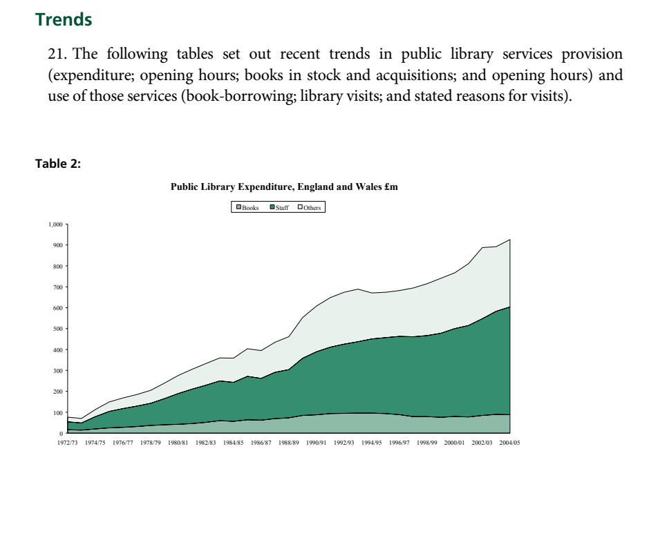
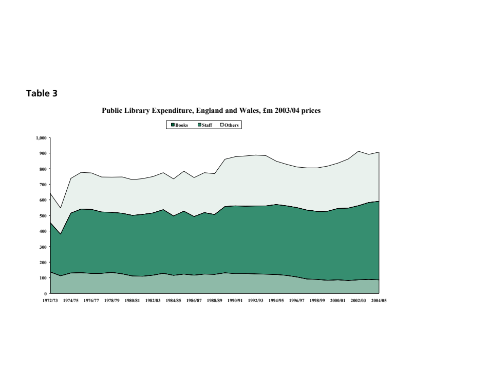
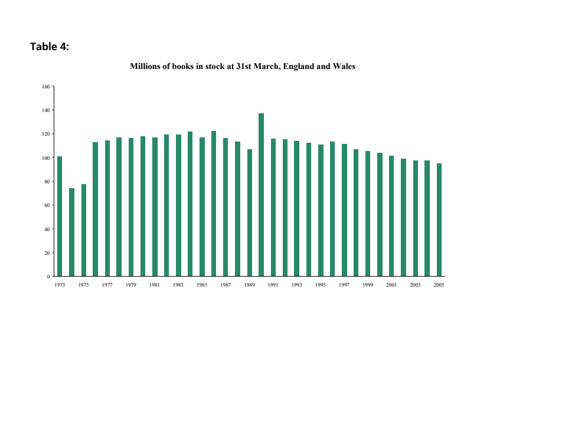
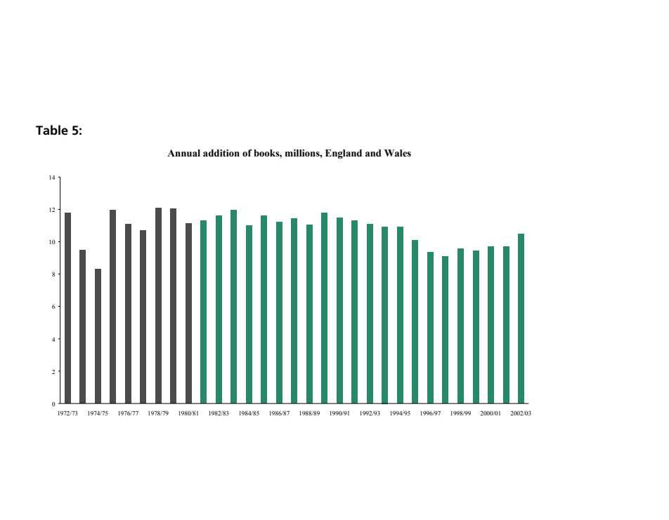
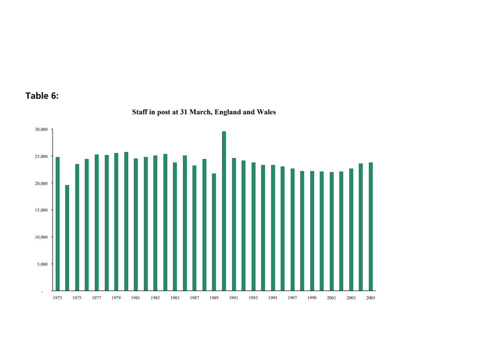
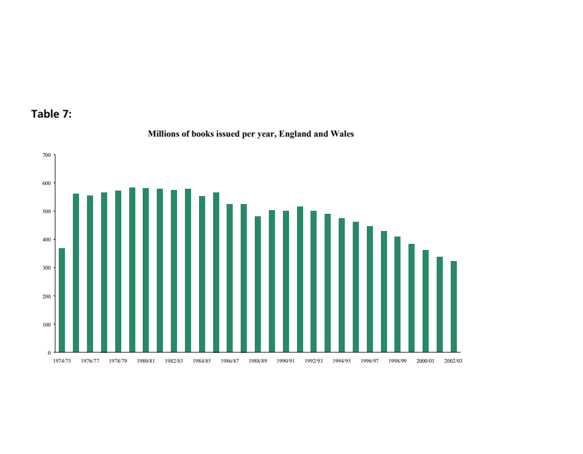
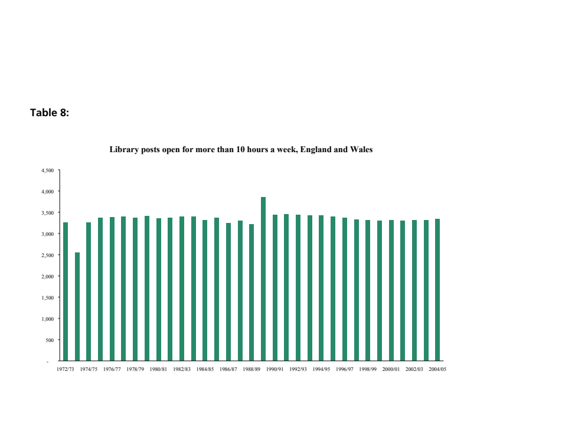

<!-- PAGE: 1 -->
House of Commons  
Culture, Media and Sport Committee  

# Public Libraries

**Third Report of Session 2004–05**  
**Volume I**  
Report, together with formal minutes.  

Ordered by The House of Commons to be printed 24 February 2005.  

**HC 81-I.**

<!-- PAGE: 2 -->

<!-- PAGE: 3 -->
House of Commons  
Culture, Media and Sport Committee  

## Public Libraries

**Third Report of Session 2004–05**  
**Volume I**  
Report, together with formal minutes.  

Ordered by The House of Commons to be printed 24 February 2005.  

**HC 81-I.**  
Published on 10 March 2005 by authority of the House of Commons.  
London: The Stationery Office Limited.

<!-- PAGE: 4 -->
## The Culture, Media and Sport Committee

The Culture, Media and Sport Committee is appointed by the House of Commons to examine the expenditure, administration, and policy of the Department for Culture, Media and Sport and its associated public bodies.

### Current membership

- Sir Gerald Kaufman MP (Labour, *Manchester Gorton*) (*Chairman*)
- Mr Chris Bryant MP (Labour, *Rhondda*)
- Mr Frank Doran MP (Labour, *Aberdeen Central*)
- Michael Fabricant MP (Conservative, *Lichfield*)
- Mr Adrian Flook MP (Conservative, *Taunton*)
- Mr Nick Hawkins MP (Conservative, *Surrey Heath*)
- Alan Keen MP (Labour, *Feltham and Heston*)
- Rosemary McKenna MP (Labour, *Cumbernauld and Kilsyth*)
- Ms Debra Shipley MP (Labour, *Stourbridge*)
- John Thurso MP (Liberal Democrat, *Caithness, Sutherland and Easter Ross*)
- Derek Wyatt MP (Labour, *Sittingbourne and Sheppey*)

### Powers

The Committee is one of the departmental select committees, the powers of which are set out in House of Commons Standing Orders, principally in SO No 152. These are available on the Internet via `www.parliament.uk`.

### Publications

The Reports and evidence of the Committee are published by The Stationery Office by Order of the House. All publications of the Committee (including press notices) are on the Internet at `http://www.parliament.uk/parliamentary_committees/culture__media_and_sport.cfm`.

### Committee staff

The current staff of the Committee are Fergus Reid (Clerk), Ian Cameron (Second Clerk), Grahame Danby (Inquiry Manager), Anita Fuki (Committee Assistant) and Louise Thomas (Secretary), with support from Jonathan Coe (Office Support) and Luke Robinson (Media Officer).

### Contacts

All correspondence should be addressed to the Clerk of the Culture, Media and Sport Committee, House of Commons, 7 Millbank, London SW1P 3JA. The telephone number for general enquiries is 020 7219 6188; fax 020 7219 2031; the Committee’s email address is `cmscom@parliament.uk`.

<!-- PAGE: 5 -->

<!-- PAGE: 6 -->

<!-- PAGE: 7 -->
## Contents

| Section | Page |
|:---|---:|
| Summary | 3 |
| 1 Introduction | 5 |
| 2 Background and context | 6 |
| History | 6 |
| Recent developments | 7 |
| Trends | 10 |
| British Library | 14 |
| Public Lending Right | 14 |
| 3 Role of libraries | 16 |
| Reading initiatives | 21 |
| Libraries’ wider policy goals | 21 |
| 4 Strategic framework | 22 |
| Government departments | 22 |
| Standards of provision | 24 |
| Remedial action | 28 |
| A New Act? | 29 |
| 5 Funding | 30 |
| Value for money | 30 |
| The physical infrastructure | 31 |
| 6 Accessibility | 33 |
| Opening hours | 33 |
| The People’s Network | 34 |
| Access and Accessibility for people with disabilities | 37 |
| 7 Recruitment and staffing | 39 |
| 8 School library services | 40 |
| Devolved and delegated funding | 40 |
| Conclusions and recommendations | 44 |
| Witnesses | 53 |
| List of written evidence | 54 |
| Reports from the Committee since 2001 | 56 |

<!-- PAGE: 8 -->

<!-- PAGE: 9 -->
## Summary

Public libraries are an important national resource with a vital role to play in establishing, nurturing and nourishing people’s love of reading. Libraries also play an important part in life-long and informal learning providing access to books as well as other reading material whether on paper or, via the People’s Network, in digital form. Libraries, together with their staff, are a trusted civic amenity—highly valued, safe public spaces and storehouses of advice, information and knowledge—without which the citizens of Britain would be very much the poorer.

The public library system in Britain costs about £1 billion per year, the vast bulk of which is provided by local authorities who must deliver an efficient and comprehensive service in their areas. The Department for Culture, Media and Sport, acting through the Museums, Libraries and Archives Council—and in partnership with many others—has responsibility for the oversight of the service and the promotion of its quality. After some casting about, the Department has now settled on a system whereby libraries are measured against ten national standards. However, we believe that this list represents rather limited ambitions which, even so, are not being fulfilled. The top ten standards do not refer to extended opening hours, book loans, access or material for people with disabilities, value for money from the service or free access to the internet (all of which we regard as important). In addition, crucially, the standards that are in place are not backed up with effective mechanisms for ensuring continuous improvement or even simple compliance.

Therefore, the snapshot of library services revealed by our evidence is unsurprising. There were pockets of excellence but, overall, there were equal proportions of satisfactory and less than adequate services across the country. The data submitted to us showed that overall spending was up but, within this total, spending on books was down; as were loans of books and overall visitor numbers. We regard a situation in which core performance indicators, and gross throughput, are falling—but overall costs are rising—as a signal of a service in distress. This must be reversed.

Our key recommendations are designed to focus attention on libraries’ fundamental role in promoting reading and we seek to distinguish clearly between core functions and desirable add-ons (prioritising resources in favour of the former). There need to be far stronger links between national library standards (which themselves need improving) and effective mechanisms to encourage and enable library services to meet, if not surpass, them. We also wish to see an action plan for the refurbishment of the nation’s library buildings; one that includes clear indications of where the necessary resources, estimated at somewhere between £240 million and £650 million, will come from.

<!-- PAGE: 10 -->

<!-- PAGE: 11 -->
## 1 Introduction

**1.** The Culture, Media and Sport Committee last held a full-scale inquiry into public libraries in 2000.[^1] The Government’s target for the provision of internet access in public libraries, via “the People’s Network”, was examined in 2004.[^2] In view of the importance of the public library system, and the £1 billion worth of public money involved, we considered it worthwhile to return to the subject now that the Government’s ten year national strategy for the service has had an opportunity to settle in[^3] and the People’s Network has reached every public library in the country.

**2.** In October 2004 we issued a call for evidence outlining our main terms of reference under the following broad headings:

i. accessibility;

ii. funding;

iii. new models of provision and new policy demands;

iv. the legislative, strategic and administrative framework;

v. recruitment and training of library staff;

vi. the role of institutional and specialist libraries; and

vii. the performance and maintenance of the People’s Network.

**3.** As in the previous Committee’s inquiry, we received a large number of written submissions from the principal national organisations, professional representative groups, local authorities, user groups, charities and individuals. The Committee was grateful for all contributions made to it during the course of this inquiry and has published the written memoranda received in Volume II of this Report.

**4.** In November 2004, in response to the Committee’s invitation to submit evidence, the DCMS laid a Report to Parliament on Public Library Matters before the House which set out recent developments and future plans; aiming to give “an overview on how libraries will develop to meet the needs of 21st Century users.”[^4] This text has been included as an appendix to this Report for ease of reference.

**5.** Oral evidence was taken in November and December 2004. The Committee heard initially from a panel of experts: Mr Tim Coates, library consultant and former Managing Director of Waterstone’s book shops; Ms Miranda McKearney, a Director of the Reading Agency; Mr John Holden, Head of Culture at the think tank, Demos; and Ms Heather Wills, Idea Store Programme Director, London Borough of Tower Hamlets. We also <!-- PAGE: 12 --> took evidence from representatives of: the Chartered Institute of Library and Information Professionals (CILIP) (the professional body for librarians, formerly known as the Library Association); the Society of Chief Librarians (SCL); the Audit Commission; the Advisory Council on Libraries (ACL) (the statutory advisory body for Ministers); The Museums, Libraries and Archives Council (MLA) (the relevant non- departmental public body for libraries); the Local Government Association (LGA); Jacqueline Wilson (the nation’s most borrowed author); and three Ministers: Rt Hon Lord McIntosh, Department of Culture, Media and Sport (DCMS); Mr Stephen Twigg MP, Department for Education and Skills (DfES); and Rt Hon Nick Raynsford MP, Office of the Deputy Prime Minister (ODPM).

**6.** In January 2005 the Committee visited two new public libraries, the “Idea Stores”, at Bow and Chrisp Street in the London Borough of Tower Hamlets. We were most grateful for the hospitality extended to us and for all the efforts made by Ms Wills and her team in facilitating a helpful and informative visit.

## 2 Background and context

### History

**7.** The modern public library service has its roots in the Victorian agenda for social reform of the mid-nineteenth century.[^5] One of the respondents to this inquiry, Mr Nick Moore, summarised the development of the service from its humble origins to the present day describing early growth at the beginning of the last century, consolidation between 1920 and 1964 and concluding with a description of performance in the last decade of the twentieth century.[^6]

**8.** Mr Moore described how the passing of the originating statute, the Public Libraries Act 1850, gave legitimacy to a range of facilities designed to support mass education that was already in place: an early manifestation of the role of libraries in social inclusion. The Act placed responsibility for the nascent service firmly at the door of contemporary local authorities (rather than national government). The Act was permissive in that local authorities were allowed to choose to provide library services but there were constraints on the amounts an authority could spend. There remained much reliance on philanthropy and voluntary donations. In this climate, levels of participation by local authorities were low and even where the Act was adopted, mainly in the industrial North and Midlands, the level of service provided was poor by the standards achieved in the mid-1900s.[^7]

**9.** Implementation of the 1850 Act, and improvements in library provision, accelerated between 1900 and 1919 precipitated by substantial grants donated by the philanthropists <!-- PAGE: 13 --> Andrew Carnegie and Passmore Edwards. The resources they committed were used both to improve book stocks in existing libraries and to construct new libraries mainly around London and the South East.[^8] Steady growth continued through the 1920s followed by understandable stagnation of the service in the following decades as financial crises and war interrupted further development. In the 1950s, however, book stocks began to rise and levels of usage of libraries, and the range of services they provided, increased.[^9]

**10.** The Public Libraries and Museums Act 1964 updated the 1850 legislation and placed the public library service provided by local authorities under the “superintendence” of Ministers giving the relevant Secretary of State the power to require information necessary to demonstrate that an authority was fulfilling its statutory obligations.[^10] The Act made new provision for regulating and improving that service and, perhaps most noteworthy of all, set out the duty of every library authority to provide a “comprehensive and efficient library service for all persons desiring to make use thereof”.[^11] In addition to supervision, the relevant Secretary of State was given the duty to “promote the improvement of those services generally”.[^12]

**11.** The 1964 Act gave central Government an overview of local library services for the first time. The legislation allowed for action if library authorities defaulted in their obligations to the public[^13] and the Act stated in general terms what those duties were: “to employ such officers, to provide and maintain such buildings and equipment, and such books and other materials, and to do such other things, as may be requisite.”[^14] The Act also set out that, in fulfilling its duties, a library authority should have regard to keeping adequate stocks of books, other printed matter, pictures, records, films and other materials in sufficient number, range and quality to meet the public’s requirements and the special needs of adults and children.[^15] Library authorities were enjoined to encourage and advise adults and children to maximise the use made of the services.[^16] The 1964 Act still governs the extensive public library network in the twenty-first century.

### Recent developments

**12.** In 1998 the Government moved to establish national standards for libraries and to put some meat on the bones of the statutory duty to provide a “comprehensive and efficient” service. The Government required all library authorities to submit Annual Library Plans to DCMS.[^17] These plans were to incorporate reviews of past performance <!-- PAGE: 14 --> and set out strategies for the coming years.[^18] In 2001 DCMS launched a set of 26 Public Library Standards the aim of which was to create a clear and widely accepted definition of a library authority’s duty to provide a “comprehensive and efficient service.”[^19] In Standards and Assessment, which sets out the standards, they were described as complementing Annual Library Plans. However, towards the end of 2002, the system of Annual Library Plans was discontinued and replaced by Public Library Position Statements. These Statements were comparatively streamlined documents which were said to be aimed at outlining a local authority’s compliance, or “engagement”, with the Government’s new strategy— Framework for the Future .[^20] This strategy was published in February 2003.

**13.** In 2004 the original 26 national standards were dropped and a simplified set of ten— the Public Library Service Standards—were announced.[^21] Public Library Position Statements also turned out to be transitional as DCMS then moved towards a system whereby authorities must report on their performance against the ten national standards as part of an annual return to the Chartered Institute of Public Finance and Accountancy (CIPFA) who are sub-contracted to collate the results.[^22]

**14.** The table below (Table 1) summarises the development of the library service and focuses particularly on those changes introduced in the last seven years.

#### Table 1: Recent policy milestones

| Year | Policy / Standard | Description / Purpose |
|:---|:---|:---|
| 1998 | Annual Library Plans | Introduced to review past performance and set future strategies |
| 2001 | Public Library Standards (26) | Created clear and widely accepted definition of comprehensive and efficient |
| 2002 | Public Library Position Statements | Discontinued Annual Library Plans for all except poorly rated |
| 2003 | Framework for the Future | Ten-year national strategy |
| 2004 | Public Library Service Standards (10) | Replacing Public Library Position Statements and original 26 Standards |

<!-- PAGE: 15 -->
**15.** On the release of the top ten standards Lord McIntosh, Parliamentary–Under Secretary of State at the DCMS, stated: “The new standards are fewer in number, but no less stretching. They mean library users will now know what they have a right to expect, and how well their own service is performing compared to others.”[^23] We note, however, that the new standards document, Public Library Service Standards , says that authorities should continue to collect and monitor their performance against the original 26 standards (now dropped or amended); if they thought it “worthwhile”.[^24]

**16.** Some witnesses, for example Mr Coates,[^25] suggested the Government’s various initiatives had been weak and failed to clarify who was responsible for the performance of the library service. He said that: the DCMS had failed to make Annual Library Plans function as they should have done; the first set of national standards was produced without associated training or guidance; the second set was published without analysis of why the first set failed; and that Framework for the Future was a policy statement without an accompanying management strategy for meeting the needs of the public which, in any case, have never been subject to professional assessment.[^26]

**17.** Some of these criticisms were echoed by the DCMS’s own ministerial advisory panel which reported that: “At a time when libraries are doing an increasing amount to contribute to the shared priorities of central and local government, it is a matter of concern that the regulatory framework that underpins DCMS’s and library authorities’ linked statutory obligations has been watered down with the demise of, first, Annual Library Plans and, now, Position Statements.” The ACL said that the current set of 10 standards—which it had played a major part in devising—were “hoped” to guarantee “at least a minimum level of service for users across the 149 English library authorities.”[^27]

**18.** In contrast, the 2004 DCMS report set out a picture of more orderly progress. The Department said that the Annual Library Plans (ALPs) were introduced in 1998 against “the backdrop of the decline of some of England’s public library services” to encourage “better planning”. The DCMS stated that ALPs, having improved markedly over four years, were discontinued in 2002 having achieved their aim. The wisdom of abandoning an improving product seems to us to be open to question. The much more “streamlined” Position Statements were said to be aimed at eliciting the engagement of local authorities with the Framework for the Future agenda. DCMS reported that in September 2004, when the Statements were discontinued, 6% of authorities had achieved an “excellent” assessment in relation to the new strategy, and a further 81% had been assessed as “good”.

**19.** However, the degree of engagement with a new agenda is, of course, not in itself a measure of the quality of services. In 2002—the very year that DCMS dropped the <!-- PAGE: 16 --> detailed Annual Library Plans, reporting “job done”—returns against the original set of library standards, together with a major report from the Audit Commission, “confirmed what the Department had long suspected” in indicating that half of all library services were unsatisfactory.[^28] In evidence to us, the Audit Commission asserted that, in its opinion, this 50/50 split remained the position.[^29]

**20.** We commend the Government for attempting to establish a national strategy for the provision of library services, and national standards for the quality and performance of those services, in accordance with its statutory responsibilities. We were, however, dismayed by the chopping and changing that has taken place in the process of trying to settle on a set of workable arrangements. We suspect that the overall policy of granting “freedoms and flexibilities” to local authorities may have been applied too liberally by DCMS in this area to the detriment of improvements in library services; not least the 50% of such services that remain persistently below standard.

### Trends

**21.** The following tables set out recent trends in public library services provision (expenditure; opening hours; books in stock and acquisitions; and opening hours) and use of those services (book-borrowing; library visits; and stated reasons for visits).

#### Table 2: Public Library Expenditure, England and Wales £m

<!-- PAGE: 17 -->
#### Table 3: Public Library Expenditure, England and Wales, £m 2003/04 prices

#### Table 4: Millions of books in stock at 31st March, England and Wales

<!-- PAGE: 18 -->
#### Table 5: Annual addition of books, millions, England and Wales

#### Table 6: Staff in post at 31 March, England and Wales

<!-- PAGE: 19 -->
#### Table 7: Millions of books issued per year, England and Wales

#### Table 8: Library posts open for more than 10 hours a week, England and Wales

<!-- PAGE: 20 -->
**22.** We regard the overall picture to be one of decline—both in provision and usage— especially in the provision of books which many see as a library’s key function. It is difficult to argue that the library service is simply responding to reduced demand from the community when: overall expenditure is rising in real terms; demand for books and information from other sources is also rising; and evidence shows that library improvement and/or refurbishment schemes can boost visits and, in particular, book issues by a significant degree. We believe that a situation in which core performance indicators, and gross throughput, are falling—but overall costs are rising—signals a service in distress.

### British Library

**23.** The British Library has a close working relationship with local libraries nationwide.[^30] All public library authorities are registered users of the British Library’s remote document supply service which accounts for 45% of total inter-library lending in the UK.[^31] The British Library’s website, which includes selected British Library material, can now be accessed via the People’s Network located in public libraries. The British Library has been sharing its expertise with national library organisations on a range of subject areas such as the positioning and marketing of libraries and exchanging information on working with the business community.[^32]

**24.** We commend the British Library in its efforts to support and advise the public library sector and recommend that such links be developed further in the future with achievable targets being set to enable progress to be monitored and assessed.

### Public Lending Right

**25.** The Public Lending Right Act 1979 confers on authors, and other contributors such as an illustrator, a right to receive payment from central Government for the free lending of their books by public libraries.[^33] The Public Lending Right Scheme (PLR) established in 1982, gives effect to that right. Eligible authors currently number well over 30,000. The amount paid to each author under the PLRS depends on how often their books were taken out but is subject to an annual ceiling (£6,000) and floor (£5). The Registrar of the Scheme makes an assessment on the basis of loans data from a large and rotating sample of some 400 library branches across the country.[^34]

**26.** The PLRS is obviously a pot to be shared by participants rather than being demand- led; for example the “rate per loan” determined in February 2002 was 2.67 pence. Total funding for the Scheme has been increased to £7.4 million for 2004-05.[^35] Overall, £77 <!-- PAGE: 21 --> million has been distributed to eligible authors since the Scheme started.[^36] The importance of the Scheme should not be underestimated and Jacqueline Wilson told us that PLRS payments were a crucial element of income for less well-established authors.[^37]

#### Table 9: PLRS resources (1982 vs 2004)

| Metric | 1982 | 2004 |
|:---|:---|:---|
| Total eligible authors | 7,562 | 32,000 |
| Total funding (£m) | 2.0 | 7.4 |
| Funding per eligible author | £264 | £231 |

#### Table 10: PLRS accounts 2002–2003

| Payment bands (£) | Authors earning | Total |
|:---|:---|:---|
| 5–49 | 10,140 | |
| 50–499 | 6,609 | |
| 500–2,499 | 1,653 | |
| 2,500–5,999 | 415 | |
| 6,000 (maximum) | 245 | |
| **Total** | **19,062** | **£6,194,517** |

*Source: National Audit Office: HC 1139 of 2001–2002.*

**27.** We support the continuation and development of the Public Lending Right Scheme as a mechanism for encouraging and sustaining writing talent. Furthermore, the PLRS contributes to the development and maintenance of important links between writers and libraries and, through libraries, to readers.

<!-- PAGE: 22 -->
## 3 Role of libraries

**28.** There has been a long-standing debate over what public libraries are for; and this has been complicated recently by a growth in the perceived importance of information technology and the provision of access to it, including the internet, for the public. From the evidence we have received it is clear that many libraries are no longer simply about lending books and providing a neutral and quiet space for reading and research. Libraries now serve their communities in a number of ways that vary from authority to authority, area to area. Libraries serve variously as: centres of learning for both children and adults; centres of advice on council services (and in some cases their actual provision); sources of support for small businesses; venues for community meetings—including MPs’ surgeries—and the location of a range of other services not traditionally seen as part of a library’s core remit.[^38]

**29.** Some argue that libraries are recognised as safe public spaces and are the right places to locate other information-based community services. For example, the LGA said that: “there must be wider recognition of the role they [libraries] have in supporting education and learning for all ages, tackling social exclusion, supporting communities and bringing communities together.”[^39] Mr John Holden, from Demos, said that the definition of what libraries ought to do should not be handed down from government or experts but should come “more from what the public values about libraries”.[^40]

**30.** Ms Miranda McKearney, from the Reading Agency, argued persuasively that libraries’ role should be about reading, as an activity, rather than a focus on books themselves as physical objects for lending. She said “To me their role in encouraging reading is about…active intervention at key life stages in a way that connects to policy and helps build the kind of society that we want”.[^41] Ms Wills, from the Idea Store programme in Tower Hamlets, agreed saying “at the top of my list [would be] a contribution to ‘life-long learning’ in its widest sense”[^42] from support for the under-fives to adult evening classes. Ms McKearney concluded that libraries should be “championing reading and addressing some of our fundamental social problems, literacy not least amongst them…injecting critical informal learning into the system [of formal education]”.[^43]

**31.** Mr Coates wrote that: “There has been a fundamental error of approach over the past 20 years wherein the assumption has been made that in order to increase their appeal and use, libraries should diversify. The effect of this has been to reduce the quality of reading material and information on offer and consequently the reputation of the service to the <!-- PAGE: 23 --> public, particularly to new generations of readers…The policy of diversification has been a catastrophe for libraries in this country.”[^44] Mr Bill Macnaught, Chairman of the Government’s Advisory Council on Libraries identified “literature and information” as the core library products but the way that information was delivered had been the subject of a quiet revolution.[^45]

**32.** We recall the Secretary of State’s evidence in 2003 that “the best libraries are undoubtedly the libraries that, when you walk into them, you do not know whether you are walking into a job centre, an Internet café, a juice bar or a library.”[^46] This was likely to have been, at least in part, a reference to the Idea Stores in Tower Hamlets which have precipitated something of a renaissance in Bow. Ms Wills told us that, despite all the improvements in environs, book stocks, facilities and opening hours, if the building still had “library” on the door, “we probably would not have achieved the significant results that we have.”[^47] We recognise and support the importance of listening to the results of consultation with service users—and we were extremely impressed by all the Idea Stores had to offer (inside and out)—but we regret that the word “library” seems to have accreted such negative overtones. We would far prefer to see the re-invigoration of what libraries mean to the public (by improvement of the services) than the re- branding of institutions.

**33.** The Reading Agency, in their written evidence, summarised a sentiment held by many: “During the last 20 years libraries have spread themselves very thinly, feeling they must be all things to all people.”[^48] It was proposed by one witness that, for libraries, “improvement” should mean “better ranges and collections; modern access to information; more agreeable buildings; more up-to-date customer service and longer opening hours.”[^49] Our predecessor Committee’s Report on public libraries also debated libraries’ role and, in particular, the competition between spending on new technology and on traditional book stocks. The former Committee concluded that: “the challenge for the library sector is to ensure that the development of information technology in libraries broadens library services and does not take place at the expense of books.”[^50]

**34.** The Government has sought to define what should be at the core of libraries’ modern mission in its “ Framework for the Future ” national strategy: “the promotion of reading and informal learning; access to digital skills and services including e-government; measures to tackle social exclusion, the building of community identity and the development of citizenship.”[^51] However, we welcome the statement by Lord McIntosh, <!-- PAGE: 24 --> Minister for Media and Heritage, that the core purpose of libraries, “which is books”, should not be neglected.[^52]

**35.** We believe that there are, in practice, two key debates which are only confused by conflation. The first is over the core function of public libraries and embraces, but goes beyond, the ‘books versus IT’ question. We are in no doubt that, while libraries are about more than books (and newspapers and journals), these traditional materials must be the bedrock upon which the library services rest no matter how the institution is refreshed or re-branded in the light of local consultation. The explosion of relevant new technologies has to be embraced by institutions but this should be done in the context of their key functions to gather, order, present and disseminate, challenging, as well as relevant, material and information for their local communities. As Catherine Blanshard, President of SCL said: “The issue is around the role of libraries at giving us…knowledge. Books are only one medium…no library service buys the Encyclopaedia Britannica any more because they only publish it electronically.”[^53] In this light, public libraries do appear to be the right home for the People’s Network as a resource allowing access to, literally, a new world of information stored nevertheless in written form.

**36.** The second, and quite distinct, debate is over the potential for the location of related or analogous services for the local community within public library sites. We recognise that libraries are viewed as safe public environments and as such have the potential to act as a suitable home for services meeting a wide range of community needs and wishes. However, it is equally clear to us that libraries must not be over-loaded with objectives or expectations that strain their resources or inhibit the fulfilment of their core functions as outlined above. Libraries and their staff cannot be expected to constitute a one-stop shop for all a community’s demands for information and advice without the appropriate allocation, and clear demarcation, of resources.

**37.** We appreciate that a library serving a rural community in Taunton cannot be a carbon copy of a library serving a disadvantaged inner city community in Tower Hamlets nor that either should be like a branch located in the City of London without a significant residential population. We also accept that a public library should reflect its community and that library authorities must determine the needs and demands of their local population in deciding what services it needs to prioritise for delivery.

**38.** All libraries, however, whatever their location, should be set core minimum standards of provision focused on a core purpose to provide access to the written word, including high quality and relevant books—both modern titles as well as the classics, and otherwise, of the past—newspapers and journals and the internet, all in a welcoming and safe environment at the hours that their users want. Once these fundamentals are in place, a library may then build on the range of services it offers or the range of services that the local authority, after consultation and with <!-- PAGE: 25 --> appropriate funding, seeks to co-locate on the site. However, within this plethora of services, the notion of simply reading for pleasure must be fundamental.

**39.** When over half of public libraries are rated as below an acceptable standard by the Audit Commission,[^54] it is our view that the foundations must first be sound before libraries diversify into other areas. Libraries can, and should, do more but must not lose sight of their raison d’etre and the first priority for resources.

**40.** Book issues are falling but book sales are up[^55] and you only have to make a journey on public transport to see evidence of people’s appetite for books. Book issues are not down because people are not reading. Ms Margaret Haines, President of CILIP said: “there is a tremendous resurgence of interest in reading and books and literature at all ages, but particularly with children. I do not think we are seeing a decline in reading.”[^56] Consumer book sales rose by around one-quarter in real terms between 1990 and 2000; and went from £2,045 million in 2000 to £2,400 million in 2003.[^57]

**41.** The author, Jacqueline Wilson, encapsulated the approach libraries should take when she said in evidence: “I think it is a very rich time for literature; but I do certainly feel for many families book-buying is not a top priority. I cannot understand why libraries cannot capitalise on this. I know advertising is very expensive but outside a public library…you could have: “The Diamond Girls” by Jacqueline Wilson: £10.99 in Waterstone’s; £8.99 in Ottaker’s; £6.40 on Amazon; £5.99 at Sussex Stationers; and nothing at all in our library.”[^58] We believe the balance between book loans and book sales is in large measure due to the reduced price of books from different sources on the one hand and poor book stocks in many libraries on the other. We welcome the fact that books have, at least, a place in the nation’s shopping basket. Public libraries must seek to capitalise on the public’s obvious appetite for reading.

**42.** It does appear that the public would respond to improvements in this area. In its evidence the Museums, Libraries and Archives Council (MLA) drew our attention to non-user surveys such as those undertaken by MORI which consistently identify issues such as stock quality and stock choice as reasons for not using libraries.[^59] UNISON pointed to many examples raised by their members of an imbalance between spending on books and on technology in spite of public demand for more and new books: “One branch stated that it was ‘time for more resources to go back into books. I think they’ve got a bit left behind in recent years, as priorities have focused elsewhere. New books fly out – we just haven’t enough. Surveys of customers always reveal that more new books are a major factor in what our customers want us to do better.’ ”[^60] We also note with <!-- PAGE: 26 --> interest that, where library authorities have turned around the overall quality of the service, the number of book issues has increased substantially.[^61]

**43.** As Mr Moore indicated, despite a significant overall increase in expenditure on libraries, the impact on book expenditure has not been so marked. Current levels of expenditure on books are still only about three-quarters their equivalents in 1990-1991.[^62] It cannot be a coincidence that book issues have fallen just as libraries are spending less on their book stocks. Public Library Service Standard number 9—which proposes an additional 216 “books and other items” per 1,000 population be purchased annually—is a step in the right direction but it does not seem enough. We believe that the improvement of the quality, range and number of books in stock in our public libraries should be made a priority. The current average spend on books of 9% of total funding is very low; especially in comparison with the 1980s when 17% to 18% was the norm.[^63]

**44.** A substantial increase in the percentage of funding spent by each library authority on books should be a priority. The precise level, or formula for setting that level, must take into account variations between libraries, their current stocks and the demands of the communities they serve. However, we recommend that each library authority reviews its investment in books against a new Public Library Service Standard seeking improvement in the desired outcome: book issues per head of population and, perhaps separately, book issues per child. This would allow authorities to consider a variety of other methods, in addition to spending, to increase lending. For example libraries could: improve the ways they showcase book collections to the public: organise them more attractively and in better locations; establish book clubs; produce “recommended” lists; provide proactive advice and reminders (perhaps via e-mail) for library members on genres, authors and titles; and provide effective and creative ways to make the best possible use of the existing stock (by linking older titles with new books; with recent events and current affairs, newly released films or popular TV and radio shows).

**45.** We were concerned by Jacqueline Wilson’s observation that: “in various libraries…if the book-buying has to be cut it is often the children’s books that are frozen and this does seem a shame.”[^64] If the situation is as Ms Wilson described, then it is unacceptable. We view the addition of a new, more book-orientated, Public Library Service Standard to be the only practical way to encourage books back to the top of the library agenda and to reduce threats of cuts. We recognise that highly illustrated children’s books are likely to be relatively expensive but for these titles to be the first to be threatened by budget cuts seems to fly in the face of initiatives, discussed below, aimed at improving young people’s literacy and familiarity with books. Any new national library service standard aimed at book issues should have a separate and specific element aimed at promoting children’s <!-- PAGE: 27 --> reading. The issues surrounding the expense of children’s books can also be dealt with by capitalising on libraries’ potential to join together in consortia, thereby increasing their purchasing power – a topic we deal with, in more detail, later in this Report.

### Reading initiatives

**46.** There was consensus around evidence showing that the earlier children learn to read, the better they do in school later in life.[^65] We congratulate the Book Trust for the establishment and development of the Bookstart programme which gives free books to infants at their health checks and offers the opportunity for them and their carers to join a library.[^66] Similarly we congratulate libraries for the role that they have played in making a success of this scheme.

**47.** We commend the Government’s recent decision to fund Bookstart and we note that it is the Government’s intention to extend this programme to provide further free books to children at eighteen months old and two years of age.[^67] Of course, once ignited, any enthusiasm for books and reading on the part of carers and their charges must be tended effectively by access to a wide choice of suitable material, as well as attractive environs, at local libraries.

**48.** For older children, the Committee recognises the important work carried out by the Reading Agency in partnership with public libraries, in encouraging a desire for reading across the country. The Big Read of 2003 and the annual national Summer Reading Challenge are two excellent examples of how libraries can use their unique position to foster a love of reading in imaginative ways that link in with other projects, institutions and organisations with similar objectives.[^68] We urge DCMS to foster the cooperation between public libraries and the Reading Agency, together with primary schools in particular, to work together to plan and introduce more initiatives to nurture a love of reading across the country.

### Libraries’ wider policy goals

**49.** Having emphasised the importance of books and reading, we recognise that libraries can offer more to the communities which they serve. Public libraries have always been part of tackling social exclusion (whatever this objective has been called over time) and we would encourage a continuing focus on those areas where libraries have a unique contribution to make to this end.[^69]

<!-- PAGE: 28 -->
**50.** We believe that there are a number of facets of tackling social exclusion which should justifiably be within a library’s operational sphere, depending on their local circumstances. These are: improving literacy levels of pre-school children and post- school adults; providing the public with new skills such as CV writing and basic computer literacy; offering information on education and skills training; organising homework clubs; seriously addressing opening hours by, for example, opening in the evenings and on Sundays; assisting people whose first language is not English by the provision of material in their mother tongue and by organising English reading classes on the premises.

## 4 Strategic framework

### Government departments

**51.** Three government departments have key responsibilities for services provided by public libraries. Statutory responsibility rests with the Secretary of State for Culture, Media and Sport whose duty it is to oversee the discharge by local authorities of their functions in relation to libraries;[^70] ODPM provides the majority of resources for libraries through its funding of local authorities; and DfES works with libraries in so far as they provide educational services and coordinate activities with schools.

**52.** At the sub-departmental level there is the Museums, Libraries and Archives Council (MLA) and the Advisory Council for Libraries (ACL). MLA is the non-departmental public body working as a development agency for and on behalf of museums, libraries and archives, whose role includes the distribution of some funding and advising the Government on policy and priorities for the sector. MLA states that its aims are to: “provide strategic leadership, to act as a powerful advocate, to develop capacity and to promote innovation and change.”[^71] ACL describes itself as “an expert group on public libraries” which provides advice to the Secretary of State and MLA on all public library matters.[^72]

**53.** Some submissions argued that the division of responsibilities between government departments inhibits the development of public libraries. The library sector seems confused as to the division of responsibilities between each department, the MLA and ACL in relation to libraries and consequently as to where it should focus its lobbying and persuasion.[^73] Some of our witnesses argued for policy responsibility for libraries within central Government to be handed over to ODPM from DCMS, thus connecting the strategic leadership with the bulk of the resources. The Society of Chief Librarians (SCL) for example complained that: “It [the Government] has hidden away its support [of libraries] in the bowels of the Department of Culture, Media and Sport and it often feels <!-- PAGE: 29 --> as if they [libraries] have dropped off the Government’s radar. The influence they can bring to bear on both larger government departments and the ODPM appears to be ineffectual and poorly supported.”[^74] The SCL urged the Government to: “realign libraries within government to ODPM where they would be at the heart of Local Government reflecting our role in democracy.”[^75] Bedfordshire County Council, for example, argued that: “Public libraries really need solid representation within the ODPM. Only in this way will local councils be encouraged to properly fund this important local service.”[^76]

**54.** Other witnesses supported the status quo provided that libraries were given sufficient priority whichever department has control and that all government departments work together to produce a co-ordinated approach. For example, Mr Bob McKee of CILIP said: “The reason I do not want to be drawn on which department [should have responsibility] is because to me the essence of public library service is where those three sets of life activities—cultural life, learning life and community life—intersect. I do not want to divide them, I do not want to have a turf war between departments, I want them to work together.”[^77] Nonetheless, CILIP in written evidence did complain of the current position: “There is a perception within the library community that at present DCMS carries insufficient weight and authority within Government.”[^78]

**55.** We understand the concerns of those who feel the library sector is not getting its voice heard across Government. However, we question a solution which would place libraries within a much larger government department with the potential for libraries to rank as an even lower priority, amongst its other concerns, than within DCMS. Clearly, the same problem would apply were libraries policy to move to the DfES (compounded by the same dislocation from core funding suffered within DCMS).

**56.** We believe that the debate about which government department has responsibility for the performance of the service as set out in the 1964 Act is largely irrelevant. The key interface is between central government and local authorities. The only benefit of uniting resources and strategic responsibility for policy would be if the funding for the library service was to be in some way ring-fenced and allocations to individual authorities influenced by performance. Such an approach would be very much against the tide of Government policy. The Secretary of State for Culture, Media and Sport, told us in 2003: “I simply do not have the levers to compel local authorities to…observe [library standards]. This is arguably an area where one thrust of policy in relation to local authorities—to free them up from a lot of red tape and the targets and the centrally determined obligations that have been the source of controversy—swims against the policy of my department exercising leverage in relation to libraries.”[^79]

<!-- PAGE: 30 -->
**57.** We note that the Department’s 2004 report on public libraries refers to a power, under the 1964 Act, for the DCMS, on behalf of the Secretary of State, “to intervene in an authority where it has concerns that an authority is in breach of the Act.” The example of unwarranted and disproportionate budget cuts was given as potential grounds for concern but there was no indication of what form such an intervention might take nor whether this power had ever been used. If local authorities are the correct level of government to manage the country’s library services—and we received no evidence to the contrary—then the DCMS is probably best qualified to hold overall policy responsibility and the logical source of strategy, advocacy and targeted resources with which to seek improvements.

**58.** We note the evidence of Ms Lyn Brown, of the Local Government Association and Newham LBC, who pointed to the range of objectives of other departments to which library services contributed and suggested that top of her wish-list would be to “persuade the other departments outside the DCMS of the value of libraries to the outcomes they want”.[^80] She mentioned the Department of Work and Pensions and what libraries do about getting people into employment and helping small businesses; the Home Office and how libraries contribute to tackling anti-social behaviour and truancy; and the DfES and the value libraries add to education programmes and learning for all sections of the community. While we see no case for moving responsibility for libraries to a different department, it is vital that the DCMS raises its game and acts far more effectively as a champion and advocate for libraries across Government. In the absence of levers with which directly to achieve improvements against the statutory criteria for a satisfactory service, the DCMS must establish other means to secure improvements which we discuss below.

### Standards of provision

Library standards

**59.** As we have noted, there is a consensus over the patchy quality of library services around the country with about half being sub-standard to some degree.[^81] It is important that all library services seek to improve their performance towards the standards set by the best. There is of course some tension between local authorities’ responsibility for developing the library service to meet the requirements of their communities and the statutory role of central Government. The setting of common Public Library Service Standards tries to bridge this dichotomy.

**60.** The current top ten Public Library Service Standards with which library authorities must aim to comply relate to:

i. the proportion of households living within a specified distance of a static library;

ii. aggregate scheduled opening hours; <!-- PAGE: 31 --> iii. the percentage of static libraries providing access to electronic information resources connected to the internet;

iv. the number of electronic workstations with access to the internet and the libraries catalogue;

v. dealing with requests;

vi. number of library visits;

vii. adults’ satisfaction rates;

viii. children’s satisfaction rates;

ix. number of books and other items acquired annually; and

x. time taken to replenish the lending stock.[^82] A Best Value Performance Indicator around compliance with these standards is being piloted currently.

**61.** Standards which were omitted from this streamlined set, but incorporated in those published in 2001, referred to: book issue periods; the number of books permitted to be borrowed at any one time; the number of visits to library websites; levels of success in finding a specific book or gaining information; and other types of satisfaction rates.83

**62.** Evidence to the Committee called for a range of revisions and changes to the new standards. CILIP and the Audit Commission for example have requested additional standards which cover free access to the internet (a subject we deal with later in this Report), social inclusion factors, higher standards for children’s satisfaction rates, as well as some for the elderly, and standards covering skills and competencies required of staff.[^84] The DCMS’s evidence suggested that the ten standards were ‘work in progress’ which would continue to be developed and revised over time, especially “as the quality of data is improved”. DCMS indicated that an important factor in setting the standards was the avoidance of additional burdens on local authorities.[^85]

**63.** We have sympathy with those of our witnesses who wished to see the standards strengthened and the list extended. We deal with specific changes as they arise in our discussion of the issues throughout this Report but in summary we believe that the list of standards should be extended and/or revised to include measures of: the number of adult and children’s book loans; the provision of material for users with disabilities; extended opening times; value for money and the three Es (efficiency, effectiveness and economy – including the balance of management and frontline staff); free access to the internet; and the quality of user consultation (and subsequent action).

<!-- PAGE: 32 -->
### Library impact measures

**64.** A second strand of work is the development of library “impact measures”.[^86] Although these measures are not yet promulgated, they do not appear to have been conceived as tools for the assessment or management of library service outcomes. DCMS wrote that: “These [impact measures] are intended to further raise the profile of library services by highlighting the contribution that they make to corporate and national agendas in the context of shared priorities of local and central government.” The Department added: “Relevance to local needs will be ensured by the linking of measures drawn up by authorities to a community profile.”[^87] We have no idea what this means. We hope, and expect, that the library impact measures, being drawn up by the government and the library sector together, will eventually enable the DCMS and local library authorities to assess the outcomes of library service provision in a specific community, with a view to the improvement of those services and those outcomes.

**65.** However, it hardly seems to matter what is on the list of standards or impact measures if they are not taken seriously by local authorities. Mr Coates asserted that: “the first set of DCMS standards has had little impact…councils came to regard them as not obligatory.”[^88] There seems to be no evidence of any of the plans, position statements, nor standards resulting in remedial intervention by the Government, as envisaged in the 1964 Act, despite “confirmation” of suspicions within the DCMS that half the country’s public libraries were below par.

**66.** Annual Library Plans and their successors, the Public Library Position Statements, and now the returns required under the latest Public Library Standards regime, were in practice forwarded to CIPFA and copied to DCMS. CIPFA is contracted to compile scores from the returns which are subsequently fed into a local authority’s Comprehensive Performance Assessment (CPA) undertaken by the Audit Commission. However, we understand that the weighting attributed to these scores has not been significant. DCMS on the other hand appears not to react to them at all.

**67.** The right standards, properly reported to Government and triggering remedial action in the event of poor performance are all crucial elements in helping to improve the quality of the service. We recommend that the DCMS reviews its system with this in mind. Comprehensive Performance Assessment (CPA)

**68.** The other available measuring device relies on the Comprehensive Performance Assessment, referred to above, conducted by the Audit Commission and applying to local authority services as a whole. This tool is potentially effective as the Audit Commission is local government’s own public spending watchdog. The Audit Commission itself, however, was careful not to overstate its importance: “I think we <!-- PAGE: 33 --> probably are afforded too much influence over the Library Service. There is often an expectation, for instance, that CPA as a tool of the Audit Commission will in some way contribute to the improvement of the Library Service. The CPA is a very important tool to enable local citizens to know about the state of their services but ultimately it is about weighing the pig, rather than feeding the pig.”[^89]

**69.** Despite the Audit Commission’s reservations, CPA does appear to have an effect in raising standards; indeed otherwise there would be little point in conducting the work. A local authority which receives an “excellent” rating in its CPA is given more “freedoms and flexibilities” to carry on its administration released from certain administrative burdens by central Government. The consequence of an overall poor CPA assessment can result in ODPM intervention. In addition, a poor rating in the “libraries and leisure” block of services would automatically prevent a council from being assessed as “excellent” overall.

**70.** Therefore, CPA clearly does exert influence on where political and administrative attention is focused amongst local services. In addition, CILIP believed that: “Local decisions on the allocation of resources are shaped by the pressure to improve the Local Authority’s CPA score.”[^90] The submission from, for example, the London Borough of Haringey confirms that the system has this effect: “The Audit Commission’s judgement marked a turning point for the council, triggering it to look at a radical new way of running this vital service.”[^91]

**71.** We believe that Comprehensive Performance Assessments (CPA) have an important role to play in bridging the central/local divide with respect to library policy. CPA has the potential to connect performance against national library standards to local government decision-making over priorities; supplying something of a “stick” to augment the potential “carrots” available from the centre via the DCMS and MLA which we discuss below. The vital elements are: how the assessment of performance against the national standards feeds in to a CPA score; what other performance indicators for library services, if any, are used by the Commission; and what combined influence this has in the final result. We are aware that the Audit Commission, in concert with local government and the DCMS, is working on new proposals for the CPA scoring system.[^92]

**72.** In evidence the Audit Commission admitted that performance information is weak at present and that there should be a move towards obtaining more useful data and more appropriate performance measures.[^93] The CPA 2005 proposals were still out for consultation while this Report was being prepared but we expect the Government’s response to this Report to set out the conclusions in some detail. Expectations are that <!-- PAGE: 34 --> the new measures will deal more prominently with indicators of performance in libraries as an important local service and we would welcome that.

**73.** Without seeking to pre-empt the outcome of consultation we would expect DCMS to work with ODPM and the Audit Commission to ensure that the weighting and threshold arrangements within, and across, the various “blocks” of services within the CPA take full account of the importance of library services and the statutory obligation for them to be efficient and comprehensive. We strongly recommend that the meeting of national library standards by a local authority be made a key factor in the eventual overall CPA score to establish a mutually reinforcing mechanism to link national and local responsibilities in this area which has so long been the subject of “frustration” for the Secretary of State amongst others.

### Remedial action

**74.** It is necessary for poor performance to be tackled when it is identified. Incentives are necessary, and this has been discussed above. Our evidence pointed to the need for carrots as well as sticks and the allocation of resources by DCMS to an effective system for the assistance and encouragement of those library authorities which are assessed as performing poorly or below their realisable potential. One of the major conclusions of the work around the Government’s Framework for the Future strategy was that “the fragmented nature of the libraries sector—149 library services each being delivered by a different local authority—made it difficult for key messages from the national level to filter down to local services and for examples of good practice to be spread across authorities.”[^94]

**75.** DCMS’s response to the inquiry set out what it was doing in this area:

i. in 2003 the MLA was commissioned by DCMS to develop an Action Plan to achieve the Framework etc. objectives with £1 million per year for implementation over three years; and

ii. in 2004 DCMS announced a supplementary libraries improvement plan with a further £1 million per year over two years including a Peer Review programme to spread best practice, which, as MLA stated, represented a radically new approach to improvement for public libraries.[^95]

**76.** Lord McIntosh acknowledged that that there were places where the library services had fallen behind, and said that the improvement programme was designed “specifically to go into those library authorities most in need of help to provide them with peer review assistance from librarians in very good authorities and to provide back up assistance from people outside in such areas as marketing, design, research, book procurement and so on”.[^96]

<!-- PAGE: 35 -->
**77.** This initiative is not unlike the prescription written by Mr Coates which was also based around peer intervention of a roving kind. He recommended to us that:

i. a small project team be created under the leadership of the responsible Minister and Audit Commission with its own staff and resources for “pump priming” reforms;

ii. this project team should be responsible for remedial action within the public library service, with the aim of helping local authorities to restore it, within three years, to a pattern of increased usage, increased lending of books, increased value for money and improved reputation; and

iii. this team would use the powers of intervention in local government available to the Government and take appropriate action, including recommending an effective political and management structure for the national library service to be adopted when remedial work is concluded.[^97]

**78.** We believe that the MLA, the Government’s Peer Review programme and the Library Improvement programme contain the seeds of an effective programme for change and should be considered for significant coordination and expansion. A team, under the auspices of the MLA, should spend time with those working in under- performing libraries understanding their particular problems, reaching a diagnosis and prescribing the solution suitable for local circumstances; including additional resources if necessary. These library services should then be revisited regularly to monitor developments and discuss difficulties; alternatively their returns against the national standards could be flagged for a period for special attention. The MLA should be used as a central database for good practice and as an ongoing contact point for those failing to reach the minimum requirements. Any roving team must be established in such a way that staff at all levels of any service in difficulties would see the team as fellow professionals providing advice, assistance and access to targeted resources, and not as an instrument of central control. We believe this, funded by DCMS, could be the most cost- effective and expeditious way of revolutionising the service.

### A New Act?

**79.** There is an attractive argument that a new Act should be introduced to update the provisions of the 1964 legislation in order to create the right foundations for twenty-first century library services along the lines set out in Framework for the Future and recommended in this Report. The role a library plays in its community in 2005, the services it provides, and the range of media it must embrace are not comparable with circumstances existing in 1964. In addition there is need for more clarity as to what constitutes a “comprehensive and efficient” service and what action will be taken when this criterion is not met.

**80.** As the Society of Chief Librarians (SCL) maintained: “Public Library Authorities are legally bound to provide a public library service that is ‘comprehensive, efficient and <!-- PAGE: 36 --> modern’ but there is continuing ambiguity as to what this means in practice.”[^98] The Audit Commission echoed these sentiments in its submission: “The legislative framework for library services continues to lack clarity in some respects. There is still ambiguity over what constitutes ‘comprehensive and efficient’ in the Public Libraries and Museums Act 1964.”[^99] We acknowledge the useful steps taken by the Government in this area with its Framework for the Future strategy but more needs to be done. We recommend that the DCMS reviews the case for new legislation to govern public libraries, standards and framework, and report to this Committee on its conclusions in its reply to this Report.

## 5 Funding

### Value for money

**81.** Relatively few witnesses made a demand for additional funding for libraries as the centrepiece of their submission (other than for improvement of the fabric of the library estate which we discuss below). Indeed some respondents, such as Mr Coates, suggested that libraries were adequately funded but needed running more efficiently. He told us: “Overall spending is adequate. If it were well run, the library service would not need all it currently receives: the service should not be given more money unless it demonstrates better ability to give service and value.”[^100] Mr Coates asserted that in authorities far too much money is spent on administration and “out-dated procedures of various kinds” and too little is spent on reading material. Less than 8% of overall resources in 2002-03 was spent on books. Almost 60% was spent on staff. DCMS was clear that the best libraries are not the ones that spend the most.[^101]

**82.** It is noticeable that, despite the statutory duty to provide “a comprehensive and efficient” service, none of the library standards encompass value for money or efficiency gains. In oral evidence, Mr David Curtis of the Audit Commission stated: “You might expect the public library standards to be derived in some way from an understanding of what is comprehensive and efficient, but if you look at the public library standards they are neither comprehensive nor do they address issues around efficiency and value for money.”[^102]

**83.** With 149 library authorities across the country, the potential for savings is likely to be significant. In Scotland, consortia of library authorities, reportedly, are well developed and have been driving down costs for some time. There seems to be no bar to authorities in England and Wales acting in the same way. The Audit Commission, and Mr Coates, outlined practices where potential efficiency savings could be made: stock and book <!-- PAGE: 37 --> procurement; training and development; enquiry handling; more staff available for front- line services; systems for lending and cataloguing; performance measuring, management and marketing; property management and library design.[^103]

**84.** The DCMS response to our inquiry referred rather opaquely to a major “library efficiency and procurement study” that was about to get underway. This work was set to look at: the supply of books; procurement issues; and “wider possibilities for improvement in efficient running of library services.”[^104] The Government also refers to a leadership skills and development programme to be rolled out in 2005-06. We believe that these initiatives could be mutually-reinforcing if the development programme included a focus on effective management.

**85.** A long hard look at efficiencies within and across the public library sector—with one eye on the potential for economies of scale (where local responsiveness will not be inhibited)—is well overdue. We recommend a new initiative aimed at inspiring an efficiency drive within libraries and library services generally; including a substantial shift of resources to frontline services. This should be co-ordinated at a national level by DCMS and MLA with the assistance of the Audit Commission. Progress should be driven by the inclusion of a value for money indicator amongst the national library standards.

### The physical infrastructure

**86.** Many of our witnesses made reference to a crumbling public library estate and the substantial sums required to bring library buildings into decent repair. Our evidence was clear that a significant barrier to library use was shabby buildings; whether inside or out. The Local Government Association in its evidence stated that: “DCMS undertook an asset management survey of local councils earlier this year that estimated the backlog of maintenance for those library authorities who responded (about a third of all local authorities) is £79.8 million.”[^105] According to the MLA: “a survey conducted 10 years ago identified a backlog of building repairs and refurbishments totalling £650 million in England alone. There is reason to believe this potential cost has increased substantially.”[^106] This suggests a total significantly higher than the £240 million that can be extrapolated from the Department’s figures. There is manifestly a problem and with such vast, if differing, amounts being put forward as estimates, the solution cannot be simple.

**87.** Many witnesses looked to the National Lottery for the necessary resources.[^107] However, it is a matter of record that the Lottery distributors are under ever-increasing pressure; not least the Heritage Lottery Fund which is presumably the target fund for at least a proportion of the older listed library buildings. The previous Committee <!-- PAGE: 38 --> recommended that DCMS allocate the funding of libraries to a specific National Lottery fund. This has not happened although, with lottery distribution due for major review in 2006, there may be an opportunity for Ministers to consider whether the MLA should take on such a role in respect of public libraries. It is difficult to determine easily how much lottery funding has been awarded specifically for public library building, refurbishment or redevelopment. A rough estimate from available data indicates that, to date, well over £200 million in total has been awarded from Heritage, Community, New Opportunities and Millennium lottery funds to projects related to the buildings, redevelopment, and services of libraries of all kinds.

**88.** A significant deterioration in the public library estate is, however, a scandal that must be rectified. Whether the buildings in question are exemplars of architectural splendour or of more humble design, the library building stock needs to be safe-guarded, and maintenance and refurbishment should have been planned, and provisions made, by its custodians before now. In 2003, the Secretary of State told us that that the Government was investing unprecedented amounts of public money in new buildings. She stated that: “If we have learned anything from the past at all it is that public buildings work well when they are uplifting to the spirit as well as fit for [their] purpose.”[^108] We can think of no better aspiration for our public libraries than these words; but the Secretary of State must back up her vision with action and resources.

**89.** We recommend that DCMS, ODPM, MLA and local authorities work actively together to produce a more accurate picture of the condition of the public library estate and to estimate the potential call for capital investment. This needs to be prioritised along a spectrum from essential and urgent maintenance, through timely repair, to desirable refurbishment. Those libraries that merit consideration in heritage terms should be identified. A plan for action is needed that reflects and balances the realities of available funds with the identified priorities. We believe that the public library estate, in principle, merits assistance from a partnership of local and central government alongside appropriate Lottery distributors.

**90.** Other avenues of funding also exist as was amply demonstrated by Tower Hamlets in putting together the funding for its Idea Stores. In addition to donations, sponsorship and other private money, libraries seem to be an area ripe for Private Finance Initiative (PFI) projects. Eight authorities have already received credit allocations for projects that are wholly or partly public library-based.[^109] In addition, we note that DCMS, in collaboration with ODPM and the Department for Health, has issued guidance for the 2004-05 local authority bidding round in which DCMS has made clear that its priorities are projects promoting the modernisation of public library services and the creation of multi-sport facilities.[^110] We recommend further consideration be given to extending the role of PFI projects in the area of libraries.

<!-- PAGE: 39 -->
**91.** While we agree with Mr Nick Raynsford, Minister of State, that it is not the job of ODPM to dictate what obligations local councils impose on developers,[^111] we would urge local authorities to consider more frequently the possibility of including provision for library development in section 106 agreements with developers.

**92.** In order that libraries reach out most effectively to the communities they serve, it is imperative that libraries be located in the most accessible and convenient venues possible. Unquestionably, the funds do not exist to relocate libraries swiftly to new community hubs but we would support the notion that, where possible, new libraries be co-located with other public services depending on the circumstances of a particular community. Obvious juxtapositions would be near or within shopping centres, schools, hospitals or GP surgeries, community centres, youth facilities and advice service centres, near banks, post offices or council services and certainly in areas of new housing development.[^112] Local authorities need to keep a close eye on the development of their communities to ensure that local libraries remain local and are not left stranded by shifts in population.

## 6 Accessibility

### Opening hours

**93.** Libraries should be open when people want to use them. When questioned on this issue in 2003, the Secretary of State told us: “I share your frustration at this…Of course libraries should be open on Sundays. Of course they should be open in the evenings. In some parts of the country we should look to 24-hour libraries where kids who would otherwise be getting up to no good out on the streets can at least go and sit at the computers and so forth.”[^113] Tessa Jowell explained that “the problem is funding” and, in terms of achieving progress, “this is an area where my department has the responsibility for setting national library standards, but the implementation of [those] standards is a matter for local authorities.”[^114] The Secretary of State also cited the overall policy of reducing the number of specific obligations on local government which we have discussed above.

**94.** Opening hours are the subject of a Public Library Service Standard (PLSS). PLSS 2 currently advocates that the aggregate scheduled opening hours per 1,000 population for all libraries is 128 hours. However, this standard is too blunt to encourage libraries to open their doors when they are wanted; after work or throughout the weekend. In addition the formulation of the standard seems completely opaque when considered against Lord McIntosh’s stated aim of “informing library users what they have a right to <!-- PAGE: 40 --> expect, and how well their own service is performing compared to others.” There is evidence that suggests the standard has achieved some extension of opening hours overall.[^115] As the LGA said: “There appears to have been a fairly widespread extension of opening hours” but the Association went on to say that: “in many areas this has been confined to the main libraries in an area with only a significant minority of [library authorities] extending opening in most of their libraries.”[^116]

**95.** We believe that a clearer standard for opening hours should be put in place to fulfil the Minister’s stated objective of informing users. We recommend that this be augmented by a challenging target explicitly aimed at encouraging libraries to open outside normal office, and particularly school, hours and at weekends; subject to local demands.

**96.** We recognise the challenges inherent in such a development; in terms of demands on staff and on service resources. However, many other organisations have changed their culture and have achieved increased opening hours with flexible working patterns which actually allow staff to balance more effectively home—and work—life. We expect that, in a majority of residential areas, local communities would prefer extended opening hours but we recommend that local library authorities make it a priority to ascertain the views of both their existing users and the wider community in this area and act accordingly.

### The People’s Network

**97.** The People’s Network is a lottery–funded programme which was established to provide ICT learning facilities in all UK libraries and to train library staff in ICT skills. The project was funded with £120 million from the New Opportunities Fund and is managed by MLA. £2.5 million was also donated by the Bill & Melinda Gates Foundation to MLA in 1999 for the provision of information technology learning centres in public libraries.[^117] The implementation and roll-out was timed to coincide with the completion of the People’s Network.[^118] Through the People’s Network all public libraries now provide access to the internet and online services with trained library staff on hand to assist.[^119]

**98.** The People’s Network has received significant plaudits on its success in meeting the Government’s target for achieving universal internet access in the UK. The Network has also been credited with reversing the decline in library visits[^120] as well as broadening the ‘user base’.[^121] We applaud its introduction as a way of giving as many people as possible the opportunity to use the internet and e-mail and see what all the fuss is about. This <!-- PAGE: 41 --> introduction to ICT will close the technological illiteracy gap for some by giving people everywhere the chance to learn to use this technological tool which has fast become so fundamental in the apparatus of learning and communication.

**99.** We heard one or two voices of dissent that drew our attention to the costs of implementing the Network; the potential for its use to be limited, in practice, to the playing of games and swapping of gossip by young people unsupervised by adults; and the potential disruption of traditional library activities by the introduction of computers.[^122] There was an overwhelming majority of opinion, however, backed up by evaluation of the Network, that the initiative was a success and has broadened the base of users in a majority of libraries. There was also a majority amongst our witnesses, including the Government’s own advisory panel, that believed that the service should be provided free at the point of use and that this should be the subject of a national library standard.

**100.** We note that the following library authorities have elected to impose a charge for this service:

#### Table 11: Authorities charging for People's Network access

| Authority | Period of free use |
|:---|:---|
| Barnet | First 30 minutes free |
| Buckinghamshire | Not known |
| Cambridgeshire | Not known |
| Camden | First hour free |
| Cheshire | First hour free |
| Cornwall | Not known |
| Cumbria | Not known |
| Devon | Not known |
| Enfield | First 30 minutes free |
| Isles of Scilly | Not known |
| Luton | First 35 minutes free |
| Milton Keynes | First 30 minutes free |
| Northamptonshire | First 20 minutes free |
| North East Lincolnshire | First 30 minutes free |
| Peterborough | Not known |
| Rutland | First 30 minutes free |
| Tameside | First hour free |

<!-- PAGE: 42 -->
Northamptonshire First 20 minutes free North East Lincolnshire First 30 minutes free Peterborough Not known Rutland First 30 minutes free Tameside First hour free

**101.** We also understand that Lancashire and Trafford will charge from 2005.[^123] Ministers from DCMS and ODPM pointed out that the matter was one for local authority discretion and that there was currently no evidence that, where relatively low charges were imposed, significant reductions in demand for the service occurred. Mr Nick Raynsford, Minister of State at ODPM, pointed out that the Audit Commission was working on new user-focused measures for the revised Comprehensive Performance Assessment system and that these would soon reveal where there was substantial disquiet amongst library users.

**102.** We believe that charging for the People’s Network contravenes at least the spirit of the 1964 Act which permits libraries to impose fees only “where facilities made available to any person by a library authority go beyond those ordinarily provided by the authority as part of the library service.”[^124] We believe that the provision of the People’s Network in all public libraries, coupled with the Government’s target for universal access to the internet, suggests strongly that the service now falls within the statutory definition of a facility “ordinarily provided by the authority as part of the library service” and charges should not be imposed. Given evidence we received on the variations in the charges that libraries do impose, we further recommend that, where charging for services wrongly persists, the case for an applicable national standard be reviewed.

**103.** Now that the investment has been made in such a valuable commodity as the People’s Network, it must be maintained. We have no evidence that DCMS has properly considered the issues of maintenance and repair of the People’s Network. There seems, at best, an uneven pattern of preparation among local authorities as to how the service can be funded in the future.[^125] We recommend DCMS, ODPM, MLA and local authorities <!-- PAGE: 43 --> review plans and budgets for the costs of maintenance and upgrading of the system with a view to exercising the considerable purchasing power of the combined sector.

**104.** We recommend that the NAO undertakes a study of the People’s Network to assess the value for money secured by its procurement policy. Furthermore, the NAO should, perhaps in cooperation with the Audit Commission, identify whether savings can be made in the future along the lines suggested above.

### Access and Accessibility for people with disabilities

Physical access

**105.** In common with many other older public buildings, libraries were not always built with easy physical access for the elderly, the infirm or wheelchair-users. An MLA survey on access for people with disabilities (covering museums and archives as well as libraries) in 2001, showed that high performance in access for those with disabilities resulted from a planned approach involving such elements as: a formal access plan for people with disabilities; an access audit; and the provision of relevant training for staff.

**106.** The MLA stated that there is room for many organisations to strengthen their commitment to a planned approach to providing for better access to their facilities and services. The MLA survey, based on a sample of 430 institutions, showed that: • 86% of organisations had equal opportunities policies which mention people with disabilities; • 27% had a disability action plan; • 67% had undertaken audits, of which 31% had implemented all or part of the recommendations; • 54% had provided staff training; and • 56% had included expenditure for disability access in core budgets.

**107.** Evidence from Share the Vision—a partnership of the main voluntary sector organisations which produce and loan alternative format reading materials for visually impaired people and the main UK organisation of public library bodies—however, pointed out that the DCMS’s Appraisal of Annual Library Plans 2002: report on key issues stated that only 30% of authorities had responded “at least satisfactorily” to the previous requirement for “local targets for service to people with disabilities”.[^126]

**108.** The entire burden of improvement of access to libraries and the facilities therein for people with disabilities and those with visual impairment cannot be left to charity. Surveys, for example, show that people actually read more after suffering sight impairment than they had done before.[^127] Provision of access to libraries for people <!-- PAGE: 44 --> with disabilities should be a high priority for local authorities and this requires a co- ordinated policy. We recommend that such a policy is drawn up following discussion with the Disability Rights Commission. Accessibility of material

**109.** Libraries exist to provide access to material to the public. This must include those parts of the public who are visually impaired. Share the Vision was “shocked” that Framework for the Future; “the Government’s 10-year vision for public libraries did not even mention disabled people despite the Government’s own social inclusion policies; the Committee’s specific recommendations in 2000 and the DCMS’s response.”[^128] We welcome the lobbying undertaken by Share the Vision to ensure that these omissions were to some extent rectified by consultation and the inclusion in the Framework Action Plan of: • plans to sustain the Revealweb database; • updating and expansion of the Best Practice Manual to cover other disabilities; • provisions for further staff training; and • a feasibility study into the potential for publishers to provide electronic files to bona fide agencies in order to allow new publications to be produced simultaneously in print and alternative formats for people with visual disabilities.

**110.** Revealweb is an important resource which serves as a national database of materials in accessible formats.[^129] This is a multi-functional, state of the art, web-based, freely accessible service which is the cornerstone of an integrated network of services for visually disabled people and is part funded by MLA.[^130] Evidence from the National Library for the Blind[^131] and Share the Vision[^132] raised concerns over the future of the service as funding is only guaranteed up to March 2006. We recommend that secure funding is made available for the maintenance and development of Revealweb over the longer term.

**111.** Research cited by Share the Vision, shortly to be published, shows that only 4.6% of titles published in the UK ever become available in formats accessible to people with disabilities.[^133] We recommend that DCMS takes a lead within Government in securing funding to support the production of a much greater range of material in alternative formats which are accessible to people with disabilities. We believe that the provision of material in such formats should be the subject of a national standard.

<!-- PAGE: 45 -->
## 7 Recruitment and staffing

**112.** We applaud the many committed and talented people currently in the service who have dealt with ever-increasing demands on them with professionalism and vigour and who continue to transform library services locally. The public library service is a trusted and popular service. A large contributor to the esteem in which the public holds the service is its staff.

**113.** However, recruitment of graduates from professional librarianship courses into the public library service is at a low level as students are increasingly joining other professions and information services in the private sector.[^134] As Dr McKee of CILIP said in evidence: “there is a greying of the profession.”[^135] The public library service may not be able to compete with the salaries of private practice but it has a great deal to offer in terms of job satisfaction. The service is at the heart of informal and lifelong learning and it is on the frontline of providing the public with access to knowledge.

**114.** The public library service also needs individuals with a wide range of skills: knowledge management; IT; leadership; public relations and customer service expertise; managers; business-minded people; those qualified in marketing and finance; web management and many more.

**115.** We recognise and support the profession’s moves to train and qualify people from within[^136] but we strongly believe the profession must not be complacent. It needs to market itself more effectively and to cast its net more widely among potential recruits.

**116.** The Audit Commission highlighted a lack of leadership and advocacy skills in the senior echelons of the profession.[^137] This has negative impacts on local councils’ capacity to appreciate the contribution and value of libraries, the funding they are prepared to invest, the quality of service they provide and the ability of the service to advocate itself across other departments and externally to a wider audience.

**117.** The library profession must recognise its shortcomings in this area of leadership and advocacy and plan both to train its staff internally and to recruit people with appropriate experience from outside the profession. Library leaders of the future need skills, crucially including management skills, beyond those that come with a professional librarianship qualification.

<!-- PAGE: 46 -->
## 8 School library services

### Devolved and delegated funding

**118.** Since 1999, DfES has prescribed that funding be delegated fully to secondary schools for secondary library services. This means that an individual school decides where this funding is spent and consequently target spending on library services by secondary schools cannot individually be tracked.[^138]

**119.** Primary schools by contrast operate under a different model as DfES sought to protect school library services for primary and special schools. Although some education authorities had already delegated funding, regulations were put in place to allow others to retain funding centrally which could then be devolved directly to schools as “earmarked” funding for schools to procure library services from their own council or from another local authority. Since 1999, those authorities that had chosen not to delegate funding should be recording the “earmarked” funding on their budget statements, thereby demonstrating how much has been devolved. Where, however, funding has already been delegated, as is the case with secondary schools, there is currently no way of identifying this expenditure.[^139]

**120.** According to the Audit Commission: “since 1999, both the number of councils reporting earmarked funding as well as the level of earmarked funding for primary and special school library services has fallen from the beginning to the end of the period. This means either funding has been delegated to schools or it has been cut.”[^140] The following tables set out the pattern of decline over the last six years.[^141]

#### Table 12: Earmarked funding for School Library Services

| Year | Earmarked funding (£) |
|:---|:---|
| 1999/2000 | 15,200,000.00 |
| 2000/2001 | 11,560,000.00 |
| 2001/2002 | 8,613,000.00 |
| 2002/2003 | 5,692,000.00 |
| 2003/2004 | 6,383,000.00 |
| 2004/2005 | 6,417,000.00 |

<!-- PAGE: 47 -->
#### Table 13: Number of councils with earmarked funding for School Library Services

| Year | Number of Councils |
|:---|:---|
| 1999/2000 | 103 |
| 2000/2001 | 73 |
| 2001/2002 | 57 |
| 2002/2003 | 43 |
| 2003/2004 | 51 |
| 2004/2005 | 51 |

#### Table 14: Average earmarked funding for School Library Services

| Year | Average earmarked funding (£) |
|:---|:---|
| 1999/2000 | 148,000 |
| 2000/2001 | 158,000 |
| 2001/2002 | 151,000 |
| 2002/2003 | 132,000 |
| 2003/2004 | 125,000 |
| 2004/2005 | 126,000 |

<!-- PAGE: 48 -->
In oral evidence, Lord McIntosh indicated that the proportion of pupils nationwide who are funded by the school library service has declined from 85% to 63%.[^142]

**121.** While we may agree that schools are best placed to determine how their library service needs are met, DfES made the decision in 1999 that school library services for primary and special schools needed protection. We were concerned at the apparent lack of data to ascertain whether or not schools who receive delegated funding for school library services are in fact spending money on such services. We were further concerned at the lack of data to enable outside observers to identify whether school library services are providing a high standard of service delivery and/or whether delegation of funding for these services is having a detrimental effect.

**122.** When asked whether there was a concern that schools were not buying back into school library services, Mr Stephen Twigg, Parliamentary Under-Secretary of State for Schools, said: “If schools are providing alternative ways of ensuring there is a good library service within the school and promoting literacy and the love of books in other ways, I would be more relaxed about it. If they are not providing those alternatives, I would be very concerned about it.”[^143] He continued: “Ofsted has a function there, school-by- school, to determine whether that is happening. I am not convinced there is a widespread issue of schools not promoting good library services and the love of books within the school.”[^144]

**123.** The Office for Standards in Education (Ofsted), however, does not compile data on whether schools are buying back into the school library service or providing appropriate high standard alternatives nor do its reports comment on the relative impacts of the differing approaches. Therefore, there is no way of assessing whether the various arrangements for funding schools’ library services correlate to variations in the relevant standards achieved by the schools.

**124.** Although they are not strictly within the terms of reference of this inquiry, we believe that the assessment of what is happening in school libraries is extremely important and that the Government ought to be in a position to ascertain whether schools who have had funding delegated to them are in fact spending that money on library services and whether delegation of such funding is having a positive or negative effect on library services in schools.

**125.** Ofsted should undertake a thematic study on the state of school library services and the relationship between schools and public libraries. In addition, Ofsted, in its report on a school, must include reference to how that school provides its library services and the standard of its provision.

**126.** We note the Government’s proposals for Building Better Schools for the Future and we commend the Government for including, as one of their exemplar designs for <!-- PAGE: 49 --> Building Schools for the Future, a model providing for the co-location of public libraries with schools.

<!-- PAGE: 50 -->
## Conclusions and recommendations

**1.** We commend the Government for attempting to establish a national strategy for the provision of library services, and national standards for the quality and performance of those services, in accordance with its statutory responsibilities. We were, however, dismayed by the chopping and changing that has taken place in the process of trying to settle on a set of workable arrangements. We suspect that the overall policy of granting “freedoms and flexibilities” to local authorities may have been applied too liberally by DCMS in this area to the detriment of improvements in library services; not least the 50% of such services that remain persistently below standard. (Paragraph 20)

**2.** We commend the British Library in its efforts to support and advise the public library sector and recommend that such links be developed further in the future with achievable targets being set to enable progress to be monitored and assessed. (Paragraph 24)

**3.** We support the continuation and development of the Public Lending Right Scheme as a mechanism for encouraging and sustaining writing talent. Furthermore, the PLRS contributes to the development and maintenance of important links between writers and libraries and, through libraries, to readers. (Paragraph 27)

**4.** We recognise and support the importance of listening to the results of consultation with service users—and we were extremely impressed by all the Idea Stores had to offer (inside and out)—but we regret that the word “library” seems to have accreted such negative overtones. We would far prefer to see the re-invigoration of what libraries mean to the public (by improvement of the services) than the re-branding of institutions. (Paragraph 32)

**5.** We are in no doubt that, while libraries are about more than books (and newspapers and journals), these traditional materials must be the bedrock upon which the library services rest no matter how the institution is refreshed or re-branded in the light of local consultation. The explosion of relevant new technologies has to be embraced by institutions but this should be done in the context of their key functions to gather, order, present and disseminate, challenging, as well as relevant, material and information for their local communities. (Paragraph 35)

**6.** We recognise that libraries are viewed as safe public environments and as such have the potential to act as a suitable home for services meeting a wide range of community needs and wishes. However, it is equally clear to us that libraries must not be over-loaded with objectives or expectations that strain their resources or inhibit the fulfilment of their core functions as outlined above. Libraries and their staff cannot be expected to constitute a one-stop shop for all a community’s demands for information and advice without the appropriate allocation, and clear demarcation, of resources. (Paragraph 36)

**7.** All libraries, however, whatever their location, should be set core minimum standards of provision focused on a core purpose to provide access to the written <!-- PAGE: 51 --> word, including high quality and relevant books—both modern titles as well as the classics, and otherwise, of the past—newspapers and journals and the internet, all in a welcoming and safe environment at the hours that their users want. Once these fundamentals are in place, a library may then build on the range of services it offers or the range of services that the local authority, after consultation and with appropriate funding, seeks to co-locate on the site. However, within this plethora of services, the notion of simply reading for pleasure must be fundamental. (Paragraph 38)

**8.** When over half of public libraries are rated as below an acceptable standard by the Audit Commission, it is our view that the foundations must first be sound before libraries diversify into other areas. (Paragraph 39)

**9.** We believe the balance between book loans and book sales is in large measure due to the reduced price of books from different sources on the one hand and poor book stocks in many libraries on the other. We welcome the fact that books have, at least, a place in the nation’s shopping basket. Public libraries must seek to capitalise on the public’s obvious appetite for reading. (Paragraph 41)

**10.** We believe that the improvement of the quality, range and number of books in stock in our public libraries should be made a priority. The current average spend on books of 9% of total funding is very low; especially in comparison with the 1980s when 17% to 18% was the norm. (Paragraph 43)

**11.** A substantial increase in the percentage of funding spent by each library authority on books should be a priority. The precise level, or formula for setting that level, must take into account variations between libraries, their current stocks and the demands of the communities they serve. However, we recommend that each library authority reviews its investment in books against a new Public Library Service Standard seeking improvement in the desired outcome: book issues per head of population and, perhaps separately, book issues per child. (Paragraph 44)

**12.** We commend the Government’s recent decision to fund Bookstart and we note that it is the Government’s intention to extend this programme to provide further free books to children at eighteen months old and two years of age. Of course, once ignited, any enthusiasm for books and reading on the part of carers and their charges must be tended effectively by access to a wide choice of suitable material, as well as attractive environs, at local libraries. (Paragraph 47)

**13.** We urge DCMS to foster the cooperation between public libraries and the Reading Agency, together with primary schools in particular, to work together to plan and introduce more initiatives to nurture a love of reading across the country. (Paragraph 48)

**14.** Having emphasised the importance of books and reading, we recognise that libraries can offer more to the communities which they serve. Public libraries have always been part of tackling social exclusion (whatever this objective has been called over time) and we would encourage a continuing focus on those areas where libraries have a unique contribution to make to this end. (Paragraph 49)

<!-- PAGE: 52 -->
**15.** If local authorities are the correct level of government to manage the country’s library services—and we received no evidence to the contrary—then the DCMS is probably best qualified to hold overall policy responsibility and the logical source of strategy, advocacy and targeted resources with which to seek improvements. (Paragraph 57)

**16.** While we see no case for moving responsibility for libraries to a different department, it is vital that the DCMS raises its game and acts far more effectively as a champion and advocate for libraries across Government. In the absence of levers with which directly to achieve improvements against the statutory criteria for a satisfactory service, the DCMS must establish other means to secure improvements which we discuss below. (Paragraph 58)

**17.** In summary we believe that the list of standards should be extended and/or revised to include measures of: the number of adult and children’s book loans; the provision of material for users with disabilities; extended opening times; value for money and the three Es (efficiency, effectiveness and economy – including the balance of management and frontline staff); free access to the internet; and the quality of user consultation (and subsequent action). (Paragraph 63)

**18.** We hope, and expect, that the library impact measures, being drawn up by the government and the library sector together, will eventually enable the DCMS and local library authorities to assess the outcomes of library service provision in a specific community, with a view to the improvement of those services and those outcomes. (Paragraph 64)

**19.** The right standards, properly reported to Government and triggering remedial action in the event of poor performance are all crucial elements in helping to improve the quality of the service. We recommend that the DCMS reviews its system with this in mind. (Paragraph 67)

**20.** We believe that Comprehensive Performance Assessments (CPA) have an important role to play in bridging the central/local divide with respect to library policy. CPA has the potential to connect performance against national library standards to local government decision-making over priorities; supplying something of a “stick” to augment the potential “carrots” available from the centre via the DCMS and MLA (Paragraph 71)

**21.** We strongly recommend that the meeting of national library standards by a local authority be made a key factor in the eventual overall CPA score to establish a mutually reinforcing mechanism to link national and local responsibilities in this area which has so long been the subject of “frustration” for the Secretary of State amongst others. (Paragraph 73)

**22.** We believe that the MLA, the Government’s Peer Review programme and the Library Improvement programme contain the seeds of an effective programme for change and should be considered for significant coordination and expansion. (Paragraph 78)

<!-- PAGE: 53 -->
**23.** We recommend that the DCMS reviews the case for new legislation to govern public libraries, standards and framework, and report to this Committee on its conclusions in its reply to this Report. (Paragraph 80)

**24.** A long hard look at efficiencies within and across the public library sector—with one eye on the potential for economies of scale (where local responsiveness will not be inhibited)—is well overdue. We recommend a new initiative aimed at inspiring an efficiency drive within libraries and library services generally; including a substantial shift of resources to frontline services. This should be co-ordinated at a national level by DCMS and MLA with the assistance of the Audit Commission. Progress should be driven by the inclusion of a value for money indicator amongst the national library standards. (Paragraph 85)

**25.** According to the MLA: “a survey conducted 10 years ago identified a backlog of building repairs and refurbishments totalling £650 million in England alone. There is reason to believe this potential cost has increased substantially.” This suggests a total significantly higher than the £240 million that can be extrapolated from the Department’s figures. There is manifestly a problem and with such vast, if differing, amounts being put forward as estimates, the solution cannot be simple. (Paragraph 86)

**26.** We recommend that DCMS, ODPM, MLA and local authorities work actively together to produce a more accurate picture of the condition of the public library estate and to estimate the potential call for capital investment. This needs to be prioritised along a spectrum from essential and urgent maintenance, through timely repair, to desirable refurbishment. Those libraries that merit consideration in heritage terms should be identified. A plan for action is needed that reflects and balances the realities of available funds with the identified priorities. We believe that the public library estate, in principle, merits assistance from a partnership of local and central government alongside appropriate Lottery distributors. (Paragraph 89)

**27.** We recommend further consideration be given to extending the role of PFI projects in the area of libraries. (Paragraph 90)

**28.** We would urge local authorities to consider more frequently the possibility of including provision for library development in section 106 agreements with developers. (Paragraph 91)

**29.** We would support the notion that, where possible, new libraries be co-located with other public services depending on the circumstances of a particular community. (Paragraph 92)

**30.** We believe that a clearer standard for opening hours should be put in place to fulfil the Minister’s stated objective of informing users. We recommend that this be augmented by a challenging target explicitly aimed at encouraging libraries to open outside normal office, and particularly school, hours and at weekends; subject to local demands. (Paragraph 95)

**31.** We recognise the challenges inherent in such a development; in terms of demands on staff and on service resources. However, many other organisations have changed <!-- PAGE: 54 --> their culture and have achieved increased opening hours with flexible working patterns which actually allow staff to balance more effectively home—and work— life. We expect that, in a majority of residential areas, local communities would prefer extended opening hours but we recommend that local library authorities make it a priority to ascertain the views of both their existing users and the wider community in this area and act accordingly. (Paragraph 96)

**32.** We believe that charging for the People’s Network contravenes at least the spirit of the 1964 Act which permits libraries to impose fees only “where facilities made available to any person by a library authority go beyond those ordinarily provided by the authority as part of the library service.” We believe that the provision of the People’s Network in all public libraries, coupled with the Government’s target for universal access to the internet, suggests strongly that the service now falls within the statutory definition of a facility “ordinarily provided by the authority as part of the library service” and charges should not be imposed. Given evidence we received on the variations in the charges that libraries do impose, we further recommend that, where charging for services wrongly persists, the case for an applicable national standard be reviewed. (Paragraph 102)

**33.** We recommend DCMS, ODPM, MLA and local authorities review plans and budgets for the costs of maintenance and upgrading of the system with a view to exercising the considerable purchasing power of the combined sector. (Paragraph 103)

**34.** We recommend that the NAO undertakes a study of the People’s Network to assess the value for money secured by its procurement policy. Furthermore, the NAO should, perhaps in cooperation with the Audit Commission, identify whether savings can be made in the future along the lines suggested above. (Paragraph 104)

**35.** Provision of access to libraries for people with disabilities should be a high priority for local authorities and this requires a co-ordinated policy. We recommend that such a policy is drawn up following discussion with the Disability Rights Commission. (Paragraph 108)

**36.** We recommend that secure funding is made available for the maintenance and development of Revealweb over the longer term. (Paragraph 110)

**37.** We recommend that DCMS takes a lead within Government in securing funding to support the production of a much greater range of material in alternative formats which are accessible to people with disabilities. We believe that the provision of material in such formats should be the subject of a national standard. (Paragraph 111)

**38.** We recognise and support the profession’s moves to train and qualify people from within but we strongly believe the profession must not be complacent. It needs to market itself more effectively and to cast its net more widely among potential recruits. (Paragraph 115)

**39.** The library profession must recognise its shortcomings in this area of leadership and advocacy and plan both to train its staff internally and to recruit people with <!-- PAGE: 55 --> appropriate experience from outside the profession. Library leaders of the future need skills, crucially including management skills, beyond those that come with a professional librarianship qualification. (Paragraph 117)

**40.** Although they are not strictly within the terms of reference of this inquiry, we believe that the assessment of what is happening in school libraries is extremely important and that the Government ought to be in a position to ascertain whether schools who have had funding delegated to them are in fact spending that money on library services and whether delegation of such funding is having a positive or negative effect on library services in schools. (Paragraph 124)

**41.** Ofsted should undertake a thematic study on the state of school library services and the relationship between schools and public libraries. In addition, Ofsted, in its report on a school, must include reference to how that school provides its library services and the standard of its provision. (Paragraph 125)

**42.** We commend the Government for including, as one of their exemplar designs for Building Schools for the Future, a model providing for the co-location of public libraries with schools. (Paragraph 126)

<!-- PAGE: 56 -->
## Formal Minutes

Thursday 24 February 2005 Members present: Sir Gerald Kaufman, in the Chair Mr Chris Bryant Alan Keen Mr Frank Doran Rosemary McKenna Michael Fabricant Derek Wyatt The Committee deliberated. Draft Report ( Public Libraries ), proposed by the Chairman, brought up and read. Ordered , That the Chairman’s draft Report be read a second time, paragraph by paragraph. Paragraphs 1 to 31 read and agreed to. Paragraph 32 read, amended and agreed to. Paragraphs 33 to 44 read and agreed to. Paragraph 45 read, amended and agreed to. Paragraphs 46 to 49 read and agreed to. Paragraph 50 read, amended and agreed to. Paragraphs 51 and 52 read and agreed to. Paragraphs 53 and 54 read, amended and agreed to. Paragraphs 55 to 57 read and agreed to. Paragraph 58 read, amended and agreed to. Paragraphs 59 to 70 read and agreed to. Paragraph 71 read, amended and agreed to. Paragraph 72 read and agreed to. Paragraphs 73 and 74 read, amended and agreed to. Paragraphs 75 and 76 read and agreed to. Paragraphs 77 and 78 read, amended and agreed to. Paragraph 79 read and agreed to.

<!-- PAGE: 57 -->
Paragraph 80 read, amended and agreed to. Paragraphs 81 to 84 read and agreed to. Paragraphs 85 and 86 read, amended and agreed to. Paragraphs 87 and 88 read and agreed to. Paragraph 89 read, amended and agreed to. Paragraphs 90 and 91 read and agreed to. Paragraph 92 read, amended and agreed to. Paragraphs 93 to 95 read and agreed to. Paragraphs 96 and 97 read, amended and agreed to. Paragraphs 98 and 99 read and agreed to. Paragraph 100 read, amended and agreed to. Paragraph 101 read and agreed to. Paragraphs 102 and 103 read, amended and agreed to. Paragraphs 104 to 106 read and agreed to. Paragraph 107 read, amended and agreed to. Paragraphs 108 to 115 read and agreed to. Paragraph 116 read, amended and agreed to. Paragraphs 117 and 118 read and agreed to. Paragraph 119 read, amended and agreed to. Paragraphs 120 to 122 read and agreed to. Paragraphs 123 and 124 read, amended and agreed to. Paragraphs 125 to 126 read and agreed to. Summary read, amended and agreed to. Resolved , That the Report, as amended, be the Third Report of the Committee to the House. Ordered , That the Chairman do make the Report to the House. Ordered , That the provisions of Standing Order No. 134 (Select Committees (reports)) be applied to the Report. Several papers were ordered to be appended to the Minutes of Evidence.

<!-- PAGE: 58 -->
Ordered , That the Appendices to the Minutes of Evidence taken before the Committee be reported to the House. [Adjourned till Wednesday 2 March at 9.15 am]

<!-- PAGE: 59 -->
## Witnesses

| Date | Witnesses | Reference |
|:---|:---|:---|
| Tuesday 17 November 2004 | Ms Miranda McKearney, Director, The Reading Agency; Mr John Holden, Head of Culture, Demos; Ms Heather Wills, Idea Store Programme Director, London Borough of Tower Hamlets; and Mr Tim Coates, Author and Publisher | Ev 12 |
| Tuesday 30 November 2004 | Dr Bob McKee, Chief Executive, Ms Margaret Haines, President, Chartered Institute of Library and Information Professionals; and Ms Catherine Blanchard, President, Society of Chief Librarians | Ev 35 |
| Tuesday 30 November 2004 | Mr David Curtis, Director of Education, Culture and Social Education; and Ms Helen Dean, Northern Regional Service Lead (Culture), Audit Commission | Ev 52 |
| Tuesday 30 November 2004 | Mr Bill Macnaught, Chairman, Advisory Council on Libraries | Ev 61 |
| Tuesday 14 December 2004 | Mr Mark Wood, Chairman, Mr Chris Batt, Chief Executive, Museums, Libraries and Archives Council; Ms Lyn Brown, LGA and Chair for Culture and Community, Newham LBC; and Mr Tony Durcan, LGA and Head of Libraries and Information, Newcastle upon Tyne | Ev 77 |
| Tuesday 14 December 2004 | Ms Jacqueline Wilson OBE | Ev 85 |
| Tuesday 14 December 2004 | Rt Hon Lord McIntosh of Haringey, Parliamentary Under–Secretary of State, Department for Culture, Media and Sport; Mr Stephen Twigg MP, Parliamentary Under Secretary of State for Schools, Department for Education and Skills; and Rt Hon Nick Raynsford MP, Minister of State for Local Government and the Regions, Office of the Deputy Prime Minister | Ev 90 |

<!-- PAGE: 60 -->
## List of written evidence

| No. | Submitter | Evidence Reference |
|---:|:---|:---|
| 1 | Mr Tim Coates | Ev 1, 23 |
| 2 | The Reading Agency | Ev 5 |
| 3 | London Borough of Tower Hamlets | Ev 11 |
| 4 | Chartered Institute of Library and Information Professionals | Ev 26 |
| 5 | Society of Chief Librarians | Ev 32 |
| 6 | Audit Commission | Ev 44, 57, 60 |
| 7 | Museums, Libraries and Archives Council | Ev 65, 84 |
| 8 | Local Government Association | Ev 71 |
| 9 | Newcastle City Council | Ev 74 |
| 10 | Department for Culture, Media and Sport | Ev 90 |
| 11 | Office of the Deputy Prime Minister | Ev 97 |
| 12 | Acumen | Ev 99 |
| 13 | Arts Council England | Ev 102 |
| 14 | British Association for Information and Library Education and Research | Ev 103 |
| 15 | Basic Skills Agency | Ev 104 |
| 16 | Bath and North East Somerset | Ev 106 |
| 17 | Bedfordshire County Council | Ev 107 |
| 18 | Birmingham City Council | Ev 109 |
| 19 | The British Library | Ev 114 |
| 20 | Buckinghamshire County Council | Ev 119 |
| 21 | Camden Library Service | Ev 121 |
| 22 | Cheshire Libraries Information and Culture | Ev 123 |
| 23 | Desmond Clarke | Ev 124 |
| 24 | Derbyshire County Council | Ev 124 |
| 25 | Design Council | Ev 131 |
| 26 | Durham County Council | Ev 133 |
| 27 | Shiraz Durrani | Ev 138, 139 |
| 28 | Essex County Council | Ev 141 |
| 29 | Friends of Reading and Education | Ev 145 |
| 30 | FRILLS Service, part of Camden Information Services | Ev 147 |
| 31 | Gateshead Council | Ev 148 |
| 32 | Hampshire County Council | Ev 150 |
| 33 | London Borough of Haringey | Ev 151 |
| 34 | Help the Aged | Ev 152 |
| 35 | UK and Ireland Branch of the International Association of Music Libraries, Archives and Documentation Centres | Ev 155 |
| 36 | London Borough of Islington | Ev 159 |
| 37 | Adrian Johnson | Ev 160 |
| 38 | Kentwood Associates | Ev 161 |
| 39 | Knowsley Metropolitan Borough Council | Ev 165 |
| 40 | Lancashire County Council | Ev 170 |
| 41 | Laser Foundation | Ev 175, 178 |
| 42 | Leeds Library and Information Services | Ev 180 |

<!-- PAGE: 61 -->

| No. | Submitter | Evidence Reference |
|---:|:---|:---|
| 43 | Libraries and Information East Midlands | Ev 185 |
| 44 | Libraries for Life for Londoners | Ev 187 |
| 45 | Libraries North West | Ev 194 |
| 46 | The Library Campaign | Ev 195 |
| 47 | Libri Trust | Ev 199, 203 |
| 48 | Liverpool Libraries and Information Services | Ev 204 |
| 49 | Manchester City Council | Ev 206 |
| 50 | Users and Friends of Manor House Library (Lewisham) | Ev 209 |
| 51 | London Libraries Development Agency | Ev 210 |
| 52 | MLA North West | Ev 215 |
| 53 | National Library for the Blind | Ev 218 |
| 54 | National Youth Agency | Ev 221 |
| 55 | The Network | Ev 223 |
| 56 | Northamptonshire County Council | Ev 225 |
| 57 | Northwest Healthcare Libraries Unit | Ev 226 |
| 58 | Dr Stephen Wozniak | Ev 226 |
| 59 | London Borough of Redbridge | Ev 229 |
| 60 | Rotherham Metropolitan Borough Council | Ev 230 |
| 61 | Share the Vision | Ev 233 |
| 62 | Marika Sherwood | Ev 235 |
| 63 | Somerset County Council | Ev 236 |
| 64 | South Gloucestershire Council | Ev 239 |
| 65 | Staffordshire County Council | Ev 242 |
| 66 | Suffolk County Council | Ev 247 |
| 67 | Sunderland City Council | Ev 249 |
| 68 | Surrey County Council | Ev 251 |
| 69 | Ufi Ltd | Ev 255 |
| 70 | UNISON | Ev 257 |
| 71 | Wandsworth Council | Ev 263 |
| 72 | Mr J Webster | Ev 272 |
| 73 | Westminster City Council | Ev 275 |
| 74 | West Sussex County Council | Ev 279 |

<!-- PAGE: 62 -->
## Reports from the Committee since 2001

### Session 2004–05

| Report | Title | Reference |
|:---|:---|:---|
| First Report | A public BBC | HC 82 |
| Second Report | Work of the Committee in 2004 | HC 253 |

### Session 2003–04

| Report | Title | Reference |
|:---|:---|:---|
| First Report | Cultural Objects: developments since 2000 | HC 59 |
| First Special Report | Privacy and media intrusion, replies to the Committee’s Fifth Report, 2002–03 | HC 213 |
| Second Report | DCMS Annual Report: work of the Department in 2002-03 | HC 74 |
| Third Report | Work of the Committee in 2003 | HC 404 |
| Fourth Report | National Lottery Distribution Fund: balance | HC 508 |
| Fifth Report | Arts development: English National Stadium | HC 457 |
| Sixth Report | BBC European Football Championship 2004 | HC 750 |

## Footnotes

[^1]: Sixth Report, 1999-2000, Public Libraries, HC 241

[^2]: Second Report, 2003-04, DCMS Annual Report: work of the Department in 2002-03, HC 74, paragraphs 13-17

[^3]: Framework for the Future: Libraries, Learning and Information in the Next Decade , DCMS, 2003

[^4]: DCMS , 17 November 2004. Hereafter, the “DCMS report”.

[^5]: Public Library Trends, Cultural trends , Volume 13(1), No. 49, March 2004, p 28

[^6]: Ibid , pp 27-57

[^7]: Ibid, pp 28-29

[^8]: Ibid, pp 30-31

[^9]: Ibid , pp 32-39

[^10]: The Public Libraries and Museums Act 1964, Section 1(1) and DCMS Report, paragraph 16

[^11]: Section 7(1)

[^12]: DCMS Report , paragraph 15

[^13]: Section 10

[^14]: Section 7

[^15]: Section 7(2)(a)

[^16]: Section 7(2)(b)

[^17]: DCMS Report, p4

[^18]: Ibid

[^19]: Ibid

[^20]: Ibid, p 5

[^21]: New Public Library Service Standards, DCMS, October 2004

[^22]: Ibid

[^23]: DCMS, press release, 138/04, 25 October 2004

[^24]: Introduction to Public Library Service Standards , DCMS, 2003

[^25]: Who’s in charge? Responsibility for the Public Library Service, Tim Coates, April 2004

[^26]: Ev 1-3

[^27]: DCMS Report, Annex 1 (Report to the Secretary of State for Culture, Media and Sport from the Advisory Council on Libraries)

[^28]: DCMS Report, paragraph 27, and Building Better Library Services, Audit Commission, 2002

[^29]: Ev 54, Q 94

[^30]: Ev 114

[^31]: Ev 117

[^32]: Ev 118

[^33]: DCMS Report, p 17

[^34]: Public Lending Right Review, DCMS, 2003

[^35]: Ibid

[^36]: DCMS Report, p 17

[^37]: Ev 87, Q 203

[^38]: Ev 71

[^39]: Ev 71

[^40]: Ev 21, Q 37

[^41]: Ev 16, Q 14

[^42]: Ev 18, Q 24

[^43]: Ev 16, Q 14

[^44]: Ev 1–Ev 2

[^45]: Ev 62, Q 138

[^46]: 2003-04, HC 74, Q38

[^47]: Ev 19, Q27

[^48]: Ev 6

[^49]: Ev 2

[^50]: Sixth Report, 1999-2000, Public Libraries , HC 241, paragraph 22

[^51]: Framework for the Future: Libraries, Learning and Information in the Next Decade , DCMS, 2003, p 7

[^52]: DCMS Report, paragraph 4

[^53]: Ev 40, Q 67

[^54]: Ev 45

[^55]: Ev 96, Q 281

[^56]: Ev 41, Q 68

[^57]: Dr Francis Fishwick (compiled by), Book Trade Yearbook 2000, The Publishers Association, 2000

[^58]: Ev 87 – 88, Q207

[^59]: Ev 66

[^60]: Ev 261

[^61]: Ev 16, Q 16

[^62]: Ev 99

[^63]: Who’s in Charge? Responsibility for the Public Library Service, Tim Coates, 2004

[^64]: Ev 86, Q 199

[^65]: Ev 41, Q 69; Ev 6

[^66]: www.bookstart.co.uk

[^67]: Chancellor of the Exchequer’s Spending Review Statement 12 July 2004, Official Report, col 1139: “Because it is our basic belief that every child should have the opportunities today available only to some, we will extend the Bookstart scheme and – at 9 months, then at 18 months, then at age two, provide free books universally for every child. For almost 2 million children a year, their first introduction to learning – an investment not just in every child but an investment in the future of our country.”

[^68]: Ev 9 - 10

[^69]: 1999-2000, HC 241, paragraphs 41 and 42

[^70]: Public Libraries and Museums Act 1964, Section 1

[^71]: MLA website: www.mla.gov.uk

[^72]: DCMS website: www.culture.gov.uk/libraries_and_communities

[^73]: See for examples Ev 20, Q 35; Ev 22, Q 38; Ev 107

[^74]: Ev 33

[^75]: Ev 33

[^76]: Ev 108

[^77]: Ev 42, Q 73

[^78]: Ev 31

[^79]: Second Report, 2003-04, DCMS Annual Report: etc., HC 74 Q 49

[^80]: Ev 78, Q 156

[^81]: For example Ev 45

[^82]: DCMS website, Publications – New Public Library Service Standards: 1 October 2004

[^83]: Comprehensive, Efficient and Modern Public Libraries: Standards and Assessment, DCMS, 2002

[^84]: Ev 28 and Ev 47

[^85]: DCMS Report, paragraph 25

[^86]: Public Library Service Standards, DCMS, 2004, p 1

[^87]: DCMS Report, paragraph 26

[^88]: Ev 3

[^89]: Ev 52, Q 87

[^90]: Ev 28

[^91]: Ev 151

[^92]: Audit Commission consultation document: Proposals for comprehensive performance assessment from 2005

[^93]: Ev 47 and Ev 58

[^94]: DCMS report, paragraph 29

[^95]: DCMS Report, p 8

[^96]: Ev 94,Q 256

[^97]: Ev 4-5

[^98]: Ev 33

[^99]: Ev 45

[^100]: Ev 2

[^101]: 2003-04, HC 74, QQ 50 and 85

[^102]: Ev 52, Q 88

[^103]: Ev 23-25

[^104]: DCMS report, paragraph 38

[^105]: Ev 73

[^106]: Ev 66

[^107]: For example Ev 33

[^108]: 2003-04, HC 74, Q 59

[^109]: DCMS Report, p 11

[^110]: DCMS website

[^111]: Ev 93, Q 249

[^112]: Ev 66

[^113]: 2003-04, HC 74, Q 39

[^114]: Ibid

[^115]: For example Ev 66; Ev 30;and Ev 55 Q 102

[^116]: Ev 71

[^117]: www.gatesfoundation.org

[^118]: Ibid

[^119]: DCMS website

[^120]: For example, Ev 29

[^121]: Ibid

[^122]: Ev 226 -229 and Ev 4

[^123]: Ev 84

[^124]: Public Libraries and Museums Act 1964, Section 8 (5)

[^125]: Ev 14, Q9 Heather Wills: “There is a very big question left hanging as to what happens as all of these PCs need to be replaced and all of the infrastructure comes to be upgraded. I would suggest that all the while each local authority is looking at that individually and trying to come up with its own technical solutions and its own procurement decisions that will continue to be problematic. Q10: “I do not think many authorities have a full answer at the moment to how that [the People’s Network] is going to be sustained.”

[^126]: Ev 234

[^127]: Ev 218

[^128]: Ev 234

[^129]: Ev 220, Ev 234

[^130]: Ev 234

[^131]: Ev 220

[^132]: Ev 234

[^133]: Ev 235

[^134]: Ev 30

[^135]: Ev 37, Q 48

[^136]: Ev 30

[^137]: Ev 46, Q 36

[^138]: Ev 58 - 59

[^139]: Ibid

[^140]: Ev 59

[^141]: Ev 59

[^142]: Ev 91, Q224

[^143]: Ev 91, Q220

[^144]: Ev 91, Q221
