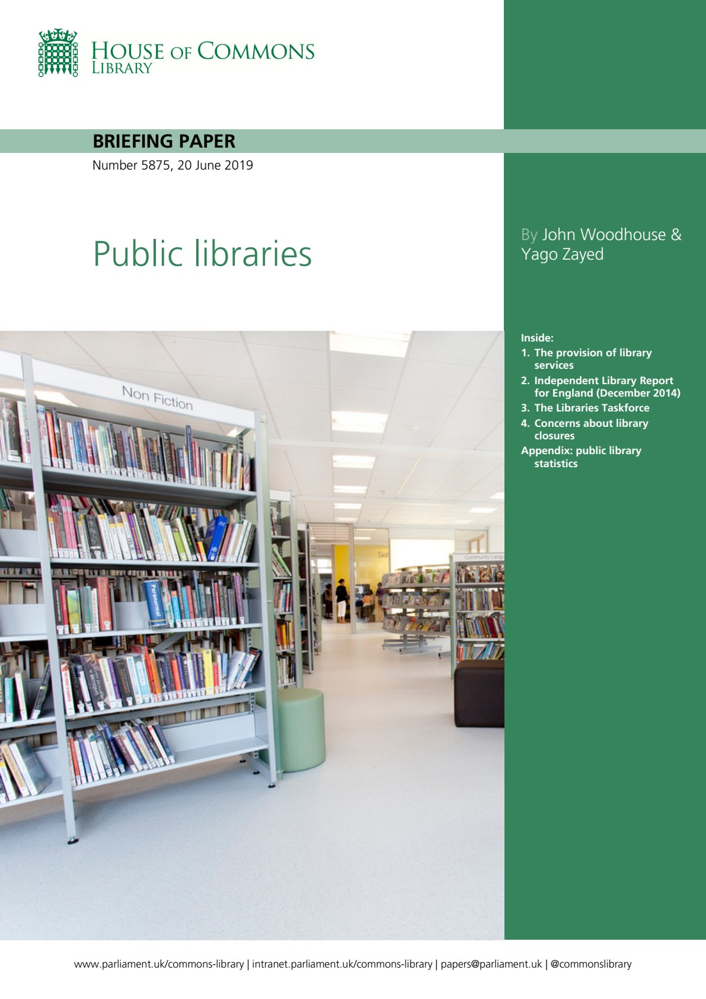

<!-- PAGE: 1 -->

# Public Libraries

**House of Commons Library**  
**Briefing Paper Number 5875, 20 June 2019**

By **John Woodhouse** & **Yago Zayed**

## Inside:

1. The provision of library services
2. Independent Library Report for England (December 2014)
3. The Libraries Taskforce
4. Concerns about library closures
- Appendix: public library statistics

<!-- PAGE: 2 -->

## Contents

- **Summary** (p. 3)
- **1. The provision of library services** (p. 4)
  - 1.1 Public Libraries and Museums Act 1964 (p. 4)
  - 1.2 The role of the Secretary of State (p. 5)
    - Power to order local inquiries (p. 5)
    - Annual report (p. 7)
- **2. Independent Library Report for England (December 2014)** (p. 8)
- **3. The Libraries Taskforce** (p. 9)
- **4. Concerns about library closures** (p. 11)
- **Appendix: public library statistics** (p. 14)

*Cover page image copyright: The new Church Street Library Westminster City Council by Matt Cheetham. Licensed under CC BY-NC 2.0 / image cropped.*

<!-- PAGE: 3 -->

## Summary

This Paper gives a brief overview of the provision of library services in England, the role of the Secretary of State, and the work of the Libraries Taskforce.

The Public Libraries and Museums Act 1964 requires local authorities in England and Wales to “provide a comprehensive and efficient library service”.

“Comprehensive and efficient” are not defined. It is the responsibility of each local authority to determine how to deliver public library services in the context of local need.

The Secretary of State for Digital, Culture, Media and Sport can order an inquiry where there is concern that a local authority is not fulfilling its duties under the Act. This has not happened since 2009 when an inquiry looked at the library services provided by Wirral Metropolitan Borough Council.

Concerns about the future of library services are ongoing. The Chartered Institute of Library and Information Professionals (CILIP) has a “My Library By Right” campaign.

An Appendix gives statistics on library visits, book loans, service points, internet access, expenditure, and the number of employees and volunteers working in libraries. These have been compiled from CIPFA statistics for Great Britain.

The main body of the Paper focuses on public libraries in England. For information on libraries in Wales see:

- Welsh Government website, Libraries;
- Welsh Public Library Standards (March 2018).

### Scotland

In Scotland, local authorities have a statutory duty, under s163(2) of the Local Government (Scotland) Act 1973, to “secure the provision of adequate library facilities for all persons resident in their area”. For further information see:

- The Scottish Library and Information Council;
- *Ambition & Opportunity: A Strategy for Public Libraries in Scotland 2015-2020*;
- MyGov.Scot website, Public libraries.

### Northern Ireland

The public library service is administered by the Northern Ireland Library Authority, known as Libraries NI. The functions of Libraries NI are set out in the Libraries Act (Northern Ireland) 2008.

For further information on public libraries see the Northern Ireland Executive website.

<!-- PAGE: 4 -->

## 1. The Provision of Library Services

### 1.1 Public Libraries and Museums Act 1964

The main legislation governing public libraries in England and Wales is the Public Libraries and Museums Act 1964.

Under section 7(1) of the 1964 Act, each local authority must “provide a comprehensive and efficient library service”. In fulfilling this duty, local authorities must consider the desirability of:

> (a) …securing, by the keeping of adequate stocks, by arrangements with other library authorities, and by any other appropriate means, that facilities are available for the borrowing of, or reference to, books and other printed matter, and pictures, gramophone records, films and other materials, sufficient in number, range and quality to meet the general requirements and any special requirements both of adults and children; and
>
> (b) …encouraging both adults and children to make full use of the library service, and of providing advice as to its use and of making available such bibliographical and other information as may be required by persons using it; and
>
> (c) …securing, in relation to any matter concerning the functions both of the library authority as such and any other authority whose functions are exercisable within the library area, that there is full co-operation between the persons engaged in carrying out those functions.[^1]

“Comprehensive and efficient” are not defined. It is the responsibility of each local authority to determine how to deliver public library services in the context of local need.[^2]

In recent years, in addition to local authority-run libraries (where the service is funded, run, and managed by local authority staff), other organisational approaches have been adopted:

- **a commissioned library** is part of the statutory service and funded by the local authority, but the running of the service has been transferred to a separate trust or organisation (e.g. a social or commercial enterprise);
- **a community-run library** has some level of ongoing support from the local authority, but staff may sometimes be volunteers. Work is according to a joint agreement such as a Service Level Agreement, Memorandum of Understanding or contract. It may or may not be counted as part of the statutory service;
- **an independent community library** is managed by a non-local authority body and is outside the local authority statutory network.[^3]

<!-- PAGE: 5 -->

There are commissioned library services in Bromley, Greenwich, Dudley, Wandsworth and Lincolnshire (run by Greenwich Leisure Limited) and Torbay and Devon (run by Libraries Unlimited). There are community-run libraries in many authorities, including Bradford, Leicestershire, and North Yorkshire.[^4]

#### Government guidance

In December 2015, the Department for Digital, Culture, Media and Sport (DCMS) published guidance on “libraries as a statutory service”.

### 1.2 The Role of the Secretary of State

The 1964 Act imposes a duty on the Secretary of State to:

> (…) superintend, and promote the improvement of, the public library service provided by local authorities in England and Wales, and to secure the proper discharge by local authorities of the functions in relation to libraries conferred on them as library authorities by or under this Act.[^5]

#### Power to order local inquiries

Under section 10 of the Act, the Secretary of State can order a local inquiry where he receives complaints that a library authority is not fulfilling its duties under the Act.[^6] Interventions by the Secretary of State will be considered on a case-by-case basis. In determining whether to order an inquiry, the Secretary of State considers factors such as:

- whether there is any serious doubt or uncertainty as to whether the local authority is (or may cease to be) complying with its legal obligation to provide a comprehensive and efficient library service;
- whether the local authority appears to be acting in a careless or unreasonable way;
- whether the decision is or may be outside the proper bounds of the local authority’s discretion, such as a capricious decision to stop serving a particularly vulnerable group in the local community;
- whether the local authority appears to have failed to consult affected individuals or to carry out significant research into the effects of its proposals;
- whether the local authority has failed to explain, analyse or <!-- PAGE: 6 --> properly justify its proposals;
- whether the local proposals are likely to lead to a breach of national library policy;
- the advantages of local decision making by expert and democratically accountable local representatives;
- whether there is any further good reason why a local inquiry should be ordered.[^7]

Decision letters in relation to complaints about library services are published on Gov.UK.

The power to order a local inquiry has only been used once – in April 2009, when the Secretary of State ordered an inquiry into the library services provided by Wirral Metropolitan Borough Council.[^8]

#### The Inquiry into Wirral library service, 2009

The Council’s plans to close 11 of Wirral’s 24 public libraries had been the subject of a large volume of correspondence, mainly from the public, but also from professional bodies. The Council was asked to work with the then Museums, Libraries and Archives Council (MLA)[^9] on the proposed restructuring of its library services. The MLA subsequently wrote to the Secretary of State, expressing concern about the situation in the Wirral.[^10]

The inquiry, led by Sue Charteris, was significant as it examined the factors determining whether a local authority was in breach of its statutory duties.

#### What did the report say?

The inquiry’s report was published in September 2009 and found that Wirral Council’s decision to restructure its library service was in breach of its statutory duty to provide a “comprehensive and efficient” service.[^11]

The Council had “failed to make an assessment of local needs (or alternatively to evidence knowledge of verifiable local needs) in respect of its library services.”[^12] It had taken the decision to close 11 libraries “in the absence of a strategic plan or review of the Library Service” and “without a clear understanding of the extent and range of services [then] being provided in the libraries”.

There had been “a further breach in relation to the needs of deprived communities” and a key concern was that there had been “an absence of an adequate plan for and commitment to a comprehensive outreach service.” Without an assessment of needs and a strategic Library Service review, the Council had “displayed a lack of logic around why some facilities were recommended for closure and not others.”[^13]

The report concluded that there was a strong case for reviewing the decision and/or retaining at least some physical service at some sites earmarked for closure.[^14] A number of recommendations were made to the Secretary of State, including that Wirral Council produce a strategic <!-- PAGE: 7 --> development plan for its library service within six months of the report’s publication.[^15]

#### Outcome

In November 2009, the DCMS issued a statement explaining that, since Wirral Council had subsequently revoked its decision to close 11 libraries, it was no longer appropriate to rule on whether the earlier decision was in breach of the 1964 Act.[^16]

CILIP welcomed the Inquiry’s conclusions as “arguably, a clear updating of the 1964 Act”.[^17]

#### Annual report

Section 17 of the Act requires the Secretary of State to publish an annual report on the exercise of his functions under the Act. The most recent report was published in October 2018.[^18] The foreword notes:

> During the period covered by this report, DCMS has worked with the Libraries Taskforce and its members to promote and support the work of public libraries. This includes the delivery of projects that received funding from our £3.9m ‘Libraries: Opportunities for Everyone’ innovation fund; support to councils to explore alternative delivery models such as public service mutuals; the Taskforce’s good practice toolkits and masterclasses to help library services to develop and improve; and the Arts Council’s funding of seven libraries organisations as new National Portfolio Organisations for 2018 to 2022, including Libraries Connected as a new Sector Support Organisation for libraries.

<!-- PAGE: 8 -->

## 2. Independent Library Report for England (December 2014)

In February 2014, the DCMS and the Department for Communities and Local Government (DCLG) commissioned William Sieghart to look at:

- the core principles of a public library into the future;
- whether the current model of delivery is the most comprehensive and efficient;
- the role of community libraries.[^19]

The Independent Library Report for England was published in December 2014. Two themes emerged “consistently and dramatically” from the investigation:

- there had been “far too many library reviews in recent years which have come to nothing”;
- not enough decision makers “appear sufficiently aware of the remarkable and vital value that a good library service can offer modern communities of every size and character”.[^20]

The Report noted the continuing importance of libraries and called for their re-invigoration:

> (…) Despite the growth in digital technologies, there is still a clear need and demand within communities for modern, safe, non-judgemental, flexible spaces, where citizens of all ages can mine the knowledge of the world for free, supported by the help and knowledge of the library workforce. This is particularly true for the most vulnerable in society who need support and guidance and to children and young people who benefit from engagement with libraries outside of the formal classroom environment.
>
> The library does more than simply loan books. It underpins every community. It is not just a place for self-improvement, but the supplier of an infrastructure for life and learning, from babies to old age, offering support, help, education, and encouraging a love of reading…[^21]

Three major recommendations were made:

**1.** The provision of a national digital resource for libraries, to be delivered in partnership with local authorities;

**2.** The setting up of a task and finish force, led by local government, in partnership with other bodies involved in the library sector, to provide a strategic framework for England, and to help in implementing the following;

**3.** The task force, to work with local authorities, to help them improve, revitalise and if necessary, change their local library service, while encouraging, appropriate to each library, increased community involvement.[^22]

<!-- PAGE: 9 -->

## 3. The Libraries Taskforce

As recommended by the Independent Library Report, a Libraries Taskforce was set up to take forward the Report’s recommendations.

The Taskforce reports to the DCMS and the Local Government Association (LGA). Its priorities are:

- promoting public libraries to the public and to decision-makers;
- providing library services and potential partners with easy access to evidence and data to inform their decision-making;
- providing clearly signposted, step by step guidance and peer support to support sustainable library services;
- helping the sector (paid staff and volunteers) obtain the insights, skills and support it needs for the future.[^23]

In 2016, the Taskforce published a “Libraries Deliver” strategy for public libraries in England. The ambition is for everyone to:

- choose to use libraries, because they see clear benefits and positive outcomes from doing so;
- understand what library services offer, and how they can make the most of what’s available to them;
- be introduced to new ideas and opportunities, then given confidence and quick and easy access to tools, skills and information they need to improve their quality of life;
- receive trusted guidance through the evolving information landscape and build the skills needed to thrive in a changing world.[^24]

To achieve the ambitions, the strategy notes that libraries contribute to seven outcomes that are critical to individuals and communities in their areas:

- cultural and creative enrichment;
- increased reading and literacy;
- improved digital access and literacy;
- helping everyone achieve their full potential;
- healthier and happier lives;
- greater prosperity;
- stronger, more resilient communities.[^25]

The strategy outlined nine components of library development:

- Encouraging common design principles;
- Planning public library services to meet local needs;
- Considering different models for local service delivery;
- Funding library services in varied and sustainable ways;

<!-- PAGE: 10 -->

- Defining what an excellent library service looks like;
- Helping libraries use better evidence to support decision-making;
- Stronger co-ordination and partnership working;
- Developing the library workforce, now and for the future;
- Making the case for libraries.[^26]

The Taskforce publishes progress reports on its work every six months. A range of material is available from the Taskforce’s website including:

- *Libraries Shaping the Future: good practice toolkit and case studies*
- *Community Managed Libraries: good practice toolkit and case studies*
- *Libraries: Alternative Delivery Models toolkit*
- *Strategic planning of library services toolkit*
- *Benchmarking Framework for library services*
- *Makerspaces and libraries*
- *Applying for funding*

### Arts Council England

Arts Council England (ACE) – the development agency for libraries in England – has taken on the work of the Taskforce until March 2020.[^27]

The ACE website has detailed information on its role including:

- Envisioning the library of the future;
- Libraries Opportunities for Everyone Innovation Fund;
- Programmes and initiatives;
- Resources.

<!-- PAGE: 11 -->

## 4. Concerns About Library Closures

When the Coalition Government came to power in May 2010, there was concern that reductions in central government grants to local authorities would result in reduced library services and closures. In its January 2013 response to a report[^28] by the Culture, Media and Sport Committee, the then Government said:

> A ‘comprehensive and efficient’ library service represents the balance to be struck by each local authority in meeting local needs within the context of available resources in a way which is appropriate to the identified needs of the communities they serve.
>
> The 1964 Public Libraries & Museums Act does not seek to be overly prescriptive but instead anchors the delivery of a local service to the needs of the local community. The closure of one or even a number of library branches does not necessarily signify a breach of the 1964 Act.
>
> (…)
>
> The Government will maintain national oversight and retain the statutory duty on local authorities to provide a comprehensive and efficient library service...The Secretary of State will use the powers of intervention where it is assessed that an authority is in breach of this responsibility. This is a serious matter, and certainly not one based on willingness and unwillingness; rather, it is a judgement on the individual facts of the case…[^29]

### Data sources

There are two main data sources on public libraries that are not directly comparable:

- **The DCMS’ Public libraries in England: basic dataset** – gives a list of libraries indicating type of library, book stock, opening times and changes in service between 1 April 2010 and 1 July 2016. A unit is an individual library. The DCMS data does not include mobile libraries.
- **Chartered Institute of Public Finance and Accountancy (CIPFA) Public Library Statistics** – give data by local authority for UK from 2004/05. However, since 2014/15 they cover Great Britain only. The statistics include a broad range of indicators: types of library, opening hours, staff, book stock/issues, computer work stations, visits and financial data. CIPFA define a library as one which is open for at least 10 hours per week. The CIPFA data does not include independent libraries.

### What’s been said since the Committee report?

In March 2019, the DCMS said that it “monitors” proposed changes to library service provision in England but does not hold “complete <!-- PAGE: 12 --> figures” on closures.[^30] In October 2017, when asked why it doesn’t collect or publish data on closures, the DCMS said that it:

> (…) does not seek to duplicate the collection of data that is collected and published by others. The Libraries Taskforce collected and published basic data about the number and locations of each public library in England as at 1 July 2016 and has worked with the libraries sector to define the data proposed for inclusion in a future core dataset for public libraries in England.[^31]

The dataset referred to above is available from Gov.UK.

### Controversy in 2016

In a February 2016 written response, the DCMS estimated, on the basis of desk research, that approximately 110 static public libraries in England had closed between January 2010 and January 2016. At least 77 new public libraries had opened during the same period.[^32]

The Chartered Institute of Library & Information Professionals (CILIP) challenged the net reduction of 33 libraries implied by the DCMS response. CILIP pointed to CIPFA figures of a net reduction of 178 libraries in England between 2009-10 and 2014-15.[^33]

### 2018 report

In August 2018, the DCMS published a report analysing public library trends in England. It also assessed the reliability and limitations of CIPFA’s statistics. The report’s “key takeaways” were that:

**1.** Overall, the CIPFA data shows a continuing decline in public library use (both in visits and book issues) in England. But:
- a. The downward trend may be slowing;
- b. The overall trend masks significant variations across and within library services.

**2.** Over one quarter of all library services are trendbuckers, meaning they have shown an increase in use (visits or issues) over the past year and/or the past decade.

**3.** The report considers 7 arguments – including cuts, the digital shift, and the failure to modernise – posited as explanations for the overall trend of decline in use of libraries, using data to analyse them when possible. No one argument was found to be sufficient as an explanation for decline on its own.

**4.** Analysis of the arguments pointed at underlying (unmeasured) variables which distinguish the “high-performers” from the rest, namely forward-thinking leadership alongside the political support and purchasing flexibility needed to innovate in response to structural changes.

<!-- PAGE: 13 -->

**5.** The second half of the report comments on the limitations of the data collected by CIPFA. The CIPFA statistics sheets were not designed to be a dataset and have only been used as such due to the lack of any alternative national figures. The statistics sheets have significant flaws that undermine their ability to be used as a definitive and authoritative source of data on trends in public library usage over time. The flaws fit into 5 broad categories: issues with structure, consistency, accuracy, standardisation, and variable selection and measurement.

**6.** The flaws in the data impair our ability to understand trends at the national level in a comprehensive way. It may be possible to remedy this if all library services contribute in the future to a consistent and comprehensive open dataset, along the lines of the work currently being led by the Taskforce Team on implementing the collation and publication of the Core Dataset previously agreed by the sector.[^34]

<!-- PAGE: 14 -->

## Appendix: Public Library Statistics

The following statistics are compiled from CIPFA public library statistics reports from 2005 to 2018. The end of this section contains the main data from which all graphs and figures are derived.[^35]

A joint DCMS/LGA sponsored taskforce undertook an analysis of the CIPFA statistics for English libraries only, which was published in August 2018. The taskforce highlighted some issues regarding the methodology used by CIPFA and the accuracy of the data stating, “Although the CIPFA data is the most complete, continuous set of data we have regarding the state of the nation’s library services, it is flawed.” As such the CIPFA figures should be treated with caution.

### Visitor numbers

According to the CIPFA figures, in 2007/08, there were approximately 322 million visits to public libraries across England, Wales and Scotland. By the end of 2017/18, this figure was approximately 233 million – representing a reduction of roughly 89 million visits (28%) on 2007/08. From 2007/08 onwards, there was a year on year decrease in visitor numbers.

Between 2004/05 and 2009/10, visitor numbers had decreased by 5%. During the period 2009/10–2017/18, visitor numbers reduced by 26%. The largest single decrease occurred in 2012/13 with an 5.8% reduction on the year before.

| Year | Number of visits for library purposes, Great Britain (millions) |
| :--- | :--- |
| 2007/08 | 322 |
| 2008/09 | 319 |
| 2009/10 | 315 |
| 2010/11 | 307 |
| 2011/12 | 299 |
| 2012/13 | 282 |
| 2013/14 | 276 |
| 2014/15 | 265 |
| 2015/16 | 251 |
| 2016/17 | 243 |
| 2017/18 | 233 |

<!-- PAGE: 15 -->

The DCMS sponsored taskforce analysis of the CIPFA data has noted that over the ten years up to 2016/17 only a 100 of a 151 library services in England have reported visit data throughout the decade which:

> As a result, total visits are hundreds of thousands below the aggregate numbers reported by CIPFA. However, the trend line demonstrated is more likely to be accurate, as it measures directly like against like.[^36]

It also noted that the downward trend in visits is slowing and that it masks significant variations across and within library services.[^37] Furthermore over a quarter of libraries are trendbuckers, having shown an increase in either visits or issues over the past year and/or decade.[^38]

Other problems concerning the data collected were that library visits are difficult to measure:

- Due to co-location, libraries may share buildings with other public services such as a Jobcentre Plus which is likely to increase the number of visits recorded by a library where it is not easy to distinguish which services are being used by visitors in these buildings.
- The use of electronic door counters are CIPFA’s preferred method of measuring the number of visits to a library. However, people are counted twice as they enter and leave, with some library services failing to halve the numbers from electronic door counters when reporting.
- Where electronic door counters are not used, CIPFA relies on sampling based on the number of visits in a particular week with the figures extrapolated to cover 50 weeks with two weeks discounted due to bank holidays. Libraries are free to choose the week of the sample and may select a week which is particularly popular.[^39]

### Book stock, book loans and requests for specific items

As with visitor numbers, the number of books in stock within public libraries has been reduced over the last decade. As at 31 March 2005, there were approximately 103 million books in stock across public libraries. By 31 March 2018, the number of books in stock stood at approximately 77 million – a reduction of roughly 26 million (25%) on the 2005 figure.

Between 2004/05 and 2009/10, public library book stocks had decreased by 7%. During the period 2010/11–2017/18, public library book stocks fell by 20%. The largest single decrease occurred in 2014/15 when the book stock at 31 March 2015 was just under 5% lower than the year before.

<!-- PAGE: 16 -->

As to be expected with the reduction in visitor numbers to public libraries, across the last decade total book borrowing also decreased, although at a greater rate. Between 2007/08 and 2017/18 the total number of books issued for loan fell from approximately 302 million to 183 million – a reduction of 119 million (39%).

CIPFA figures show that since 2010/11, the number of requests for specific items in libraries has fallen by around 3.7 million, from 15.5 million to 11.8 million in 2017/18 (a fall of 24%).

From 2005/06 the number of requests for specific items increased year on year from 9.7 million to a peak of 15.5 million in 2010/11.

### Library “service points” and internet access

The number of public libraries is measured in “service points” to include mobile as well as static libraries.

<!-- PAGE: 17 -->

As at 31 March 2005 there were a total of 4,367 service points that were open 10 hours or more per week across England, Wales and Scotland. At the same date in 2018 this figure stood at 3,618 – a reduction of 749 (17%). Between 31 March 2005 and 2010 the number of such service points decreased by 11 (0.3%). During the period 2010–2018 the number of such service points fell by 738 (17%).

The number of libraries which were open 10 hours or less per week accounted for a small proportion of total service points throughout the period – around 3%. The number of such libraries as of 31 March 2005 stood at 138. Since then their numbers have fluctuated with a high of 158 in 2006/07 and a low of 119 in 2011/12. As of the 31 March 2018, the number of such libraries was 148.

Aside from being a service purely dedicated to the storing and loaning of books for the public, libraries also offer computer terminals, often with access to the internet.

<!-- PAGE: 18 -->

At 31 March 2005 there were a total of 36,302 terminals with library catalogue and internet access. This figure increased year on year until 2011/12 when the number of terminals was reduced to 42,039 from 42,125 the previous year (0.2% lower). Since then terminal numbers have declined in each subsequent year. At 31 March 2018 there were 38,383 computer terminals with catalogue and internet access – 9% lower than in 2010 although an increase of 6% on 2005.

The number of terminals with access to Wi-Fi as at 31 March 2012 <!-- PAGE: 19 --> stood at 1,183. By 31 March 2018 this figure was 3,300 – a 179% increase on 2012.

### Employees and volunteers

As at 31 March 2005 there were 25,777 full-time equivalent (FTE) employees working in public libraries across England, Wales and Scotland. At the same time in 2018 this figure was 15,483, representing a reduction of 40%. Since 2007 the number of people employed by public libraries decreased year on year. Between 2010 and 2018 the number of employees decreased by 7,528 (-33%).

While employee numbers were decreasing over the period in question, the number of volunteers working in libraries increased. At 31 March 2008 there were 15,008 volunteers. By 2018 this figure had increased to 51,394 – a 242% increase.

### Expenditure

Since 2010/11, library net expenditure excluding capital charges has declined by 36% in real terms from £1.15 billion to £741 million in 2017/18. Between 2004/05 and 2009/10 spending in real terms declined by 4%.

<!-- PAGE: 20 -->

### Local Authority Library Statistics Table

*Great Britain, 2004/05 to 2017/18*

*Sources: CIPFA, Public Library Statistics (various years); HM Treasury, GDP deflators at Market Prices and Money GDP March 2019 (Spring Statement). Data based on 203 local authorities up until 2009; 205 local authorities thereafter. (-) No information available. a) 2017/18 prices.*

| Year | Service points 10+ hrs/wk | Service points <10 hrs/wk | Total service points | Terminals with catalogue & internet | Terminals with Wi-Fi | FTE: Professional posts | FTE: All other posts | FTE: Total posts | Volunteers | Total book stock (000s) | Book lending stock (000s) | Total book issues (000s) | Requests for items (000s) | Visits for library purposes (000s) | Net expenditure cash (£m) | Net expenditure real 2017/18 (£m) |
| :--- | :--- | :--- | :--- | :--- | :--- | :--- | :--- | :--- | :--- | :--- | :--- | :--- | :--- | :--- | :--- | :--- |
| **2004/05** | 4,367 | 138 | 4,505 | 36,302 | - | 5,940 | 19,837 | 25,777 | - | 103,443 | 76,563 | 323,248 | 8,767 | 332,565 | 989 | 1,273 |
| **2005/06** | 4,432 | 150 | 4,582 | 38,665 | - | 5,732 | 20,031 | 25,763 | - | 101,013 | 74,730 | 316,742 | 9,683 | 335,255 | 1,011 | 1,268 |
| **2006/07** | 4,431 | 158 | 4,589 | 39,367 | - | 5,562 | 20,320 | 25,882 | 12,668 | 99,484 | 73,353 | 308,798 | 10,668 | 330,814 | 1,040 | 1,268 |
| **2007/08** | 4,411 | 149 | 4,560 | 40,169 | - | 5,186 | 19,873 | 25,059 | 15,008 | 97,747 | 72,886 | 301,781 | 11,765 | 321,784 | 1,051 | 1,249 |
| **2008/09** | 4,381 | 130 | 4,511 | 41,201 | - | 4,867 | 20,092 | 24,958 | 15,894 | 97,001 | 72,835 | 304,775 | 13,338 | 318,563 | 1,053 | 1,219 |
| **2009/10** | 4,356 | 130 | 4,486 | 41,968 | - | 4,893 | 19,149 | 24,042 | 17,550 | 96,543 | 72,579 | 303,446 | 14,829 | 315,142 | 1,057 | 1,207 |
| **2010/11** | 4,345 | 126 | 4,471 | 42,125 | - | 4,298 | 18,713 | 23,011 | 21,494 | 96,420 | 72,228 | 294,090 | 15,494 | 307,101 | 1,034 | 1,159 |
| **2011/12** | 4,138 | 119 | 4,257 | 42,039 | 1,183 | 3,602 | 17,535 | 21,138 | 23,397 | 91,942 | 70,840 | 281,700 | 15,425 | 299,187 | 979 | 1,083 |
| **2012/13** | 4,069 | 122 | 4,191 | 41,583 | 1,550 | 3,505 | 16,182 | 19,688 | 33,685 | 90,082 | 69,959 | 257,185 | 14,499 | 281,731 | 937 | 1,016 |
| **2013/14** | 4,023 | 137 | 4,160 | 41,421 | 2,063 | 3,014 | 15,734 | 18,748 | 34,880 | 86,019 | 67,885 | 242,037 | 14,043 | 276,075 | 911 | 969 |
| **2014/15** | 3,917 | 143 | 4,060 | 40,936 | 2,742 | 2,911 | 15,117 | 18,028 | 41,402 | 81,921 | 65,402 | 220,606 | 12,978 | 265,280 | 859 | 903 |
| **2015/16** | 3,850 | 132 | 3,982 | 40,100 | 3,285 | 2,683 | 14,381 | 17,064 | 44,501 | 81,241 | 64,799 | 205,509 | 12,428 | 250,772 | 842 | 878 |
| **2016/17** | 3,745 | 144 | 3,889 | 38,971 | 3,321 | 2,389 | 13,805 | 16,194 | 48,025 | 79,133 | 62,938 | 192,567 | 11,907 | 243,419 | 772 | 787 |
| **2017/18** | 3,618 | 148 | 3,766 | 38,383 | 3,300 | 2,340 | 13,143 | 15,483 | 51,394 | 77,290 | 61,763 | 182,895 | 11,797 | 233,094 | 741 | 741 |

<!-- PAGE: 21 -->

## About the House of Commons Library

The House of Commons Library research service provides MPs and their staff with the impartial briefing and evidence base they need to do their work in scrutinising Government, proposing legislation, and supporting constituents.

As well as providing MPs with a confidential service we publish open briefing papers, which are available on the Parliament website.

Every effort is made to ensure that the information contained in these publicly available research briefings is correct at the time of publication. Readers should be aware however that briefings are not necessarily updated or otherwise amended to reflect subsequent changes.

If you have any comments on our briefings please email `papers@parliament.uk`. Authors are available to discuss the content of this briefing only with Members and their staff.

If you have any general questions about the work of the House of Commons you can email `hcinfo@parliament.uk`.

*Disclaimer* – This information is provided to Members of Parliament in support of their parliamentary duties. It is a general briefing only and should not be relied on as a substitute for specific advice. The House of Commons or the author(s) shall not be liable for any errors or omissions, or for any loss or damage of any kind arising from its use, and may remove, vary or amend any information at any time without prior notice.

The House of Commons accepts no responsibility for any references or links to, or the content of, information maintained by third parties. This information is provided subject to the conditions of the Open Parliament Licence.

---

## Footnotes

[^1]: Section 7(2) of the 1964 Act.
[^2]: HL4368 on public libraries, answered 14 December 2015.
[^3]: DCMS, *Definitions for types of libraries in the extended basic dataset*, January 2018; Joan O’Bryan, *Analysing data: CIPFA statistics and the future of England’s libraries*, August 2018, pp. 6–7.
[^4]: Joan O’Bryan, *Analysing data*, p. 7.
[^5]: Section 1 of the 1964 Act.
[^6]: Section 10(1)(a) of the 1964 Act.
[^7]: DCMS, *Libraries as a statutory service: guidance*, December 2015.
[^8]: “Culture secretary Andy Burnham orders local inquiry into public library service”, DCMS press release, 3 April 2009.
[^9]: From 1 October 2011, the MLA’s functions transferred to Arts Council England (ACE) and the National Archives – see “Museums and libraries formally transfer to Arts Council England”, ACE news release, 3 October 2011.
[^10]: DCMS press release, “Culture secretary Andy Burnham orders local inquiry into public library service”, 3 April 2009.
[^11]: DCMS, *A local Inquiry into the public library service provided by Wirral Metropolitan Borough Council: led by Sue Charteris*, 2009, p. 6.
[^12]: Ibid, p. 6.
[^13]: Ibid, pp. 7–8.
[^14]: Ibid, p. 8.
[^15]: Ibid, p. 9.
[^16]: Archived DCMS website, *Wirral library service inquiry* [snapshot taken 7/4/10] [accessed 17 June 2019].
[^17]: “Wirral report says user needs and staff input are central to legal duty”, *Update*, January–February 2010, p. 6.
[^18]: DCMS, *Report under the Public Libraries and Museums Act 1964 for 2017/18*, October 2018.
[^19]: “William Sieghart to chair panel to produce independent report on England’s public library service”, DCMS/DCLG press release, 8 February 2014.
[^20]: DCMS, *Independent Library Report for England*, December 2014, p. 4.
[^21]: DCMS, *Independent Library Report for England*, December 2014, p. 5.
[^22]: Ibid, p. 5.
[^23]: Gov.UK, Libraries Taskforce webpage.
[^24]: Libraries Taskforce, *Libraries Deliver: Ambition for Public Libraries in England 2016–2021*, pp. 6–7.
[^25]: Ibid, p. 7.
[^26]: Ibid, pp. 7–10.
[^27]: DCMS, *Libraries Taskforce: six monthly progress report*, May 2019.
[^28]: Culture, Media and Sport Committee, *Library closures*, HC 587 2012/13, November 2012.
[^29]: CM 8535, January 2013, pp. 5–6.
[^30]: House of Lords written question [HL14384] on library closures in England since 2010, answered 19 March 2019; See also PQ 107956, answered 19 October 2017.
[^31]: PQ 109055, answered 26 October 2017.
[^32]: PQ 27175 [on public library closures in England], answered 23 February 2016; see also PQ 904216 [on library closures], answered 21 March 2016.
[^33]: “Use of flawed figures by Ed Vaizey MP about the number of libraries strongly criticised by Chartered Institute”, CILIP news release, 1 March 2016.
[^34]: Joan O’Bryan, *CIPFA statistics and the future of England’s libraries*, August 2018, p. 64.
[^35]: Figures and charts in the appendix prepared by Lukas Audickas and Yago Zayed.
[^36]: Joan O’Bryan, *Analysing Data: CIPFA Statistics and The Future of England’s Libraries*, August 2018, p. 10.
[^37]: Ibid, p. 5.
[^38]: Ibid, p. 64.
[^39]: Ibid, pp. 59–63.
