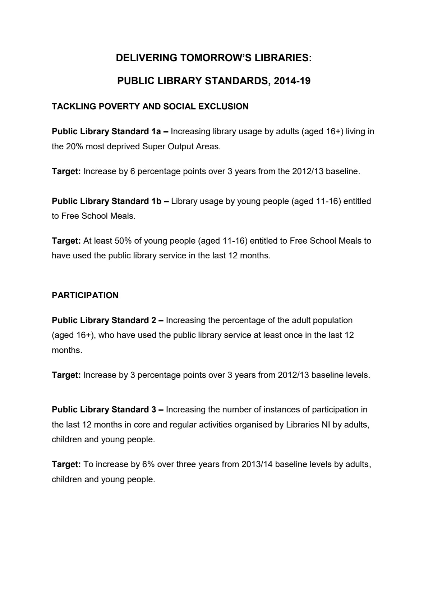

<!-- PAGE: 1 -->

# DELIVERING TOMORROW’S LIBRARIES: PUBLIC LIBRARY STANDARDS, 2014–19

## TACKLING POVERTY AND SOCIAL EXCLUSION

### Public Library Standard 1a
**Increasing library usage by adults (aged 16+) living in the 20% most deprived Super Output Areas.**

**Target:** Increase by 6 percentage points over 3 years from the 2012/13 baseline.

### Public Library Standard 1b
**Library usage by young people (aged 11–16) entitled to Free School Meals.**

**Target:** At least 50% of young people (aged 11–16) entitled to Free School Meals to have used the public library service in the last 12 months.

## PARTICIPATION

### Public Library Standard 2
**Increasing the percentage of the adult population (aged 16+), who have used the public library service at least once in the last 12 months.**

**Target:** Increase by 3 percentage points over 3 years from 2012/13 baseline levels.

### Public Library Standard 3
**Increasing the number of instances of participation in the last 12 months in core and regular activities organised by Libraries NI by adults, children and young people.**

**Target:** To increase by 6% over three years from 2013/14 baseline levels by adults, children and young people.

<!-- PAGE: 2 -->

### Public Library Standard 4
**Increasing the number of active members as proportion of the population.**

**Target:** Increase number of active members as a proportion of the population by 3 percentage points over 3 years from baseline levels at 1 April 2013 by adults, children and young people.

## CUSTOMER SATISFACTION

### Public Library Standard 5a
**Percentage of adult library users (aged 16+) who are satisfied with public library provision in NI.**

**Target:** At least 90% of adult library users are fairly satisfied/very satisfied with public library provision.

### Public Library Standard 5b
**Percentage of young library users (aged 11–16) who are satisfied with public library provision in NI.**

**Target:** At least 60% of young library users (aged 11–16) are fairly satisfied/very satisfied with public library provision.

## ACCESS

### Public Library Standard 6
**Percentage of households living within 2 miles of a static library or a scheduled mobile stop.**

**Target:** At least 85% of households should have access to a library service point within 2 miles.

## STOCK

### Public Library Standard 7
**To achieve minimum spend on stock acquisitions in all formats.**

**Target:** To achieve a minimum stock spend of £2.25 per head.

<!-- PAGE: 3 -->

### Public Library Standard 8
**Annual average proportion of borrowable stock on loan.**

**Target:** To establish a baseline for 2014/15 of the annual average proportion of stock on loan followed by a 3 percentage point increase over the following 2 years.

### Public Library Standard 9
**Percentage of adult library users (aged 16+) who agree that there is a wide variety of items available.**

**Target:** At least 90% of adult library users who have browsed through or borrowed stock in the last 12 months agree/strongly agree that there is a wide variety of items available.

### Public Library Standard 10
**Percentage of adult library users (aged 16+) who agree that the items are in good condition.**

**Target:** At least 90% of library users who have browsed through or borrowed stock in the last 12 months agree/strongly agree that the items are in good condition.

## ACCESS TO INFORMATION AND COMMUNICATIONS TECHNOLOGY (ICT)

### Public Library Standard 11a
**Provision of access to the Internet with bandwidth that is scalable to provide effective delivery of voice, data and video content to all users using recognised industry standards.**

**Target:** All static libraries to provide access to the Internet with bandwidth that is scalable to provide effective delivery of voice, data and video content to all users using recognised industry standards.

### Public Library Standard 11b
**Number of Wi-Fi and Public Access Terminal (PAT) sessions.**

**Target:** To establish a baseline in 2014/15 and to increase the number of Wi-Fi and PAT sessions by 2% over 2 years.

<!-- PAGE: 4 -->

### Public Library Standard 12
**Percentage of adult library users (aged 16+) who agree that their ability to access and use online resources/services has improved due to support provided by library staff.**

**Target:** At least 80% of library users who have been supported by library staff to access/use library ICT services or equipment in the last 12 months agree/strongly agree that their ability to access and use online resources/services has improved due to support provided by library staff.
