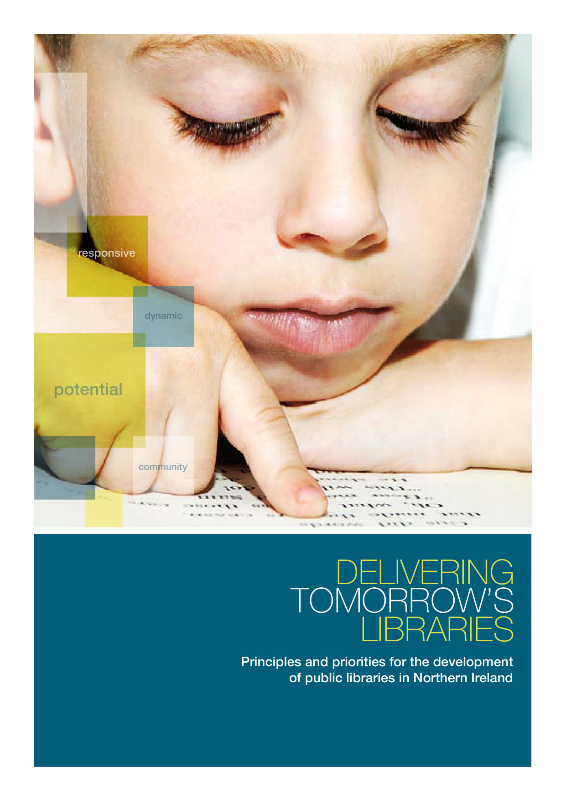
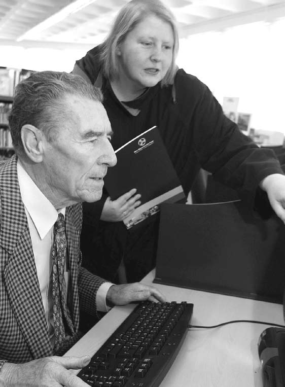
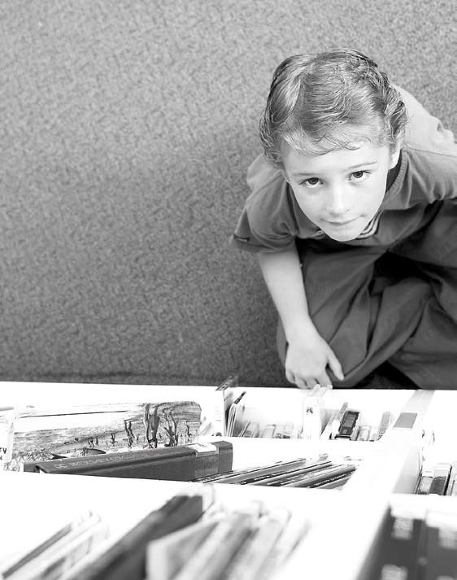

<!-- PAGE: 1 -->

# Delivering tomorrow’s libraries

## Principles and priorities for the development of public libraries in Northern Ireland

**Department of Culture, Arts and Leisure**

*July 2006*

<!-- PAGE: 2 -->

*(Inside front cover)*

<!-- PAGE: 3 -->

## Ministerial Foreword

The public library is a rich source of independent learning, enjoyment, and inspiration. Libraries empower people and communities. They record our past, help us understand our present, and sow the seeds of our future.

The role that libraries have in society is becoming more multi-faceted, providing a community space, a learning space, a location for cultural events, as well as an environment for quiet study. Public libraries are trusted, neutral, and free at the point of delivery. They are a universal service open to everyone.

At the same time, society is changing rapidly. The explosion of information technology, changing leisure patterns, rising expectations from citizens, and increasing demands on public expenditure require us to look carefully at how library services are delivered.

This policy statement, *Delivering Tomorrow’s Libraries*, sets out a vision and framework for public libraries in Northern Ireland over the coming decade. It establishes core principles of customer focus, accessibility, and high performance standards, while preparing the way for modernised regional governance under a single library authority.

I look forward to working with library staff, Education and Library Boards, local communities, and our partner agencies to realise this vision and ensure our libraries remain dynamic centres of inspiration and opportunity for everyone in Northern Ireland.

**Maria Eagle MP**  
*Minister with responsibility for the Department of Culture, Arts and Leisure*

<!-- PAGE: 4 -->

## Contents

- **1. Introduction** (Pgs 5–6)
- **2. Libraries’ Role and Vision** (Pgs 7–9)
- **3. Achieving Change** (Pgs 10–17)
- **4. Performance Monitoring** (Pgs 18–19)
- **5. Funding Formula** (Pg 20)
- **6. Taking Things Forward** (Pg 21)
- **Annex: Standards** (Pgs 22–23)

<!-- PAGE: 5 -->

> “A flexible and responsive library service which provides a dynamic focal point in the community and assists people to fulfill their potential.”

## 1. Introduction

**1.1** The public library service exists to make available the accumulated store of human knowledge and creativity to all citizens, and to assist people to develop their potential. The service is provided under the Education and Libraries (Northern Ireland) Order 1986, which places a duty on Education and Library Boards to provide a “comprehensive and efficient” library service.

**1.2** Since 1973, public libraries in Northern Ireland have been managed by five Education and Library Boards (Belfast, North Eastern, South Eastern, Southern, and Western). Over that time, the service has developed substantially. However, changes in society, technology, and demographics mean that we need to re-evaluate how library services are organised and delivered.

**1.3** The Department of Culture, Arts and Leisure (DCAL) has policy responsibility for public libraries in Northern Ireland. In 2005, the Department published a consultation paper, *Northern Ireland’s Libraries: A Framework for Change*, which highlighted the need for reform. Between 1999 and 2005, government funding achieved a real terms increase of 22% in the library budget. Yet during this same period, book loans declined by 26% and visits fell by 14%.

**1.4** The Review of Public Administration (RPA) announced the creation of a single regional library authority to replace the library functions of the five Education and Library Boards. This structural change offers an unprecedented opportunity to modernise the service, reduce administrative overheads, and redirect resources toward frontline customer services.

<!-- PAGE: 6 -->

**1.5** This document sets out the policy framework, vision, and strategic priorities for public libraries in Northern Ireland. It defines the core role of libraries, establishes principles for customer focus, and introduces a framework of minimum Public Library Standards to drive quality and accountability.

**1.6** The policy applies across all public library provision in Northern Ireland, guiding the transition to the new single library authority and ensuring that libraries remain vital community hubs for reading, learning, culture, and information.

<!-- PAGE: 7 -->

## 2. Libraries’ Role and Vision

> “The public library, the local gateway to knowledge, provides a basic condition for lifelong learning, independent decision-making and cultural development of the individual and social groups.”  
> — *UNESCO Public Library Manifesto*[^1]

**2.1** Public libraries occupy a unique position in civic life. They are open to all, regardless of age, background, or income. They offer a neutral, non-commercial space where individuals can learn, explore, and connect with their community.

**2.2** The core functions of the public library service in Northern Ireland are:
- **Promoting reading, literacy, and enjoyment of books**;
- **Facilitating independent learning and education**;
- **Providing free access to digital technology and information**;
- **Supporting community identity, heritage, and culture**;
- **Acting as an inclusive, safe, and welcoming public space**.

**2.3** In recent years, the implementation of the Electronic Libraries for Northern Ireland (ELFNI) project has transformed public access to ICT, providing broadband computers, digital resources, and automated library management across all branch libraries.

<!-- PAGE: 8 -->

**2.4** Libraries have a key contribution to make toward tackling social exclusion and what has been termed “the poverty of aspiration”[^2]. Their ability to facilitate informal learning is especially valuable for people who may have had negative experiences with formal education.

**2.5** The government’s vision for public libraries in Northern Ireland is:

> “A flexible and responsive library service which provides a dynamic focal point in the community and assists people to fulfill their potential.”

**2.6** To achieve this vision, libraries must modernise their operations, adapt to changing patterns of user demand, and provide services that are genuinely customer-centred.

<!-- PAGE: 9 -->

**2.7** We are looking for a library service which, within available resources, is:
- **Centred on people and relevant to their current needs**;
- **Responsive to local communities**, showing flexibility to reflect new demands;
- **Aspirational**, encouraging self-improvement and ambition;
- **Accessible and inclusive**, reaching out to non-users and under-represented groups;
- **High performing**, delivering consistently high standards across Northern Ireland;
- **Efficient and cost-effective**, maximising resources devoted to frontline service delivery.

**2.8** This vision provides the foundation for the strategic change programme set out in the following sections.

<!-- PAGE: 10 -->

*Section 3: Achieving Change.*

<!-- PAGE: 11 -->

## 3. Achieving Change

**3.1** Achieving the vision requires comprehensive change across governance, customer service, opening hours, stock management, and physical library buildings.

### Customer Focus

**3.2** Libraries need to be attractive to visit, welcoming, responsive to their communities, and imaginative in meeting need. Focusing the service toward the customer calls for staff development and action in the areas of access, stock, and buildings.

**3.3** Frontline library staff are the service's greatest asset. Customer service training, proactive engagement, and staff empowerment will be prioritised. We must ensure that the balance between administrative management on the one hand and frontline services on the other <!-- PAGE: 12 --> is re-aligned to ensure the service is provided on a cost-effective basis. New initiatives and support strategies which develop the service in particular directions require leadership, and staff will be required to develop such programmes. Nevertheless, where possible, frontline functions should be prioritised, enabling the concentration of staff in roles which provide direct support to library users.

### Opening Hours and Access

**3.4** Opening hours must match the lifestyle and working patterns of modern citizens. Too many libraries currently close at times when working adults and families are most able to visit, such as evenings and weekends.

**3.5** Library services must review opening schedules to ensure that branches are open when the public wants them. Major town and city libraries should provide extended evening and Saturday opening, and explore Sunday opening where there is community demand.

**3.6** Access must also be maintained for rural and dispersed communities through an effective mobile library network and innovative delivery partnerships.

<!-- PAGE: 13 -->

> “The views of the community, users and non-users alike, should be sought to ensure that library services reflect genuine local need.”

### Stock Management

**3.7** The quality, relevance, and presentation of book stock is central to the public library offer. Libraries must ensure that collections are refreshed regularly, attractively displayed, and responsive to customer demand.

**3.8** A regional approach to stock procurement and circulation will enable faster acquisition of new titles, greater choice across all branches, and substantial financial savings through economies of scale.

### Library Buildings and Environment

**3.9** High-quality architecture and interior design are critical to the success of modern libraries. Library buildings must be bright, accessible, welcoming, and equipped with comfortable seating, meeting areas, and study spaces.

<!-- PAGE: 14 -->

**3.10** Under the government's policy on *Architecture and the Built Environment for Northern Ireland* (2006)[^3], publicly funded buildings should set the standard for design excellence and sustainability. Libraries should be located in accessible town centres, shopping areas, or integrated community hubs where footfall is highest.

### ICT and Digital Services

**3.11** Building on the success of the ELFNI network, libraries must continue to expand digital services, offering high-speed public internet access, digital literacy training, electronic reference resources, and online catalogue services.

<!-- PAGE: 15 -->

**3.12** Stock selection must pay close attention to diverse community requirements, including ethnic minority languages, local studies, and accessible formats for visually impaired users.

### Targeting Disadvantage and Social Inclusion

**3.13** Libraries play a crucial role in tackling educational disadvantage and social exclusion. By working in partnership with schools, health bodies, and community organisations, libraries can assist government departments to deliver their services in a more <!-- PAGE: 16 --> cost-effective way. Many libraries already make special provision for pre-school literacy measures, primary school groups, and IT induction for older people. Such work should be built on, with sharing of best practice in particular to target the following groups:
- **Young adults**;
- **Children who need school or homework support**;
- **Adults seeking basic literacy and ICT skills**;
- **Unemployed people and jobseekers**;
- **Older citizens and people living in isolated rural areas**.

### Partnership Working

**3.14** Libraries cannot achieve these goals in isolation. They must collaborate closely with schools, early years providers, further education colleges, arts venues, museums, and community development groups.

<!-- PAGE: 17 -->

### Regional Level Activity and Single Library Authority

**3.15** Existing co-operation across Education and Library Boards has demonstrated the clear benefits of regional coordination in book purchasing, cataloguing, and electronic systems through ELFNI.

**3.16** The establishment of a single regional library authority under the Review of Public Administration will formalise and accelerate this integration. A single authority will:
- Provide unified strategic leadership for public libraries across Northern Ireland;
- Eliminate unnecessary administrative duplication across five boards;
- Deliver regional economies of scale in procurement and technology;
- Establish consistent service quality and opening standards for all citizens;
- Enhance the career structure, professional training, and mobility of library staff.

<!-- PAGE: 18 -->

## 4. Performance Monitoring

### Public Library Standards

**4.1** DCAL is introducing a set of minimum standards for public libraries. We consider that they are reasonable, sufficiently challenging at this point, and that they reflect the minimum level of service that people in Northern Ireland are entitled to expect. The purpose is to:
- Provide a clear benchmark of service quality for the public;
- Assist library authorities in monitoring performance and planning service improvements;
- Ensure equitable provision across urban and rural areas;
- Provide accountability for public expenditure.

**4.2** The initial suite of Public Library Standards covers aggregate opening hours, geographic proximity, visit levels, stock replenishment rates, ICT workstations, and user satisfaction. The full list of standards and targets is set out in the Annex to this document.

<!-- PAGE: 19 -->

### Performance Indicators and Evaluation

**4.3** In addition to statutory standards, DCAL will work with the library service to develop comprehensive performance indicators covering:
- **Usage of electronic resources and website visits**;
- **Participation in reading promotion events and lifelong learning programmes**;
- **Engagement with socially excluded and disadvantaged communities**;
- **Cost-efficiency per visit and per book loan**.

**4.4** Regular quarterly monitoring and independent customer satisfaction surveys will be established to track progress against these targets.

<!-- PAGE: 20 -->

## 5. Funding and Resources

**5.1** Funding for public libraries must be aligned with strategic outcomes and customer need. DCAL provides core recurrent grant-in-aid to support library services alongside targeted capital investment for building modern library facilities.

**5.2** The creation of the single library authority will require the development of a transparent, needs-based funding formula to distribute resources fairly across all districts in Northern Ireland.

**5.3** Library authorities must also actively pursue partnership funding, regeneration grants, and European support to complement core funding.

<!-- PAGE: 21 -->

*Section 6: Taking Things Forward.*

## 6. Taking Things Forward

**6.1** Over the coming months, the Department, working with the library service and Education and Library Boards, will devise a detailed implementation plan to put these principles and priorities into practice.

**6.2** Primary legislation will be brought forward to establish the new single Library Authority for Northern Ireland. During the transition, DCAL will work closely with board staff and trade unions to ensure continuity of service and smooth migration to the new structure.

**6.3** Public libraries have an exciting future. By focusing on customer needs, embracing modern technology, and maintaining high performance standards, we will deliver a library service that empowers individuals and enriches communities across Northern Ireland.

<!-- PAGE: 22 -->

## Annex: Public Library Standards and Targets

The following standards and targets constitute the baseline quality framework for public library services in Northern Ireland:

### Standard 1: Aggregate Opening Hours
- **Definition**: Total aggregate opening hours per 1,000 population.
- **Target**: **120 hours per 1,000 population**.

### Standard 2: Geographic Access (Proximity to Static or Mobile Service)
- **Definition**: Proportion of households living within 2 miles of a static library or mobile library stop.
- **Target**: **85% of households**.

### Standard 3: Geographic Access (Proximity to Static Library)
- **Definition**: Proportion of population living within 2 miles of a static library.
- **Target**: **66% of population**.

### Standard 4: Physical Visits
- **Definition**: Number of physical library visits per 1,000 population per annum.
- **Target**: **4,000 visits per 1,000 population**.

### Standard 5: Stock Replenishment Rate
- **Definition**: Time taken to replenish the lending stock on open access or available on loan.
- **Target**: **8.5 years**.
- *Note*: Lending stock means all books and other items available on open access or available for loan. Special collections are excluded.

<!-- PAGE: 23 -->

### Standard 6: Public Electronic Workstations
- **Definition**: Number of public access electronic workstations per 1,000 population.
- **Target**: **6 workstations per 1,000 population**.

### Standard 7: Internet Connectivity
- **Definition**: Percentage of public electronic workstations with high-speed internet access.
- **Target**: **100%**.

### Standard 8: Customer Satisfaction
- **Definition**: Percentage of adult library users (aged 16+) who rate the overall quality of the library service as good, very good, or excellent.
- **Target**: **95%**.

### Standard 9: Children's Customer Satisfaction
- **Definition**: Percentage of child library users (aged 7–15) who rate the library service as good or very good.
- **Target**: **90%**.

### Standard 10: Requests and Reservations
- **Definition**: Percentage of requested books and materials supplied within 15 working days.
- **Target**: **70%**.

<!-- PAGE: 24 -->

## Contact Details and Publication Information

**Department of Culture, Arts and Leisure (DCAL)**  
Libraries Branch  
Interpoint, 20–24 York Street  
Belfast BT15 1AQ  

Telephone: 028 9055 1800  
Website: <http://www.dcalni.gov.uk>  

*Published by the Department of Culture, Arts and Leisure, July 2006.*  
*Photographs supplied by Belfast (BELB), North Eastern (NEELB), South Eastern (SEELB), Southern (SELB), and Western (WELB) Education and Library Boards.*

## Footnotes

[^1]: UNESCO / IFLA, *Public Library Manifesto* (1994), <https://www.ifla.org>.
[^2]: Department for Culture, Media and Sport (DCMS), *Government and the Value of Culture* (2004).
[^3]: Department of Culture, Arts and Leisure (DCAL), *Architecture and the Built Environment for Northern Ireland* (June 2006).
