<!-- PAGE: 1 -->

# Framework for the Future

## Libraries, Learning and Information in the Next Decade

**Department for Culture, Media and Sport**  
*February 2003*

<!-- PAGE: 2 -->

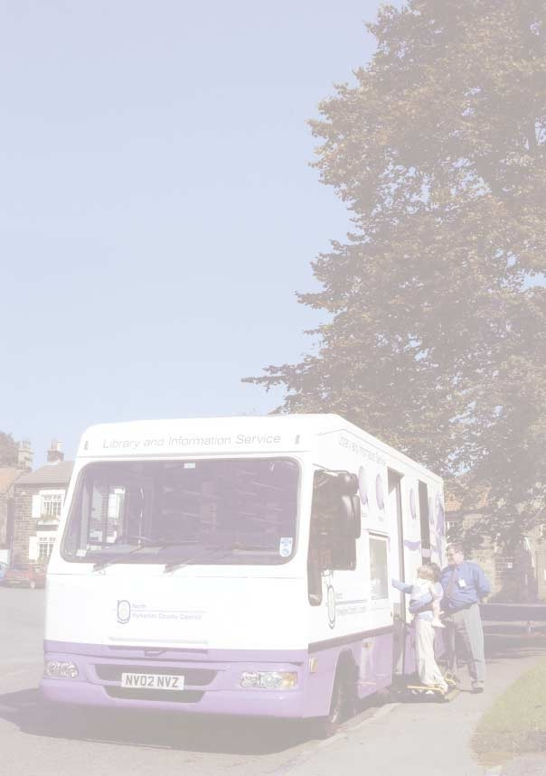

This document is based on research and analysis carried out by Charles Leadbeater with support from John Holden, from the independent policy think tank, Demos.

<!-- PAGE: 3 -->

## Contents

- [Foreword by Minister of State for the Arts](#page-4) (p. 4)
- [Executive Summary](#page-6) (p. 6)
- [1 Introduction](#page-12) (p. 12)
- [2 The Position of Libraries](#page-14) (p. 14)
- [3 Libraries' Modern Mission](#page-21) (p. 21)
- [4 Books, Reading and Learning](#page-24) (p. 24)
- [5 Digital Citizenship](#page-34) (p. 34)
- [6 Community and Civic Values](#page-38) (p. 38)
- [7 Delivering Change](#page-43) (p. 43)
- [Appendix A -- Glossary](#page-52) (p. 52)
- [Appendix B -- Acknowledgments](#page-55) (p. 55)

<!-- PAGE: 4 -->

## Foreword by Minister of State for the Arts

*Tessa Blackstone, Minister of State for the Arts*

Going to the library to borrow books and find information has been a part of our way of life for well over a hundred years. We can be justifiably proud of our public libraries. As Minister of State for the Arts, I consider it a privilege to have responsibility for the public library service. Over the past year I have had the opportunity to take a close look at the range of services on offer today in our libraries and the impact they are making on people's lives.

This has convinced me that the public library service is every bit as important today as it was when the first libraries opened. Equality of access to information and to learning is vital if we are to offer everyone the opportunity to achieve their full potential. This is all the more true in a society where we recognise that learning must be a habit for life, not just something which happens at certain points in our lives.

One of the triggers of a desire for lifelong learning comes from the pure enjoyment of reading, which libraries can help to foster. As we move towards a more knowledge-based society driven by digital technologies, the need to ensure access to information for everyone adds a new dimension. December 2002 saw the completion of The People's Network programme to create ICT learning centres in all public libraries and now 52,000,000 online hours are available to library users throughout England. By adopting UK online centre status, libraries are playing a vital role in delivering the Government's commitment to universal internet access.

> My ambition is to take this vision of what libraries can offer to a wider audience, to work across government, with local authorities and other partners to begin to raise the standards of all public library services and to ensure that the best continue to evolve.

<!-- PAGE: 5 -->

During the past year eight library authorities have received Beacon Council awards for their community library services. Others too are worthy of praise. Inspections carried out by the Audit Commission and other assessments show this to be the case. However, they also show that other local authorities have failed to provide a modern library service of high quality which is attractive to readers. Nor have they recognised the full potential that exists in the public library service to support their own corporate agendas and in so doing contribute to wider government objectives on social inclusion, education and modernisation. Local authorities collectively spend some £780 million annually on public library services. This is more than twice the combined expenditure of the Arts Council and Sport England and three and a half times the annual expenditure by local authorities on museums and galleries. It is vital that this substantial sum provides good value for money and makes a positive impact on the communities libraries serve.

Framework for the Future is a long-term strategic vision for the public library service, which has been put together following extensive consultation with Resource (The Council for Museums, Archives and Libraries), the library community including the Advisory Council on Libraries, The Chartered Institute of Library and Information Professionals, The Society of Chief Librarians and other key stakeholders in the education, community and voluntary sectors. The proposals are presented as a framework to encourage imaginative innovation and greater operational effectiveness and efficiency, adapted to local need and circumstance. I am grateful to the many people who have helped us formulate them.

My ambition is to take this vision of what libraries can offer to a wider audience, to work across government, with local authorities and other partners to begin to raise the standards of all public library services and to ensure that the best continue to evolve. The public library community has asked for clear guidance and leadership from the centre and we have responded. Resource is to publish an action plan, which will set out the first phase of implementation.

I firmly believe that if we focus on this vision we will deliver a public library service able to respond to the needs of society at the beginning of the 21st century in the way our Victorian forebears did when public libraries were first launched. If we succeed, our public libraries will continue to attract admiration and to be emulated around the world.

**Tessa Blackstone**

<!-- PAGE: 6 -->

## Executive Summary

### Introduction

**1.** Libraries are a much valued public institution built around a shared ideal: to make available resources that can be used by all members of the community to stimulate imagination and inquiry, through literature and reference, for culture and commerce. They are open to all and should benefit most those least able to afford private provision.

**2.** More people go to the library than to cinemas or football grounds. The public library service is a huge asset handed down by generations of social reformers. Its role is just as relevant in the twenty-first century as in the nineteenth.

**3.** Framework for the Future will help local and library authorities agree on the modern mission for this vital service with central government and their local communities. It will give the public library service network a shared sense of purpose. It concentrates on libraries' roles in developing reading and learning, digital skills and services, community cohesion and civic values.

**4.** Framework for the Future is the Government's vision for the public library service based on extensive consultation with Resource (The Council for Museums, Archives and Libraries), library authorities, professional and advisory bodies, including the Advisory Council on Libraries (ACL), the Chartered Institute of Library and Information Professionals (CILIP), and the Society of Chief Librarians (SCL) and other key stakeholder organisations, as well as libraries' partners in national and local government.

### The Position of Libraries

**5.** Libraries have four key strengths. They offer neutral welcoming community space and support active citizenship. They hold enormous stocks of material. This ranges beyond books to include DVDs, videos, CDs and computer software. National Lottery investment has equipped all public libraries in the UK with ICT infrastructure offering public internet access. They offer a wide range of services. As well as lending books, they operate as community centres of formal and informal learning. They promote reading across the age range starting with young babies and continuing through adulthood. They provide access to information and advice. And they are run by committed staff.

**6.** Libraries have the potential to do still more. Knowledge, skills and information are becoming more important to our lives economically, socially and as citizens. Libraries have a central role to play in ensuring everyone has access to the resources, information and knowledge they need -- particularly those groups in society who will otherwise be disadvantaged, including people who are less affluent and people with literacy problems.

**7.** The best libraries are showing the way forward. Librarians are developing new skills to help library users access ICT and use the internet. There has been a big expansion in reader development work. Eye-catching new library buildings have opened in a number of cities and other places are seeking radically to re-define the ways in which library services are delivered.

**8.** But the innovation is not evenly spread and is frequently short-lived because of a number of constraints. The public library service in England is run by 149 separate library <!-- PAGE: 7 --> authorities operating through 3,500 public libraries, including mobile services. It is difficult for national policy makers to communicate with the public library service as a whole and opportunities for local innovation to be translated into national programmes which attract public funding may be lost.

**9.** Fragmentation of this kind impedes the spread of good practice between authorities. Within local authorities, libraries are frequently part of a much larger department. Innovative authorities recognise the role libraries can play in the wider corporate agenda but in other authorities they can be overlooked and undervalued.

**10.** The Audit Commission Report, *Building Better Library Services*, May 2002, points to a decline in library visits and book loans. It notes a tendency amongst libraries to focus on current users rather than non-users, and patterns of opening hours which do not match the needs of would-be users.

**11.** Libraries also face intense competition in recruiting and retaining staff. Graduate librarians are attracted by private sector salaries. There has been little turnover of the workforce at senior level, promotion opportunities are limited and there is an urgent need to develop a new generation of library leaders.

### Libraries' Modern Mission

**12.** Libraries need a modern mission. They need constantly to renew and communicate their purpose to the communities they serve. Their modern mission should be based on:

- Evolution: building on libraries' traditional core skills in promoting reading, informal learning and self-help
- Public value: focusing on areas where public intervention will deliver the largest benefits to society including support for adult literacy and pre-school learning
- Distinctiveness: building on libraries' open, neutral and self-help culture. They should not duplicate the efforts of other public and private sector providers but complement them through partnership working
- Local interpretations of national programmes: developing national programmes which will raise the profile of the public library service as a whole but which are sufficiently flexible to be adapted to local needs.

**13.** The following three areas of activity meet these criteria and should be at the heart of libraries' modern mission:

- The promotion of reading and informal learning
- Access to digital skills and services including e-government
- Measures to tackle social exclusion, build community identity and develop citizenship.

### Books, Learning and Reading

**14.** Some libraries can be proud of the range and comprehensiveness of their book stock. But, the Audit Commission Report noted that only 59% of users find the book they come to borrow or use, an under-supply in some types of book particularly those of appeal to younger readers, and a reduction in book buying. The report also notes that stock could be managed more effectively in one-third of the authorities inspected.

**15.** This matters because reading is ever more important in modern life. The rise of the internet has not displaced reading since most <!-- PAGE: 8 --> web pages are text based. People cannot be active or informed citizens unless they can read. Reading is a pre-requisite for almost all cultural and social activities.

**16.** Innovative libraries recognise this and are integrating reading and learning strategies. Reader development strategies have become far more widespread and sophisticated. The emergence of organisations such as The Reading Agency is helping libraries create economies of scale through the development of national programmes, such as the Summer Reading Challenge.

**17.** Public libraries provide a learning network that supports formal education but also extends far beyond it. Reading, literacy and learning are inextricably linked. The self-motivated learning which libraries promote is central to the creation of a lifelong learning culture in which people expect and want to learn throughout their lifetime.

**18.** Research has demonstrated the importance of early learning activities in supporting early cognitive development. The Sure Start programme, which provides co-ordinated and integrated support to young families and their children in disadvantaged areas, has set a target for its projects, which aims to 'increase the use of libraries with parents by young children'. The challenge to libraries is to make this early years provision part of a national early years strategy.

**19.** Many library services are developing closer relationships with school age children to support the work of schools. This is providing a vital complementary learning service, which can be developed further by:

- Working with local schools to provide a planned programme of reader development to enrich and enhance the curriculum
- Forging stronger partnerships with schools in the poorest areas
- Creating a national network of homework clubs -- either physical or online
- Using the national Summer Reading Challenge to help children to continue to learn during the summer vacation and so help minimise the 'summer learning dip'
- Developing a national programme for working with children in care and young offenders institutions.

**20.** As participation rates in further and higher education climb so will the demand from students for study space and support materials. Public libraries can play a critical role as study centres for people engaged in distance learning programmes, including those offered by learndirect, where libraries provide both access to equipment and staff trained in learner support, and for students returning home in university vacations.

**21.** Libraries also have a vital role to play in supporting adults with basic literacy problems. Seven million adults in England have levels of attainment in reading and writing lower than that expected for children aged eleven. The Government's Skills for Life strategy aims to improve the literacy, language and numeracy skills of 1.5 million adults by 2007. Libraries are ideally placed to recognise and support people who might benefit from tuition.

**22.** DCMS and DfES, working with Resource, the National Learning and Skills Council and the National Literacy Trust, will continue to explore ways in which libraries can support adult basic skills provision.

<!-- PAGE: 9 -->

### Digital Citizenship

**23.** Lottery funding from the New Opportunities Fund has enabled almost all public libraries in England to establish UK online learning centres by the end of December 2002, as well as providing library staff with computer literacy and learner support skills. A related £50 million programme is creating online content. The People's Network in public libraries has a vital role to play in delivering the Government's commitment to universal access to the internet and the provision of e-government services.

**24.** Resource has hosted wide-ranging discussions with library authorities on how The People's Network should develop. Ideas emerging include:

- Communities online: public libraries could offer to create, host and manage websites for local community groups
- Culture Online: Culture Online will create new online content and interactive services. Libraries have a role in providing access and in generating new content
- National content: Resource could act as a central agent brokering national online content agreements on behalf of the public library service
- Alliances with broadcasters: libraries could be an important physical point of contact for people learning through broadcasters' online services
- Information: Resource will consider the scope for a national service to answer queries online building on similar services already offered by some library authorities.

**25.** Resource is developing plans for the future services to be provided through libraries. These plans will address the need for central development of national services and support for delivery of local services.

### Community and Civic Values

**26.** Libraries are public anchors for neighbourhoods and communities. For the majority of the population, libraries are acknowledged as safe, welcoming, neutral spaces open to all in the community. For libraries to continue to play this role in civic life they have to remain relevant to the needs of the communities they serve.

**27.** Libraries face a number of pressing challenges: renewing the building stock and reaching non-users while continuing to meet the needs of existing users. Well used and attractive library buildings draw people to town centres and so contribute to economic activity while providing people with personal space which is an alternative to shopping and commercial entertainment. Some new library buildings have been a result of successful Private Finance Initiatives. Elsewhere authorities have used imaginative design principles to modernise and improve ease of access to services. There are valuable lessons to be learned from these initiatives, which have unlocked new sources of funding. DCMS and Resource propose to work together to disseminate good practice from these.

**28.** Libraries need to re-double their efforts to reach non-users. One route to non-users is through collaboration with other public services, for example by co-locating public libraries with other services such as education, social services, health or leisure services.

**29.** Library authorities need to survey and review the needs of the communities they serve, <!-- PAGE: 10 --> focusing particularly on the needs of the people who do not currently use libraries but might be attracted to do so and might disproportionately benefit from the services on offer. They should be considered as a means of developing and implementing the local authority community strategy.

### Delivering Change

**30.** Framework for the Future is seeking to develop a new partnership for delivery between central and local government. Local authorities must retain their statutory duty to provide a comprehensive and efficient library service, taking account of local needs and circumstances. The role of central government is to guide, support and set the standard for that service.

**31.** Delivery of this new strategic framework will require:

- Greater recognition by central and local government of the role public libraries can play in the delivery of key public service priorities
- A strong central capacity to speak for the public library service, to champion innovation and to spread good practice. Resource is the strategic body empowered to advise government and the library sector on the long-term development of museums, archives and libraries
- A strengthened regional capacity to support local service development and help libraries to build cross-sectoral partnerships
- Simpler and streamlined arrangements for setting standards, planning and inspecting services in order to drive continuous improvement in public library services
- A new relationship with the business community.

**32.** DCMS will lead action in all these areas with Resource and the library community. Resource will publish an action plan in spring 2003 setting out how it will implement this new strategic framework.

<!-- PAGE: 11 -->

> Imagine a place through which every newborn baby is welcomed into the community with a gift of books to help start a lifelong journey of learning...
>
> Imagine a place you can walk into, without anyone asking who you are or why you're there, that is warm, clean, safe and welcoming...
>
> This is not a shop but it offers people as much choice as a modern bookstore...
>
> Here you can get advice about careers or look for a job, find out about your local council, consult an encyclopaedia, read a national newspaper or borrow a recording of the latest music...
>
> This is not a college but it's a place where you can learn to use a computer, access the internet and discover new worlds of knowledge...
>
> And if you cannot get to these places, because you live in a remote rural area or have difficulty leaving your home, a mobile service will come to you.
>
> And much of this is free at the point of delivery.
>
> There are places like this all over the country: public libraries.
>
> *All of the above are examples drawn from what libraries are doing right now.*

<!-- PAGE: 12 -->

## 1 Introduction

**1.1** Our public libraries were built on a central ideal: to make available shared resources that could be used by all members of the community to stimulate imagination and inquiry, through literature and reference, for culture and commerce. Libraries offer a public service: they are open to all and should benefit most those who are least able to afford private provision. Libraries work by giving people enormous choice over how they can use the shared resources for their own ends. Libraries, like parks, are shared spaces in which people can choose from any number of activities. It is that combination of community and choice, public provision for private pleasure, which makes libraries so special.

**1.2** Libraries are such a part of our way of life that it is easy to take them for granted. More people go to libraries than cinemas. Visits to libraries outnumber visits to professional football grounds. The public library system is a huge asset handed down by generations of social reformers. If we did not have libraries we would be investing huge sums to create them afresh. In the twenty-first century libraries have great potential to play an even more critical role, helping to create a culture of continuous learning and enabling everyone to access, navigate and enjoy the wealth of material available on the internet. That potential is symbolised by inspiring new libraries in Peckham and Bournemouth, March and Norwich and exciting developments planned in Birmingham and Cambridge. It is apparent in the services offered by the Beacon library authorities and other innovatory services up and down the country.

**1.3** Framework for the Future should help local and library authorities agree on shared priorities with central government and their local communities. This is not a blueprint with detailed targets for how libraries should achieve these goals. The aim is to provide the library service as a whole with a shared sense of purpose. That should allow libraries to make more of their combined efforts in promoting learning, literacy and access to information technology and combating social exclusion.

**1.4** These goals will take time to achieve through a process of evolutionary change. This may require library authorities to look critically at how they use their existing resources and arrive at decisions locally about the balance of priorities. Over time we expect them to attract new sources of funding into the library service as others appreciate the part that libraries have to play in delivering their agendas.

**1.5** The framework should strengthen libraries by guiding them to find local solutions for national policy priorities. It encourages libraries to use their distinctive strengths and capabilities to tackle significant social issues such as adult literacy, access to information technology and combating social exclusion.

**1.6** That renewed sense of mission will require a new relationship between the local governance of libraries, regional partnerships to share good practice and national initiatives through which libraries can combine to make a greater impact on national life.

<!-- PAGE: 13 -->

**1.7** Framework for the Future concentrates on libraries' roles in developing reading and learning, digital skills and services, community cohesion and civic values. It should help:

- Guide local authorities in integrating libraries into their corporate strategies
- Clarify the distinctive contribution which libraries can make to delivering broader government objectives and targets on education, modernisation and social inclusion
- Focus professional bodies concerned with staff development and training
- Make it easier for libraries to collaborate regionally
- Help forge mutually beneficial links between public libraries and the formal learning sector
- Help forge partnerships with national agencies with goals that libraries share.

Libraries are such a part of our way of life that it is easy to take them for granted. More people go to libraries than cinemas. Visits to libraries outnumber visits to professional football grounds.

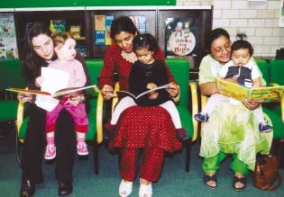

*Supporting early learning. Courtesy of London Borough of Sutton Library, Heritage and Registration Services.*

**1.8** This framework is the Government's vision for how libraries should develop as supported by Resource (The Council for Museums, Archives and Libraries). It was developed through extensive consultation with library authorities, professional and advisory bodies, including the Advisory Council on Libraries (ACL), the Chartered Institute of Library and Information Professionals (CILIP), and the Society of Chief Librarians (SCL) and other key stakeholder organisations, as well as libraries' partners in national and local government.

**1.9** Libraries will prosper most and benefit the communities they serve if they can communicate and deliver a clear sense of mission. This framework is designed to help libraries to work with their current and future funders, partners and users to agree on that mission and then organise to deliver it.

<!-- PAGE: 14 -->

## 2 The Position of Libraries

> ### Case Study: Bournemouth Central Library
>
> Bournemouth's new Central Library is based in a bold, light, open modern building. It is already starting to change the town.
>
> There are fifty personal computers dotted around the building. In the foyer is a new café. An express area is designed for people to browse and choose from the most popular material, which includes videos, DVDs, CDs, as well as books. Teenagers gather in an area that they helped to design. The building is light but quiet and so an excellent place for learning. A large proportion of the people coming into the library use it for study in the broadest sense of the word, rather than to take out books. Since the opening visitor numbers have more than doubled. Book issues have risen by about 10%. The computers are used for about 2,500 hours a week.
>
> The South East England Regional Development Agency is studying plans to create a pedestrian piazza outside the library, which could be used for cultural events. That in turn is attracting local businesses. Investment in public space is creating the backdrop for economic growth.
>
> The new library building has been funded through a Private Finance Initiative scheme.
>
> > 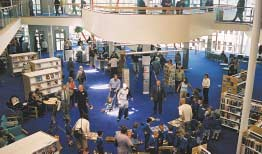
>
> *Bournemouth Central Library courtesy of Bournemouth Libraries, Leisure and Tourism Directorate. Photographer: John Tardiff of Arthouse.*

### Historic strengths, future potential

**2.1** There are four key strengths of libraries. They can be understood as the four "S"s.

**2.2** First, libraries create, both within and without, spaces in which communities can flourish. There are some 3,500 public libraries in England including mobiles and those which open part time. In addition to this there are close to 17,000 service points including those in community centres, sheltered accommodation, playgroups, leisure centres and youth groups. Libraries are used for meetings, performances, displays, readings and debates. Indeed increasingly, good libraries are designed with that in mind. Well run libraries help create a sense of community. They are open to all, offer safe, welcoming space and support active citizenship. The recent Beacon Council programme on Libraries as a Community Resource highlighted this.

> ### Case Study: Community Libraries
>
> The Dyke House Community Library and Resource Centre was set up in Hartlepool twelve years ago on an estate with high unemployment, crime and many single parent families. The library now provides books including talking books, videos and CDs, as well as a home for a variety of community activities and courses and free advice on employment issues.
>
> The library in the Liverpool 8 Community Law Centre serves both users and lawyers and provides much needed quiet study space. Merton libraries run special projects for refugees and asylum seekers.

<!-- PAGE: 15 -->

**2.3** Second, public libraries hold enormous stocks of materials for people to draw upon. In 2001 they issued 430 million items. The book stock is central to what public libraries offer. Libraries must have a rich and varied range of stock if they are to meet the needs of their users and attract new people. Libraries hold current titles and those which are out of print. They enable the reader to read around the subject. And if a book is not held it can be borrowed through inter-library loan. In recent years the stock in libraries has been expanded to include DVDs, videos, CDs, computer games and software. The National Lottery funded £120 million investment in The People's Network has created an infrastructure of computers and communications, which is akin to creating millions of metres of new shelving, providing access to such a wealth of material held in other libraries as well as the World Wide Web. From the end of December 2002 almost all public libraries in England qualify as UK online centres offering internet and e-mail access and other online services for all.

*Promoting reading. Courtesy of London Borough of Sutton Library, Heritage and Registration Services.*

**2.4** Third, libraries increasingly provide added- value services, which extend well beyond the loan of books. That is one reason why public libraries are not just publicly funded versions of bookshops. They take on roles bookshops never would.

**2.5** Libraries have always been community centres of learning. Many deliver courses in conjunction with Colleges of Further Education or run homework clubs. Increasingly they are accredited as learndirect centres offering access to equipment, the full range of learndirect courses and staff trained in learner support skills. DCMS, DfES, Resource and learndirect/Ufi are currently developing a programme of online services including taster sessions to help people diagnose their ICT training needs and then receive the training they need. But just as important, libraries allow people to learn informally or at their own pace, without having to study for a qualification. Library services run a wide <!-- PAGE: 16 --> range of programmes designed to encourage reading especially among pre-school children, such as Bookstart, where libraries work with health visitors to provide parents and babies with packs of reading materials. Libraries provide services for local businesses, prisons and young offenders institutions, schools developing reading programmes and social services departments working with young people in care or old people who are housebound. Libraries are not just buildings. They are increasingly vital service centres for a host of information-related needs.

**2.6** Finally, all these roles depend on library staff. Libraries employ a committed workforce that is animated by public service values; to help citizens gain access to information and skills as well as the pleasures of reading. Library staff increasingly need to draw on a wide range of skills: offering learner support for homework clubs or to people inexperienced in use of ICT; drawing on their knowledge of the book stock to advise and using information retrieval skills across all subject areas. The more that libraries deliver through added-value services, partnerships and outreach into the community, the more success will depend on the outlook, skills and attitudes of the library workforce.

**2.7** The most impressive improvements in libraries have come when managers have brought staff with them in a process of change, by helping to equip staff with skills to deliver a clear vision for improving services. New buildings, good stock, open spaces for the community matter, but without good leadership and staff commitment they will amount to little.

### Potential

**2.8** Libraries have a huge opportunity to play an even more central role in future.

**2.9** We live in a society in which knowledge, skills and information are becoming more important to our lives, economically, socially and as citizens. Jobs in manufacturing and services increasingly demand higher skills, the ability to use computers and the capacity for continual on the job learning. Communities of interest are often formed around hobbies, courses and shared tastes in literature, and learning interests, such as local history. The ability to make sense of and use the welter of information available to us from the media and the internet is vital to our ability to make choices and exercise our democratic rights as citizens.

**2.10** However, access to and the ability to use information and knowledge are not equally distributed. About seven million adults in England are judged to be functionally illiterate. Affluent families are far more likely to be able to give their children access to books, computers and the internet than poorer families. If we do not guard against it, the economic returns from knowledge and skills will go disproportionately to those groups and places that are already rich in both.

**2.11** In future, libraries will have a critical role in helping promote greater equality of access to and capability in using information, engaging in learning and acquiring knowledge. They will act as gateways to knowledge held in other institutions, such as universities and colleges, museums and archives as cultural and learning resources become more widely accessible. That will place new emphasis on the skills of librarians in understanding user needs and navigating through the resources to satisfy those needs.

<!-- PAGE: 17 -->

**2.12** Libraries' capacity to take on this wider role will be enhanced by digital technologies. Libraries already provide people with basic access to the internet. In future, their role could be expanded with services to host websites for local community groups online, to facilitate community online discussions, to publish local authors and poets and to guide people to a vast array of material available across the internet. Libraries could become local mediators, helping people develop their information literacy skills, facilitators, aggregators and publishers of online content. Through local libraries, users could gain access to rich databases of ideas, advice, as well as music, photographs and videos.

**2.13** As the hardware of The People's Network is put in place, libraries, jointly and individually, will need to address how that infrastructure should be used, to maximise participation and spread the ability to use it creatively.

We live in a society in which knowledge, skills and information are becoming more important to our lives, economically, socially and as citizens.

### Innovation

**2.14** There is much to celebrate. At the national level, investment in The People's Network of computers and internet connections, supported through the Lottery by the New Opportunities Fund, is attracting new users and has helped to give librarians new skills to develop new services, often in partnership with educationalists and training providers.

**2.15** New buildings such as the libraries in Peckham, Bournemouth and Norwich, as well as ambitious plans in Birmingham and Cambridge have caught the public imagination through the way they contribute to revitalised civic spaces. Renewal plans such as Tower Hamlets' Idea Stores and Hampshire's Discovery Centres are exciting huge interest among partner organisations and other council departments.

<!-- PAGE: 18 -->

> ### Case Study: Norfolk & Norwich Millennium Library
>
> The Norfolk & Norwich Millennium Library is largely open plan with books for loan and for reference stored together for ease of access. Study spaces and computers are spread throughout the building. There are dedicated areas for children, local history and business information, as well as a special express service in the lobby to allow people to browse and borrow popular items through a self-service check out. This area, which is open until 10.30pm each night, allows people to choose from an array of classic and best-selling paperbacks, arranged in bookshop style displays as well as use computers for e-mail and short enquiries. Staff were encouraged to play a role in redesigning the library and new training programmes for customer care and information technology were introduced. Staff now work in largely self-directed and self-managing teams taking responsibility for different aspects of the service.
>
> > 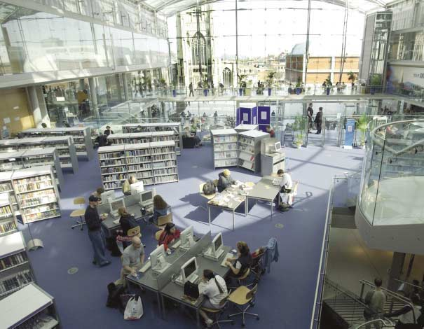
>
> *Library users at the Norfolk & Norwich Millennium Library. Courtesy of Norfolk Library and Information Service. Photographer: Jacqueline Wyatt Photography.*

<!-- PAGE: 19 -->

**2.16** The framework of Annual Library Plans and Public Library Standards has evolved to drive more coherent strategies for improvement. Charitable bodies such as The Reading Agency, private organisations like Opening the Book, foundations such as the Bill & Melinda Gates Foundation, Paul Hamlyn Foundation and Wolfson Foundation and bodies such as CILIP and the SCL are also making vital contributions to promote new thinking about library services.

**2.17** The Beacon Council programme, Libraries as a Community Resource, has raised the profile of the public library service and helped disseminate good practice. However too much of that innovation is patchy, uneven and short lived. Central and local government must work together to find better ways for more libraries to improve significantly their services. To do that we have to understand and address the constraints that often hold libraries back.

### Constraints and challenges

**2.18** Despite its strengths and resilience, the public library system faces a number of challenges that must be addressed if it is to realise its potential to the full in the decade to come.

**2.19** One problem is fragmentation. There is a danger of drift and stagnation in a highly fragmented system, in which 149 library authorities run more than 3,000 public libraries. This makes opportunities for libraries to contribute to developing and delivering national policy a particular challenge. Potential funders from the private sector and other prospective partners make the same point.

**2.20** Fragmentation could become more of a disadvantage as digital technologies play a larger role. Information technology systems need common standards and protocols. Libraries will need to acquire rights to digital content such as music and film archives. There will be many occasions when these agreements are best negotiated nationally.

**2.21** Fragmentation makes learning difficult. There are wide disparities between the performances of different library authorities, not all of which can be attributed to funding differences. However the mechanisms for identifying, distilling and disseminating good practice are weak compared with some other public services. Libraries need more effective machinery for identifying and correcting failure and finding and spreading good ideas. Without that, innovations will be trapped in pockets.

**2.22** Library leaders have complained of a lack of national advocacy for libraries both within policy making and externally to the population at large. As a result libraries run the risk of being taken for granted or overlooked. The contrast with sports and the arts is instructive. More people go to libraries than attend professional football matches. More people visit libraries than go to the theatre. Yet the sports and the arts have national role models and advocates who make a high profile case for their field being seen as a vital part of national life. Libraries lack such advocates.

**2.23** At a local level, libraries are often submerged within much larger departments within local authorities. Many of the most innovative local authorities, including the Beacon library authorities, recognise the role that libraries can play within their corporate strategies. Libraries have responded to that. However in many other authorities, the potential of library services is not being tapped.

<!-- PAGE: 20 -->

**2.24** While policy for public libraries rests with the DCMS, core funding for libraries is provided to local authorities as part of their unhypothecated block grant allocation from ODPM. This means that there are no specific allocations to libraries. Other important funding comes from the Department for Education and Skills. Central government is also providing local authorities with an additional £675 million in 2001-2006, to ensure that all local authority services, including libraries, are electronically enabled by 2005.

**2.25** Libraries face mounting competition on several fronts. The Audit Commission Report *Building Better Library Services*, published in May 2002, notes that since 1992/93 visits to libraries have fallen by 17% and loans of books by almost one quarter. Twenty-three per cent fewer people are using libraries for borrowing than was the case three years ago. Book issues, which are but one measure of library performance, have fallen by about 25% since 1992/93. Over the same period consumer books sales have risen by 25% in real terms as publishers and retailers have responded to the end of the Net Book Agreement with more aggressive pricing strategies, longer opening hours and new retail formats. The Audit Commission report, which is drawn from the first thirty-six Best Value inspections including library services, also notes a tendency for libraries to focus on current users rather than non-users. At the same time there has been a decline in the proportion of library users aged under 55. Concentration on current users is reflected in the book stock which, the report found, had greater appeal amongst older readers and in opening hours where non-users consistently called for more weekend and late evening opening.

> ### Building Better Library Services -- Audit Commission, May 2002
>
> Library services need to direct their resources at delivering the services that local people want, in particular:
>
> - Providing the books and information services that people want and need
> - Maximising accessibility by opening at times that suit local people, making better use of joint-use facilities, and using the internet to provide access to their services to people at home
> - Making services easy and pleasant to use -- in particular looking at what attracts people to bookshops
> - Building awareness among non-users of the services they have on offer.

**2.26** Libraries also face more intense competition in recruiting and retaining the staff they need. Librarians' skills have become more valuable in businesses that thrive on information processing and retrieval. As a result library school graduates are going into the private sector. At more senior levels, there has been very little turnover in the library workforce. There has been only a modest infusion of young people and new skills. With the exception of the Lottery funded ICT training programme for library staff, investment in continuous development is limited. A generation of leaders recruited into the library profession thirty or more years ago is due to retire within the next few years. Developing a new generation of library leaders fully trained in business management and marketing skills is thus an urgent priority.

<!-- PAGE: 21 -->

## 3 Libraries' Modern Mission

> ### Case Study: Idea Stores in Tower Hamlets
>
> The London Borough of Tower Hamlets council wants to create a new kind of library: the Idea Store. The authority embarked on the radical overhaul after it found only 15% of Tower Hamlets residents were regular users of its libraries. Yet the unmet need for lifelong learning was huge: 24% of residents needed help with basic skills.
>
> The first Idea Store opened in 2002. It is open 7 days a week for 71 hours. In the foyer people can study, read or have lunch in a large café. Across the hall a bank of internet computers is in constant use. Staff at the library are drawn from adult education and libraries: they form a single, integrated team and wear the same T-shirts. The first, prototype Idea Store is partly a refurbished library, which is a century old. But the bright colours and modern furniture give the place the feel of a record shop or internet café. Visitor figures have trebled, and issues are up by 65% and rising.
>
> Idea Stores are a modern reinterpretation of what a library can be. Around the core stock of books and information, the staff are helping people to learn, search for jobs, access public services or simply to enjoy themselves. In the course of the next few years the Idea Stores brand will be rolled out across the whole authority in a network of purpose-built buildings, in time replacing all the current library building stock.
>
> > 
>
> *Prototype Idea Store at Bow. Courtesy of London Borough of Tower Hamlets.*

<!-- PAGE: 22 -->

**3.1** Idea Stores is just one example of how libraries are renewing themselves around a new image, service and sense of purpose. There are numerous others. Hampshire is planning to create Discovery Centres, which will combine libraries with museums, health facilities, leisure activities and e-government services. The idea is that through visiting libraries people should discover unexpected links that draw them into new activities. Liverpool Libraries and Information Services offers Libraries Plus, in which all libraries offer a link to additional services whether sport, health, education or business support.

**3.2** But library renewal does not have to involve re-branding. Staffordshire is a good example of renewal from within a traditional library service. The Best Value Review: Library Vision, final report in January 2001, called for services to be reshaped around a clear understanding of the needs of modern users and delivered through partnerships with other services. A major countywide library refurbishment programme has been launched. Mobile library routes were redrawn to meet shifts in population. New collection and drop off points are being opened. Online membership, requests and a 24-hour telephone renewal service were introduced. Most libraries are open on Saturday afternoons and Sundays.

### How libraries renew

**3.3** Several key messages stand out from these and other examples of how library authorities are attempting to renew themselves:

- There is no single vision for the future image and branding of libraries. These need to be devised and tailored to local circumstances
- Having a vision of the service is indispensable to animate staff, connect with customers, attract partners and draw in funding
- The vision has to start from a well thought through understanding of the modern needs of users and non-users, based on research and direct engagement with them
- The modern services libraries should offer increasingly depend on partnerships with education, learning, leisure, health and e-government. Thriving libraries are invariably co-located with other services and increasingly employ teams comprising people from different services
- Libraries are places: their tangible look and feel still matters hugely to people. Libraries need to be conveniently located, in buildings which are well appointed and which open when people need them, including weekends and evenings
- Successful library services communicate their mission to users through their look, feel, image and outreach work. Libraries need to be seen as open, welcoming places, which is why the presence of cafés, toilets, areas for families and young children are so vital
- Even the most radical new ideas for libraries are evolutionary: they build on the historic strengths of libraries. New brands such as Idea Stores and Discovery Centres reinterpret the role of libraries in a modern setting
- Successful libraries not standalone services. They thrive when they play a clear role within local authority strategies to promote learning and social cohesion. The more libraries can show they contribute to wider social objectives, the more likely they are to attract support.

<!-- PAGE: 23 -->

**3.4** Libraries thrive best with a sense of mission. The future success of libraries depends on their continually renewing and communicating that sense of mission for a very different society. This is a society in which people have access to a much wider range of sources for pleasure, entertainment, information and learning but in which there are social inequalities, particularly of access to and of capability in reading, learning and using digital services.

**3.5** As a consequence, the modern mission for libraries should be based on four main factors:

1) Evolution Libraries have to build upon their distinctive and long-standing capabilities in promoting reading, informal learning and self-help. Libraries' new roles and services should emerge from their traditional core skills.

2) Public value Libraries should focus on areas where public intervention will deliver large spin-off benefits for the rest of society, such as promoting adult literacy and pre-school learning.

3) Distinctiveness Libraries should build upon their open, neutral and self-help culture. They should not duplicate the efforts of other public and private sector providers. Libraries need to play to their distinctive strengths but invariably in partnership with others who have different skills.

4) Local interpretations of national national offers must be flexible enough to be adapted to local needs, styles and priorities. The People's Network is a good example of how a national programme to provide people with public access to the internet and digital skills, has been taken up in many different ways locally. Libraries need to devise and deliver more programmes of this kind.

**3.6** Three main areas fit these four criteria that should guide the libraries in developing their modern mission:

- The promotion of reading and informal learning
- Access to digital skills and services including e-government
- Measures to tackle social exclusion, build community identity and develop citizenship.

**3.7** These three themes will be at the heart of the library's modern mission.

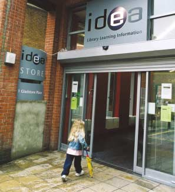

*Prototype Idea Store at Bow. Courtesy of London Borough of Tower Hamlets.*

<!-- PAGE: 24 -->

## 4 Books, Reading and Learning

### Quality book stock

**4.1** Libraries and books are synonymous in the minds of most library users. A library cannot claim to be successful unless it has a good range of books carefully selected to meet the needs of its community. Many libraries can be justifiably proud of the quality of the book stock, its range and comprehensiveness and their ability to respond quickly to demand. The best libraries are in tune with readers' needs, anticipating demand so that sufficient copies of popular books are available when they are needed and works, which form part of our literary heritage can always be found. However, the Audit Commission report, Building Better Library Services, also pointed to some disappointing findings. Only 59% of users find the book they came to the library to borrow or use. Analysis of the book stock suggests under supply of books, which appeal to a younger audience and a shortage of twentieth-century classics. Spending on books has fallen from 15% to 10% of overall budgets over the past decade and at the same time the report notes that one-third of library authorities could manage stock more effectively including getting stocks on shelves more quickly.

### The importance of reading

**4.2** In modern life reading is becoming more important than ever. Reading stimulates the imagination and develops creativity. It helps develop independence in learning. Reading draws the reader into a continual journey linking related interests.

**4.3** The rise of the internet has not displaced reading. Most web pages are text based. It has encouraged more people to read.

According to consumer surveys the amount of time spent reading has risen. Fifty-two per cent of adults read books to relax or relieve stress, 27% as a form of escapism and 24% as a chance to use the imagination. Two-thirds of adults and over a half of children read books to find things out.

**4.4** The value of reading, however, stretches far beyond the benefits to the individual. It brings social benefits. It is hard for people to be active citizens unless they can read newspapers and government publications. It is hard for people to be informed consumers, unless they can read guarantees, warranties and small print. It is hard for people to enter into contracts and trade unless they can read legal documents. Most cultural activities are enhanced by reading, from visiting the theatre to reading a CD sleeve or a football programme. Reading gives people access to shared conversations and communities and it promotes family bonding. The phrase "Did you read…?" is one of our most commonplace conversational openings.

**4.5** Being unable to read cuts people off: from their own potential and the society around them. Being unable to read in an increasingly text rich culture can lead to social exclusion, with profound consequences socially and economically. More than seven million adults in England are estimated to have literacy problems. Innovative library authorities are integrating reading and learning strategies recognising that the informal self-motivated learning they promote is central to creating the learning habit in society.

**4.6** Thus public libraries' mission to promote the skills, and even more importantly, the appetite, for reading is vital.

<!-- PAGE: 25 -->

> ### Case Study: Bookstart
>
> Bookstart, launched by Booktrust through private sponsorship, was first piloted in Birmingham in 1992 on the principle that it is never too early to introduce children to books. Simple packs were put together to be distributed by health visitors when they make their 7 -- 9 month check on a baby's health. They include a free picture book, a place mat with nursery rhymes, book lists for babies and an invitation to join the local library.
>
> Ten years from its launch, Bookstart has developed into a national programme and academic research shows that Bookstart babies are more confident readers when they start school. Families that had a Bookstart pack are far more likely to take their children to the library, name reading as one of their most enjoyable activities and finish a book once it has been started. At the age of five Bookstart children are far more likely to join in with stories, ask questions about them and relate a story to their own lives.
>
> > 
>
> *Mayor of Royal Borough of Windsor and Maidenhead with parents and babies at Bookstart launch. Courtesy of Royal Borough of Windsor and Maidenhead Library Service.*

### How libraries are making a unique contribution to the reading nation

**4.7** Libraries do not just provide a store of books: they help people experience and enjoy the pleasure of reading. In recent years there has been an important shift in how libraries view and plan their work with reading. As well as its importance as a tool for learning, they have recognised its creative, imaginative role in people's lives. Reader development strategies have become far more widespread, encouraging people to start reading, whether young or old; helping emerging readers to find more interesting material, whether that be teenagers or adult first time readers; connecting people with similar interests to one another through book groups and reading events. Increasingly libraries are developing outreach strategies reaching out to disaffected groups and demonstrating the motivational power of reading.

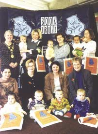

*Promoting reading for pleasure. Courtesy of London Borough of Sutton Library, Heritage and Registration Services.*

<!-- PAGE: 26 -->

> ### Case Study: HM Prison Service and The Big Book Share
>
> All prisons managed by HM Prison Service offer a library service provided by the public library authority. Even the most progressive regimes leave prisoners with a large amount of unoccupied time. As a consequence, reading can be an important leisure activity in prison, especially so when there is an adequate library service to support that need. The Big Book Share is a partnership between Nottingham City Libraries and Information Service, The Reading Agency, HM Prison Nottingham, Marks & Spencer plc's Community Division, East Midlands Arts and 23 children's publishers. Librarians run fortnightly sessions at the prison to help prisoners choose books and support children reading. Prisoners develop reading skills as they read with their children on visits or record a tape of stories for their children to listen to at home.

**4.8** Libraries' approach to reader development is becoming increasingly sophisticated. Library authorities are working together to create new structures enabling programmes to be delivered both regionally and nationally. The Summer Reading Challenge is one example. Until four years ago each library authority developed its own summer reading programme. This is now a national programme, co-ordinated through The Reading Agency (TRA), creating economies of scale and allowing libraries to market their services far more effectively. Another good example occurred in 2002 when The Reading Agency co-ordinated the library contribution to Splash Extra, a government programme of diversionary summer activities for young people at risk of offending. TRA worked with ten English library authorities to deliver its Splash Extra programme, in partnership with local Youth Offending Teams and youth services, which consisted of a varied and largely successful programme of reading- related multimedia arts activities throughout the summer. These reached 2,500 young people within the designated target groups, the majority of whom have never previously set foot in a library, and for whom the world of words, books and reading was unknown, alien or hostile territory.

> ### Case Study: Northamptonshire Libraries
>
> In 2001 Northamptonshire Libraries and Information Service ran a Bookstart programme for babies; a summer reading challenge to encourage school age children to read six books over the holidays; a summer bookbus to visit play schemes and literacy schools; a story festival which involved 7,000 children; online workshops for budding writers; new internet based tools people can use to find new books that might interest them and a variety of local reading clubs.

<!-- PAGE: 27 -->

**4.9** Increasingly ICT is being used to support reader development. Whichbook.net, launched by Opening the Book, allows readers to select works of fiction tailored to their particular interests and preferences. New training programmes are developing. Branching Out, a collaboration between library authorities and Regional Arts Boards, provides regional programmes of activity to promote literature development. Their Reading Futures, a pilot programme funded through the DCMS/Wolfson programme has created a quality framework for planning young people's reading services. In addition, libraries are investing in research to understand better the needs of readers and the impact their reading is having on future attainment.

> ### Case Study: Chatterbooks
>
> Chatterbooks is a national network of reading groups for 4-12 year olds, sponsored by Orange, in partnership with the public library network and was brokered by independent library development agency Launchpad. Chatterbooks aims to inspire young people to read more adventurously and develop confidence in talking about and choosing books. Orange has funded the work needed to create the network, for staff training, as well as a best practice handbook. Orange also funds the provision of high quality reading materials for all children participating in the scheme. Seventy library authorities now participate in Chatterbooks. Orange's feedback on the scheme is highly favourable. It combines corporate profile at the highest level with grassroots activity in all kinds of communities, including some very deprived ones. It also offers Orange staff the chance to get involved as volunteers.

**4.10** The case studies in this section illustrate just some of the different approaches libraries are taking to promote reading to new audiences. Development agencies -- such as The Reading Agency and Opening the Book -- have already played a critical role in changing the way that libraries think and in promoting reader development. Promoting reading in a society is not the job of libraries alone. Best selling authors including the Children's Laureates have done much to make reading accessible and exciting in the past few years. Literary prizes -- Booker, Whitbread, Orange, Carnegie -- promote reading powerfully.

> ### Case Study: Liverpool Libraries and Information Services
>
> Liverpool Libraries and Information Services have worked with excluded black youngsters in Edge Hill and housebound readers to provide them with more choice. It is one of thirty-three authorities involved in the Branching Out project that brings together libraries with publishers and booksellers to promote new literature. It is one of the authorities that took part in promotions organised around the Orange prize.

<!-- PAGE: 28 -->

> ### Case Study: The Novel Route (American Express, West Sussex & Brighton)
>
> The Novel Route is a scheme involving American Express, West Sussex and Brighton Libraries. Arts & Business South East was a crucial partner in the early stages of this project, brokering the arrangement between American Express and the library services. The project has been developed as part of the rollout of Books & Business into the South East, looking at how library/business partnerships could develop in a regional setting, with a focus on creative reading.
>
> A reader development worker leads the lunchtime reading sessions for staff at AMEX's offices in Burgess Hill and Brighton and the local libraries supply the books. The involvement of a reader development worker has meant that groups at both offices can share experiences and also raise the profile of the library. Library staff are involved and develop new skills needed to work in a non-library environment. American Express has provided support, through office space and allowing staff time to attend. The company also intend to fund an end of project event that will bring together employees, librarians and local teachers to celebrate the project and provide a chance to discuss, in convivial surroundings, potential opportunities for future working.

### Public libraries and learning

**4.11** Public libraries provide a learning network that runs parallel with formal education but also extends far beyond it. Public libraries complement and reinforce formal learning, helping to make formal education more effective.

**4.12** The central activity of libraries in promoting reading is a key element of their role in supporting learning. Reading and literacy are inextricably linked and the motivation and enjoyment that reading provides is essential in creating lifelong learners. The kind of informal, self-motivated learning libraries promote is central to the creation of a deeper learning culture in the UK, in which people expect and want to learn, pursue their hobbies and interests, develop their information literacy skills, be creative and gain inspiration, develop vocational and non-vocational skills, well after they have left formal education.

**4.13** Public libraries are part of a broader community of library provision for learners in schools, colleges, universities and in school library services, all of which have clearly identified roles in supporting education. Libraries in businesses and voluntary agencies are also discovering their role in supporting learning. Partnerships between libraries can strengthen the support for the learner who will move from institution to institution in increasingly flexible learning patterns.

<!-- PAGE: 29 -->

### Learning culture

- Learning has to become a habit and a culture, rather than an obligation and imposition.
- Learning has to start before and extend well beyond school and college.
- Learners have to be able to access learning in manageable, flexible packages, suited to their needs as well as being able to enrol on terms and courses.
- People with poor experience of formal education need extra encouragement and small steps to get back on the ladder of learning.

### Libraries' role

Libraries provide an unthreatening environment for self-motivated learning, in which people can pursue their hobbies and interests without necessarily engaging in formal courses. Libraries promote learning as exploration and self-development.

Libraries are one of the few places where young and old, school children, college students and adult learners can all participate in learning.

Libraries allow informal, individual learning, clubs and communities for learning (such as local history) as well as providing a range of short evening and daytime courses.

Libraries are "learning start up" organisations, they should excel at helping people get started with learning, whether those are children or adults returning to learn. Libraries should provide the foundations for a learning culture.

> ### Case Study: March Library, Cambridgeshire
>
> In Cambridgeshire, March library is not a college of further education: but it offers a wide range of courses, the local college has integrated its learning opportunities in March with the learndirect centre of the library. Nor is it a school: but children use it for out of hours study. March library also works closely with tutors working with children excluded from school to provide them with a place to work. The redesigned library is an example of how learning can be made an integral yet informal part of a library service. The new library, opened two years ago, makes this offer to local people: "whatever you want to learn and however you want to learn, whether at home or in a group, we can make it happen for you".
>
> Anyone who wants to learn, no matter what the subject, can talk to a personal learning adviser who will recommend the best approach. Learners can study on their own at a bank of computers, go on a course, sign up for distance learning or simply take away a book. The library runs accredited courses from British Computer Society (ECDL) and OCR (New CLAIT) in addition to learndirect.
>
> > 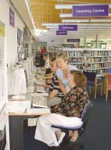
>
> *Learners at March Library. Courtesy of Cambridgeshire County Council Libraries and Information Service.*

<!-- PAGE: 30 -->

**4.14** Libraries are an important network for lifelong, curiosity driven learning. Extensive consultation suggests the public library service should focus its activities on three main areas:

- Supporting early learning
- Supporting pupils and students
- Supporting older students.

### Supporting early learning

**4.15** Research has demonstrated the importance of early learning activities in supporting early cognitive development. Increasingly the role of libraries is being acknowledged and addressed in early years service provision. The Sure Start programme which provides co-ordinated and integrated support to young children and their families in disadvantaged areas is encouraging closer links with public libraries. Sure Start has included a target for each project, which aims to 'increase the use of libraries with parents by young children in Sure Start areas'. Involvement in Sure Start has enabled libraries to increase their early years provision -- in the past two years over one hundred and thirty early years library posts have been created.

> ### Case Study: Peterlee Sure Start
>
> Peterlee Sure Start is working with libraries to improve educational attainments with its 'Read and Play Club'. Peterlee Sure Start's research found that only 6.9% of the pre-school children in the district were gaining access to library services (i.e. having borrowed in the last twelve months). 'Fun' learning materials such as books, videos and toys are provided in the Sure Start Read and Play Clubs. Each child in a Sure Start area has a personalised 'Book Worm' library card. The Sure Start Programme works in tandem with the County Library Service. In six weeks they increased active library membership in children of 0-4 by 100%.

**4.16** The challenge to libraries is to make this a core activity clearly identifying it as an element of the national early years strategy.

### Supporting pupils and students

> ### Case Study: Stockton on Tees Community Libraries
>
> Stockton on Tees' community libraries all house a dedicated homework resource collection, including PCs offering access to the internet and CDs. Homework help sessions are run by trained staff.

**4.17** Many library services are developing closer relationships with school age children to support and complement the work of schools. Hertfordshire library service was one of the first in the country to create homework clubs, which have been running for five years. Page Moss Library in Huyton works with social services to create services for children excluded from school to encourage them to learn in informal ways.

**4.18** Libraries are currently discovering the key role they have to play in delivering Connexions, the Government's new support service for all young people aged 13-19 in England. The programme offers support to young people delivered through access to information and through the personal support offered by a trained personal adviser. Libraries are recognising their role in both of these functions.

> ### Case Study: Birmingham Central Library Connexions
>
> Birmingham Central Library now hosts a Connexions information point. This is the centre of a strong local library strategy for supporting Connexions, which will establish a Connexions team within the library and work closely with Behavioural Support Services who will use referral to the library as an educational extension of their service provision.

<!-- PAGE: 31 -->

> ### Case Study: Bedfordshire Libraries' Homework Centres
>
> Bedfordshire Libraries' Homework Centres are open two evenings a week and are staffed by a Homework Centre Organiser, supported by library staff. The target age group for the Centres' users is 8 -- 13 year olds, although any child needing help with homework is welcome. Each centre is in a library and has a dedicated study area, offers access to stock and a bank of PCs linked to the internet, CDs, word processing and other packages. The Homework Centre staff encourage children to use the most effective resources -- whether books or ICT or helping each other. The first two Homework Centres, launched in 2001, have proved so successful that they are now funded permanently. Two more Homework Centres have opened recently.

**4.19** School Library Services support learning for around three-quarters of school children in England. These services are frequently managed by the public library service and act as a crucial bridging agent between schools and public libraries. Their knowledge of the curriculum can enrich libraries' homework support provision. Frequently they forge partnerships to enable public libraries to work more effectively in supporting literacy and developing reading and increasingly they are providing links at local level between public library ICT learning networks and school ICT provision.

**4.20** Libraries can provide a vital alternative but complementary learning service to support school age children. In the next decade this should involve the library service in:

- Working with local schools in conjunction with Schools Library Services and the School Library Association to provide a planned programme of reader development to enrich and enhance the curriculum
- Forging stronger partnerships with schools in the poorest areas to encourage children from these schools to use libraries
- Creating a national network of homework clubs with every library authority offering a service of some kind to every secondary school in their area. This could take the form of a physical club or access through the library to online resources such as Channel 4's Homework High service
- Using the national Summer Reading Challenge to help children to continue to learn in the long school holidays and so help minimise the 'summer learning dip' which means that the first weeks of autumn term are often taken up with remedial work. This might initially focus on the transition from primary to secondary school. Every child leaving primary school could be invited to the library Summer Reading Challenge
- Developing a national programme for working with children in care and young offenders institutions.

**4.21** Taken together these initiatives could provide a powerful entitlement for school children, which will serve to enhance and support formal educational provision.

<!-- PAGE: 32 -->

> ### Case Study: Boox on the Move
>
> Boox on the Move, a partnership between Leeds Library and Information Services and Barnardo's, supports the information needs of young people in care. Aimed at 13-16 year olds the scheme is about creating a positive reading culture. Originally aimed at meeting sexual health information needs the project has been broadened to cover all aspects of a young person's life.

### Supporting older students

**4.22** One of the most far-reaching strategies to put libraries at the heart of learning has been pursued by a partnership between the public, college and university library services of Sunderland. These libraries have joined forces to create The Libraries Access Sunderland Scheme (LASH). LASH links public, college and university libraries, which gives users access to all facilities. The public libraries now offer one hundred and thirty drop in courses run in conjunction with the City of Sunderland College. Libraries across the city play an important role in delivering outreach work and promoting learning.

**4.23** As participation rates in further and higher education climb so will the demand from students for study space and support materials. Public libraries could play a critical role as study centres for people engaged in distance learning programmes, for example those run by learndirect. The success of the LASH initiative suggests it should be learned from and adapted to other cities developing learning strategies.

> ### Case Study: Adult Basic Skills in Sunderland
>
> Sunderland's library service plays a critical role in the city's strategy for developing adult basic learning. About 43,000 of Sunderland's population of 289,500 are estimated to have literacy levels below the national average. Hendon library was one of the first in the country to create a short intensive basic skills course for adults, ran in partnership with the City of Sunderland College. In Hetton, an area hit by mining closures, a multi-purpose centre will open in 2003: it will comprise a library, Electronic Village Hall, Learning Centre, GP surgeries, housing offices, home care services, sports facilities, Job Linkage, community rooms and café, multi-purpose rooms for social and training opportunities and an Information service.

**4.24** The Government's Skills for Life strategy aims to improve the literacy, language and numeracy skills of 1.5 million adults by 2007. Libraries have demonstrated that they can play a vital role in this programme of adult literacy in a range of ways. They are ideally placed to recognise people who might benefit from tuition and encourage them to find out more, they can incorporate tuition into other services, and the library provides an informal environment for courses.

**4.25** DCMS and DfES working with Resource and the National Learning and Skills Council and the National Literacy Trust, will continue to explore ways in which libraries can support adult basic skills provision.

<!-- PAGE: 33 -->

### Conclusions

**4.26** Promoting reading and informal learning are core library activities. Libraries need to build on these successes to help create a culture of lifelong learning for all. To do that the library service needs to:

- Foster local and regional partnerships to integrate libraries' work on reading and learning with formal education
- Broaden and enrich reader development work, creating new initiatives to promote books and reading for pleasure and for learning
- Work with Sure Start to develop closer links with libraries in early years provision
- Work with local schools to develop homework support services and reader development initiatives
- Provide study facilities and support for students in further and higher education
- Continue to develop libraries' work in supporting adult basic skills
- Build up the capacity of the Reading Agency to expand reader development programmes and to broker national and regional partnerships for the delivery of learning through libraries.

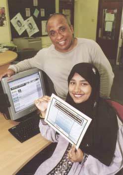

*Supporting Lifelong Learning. Courtesy of London Borough of Barnet Library Service.*

<!-- PAGE: 34 -->

## 5 Digital Citizenship

> ### Case Study: Leeds Community Websites
>
> Leeds Library and Information Services is helping people to create community websites, organised around communities of interest and language as well as geographical communities. Users of the websites can create their own web pages, which both increases democratic engagement and builds ICT skills. Council proposals and decisions are posted on local issues such as planning and schools, and web based feedback and discussion follows. The sites also contain useful information on local services, activities and history.

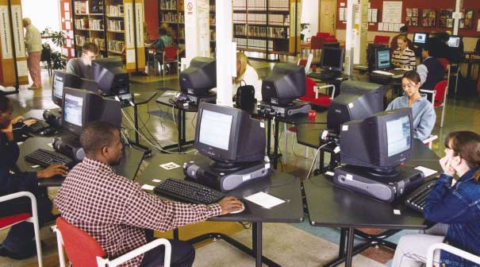

*Open Technology and UK online Centre, Stockton Central Library. Courtesy Stockton on Tees Borough Council, photographer Peter Mernagh Film & Photography.*

**5.1** Public libraries were created 140 years before the internet became a popular activity. Yet in a sign of their ability to adapt, public libraries are at the forefront of devising ways to use digital technologies to promote community and learning. Many people see the internet as a tool of consumerism, to allow people to create more personalised services. Yet it is also a powerful tool for promoting collaboration, sharing and peer-to-peer services. It is in this area, the massive social potential of the internet, that libraries are playing a leading role.

**5.2** The investment in The People's Network has been the first significant step along the way to allowing libraries to fulfil their potential in the digital age. Lottery investment, funded through the New Opportunities Fund, has enabled almost all public libraries in England to establish UK online learning centres by the end of December 2002, as well as providing library staff with computer literacy and learner support skills. A related £50 million programme is creating online content.

<!-- PAGE: 35 -->

**5.3** Trends in internet use point to a potential digital divide. People who are unemployed, who lack access to the internet at work and older people are amongst those currently less inclined to experience the opportunities and benefits offered by online services. The library service has a vital role to play in delivering the Government's commitment to universal access to the internet and the provision of e-government services.

> ### Case Study: London Borough of Sutton Community Information
>
> In the London Borough of Sutton, developments in ICT have made it possible for an extensive computerised community information database to be available not only through PCs in every library but also from home via library service web pages. These web pages also provide links through a '24 hour reference library' to a wealth of regional and national information, including newspapers and media, government information, health and social welfare, legal and consumer advice, and education and lifelong learning. It links residents with council departments enabling them to ask for information or make comments or complaints about services and it gives them a choice of the way in which they can receive a reply.

> ### Case Study: Derbyshire Libraries Mobile Broadband
>
> Derbyshire libraries have offered internet access since 1998. All forty-five libraries are equipped with broadband links, and an award-winning wireless network enables three large mobile libraries to take the internet to twenty-one isolated and disadvantaged communities. A fully web-enabled system enables library users to access the catalogue and conduct transactions online. The library service has a successful record of partnership with private and public sector agencies to create new services, and is central to the local authority's plans to modernise service delivery. Libraries have made great strides in providing ICT and information services to older users, and this has resulted in a range of new initiatives in partnership with the council's social services department. Libraries will become the primary source of information on a wide range of services for older people.

> ### Case Study: Leeds Enquiry Express
>
> Leeds Library and Information Services have created Enquiry Express, a free telephone, fax and e-mail service to allow any library user to ask questions about homework, general knowledge, current affairs or legislation, 24 hours a day, six days a week. They are guaranteed to get a reply within a maximum of 24 hours. Gateshead Borough Council Library Service has just introduced a fully online Ask a Librarian service, which answers queries about local history, services and culture.

**5.4** Through The People's Network libraries are using information technology to:

- Provide access to government services: by 2005 all government services should be accessible online. Libraries will be at the forefront of creating universal access to e-government services. The 3,000 library based UK online centres in England will ensure that everyone has access to the ICT equipment and support they need
- Create new links to local services: libraries are doing far more than deliver access to existing services. The most innovative are creating new services
- Online information services: libraries are using the internet to deliver their own existing services in new ways. As a result they are creating new online communities and activities <!-- PAGE: 36 -->
- Content creation: libraries are using funding from The People's Network to help create content relevant to the local community and providing the opportunity for community groups to create their own content and discussion groups. There is enormous scope for libraries and archives to work together to provide virtual access to their collections of local and family history and in so doing help to shape community identity.

> ### Case Study: Knowsley Local History Intranet
>
> In Knowsley, library staff have created an intranet site available to local schools, which looks at Knowsley in the second world war and the Victorian age. This links the school history curriculum with local history and geography, and with oral history. This developed from an idea proposed by the schools library manager, and has involved the library working with local museums and schools.

**5.5** Resource has hosted wide-ranging discussions with library authorities on how The People's Network should develop. Ideas emerging that could form the basis for programmes with national reach include:

- Hosting communities online: public libraries could offer to create, host and manage websites for local community groups, building on the Leeds example. This would position libraries as the hub for local communities online
- Culture Online: the recently launched Culture Online programme will create exciting new online content and interactive services. Libraries have a role to play in providing access to services and in generating new content
- National content: Resource could act as a central agent brokering national online content agreements on behalf of the public library service. Westminster's partnership with an online music company is an example of the kinds of new online services libraries could be providing. Users at Westminster libraries can now download, listen to and explore play lists for about 10,000 classical recordings
- Alliances with broadcasters: the library service and broadcasters could explore areas of common interest in informal, home-based learning. Libraries could be an important physical point of contact for people learning through broadcasters' online services
- Information: Resource will consider the scope for a national service to answer queries online that are often asked at libraries, building on local services such as Leeds' Enquiry Express and Gateshead's Ask a Librarian which allows enquirers to pose questions to librarians at any time and aims for a rapid response to all enquiries
- Online learning: Resource will explore <!-- PAGE: 37 --> new opportunities for online learning such as the work currently in progress with learndirect to develop specially designed new learning services to be delivered through The People's Network.

> ### Case Study: Online@Malvern
>
> Online@Malvern is situated in a prime spot very near to the main entrance of Malvern Library enabling visitors to have easy access to the lending library or the learning centre. The learning centre was set up in partnership between Worcestershire County Council Library Services and Worcester College of Technology. All the staff are employed by the College and cover other Online centres in the area. There is always at least one learner support adviser present when the centre is open. All advisers can offer some ICT support and other specialist support is drawn in as needed.
>
> The centre offers the use of eighteen PCs and there is plenty of free parking and cafés nearby. The centre opens five days per week including late evening and Saturday opening. Learners range from 18--90 years of age and Introduction to Computers, Word and the internet are the most popular courses.
>
> The centre has very good links with a number of local organisations including the Fire Service, which currently has twenty learners enrolled on learndirect courses; the Job Centre, which recommends learndirect to staff and clients and the local Christian bookshop, which promotes courses to staff and members and also allows its high street premises to be used for learning promotions.

### Conclusions

**5.6** The £120 million investment from the New Opportunities Fund to create a People's Network of UK online and ICT learning centres in libraries puts libraries in a strong position to play a full role as centres for digital learning, community activity and creativity.

**5.7** With that infrastructure now in place and many library staff trained to use the internet and support other users, Resource has turned its attention to developing a strategy for creating content, services and activities online.

**5.8** This strategy will focus on content, learning, services and community building online. Library authorities must be able to tailor local services to local needs. But the public library service as a whole must also be able to deliver access to national content, databases and material.

<!-- PAGE: 38 -->

## 6 Community and Civic Values

> ### Case Study: Sunderland Millennium Centre at Concord
>
> Sunderland's £1.3 million Millennium Centre at Concord, Washington, is in an area of deep social deprivation. The new centre replaced an old library building and was the product of extensive community consultation. It was built through a partnership between the City Council, the Millennium Commission and the National Playing Fields Association. At the centre's heart is a library and an online centre called an Electronic Village Hall. In the first year 140,000 people visited the centre and 80,000 used the library. The youngest registered user is 4 months old; the oldest is 84. Around the centre is a floodlit multi-user sports area, an online centre specially designed for young people, an arts studio, crèche, café and disco area. The centre has sixty registered community user groups. It hosts careers services and job fairs, healthy living programmes and crime reduction schemes.

**6.1** Community is an elusive, intangible quality that all too often is valued only once it has been lost. Libraries help to give the idea life. Libraries need to be accessible as buildings, but the library service needs to extend beyond the building. Many library services have long traditions of outreach work, from Bristol libraries' work in the St Paul's district of the city, through Walsall's innovative online learning bus which travels around local housing estates, to Cambridgeshire's and Suffolk's different programmes to deliver services to isolated rural communities. Libraries have a long tradition of offering services to people who are housebound and those in residential care.

**6.2** Libraries are public anchors for neighbourhoods and for communities. They provide a sense of stability. For the majority of the population, libraries are acknowledged as safe, welcoming neutral spaces open to all in the community. They attract users from across the social spectrum.

> ### Case Study: Blackburn with Darwen Central Library
>
> Blackburn with Darwen's Central Library is an example of how services can be radically improved within an existing building and budgets. The library, which serves more than a million users a year is about to be transformed through a £1million refurbishment financed through its role in delivering the local authority's Public Service Agreement. The library will host a massive increase in online learning for basic skills and services for young people, including a café and young person's drop-in centre. The library's second floor will become a learning zone. A self-service system for issuing and returning books will be installed, designed to allow staff to spend more time serving users.

**6.3** However libraries face a number of pressing challenges: renewing the building stock and reaching non-users while at the same time maintaining and developing current usage. Inspiring new library buildings in Peckham, Bournemouth and Norwich, as well as successful existing libraries such as Chesterfield, exemplify the spin-off benefits from a successful library in a town centre. Successful libraries attract people to a centre and so contribute to economic activity, while also providing people with a neutral personal space that is an alternative to shopping and commercial entertainment.

<!-- PAGE: 39 -->

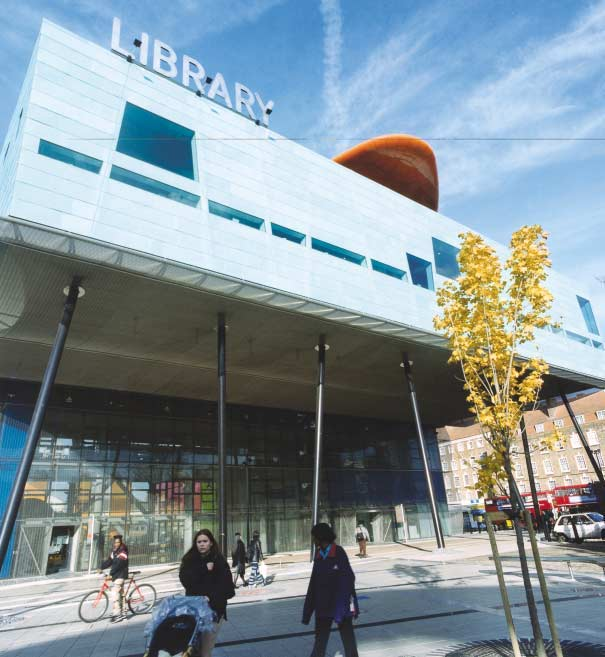

*Peckham Library. Photographer: Len Cross 2000. Courtesy of London Borough of Southwark Libraries and Museums Service.*

<!-- PAGE: 40 -->

**6.4** There are valuable lessons to be learned from these initiatives that have unlocked new sources of funding for library buildings. DCMS and Resource propose to work together to gather, promote and spread these examples of how library services have financed and planned modernisation programmes.

> ### Case Study: Suffolk Library Links
>
> Suffolk Libraries and Heritage Service Library Links is a pilot scheme to develop new ways of serving rural communities. Each Link is a 'mini library' with a collection of frequently exchanged books. There is also a networked PC providing access to the full range of items in all Suffolk's libraries. These Library Links are located mainly in village shops and post offices. Library Link rent provides a valuable subsidy to businesses. The project reinforces Suffolk County Council's policy to sustain village facilities.

**6.5** Libraries need to redouble their efforts to reach lapsed and non-users and also to maintain their current user base. The Audit Commission report noted demands even among library users for more flexible and weekend opening; for better marketing of services delivered in pleasant surroundings. Two-thirds of inspections concluded that Best Value reviews have not fundamentally challenged what the service is for and why it is needed. One half of inspections found consultation for users and non-users was inadequate.

**6.6** People who find reading difficult and groups in the community most at risk of social exclusion may find libraries distant or even intimidating places rather than seeing them as symbols of community.

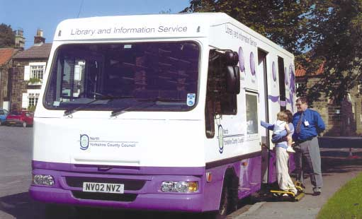

*Extending services to all areas of the local community. Courtesy of North Yorkshire County Council.*

<!-- PAGE: 41 -->

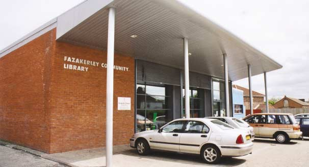

*Fazakerley Community Library. Courtesy of Liverpool Libraries and Information Services.*

**6.7** In 1999, DCMS published Libraries for All. This set out guidelines for local authorities on how to deliver an inclusive public library service. One route to reach non-users is through closer collaboration with other public services, for example, by co-locating libraries. Libraries deliver on their potential as community catalysts when they actively and imaginatively seek out the views of users and crucially, non-users, and translate those views into new services. Successful library services invariably work in a network of alliances and partnerships with schools, social services, the police, museums and leisure services. Walsall's eight libraries, for example, are co-located with two museums, a theatre, housing services, two schools and community centres. Other authorities have established links with clinics and health centres.

**6.8** All libraries need to work to establish programmes that will engage groups and individuals that are hard to reach by identifying them and establishing what are their particular needs and then by redesigning services when necessary so that there are no barriers to inclusion. Those libraries, which are already successful in this important work, frequently involve the communities themselves in the design and implementation of services.

**6.9** The Government requires local authorities to prepare community strategies for promoting the economic, environmental and social well- being of their areas and so contribute to the achievement of sustainable development in the country. Authorities have been given broad powers to improve and promote local well- being as a means of helping them to implement these strategies. In future Local Cultural Strategies will be subsumed within community strategies. It is important that the library planning process should be linked to community planning so that the contribution of libraries to the broader priorities of local communities is identified and integrated with other service provision.

**6.10** Community strategies should be prepared in collaboration with the Local Strategic Partnership, which brings together those who deliver different services to decide where common priorities for the improvement of public services lie. LSPs are encouraged to develop 'ownership' of the community strategy for each local area and it is vital that the public library service has effective links with them.

<!-- PAGE: 42 -->

> ### Case Study: London Borough of Barnet Chinese Community Project
>
> The London Borough of Barnet Library Service includes as a key objective the need to promote social inclusion and celebrate the cultural diversity of the local community. A successful project with the Chinese community has enabled the library service to have a much greater understanding of the needs of the borough's Chinese residents. An open day was held at Grahame Park Library to introduce residents to the library and to encourage them to enrol as library members. New collections of stock and information leaflets in Chinese were launched and the event was provided in partnership with the local Chinese Community Association and Oriental City (a retail complex based in the area).

### Conclusions

**6.11** Libraries have a vital role as anchor institutions in our communities: they are among the most basic membership institutions in civil society. For libraries to continue to play this stabilising role in civic life they have to remain relevant to the needs of all within the community and the buildings they operate in should be fit for purpose.

Libraries have a vital role as anchor institutions in our communities: they are among the most basic membership institutions in civil society.

*Cookham Library. Courtesy of Royal Borough of Windsor and Maidenhead Library Service.*

**6.12** Those needs cannot be assumed or taken for granted. Libraries must be adept at seeking, understanding and serving the needs of non-users, some of whom may be ill at ease in a library setting.

**6.13** Library authorities need to survey and review the needs of the communities they serve, focusing particularly on the needs of people who do not currently use libraries but might be attracted to do so and might benefit disproportionately from the services on offer. This should form part of the local authority community strategy.

<!-- PAGE: 43 -->

## 7 Delivering Change

**7.1** It is not enough for libraries to have a compelling vision of their role in modern society. That vision has to be matched by a credible plan for delivering tangible improvements in services across the public library network as a whole.

**7.2** Library services are operated by a highly decentralised, distributed system in which 149 library authorities in England operate more than 3,000 libraries. The great strength of libraries is their sense of local connection: their relationship with the communities they serve and the part they play in delivering the wider local corporate agenda. The basis for that relationship is that libraries are funded by and accountable to local government.

**7.3** However in any organisational structure, strengths can also produce weaknesses. One drawback to such a highly decentralised network is that it can lead to fragmentation and a lack of strategic direction for the service as a whole. The danger in fragmentation is that the shared needs of the library network as a whole, for example leadership development and information technology standards, become more difficult to identify and tackle. Opportunities for libraries to share resources as a result are sometimes missed.

**7.4** The goal of this framework is to develop ways for central government, local government and library authorities jointly to identify the priorities for public libraries. DCMS will ensure that this approach is compatible with local accountability for services that are tailored to the needs of distinctive localities.

**7.5** The following provide the key to delivering this new strategic framework:

- A greater recognition by central and local government of the role of public library services as a delivery agent across a range of services and objectives
- Stronger sectoral leadership at national and regional level
- Development of the library element of the local authority performance management framework in order to drive continuous improvement in public library services
- A new relationship with the business community.

**7.6** DCMS will lead action in all these areas with the help of a task force consisting of key stakeholders including library professionals, representatives from local government more broadly, the private sector and other interests.

### Greater recognition by central government

**7.7** It is one of the major conclusions of this analysis that libraries have an enormous amount to contribute to the achievement of central government's key social and educational objectives. In order to deliver these benefits, it proposes a simple change to the way in which libraries operate -- that the library service should focus its efforts in the key areas identified in this framework and, as far as possible, that the same national offers should be available in every library. The combined strength of the library service working together is already apparent through programmes such as The People's Network and the summer reading programme. We need now to apply it elsewhere.

<!-- PAGE: 44 -->

**7.8** This framework is the first step in identifying what some of these offers might be. It proposes a number of areas where there is a gap in delivery -- such as the need to complement and reinforce formal education with informal learning -- which the library service can fill because of its unique characteristics and strengths, and suggests what measures might meet the need. Examples might include national programmes to support adult basic skills; to provide services for cared for children and young offenders and a national network of homework clubs either physical or virtual. All these things happen now but if we develop a national approach, then we ensure access for all, deliver economies of scale and ease negotiations with other funding partners.

**7.9** All of these possible measures have been developed in consultation with the relevant departments. DCMS and Resource need now to engage with partners in Whitehall to develop joint strategies to develop and prioritise among them and consider other ways in which the untapped potential of libraries can be exploited to deliver the Government's priorities. When these programmes have been identified and developed, it will provide a stronger case for other central government departments to consider funding them, in the light of their priorities at the time.

**7.10** These national offers must however be tailored to local circumstances. The aim is that library authorities should look rigorously at the needs of their local communities and prioritise accordingly, for example, in an area where adult literacy is a particular problem the library service will need to give greater priority to adult basic skills.

**7.11** The role of central government is to:

- Help identify libraries' key contribution to national and local priorities
- Set out a small number of national expectations for the public library service to deliver
- Clarify the links with the shared priorities for local government
- Encourage continuous improvement through performance management.

**7.12** The way in which the national expectations are met, and the way in which libraries are identified within Community Strategies should be entirely a matter for local authorities and their partner organisations. This empowers library authorities to operate flexibly and imaginatively in meeting the needs of their communities.

### Greater recognition by local government

**7.13** It is striking how much variation there is in the standard of library services in different parts of the country. The best services are found where their local authority managers have done the exercise described above -- considered how their library services can help them deliver their key corporate objectives, developed strategies for using them, and resourced and managed them according to a clear set of priorities.

<!-- PAGE: 45 -->

> ### Case Study: London Borough of Camden
>
> London Borough of Camden's 1998 Best Value Action Plan provided a radical agenda to bring libraries to the fore of many key policy areas. Library opening hours have been extended by 20% by developing partnerships with post-16 learning establishments, the youth service, Sure Start and Capital Careers. The libraries are learning hubs for online learning and satellite 'spokes' have been established in twenty community centres. A significant investment programme has been established with capital challenge funding meeting the costs of several libraries. A new combined library, learning and youth resource centre is being built through a private sector partnership. Libraries now feature strongly in the community strategy.

**7.14** It is therefore a key task for DCMS and Resource working with local government to ensure that local authority managers are fully aware of the ways in which they can use their libraries. DCMS needs to build stronger relationships with local government across the full range of its service sectors and develop integrated approaches to the identification of good practice and encouragement of continuous improvement. This needs to be done as part of a holistic DCMS strategy to respond to the Local Government White Paper, involving Resource and other strategic NDPBs.

**7.15** Within DCMS, policy lead for the public library service will sit in a new directorate, which also deals with local government issues related to its sectors and for cross-cutting work on developing cohesive communities. This will ensure that policy for public libraries is taken forward in the context of the wider local government agenda.

**7.16** To make a real contribution to these agendas, however, libraries need to become a much more effective delivery mechanism, and this is where better sectoral leadership can help.

### Better sectoral leadership at national and regional level

**7.17** Many of the most successful and dynamic library services in the world have at their core a small, focused agency, which helps to drive change. One outstanding example is Singapore's National Library Board. In Holland and Sweden recent efforts to revitalise and renew libraries have turned on the creation of new central capacity to drive change and encourage collaboration.

**7.18** Resource is the strategic body empowered to advise government and the library sector on the long-term development of museums, archives and libraries. Resource will now develop:

- A clearer central focus on public libraries within its overall organisation
- Greater capacity to move from advice to implementation and action to drive change.

<!-- PAGE: 46 -->

**7.19** DCMS has outlined the following remit for Resource in support of the public library service:

- With DCMS, provide strategic vision and direction for the library network as a whole
- With DCMS, act as a national interlocutor for public libraries in dealings with national agencies and departments to promote libraries as a policy delivery vehicle to national policy makers
- With DCMS, assist local and library authorities to recognise ways in which library services can contribute to the wider corporate agenda
- With DCMS, act as a national advocate for libraries
- Devise workforce development and leadership plans for the library service nationally
- Encourage partnerships with foundations and private sponsors to fund innovation
- Broker common ICT standards and national content agreements
- Provide support, foster innovation and spread good practice
- Create regional capacity for shared resources and learning.

**7.20** The Advisory Council on Libraries will have new terms of reference and its membership will be a small expert team of library advisers. ACL will work closely with DCMS and Resource in delivering the vision set out in this document. DCMS and Resource will also continue to work closely with CILIP and the SCL in taking the strategy forward.

**7.21** Leadership at the local level is vital to delivery of this vision. A key element of Resource's future work will be to address workforce development and in particular how to ensure the library service develops leaders for the future. This will require a detailed analysis of skills needs and training and recruitment practices borrowing from good practice already under way in other sectors such as health and education where similar problems exist. The aim must be to make entry to the library service more fluid embracing a wider skills mix and to enable continuous professional development including leadership training to become the norm.

### A new library development plan

**7.22** DCMS has asked Resource to prepare a new three-year plan for public library development, which would include:

- The creation of a national leadership programme
- The creation of a wider workforce development plan
- Developing further Resource's links with government departments and agencies with a responsibility for learning, online and community related services
- Plans for the future development of The People's Network
- Agreeing common ICT standards for technology and services
- Creating a fundraising and business development capacity to explore opportunities for raising external funds from foundations and private sponsors
- A research and evaluation programme to demonstrate the impact made by public library services
- Supporting DCMS in delivering the new performance management and advisory system.

<!-- PAGE: 47 -->

### Regional capacity

**7.23** In tandem with stronger, focused capacity at the centre to help drive change, libraries need a stronger regional network to:

- Share resources and reduce costs, for example on the purchase of books and ICT
- Identify and spread best practice in service development
- Promote and advise on joint bidding for resources from national and European agencies
- Create schemes for staff development
- Encourage joint working and partnerships with other related services
- Promote libraries to the regional bodies being created in England, such as the Regional Development Agencies and Learning and Skills Councils.

**7.24** These measures together will create a strong regional focus for the public library service.

**7.25** Resource is in the process of creating regional agencies in each of the nine English regions to co-ordinate and develop museums, archives and libraries. Additional funding was made available to transform existing area museum councils into regional agencies that would represent museums, archives and libraries in the regions. NEMLAC in the North East of England is one such model, which has been built on a strong regional infrastructure. SEMLAC in the South East of England is developing a new infrastructure for a newly created Regional Development Agency area.

**7.26** The regional agencies in the nine English regions will promote collaboration between libraries and other agencies and help provide a sense of strategy for the region as a whole. As the agencies develop, that strategic vision will need to be matched by a capacity to focus on the specific needs of libraries. Renaissance in the Regions, the recent Resource report on regional museums, proposed the creation of regional museum hubs. Resource will explore how to provide a similar regional focus for libraries. There are already a number of successful models for collaborative improvement. Resource will work with library authorities to determine the most effective approach. Other examples of existing arrangements include:

- The London Library Development Agency. Each of London's thirty-three library authorities has bought into the agency, through membership subscription. That has allowed a small organisation to be developed to articulate the value of libraries to London, bid successfully for funding and help spread and share best practice
- Beacon library authorities and other similar innovatory library services. The Beacons are charged with disseminating the good practice and expertise for which they have been recognised. Resource will explore the potential for developing the role of these library services.

**7.27** As part of this work Resource is collaborating with the British Library and CILIP. Led by a regional development officer for libraries in England, representatives of all nine regions are working with the national bodies to spread good practice and ensure that issues concerning the library and information community are embedded in each of the regional agencies.

<!-- PAGE: 48 -->

### Challenge and improvement

**7.28** Libraries have a central role to play in supporting the delivery of local and national priorities across a wide range of areas. The better performing library services are well integrated with the wider agenda of their local authority, and, as is shown in this document, are outward looking and innovating in terms of their practice and services. This reflects what the best performing local authorities are delivering for their communities as a whole.

**7.29** As part of its wider programme to help councils make real improvements in local services for the communities they serve, the Government has announced an important package of measures, which give councils more freedom to shape their spending and their services. This package includes a significant reduction in the plan requirements of central government.

**7.30** Library services are part of this wider picture. We want to empower the best performing councils to continue to improve their library services, and to help and support those councils who have some way to go to delivering services that match the best.

**7.31** Annual Library Plans were introduced in 1998 and Public Library Standards were implemented in 2001. They have provided a focus for managers to gather information and manage services. We now believe the time is right to move away from this mechanism towards arrangements for the planning and delivery of library services which match the spirit of the Government's new partnership with local government.

**7.32** Instead of requiring an Annual Library Plan from each library authority, from 2003/04 we will no longer require any return from any authority which is rated 'excellent' overall in their Comprehensive Performance Assessment (CPA). Nor will we require a return from those councils whose library service is considered 'excellent', but whose overall assessment is 'good'. We believe it is important that those authorities who have demonstrated they can perform to the highest standards should be free of this requirement from next year so that they can get on with the important business of continuing to deliver excellent services to their communities.

**7.33** For other authorities, we believe time and support are needed to develop their approach to this strategy and to modernise and improve their library services. However, we intend radically to streamline the arrangements that will apply to them from 2003/04.

**7.34** They will no longer be required to submit an Annual Library Plan in the old format. Instead, we will require them to submit a much simpler 'position statement', which will be significantly shorter, and sharply focused on seeking information to demonstrate how they intend to shape and deliver their services in line with this strategy and its three broad themes:

- Promotion of reading and informal learning
- Access to digital skills and services (including e-government)
- Tackling social exclusion, building community identity and developing citizenship.

**7.35** We will look carefully at these new position statements and, if performance and engagement with delivering the strategy are satisfactory in 2003/04, we will remove the requirement to submit a further position statement.

<!-- PAGE: 49 -->

**7.36** Only authorities we are not convinced are ready to deliver will be required to submit a further position statement for 2004/05. And thereafter, the requirement will be removed altogether.

**7.37** In this way, over the next two financial years we intend to reduce and sharpen our requirements in line with the lighter touch approach applying across government, and to focus down increasingly on those authorities that still have a way to go in developing their capacity to deliver.

**7.38** In addition to these new arrangements, we will be working on a number of other fronts to strengthen the arrangements for gathering information in line with the new library strategy agenda.

**7.39** DCMS will work with the Office of the Deputy Prime Minister to identify and develop the key Best Value Performance Indicators for the library service focusing on those that will provide central and local government with the essential information they need about the quality of local library services.

**7.40** The Government acknowledges that over time Comprehensive Performance Assessment needs to pick up more qualitative data on library services. DCMS, with the support of the Office of the Deputy Prime Minister, will continue the helpful discussions we have already had with the Audit Commission about how, within the context of a co-ordinated and proportionate model of local government inspection informed by CPA outcomes, inspection arrangements can best address the library service. We see as the key issues the prioritising of services most in need of improvement and including a proper recognition of the contribution libraries can make to the assessments of a range of other important services, and the delivery of wider shared priorities.

**7.41** We will also take full account of the role of libraries and other cultural services in the development and implementation of community strategies. And these services will feature significantly in forthcoming research that will analyse the way in which various local services connect with the community strategy process.

**7.42** In developing and taking forward these new arrangements we will work closely with Resource, the Advisory Council on Libraries, the Local Government Association, and other public libraries stakeholders including the Chartered Institute of Library and Information Professionals (CILIP) and the Society of Chief Librarians.

### Developing a new relationship with the business community

**7.43** We believe there is scope for public libraries to develop mutually beneficial partnerships with those businesses that recognise the importance of corporate social responsibility. Libraries provide an excellent means for such companies to implement CSR programmes aimed at supporting local communities, lifelong learning and combating social exclusion.

**7.44** Innovative libraries, often supported by The Reading Agency, have had some considerable success over recent years in attracting private sponsorship to their activities. The case study examples demonstrate some of the opportunities which exist for libraries to work with publishers, booksellers, authors and private sponsors to support reading promotion. Such partnership and sponsorship arrangements deliver much more than the <!-- PAGE: 50 --> immediate goal of the project. Workplace based projects can help libraries reach new audiences. Business partnerships can bring with them development opportunities for library staff where, for example, librarians have been invited into business mentoring and skills enhancement programmes where a sharing of public and private sector expertise can be beneficial. These closer links also enable the library community to develop advocates within the business community.

**7.45** Much is being done and more of this could be done. Links between private sponsors and literature are not as strong in other sectors of the arts world. The DCMS/Wolfson funded Books and Business programme is beginning to build a portfolio of business partnerships and The Reading Agency had included the need to build reading inspired business partnerships as one of its key work strands.

> ### Case Study: West Sussex Library Service and Arts and Business
>
> During 2002 West Sussex Library Service installed ICT equipment offering free public internet access in its thirty-five libraries as part of The People's Network. The library service was able to publicise the launch of the new service to users and put in place a long-term marketing strategy to make non-library users aware of the service by drawing on the expertise of a marketing manager from a locally based firm. Networking body Arts and Business South East was able to broker the arrangement through the use of their skills bank database.

> ### Case Study: The County Big Book Scheme (Cumberland Building Society & Cumbria)
>
> The County Big Book scheme was a partnership between Cumberland Building Society and Cumbria County Council Education & Libraries. As part of their commitment to corporate social responsibility, the Cumberland Building Society wanted to support local initiatives that might not otherwise receive funding and so make a useful contribution to the local community. The Society also hoped that by demonstrating its commitment to regional activities it would be able to raise its public profile and present itself as a caring and ethical organisation.
>
> Working initially through the County Council's Education Department, the Society began to support the region's Arts in Education programme, which benefited schools, arts venues and libraries. One particularly successful initiative was the "County Big Book" project, a scheme involving primary schools in Cumbria and the Young People's Library Service. Schools were invited to compile their own "Big Book" of stories and contributions made by school children. These were submitted to a panel of judges who selected three winning books to be published and distributed around the county. As a result of the benefits it has enjoyed, the Society has now committed an ongoing donation from its annual profits to secure a continued involvement in local affairs.

**7.46** By developing a new relationship with the business community, libraries will also benefit from access to vital skills, such as marketing, access to new audiences through workplace based initiatives and access to new sources of funding for projects. Businesses will be able to profit from a raised profile, an enhanced corporate reputation and opportunities for staff development.

**7.47** Building successful partnerships with the business community takes time and expertise. As part of their new remit, working with other experts in the field, Resource will look at ways to support public libraries to connect with the business community.

<!-- PAGE: 51 -->

### Libraries in 2013

The examples at the beginning of this document illustrate some of the services on offer in libraries in 2003. The following could be our vision for 2013:

- Anyone seeking a book can be guaranteed to get access to it through the library whether or not it is still in print
- All babies and new parents are invited to become library members within the first year of the baby's life as well as being exposed to the opportunities for early years reading
- All school age children can join a homework club, engage in summer activities or join reading groups
- All families in Sure Start areas are given intensive help in promoting reading
- Any adult struggling with adult basic skills can turn to a library for personalised intensive help
- Any member of a public library can also access materials held in libraries in higher and further education
- Anyone seeking opportunities for learning and training can be guided to a course through a library
- Any community group can turn to the library for help in creating, hosting and managing community content online
- Any citizen can engage with government services, debate and consultation online through a library
- Anyone can ask a library for information through a national online service
- All of these services will be offered in premises fit for purpose either within the library building or through outreach.

And libraries will still be places where anyone can learn, discover, reflect or imagine without being questioned, asked to show a membership card, or required to book an appointment.

<!-- PAGE: 52 -->

## Appendix A -- Glossary

- **Advisory Council on Libraries (ACL)** — The statutory body set up under the Public Libraries and Museums Act 1964 to advise the Secretary of State for Culture, Media and Sport on public libraries.
- **Annual Library Plans (ALPs)** — Introduced by DCMS in 1998. English library authorities, through their ALPs, provide DCMS with an overview of their service, details of forward attainment and assessment on the meeting of previously set targets. The planning system will change and ALPs will be streamlined from 2003 onwards.
- **Beacon Libraries** — The ODPM's Beacon Scheme is intended to encourage good practice amongst local authorities and to disseminate that practice across all authorities. One of the themes in the 2002/03 Beacon "round" was "Libraries as a Community Resource". After a rigorous assessment process, eight authorities emerged as Library Beacons.
- **Booktrust** — The national charity for books and reading in the UK. Bookstart is a national scheme, run by Booktrust, offering free books to every new child and advice to every parent.
- **The Chartered Institute of Library and Information Professionals (CILIP)** — The leading professional body for librarians and information managers in the UK, with members in all sectors private, voluntary and public, including public libraries. CILIP was formed by a merger of the Library Association and the Institute of Information Scientists in April 2002.
- **Culture Online** — A DCMS funded initiative with the aim to increase access to the arts and culture by creating a 'digital bridge' between learners and the resources of the arts and cultural sectors. COL will be delivered through 20-40 exciting new online or interactive projects created in partnership with a range of cultural and commercial organisations, between 2002 and 2004.
- **The Department for Culture, Media and Sport (DCMS)** — Has the statutory responsibility to superintend the delivery of the English public library service by local library authorities and promote its development. The Secretary of State for Culture, Media and Sport has a statutory duty under the Public Libraries and Museums Act 1964 to ensure that public library authorities in England provide a 'comprehensive and efficient' library service. The Scottish Office, the Welsh Office and Department of Culture, Arts and Leisure Northern Ireland Executive are responsible for policies affecting the library services in Scotland, Wales and Northern Ireland, respectively.
- **DCMS/Wolfson Public Libraries Challenge Fund** — A partnership between DCMS and The Wolfson Foundation to enhance the facilities and services provided by public libraries in England. The Fund ran annually between 1997 and 2002 and has provided over £13 million funding for 139 public library based projects.
- **The Department for Education and Skills (DfES)** — Established with the purpose of creating opportunity, releasing potential and achieving excellence for all. The Department delivers on a range of education issues through working closely with other government departments and cross-departmental bodies.
- **Learndirect/University for industry (Ufi)** — Ufi Limited was created in 1998 to bring about the government's vision of a 'university for industry'. Learndirect is Ufi's network of online learning and information services, which was rolled out nation-wide across England, Wales and Northern Ireland from 25 October 2000 following a successful national pilot.

<!-- PAGE: 53 -->

- **Learning and Skills Council (LSC)** — Established in April 2001, The Learning and Skills Council is responsible for funding and planning education and training for all over 16 year olds in England. The LSC works with partners, employers, learning providers, community groups and individuals to develop and implement strategies that meet the Government's aims set out in the 'Learning to Succeed' White Paper.
- **London Libraries Development Agency (LLDA)** — Created to develop and realise a co-ordinated strategic vision for all library and information services across London.
- **National Literacy Trust** — Founded in 1993, is an independent charity concerned with raising literacy standards for all age groups throughout the UK.
- **North East Museums, Libraries and Archives Council (NEMLAC)** — The regional development agency for museums, libraries and archives in North East England. It aims to facilitate sector development across the region through strategic leadership, advocacy, advice, exemplar projects and service delivery.
- **Opening the Book Ltd** — An independent company that pioneers a new approach to promoting literature from the reader's point of view. Opening the Book creates resources for readers and provides training and consultancy services to all the professions who work with readers -- librarians, booksellers, publishers, arts organisations and government departments.
- **The People's Network** — A £120 million lottery funded initiative, through the New Opportunities Fund (NOF), to set up Information and Communication Technologies (ICT) centres (£100m) in every UK public library by the end of 2002 and to train library staff (£20m) in ICT skills and learner support. In England NOF funded libraries automatically qualify for UK online centre status.
- **Public Library Service** — The public library service in England is run by 149 separate library authorities operating through 3,500 service points, including mobile services. Under the Public Libraries and Museums Act 1964 local authorities have a statutory obligation to provide a 'comprehensive and efficient' library service. Public libraries are funded through a combination of council tax revenue and the Revenue Support Grant from the Office of the Deputy Prime Minister.
- **Public Library Standards** — The monitoring arm of DCMS's public libraries planning and monitoring framework. The standards took effect from April 2001 with a three-year phase-in period and they help to define library authorities' statutory obligation to provide a library service that is 'comprehensive and efficient'. The standards are a suite of targets across a basket of core activities. Since their introduction, library authorities have notified DCMS of their performance against each of the standards through their annual library plan. With the introduction of Framework for the Future, the standards will be reviewed to make sure that they fully reflect the new strategy and do not impose an unreasonable administrative burden on local authorities to deliver quality services to meet local needs.
- **The Reading Agency (TRA)** — A library development agency working in new ways with both adult and young people's librarians to inspire a reading nation. The Reading Agency was formed by a merger of Launchpad, The Reading Partnership and Well Worth Reading in July 2002.

<!-- PAGE: 54 -->

- **Resource: The Council for Museums, Archives and Libraries** — The strategic body empowered to advise government and the library sector on the long-term development of museums, archives and libraries. Resource was created by the merger of the Museums and Galleries Commission and the Library and Information Council in April 2000. Resource is primarily funded by the DCMS. As a Non-Departmental Public Body, Resource is managed by its Board of Councillors, who are ultimately accountable to the DCMS for all of Resource's operations.
- **School Library Services** — Central services provided by local authorities to support school library provision. They provide a range of services including loan collections, collection management advice and support, and training for teachers and librarians. The Scottish Office, the Welsh Office and Department of Culture Arts and Leisure Northern Ireland Executive are responsible for policies affecting the school library services in Scotland, Wales and Northern Ireland, respectively.
- **South East Museum, Library & Archive Council (SEMLAC)** — The new regional development agency for the museum, library and archive sector in the South East.
- **Society of Chief Librarians (SCL)** — The professional association with the aim to advance the interests and influences of libraries by representing the views and interests of Chief Librarians in England and Wales.
- **Sure Start** — A cornerstone of the Government's drive to tackle poverty and social exclusion. The aim is to improve the well-being and life opportunities of young children aged 0-3 yrs through better health, childcare and educational opportunities. It does this by setting up local neighbourhood programmes, concentrated in localities where a high proportion of children are living in poverty and social exclusion, to deliver a range of services across education and health and family support.
- **UK online** — The overarching programme linking the Government's various Information Age initiatives and was launched by the Prime Minister in September 2000. The establishment of 6000 UK online centres in England by the end of 2002 is a major part of the programme and public libraries will form around a half of the UK online centre network thanks to The People's Network programme.

<!-- PAGE: 55 -->

## Appendix B -- Acknowledgments

In July 2002 the Department for Culture, Media and Sport set up a project stakeholder group with the following terms of reference 'to guide the DCMS in the development of a new strategic framework for the public library service'. Membership of the group is set out below:

- **Alex Stewart (Chair)** — Director, Museums, Galleries, Libraries & Heritage Group, Department for Culture, Media and Sport
- **Chris Batt** — Director, Libraries and Information Society Team, Resource: The Council for Museums, Archives and Libraries
- **Tony Belmega** — Assistant Director, Policy and Development and Head of Adult Learning, Learning and Skills Council
- **Margaret Bennett** — Head of Lifelong Learning and Technologies, Department for Education and Skills
- **Jon Boagey** — Head of Information Services, National Youth Agency
- **Lyn Brown** — Chair of Cultural Services Executive, Local Government Association
- **John Hicks** — Chairman, Advisory Council on Libraries
- **Julie Hill** — Senior Project Officer, Local Government Association
- **Bill Macnaught** — Head of Cultural Development, Gateshead Council
- **Bob McKee** — Chief Executive, CILIP
- **Martin Molloy** — Director of Libraries and Heritage, Derbyshire County Council
- **Miranda McKearney** — Director, The Reading Agency
- **Neil McClelland** — Director, National Literacy Trust
- **Graham Walker** — Director of the Central Strategy Unit, Office of the e-Envoy
- **Alan Wells** — Director, The Basic Skills Agency
- **Janet Evans** — Head of Museums, Libraries and Archives Division, Department for Culture, Media and Sport
- **Mandy Barrie** — Head of Libraries and ICT Development Branch, Department for Culture, Media and Sport
- **Peter Beauchamp** — Chief Library Adviser, Department for Culture, Media and Sport
- **Roger Stratton-Smith** — Head of Local Government Team, Libraries, Local Regional and International Division, Department for Culture, Media and Sport
- **Alex Petrovic (Secretary)** — Policy Adviser, Libraries and ICT Development Branch, Department for Culture, Media and Sport

<!-- PAGE: 56 -->

The Department for Culture, Media and Sport would like to thank the members of the Advisory Council on Libraries (ACL) for their advice and guidance. Membership of the ACL is set out below:

- **John Hicks (Chairman)** — Chairman, Advisory Council on Libraries
- **Chris Batt** — Director, Libraries and Information Society Team, Resource: The Council for Museums, Archives and Libraries
- **Keith Crawshaw** — Head of Leisure Services, Sheffield City Council
- **David Ball** — Associate Head of Academic Services, Bournemouth University
- **Rob Froud** — County Librarian, Somerset County Council
- **Graham Bulpitt** — Director, Learning Centre and University Librarian, Sheffield Hallam University
- **Shelagh Levett** — Head of Arts, Library and Museum Services, Bournemouth Borough Council
- **Bob McKee** — Chief Executive, CILIP
- **Martin Molloy** — Director of Libraries and Heritage, Derbyshire County Council
- **Guenever Pachent** — Assistant Director (Libraries and Heritage), Suffolk County Council
- **David Ruse** — Assistant Director, Lifetime Learning, Westminster City Council
- **Brian Stevenson** — Commissioning Inspector, Audit Commission
- **Rob Warburton** — Assistant Head of Cultural Services, Kirklees Metropolitan District Council

The Department for Culture, Media and Sport would also like to thank the following people for their assistance in the development of the new strategic framework for public libraries:

- **David Anderson** — Director of Learning and Interpretation, Victoria and Albert Museum
- **Brian Ashley** — Assistant Director (Libraries, Information and Museums), Nottingham City Council
- **Andrea Barker** — Head of Cultural Services, Stockton on Tees Borough Council
- **Micheline Beaulieu** — Head, Department of Information Studies, The University of Sheffield
- **Greg Birdseye** — Associate Director, Public Services Research, Audit Commission
- **Catherine Blanshard** — Head of Library and Information Service, Leeds City Council
- **Eric Bohl** — Corporate Director (Customer Services), London Borough of Tower Hamlets

<!-- PAGE: 57 -->

- **Steve Bundred** — Chief Executive, London Borough of Camden
- **Tim Coates** — Independent Consultant
- **Sheila Corrall** — Director of Academic Services, The University of Southampton
- **Hilary Cottam** — Director -- Learning and Public Services, The Design Council
- **Margaret Croucher** — Research Programme Manager, Resource: The Council for Museums, Archives and Libraries
- **Kate Davenport** — Head of Libraries, Bristol City Council
- **Ray De Graff** — ICT Strategy Officer, North Yorkshire County Council
- **Jonathan Douglas** — Adviser for Youth and School Libraries, CILIP
- **Shiraz Durrani** — Strategy and Commissioning Officer, Merton Libraries, London Borough of Merton
- **Diana Edmonds** — Managing Director, Instant Library Ltd
- **Judith Elkin** — Dean of Faculty, Computing, Information and English, University of Central England
- **Annie Everall** — Service Manager, Young People & Policy Development, Derbyshire Libraries and Heritage Department
- **Ian Everall** — Black Country ICT Co-ordinator, Black Country Consortium
- **Pat Flynn** — Head of Library and Information Services, Leicester City Council
- **Tom Forrest** — Director, Opening the Book
- **Kathleen Frenchman** — Liaison Officer, Libraries for Life for Londoners
- **Fred Garnett** — Head of Community Programmes, BECTA (British Educational Communications and Technology Agency)
- **Sue Greenfield** — Divisional Librarian, Hampshire County Council
- **Viv Griffiths** — Board Member, Resource: The Council for Museums, Archives and Libraries
- **Jane Hall** — Head of Libraries, Arts and Information, Sunderland Metropolitan District Council
- **Kevin Harris** — Information Manager, Community Development Foundation
- **Ruth Harrison** — Project Manager, The Reading Agency
- **David Haynes** — Head of CILIP Consultancy Services, CILIP

<!-- PAGE: 58 -->

- **Debbie Hicks** — Policy and Strategy, The Reading Agency
- **Jennifer Holland** — Head of Libraries and Information, Norfolk County Council
- **Mike Hosking** — Head of Libraries and Information Services, Cambridgeshire County Council
- **Natasha Innocent** — Reader Development Project Manager, London Libraries Development Agency
- **Ian M. Johnson** — Head of the School of Information and Media, The Robert Gordon University, Aberdeen
- **Pam Jones** — Learning Resource Manager, Knowsley Library Service
- **Brian King** — Strategic Policy Advisor, Audit Commission Inspection Service
- **Trevor Knight** — Executive Head of Library, Heritage and Registration Services, London Borough of Sutton
- **David Lindley** — Sales and Marketing Director, Books for Students
- **Joyce Little** — Head of Libraries and Information Services, Liverpool City Council
- **Brian Loader** — Director, Community Informatics Research & Applications Unit (CIRA), University of Teesside
- **Lindsay Mackie** — Director, Diana, Princess of Wales Memorial Award for Young People
- **Peter Marchant** — Head of Libraries, Knowsley Metropolitan Borough Council
- **Roger McMaster** — County Manager for Suffolk Libraries and Heritage, Suffolk County Council
- **Norma Monks** — Assistant Director of Culture, Leisure and Sport, Blackburn with Darwen Borough Council
- **David Murray** — Director, London Libraries Development Agency
- **Julia Newton** — Head of Libraries and Information Service, London Borough of Lewisham
- **Janet O'Hehir** — Lending Time Project Director, CSV
- **John Pateman** — Head of Libraries and Heritage Services, London Borough of Merton
- **Jenny Poad** — Library Services Manager, Bedfordshire County Council
- **David Potts** — Senior Network Adviser, Resource: The Council for Museums, Archives and Libraries

<!-- PAGE: 59 -->

- **John Readman** — Head of Libraries, Archives and Arts, London Borough of Lambeth
- **Geoff Smith** — Head of Cooperation and Partnerships, The British Library
- **Rachel Smith** — Senior Policy Adviser, Central Strategy Unit, Office of the e-Envoy
- **Bjarne Stenquist** — Consultant
- **Paul Sternberg** — Education Editor, Interactive, Channel 4
- **Mark Taylor** — Library & Information Services Manager, Royal Borough of Windsor and Maidenhead
- **John Turner** — Service Manager, Nottingham Central Library
- **June Turner** — Reader Development Coordinator for Essex Libraries, Essex County Council
- **Pam Usher** — Head of Cultural Services, London Borough of Barnet
- **Bob Usherwood** — Professor of Librarianship, Department of Information Studies, The University of Sheffield
- **Rachel van Riel** — Director, Opening the Book
- **John Vincent** — Networker, The Network -- tackling social exclusion in libraries, museums, archives and galleries
- **Robert Walters** — Principal Librarian, Support Services, Bradford City Metropolitan Council
- **Heather Wills** — Idea Store Programme Director, London Borough of Tower Hamlets
- **Ken Worpole** — Independent Writer and Policy Consultant
- **Eric Wright** — County Libraries and Information Officer, Northamptonshire County Council
- **Chris Yapp** — Client Principal, HP Global Services

<!-- PAGE: 60 -->

PP496  
**Department for Culture, Media and Sport**  
2-4 Cockspur Street  
London SW1Y 5DH  
www.culture.gov.uk  
*February 2003*
