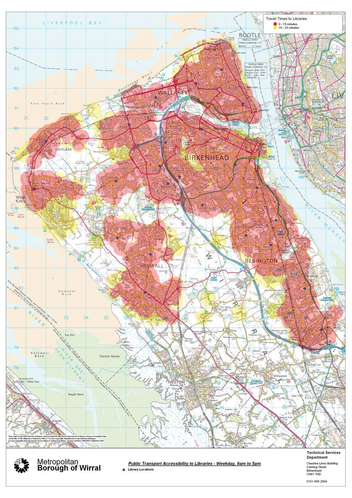
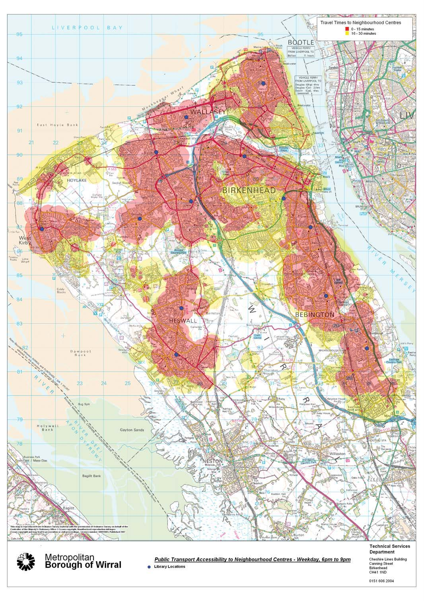
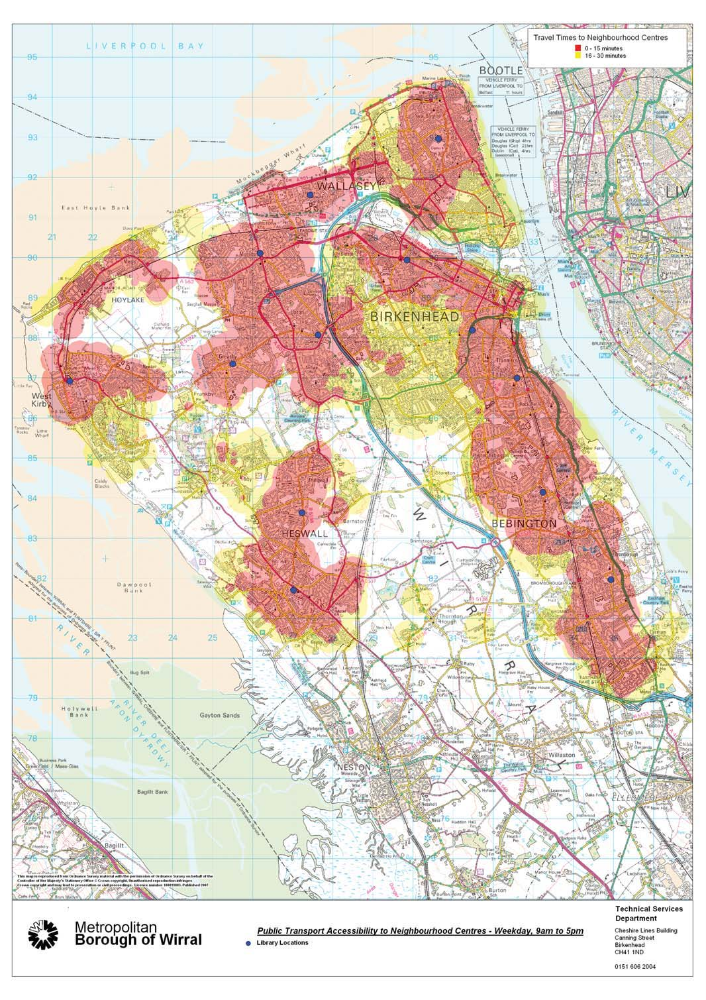
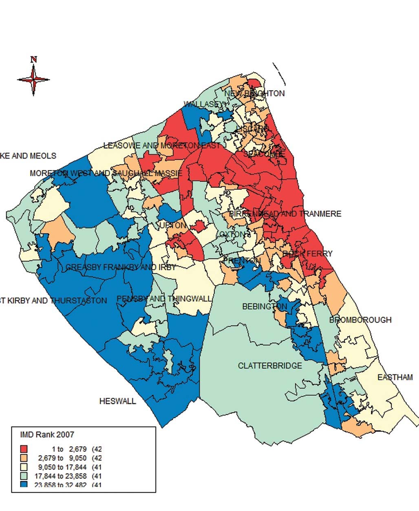
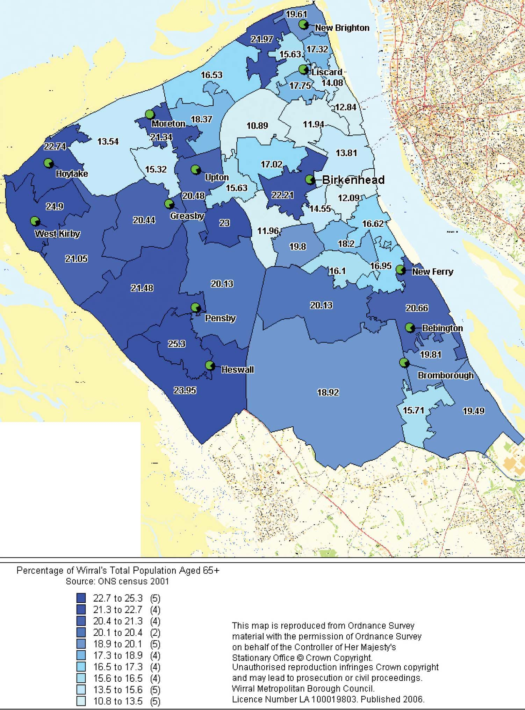

<!-- PAGE: 1 -->

# A Local Inquiry into the Public Library Service Provided by Wirral Metropolitan Borough Council

**Led by Sue Charteris**

**September 2009**

Department for Culture, Media and Sport — improving the quality of life for all.

<!-- PAGE: 2 -->

Our aim is to improve the quality of life for all through cultural and sporting activities, support the pursuit of excellence, and champion the tourism, creative and leisure industries.

<!-- PAGE: 3 -->

## Contents

| Section | Page |
| :--- | :--- |
| About the author: Sue Charteris | 5 |
| Executive Summary | 6 |
| 1. Introduction | 10 |
| 2. The Inquiry | 12 |
| 3. Background and context | 16 |
| 4. Wirral’s plans for the library service | 19 |
| 5. Evidence received from other stakeholders | 24 |
| 6. Assessment of local needs | 40 |
| 7. Consideration of local factors | 46 |
| 8. Meeting the guidance factors in the Public Libraries and Museums Act 1964 | 54 |
| 9. Conclusions and recommendations | 57 |
| Appendix 1: Terms of reference | 63 |
| Appendix 2: Acknowledgements and details of contributions to the Inquiry | 65 |
| Appendix 3: Travel times for current service | 69 |
| Appendix 4: Travel times for 13 neighbourhood centres | 71 |
| Appendix 5: Car ownership | 73 |
| Appendix 6: Percentage of Wirral population aged 65+ | 74 |
| Appendix 7: IMD rank 2007 | 75 |
| Appendix 8: Proposed staffing structure | 75 |

<!-- PAGE: 4 -->

[Blank page in original publication]

<!-- PAGE: 5 -->

## About the author: Sue Charteris

Sue Charteris is Managing Director of Shared Intelligence; established in 2000. She is a Public Policy Consultant specialising in Local Government and Public Service Reform. Building on her previous experience as Chief Executive of Merton and Executive Director of Kirklees local authorities, she was founder member of the Local Government Modernisation Team at the then Department of Transport and Local Government (now. DCLG) and Associate Fellow of the Local Government Centre at Warwick Business School.

For the past ten years Sue has helped both local authorities and other public sector bodies with policy development and change management, and the creation of learning networks to share learning and generate good practice notably on Local Area Agreements (LAAs) and on Neighbourhood Management.

Sue has led and managed peer reviews (including reviews for the DCMS of the Arts Council, UK Film Council, English Heritage and the MLA).

Sue is an Member of the England Committee of the Big Lottery Fund and holds an M. Phil from the University of Lancaster.

<!-- PAGE: 6 -->

## Executive summary

### Introduction

**1.** The Local Public Inquiry into Wirral Metropolitan Borough Council’s (MBC) Library Service has found the Council’s decision to restructure its Library Service to be**in breach of its statutory duties**under the Public Libraries and Museums Act 1964, to provide “comprehensive and efficient public Library Services for all persons desirous to make use thereof”.

**2.** The primary reason for this breach is that the Council**failed to make an assessment of local needs** (or alternatively to evidence knowledge of verifiable local needs) in respect of its Library Services. In the absence of such an assessment, I conclude that the Council therefore cannot have reasonably met such needs in the context of its statutory duties and available resources. Without any such reference point of the needs to be met, the Council was unable to identify a reasonable option for meeting such needs both comprehensively and efficiently.

**3.** Following a review of its Cultural Services in 2007 and a Strategic Asset Review (SAR) in 2008,**Wirral MBC made a decision to rationalise its Library Service**by investing £20 million (within its Capital Investment Programme) in 13 Neighbourhood Centres, each with a library at its heart, and with an extended outreach programme; effectively replacing a service comprising 24 libraries.

**4.** The Council states that the Centres will house**multiple Council functions**and, wherever possible, be co-located with one or more of the Council’s key partners, including the Police, Fire Authority and Health Service. The Council says that the investment will allow for**improved opening hours**and that more than 99% of people will be within**a two mile radius**of a library.

**5.** The Council’s view is that it is**hard to reconcile a plethora of small libraries**with a reasonable interpretation of ‘efficient’, and that if the service is confined to operating from what they say are **generally poor quality and outdated buildings**, it will deter many potential users and result in continuining decline in book issues. The Council’s evidence also points out that the Council**must comply with a wide range of statutory duties**and that it has acted reasonably in meeting and balancing these potentially conflicting duties.

### Wirral Public Libraries Inquiry

**6.** Following receipt of a large volume of correspondence and a specific complaint from the Museums, Libraries and Archives Council (MLA) that it was not satisfied that Wirral MBC’s proposals were compliant with their duties and obligations under the 1964 Act, the Secretary of State decided that a local Inquiry pursuant to section 10(1) of the Act was required.

**7.** I, Sue Charteris, was appointed as the independent person to lead the Inquiry, which was conducted in accordance with the Public Libraries (Inquiries Procedure) Rules 1992 (the “Procedural Rules”).

**8.** The Secretary of State specified that the role of the Inquiry was to:

> ‘Gather information and provide advice in order for the Secretary of State to assess whether, in taking the decision to implement the proposed changes to their Library Service, the Wirral is in default of their statutory duties under the Public Libraries and Museums Act 1964, including the provision of a comprehensive and efficient Library Service.’

<!-- PAGE: 7 -->

**9.** I was asked to consider the following questions:

* Did Wirral make a reasonable assessment of local needs in respect of Library Services and, in any event, what are those needs?
* On assessment of local needs, did Wirral act reasonably in meeting such needs through their proposals in the context of available resources and their statutory obligations?

**10.** I was also asked to recommend, in the event that Wirral MBC is found to be in breach of its statutory duties, the practical steps the Council could be ordered to take by the Secretary of State in order to address this failure.

**11.** I held a number of pre-Inquiry meetings, including with community leaders (including MPs, Councillors and Elected Members), key partner organisations, and library and council staff. I also visited all libraries earmarked for closure and spoke to staff, user and campaign groups, local councillors, governors or teachers of local schools, and other residents and users. I also took the opportunity to visit other libraries in the borough.

**12.** The Inquiry received formal Statements of Case from 36 parties, including the Secretary of State and Wirral MBC, and, 30 individuals or representatives submitted a Proof of Evidence, allowing them to present their evidence (if they wished) at the Inquiry meeting. The Inquiry was held in public on June 9th and 10th 2009 at the Floral Pavilion, New Brighton. Although the Council made its decision at their Council meeting in March 2009, it decided to suspend the implementation of its plans pending the outcome of the Inquiry.

**13.** My report outlines the submission the Council made to the Inquiry in full and summarises the contrasting arguments put to the Inquiry. I critically evaluate the evidence both provided by the Council and by other stakeholders against the structure set out in the Inquiry’s terms of reference.

### Key findings and conclusions of the Inquiry

**14.** As noted above, the Inquiry has found the Council to be in**breach of its statutory duties**under the Public Libraries and Museums Act 1964, because it**failed to make an assessment of local needs**in respect of its Library Services. It therefore cannot have acted reasonably in meeting such needs in the context of its statutory duties and available resources, as, in the absence of such assessment or demonstrable knowledge of local needs, it was incapable of identifying a reasonable option for meeting such needs both comprehensively and efficiently.

**15.** In particular, there are some**specific needs for adults**that have not been addressed. These include the specific requirements for older people, disabled people, unemployed people, and those living in deprived areas.

**16.** I am also concerned that although the Act does not specifically cover the role of schools in library provision, the Council has not been able to demonstrate that it has had due regard to the**general requirements of children**which I consider to be a breach of its statutory duties.

**17.** The Council took the decision to close 11 of its libraries in the**absence of a strategic plan for or review of the Library Service**. As such, I believe that the Council’s approach to re-visioning the service was fundamentally flawed, because their approach focused specifically on the issue of asset management and cost savings.

**18.** I also believe that the decision was made**without a clear understanding of the extent and range of services**currently being provided in the libraries, including those which are ‘core’ to the service and those which are ancillary. This makes it difficult to see how the Council could plan for ceasing or re-locating aspects of the current service.

<!-- PAGE: 8 -->

**19.** The Council’s decision, which is better described as an indication of intent rather than a fully worked up plan, risks being a partial response to need that would disadvantage relatively isolated and deprived communities. I therefore believe there to be**a further breach in relation to the needs of deprived communities**. On the basis of the evidence provided to the Inquiry, I do not consider that the needs of the community in either Beechwood or Woodchurch estates, who form part of the wider library community as a whole, will be adequately met.

**20.** A key concern of mine, therefore, has been the**absence of an adequate plan for and commitment to a comprehensive outreach service**. Without this, the Library Service as a whole will not be compliant.

**21.** Without an assessment of needs and a strategic Library Service review, the Council has**displayed a lack of logic**around why some facilities were recommended for closure and not others.

**22.** Having considered the evidence submitted to the Inquiry, I believe there is**a strong case for reviewing the decision and/or retaining a physical service (not necessarily as it is now) at some sites earmarked for closure**. This is for the following reasons:

* **where libraries are located in an area of significant deprivation**: relevant particularly for **Beechwood**and**Woodchurch**, but the argument could equally apply to the libaries serving the **Eastham**,**Prenton**and**Seacombe**communities.
* **where the Council’s decision on which libraries to close changed**: due to the lack of consultation with residents when the decision to close Bromborough Library was substituted for **Eastham**, and Upton Library for**Woodchurch**, meaning that the Council did not consider the needs of those communities affected by the changes.
* **where the Council identified an area of need but subsequently chose to ignore this information**: the Council made the decision to close**Woodchurch**instead of Upton despite originally recommending that Woodchurch Library be retained because of it being an area of high need. The Inquiry has seen no clear rationale, based on evidence of a recent change in local need, for the reversal of the Council’s recent decision, which I believe constitutes a breach in the Council’s statutory duties.
* **where the Council has failed to meet its own standards in terms of a reasonable distance to travel**: the Council needs to address arguments put to the Inquiry that residents of Meols, currently served by**Hoylake**Library, will be the only residents further than two miles away from a library if Hoylake were to close. I do not believe this is acceptable given the higher concentration of older people and disabled people in that area of the borough.
* **where libraries have inter-dependent links with schools and/or children’s centres**: in particular,**New Ferry**,**Ridgeway**and**Woodchurch**. There has been a lack of involvement of governing bodies in discussions, and for New Ferry in particular, the closure of the library would result in no savings for the Council.

**23.** This is**not to say that I am endorsing the Council’s plans to continue with the closures of the libraries not listed here**, as these arguments may equally be applied to other areas/libraries. Nor am I saying the status quo must prevail and/or that the Council’s financial constraints have been disregarded. Rather, given that the Inquiry’s remit did not include undertaking a full assessment of needs on behalf of the Council, I wish to emphasise that the evidence presented to the Inquiry might not fully represent the needs of all users and potential users for all libraries.

### Advice and recommendations to the Secretary of State

**24.** Given the breach of duties outlined above it is not possible for the Inquiry to endorse Wirral MBC’s current plans for restructuring its Library Service.

**25.** However,**the Inquiry has generated considerable evidence of local needs and demands**for the service on which the Council can now draw.

<!-- PAGE: 9 -->

**26.** I recommend that the Secretary of State requires Wirral MBC to**produce a clear strategic development plan for the Library Service in Wirral**to his satisfaction and within six months of publication of this report. I set out in the detail in the report the areas the report must cover.

**27.** Subject to his endorsement of the plan, I also recommend that the Secretary of State requires **updates of this plan to be submitted to him annually for the next five years**, with ongoing support and advice provided by the MLA. If, after due consideration, the Council still wishes to proceed with its model of fewer but better buildings (involving closures), I recommend that the Secretary of State require the Council to**evidence how it will meet the needs of all groups and communities in the Wirral**.

**28.** Importantly, I would recommend that the Secretary of State requires evidence from Wirral MBC that they are**working with a wide range of representative groups and library users**from all the libraries, including those in libraries that are planned to close, on the design and accessibility of the new centres, and the transition of services highly valued by current users of the libraries that are planned to close.

**29.** I also recommend that the Secretary of State requests Wirral MBC to take steps to**strengthen the new service**.

**30.** I do believe that this is**an opportunity to turn this difficult situation around**. Given the debate this Inquiry has provoked, there is an opportunity to draw on support available locally from the library user and campaign groups, potential partner organisations and others; and regionally and nationally from other library authorities, the Chartered Institute of Library and Information Professionals (CILIP) and the MLA.

**31.** The law requires Wirral MBC to provide a comprehensive and efficient service for all those persons desirous of the use thereof. I recognise that Wirral MBC, like other authorities across the country, has considerable pressure on service budgets and needs to ensure it is making the best use of its resources both now and in the future; but there were risks in relying on a Strategic Asset Review without a concurrent Library Service Review to specifically address the design and delivery of the Library Service.

**32.** I recognise too that the Council decided to be proactive and develop a new approach of providing a network of fewer but better Neighbourhood Centres ‘with libraries at their heart’, together with an enhanced outreach service, which it believes is a more sustainable way forward. However, I do not believe that the Council adequately assessed how well this model would meet the needs of its constituent communities before taking a decision to close 11 of its 24 libraries. At best the decision was premature and does not demonstrate how specific needs within communities will be adequately met. As such, it is impossible for me to agree that the plans are reasonable or adequate. I recommend to the Secretary of State a series of steps that I consider to be necessary to turn this situation round.

<!-- PAGE: 10 -->

## 1. Introduction

### Wirral Public Libraries Inquiry

**1.1** Between December 2008 and April 2009, the Secretary of State for Culture, Media and Sport received a large volume of correspondence – mainly from members of the public but also from professional bodies – expressing their concern over the proposals drawn up by Wirral Metropolitan Borough Council (MBC) in respect of the restructuring of its Public Library Service.

**1.2** The Secretary of State encouraged Wirral MBC – in February 2009 – to seek the assistance of the Museums, Libraries and Archives Council (MLA) in order to facilitate dialogue over the proposals, and caused the MLA to visit and report back on the progress and outcomes of the proposals.

**1.3** Following reports of concern from the MLA and a specific complaint that the MLA was not satisfied that Wirral MBC’s proposals were compliant with their duties and obligations under the Public Libraries and Museums Act 1964, the Secretary of State decided that a local inquiry pursuant to section 10(1) of the Act was required in order to gather and assess independently information on the proposals and to assist in the determination of whether or not Wirral MBC is failing in its duties under the 1964 Act.

**1.4** I, Sue Charteris, was appointed by the Secretary of State as the independent person to lead the Inquiry, which was conducted in accordance with the Public Libraries (Inquiries Procedure) Rules 1992 (the “Procedural Rules”) (see chapter 2 for more details).

### Inquiry Report

**1.5** This report presents the Inquiry’s findings and my recommendations to the Secretary of State with regard to Wirral’s Public Library Service and the exercise of his statutory duties.

**1.6** It draws on both formal and informal evidence submitted to the Inquiry by Wirral MBC and other local, regional and national stakeholders, as well as findings from the pre-Inquiry meetings and visits I conducted.

**1.7** The subsequent chapters of the report are set out as follows:

* Chapter 2 sets out the background to the Inquiry, outlining the Inquiry’s Terms of Reference and the legal framework it operated within.
* Chapter 3 sets out the background and context to Wirral, including a description of the borough, some key contextual issues and the current service.
* Chapter 4 is based on the Council’s evidence and outlines its proposed plans for the Library Service, including the basis for its decision and what the new service would look like.
* Chapter 5 draws on other contrasting evidence submitted to the Inquiry by other stakeholders, summarising their key arguments presented to the Inquiry.

<!-- PAGE: 11 -->

* Chapter 6 is the first of three sections that critically evaluates the evidence provided by Wirral MBC and other stakeholders against the structure set out in the Inquiry’s Terms of Reference. This section looks at the specific issue of the assessment of local needs in relation to the provision of a comprehensive and efficient service.
* Chapter 7 considers a range of other local factors that the Inquiry feels need to be taken into account, including the financial context for the Council, the operation of the service, delivery of the service, and the strategic vision for the Library Service.
* Chapter 8 explores the extent to which Wirral MBC’s proposed changes to the Library Service demonstrate their regard for the guidance factors outlined in the Public Libraries and Museums Act 1964.
* Chapter 9 draws together the evidence and the Inquiry’s findings to provide some overall conclusions and my recommendations to the Secretary of State.

<!-- PAGE: 12 -->

## 2. The Inquiry

### Terms of reference

**2.1** The Secretary of State specified that the role of the Inquiry was to:

> ‘Gather information and provide advice in order for the Secretary of State to assess whether, in taking the decision to implement the proposed changes to their Library Service, the Wirral is in default of their statutory duties under the Public Libraries and Museums Act 1964, including the provision of a comprehensive and efficient Library Service.’

**2.2** In formulating this advice and recommendations, I was asked to consider the following questions:

* Did Wirral make a reasonable assessment of local needs in respect of Library Services and, in any event, what are those needs?
* On assessment of local needs, did Wirral act reasonably in meeting such needs through their proposals in the context of available resources and their statutory obligations?

**2.3** In considering the question of local needs, I was asked to comment independently on factors around the local authority context; service operation; service delivery; and strategic vision (more details on what these areas cover specifically can be found in the full Terms of Reference in Appendix 1).

**2.4** In considering the statutory obligations, I was asked to consider and make an assessment, with reference to best practice where appropriate, on how effectively the Wirral’s Library Service addresses and meets the guidance factors contained in the 1964 Act relating to the desirable elements of all Library Services.

**2.5** Finally, I was asked to recommend, in the event that Wirral MBC is found to be in breach of its statutory duties, the practical steps they could be ordered to take by the Secretary of State in order to address this failure.

### Public Libraries (Inquiries Procedure) Rules 1992

**2.6** The Inquiry was conducted within the Public Libraries (Inquiries Procedure) Rules (1992). These Rules define the procedures for the Inquiry and cover the following main points:

* Interested parties can present their case to the Inquiry by serving a ‘statement of case’ and, in so doing, become entitled to appear at the Inquiry. In addition, where such a ‘person entitled to appear’ proposes to give or call evidence by the reading out of an oral statement, a ‘proof of evidence’ (being the oral statement) needs to be submitted in advance and, where demanded by the Inquiry, a summary of this proof.
* The ‘appointed person’ has the right to hold meetings with relevant parties prior to the Inquiry through ‘pre-Inquiry meetings’ and conduct ‘site inspections’ to libraries.
* After the Inquiry meeting, the appointed person should submit a report to the Secretary of State, who will then notify interested parties of their decision.

<!-- PAGE: 13 -->

**2.7** The Rules also specify the procedures for the ‘notification’, ‘timetable’ and ‘order’ of the Inquiry meeting. For specific details of the Rules, please see: http://www.opsi.gov.uk/si/si1992/Uksi_19921627_en_1.htm.

### Statutory requirements

**2.8** The**Public Libraries and Museums Act (PLMA) 1964**requires the 151 first tier English local authorities to provide “comprehensive and efficient public Library Services for all persons desirous to make use thereof”.

**2.9** The Secretary of State for Culture, Media and Sport has a duty under the same Act to superintend the delivery of Library Services and to promote the improvement of public libraries and can intervene in a service where he has cause for concern. The powers of the Secretary of State, if an authority is found to be in default of its obligations under the Act after investigation (such as ordering a remedy to breaches or ordering a takeover of the library authority), are set out in section 10 of the Act.

**2.10** I am quoting in full the following extract from section 7 of the PLMA 1964, which outlines the general duty of library authorities and forms the basis for the Inquiry.

### General duty of library authorities

> —(1) It shall be the duty of every library authority to provide a comprehensive and efficient Library Service for all persons desiring to make use thereof,...

> Provided that although a library authority shall have power to make facilities for the borrowing of books and other materials available to any persons it shall not by virtue of this subsection be under a duty to make such facilities available to persons other than those whose residence or place of work is within the library area of the authority or who are undergoing full-time education within that area.

> (2) In fulfilling its duty under the preceding subsection, a library authority shall in particular have regard to the desirability—

> (a) of securing, by the keeping of adequate stocks, by arrangements with other library authorities, and by any other appropriate means, that facilities are available for the borrowing of, or reference to, books and other printed matter, and pictures, gramophone records, films and other materials, sufficient in number, range and quality to meet the general requirements and any special requirements both of adults and children; and

> (b) of encouraging both adults and children to make full use of the Library Service, and of providing advice as to its use and of making available such bibliographical and other information as may be required by persons using it; and

> (c) of securing, in relation to any matter concerning the functions both of the library authority as such and any other authority whose functions are exercisable within the library area, that there is full co-operation between the persons engaged in carrying out those functions.

### Other relevant legislation

**2.11** Given the scope of the Secretary of State’s powers, the terms of reference of the Inquiry are specifically to address whether or not Wirral MBC is meeting its obligations to comply with the 1964 Act. However this legislation does not operate in isolation and I have also had regard to other legislation applying to local government and its partners where it is relevant to how local authorities define need in their localities, especially the “special requirements” referred to in s.7(2)(a) of the Act.

<!-- PAGE: 14 -->

**2.12** I consider the equalities legislation to be relevant. This includes:

* **Race Relations (Amendment Act) (2000)**which placed a general duty on public authorities to promote race equality and eliminate unlawful racial discrimination;
* **Disability Discrimination Act (2005)**which placed a duty on public authorities to promote equality of opportunity for disabled people and eliminate unlawful discrimination; and
* **Equality Act 2006**which placed a duty on public authorities to promote equality of opportunity between men and women and eliminate unlawful discrimination and harassment.

**2.13** The specific duties contained within each of these Acts also require a public authority to carry out Equality Impact Assessments as soon as a relevant new policy, function or service is considered. Public authorities are also required to monitor for adverse impact and publish the results of assessment, consultation and monitoring. The equalities duties are soon to be transcended by the Equality Bill currently going through Parliament[^1].

**2.14** Going forward, the**Local Government and Public Involvement in Health Act 2007**and the new **Statutory Guidance for the Duty to Involve**(which came into effect in April 2009) will be relevant as it places authorities under a duty to consider the possibilities for provision of information to, consultation with and involvement of representatives of local persons across all authority functions. Again, this extends to people who live, study or work in the area.

**2.15** According to the Duty to Involve, authorities should provide representatives of local persons with appropriate information about services, policies and decisions which affect them or might be of interest to them. The duty also specifies that the authority should offer appropriate opportunities for people to have their say about the decisions and services that affect them through consultation. Consultation needs to provide genuine opportunities for people to be involved.

### Process

**2.16** Following the formal notice of the Inquiry given by the Secretary of State, I contacted interested individuals to explain the Inquiry procedures, set out how to make a formal or informal submission to the Inquiry, and serve the formal notification. In addition to people who had written to the Secretary of State, this list, compiled with the assistance of Wirral MBC, included all local councillors; relevant council staff; members of the Local Strategic Partnership and other relevant partners; area forum and union representatives; community organisations; library user groups; and Older and Young People’s Parliaments.

**2.17** In order to gain the fullest possible understanding of both the factual evidence, the range of different interests, and to facilitate the opportunity for people to contribute in different ways, I decided to use my right to hold pre-Inquiry meetings. Meetings were held ahead of the Inquiry with community leaders (including MPs and councillors), key partner organisations, and library and council staff. Full details for the pre-Inquiry consultees are included in Appendix 2.

**2.18** I also decided to conduct a number of site visits, and visited all libraries earmarked for closure by the proposed changes to speak to library users and get a feel for the existing service. I also took the opportunity to visit a few other libraries in the borough[^2] and was given a tour of the borough in advance of the Inquiry. In the libraries earmarked for closure, I met with staff, user and campaign groups, local councillors, governors or teachers of local schools, and other residents and users. In total, I estimate that I met with approximately 400 people through the visits.

<!-- PAGE: 15 -->

**2.19** Views and facts collected orally from these meetings and visits have been considered by the Inquiry, and any correspondence and documents received whilst conducting these meetings and visits constitutes (where relevant) formal evidence, all of which was disclosed at the Inquiry in accordance with the Procedural Rules. The full details of people who expressed their views informally by email or letter have not been included because it has been impossible to gain consent from them all to do so.

**2.20** The Inquiry received formal Statements of Case from 36 parties, including the Secretary of State and Wirral MBC. In total, 30 individuals or representatives submitted a Proof of Evidence, allowing them to present their evidence (if they wished) at the Inquiry meeting.

**2.21** All parties who had submitted formal evidence were given access to formal evidence submitted by other parties, and had the right to amend their evidence in light of new information ahead of the Inquiry.

**2.22** The 30 groups that wished to give evidence at the Inquiry were then asked to provide a 1,000 word summary of their Proof of Evidence prior to the Inquiry and were instructed that any ‘reading out’ would be limited to this summary.

**2.23** The Inquiry was held in public on June 9th and 10th 2009 at the Floral Pavillion, New Brighton. The order of proceedings intended to deal with submissions received in a way that minimised duplication and enabled key questions and concerns to be addressed. First, the summaries were heard from all parties, grouped looking at the service as a whole first and then to particular local areas. Rights to cross-examine were first given to the Secretary of State and Wirral MBC only.

**2.24** The remainder of the Inquiry made further enquiries on issues raised by oral evidence with opportunity for permission to be granted for cross examination by other persons entitled to appear where appropriate. At the end of the first day parties, who had submitted formal evidence, were given an opportunity to raise issues for further cross-examination on the second day.

**2.25** It was my intention to limit the Inquiry to the issues raised in the Terms of Reference. I therefore took into account only evidence that I considered within the remit of the Inquiry. Therefore, correspondence received or evidence provided on the following issues was not taken into account:

* allegations about the merits of the consultation process and whether it was flawed or not, other than to establish whether and how the Council took steps to ascertain local needs.
* questions around national standards or the merits or otherwise of the Strategic Asset Review conducted by the council, other than to establish and enquire into the implications for the delivery of Wirral’s public Library Service.
* comments or allegations that may be construed to be party political and/or refer to by name or cast doubt on the judgment of named individual council officers or elected councillors.
* whether or how library and other council staff were consulted or instructed ahead of or during the Inquiry.

**2.26** While both formally submitted evidence and less formally received correspondence was considered by the Inquiry, more weight was naturally given to formal evidence (where it had stood up to examination) as it had been subject to cross examination at the Inquiry meeting and pre-Inquiry scrutiny by all those entitled to appear. All evidence submitted and received was disclosed at the Inquiry.

<!-- PAGE: 16 -->

## 3. Background and context

### Wirral: a local story of place[^3]

**3.1** Wirral is a unique and special place. A peninsula which is located in Merseyside and bounded by the Rivers Dee and Mersey, it is home to over 300,000 residents and covers 60 square miles.

**3.2** The green belt covers much of the spine of the peninsula. Wirral is well served by motorway and transportation links but despite this, some of the older urban areas on the eastern side of the borough lack amenities, and continue to be the focus of regeneration initiatives through bringing former brownfield sites and areas of housing market failure back into use.

**3.3** Wirral is a place of sharp contrasts. It has some of the most affluent wards in the country and some that rate amongst the most deprived. For many of its citizens, there is an excellent quality of life, with good leisure facilities, an attractive coastline and countryside, good quality housing, good schools and quality employment opportunities. For some, the picture is very different, with pockets of high unemployment, low skills levels, poorer quality housing, unacceptable levels of anti-social behaviour and high levels of ill health. Between the most affluent and the most deprived areas there is a stark mortality gap, with those in the most affluent areas living on average over 10 years longer than those in the most deprived areas.

**3.4** The overall picture masks significant inequalities within Wirral. Wirral is ranked 60th most deprived out of 354 local authorities according to the English Indices of Deprivation 2007. However further examination of the indices reveals that out of the 207 lower super output areas within Wirral, 32 areas feature in the 5% most deprived in England and two areas feature within the 5% least deprived, with a further seven areas in the 10% least deprived in England. While the relative deprivation position overall has improved (from being the 48th most deprived borough in 2004 to the 60th in 2007), Wirral remains the 8th most deprived in terms of employment and 21st in terms of income.

### Some key contextual issues

**3.5** A reading of the Council’s own descriptions and the ‘Local Story of Place ‘ suggest the following issues are relevant to the provision of its Library Services and needs of the local communities.

**3.6** The borough has a high ageing population and a low number of people in their 20s and 30s compared to England and Wales, with 18.4% of residents aged 65+ compared with 16% in England. With the older population expected to be the fastest increasing population group by 2029, looking after the elderly population will become a major issue for the borough in the near future, impacting on healthcare and other services.

**3.7** According to mid year estimate figures, Wirral’s population figures have steadily declined from 316,500 in 2000 to its latest figure of 311,200 residents in 2006.

**3.8** The fastest falling category is the 25 – 34 year olds which has fallen by 20% from 2000 figures, followed by the numbers of 1-14 year olds which is down by 10.4%.

<!-- PAGE: 17 -->

**3.9** Wirral has the lowest levels of gross value added (GVA) on Merseyside. Earnings of people who work in Wirral are below the national average, whilst earnings of Wirral residents are actually above national figures, due to the fact that a large number of residents work outside the borough, often in higher earning jobs than those found within the borough.

**3.10** Enterprise levels are also low: the number of VAT registered businesses is much smaller than might be expected in Wirral when compared with regional and national figures. The borough suffers from low job density, and whilst skill levels on average appear good, there are significant gaps in employment skills in deprived communities.

**3.11** Significant progress has been made in reducing the number of young people aged 16-18 not in education, employment or training. This stood at 9.1% for November 2007 compared to 9.94% in November 2006. However, this is against a target of 8.24% on the trajectory towards the 2010 PSA target. The most deprived areas of the borough have been identified as having disproportionately higher levels of young people not in education employment or training, as well as specific cohorts including teenage mothers, care leavers and young offenders.

**3.12** There are high levels of worklessness in the borough, with a strong correlation to low levels of economic inactivity, poor education and skills attainment, and other deprivation indicators. The people with the lowest qualifications are least likely to find employment. Wirral has a rate of 35.5% of working age people with no qualifications.

**3.13** Wirral’s overall attainment figures are above the national average for 2007 with 60.6% of children achieving five or more A*-C at GCSE (national average: 59.3%); in the five A*-G grades category the borough achieved 92.1% (national average: 91.2%). However, there are disparities in attainment between different areas of the borough, with children in Birkenhead achieving 49.9% five or more A*­ C grades at GCSE compared to 75.4% for West Wirral (all figures are provisional).

### Wirral Library Service

**3.14** Wirral Library Service sits within the Regeneration Department after a transfer of responsibilities for culture and leisure in April 2006 from the Education Department. The service currently includes 24 Libraries[^4]; 23 full time and one part time. There are two Home Reader services and a Schools Library Service[^5].

**3.15** The service provided includes:

* book lending, request service and Inter Library loan;
* internet and computer access;
* fax and photocopying services;
* adult learning courses (in some libraries);
* children’s books and activities;
* reading Groups for adults and children;
* reference and Information services;
* family and Local History;
* newspaper and magazines;
* CD and Music Loans (in some libraries only);
* DVD hire (in some libraries only); and
* community meeting rooms.

<!-- PAGE: 18 -->

**3.16** Some of Wirral’s libraries also operate as Council information points, offering access to other Council services. Councillors, MPs and the police also use some libraries for surgeries.

**3.17** Most libraries are open to the public five days a week. The operating hours for most libraries include two long days until 7.30pm (usually Mondays and Thursdays) and three shorter days until 5pm (usually Tuesday, Friday and Saturday). Nearly all of Wirral’s libraries are closed on Wednesdays, Sundays and during lunch time.

**3.18** According to the library statistics provided by the Council, the libraries issued 1,735,747 books and 89,744 audio-visual materials to library users in 2008/09, up from the previous year. In total, 1,823,462 visits were made to Wirral’s libraries in 2008/09. ICT usage is a popular reason for visit with 201,946 visits made to use computers.

**3.19** The budget allocation for the Library Service in 2009/10 (without any savings) is £7,017,200, of which £4,038,100 is allocated for staff. There is an income of £391,400 and recharges of £207,300 to other Departments giving a final budget of £6,418,500.

<!-- PAGE: 19 -->

## 4. Wirral’s plans for the library service

**4.1** This section of the report is based on Wirral MBC’s summary of evidence submitted to the Inquiry[^6]. It includes details of how the decision was made to restructure the service and the Council’s plans for the new Library Service.

### Cultural Services Review

**4.2** While the Council says in its evidence to the Inquiry that the proposed closure of 11 libraries has been hugely controversial, the Council states that radical strategic change is necessary in order to deliver sustainable Library Service improvements, fit for the 21st Century. In 2007, Wirral Council commissioned consultants Strategic Leisure to review its Cultural Services, including libraries and in October 2008, the outcome of Strategic Leisure’s work was presented to the Cabinet. It recommended that the Council addressed the following Library Service issues:

* too many buildings;
* many in poor condition and some not fit-for-purpose;
* insufficient capital investment and revenue resources;
* high staffing and support costs;
* inadequate Book Fund; and
* ICT investment.

**4.3** The consultants recommended that there should be better strategic planning for Wirral’s cultural provision in relation to facility location, accessibility and a hierarchy of service provision. They identified the following strategic actions:

* re-provision – fewer but better facilities;
* improved accessibility to facilities for the whole community of Wirral;
* re-aligning of resources to deliver required outcomes;
* examine alternative delivery options;
* new and extended partnerships with other public bodies and local communities;
* increased community involvement in the management and operation of facilities;
* a more inter-directorate approach with improved communication; and
* improved quality of facilities and service delivery.

**4.4** The Council states that unless these issues are addressed, the Library Service will continue to deteriorate and they would be managing decline. They note that the expectations of residents are increasing all the time, as are the costs of maintaining the library facilities but that Wirral’s facilities were put in place to meet the demands, needs and expectations of previous times. The Council therefore believes that not addressing these issues would result in a failure to ensure a ‘comprehensive and efficient’ service in the future.

<!-- PAGE: 20 -->

### Strategic Asset Review

**4.5** According to the Council, Wirral’s vision of a modern (comprehensive and efficient) Library Service integrates high quality Neighbourhood Centres (with libraries at their heart) and an enhanced outreach programme to meet the needs of**all**users. The Council says that the Library Service will be further integrated with the Council’s (and partners’) other work to improve the life skills and opportunities of local people, particularly in the more deprived parts of the Borough. According to the Council, this concept has developed over time through numerous reports and extensive consultation, culminating in the Strategic Asset Review (SAR).

**4.6** The Council states that the proposals contained within the SAR followed the vision recommended in the Cultural Services Development Plan of ‘High quality, multi-purpose facilities, concentrated on strategic locations to benefit the whole community of Wirral’. The Council also states that the SAR, which looked at cultural services as a whole, tackled the important issues identified above, which it believes will help to deliver the key objective of the Corporate Plan which is to:

> ‘Deliver first class services, which are affordable, sustainable and meet the needs of local people. Wherever possible this will be done through the engagement and empowerment of individuals and communities in both the design and delivery of local services, and by working together with partners in the public, private and the community/voluntary sectors.’

**4.7** The Council states that the SAR was conducted on a strategic, borough-wide basis, with the proposed Neighbourhood Centre locations having regard to demographics, accessibility and the suitability of buildings for improvement. The Council says that the SAR did**not**focus on**individual**buildings. Rather, it identified a strategic way forward for the whole of Wirral.

**4.8** The SAR Report to Cabinet on 27 November 2008, considered three options for Wirral’s libraries:

* No change. This would have significant adverse cost implications.
* Minimal Provision. Designed to maximise savings, retaining only five Libraries. It was not recommended.
* Strategic Consolidation at (and £20 million investment in) 12 (later 13) Neighbourhood Centres – the recommended approach.

**4.9** The Council states that following the 27 November 2008 Cabinet meeting, the SAR proposals (covering libraries, leisure and sports facilities, and community centres) were the subject of extensive public consultation, including four specially convened Area Forum Conferences that were attended by well over 2,000 people. The proposals were also debated at Council on 15 December 2008 and at six Overview and Scrutiny meetings.

**4.10** As noted above, the initial proposal put to Cabinet in November 2008 was for 12 Neighbourhood Centres with library provision at their heart. Following the public consultation, the Council says that this was changed and increased to 13 at the Cabinet meeting on 15 January 2009. For the Library Service, the changes between the November 2008 proposals and the January 2009 Cabinet decision were as follows:

* Bromborough Library to be retained and form the core of the Neighbourhood Centre for Eastham and Bromborough, but Eastham Library to close;
* Upton Library to be retained but Woodchurch Library to close; and
* Pensby library to be retained, meaning that 13 libraries will be provided, rather than the 12 originally proposed.

**4.11** According to the Council, the first two changes responded to significant levels of representations from local service users that the initial proposals did not best reflect local needs. The retention of Pensby Library reflected Members’ acceptance that there was a need for some further library provision geographically between Heswall and Greasby.

<!-- PAGE: 21 -->

### Investing in the Neighbourhood Centres

**4.12** The Council states that the SAR will enable an investment of £20 million in 13 Neighbourhood Centres, each of which will have a library at its heart. The Centres will house multiple Council functions and, wherever possible, be co-located with one or more of the Council’s key partners, including the Police, Fire Authority and Health Service.

**4.13** According to the Council, the Neighbourhood Centres with libraries and peripatetic services will ensure a sustainable, accessible service. The Council says that the Neighbourhood Centres will continue to deliver the services outlined in the Cultural Services Strategic Development Plan (2008):

* A wide range of books for lending, reference (main libraries only), and bibliography use;
* Life Long Learning opportunities;
* Community access to IT, including the internet;
* Specialist support for research, local history and education;
* Information and advice relevant to the local area, and wider region;
* Publicly accessible, neutral spaces, co-located with other community services; and
* Access to Wirral Council and National Government information.

**4.14** The Council states that the Neighbourhood Centres will be high quality facilities, that will meet users’ needs and expectations; well maintained, clean and safe; energy efficient; in the right place and accessible by public and private transport; and have excellent facilities for service users with disabilities.

**4.15** According to the Council’s latest data (see section 5 for more details on this process and Appendix 3 and 4 for maps on travel times), more than 99% of people will be within a two mile radius of a library (placing the Council ninth out of the 16 authorities in its Audit Commission ‘Family’) and more than 80% within one mile (placing the Council 13th in its Family). With 13 Neighbourhood Centres, the percentage of the population within 15 minutes travel time of a library will be 80% with 13 Neighbourhood Centres compared with 96% with 24 libraries. Consequently, 16% of the population will have their travel time to a library extended from ‘within 15 minutes’ to ‘within 30 minutes’ if 11 libraries close. In addition, 99% of the population will be within 30 minutes of a library whether there are 13 or 24 libraries.

**4.16** The Council states that joint provision with One-Stop-Shops (and other services) will allow for improved opening hours and support facilities at the 13 retained libraries, meeting known user needs. They say that no Library will close at lunchtimes or on Wednesday (as presently happens) and opening times will be extended into evenings and weekends. These new extended hours will operate from the date of closure of the other libraries.

**4.17** These improvements in opening hours at the Neighbourhood Centres will mean that the Library Service’s aggregate opening hours will be 118 hours per 1000 population (compared to 160 hours at present) according to the Council. This will place Wirral equal 10th in its Family of 16 authorities: higher than Dudley (115); Derby (108); Sefton (103); and Southend (99); and very substantially higher than Darlington (66). This is also a level of provision that is virtually identical to the 120 hours average across all English library authorities.

**4.18** The Council states that if the determining factor as to what is a ‘comprehensive’ Library Service is aggregate library opening hours, this will drive authorities towards a multitude of small libraries, which – with fewer staff – cost less per hour to open. The Council therefore believes that this shows how a performance indicator may unintentionally hinder service improvements (one of the reasons why the former Library Standards were abandoned by Department for Culture, Media and Sport (DCMS)[^7]. In the Council’s view, it is hard to reconcile a plethora of small libraries with a reasonable interpretation of ‘efficient’, as the Council believes it is a less efficient way to deliver a Library Service.

<!-- PAGE: 22 -->

**4.19** Rationalising the Service at 13 libraries in Neighbourhood Centres will deliver annual revenue budget savings of over £0.8 million, even allowing for the costs of extending opening hours and enhancing the outreach programme. The Council’s original 2009/10 Budget Estimate for its Library Service (with 24 libraries) was £6,418,500. With 13 libraries, this decreased by 13.65% to £5,542,400.

**4.20** If Wirral’s 2007/08 expenditure figure of £19,781 per 1,000 population is reduced by 13.65%, it declines to £17,081. In 2007/08, the last year for which comparative CIPFA data is available, this would have placed Wirral ninth out of 15 comparable authorities (one of the 16 comparator authorities provided no data on this indicator). Delaying the implementation of the Library Service aspects of the SAR will cost £68,000 per month, according to the Council.

**4.21** The Council says in its evidence to the Inquiry (which they confirmed verbally at the Inquiry itself) that representatives from Wirral’s diverse communities will help design the (new) Neighbourhood Centres to ensure all needs are met. These individuals include representatives from the Youth and Older People’s Parliament, faith and BME groups. The borough-wide ‘Community Audit’ examines the accessibility of all buildings available for public use (and their users). According to the Council, this will ensure accessibility is not just preserved where currently provision is good, but also enhanced in the future. They say that the outreach programme will expand to meet needs arising from the reduction in library buildings.

### Conclusion

**4.22** The Council says in its evidence that it recognises the positive benefits that the Library Service has for the quality of life of Wirral residents. However, they say that if the Service is confined to operating from an excess of generally poor quality and outdated buildings, it will deter many potential users and there will be a continuing decline in book issues. The Council says it believes that if the Library Service is to thrive, it must operate from high quality buildings augmented by the Council’s already successful outreach programme (enhanced as required to meet changing needs) for those who require it.

**4.23** The Council states that bringing together library and other services in fit for purpose buildings is a proven way of increasing library usage. An example of where this has already been put in place in Wirral is the library in the St James’ Centre in the north end of Birkenhead, a community of significant deprivation.

**4.24** The Council feels it is important to note that despite the reduction in the overall number of libraries, based on the available comparator information, Wirral’s Library Service provision will still compare favourably with that of other local authorities of a similar nature. Given the respective levels of expenditure (ninth ‘in the Family of authorities’) and performance (ninth for the percentage within two miles of a library and 10th for aggregate opening hours), 13 library buildings and Wirral’s outreach programme will represent a service that can reasonably be described as ‘comprehensive and efficient’ and one that meets the needs of local people. As the Council invests over £20 million in upgrading the 13 Neighbourhood Centres, the efficiency of the Library Service will further improve as new technology is deployed. However, according to the Council, at no stage during this programme of change will the Library Service offer be below what might reasonably be described as ‘comprehensive and efficient’, meeting the needs of local people.

**4.25** The Council states that it must comply with a wide range of key statutory duties. These include: the provision of child and adult social services; education; libraries; waste management (undertaken by Merseyside Waste Disposal Authority) and waste collection; highways; and transportation (delivered through Mersey Travel). The Council is also under a duty to secure continuous improvement in the provision of all its services. Lastly, the Council owes a fiduciary and statutory duty to its taxpayers to set a balanced budget.

<!-- PAGE: 23 -->

**4.26** The Council states that it must act reasonably in meeting (and balancing) all these potentially conflicting duties. According to the Council, having regard to its duties under the 1964 Act, other statutory duties and overall financial position, the revised Library Service provision (and the Council’s level of revenue and capital expenditure on it) is well within the spectrum of service provision levels that is demonstrably reasonable.

**4.27** According to the Council, the implementation of the revised Library Service will from its outset meet (and exceed) the Council’s duty under the 1964 Act. The Service (comprising 13 libraries and Wirral’s outreach programme) will be comprehensive (albeit having fewer buildings) and efficient (indeed, more efficient than at present) and will reasonably meet the needs of all persons wishing to make use of the Service.

**4.28** The Council’s evidence has raised a number of concerns and questions from other stakeholders. These key arguments are outlined in the next section.

<!-- PAGE: 24 -->

## 5. Evidence received from other stakeholders

**5.1** This section of the report focuses on key issues raised by other stakeholders at a local, regional and national level with regard to the Council’s plans to restructure its Library Service. While not all of the points contained within this section are directly relevant to or covered by the 1964 Act or the Terms of Reference for the Inquiry, I feel it is important that the main concerns voiced by residents, users, campaign groups and other stakeholders are included in this report.

**5.2** The section therefore builds on previous sections and summarises the main arguments put forward by other stakeholders[^8] through the submission of formal and informal evidence, and through the pre- Inquiry meetings[^9]. At the beginning of each sub-section, the Council’s position is outlined so that the key arguments are set against this.

**5.3** This evidence and that of the Council is critically evaluated in the subsequent chapters, against the specific questions set out in the Terms of Reference and the requirements of the 1964 Act.

**5.4** The issues presented by other stakeholders have been grouped by theme in this section in order to avoid repetition. The issues explored include:

* assessing needs and impact;
* fewer but better facilities;
* implications for transport and travel;
* the current service;
* links with schools, children’s services and children’s centres;
* links with services for improving skills and tackling worklessness;
* links with other services;
* condition of the buildings;
* usage and performance data;
* timescale and interim arrangements;
* vision and strategic approach; and
* financial circumstances.

### Assessing needs and impact

**5.5** A key question for the Inquiry was to ascertain what steps the Council took to ascertain need, as it is considered an implicit necessity in the design and delivery of a service to all those desirous of using it, that needs and desires be assessed in order to be met both “comprehensively and efficiently”.

**5.6** The Council stated at the Inquiry that no specific study to ascertain the needs of users and residents in relation to the Library Service was undertaken as the SAR looked at all cultural services in its widest <!-- PAGE: 25 --> sense. However, the Council said at the Inquiry that it did draw on the considerable local knowledge of officers and Members, and work done previously through the 2006 Citizens Panel Survey (which provided evidence of views on extended opening hours, more details of which can be found below); Citizens Survey (April 2006) and Public Library Users Survey (PLUS; December 2007).

**5.7** A key concern of many stakeholders is that this approach is not sufficient. They have commented that there is no evidence that the Council has undertaken analysis to match their strategic goals and statutory duties against identified need or the level and quantity of services they should provide. Stakeholders say that while the Council’s evidence states that the service will reasonably meet the needs of all persons wishing to make use of the service, these needs have not been researched. They also argue that the Council seems to have decided that the needs of communities will be met by 13 libraries delivered within Neighbourhood Centres and then consulted on them rather than engaging in a prior debate on options for the service.

**5.8** In setting out the case for closure and the location of alternative library facilities, stakeholders, including the Leader of the Conservative Group have commented that no attempt has been made to analyse existing or future patterns of need or to carry out equity mapping to confirm that resources will be applied where they are most needed.

**5.9** As such, there are concerns from many stakeholders that the Council’s proposed closures did not differentiate between the needs of deprived communities and those of affluent areas, nor consider the impact the closure of the local library would have on them. According to these stakeholders, this means that, among other things, no account was taken of factors directly attributable to poverty which could make problematic access to provision, including low levels of computer ownership and broadband access together with low levels of car ownership.

**5.10** For example, one stakeholder describes the specific needs of the residents of the Beechwood estate. The estate is within the Bidston Ward, which is one of the poorest wards in Wirral (and the country), with schools in the area having Free Schools Meals factors in excess of 70%. Moreover, the stakeholder cites previous research which indicates that the low or very low level of adult basic skills in the area (42% in the Bidston ward) is likely to have consequent effects for their children in terms of their levels of attainment when they enter school[^10]. This stakeholder puts forward the view that children’s general educational need is therefore both direct and indirect: they need to have good in- school provision, additional provision to compensate for a lack of resources at home, and, in order to improve their children’s attainment, parents need to develop their own skills in order to enter the job market and raise their children out of poverty.

**5.11** The Council, however, has stated in its evidence that while parts of Wirral suffer high levels of deprivation with all the challenges that usually typify such areas, delivering services on the ground in these communities should not be wholly dependent upon the retention of existing buildings. Stakeholders argue that this does not take into account the needs of those communities, saying for example that the closure of Beechwood library would mean the loss of an essential resource in an already highly disadvantaged community and that particular features of the community mean that for a number of people, especially children, the alternatives are unrealistic.

**5.12** Stakeholders representing other areas/libraries have expressed similar concerns. They believe that Wirral MBC has made no assessment of the impact the library closure would have on individual people, the community and/or specific communities. They say the actual loss in service provision will be substantial and specific user groups (including the very young and the elderly) will not be able to make effective use of the new arrangements once their local library has been closed.

**5.13** In addition to this, there are concerns from stakeholders, notably the Leader of the Conservative Group and other campaigners, that there is no evidence of an Equality Impact Assessment having <!-- PAGE: 26 --> been carried out prior to the decision to close 11 Wirral libraries, or at all during the process. This was confirmed by the Council at the Inquiry, as stated above. The Council, however, said at the Inquiry that although they did not do a full Equality Impact Assessment, they did have regard to a range of issues, including disability and mobility which they said were significant issues. They also said that work was done on this as part of the Overview and Scrutiny Committee in 2006.

### Fewer but better facilities

**5.14** The Council says in its evidence that in 2007, the consultants Strategic Leisure were commissioned to undertake a comprehensive review of strategic provision in Wirral[^11]. They produced an appraisal of the condition of cultural services facilities, their accessibility, and an assessment of the levels of provision. Following visits to all cultural facilities owned by the Council, interviews with all Council departments and representative groups of users, and a review of relevant documents and data, the consultants recommended that there should be better strategic planning for Wirral’s cultural provision in relation to facility location, accessibility and a hierarchy of service provision. In particular, the review recommended the need for a change of focus for the Library Service in Wirral from buildings to community provision based on fewer, better quality and more accessible services and facilities.

**5.15** Running in parallel (and in part informed by the initial findings of the Cultural Services review), the Council says that it embarked on the Strategic Asset Review (SAR) in July 2008. According to the Council, the SAR was conducted in a holistic way on a borough wide basis and did not focus on individual buildings. Rather, it identified a strategic way forward for the whole of Wirral through improved services.

**5.16** The SAR identified many buildings (across services) in the borough as not fully utilised by the services that operate them. An opportunity was therefore identified in the SAR to combine several functions within shared buildings, use the reduced number of buildings more efficiently and reduce operating costs to the benefit of front line services. An opportunity was also identified to extend the usage times of a number of buildings outside core hours, increasing accessibility for the public.

**5.17** According to the Council, investing in 13 Neighbourhood Centres (as opposed to the current 24 libraries) is the ‘best for the borough’ and would allow for greatly improved opening hours at these libraries and improved support facilities. The Council says that the investment will also allow for significant improvements in the book stock and in IT facilities.

**5.18** However, many stakeholders, including some Ward Councillors, have a fundamentally different view of what constitutes appropriate provision in the Wirral. While some respondents have acknowledged that the strategy of “better services from fewer sites” can have positive outcomes (CILIP, for example, has cited Tower Hamlets), many local residents, user groups and campaigners in Wirral have placed a key emphasis on local, accessible services, rather than fewer and better.

**5.19** Some people feel strongly that a healthy community needs its Library Service to be conveniently available locally, ideally within easy walking distance for all members of the local community. This accessibility is seen to be most important, bearing in mind the limited mobility of many users of libraries, for example, young children, the disabled and the elderly. It is also seen to be particularly relevant for Wirral, which is viewed by many as a collection of small towns and villages, each with its own separate identity and sense of community.

**5.20** For such communities, some stakeholders say that a local library is particularly important, both in terms of community identity and in terms of services provided through the library: particularly access to ICT and to opportunities for family learning. They say that the library is often the focal point of a community, where people of all ages gather to learn and socialise in a safe environment.

<!-- PAGE: 27 -->

**5.21** There is a strong feeling among some stakeholders that the impact of removing safe and secure environments which help to facilitate community interaction and cohesion, combat isolation and exclusion, while signposting residents to other council and voluntary sector services, has not been fully and sufficiently assessed by the library authority. Some stakeholders, including local business owners argue that the proposed closures will weaken rather than strengthen local communities, and would leave a number of deprived communities without a Library Service.

**5.22** Library staff at a pre-Inquiry meeting told me that adults involved in the ‘Six Book Reading Challenge’ (a national reading challenge for adult readers that staff run in conjunction with partners in the adult lifelong learning service including in many of the libraries earmarked for closure[^12]), have said that they felt that a community based library was far less threatening and that they were more likely to engage with it.

**5.23** Moreover, some stakeholders who submitted evidence said that for older people, the library can offer a social and emotional life-line, especially to those who live alone. Some stakeholders, including campaign groups representing users across the libraries, argue that the relationship between health, mobility, and emotional well-being is widely accepted and that if the library closures go ahead, this group will suffer a deprivation which could seriously impact on their health.

**5.24** The key issue here is that many stakeholders feel that no consideration or analysis of these needs was carried out by the Council and that they therefore question whether their needs can therefore be met “comprehensively or efficiently” if they are unknown or unascertained. Some stakeholders believe that, had a proper review of services been conducted, it would have been clear that local people want local accessible services.

### Implications for transport and travel

**5.25** Many people giving evidence to the Inquiry argued that the reduction in the number of libraries would considerably reduce access; whereas many people can now walk to a library, they will be unable to do so with the proposed new structure. Among the difficulties cited were car ownership, travel times, the cost of travel, wider accessibility concerns, and sustainability considerations.

#### Car ownership

**5.26** The Council recognises in its proof of evidence that parts of Wirral experience significant levels of deprivation. They say that some of the 3% most deprived areas in the country fall within the urban areas of Birkenhead and parts of Wallasey, which means that there are generally low levels of car ownership in these areas (see Appendix 5 for levels of car ownership). However, the Council says it has undertaken transport accessibility mapping (included in Appendix 3 and 4), which it says shows that there is good access to services by public transport.

**5.27** However, some stakeholders argue that access to alternative, off site provision would be unrealistic for many local residents. Many of the most deprived estates in Wirral, such as Beechwood and Woodchurch, have low levels of car ownership, poor public transport links, fares which are high in relation to per capita income and unsafe access to out-of-estate facilities for unescorted young children (the Beechwood estate, for example, is surrounded by a motorway and a dual carriageway). Some stakeholders argue that these factors would be taken into account when re-siting schools and so a similar logic should apply to libraries.

**5.28** Those stakeholders who are car drivers also query whether the new Neighbourhood Centres will have sufficient car parking and what assessment has been made by the Council for this.

<!-- PAGE: 28 -->

#### Distance and travel times

**5.29** The Council claims in its evidence to the Inquiry that with 13 Neighbourhood Centres, more than 99% of people will be within a two mile radius of a library (placing the Council ninth out of the 16 authorities in its Audit Commission ‘Family’) and more than 80% will be within one mile (placing the Council 13th in its Family).

**5.30** However, the Council notes that travel time is considered to be more important than distance travelled and a more accurate assessment than measuring concentric circles from a destination. As such, the Council has stated that it has used transport accessibility mapping to illustrate the extent of Library Service coverage alongside public transport provision, using Accession GIS software, which was issued to all local authorities in 2005 and is well recognised as the main software used to assess transport accessibility to destinations. The output map (see Appendix 3 and 4) shows the travel time using coloured contour bands with associated time periods.

**5.31** Using this analysis, the Council states that 80% of the Wirral population will be within a 15 minute travel time to one of the 13 Neighbourhood Centres and 99% will be able to access a Neighbourhood Centre within 30 minutes. In its additional evidence presented to the Inquiry, the Council says that for the current service, 99% of the Wirral population are able to access a library within a 30 minute travel time, with 96% able to access a library within 15 minutes.

**5.32** These figures are actually contested by Hoylake Action Group, who say that the closure of Hoylake Library would result in Meols (which has a population of around 6,000 – 2% of the total population of Wirral) being the only built up area in Wirral that would be further than two miles from a library[^13]. They feel that this is unacceptable, particularly in light of the area’s high proportion of elderly, permanently sick and disabled residents who are least able to travel[^14]. A map showing the concentrations of older people across the borough is included in Appendix 6.

**5.33** Another stakeholder has questioned the accuracy of the maps that have been produced by the Council, since the distance necessitating 30 minutes travel during the day drops to 15 minutes travel time during the evening. They claim this is unrealistic since for some residents without cars, public transport in the evenings is severely restricted (and might be considered unsafe for the elderly and young children). The maps also do not show overlap between levels of deprivation and physical access to a library[^15].

**5.34** Moreover, other stakeholders argue that it is not just about the time it takes to travel to the library, but the time of the whole trip. Taking this into account, stakeholders say that it can take significantly longer to get a bus to the nearest library, use the Library Services and then wait for a bus back. Others have also expressed safety concerns about walking to a library that is further away. For example, according to Ridgeway Library Campaign Group, if this library was allowed to close, while the nearest library would be 1.24 miles away, this would involve crossing many busy roads including an accident blackspot.

**5.35** In addition to this, some stakeholders say that primary schools and children who currently use a local library would have to walk over 30 minutes to the nearest library, but as most class lessons consist of 40 minutes, this leaves little time in the library.

**5.36** Similarly, in Woodchurch library, stakeholders point out that the four main primary schools that currently visit the library on a regular basis are each some distance away from Upton (which would be the nearest if Woodchurch were to close) and are separated by a busy by-pass. According to the Chair <!-- PAGE: 29 --> of Governors for Woodchurch and Woodchurch CE Primary School and Ganneys Meadow Early Years Centre (which is co-located with Woodchurch library), the schools are not in a financial position to provide transport to the library, so the children would have to walk, but such a journey would be too long and too dangerous. Evidence from other stakeholders, including user and campaign groups, suggests that other schools (such as those that currently use Higher Bebington, Hoylake, Seacombe and Wallasey Village Libraries) will face similar problems.

#### Costs of public transport

**5.37** Many stakeholders have argued that the cost of using public transport is high, particularly for those living in deprived areas and for low income families, and that there is no evidence that the Council has made any provision for public transport and associated costs of the poor, unemployed, disadvantaged and school groups. Many stakeholders have quoted a figure of around £8 for a mother and two children to travel on the bus to their nearest library, which they argue is too much for low income families to pay to visit the library and will discourage people from using the libraries.

**5.38** The Council has said in its evidence that it recognises that there are parts of Wirral that experience significant levels of deprivation and that public transport is not free for most people. However, the Council emphasises that the Neighbourhood Centres have intentionally been located in commercial centres or on important transport routes where people will have a number of other reasons to travel to, in addition to wishing to visit a library.

**5.39** This is also contested by local residents and campaign groups. For example, the Council has asserted that the people of Hoylake and Meols regularly shop at West Kirby (and could therefore use this library when they go there to shop), but a local campaign group says that this ‘local knowledge’ is incorrect, pointing out that Hoylake is a vibrant little town containing four supermarkets, a butchers, a greengrocers and many more local shops. They feel that implying that most residents go to West Kirby to shop is ill informed and impracticable for many of the older and younger people who live there[^16].

**5.40** The Council also says in its evidence to the Inquiry that further mitigation of increased transport costs can be achieved through the greater use of IT. As part of its on-line service and development programme, the Council says that the Library Service has already seen a significant increase in online access. On-line renewals have increased by 50% from 54,000 in 2007/08 to 102,000 in 2008/09. Significant further investment in IT provision, both in library buildings and in community buildings (potentially including redundant former libraries) is planned as part of the implementation of the SAR, with £6 million allocated in the Council’s Capital Programme. This investment will include access to on-line reference sources, reservations on-line and overdue alerting systems intended to provide additional staff capacity to the Library Service by freeing them from routine, time-consuming administrative tasks.

**5.41** However, other stakeholders, including the Wirral-wide campaign group ‘Wirral Against the Cuts’, argue that in deprived areas that perhaps need the service most, computer ownership is quite low. There are many people who do not have access to the internet at home who regularly use the computers in the libraries to provide a vital link to the information highway[^17].

#### Other accessibility issues

**5.42** The Council, in its evidence to the Inquiry, says that it recognises that having to navigate unfamiliar transport routes or use an unfamiliar form of public transport can act as a barrier to making journeys for some members of the public. In response to this, Wirral has developed (and is now running) a Personal Travel Support Service to help people develop the confidence and skills to travel on their own. <!-- PAGE: 30 --> This service is targeted at the more vulnerable members of the community (and people who are new to the area) and involves helping people to understand timetables and accompanying people on new and unfamiliar journeys.

**5.43** However, other stakeholders have argued that there is no evidence of a detailed Travel Impact Assessment having been carried out prior to the decision to close 11 of the Libraries, or at all. They argue that if this had been done, it would have revealed a number of issues around accessibility that have not been considered by the Council, particularly for older people, disabled people, and children and young people.

**5.44** For example, some campaign groups, including Irby Library User Group and Hoylake Action Group, have highlighted the fact that travel to other libraries is particularly difficult for anyone who is wheelchair bound or has mobility problems, or is reliant on public transport; for example, the batteries contained in electric mobility scooters do not have sufficient capacity to make the journey to another library that is some distance away and in the case of Hoylake Library, it is not possible for anyone with mobility problems to cross the bridges over the railway lines at Meols and Manor Road stations. The Council, in evidence to the Inquiry, gave the undertaking that although it could not design a service around the ‘what if’ needs of all potential users of the service, it would do all it could to help particular individuals to access services if their specific needs were drawn to the Council’s attention.

**5.45** In addition to this, many people have said that currently, parents feel comfortable letting their children walk to their local library on their own as the library is close to their home and the staff at the library know them. However, they have said that they would not feel comfortable letting them travel on public transport on their own to a library that is further away.

**5.46** For some people, particularly those I saw during the library visits, the Inquiry also heard that the Central Birkenhead Library can be quite intimidating and can actually discourage people from using the service. These people said that they would be more likely to use a more familiar, friendly and informal community library.

**5.47** Many stakeholders claim that the likelihood is that with all of these considerations – the additional cost, travel time, and difficulties accessing a library further away – people will be less likely to use the service. They say that access is not just a question of physical distance but of a library user’s relationship with his or her library. As a result, user groups, campaign groups and other stakeholders argue that current library usage by some residents may well drop from the present increasing levels should their own library cease to function.

**5.48** Some local stakeholders also felt that the new plans for the Library Services go against the Council’s priorities set out in their Corporate Plan to reduce carbon emissions. These stakeholders have argued that the centralisation of library provision in a few regional centres will lead to greater traffic volumes with negative environmental consequences. In Hoylake, the campaign group has estimated that the closure of Hoylake Library could generate an extra 50,000 journeys to West Kirby or Moreton (the other two nearest libraries if Hoylake were to close), (although the basis for these calculations is not provided). They argue that this will lead to increased road congestion, environmental pollution and parking chaos, and that short car journeys are less fuel efficient.

### The current service

**5.49** Some stakeholders argue that the Council’s understanding of the current service is very limited and that the present Library Service is offering much more than the Council understands it to be. One of the campaign groups has said that at a full Council meeting on 8th February 2009, it was agreed that an audit of each library facility would be carried out. According to local ward councillors, however, this audit only started when the Secretary of State ordered the Inquiry, which they have said means that the Council made its decision to close libraries and other facilities without fully understanding what <!-- PAGE: 31 --> the current service is offering and therefore, without understanding what might be ‘surplus to requirements’ (if anything)[^18].

**5.50** Some stakeholders claim that had there been a proper assessment by the Council, its officers would have discovered that the libraries have built up strong relationships with their local communities providing a much loved range of resources and facilities far beyond basic book lending. As staff explained: ‘the libraries are multi-purpose hubs – not just boxes of books. We are a people centred service. We already do a lot of the things [they want the hubs to do].’

**5.51** This includes a whole host of activities, which have been outlined by UNISON and many user groups in their evidence, such as:

* **adult learning and employment services**: including partnerships with adult learning providers and computer literacy courses, links with a range of employability providers, and adult reading groups;
* **health services**: through charities such as Macmillan Cancer Support, health trainers, surgeries through NHS Wirral to support people suffering with moderate mental health problems, and appointments with the Wirral Alcohol service;
* **children and young people**: including story time, baby bounce and rhyme, the Summer Reading Challenge, Bookstart, study space, links with SureStart and children’s centres, and school and nursery visits;
* **other information services**: including local history groups, information points, police surgeries, Wirral Partnership Homes residents meetings, ward councillor surgeries, Age Concern surgery;
* **social activities**: including coffee mornings, fundraising activities, and other social events[^19].

**5.52** Stakeholders therefore emphasise that the current service is much more than the bricks and mortar of the building. They say that the staff know the people in their areas and deal with all sorts of questions and problems from their users. The libraries are used by all sorts of groups as a safe, warm and dry meeting place and staff are trusted and well respected by users. UNISON, representing the library staff, have emphasised that the libraries are much more than just books; they are a social meeting place, a gateway to internet access, a council information point and a focus of community life.

### Links with schools, children’s services and children’s centres

**5.53** The Council in its evidence to the Inquiry state that its Department for Children and Young People (CYPD) supports a range of specific initiatives, links and projects that utilise the expertise of the Library Service to support Learning and Development in schools. This includes BookStart, Book Ahead and Boys into Books. The School Library Service offers support and guidance to schools on the development of their own library resources and recommendations for suitable books.

**5.54** The Council has said that the revised Library Service will allow further development of links with schools and other education providers to enhance learning opportunities for young people and their families. Neighbourhood Centres will allow for a coordinated range of provision, including Sure Start, children’s centres, Extended Services and Schools and Adult Learning, and will provide the locations for remote and face to face access for young people and families to obtain advice, support and information on a range of services managed by CYPD. They will also provide locations for other Children’s Services provision; for example, the Family Support Drop-In Services for Young People.

<!-- PAGE: 32 -->

**5.55** However, other stakeholders – including school governors speaking on behalf of Head Teachers – have expressed concerns that they have not been consulted on their usage of the libraries[^20] and that it appeared that the Council’s understanding of this was also fairly limited. As noted above, stakeholders have argued that the proposed closures would actually present major difficulties for schools that currently use the Library Service regularly, since the duration of lessons would not allow for the extra travelling time; schools may not be in a financial position to provide transport; and walking the extra distance would be too long and too dangerous.

**5.56** UNISON has claimed that if the closures go ahead, 25 primary schools and 4,729 children within them (20% of the primary school population) will no longer be within walking distance of a library. Of these, 1,802 children are in areas of economic and social deprivation. This would therefore mean for a number of children of school age, substantially reduced access to books, computers and study areas to complete homework and satisfy the ICT requirements of the National Curriculum which, from 2011, will include ICT as part of core provision (with English and Mathematics). There would be reduced opportunities for library professionals to excite children about reading and widen their range of reading matter.

**5.57** Stakeholders argue that adequate library provision, at a local level, remains a key element in maintaining and improving educational opportunities, both for school children and mature students who are seeking to gain educational or training qualifications. They say that libraries are not simply sources of information, but help to reinforce educational aspirations. Many of the libraries threatened by closure continue to play a major role in meeting the needs of children and young people. For example, one stakeholder has noted that Beechwood offers a toy library in a safe and friendly environment that is designed to encourage learning through play, while over 106,000 items were issued to young people by all 11 libraries in 2007/08.

**5.58** One stakeholder has pointed out that nine libraries (Beechwood, Eastham, Hoylake, Irby, Prenton, Ridgeway, Seacombe, Wallasey Village and Woodchurch) were successful in increasing the extent of usage by young people in the last financial year (in Prenton and Ridgway by 10.8% and 16.2% respectively)[^21]. Stakeholders argue that it would be perverse at this juncture, if the reward for improving the access of young people to library-based educational and cultural facilities should be a closure programme which effectively unravels the important achievements which have been made in recent years.

**5.59** A particular concern for some stakeholders has been Woodchurch library, which was relocated 10 years ago to the Ganneys Meadow Early Years Centre to enable it to become part of the multi-agency provision. Stakeholders say that it is a large and extremely busy designated children’s centre with its own nursery and day care facilities plus on site family support, health visitors, adult education, extended school provision, activities for under 3’s and many other services. The centre is open all year round and the library is housed in a small, purpose-built extension. Four primary schools on the Woodchurch Estate also currently use the library. Stakeholders, including Ward Councillor Anderson, argue that as Woodchurch was not originally earmarked for closure and therefore not considered in the original consultation, interested parties were given virtually no opportunity to express their opinions or protest.

**5.60** Similarly, New Ferry Library’s position within the grounds of Grove Street Primary School is argued by stakeholders to be important to the continuing improvements in child literacy in the area, and also in children’s enjoyment of reading. Stakeholders say that the school encourages parents to take a more active role in progressing their children’s participation in reading and social activities provided during holiday times by the library. It is highlighted that the actual saving to the Council if this library were to close would be zero, because the library is manned by staff seconded from Bebington Library, while <!-- PAGE: 33 --> the running costs for the buildings itself are borne out of the school’s own budget as part of a building providing wrap-around care for children in the community. In the Council’s supplementary evidence on savings on closure[^22], they confirm that there would be no savings from closing New Ferry Library; however, the Council has since pointed out that there is a cost for providing staff from Bebington Library to operate New Ferry Library.

### Links with services for improving skills and tackling worklessness

**5.61** The Council has stated that the Library Service will continue to work in partnership with a number of organisations to meet the Council’s objective to “create more jobs, achieve a prosperous economy and regenerate Wirral”. In addition to proactive outreach services, there are localised centres within communities that provide a number of local services to meet this objective. These include community centres, local Development Trust buildings and libraries.

**5.62** The Council therefore says that the libraries currently support the above objective by providing:

* a venue for Blue Orchid (a deliverer of the Council’s business start up programme) to provide advice sessions on setting up their own business. These operate from Bebington, Heswall and West Kirby libraries, as Blue Orchid focus their activities on the west of the Borough under the terms of operation of Wirral’s business start up programme;
* a venue for organisations like the Shaw Trust (which supports disabled people to prepare for work and independent living) to hold sessions in the St James Centre;
* a point of information on the services available to support those who are workless;
* access to IT facilities for compiling CVs and access to Job Search Facilities free of charge; and
* short-term work experience for a number of people returning to work and supporting people with disabilities to improve their independence and acquiring life skills through partnerships such as the Oak Leaf Trust.

**5.63** Staff from Involve Northwest Reach Out project, that is based on the Beechwood estate and supports people back into jobs, highlighted the importance of the library to their users given that lot of their clients do not have computers at home, they come to the library to complete job applications online, and it is a free accessible service.

**5.64** A key concern for many stakeholders, including library staff, has therefore been that for parents of working age, the proposed closures would mean the removal of access to the books, computers with internet access, and information necessary to the upskilling they need to enter work and take them and their children out of poverty. One stakeholder points out that this would make it more difficult to meet Government targets with respect to the raising of standards and getting people back to work.

**5.65** Stakeholders point out that Wirral is a highly unequal society, with areas of deprivation highly concentrated in the eastern districts of the authority where a significant number of residents suffer from poor quality health, high unemployment and an absence of any qualifications. Some stakeholders have claimed that nine of the 11 libraries threatened by closure are located in wards where the need for educational facilities is greatest. Far from offering any solution to these long-term problems, as reflected in multiple deprivation indices, according to one stakeholder, the Council’s decision will only aggravate the current situation.

**5.66** User groups argue that many local unemployed people currently use the libraries to surf job sites on the internet and fill out on-line job application forms, because they can not afford a computer at home, particularly in areas where there are high unemployment rates. They say that the library staff are willing to assist with CV compilation and accessing job search websites.

<!-- PAGE: 34 -->

**5.67** This group of users are least likely to own a car and to be able to afford the cost of public transport to another library. If the libraries close, stakeholders argue that these people will be seriously disadvantaged.

### Links with other services

**5.68** The Council says in its evidence to the Inquiry that further outreach services are also offered, in addition to those outlined above. Other partners include Health and PCT partners, Cancer Macmillan and Books on Prescription which helps to support residents’ health needs in the community.

**5.69** According to the Council, its continuing partnership with the Reader Organisation which delivers the ‘Get into Reading’ Project will allow the delivery of staff and resources to support the reading and community needs of groups of vulnerable people. It is proposed that the Reader Organisation will establish two community-based Reader Centres in Beechwood and Woodchurch delivering increased social engagement, health and well being, and access to education through a range of activities focused on the shared reading of books. At the Inquiry, the Council said that the aim was to have a Get into Reading facility that would have IT access and book stock in the same premises, which would support literacy, reading and access to IT.

**5.70** The Council states that the aims of the Reader Centres are to:

* bring books to life and bring about a reading revolution on the Beechwood and Woodchurch estates. This means books reaching all kinds of people, in all kinds of ways and recognising the unique ability books and reading have in connecting with the most excluded groups in communities;
* engage residents with books and use reading as a force for personal growth, change and development in their lives; and
* provide a new and exciting approach to the provision of Library Services which historically have suffered from lack of funding and vision, ultimately resulting in a service which could provide greater social return.

**5.71** Contribute to the social and economic transformation of the Beechwood and Woodchurch estates in accordance with the Local Area Agreement and other Council strategies. This will be by communities engaging with the service, building trust and long-term relationships through progressional activities which expand the focus from reading and books towards employment and training while retaining a literature focus and person-centred approach.

**5.72** However, evidence to the Inquiry shows that while Wirral MBC are committed to paying the Reader Organisation £25,000 for two years for the delivery of the ‘Get into Reading’ project, this is in fact part of a pre-existing arrangement which was set up last year as part of a three year support package to cover six groups. No specific figure for a two year outreach programme has yet been agreed, but the PCT have increased their funding to the Reader Organisation to a total of £95,000 per year – a deal which they had hoped the Council would match, but have not yet.

**5.73** Moreover, some stakeholders point out that the aims of the Reader Organisation (specifically, the ‘Get into Reading’ project) are complementary to other provision and, in particular, aim to create an appetite for reading, particularly among vulnerable groups. In particular, it does not aim to provide IT facilities (which would be well outside its current range of interests), a venue for study, or a safe environment for children. Indeed, it would be dependent on others to provide accommodation for its groups. Stakeholders point out that while the Reader Organisation provides a highly valuable service, it is important to recognise that it is not a substitute for a library or for the minimum services which the Council is legally required to provide.

**5.74** Many stakeholders have expressed concerns that there appear to be no detailed plans about where these additional services will be located and what support will be available to move them. They say <!-- PAGE: 35 --> that the Council has failed to implement, or make sufficient plans for, the re-provision or relocation of local services provided within the 11 libraries earmarked for closure.

**5.75** Stakeholders say that they are yet to read any alternative proposals for these services under the Council’s closure plans and wish to emphasise that many of these links and services are not easily replaced in an alternative setting, having taken several years to develop.

### Condition of the buildings

**5.76** According to the Council, the strategic approach that has been proposed through the restructuring of the Library Service will move the balance of funding away from maintaining ageing and costly buildings and back towards the delivery of a truly comprehensive and efficient Library Service to Wirral residents. The Council believes that if the service is confined to operating from an excess of generally poor quality and outdated buildings, that will deter many potential users and there will be a continuing decline in book issues. Therefore the Council thinks that if the Library Service is to thrive, it must operate from high quality buildings augmented by the Council’s already successful outreach programmes (enhanced as required to meet changing needs) for those who require it.

**5.77** However, many stakeholders have argued that the buildings are not in bad condition. In fact, they say that some of the ones that are threatened with closure have either very recently benefited from capital expenditure, for example by improving disability access and/or the addition of one stop shop facilities (Eastham), or are relatively new. Ridgeway Library, for example, is housed in a purpose-built, energy- efficient building according to some stakeholders. It is less than seven years old, has 40 PCs for public use/adult education classes, and has excellent parking facilities and disabled access throughout[^23].

**5.78** Other user and campaign groups have also claimed that many of the libraries do not fall into the category of being an old building needing significant repairs and maintenance, including campaign and user groups from many of the libraries involved in the decision.

**5.79** When the Council was asked at the Inquiry how buildings in poor condition had been identified, the Inquiry was told that the Strategic Leisure report included an appendix of an assessment of the buildings they visited but it did not result in recommendations around closure, which came from the SAR. The Council said that the SAR looked at all buildings, including those in need of significant repair.

### Usage and performance data

**5.80** Many national commentators, including CILIP and the MLA, made reference to the national performance data on public libraries.

**5.81** Information on the DCMS website itself states that to encourage better planning and accountability within services, from 1998 to 2002/03 DCMS commissioned the (then) 149 library authorities to produce annual library plans. These were replaced by the first set of 26 public library standards in 2001.

**5.82** The Standards were designed to help library authorities to interpret the legislative duty to deliver a “comprehensive and efficient” service and were set at the level of the best 25% of libraries (as they were performing in 1999/00). Authorities were asked to meet the standards by the end of 2003/04. Few authorities met every standard by this time, but failure to meet one or more of them did not necessarily signify a breach of the 1964 Act. However, failure to comply with the standards did have an impact upon the Comprehensive Performance Assessment (now the Comprehensive Area Assessment) of the local authority and therefore primed many improvements including longer opening hours in 75% of library authorities and increased acquisitions within two-thirds of them.

<!-- PAGE: 36 -->

**5.83** The standards were streamlined into 10 key indicators and re-launched in October 2004. They were revised periodically before being withdrawn altogether from April 2008 in line with the new performance framework for local government.

**5.84** In 2009, National Indicator 9[^24] (percentage of adults stating that they had used a library in the last year) was used to compare library authorities. Wirral achieved 53.17% participation and was in the upper quartile for compliance.

**5.85** The Council has stated that the number of library visits per 1000 population (PLS 6) is likely initially to be adversely affected by the reduction in libraries in the short term but the Council believes that improved marketing and facilities will help counter this. It also says that bringing together library and other services in fit for purpose buildings is a proven way of increasing library usage. An example of where this has already been put in place in Wirral is St James’ Library in the north end of Birkenhead, a community of significant deprivation. The St James’ Centre, a building owned by a Community Development Trust, has seen the bringing together of a library, Surestart facilities and community provision in a new building. As a result, usage of the library (in terms of footfall, book issues and IT usage) has risen at a significantly greater rate than in other libraries across the borough.

**5.86** However, despite these claims, several stakeholders have suggested that important evidence about usage and the performance of the Library Service had not been presented to the Council during the period when the closure proposals were under consideration, and therefore that the Council did not take usage and performance into consideration[^25].

**5.87** Had usage figures been considered, stakeholders (in particular Professor Robert Lee from the University of Liverpool) claim that the Council would have seen that many, but not all, of the public libraries have a strong and growing user profile. They argue that they are not necessarily failing community institutions, even on the basis of the Council’s criteria. Seven libraries (Beechwood, Eastham, Hoylake, New Ferry, Prenton, Ridgeway and Woodchurch) registered an increase in the number of users (2006/7-2007/8), with three cases exceeding the Council’s target figure (Beechwood, Prenton and Woodchurch)[^26]. A similar picture is evident in relation to the number of items issued: five libraries recorded a rise, in contrast to the general trend both on the Wirral and nationally, while three (Beechwood, Prenton and Woodchurch) exceeded their targets. In 2007-08, eight of the threatened libraries had over 40,000 visitors, a level of usage which provides direct evidence of their continued popularity.

**5.88** Moreover, stakeholders argue that little analysis has been done to assess the impact of the closures on the remaining libraries. Eastham Campaign Group, for example, say that presently, Bromborough Library is a busy library with a full range of additional activities on offer, in a similar way to Eastham Library. These activities are all currently fully subscribed and there is huge concern among many library users in Eastham that Bromborough will not have the capacity to accommodate the activities that are currently carried out at Eastham Library and, if they already run similar groups, there will be little or no extra capacity to absorb the Eastham users[^27].

**5.89** Additionally, there are concerns about whether Bromborough Library can accommodate the extra book borrowing that will result from the closure of Eastham Library. Stakeholders believe that the Council has not taken into consideration the need for additional books to be on offer.

<!-- PAGE: 37 -->

### Timescale and interim arrangements

**5.90** A key concern for many stakeholders has been the timescale for the development of the new Neighbourhood Centres. From the Council’s plans, it appeared that the closures were planned to take place before any new or alternative provision would be in place, and any plans for interim arrangements were not clear. As far as other stakeholders were aware, including CILIP, no funding or timescale had been agreed for the Neighbourhood Centres.

**5.91** However, in its revised evidence to the Inquiry, the Council produced a schedule for reprovision for 2009-2011. This schedule shows that six of the libraries needing only minor rebuilding and/or service remodelling would have been completed by December 2009 and a further three needing major refurbishment/re-configuration would have been completed by March 2010. The remaining four needing significant re-building or new build would have been completed by March 2011. While this information was not provided previously, the Council stated at the Inquiry that this schedule had been drawn up prior to the Inquiry (as opposed to for the Inquiry). The Council also stated that the closures would be phased over a period of three months.

**5.92** Another concern among stakeholders, including many user and campaign groups and other stakeholders, is that the provision of the new multi-purpose centres has been talked about but not yet confirmed – i.e. proposals are “subject to funding”. According to stakeholders, the promised programme of new-build is seen as merely aspirational, particularly in the current financial situation, and there is some concern among local residents and user groups that there may be a scenario where the libraries will close and the re-development of the Neighbourhood Centres will not happen. The Council does confirm, however, that a commitment for the expenditure of £20 million to develop the retained libraries into Neighbourhood Centres is included in their Capital Programme.

### Vision and strategic approach

**5.93** Another of the major criticisms from other stakeholders, notably the MLA and CILIP, has been that the SAR was not complemented by a Library Service review, looking at service roles, community needs, delivery models, and local impact. Several stakeholders have commented that the proposals have been set out in the context of budget reductions and competing priorities, and give no indication of a strategic approach to Library Service improvement or development. While stakeholders (such as the MLA) recognise that Wirral MBC, like all local authorities, must provide services within its available resources, they feel the planned changes to library provision continue to appear to be buildings and finance rather than service led, which, in their present form, would deny decent services to substantial communities (including many socially and economically deprived people).

**5.94** Stakeholders point out that the standing ‘Corporate Vision and Ambition for the Public Library Service’ (2004) has not been amended and was not used to inform the pattern of library provision prior to the closure of 11 libraries. As there has been no published change to this vision, they have concluded that no analysis was, nor could have been, undertaken on the current library network and its ability to deliver any outcomes the library authority endeavours to achieve from the service. Some have also said that the additional evidence supplied by Wirral MBC during the Inquiry has only reinforced their view that there was not a prior vision for the Library Service. This absence of strategic thought means that the substitution of other solutions have been overlooked until much too late in the process. Indeed, according to the MLA, the three options provided within the SAR (of no change; minimum provision of five libraries; and the recommended number of twelve) reconfirm that this was an exercise focused first and foremost on a reduction in buildings to create the desired savings.

**5.95** The Council says in its evidence that the designs will be developed with Wirral’s diverse communities, which stakeholders say demonstrates that the design principles are not already known. They say that in any capital development it would be usual to set out the service requirements before deciding the solution. Budget cuts of this scale should go through the same discipline that bids for investment <!-- PAGE: 38 --> would go through. A business case should have been developed setting out the benefits being sought and the different options for delivery. If 13 hubs was the best option, a more detailed business case should have then been developed to test this out. Community engagement could be built into the process to help the design.

**5.96** The Council has also been criticised by stakeholders for describing the competing priorities of Adult Social Services and Children’s Services as having “the support of a statutory requirement”, suggesting that they were previously not aware of the statutory basis of the library provision. Stakeholders also say that there is not any indication of an understanding of the ways in which the Library Service can contribute to broader council objectives, including those related to Social Care and Children’s Services.

**5.97** In addition to this, other stakeholders have said that there appeared to be no logic to the proposed library closures, evident at the Cabinet meeting on 15th January when two of the libraries originally scheduled for closure were reprieved and two other libraries (not included in the public consultation) were added to the list of libraries to be closed. This switch – which meant that Eastham Library was scheduled to close instead of Bromborough Library, and Woodchurch instead of Upton, and Pensby was retained – has been a major cause for concern among other stakeholders. This was felt to be unreasonable, particularly since Eastham and Woodchurch were added to the closure list without any opportunity to engage and consult on the decision. According to the Eastham Ward Councillors, many of the users of these two libraries had campaigned on behalf of the other libraries, but had not expected that this would be at the expense of their own library.

**5.98** Moreover, the SAR had actually recommended that Woodchurch Library be retained:

> ‘it is important to maintain a service delivery presence on the eastern side of this area (Woodchurch), which contains pockets of serious deprivation … it is recommended that Woodchurch Library is retained and forms the nucleus of a multipurpose complex, notwithstanding current relatively low levels of usage. This recommendation is justified by the level of needs of local people in the Woodchurch area and illustrates the sort of multi-dimensional complexities involved in the SAR: simply looking at library usage levels would have been too simplistic and resulted in an inequitable outcome[^28].’

**5.99** This recommendation from the Chief Executive was endorsed unanimously by Cabinet. However, the Cabinet decision nearly two months later, when the limited consultation process had expired, approved Woodchurch Library to close and Upton Library to be retained in response to substantial public representation. Stakeholders representing these libraries feel that Cabinet’s decision was inequitable, contradictory and does not purport to a comprehensive and efficient Library Service for local residents[^29].

### Financial circumstances

**5.100** While some stakeholders have said they fully agree that in the financial context, radical changes need to be made and that Library Services need to be part of the overall contribution to balancing the books, they contend that difficult financial circumstances do not preclude taking a strategic approach to the solutions which can make the best use of services within the resources available.

**5.101** Some stakeholders have commented that the case for closure of 11 Wirral libraries appears to be based upon the library authority’s perceived need for council savings. They claim that the library authority had £5 million in its efficiency investment budget (revenue) unallocated at the setting of the Council’s 2009/2010 budget, although the Council have confirmed that this budget is not available to support mainstream spending. Some stakeholders have expressed the view that the social impact on the communities losing their libraries does not justify the financial savings to be made for a council whose sources of income are in excess of £300 million.

<!-- PAGE: 39 -->

**5.102** There are also arguments that the £20 million investment could be used to improve the service across the existing 24 libraries. Some stakeholders argue that the Council’s Director of Finance has said that for spend to be classed as capital, it has to add value to or enhance the length of life of an asset. While general repairs and maintenance cannot be capitalised, stakeholders argue that this does present an opportunity for improvements to be made to buildings using Prudential Borrowing powers.

**5.103** This has led to some stakeholders arguing that improvements could be made to the existing number of libraries, rather than in just 13 of them. For example, in Eastham, the consultants employed by the Council described the library as ‘a well designed facility’ but noted the lack of a separate reading area. The Eastham Ward Councillors say that this, with meeting and café type facilities, could be provided if only a small element of the £20m capital the Council wishes to spend, were actually to be spent in Eastham.

**5.104** Some campaigners also point out that in specific instances, neither the revenue nor the capital costs of the buildings are borne by the Council. This is understood to be the position at Beechwood and, New Ferry, and Woodchurch the library is not separated from the Ganneys Meadow Early Years Centre, so the revenue costs of supporting those facilities is for staffing only. Stakeholders argue that in some circumstances this could be done in a different way.

<!-- PAGE: 40 -->

## 6. Assessment of local needs

**6.1** This section, along with sections 7 and 8, provides my critical analysis and reflection of the evidence submitted by Wirral MBC and other stakeholders to the Inquiry, against the key questions outlined in the Inquiry’s Terms of Reference.

### Did Wirral make a reasonable assessment of local needs?

**6.2** I have probed the evidence to try to ascertain whether or not Wirral MBC did make a reasonable assessment of local needs in relation to the proposed restructuring of its Library Services. I have perused the evidence to seek to ascertain how the Council considered the needs of its communities, including the general requirements, as well as the special requirements, of adults and children (as per the statutory requirement under s.7(2)(a) of the 1964 Act). I also decided it was reasonable to seek to ascertain how the specific needs of different people within communities – such as older and younger people; men and women; unemployed people; BME groups; and disabled people – were established.

**6.3** I have not seen any evidence that the Council has drawn on its own demographic data and/or other information about local needs. I do not believe that the information that the Council used (i.e. local knowledge of officers and Members, previous survey data, and examination via its own scrutiny committee process) was sufficient. The only specific study referred to by the Council at the Inquiry is a focus group held with representative groups in May 2009 to consider the design of the Neighbourhood Centres.

**6.4** Because the starting point for these developments was the SAR, it is clear that the Council did not undertake a separate or specific review of the Library Service and the needs of their communities in relation to it. In their own evidence, the Council says that ‘the officer group had to integrate the authority’s aspirations with the existing portfolio of buildings and the Council’s available financial resources’ (p.12 of the Council’s revised proof of evidence), making no mention of the needs of current and future users of the Library Service.

**6.5** This was reflected in the three options put forward for consideration in the SAR report of: no change; minimal provision (designed to maximise savings, retaining only five libraries); and strategic consolidation and investment in 12 (later 13) Neighbourhood Centres (p.13 of the Council’s revised proof of evidence). The Council states in its evidence that it has concluded that 13 Neighbourhood Centres (previously 12) would be the ‘best fit’. However, the Council has failed to adequately demonstrate how it reached that conclusion and how it weighed up the need for savings against the needs of residents for the Library Service which have emerged expressly and clearly through the process of the Inquiry.

**6.6** While the Council did take into account factors around accessibility by public and private transport; the need to have a reasonable spread of facilities across the borough; the nature, state of repair, location of existing facilities; and the potential to provide services with partners, they appeared to have a general view of their local communities, rather than considering the different needs that might exist among different people and groups; i.e. those “desirous of making use thereof ” (see s.7 of the 1964 Act).

<!-- PAGE: 41 -->

**6.7** The Council assumed it knew what people wanted, including longer opening hours, but did not base this on any evidence of what local people who live, work and study in the area want and need;

> i.e. “the general … and … special requirements of adults and children”.

**6.8** In addition to this, it is notable that no Equality Impact Assessment has yet been carried out. While I acknowledge that the Inquiry’s Terms of Reference are focused on the Council’s statutory duties under the 1964 Act (and not under the equalities legislation which would require an Equality Impact Assessment to have been carried out in relation to race, gender and disability), it must be noted that an Equality Impact Assessment or similar approach to assessing needs of different people and communities would have helped the Council to understand people’s differing needs in relation to the Library Service. This process would have helped the Council to assess the different impact of the proposed restructure on different groups and consider possible ways of mitigating any adverse impacts and delivering a comprehensive and efficient service.

**6.9** The SAR responded directly to a number of reports from District Audit evidencing to Wirral MBC that it needed to do an assessment of its building stock. While this was an undoubtedly comprehensive piece of work, it was in my view a very big step to jump from this strategic stock analysis to relying on it to provide a sound rationale for library closures within a statutory service based framework.

**6.10** Although the Inquiry was not tasked to look at the consultation process per se, I am not satisfied that the consultation that was undertaken in relation to the SAR was an appropriate vehicle or an adequate method of providing the Council with sufficient information on the general and specific needs of adults and children who live, work and study in the area in relation specifically to Library Services. It is clear from the descriptions received of the very large public meetings that took place on the overall changes for cultural services that library users did not feel that they had a chance to fully debate or air their views in a way that could reasonably inform the Council’s decision making, not least because the appropriate questions were not being asked of them.

**6.11** I have also found that the particular circumstances of specific residential communities and their need for library facilities were not considered. The Council has argued that it took a more strategic approach looking across the borough, but this has meant that the specific needs and circumstances of the communities who use each of the libraries, and who are constituent parts of the whole, were not considered and could not inform the strategic view. These specific needs have been articulated very clearly throughout the Inquiry.

**6.12** The Council did not present its evidence on a library by library basis and I respect the reasons for that. I have considered whether I should outline fully the arguments put to me during the visits, in correspondence and in formal evidence to the Inquiry itself, about the specific issues and circumstances for each of the individual libraries earmarked for closure, but have decided against it. I appreciate that this might disappoint the representatives of some communities, but in my view it would be invidious for me to act on either impressions or partial evidence. It was not possible for me to make a comprehensive study of the situation in each case (e.g. where communities were unrepresented by stakeholders) and the strength of the arguments varies according to how well they have been articulated by local user and campaign groups. I believe it is for the Council to use this considerable body of evidence as well as other local data and intelligence, to consider the particular circumstances of each ‘community’ of library users that pertains to the specific libraries currently earmarked for closures.

**6.13** However, the Council has not been able to convince me that it has made an assessment of needs in the following circumstances:

* where libraries are located in an area of significant deprivation: where there is a strong case that a physical presence is needed to meet local needs. It has not been evidenced whether a physical presence is demonstrably ‘surplus to requirements’ in deprived communities and/or whether needs can be met comprehensively and efficiently by other means. This argument has been made <!-- PAGE: 42 --> particularly strongly by others in relation to Beechwood and Woodchurch, but similar arguments could well apply in relation to the communities of Eastham, Prenton, and Seacombe;

* where libraries have particular characteristics within the local population and/or geography of the local area that make access more difficult, particularly in the case of Hoylake, where the distance from the nearest library is contested;
* where libraries have strong links with schools and/or children’s centres, seemingly meeting the needs of both children and adults such as New Ferry, Ridgeway and Woodchurch; and/or
* where the Council’s decision changed – i.e. Woodchurch and Eastham – and thereby eliminated the opportunity for local residents and users to outline to the Council their Library Service needs and express their views on how these can be met.

### What are the needs of local people?

**6.14** The Council is clear in its evidence to the Inquiry that the proposed changes to the Library Service will reasonably meet the needs of all persons wishing to make use of the service, but I remain to be convinced that these needs are fully stated in any of its evidence.

**6.15** The Council also says that representatives from Wirral’s diverse communities are engaged in the design and planning of the new Neighbourhood Centres[^30] and that feedback is informing the design process for the Neighbourhood Centres to ensure local needs are met, but again does not say what their work with these representatives has revealed in terms of different needs or how the centres will address the needs of communities beyond the immediate vicinity. In addition, it states that representatives involved in this are the Youth and Older People’s Parliaments, and faith and BME groups, and does not in the evidence make any mention of other representative groups such as those representing disabled people or other disadvantaged groups.

**6.16** However, I have heard from other stakeholders about a complex set of needs within Wirral’s communities. These have been outlined above when considering the evidence submitted to the Inquiry from other stakeholders, from which I would suggest that the Council draws on in future. There is also evidence in the ‘Local Story of Place’, as outlined in section 3.

**6.17** Key points I would like to emphasise from the evidence include:

* **significant levels of deprivation**, particularly in the eastern side of the borough (see Appendix 7 which shows the IMD rankings across the borough). Many stakeholders have pointed out that the Wirral is a borough of stark contrasts, but while the Council has recognised this in its evidence, it has not differentiated between the needs of those people who live in the more deprived areas and those in more affluent areas.
* **low levels of car ownership**, particularly within the more deprived areas of the borough (see Appendix 5 for additional information on car ownership across the borough provided by the Council at the request of the Inquiry). The Council itself acknowledges the high correlation between low income and low car ownership, and that car ownership is lowest in the most deprived wards in the eastern side of the borough, where the majority of the libraries due to close are located.
* **low levels of computer ownership and broadband access**, again particularly in deprived areas, making online access of Library Services impossible for some residents and increasing their dependence on the Library Service’s IT and internet facilities.
* **low level of adult basic skills and higher levels of unemployment**in deprived areas also means that there is a need for resources to help improve adult skills in order to help them enter the labour market and to allow them access to IT facilities and the internet to search for jobs and compile CVs. With many children born into families where adults have poor basic skills, there are <!-- PAGE: 43 --> also educational needs for children in terms of additional provision to compensate for a lack of resources at home, including their parents’ own educational levels.

* **higher proportion of older people**than the national average (18.4% aged 65+ compared to 16% in England), who are a key user group of the Library Service currently and have particular mobility needs. Evidence to the Inquiry has shown that many older people would experience difficulties using public transport, and for those who use electric mobility scooters, it has been emphasised that the batteries contained in the scooters do not have sufficient capacity to make a longer journey to another library. This is a particular issue for residents of Hoylake and Meols, which together have the highest percentage of elderly people over 75 of any ward in Wirral (12.92%) while nearly a quarter of the residents (22.6%) are aged over 65 (according to the 2001 Census figures). The 2001 Census figures also show that Hoylake and Meols have 65% more permanently sick and/or disabled people that the national average.
* **families with young children**, who have also been identified as a key user group of the current Library Service, the financial and time constraints of travel to an alternative library would be prohibitive. The cost of a return journey for a family of four to travel to another library has often be quoted by other stakeholders as around £7-8, which is a significant amount for a visit to the library, particularly for low income families. In addition to this, whereas many parents are currently happy for their children to walk to the local library unaccompanied, for example on the way home from school, they will not allow them to travel alone outside their local area, which will make it difficult for children and young people to access the library in future.
* **local schools and school age children,**many of whom have said that they regularly visit the library and value its role in supporting the learning of their pupils. Libraries play an important role in reducing barriers to learning, particularly for those pupils from disadvantaged backgrounds, and provide a safe space for pupils to go to do their homework. For most of these schools, the local library is currently a short walk away and as noted above, travelling a further distance will be unlikely because of the extra time it would take to travel to another library; the additional cost of using transport rather than walking; and safety concerns involved in walking further and over busy roads.

**6.18** Although the Schools Library Service was not part of the Inquiry, I have found this last point particularly worrying, and in considering the needs of children to have access to Library Services, I have considered evidence provided by representatives of governing bodies of local schools. It is of course for the Council to decide whether or not it regards a partnership with schools as part of its core provision for Library Services; it may feel that it can meet the needs of children in other ways. However, I am very concerned that discussions with a core stakeholder group, who could have provided valuable evidence into local needs and indeed, in some cases, a shared approach to provision, have not taken place and indeed appear to have been actively discouraged.

### On assessment of local needs, did Wirral act reasonably in meeting such needs through their proposals in the context of available resources and their statutory obligations?

**6.19** My interpretation of the evidence is that, even accounting for the resource constraints that it is operating within, Wirral MBC did not make a thorough assessment of local needs either before or during the Inquiry and I cannot therefore find that it acted reasonably in meeting these needs. In fact, it is clear that local needs (including, but not limited to, both “general … and … special requirements” – S.7 of the 1964 Act) in relation to the Library Service did not form a key consideration in the Council’s decision.

**6.20** The Council has provided information on the costs of the Library Service in the context of the overall budget. The Council has clearly gone to considerable efforts to analyse the savings available from a ‘property based perspective’ but seems to have gone straight from an analysis of this evidence to a solution without looking at what other approaches could be adopted by reference to the needs and desires of its community and within the resource constraints.

<!-- PAGE: 44 -->

**6.21** Because the Council did not demonstrate that it had made an assessment of local needs,**I conclude that the Council cannot have acted reasonably in meeting such needs**through their proposals, either in meeting their statutory obligations, or in the context of available resources, as, in the absence of such assessment or demonstrable knowledge of local needs, it was incapable of rationally identifying a reasonable option for meeting such needs both comprehensively and efficiently.

**6.22** The Council states that it did not do any consultation specifically on libraries, neither did it appear to use evidence of either demand information (for example, usage figures) or satisfaction as a basis of its decision. While these sources of data might be misleading, it is reasonable to assume that they could have provided albeit a partial indicator of need and desire.

**6.23** It is not clear to me whether or how the Council took its legal requirements under the Public Libraries and Museums Act 1964 into account in reaching its decision and, other than the Strategic Asset Review, which concluded at the same time as the budget making process, it is difficult to see what factors relevant to its statutory obligations the Council did take into account in reaching its decision. I can see that the Council did compare its provision with the Audit Commission’s ‘family’ of statistically similar authorities, and that retaining 13 libraries would place it ‘mid-table’ in terms of analysis against the former Library Standards. However, I do not believe this takes account of the local variation and Wirral’s unique circumstances.

**6.24** Whilst I am sympathetic to points raised by some stakeholders who have articulated the role that their local library plays in fostering community cohesion these points are out of scope in this Inquiry as they go beyond the scope of the 1964 Act.

**6.25** I also recognise that the Council cannot be expected to meet all needs expressed regardless of resource constraints and that compromises have to be made. For example, I agree with some of the observations made by officers and members, particularly in pre-Inquiry consultations, that some (but not all) activities taking place in its libraries are more of a ‘community and social nature’ than an integral part of the service. It seems to me that the difficulty, however, arises because the Council took its decision before it had any evidence of the pattern of use and demand, and was unable to ascertain which of the library uses it regarded as ‘core’ or ‘non core’ based on community need and the guidance factors of the statutory framework.

**6.26** While the analysis of local needs may involve a shifting set of circumstances and a developing methodology over time, I would currently reasonably expect**an analysis of needs**to be based on:

* consideration of the wide range of those needs caught by the definition of all those who live, work and study in the area, and the specific needs of adults and children and young people of all ages;
* an assessment of accessibility – drawing on travel data including car usage data, public transport routes and the cost of services;
* consideration of the views of existing users, and an attempt to analyse the reasons and motivations of non users and how their use could be encouraged;
* an assessment as to whether there is any differential impact (via an equalities impact assessment) on whether any specific communities or groups would suffer any adverse impacts as a result of the changes to the service; and
* consideration of information from partner organisations and other departments, including reference to learning strategies for children and adults, links with social and adult care, and employment initiatives.

**6.27** I would also expect there to be a consideration of new and or amended ways of operating the service that might be**more efficient**. Currently, this might reasonably include an assessment of:

* whether the library buildings are fit for purpose, and or in the right place to serve the needs of the community;

<!-- PAGE: 45 -->

* whether there is scope for more effective use of resources, through for example flexible staffing arrangements, self-issuing, or the Community Asset Transfer model or partial model;
* whether there is scope to provide the service more efficiently via delivery partnerships within and outside of the authority, for example through Service Level Agreements (SLAs) with other council functions;
* whether there is demand for the services in the way that they are currently offered;
* whether the buildings are beyond their useful life and what the scope of shared facilities might be;
* whether a physical presence is necessary, taking into account the particular needs of that community, and if it could be replaced by other means such as a mobile service; and
* whether steps are needed to encourage use of library provision.

**6.28** While this is not an exhaustive or definitive set of criteria, I would expect**a ‘reasonable’ authority**to use such evidence,**together with an assessment of resources available**, to devise a comprehensive vision and development plan for the service, which addresses these considerations within the development plan. It may, having done this, still draw different conclusions than those others might draw, and it might make decisions that are unpopular, but importantly, these decisions would be based on evidence which could be used to demonstrate the comprehensiveness and efficiency of the service provided by reference to demonstrable need and resources.

<!-- PAGE: 46 -->

## 7. Consideration of local factors

### Local Authority – financial context

**7.1** According to the Council, like all local authorities, Wirral has been the subject of rigorous inspection and assessment over recent years, which have identified as a recurring theme the need for rationalisation and better management of the Council’s asset base. For example, the Annual Audit and Inspection Letter (March 2008) stated the following:

> ‘Action needed by the Council: Improve asset management as one of the key priorities for improvement within the authority’s approach to transformational change.’

**7.2** In addition to this, the Council points out that it is required to demonstrate increasing evidence of providing efficient services and value for money to local people. According to the Council, rationalising the Service at 13 libraries in Neighbourhood Centres will deliver annual revenue budget savings of over £0.8 million, even allowing for the costs of extending opening hours and enhancing the outreach programme. The Council’s original 2009/10 Budget Estimate for its Library Service (with 24 libraries) was £6,418,500. With 13 libraries, this decreased by 13.65% to £5,542,400.

**7.3** The Council says that its Change Programme requires capital investment to deliver the improved facilities from which to provide the enhanced services and deliver required efficiencies. They say that this is in line with the aims of prudential borrowing, as authorities can borrow to invest as long as that borrowing can then be funded from within Council budgets (commonly known as Invest-to-Save projects). The Council states that there are, however, significant restrictions upon what can be treated as capital investment, and that these restrictions specifically exclude anything of a repair or maintenance nature which does not extend the life of a building and such expenditure must be funded by revenue budgets.

**7.4** I recognise that this is clearly a difficult position for the Council and that there is a need to balance resources with local needs, particularly in the current climate. The potential to achieve best value via developing integrated facilities is a sound starting principle. I certainly understand and appreciate why the Council thinks that the status quo is not an option. However, the decisions taken by the Cabinet and then the Council in March 2009 were based largely on an asset based review. While this met another of the Council’s obligations (namely to undertake and make a clear assessment of how it could make better use of its assets as outlined above), there were considerable risks to relying so heavily on this approach to the future design and development of its Library Service.

**7.5** I would have expected the reports to Cabinet and Council to make clear how the proposals would enable the Council to demonstrate to itself how it was satisfying its statutory duties. The only reference I have seen is in the report from Strategic Leisure (of the Cultural Services Review) and another in the Council’s supplementary evidence (p. C307). Moreover, as noted above, the SAR was not complemented by a strategic Library Service review that balanced the need for efficiency savings <!-- PAGE: 47 --> against an agreed vision for the service that meets local needs in accordance with statutory obligations.

**7.6** The Council has also not clearly articulated its reasons or logic behind the choice of libraries or buildings to invest in. It intends to use prudential borrowing powers as a basis for its Capital Investment Strategy, which cannot be used for anything of a repair or maintenance nature which does not extend the life of a building. I accept that this approach to investment is about generating efficiencies and could not be legitimately used to undertake enhancements in all 24 buildings.

**7.7** While I appreciate the financial pressures that the Council has been and continues to be under, I do not believe that the SAR was the most appropriate method – in itself – of strategically reviewing and redeveloping the Library Service, since this offered limited opportunity to balance these challenges against local needs and demands for the service.

**7.8** This is not to say that savings could not be made, but the absence of a review of the Library Service and the Council’s apparent interpretation of an ‘efficient’ service in entirely financial terms, appeared to rule out any meaningful discussions of other options, such as reducing opening hours, using volunteer staff or electronic issuing, and/or developing a ‘library links model’ that have all been implemented elsewhere (for example in Dudley and Westminster). While the Council has said that some of these options were considered, particularly Mobile Libraries which were not selected due to adverse public reaction, no other approaches to efficiencies seem to have been developed.

**7.9** In addition, while there is the potential for community led facilities, which is still on the table as far as the Council is concerned (and they have set some money aside to stimulate such developments), it is clear from the Council’s evidence that these facilities will not be part of the core service. Moreover, the community groups that I spoke with voiced scepticism, partly because some groups (who could be in a good position to have a more extensive role in managing a library, such as Hoylake and Higher Bebington) had already been approached to run the local community centre and argued that they certainly could not do both.

### Service operation

#### Condition of the buildings

**7.10** As noted above, the Council states that its proposals are based on a strategic approach that moves the balance of funding away from maintaining ageing and costly buildings and back towards the delivery of a truly comprehensive and efficient Library Service to Wirral residents. The Council believes that if the service continued to operate as it currently does, it would be confined to operating from an excess of generally poor quality and outdated buildings, that would deter many potential users and there will be a continuing decline in book issues.

**7.11** When I visited Wirral’s libraries[^31], despite expecting to see a series of buildings either in very poor condition, or in entirely the wrong location, or considerably underused, I did not find this generally to be the case.

**7.12** Some but not all of the buildings were in disrepair and clearly there were acknowledged issues around the sustainability of Birkenhead Central library (notwithstanding that it is a fondly viewed facility by some users and non users alike). Other facilities, such as Ridgeway Library, were only a few years old. Although funding for appropriate necessary repairs, prior to transfer of assets to local groups, has been identified in the Community Fund, a full schedule of the anticipated repair costs going forward has not been provided.

<!-- PAGE: 48 -->

**7.13** Also, while the Council has stressed that the SAR did not focus on individual buildings, it also says that factors taken into account for the location of the proposed Neighbourhood Centres included the nature, state of repair and location of existing facilities. This therefore appears to be a contradiction in the Council’s evidence, unresolved despite considerable probing at the Inquiry.

**7.14** Moreover, it seems to me that there is some inconsistency in the Council’s own evidence, in which they state that one of the reasons for the decision to make the proposed changes was the challenge of maintaining ageing and costly buildings, while at the same time saying that a decision was made to close Eastham Library instead of Bromborough Library, which is in need of significant repair.

**7.15** I do take the point that the Council is looking responsibly to reduce its long term maintenance costs and that libraries cannot be immune from this. However I remain unconvinced that the Council has thoroughly assessed its buildings and produced a clear estimate of anticipated repair costs, and that it has based its decision on retaining 13 Neighbourhood Centres on accurate information about their state of repair and maintenance costs.

#### Opening hours

**7.16** The Council has cited research previously conducted by DCMS and the MLA in preparing their joint publication ‘A New Libraries Performance Management Framework’ (March 2007), which identified the factors by which library users ‘rate’ a library. They say that one of the common factors cited included library opening hours. In addition to this, the Council said at the Inquiry that in the 2006 Wirral Citizens Panel Survey, 24% of respondents said that they would be more likely to visit the library if it had more or later opening hours. At that time, the Library Service was closed on a Saturday afternoon, so 27% of respondents were looking for a re-instatement of the service on a Saturday afternoon and 25% were looking for Sunday opening hours.

**7.17** According to the Council, investing in the 13 Neighbourhood Centres will allow for greatly improved opening hours at these libraries, extending the accessibility of library provision across Wirral, particularly for those in work during the day. They say that no facilities will close at lunchtimes or on a Wednesday (as presently happens in most Wirral libraries) and opening times will be extended into the evening and at weekends. The Council says that the 13 libraries will be open for these new hours as soon as the other libraries scheduled for closure cease to be open to the public.

**7.18** However, while it is true that extended opening hours can be presupposed to generally increase accessibility to a Library Service, the evidence for the need for extended opening hours in Wirral is limited and has not been tested in the context of the current proposals, i.e. in the context of specific closures. Although 24% of respondents to the 2006 Wirral Citizens Panel Survey said they would like more or later opening hours, they were not asked whether they would prefer more or later opening hours in fewer locations, as opposed to the same or more limited opening hours with their existing libraries. A dialogue around these different options did not happen with users and residents.

**7.19** In addition to this, there are arguably particular stages in life where libraries are made particular use of by local people and the main users of the Library Service would appear to be children and young people; unemployed people; older people; and mothers and parents with young children. While there is obviously an argument that the library authority should be encouraging use of the libraries among non users too, the needs of those who need the library most and use it regularly are surely critical. Mapping patterns of usage would be beneficial in considering what the most appropriate opening hours are for Wirral.

**7.20** I do not believe that these issues were properly considered by Wirral MBC when it made its decision and have found it difficult to ascertain whose needs the Council was trying to meet through extended opening hours in the context of them operating out of fewer centres.

<!-- PAGE: 49 -->

**7.21** In addition, the Council has implied in its evidence that ‘the determining factor as to what is a ‘comprehensive’ Library Service is aggregate library opening hours’, based on the former Library Standard around opening hours, I agree that it is not the determining factor and have not seen any evidence from other stakeholders to imply this. Rather, I believe that a comprehensive and efficient service is one that is based on local need in the context of available resources.

**7.22** This is actually reinforced by the MLA’s interpretation of ‘comprehensive and efficient’, which the Council references in its own evidence, which sets a standard for ‘opening hours that meet the communities’ needs, based on thorough consultation and full engagement with a wide range of users and user groups’. The Council’s evidence explains how the 13 Neighbourhood Centres will allow for extended opening hours, but does not clearly explain the evidence and consultation behind the decision.

#### Outreach service

**7.23** The Council has referred to an ‘extensive’ outreach programme in its revised evidence to the Inquiry. This includes the Home Reader Service; a new staffing structure that allows for greater community outreach and engagement; and the work already being done through the ‘Get into Reading’ project delivered by the Reader Organisation.

**7.24** The Council says that the Home Reader Service currently provides books and other resources to over 700 Wirral residents, with additional services being provided to residential homes and sheltered accommodation. They state that customers are largely people who can no longer access static libraries through mobility or ill health issues, and that each customer has a regular programme of visits with books chosen, based on a personal reader profile that is regularly updated.

**7.25** The Council says that its proposed changes to the Library Service staffing structure include the reassignment of a senior management post to drive forward service improvements through community engagement, using performance management information to direct and improve community capacity at all library sites. It states that the posts of Senior Reference Librarian, Senior Children’s Librarian and Senior Audio Librarian will be relieved of direct staff responsibilities and will operate on a Wirral wide basis to develop new initiatives, support Neighbourhood Centre staff and partnership working. Senior Library Managers will also be given area responsibilities, encouraging them to develop community capacity beyond their library premises.

**7.26** The Council states that its continuing partnership with the Reader Organisation through the ‘Get into Reading Project’ will allow the delivery of staff and resources to support the reading and community needs of groups of vulnerable people. It is proposed that the Reader Organisation will establish two community-based Reader Centres in Beechwood and Woodchurch delivering increased social engagement, health and well being, and access to education through a range of activities focused on the shared reading of books.

**7.27** However, I believe it is material that in the Council’s evidence to the Inquiry and at the Inquiry itself, the Council’s plans for the outreach programme did not appear to be fully developed. I have seen that this programme of work could be hugely beneficial, but I remain unconvinced that the Council has fully worked up these plans as a core part of the service. If the Council wishes to rely on such services as ‘replacing’ removed/closed services, or ‘ensuring statutory compliance’ in the absence of the closed libraries, they need to demonstrate that they have a fully worked up proposal that will be in place upon the closures. If, however, the Council do not assert that such services replace closures or ensure compliance in any way (i.e. are merely complementary), they need to effectively demonstrate that the closed libraries will be ‘surplus to requirements’ both in terms of local need and therefore in terms of statutory requirements.

<!-- PAGE: 50 -->

**7.28** This is reflected by the fact that while the Council is providing some funding for the ‘Get into Reading’ project delivered by the Reader Organisation, this is part of a pre-existing arrangement and the Council is yet to confirm whether it will match additional funding that the PCT has agreed to provide.

**7.29** It should also be noted that in some geographical areas of particular need, such as Beechwood and other deprived estates, I do not see that the outreach service would be enough to replace the loss of the library within the Council’s statutory requirements. Rather, the outreach service should complement the core provision and, in these areas, a physical resource would still be needed.

**7.30** I also have concerns about the awareness of the Home Reader service and its appropriateness as a suitable alternative to visiting the library. The pre-Inquiry visits revealed that a lot of people were not actually aware of the service – a finding which is backed up by the 2006 Citizens Panel Survey results which show that less than a fifth of respondents were aware of the housebound service (14.2%). For those who were aware of the service, they said that actually visiting the library was very important, since it provided an opportunity to get out of the house, meet friends and interact with others. They told the Inquiry that they would see the Home Reader service as a last resort.

**7.31** I conclude, therefore, that an outreach programme could well form a core part of the Council’s service plan going forward, but on the basis of evidence given at the Inquiry, it clearly needs a lot more development before it could be deemed to be a core part of the Library Service.

### Service delivery

#### Usage and capacity

**7.32** The Council’s evidence to the Inquiry indicates that the Library Service is relatively well used in Wirral. In 2009, National Indicator 9 (percentage of adults stating that they had used a library in the last year) was used to compare library authorities. Wirral achieved 53.17% participation and was in the upper quartile for compliance.

**7.33** The Council has stated that the number of library visits per 1000 population (PLS 6) is likely initially to be adversely affected by the reduction in libraries but the Council believes that improved marketing and facilities will help counter this.

**7.34** However, I have not seen evidence to show what (if any) information the Council considered regarding usage patterns, or whether any other evidence was drawn on when the Council made its decisions around the restructuring of the service. In its evidence to the Inquiry, the Council says that factors taken into account included accessibility by public and private transport; the need to have a reasonable spread of facilities across the borough; the nature, state of repair, location of existing facilities; and the potential to provide services with partners. It does not mention usage patterns.

**7.35** In addition to this, there has been no proper assessment of the impact of the closures on usage levels in the 13 Neighbourhood Centres. The Council has said that it thinks service usage will initially decrease but will increase again through marketing and promotion of the new Neighbourhood Centres. However, the Council does not appear to have considered whether the new Neighbourhood Centres will have the capacity to take on users from the libraries that will close under the plans, and whether the Home Reader service will have the capacity to deal with an increase in users who cannot get to their local library anymore.

**7.36** In fact, staff told me that they had strong concerns about this, particularly in terms of group activities currently on offer at the libraries. I have not seen evidence that the Council is aware of the full range of these activities, or was able to determine which were ‘ core’ when making its decision, nor that it has made sufficient plans for re-locating those activities which are integral to the service and coping with increased demand in fewer centres.

<!-- PAGE: 51 -->

#### Satisfaction with the service

**7.37** There are currently relatively high levels of satisfaction with the current Library Service; PLS 7 and 8 are user satisfaction averages for which Wirral gets very high scores. The Council said at the Inquiry that it believes these new plans are needed to sustain that high level of satisfaction.

**7.38** However, the volume of responses to and interest in the Inquiry and the Council’s proposals shows that there is clearly very strong opposition to the plans. Local people and users of the service clearly want a service in their local area/neighbourhood, rather than fewer and better facilities. There is therefore little evidence to suggest that people will be more satisfied with the new Neighbourhood Centres than their existing library.

**7.39** In any case, although I accept that improvements to the service are necessary and that these can, in theory, be gained through library closures, the lack of community and user group involvement in these decisions and the Council’s failure to engage residents and users in a meaningful way totally goes against the principles of increasing user satisfaction. It also fails to demonstrate effectively a correlation between need and delivery under the new proposals which might help to deliver such proposals in a more acceptable way. I find it difficult to understand how, unless you assess what people want and need with regards to their Library Service, you can provide a service that people are satisfied with or even to commence a discussion with users about what is a reasonable service proposition.

#### Links with services/partners

**7.40** The Council says in its evidence that Wirral’s Library Service currently has strong links with a number of other services and key partners, including Children’s Services and Children’s Centres; a number of organisations that aim to tackle worklessness and increase skills levels; and health and PCT partners, including Macmillan Cancer Support and Books on Prescription, which help to support residents health needs in the community.

**7.41** However, the pre-Inquiry meetings and evidence submitted by other stakeholders to the Inquiry have revealed that the extent of services delivered within the libraries (including those scheduled for closure) – by library staff and by other partners – is far greater than the Council has understood it to be. The Council had resolved at its March 2009 meeting that it would address this through the Community Audit, which would look at all the services and activities being delivered in each of the libraries. However the Community Audit which, it has been claimed, has only recently been put in motion, actually looks at community facilities in a local area (examples of two of these studies were presented at the Inquiry- check) not community activities within the library. As far as I am aware, this information is therefore still unavailable to the Council.

**7.42** I therefore remain unconvinced that the plans for how these services will become integrated in the new Neighbourhood Centres (or as part of a coherent outreach service) have been fully developed. There is no evidence to suggest that partners and deliverers of key services are signed up to the proposed restructuring of the service or that discussions have taken place with them around how easy it will be to relocate their service, and where they would like to be relocated to and when.

#### Staffing and leadership

**7.43** The Council states in its evidence that the Regeneration Department formally assumed responsibility for Cultural Services in April 2006. As such, the Council states that the Director of Regeneration has had the overall responsibility for the strategic management of Cultural Services since this time, with line management responsibility for the Head of Library Services, who has overall responsibility for the management of Wirral’s Library Service. The proposed revised staffing structure was presented to the Inquiry and is included in Appendix 8.

<!-- PAGE: 52 -->

**7.44** Some stakeholders state that there are stronger links to be made with children’s and adults’ services rather than regeneration. I do not think that where a service sits in the Council is particularly relevant, what matters more is that there is both effective day-to-day managerial collaboration and a shared strategic vision across all aspects of the local authority. It is very evident that many other local authorities have recognised the contribution that libraries can make to other agendas, and have often used the Library Service to deliver major areas of their LAA, such as increasing educational attainment and tackling worklessness. Of course I appreciate that Wirral MBC is under no obligation to run the service in this way but it is relevant to how best to secure best value.

**7.45** I do have concerns about the profile of the service. For example it was very difficult for me even to establish what the current service comprises. I did not see any information leaflet describing the service as a whole and how it can be accessed, and there is no mention of the service in the Corporate Plan of the Council. I can conclude that it has been under publicised for some time. The voice of the Head of Service (as the professional expert) is absent in the reports to Council concerning the fundamental changes to the service. I would argue that this is unusual. I also take the points raised by various commentators that the Council could be more active in the established library networks within the region. This is far from being a statutory requirement but it could well mean that the Council is missing out on learning about how other services across the country, and in particular the region, are making efficiencies while retaining a positive and valued role for the service.

**7.46** While again recognising that it is not essential for the Council to do so, I am concerned that the Council did not seek the advice of the MLA in advance of reaching a decision nor notify either the Secretary of State or the Government Office about its plans before finalising them. Access to outside help was not sought in managing what was clearly going to be a difficult decision.

**7.47** I am concerned that the revised staffing structure for the service presented to the Inquiry was not available as a tool to guide the Council’s decision making. I am still unclear as to whether the structure is a firm decision of the Council, nor is it clear how the roles described connect into the new vision for the service. As such it is difficult to establish whether or how the Council has the right level of resources within the new structure to enable the service to meet the guidance factors in the Act.

### Strategic vision

**7.48** The Council says that its vision of a modern (comprehensive and efficient) Library Service integrates high quality Neighbourhood Centres (with libraries at their heart) and an enhanced outreach programme to meet the needs of all users. It outlines its vision for the service in section 3 of its evidence, looking at the Cultural Services Review, SAR and recommendations for strategic consolidation and investment in 13 Neighbourhood Centres.

**7.49** It seems to me that this approach to re-visioning the service was fundamentally flawed. The Cultural Services Review and SAR were not complemented by a Library Service review. Such a review should have been undertaken to look at service roles, community needs, delivery models, and local impact. There is a very wide spectrum of views within Wirral about what a Library Service constitutes and indeed at a fundamental level what the service ‘is for’. On the one hand there is a view that the obligations on the Council are to provide a sufficiently wide range of reading materials (book stock), whereas on the other hand it is ‘a lifeline’ and the hub of community life. While one interpretation is arguably too narrow and the other so wide that it might place an unduly high expectation on the Library Service per se, the lack of articulation of what the service is for and what it is trying to achieve is a real weakness that needs to be addressed.

**7.50** Wirral MBC, however, has focused specifically on the issue of asset management and cost savings, without having consciously addressed how they have judged the need to meet their obligations to provide a comprehensive and efficient service.

<!-- PAGE: 53 -->

**7.51** The absence of this appraisal before decisions were taken seems to have led to other potential contributions or solutions to meeting needs being overlooked until much too late in the process. The Community Audit has only just been set in motion; the plans for the outreach programme are sketchy; and discussions around Community Asset Transfer are only at an early stage with no firm commitments. The arguments in the Strategic Leisure report to examine alternative delivery options; increase community involvement in the management and operation of the facilities; and develop a more inter-directorate approach with improved communications, were not followed through in the reports to the Cabinet, and the arguments for community based alternatives were, and remain, insufficiently developed. Moreover, the recommendations made to Cabinet to make more targeted interventions in the more deprived areas were not followed through.

**7.52** In addition to this, the Council’s focus on managing assets and making efficiency savings across the whole culture portfolio, without a proper review of the Library Service and an assessment of local needs, has led to a process of selecting libraries for closure that does not appear to be based on sound evidence. The decision to retain Bromborough Library instead of Eastham, and Upton Library instead of Woodchurch, seem to be based solely on public representation for those libraries at the consultation events. However, users and residents of Eastham and Woodchurch libraries stated that they had helped to campaign on behalf of Bromborough and Upton, and did not think that this would be at the expense of their own libraries. This also meant that users of Eastham and Woodchurch libraries were not consulted on these changes since the decision was made following the consultation.

**7.53** Moreover, at the Inquiry, the Council described its choice of the 13 locations for the Neighbourhood Centres as the ‘best fit for the borough’, but without an assessment of needs, a review of the service and a focus on the particular characteristics of the local area and population in each of the libraries, I cannot see how the Council had a clear idea of who this model would ‘fit’.

<!-- PAGE: 54 -->

## 8. Meeting the guidance factors in the Public Libraries and Museums Act 1964

**8.1** This section considers the evidence for how Wirral MBC will meet the guidance factors for a comprehensive and efficient service, as outlined by the Public Libraries and Museums Act 1964. These guidance factors were outlined in the Inquiry’s Terms of Reference and have been broken down for the purposes of this report as follows:

* securing and keeping a wide range of free resources, including books and other printed matter, pictures, sound recordings, films and other materials, to browse and borrow in sufficient number, range and quality;
* to meet the general requirements (and any special requirements) of both adults and children living, working or studying in the local area;
* free independent information and advice from staff; and
* encouraging use and participation of the service, for example, through clear and easy ways to join, access, shape and influence the service.

### Securing and keeping a wide range of free resources

**8.2** The Council says in its evidence that the 13 Neighbourhood Centres with libraries at their heart will deliver high quality community spaces attracting a wide range of users with a full range of Library Services, including free access to the Internet, Wi-Fi, reading groups and summer activities for children. The Council has argued in its evidence to the Inquiry that facilities and resources in the libraries will be enhanced through the proposed changes, as they will be able to invest in fewer and better facilities. For example, the Council says that although there will only be 13 Neighbourhood Centres, no reduction will be made to the Book Fund and significant improvements will be made to stock management using modern technology.

**8.3** While I accept that spreading resources over 13 libraries instead of 24 is likely to give a wider range of stock on the shelves of remaining libraries, it does not seem to me to otherwise either protect or enhance the offer. It should not be ignored that users of the Library Service have expressed their satisfaction with the current service and have emphasised during the Inquiry that the most important aspect of the Library Service for them is its ‘localness’. However, the Council seems to have assumed that a local service is not an efficient one, rather than exploring how this model can be efficient (for example, through customising opening hours to meet local needs and introducing a self-service system).

**8.4** Moreover, it is clear that the Council still does not fully understand the range of services and activities currently on offer at its libraries. The evidence shows that the Council made its decision without carrying out a review of the current service, and while it has claimed that a Community Audit will be undertaken for each of the libraries, the work that has currently gone into the Community Audit has looked at community facilities within a local area rather than within each of the libraries. It is unclear whether an audit of the activities within each of the libraries has actually commenced.

<!-- PAGE: 55 -->

**8.5** Wirral MBC has recognised (and noted in its evidence) that where libraries close it may be appropriate for the redundant library building to be transferred to a community group, and have adopted a formal policy on Community Asset Transfer (CAT), which was approved by Cabinet in March 2009. However, I have not seen any evidence to suggest that these arrangements form a part of the Library Service or indeed that the Council see these as forming part of the Library Service as a whole.

### Meeting the general requirements (and any special requirements) of both adults and children

**8.6** While the Council has said in its evidence that it believes the 13 Neighbourhood Centres (with libraries at their heart) and an enhanced outreach programme will meet the needs of all users, it has not assessed those needs or defined them at all in its evidence.

**8.7** I cannot agree that the proposed changes to Wirral’s Library Service are meeting local needs, including the general and any specific requirements of both adults and children. The 1964 Public Libraries and Museums Act requires the Council to provide a service for all those desiring to make use thereof (i.e. an implicit requirement to assess local needs/desire) and, in respect of its resources, an explicit requirement to have regard to the desirability of meeting the general and special requirements of both adults and children. However, since there was no assessment of needs and limited consultation, I cannot see how the Council can have had regard to their needs.

**8.8** Evidence submitted by other stakeholders and the pre-Inquiry meetings have highlighted a number of important local needs, which have been outlined in section 7. These include particular requirements for those living in deprived or isolated areas; unemployed people; older people, disabled people or those with mobility problems; children and young people; and young families.

**8.9** In considering all of the evidence, I am not satisfied that the Council has made sufficient arrangements to ensure that these needs and requirements are met. In particular the needs of children to access the service do not seem to have been fully taken into account. While the Council says that some schools use the service but others do not, I would expect the Council to articulate clearly what its general Library Service offer is to schools and how it relates to the schools’ Library Service. The Council does state that other opportunities for working with schools, for example through Building Schools for the Future, may well generate other models of co-provision but at present these plans are not firm enough to be taken into account.

### Free independent information and advice from staff

**8.10** The Council says that each of the new Neighbourhood Centres will provide information and advice on all Wirral Council services, with joint provision with One-Stop-Shops and other services. This integrated approach is to be commended.

**8.11** However, what has become clear during the Inquiry is that many of the libraries are already providing information on a whole range of services and other issues, as well as staff providing very proactive support to individual library users, not just in choosing books or providing support to internet based searches, but with queries of all kinds. This service is clearly very highly regarded by the public, who told me that their librarians were ‘fantastic’ and ‘so much more than librarians’.

**8.12** In relation to the general advice about the wider range of public functions, as has been raised in previous sections of this report, there is a concern that the Council did not seem to take account of this spectrum of advice or fully understand it when it made its decision.

**8.13** The Council has failed to persuade me during the course of the Inquiry that it had a comprehensive understanding of the information currently being provided through its libraries.

<!-- PAGE: 56 -->

### Encouraging use and participation of the service

**8.14** The guidance factors in the 1964 Act say that the library authority should have regard to the desirability of encouraging use and participation of the service through clear and easy ways to join, access, shape and influence the service.

**8.15** The Council says that the physical transformation of libraries through the neighbourhood model, combined with the co-location of other essential services, is a proven way of attracting demand from new users as well as greater use by existing users. This is borne out by library authorities elsewhere as well as in Wirral. As such, it is a sound starting principle and an imaginative response to provision in Wirral, as is the involvement of community representatives in the design of the facilities. However, it does not seem to me that the Council has, before reaching its final decision, considered how the potential risks of its proposals unintentionally curtail or inhibit users and residents from accessing the Library Service and potentially to those most in need.

**8.16** I would expect the Council to take into account the following factors before deciding how many neighbourhood hubs were needed in Wirral:

* the time (and costs) involved in travelling to reach centres;
* the difficulties of accessing public transport for older people, disabled people and those with mobility problems;
* safety concerns for children and young people in travelling further from their local neighbourhood/area; and
* removing local links with schools, where pupils currently walk to a library for regular visits.

**8.17** I agree with the Council that whilst it may be desirable, it is not possible for every resident to have a library ‘round the corner’. I have taken account of needs where there were substantive challenges expressed. The Council has provided details of its travel planning service, but this will still leave a number of points made at the Inquiry, particularly around disability access, insufficiently addressed.

<!-- PAGE: 57 -->

## 9. Conclusions and recommendations

**9.1** This section of the report outlines my conclusions and recommendations to the Secretary of State, drawing on all the evidence presented to the Inquiry and outlined in this report.

### Conclusions

**9.2** The Council has provided more information to the Inquiry than it appears to have considered at the time the decision was made, which, while understandable in terms of working together its detailed case, highlights and suggests certain information and consideration gaps at the time the decision was made. However, I have fully taken this additional information into account in formulating my recommendations to the Secretary of State as to whether or not the Council’s proposals are in default of their statutory duties under the Public Libraries and Museums Act 1964, including the provision of a comprehensive and efficient Library Service.

**9.3** Despite all the evidence submitted and the people consulted through the Inquiry, it has been very difficult for me to be satisfied that Wirral MBC’s plans for a revised service will indeed be comprehensive and efficient and make adequate Library Service provision for its communities. I therefore conclude that**the Council’s decision to reform its Library Service in the manner proposed places it in breach**of its statutory duties. The neighbourhood centre model each with a library at its heart is a sound starting principle as a method of delivery but the plans need to be based on evidence which shows that it comprehensively and efficiently meets the needs of the community desirous of using the Library Service.

**9.4** The primary reason for this breach is that the Council**failed to make an assessment of local needs** in respect of its Library Services. The Inquiry has accepted the implicit and explicit interpretation of the 1964 Act that a comprehensive and efficient service is one that is based on local needs (hence why there can be no single definition which is true to all library authorities in England), and if those needs are not fully assessed and taken into account, it becomes a rational impossibility for a library authority to design a service which comprehensively and efficiently meets those needs in a demonstrable way. It is therefore impossible for the Inquiry to endorse the Council’s plans.

**9.5** A description of these needs has been set out in the preceding chapters of this report. Alongside some specific needs for adults (including those of older people; disabled people; unemployed people; and those living in deprived areas), I remain very concerned that although the Act does not specifically cover the role of schools in library provision, the Council has**not been able to demonstrate that it has had due regard to the general requirements of children**. I consider this to be a breach of its statutory duties.

**9.6** Because the Council did not demonstrate that it had made an adequate assessment of local needs, I also conclude that the Council**did not act reasonably in meeting such needs**through their proposals, either in meeting their statutory obligations, or in the context of available resources; as, in the absence of such assessment or demonstrable knowledge of local needs, it was incapable of identifying a reasonable option for meeting such needs both comprehensively and efficiently.

<!-- PAGE: 58 -->

**9.7** The**absence of a strategic plan or a development plan for the service**, based on an assessment of need and a contemporaneous review of the service, completely hinders the Council being able to describe how its plans will meet the needs of and have due regard for those who live, work and study in the Wirral, including, in respect of resources, the general and specific requirements of adults and children.

**9.8** Indeed, I believe that the evidence shows that the Council took the decision to close the libraries without having first established the extent and range of library provision it was providing within the buildings, including those which were ‘core’ to the service and which were ancillary. I do not see how the Council was therefore able to judge or plan for either ceasing or relocating any aspects of the service. The Council’s decision is therefore better described as an indication of intent rather than a fully worked up plan.

**9.9** My assessment is that the Council’s decision to close 11 of its libraries and develop the remaining 13 into integrated Neighbourhood Centres was and remains premature, and risks being a partial response to local need that would disadvantage relatively isolated and deprived communities. I therefore believe there to be**a further breach in relation to the needs of deprived communities**. On the basis of the evidence provided to the Inquiry, I do not consider that the needs of the community in either Beechwood or Woodchurch, who form part of the wider library community as a whole, will be adequately met.

**9.10** Related to this, a key concern of mine has been the absence of adequate plans for and commitment to an enhanced outreach service, including whether the transition would be managed through interim arrangements following closure and prior to new centre development and outreach implementation. Despite the Council saying during the Inquiry that the outreach services add to the provision of a comprehensive and efficient Library Service, plans have not been worked up in detail. I have therefore reached the view that**without adequate plans for outreach services, the Library Service as whole will not be compliant**, and in particular that the Library Service in deprived areas will not meet the Council’s statutory duties.

**9.11** I have found that due to the absence of an assessment of needs and a strategic Library Service review, the Council has displayed a lack of logic around why some facilities were recommended for closure and not others. While I have noted above that I have decided not to provide a full assessment of each of the individual libraries earmarked for closure, I believe that, had the Council sufficiently assessed local needs and/or been furnished with the information that the Inquiry has now considered but still taken the same decision (or if following the Inquiry they uphold their decision), there would still be**a strong case for reviewing the decisions and/or retaining a physical service (not necessarily as it is now) at some of the sites earmarked for closure**. The evidence submitted to the Inquiry indicates a demonstrable need for a physical presence of a service in some areas for the following reasons:

* **Where libraries are located in an area of significant deprivation**: which I think is relevant particularly for**Beechwood**and**Woodchurch**, but is an argument that could equally apply to **Eastham**,**Prenton**and**Seacombe**libraries. This is because of the distinct needs of the resident population, as significantly deprived areas of the borough (which as noted above, I consider to be a breach). There is also a lack of clarity about whether the ‘Get into Reading’ project proposed for the Beechwood estate presupposes the use of library premises or not.
* **Where the Council’s decision on which libraries to close changed**: due to the lack of consultation with residents when the decision to close Bromborough Library was substituted for **Eastham**, and Upton Library for**Woodchurch**. In changing the decisions about what local libraries to close in the light of representations made to it from some communities and user groups, the Council did not consider the needs of those other communities, specifically those in Eastham and Woodchurch who became affected by the changes.
* **Where the Council identified an area of need but subsequently chose to ignore this information**: in addition to the distinct needs of the resident population, and a lack of <!-- PAGE: 59 --> consultation with residents, the decision to close**Woodchurch**Library instead of Upton was made in spite of the Council originally recommending that Woodchurch Library be retained because of it being an area of high need. The Inquiry has seen no clear rationale, based on evidence of a recent change in local need, for the reversal of the Council’s recent decision, which I believe constitutes a breach in the Council’s statutory duties.

* **Where the Council has failed to meet its own standards in terms of a reasonable distance to travel**: particularly in the case of**Hoylake**Library, where Meols (the residents of which are currently served by Hoylake Library) will be the only built-up area in Wirral to be further than two miles away from a library if Hoylake were to close. I do not believe this is acceptable given the higher concentration of older people and disabled people in that area of the borough.
* **Where libraries have interdependent links with schools and/or children’s centres**: in particular, **New Ferry**,**Ridgeway**and**Woodchurch**. There has been a lack of involvement of governing bodies in discussions, and for New Ferry in particular, the closure of the library would result in no savings for the Council.

**9.12** This is**not to say that I am endorsing the Council’s plans to continue with the closures of the libraries not listed here**, as these arguments, particularly those around deprivation and the particular needs of certain communities or geographical areas, may equally be applied to other areas. Nor am I saying the status quo must prevail and/or that the Council’s financial constraints have been disregarded. Rather, given that the Inquiry’s remit did not include undertaking a full assessment of needs on behalf of the Council, I wish to emphasise that the evidence presented to the Inquiry might not fully represent the needs of all users and potential users for all libraries.

### Advice and recommendations to the Secretary of State

**9.13** Given the breach of duties outlined above it is not possible for the Inquiry to endorse Wirral MBC’s current plans for restructuring its Library Service. One of the options I could recommend to the Secretary of State would be to order Wirral MBC to withdraw its current plans and start the whole exercise again. However, the Inquiry has now drawn out considerable evidence of local needs and demands for the service (including in evidence presented to and assembled during the Inquiry), and Wirral MBC can draw on this to undertake a more thorough assessment of local needs. However, it should be re-emphasised that not all communities were represented in evidence or in oral representations, and information on such communities remains unexamined by both the Inquiry and the Council.

**9.14** I therefore recommend that the Secretary of State requires the Council to**produce a clear strategic development plan for the Library Service in Wirral**to his satisfaction and submit this for approval within six months of the publication of this report. I appreciate it is in the Council’s and Wirral’s Library Service users’ interests for this to happen speedily and sooner is preferable, but it is important that this is done robustly.

**9.15** This plan must be evidence based, must take into account the Inquiry’s findings, and needs to provide an integrated vision for the new service. Based on suggestions and proposals made to it at and during the Inquiry, and subsequently in respect of communities who were not represented at the Inquiry (who should be demonstrably assessed by the Council), the plan should include:

* a statement of what the service is trying to achieve;
* a description of local needs, including the general and specific needs of adults and children who live, work and study in the area;
* a detailed description of how the service will be delivered;
* how the plans will fully take into account the demography of the Wirral and the different needs of adults and children in different areas (both in general and specific terms);

<!-- PAGE: 60 -->

* the resources available for the service, including an annual budget; and
* how the specific breaches identified in this report have been addressed.

**9.16** Subject to his endorsement of this report, I also recommend that the Secretary of State require updates of this plan to be submitted to him**annually for the next five years**, with ongoing support and advice provided by the MLA.

**9.17** The Secretary of State might wish to point out that he is not against closures per se; there clearly is some scope for rationalising and simultaneously enhancing the service where particular elements have been demonstrated to be ‘surplus to requirements’ or effectively replaced/replicated and enhanced by alternatives. The Secretary of State might agree with Wirral MBC that its proposed hubs model of Neighbourhood Centres with libraries at the heart would seem to provide a firm basis for the service. However there are unlikely to be sufficient physical locations to satisfy the particular needs of Wirral. There is a need to review the particular needs of some communities for a physical presence as well as providing a set of very clear plans for targeted interventions, including outreach, to meet the needs of those communities who might not find the new facilities sufficiently accessible.

**9.18** If, after due consideration, the Council still wishes to proceed with its model of ‘fewer and better buildings’ (involving closures), I recommend that the Secretary of State require the Council to **evidence how it will meet the needs of all groups and communities**(in all cases) which make up the wider community in Wirral, given concerns outlined above that the current plans would have an adverse impact on certain groups and communities. I recommend that in this situation, in addition to the above points, the Secretary of State should ask the Council to clearly explain:

* how it will provide services from the new centres, including how many centres it is proposing and on what basis;
* what additional plans it has put in place to ensure it is meeting local needs, including the general and specific requirements of adults and children who live, work and study in Wirral that have been outlined during the Inquiry and in this report – particularly where a closure is still planned to go ahead;
* how it will deliver an extended outreach service, including evidence of where the service would be located, what an enhanced (and better publicised) Home Reader service would look like for those who cannot travel, and how the new staffing structure will support the extended outreach initiatives;
* what the relationship of the Library Service is with child and adult learning and skills;
* whether it has any plans to extend the ‘Get into Reading’ project approach beyond the two estates mentioned, and if not, how other areas of high deprivation will be served;
* how the Library Service will work with both existing and future extended schools and whether there is any scope to pilot a new model for working with schools (key areas to pilot this approach would seem to be New Ferry, Woodchurch and Ridgeway);
* how it will work with existing user groups and other partners to promote access to Library Services for residents at all ages and stages of their lives;
* what the stages and timescales for implementation will be that clearly state how the Council will manage the transition; and
* what factors it has considered that will make the services more efficient (e.g. joint use, electronic book issue, community ownership/ involvement).

**9.19** Importantly, I would recommend that the Secretary of State requires evidence from Wirral MBC that they are working with a wide range of representative groups and library users from all the libraries, including those in libraries that are planned to close, on:

* The design and accessibility of the new centres to ensure that they meet their needs as well as those in the immediate locality.

<!-- PAGE: 61 -->

* The transition of those services highly valued by current users of the libraries that are planned to close, on what other alternatives there are to replace aspects of the service (other than book borrowing) that are currently highly valued, particularly IT access and a place to study. This is to ensure that the library users and the Council have a shared appreciation about where to study and how to access materials etc.

**9.20** While I note that this is outside of the Secretary of State’s powers under the 1964 Act, I also recommend that he requests Wirral to consider taking**a number of steps that will strengthen the new service**:

* set up a Wirral wide advisory body for the service, involving key partners, that continues to advise on and jointly develops the service as it goes forward;
* draw on examples from elsewhere of how local authorities have modernised their service and reduced costs;
* take more advantage of resources available in the region as a whole; and
* draw on development support to manage the transition to the new service, using the MLA and possibly expertise from other library authorities who have made this journey.

### Final remarks from the Inquiry Chair

**9.21** It would have been so much easier for me to make a judgment on the Council’s plans and provide advice readily to the Secretary of State, possibly negating the need for this Inquiry, if I had been able to detect a seamless story of how the Council had identified need, and how it had reached its own judgement on balancing the need to provide a comprehensive and efficient service that would still be compliant with the Act.

**9.22** I am profoundly concerned at the lack of transparency of this process. I had to read volumes of evidence from the Council itself as well as other stakeholders to establish the evidence trail – and then to read revised evidence which gave some further indication of its plans, which further prolonged the process.

**9.23** The law requires WMBC to provide a comprehensive and efficient service for all those persons desirous of the use thereof. I recognise that Wirral MBC, like other authorities across the country, has considerable pressure on service budgets and needs to ensure it is making the best use of its resources both now and in the future. I recognise too that the Council decided to be proactive and develop a new approach of providing a network of fewer but better Neighbourhood Centres ‘with libraries at their heart’, together with an enhanced outreach service, which it believes is a more sustainable way forward. However, I do not believe that the Council adequately assessed how well this model would meet the needs of its constituent communities before taking a decision to close 11 of its 24 libraries. At best the decision was premature and does not demonstrate how specific needs within communities will be adequately met. As such, it is impossible for me to agree that the plans are reasonable or adequate. I recommend to the Secretary of State a series of steps that I consider to be necessary to turn this situation round.

**9.24** I would like to emphasise to the Secretary of State that it would be reasonable for him to expect that within the meaning of the Public Libraries and Museums Act 1964, any reasonable library authority, before embarking on major change proposals, should undertake a needs assessment of the changing needs of its local population for Library Services, taking into account relevant local factors. Indeed s.7(2) of the Act places a mandatory requirement upon library authorities to have regard to the desirability of securing that the needs of local adults and children are met (in respect of the provision of library resources) when discharging its duties to provide a comprehensive and efficient service under the Act, and I have outlined in section 6 of this report what I think this explicitly required analysis and the more general implicitly required analysis of needs should include.

<!-- PAGE: 62 -->

**9.25** Although I have ruled out a discussion on the Councils’ consultation process from the Inquiry’s consideration, it is material that, in Wirral’s case, the lack of a consultation process that focused on libraries per se (rather than all leisure facilities including community centres) did make it difficult for the Council to ensure and demonstrate that it was taking the needs of service users (current and prospective) into account.

**9.26** In addition to the lack of a link between information upon which the Council could have reasonably based a service decision, the plans that have been submitted are not, in my view, of sufficient detail to satisfy the Inquiry that the service proposals will lead to a comprehensive and efficient service. Hence the only conclusion that can be made is that there has been a breach of Wirral MBC’s statutory duty. This leads me to conclude that the Secretary of State will need to be continuously assured that the local authority has the capability, capacity and determination to implement its plans for the revised service, although I recognise that this level of involvement is not an ideal solution for either parties.

**9.27** This difficult situation could still be turned round. It is not beyond the realms of imagination that this troubled time for the Library Service in Wirral could be a significant opportunity. Indeed, particularly given the debate this Inquiry has provoked, there is an opportunity now to draw on support available to the Council locally from the library user and campaign groups, potential partner organisations including Age Concern, the Reader Organisation and others; and regionally and nationally from other library authorities, CILIP and the MLA.

**9.28** Wirral MBC could, and arguably without considerably more expenditure, become an exemplary library authority whilst ensuring it is making the best use of its resources both now and in the future. These are not incompatible objectives. It is clear to me, from the Inquiry and the pre-Inquiry meetings, that libraries in the Wirral play a significant role in the lives of many Wirral residents. Wirral’s libraries are clearly seen as safe, neutral spaces to read and study, and to receive the advice of trusted staff. There is therefore the potential for them to provide added value to other council services. The challenge for Wirral MBC now is to regain trust, and work with library users and other stakeholders to redesign the service. To do this, Wirral MBC would need to be prepared to invest skills and time up front to develop a genuinely community based library service that is sustainable going forward.

<!-- PAGE: 63 -->

## Appendix 1: Terms of reference

The role of the inquiry is to:

Gather information and provide advice in order for the Secretary of State to assess whether, in taking the decision to implement the proposed changes to their Library Service, The Wirral is in default of their statutory duties under the Public Libraries and Museums Act 1964, including the provision of a comprehensive and efficient Library Service.

**1. In formulating this advice and recommendations the inquiry should consider the following questions:**

* Did Wirral make a reasonable assessment of local needs in respect of Library Services and, in any event, what are those needs?
* On assessment of local needs, did Wirral act reasonably in meeting such needs through their proposals in the context of available resources and their statutory obligations?

**2. In considering the question of local needs, the inquiry should consider what assessment was made by Wirral (through the process of consultation) of local needs, and may wish to comment independently upon the following local factors:**

* local authority context: equalities and population (including deprivation, geography, demography), budget, local priorities and sustainability;
* service operation: infrastructure (including buildings, mobiles, digital and outreach services); resources; staffing; opening hours; service budget;
* service delivery: value for money; performance data (including visits, book issues, user satisfaction); library leadership/management capacity; local partnerships and cross-authority working; and
* strategic vision: links between Library Service and key local strategies; current and future vision for the service.

**3. In considering statutory obligations, the inquiry should consider and make an assessment, with reference to best practice where appropriate, on how effectively The Wirral’s Library Service addresses and meets the ‘guidance factors’ contained in the 1964 Act relating to the desirable elements of all Library Services, which can be summarised as follows:**

* securing and keeping a wide range of free resources (including books and other printed matter, pictures, sound recordings, films and other materials), to browse and borrow in sufficient number, range and quality to meet the general requirements (and any special requirements) of both adults and children (living, working or studying in the local area);
* free independent information and advice from staff; and
* encouragement for use and participation of the service; for example, through clear and easy ways to join, access, shape and influence the service.

<!-- PAGE: 64 -->

**4. Recommend, in the event that Wirral MBC is found to be in breach of its statutory duties, the practical steps they could be ordered to take by the Secretary of State in order to address this failure;**

**5. Execute all these responsibilities in accordance with the scope of the 1964 Act.**

### Consultees

The inquiry should give interested parties the opportunity to comment, and take their views into considerations. Particular emphasis is placed on securing the contribution of the following groups:

* local communities – those resident, working or studying in the area – including representative organisations;
* community leaders including local Members of Parliament and Councillors; and
* Key partner organisations; Council officers – leadership, library managers, library staff and their unions.

<!-- PAGE: 65 -->

## Appendix 2: Acknowledgements and details of contributions to the inquiry

I would like to thank all those who contributed to the Inquiry, either through attendance at the pre-Inquiry meetings and visits and/or through the submission of formal and informal evidence.

I would also like to thank Wirral MBC for their help in the coordination of the pre-Inquiry meetings and visits, as well as ensuring that the practical aspects of the Inquiry itself ran so smoothly.

I would also like to thank the colleagues who provided me with Secretariat support during the Inquiry, particularly Laura Jenkins and Kairika Karsna.

This appendix provides details of people who contributed to the Inquiry formally. Formal contributions were made by submitting a statement of case and/or a proof of evidence to the Inquiry. Informal representations were also made by email, letter, or were presented in person to me during pre-Inquiry visits and meetings, but I have not included these details since it has been impossible to gain the consent of all parties for their names to be published in this report.

### Formal Contributions

| Organisation/Name | Represented by: |
| :--- | :--- |
| Beechwood Library User Group | Julie Wigfield |
| CILIP, The Chartered Institute of Library and Information Professionals | Bob McKee |
| Dave Hall | — |
| Eastham Village Preservation Association | Jeff Clarke and Marjorie Hall |
| Eastham Ward Councillors | Phil Gilchrist |
| Esther McVey | — |
| Friends of Hoylake & Meols Gardens & Open Spaces | Elaine Whalley |
| Ganneys Meadow Early Years Centre | Alison Cretney |
| Hoylake Library Action Group | Liz Webster and Barbara Kirby |
| Irby Library User Group | Donald McCubbin and Kevin Marley |
| Irby, Thurstaston and Pensby Amenity Society | Ian Chalmers |
| John Hale | — |
| Leah Fraser | — |
| Margaret Cook | — |

<!-- PAGE: 66 -->

| Organisation/Name | Represented by: |
| :--- | :--- |
| Museums, Libraries and Archives Council | Roy Clare, Dr Keith Bartlett and Nathan Lee |
| Na’amat Little | Mark Craig |
| New Brighton and Wallasey Area Forum | Martin Revans |
| Pensby Library User Group | Claire Sanderson |
| Prenton Tenants and Residents Association | Alan Dollery |
| Ridgeway Library Campaign Group | Alison Barham and Frank Harrison |
| Robert Lee | — |
| Save Eastham Library campaign group | Gerry Patten and Lewis McDonald |
| Save Wallasey Village and Seacombe Libraries Campaign | Brian Kendall |
| Secretary of State | — |
| Stephen Hesford MP | — |
| The Friends of Prenton Library | Mike Cooke |
| The Reader Organisation | Dr Jane Davis and Jen Tomkins |
| Tim Coates | — |
| Tom Anderson | — |
| UNISON | Geoffrey Bradfield, Diane Kelly and Jane Edwards |
| Valerie Curtis | — |
| Wallasey Ward Councillors | Paul Hayes |
| Wirral Against the Cuts campaign group | Elaine Jones and Alan McFadden |
| Wirral MBC | Alan Stennard |
| Wirral MBC Conservative Group | Jeff Green |
| Woodchurch Library campaign group | Gillian Hargreaves |

### Informal presentations in person during pre-inquiry meetings

| Organisation/Name | Represented by: |
| :--- | :--- |
| ***National/Regional bodies*** | — |
| Audit Commission | Mike Thomas, District Auditor; Peter Forrester, CAA Lead |
| CILIP | Bob McKee, Chief Executive |

<!-- PAGE: 67 -->

| Organisation/Name | Represented by: |
| :--- | :--- |
| Government Office North West | Janet Matthewman, Culture Media and Sport Manager; Jo Lappin, Regional Partnership Director; Liz Meek, Director |
| MLA | Nathan Lee, Regional Manager of North West MLA |
| ***Local organisations*** | — |
| Age Concern Wirral | Myrtle Lacey, Chief Executive |
| Churches Together | Father Leon Ostaszewski, Chair |
| Merseyside Police | Jon Ward, Commander Chief Superintendent |
| NHS Wirral | Andy Mill, Head of Engagement |
| Older People’s Parliament | Geoff Dormand |
| Wirral Voluntary Sector Forum | Peter Barnett; Elizabeth Davey |
| ***Political representatives*** | — |
| Eastham Ward Councilors | Cllr Dave Mitchell; Cllr Phil Gilchrist; Cllr Tom Harney |
| Parliamentary representatives | Angela Eagle MP; Ben Chapman MP; Frank Field MP; Stephen Hesford MP |
| Wirral MBC Cabinet | Cllr Bob Moon; Cllr Jean Quinn; Cllr Jean Stapleton; Cllr George Davies; Cllr Gill Gardiner; Cllr Moira McLaughlin; Cllr Phil Davies; Cllr Simon Holbrook; Cllr Steve Foulkes; Cllr Stuart Kelly |

<!-- PAGE: 68 -->

| Organisation/Name | Represented by: |
| :--- | :--- |
| Wirral MBC Opposition | Cllr Jeff Green, Leader of Opposition |
| Wirral MBC Scrutiny Committee Members | Cllr John Hale; Cllr Leah Fraser; Cllr Phil Gilchrist |
| ***Library staff representatives*** | — |
| Library staff | 24 members of staff |
| UNISON | Joe Taylor, Branch Secretary; Jane Edwards; Geoff Bradfield, Branch Officer |
| ***Library users*** | — |
| Beechwood library users | Appr 20 individuals |
| Eastham library users | Appr 50 individuals |
| Higher Bebington library users | Appr 40 individuals |
| Irby library users | Appr 80 individuals |
| New Ferry library users | Na’amat Little, Headteacher of Grove Street Primary School; Mark Craig, New Ferry Regeneration |
| Seacombe library users | Appr 20 individuals |
| Wallasey Village library users | Appr 60 individuals |
| Wirral Against the Cuts campaign group | Alec McFadden; Elaine Jones |
| Woodchurch library users | Appr 50 individuals |
| ***Wirral MBC*** | Bill Norman, Director of Law, HR and Assets; Howard Cooper, Director of Children and Young People; Ian Coleman, Director of Finance; Jim Lester, Head of Cultural Services; John Webb, Director of Adult Services; Stephen Maddox, CEO Wirral Council; Sue Powell, Head of Service for Wirral Libraries |

<!-- PAGE: 69 -->

## Appendix 3: Travel times for current service

<!-- PAGE: 70 -->

<!-- PAGE: 71 -->

## Appendix 4: Travel times for 13 neighbourhood centres

<!-- PAGE: 72 -->

<!-- PAGE: 73 -->

## Appendix 5: Car ownership

### Table 1: Households with 0 cars by ward

| Ward | Households with 0 cars |
| :--- | :--- |
| Bidston and St James | 56.77% |
| Birkenhead and Tranmere | 53.74% |
| Seacombe | 47.01% |
| Rock Ferry | 48.05% |
| Upton | 37.27% |
| Liscard | 37.06% |
| Leasowe and Moreton East | 38.18% |
| Bromborough | 34.25% |
| New Brighton | 31.48% |
| Claughton | 28.44% |
| Bebington | 24.64% |
| Prenton | 26.88% |
| Oxton | 24.88% |
| Moreton West and Saughall Massie | 22.73% |
| Wallasey | 21.46% |
| Eastham | 22.16% |
| Pensby and Thingwall | 20.03% |
| Hoylake and Meols | 20.85% |
| West Kirby and Thurstaston | 19.12% |
| Greasy, Frankby and Irby | 13.98% |
| Clatterbridge | 12.8% |
| Heswall | 12.18% |

(Source: 2001 Census).

<!-- PAGE: 74 -->

## Appendix 6: Percentage of Wirral population aged 65+

The map below shows the concentrations of older populations across the borough. The darker colours illustrate that the highest concentrations of over 65s are in the west and south of the borough.

<!-- PAGE: 75 -->

## Appendix 7: IMD Rank 2007

The map below shows the concentrations of older populations across the borough. The darker colours illustrate that the highest concentrations of over 65s are in the west and south of the borough.

<!-- PAGE: 76 -->

## Appendix 8: Revised staffing structure

| Tier / Reporting Line | Column 1 | Column 2 | Column 3 | Column 4 | Column 5 | Scope Note |
| :--- | :--- | :--- | :--- | :--- | :--- | :--- |
| **Head of Service** | HEAD OF SERVICE | HEAD OF SERVICE | HEAD OF SERVICE | HEAD OF SERVICE | HEAD OF SERVICE | — |
| **Principal Librarian Tier** | Principal Librarian: Operational Services | — | Principal Librarian: Performance & Development | — | Principal Librarian: Outreach & Development | — |
| **Specialist / Wirral Wide Tier** | Senior Reference Librarian | Principal Librarian: Bibliographical Services | Senior Childrens Librarian | Senior Schools Librarian | Senior Audio Librarian | *Wirral Wide Responsibility* |
| **Senior Library Manager Tier** | Senior Library Manager: BE | Senior Library Manager: BI | Senior Library Manager: HE | Senior Library Manager: WC | Senior Library Manager: WK | — |
| **Community Services Library Tier** | Community Services Library: BR | — | — | Community Services Library: MO | Community Services Library: GR | — |
| **Community Library Tier** | Community Library: RF | Community Library: Upton | — | — | — | — |
| **Home Reader / Satellite Library Tier** | Home Reader Service | Satellite Library: St James | Satellite Library: Pensby | Satellite Library: Leasowe | — | — |

<!-- PAGE: 77 -->

We can also provide documents to meet the specific requirements of people with disabilities. Please call 020 7211 6200 or email enquiries@culture.gov.uk.

Department for Culture, Media and Sport © Crown Copyright February 2009/PP1169.

<!-- PAGE: 78 -->

2-4 Cockspur Street, London SW1Y 5DH, www.culture.gov.uk.

## Footnotes

[^1]: The Equality Bill was introduced in the House of Commons on Friday 24th April 2009 and published on Monday 27th April 2009. A Public Bill Committee has been set up to consider the Equality Bill, following its Second Reading.

[^2]: Libraries visited included Beechwood, Eastham, Higher Bebington, Hoylake, Irby, New Ferry, Prenton, Ridgeway, Seacombe, Wallasey Village and Woodchurch – all of those threatened with closure. I also visited Bebington, Birkenhead Central, Pensby, Rock Ferry and Upton.

[^3]: This section of the report is based on ‘Wirral’s local story of place’ produced by Wirral MBC for the Government Office North West.

[^4]: For more information, see here: http://www.wirral-libraries.net/index.php?title=home.

[^5]: The Schools Library Service is not covered by the Public Libraries and Museums Act 1964, but is clearly relevant to the local Library Service as a whole.

[^6]: The summary is based on the Council’s own summary of proof of evidence (though it is not provided in exactly the same words), but the sub-headings have been included for the purposes of this report.

[^7]: See the joint DCMS and MLA publication ‘A New Libraries Performance Management Framework’ (March 2007), at paragraph 4.4.

[^8]: The use of the word ‘stakeholders’ in this section of the report refers to all those who submitted both formal and informal evidence to the Inquiry, as well as those who I met through the pre Inquiry visits and meetings.

[^9]: I have used names of stakeholders where I think this is appropriate, but on the whole, do not name them specifically in relation to particular points. This is because in most cases, many stakeholders (not just one) raised the issue.

[^10]: See for example Desforges and Abouchaar; Brookes et al.

[^11]: The findings of which were presented in their report ‘A Strategic Development Plan for Leisure and Cultural Services’ in October 2008.

[^12]: See here for more details: www.sixbookchallenge.org.uk.

[^13]: This is contested by the Council, who say that only a small part of Meols is further than two miles away from a library.

[^14]: The 2001 Census figures show that Hoylake and Meols together have the highest percentage of elderly people over 75 of any ward in Wirral (12.92%) while nearly a quarter of the residents (22.6%) are aged over 65. The 2001 Census figures also show that Hoylake and Meols have 65% more permanently sick and/or disabled people that the national average.

[^15]: This point is contested by Wirral MBC who argue that the transport times were calculated using a programme called Accession which was issued to them by the Department for Transport.

[^16]: This point is contested by Wirral MBC who say it is incorrect to suggest residents of Hoylake do not travel to West Kirby for a number of purposes.

[^17]: Although the Council point out that community centres also provide access to computers and the internet.

[^18]: The Council contest this point. They say that the audit formed part of the Cabinet’s decision on 15th January 2009 and this extensive work therefore did not commence as a result of the announcement of the Inquiry.

[^19]: While I recognise that not all of these activities are required under the 1964 Act, they nevertheless highlight local users’ perceptions of what a Library Service in Wirral should include and represent good practice.

[^20]: The Council contest this and say that several briefings on the proposed changes were held for Head Teachers.

[^21]: The Council point out that the large increase in Prenton and Ridgeway is likely to be due to the temporary closure of Birkenhead Central Library for repairs.

[^22]: Appended in the Culture, Tourism and Leisure Overview and Scrutiny Committee minutes (3rd February, 2009)

[^23]: The Council has subsequently pointed out, however, that Ridgeway School is included in plans presently out for consultation that would close the site from 2012.

[^24]: The National indicator set (NIS) was announced by CLG in October 2007, following the Government’s Comprehensive Spending Review 2007. Effective from 1 April 2008, the NIS is the only set of indicators on which central government will performance manage local government. It covers services delivered by local authorities alone and in partnership with other organisations like health services and the police.

[^25]: This is contested by the Council who says the information was available.

[^26]: See footnote 20.

[^27]: The Council says that the plans for the Neighbourhood Centres include a significant extension at Bromborough Library.

[^28]: See para 7.9 in the Strategic Asset Review report.

[^29]: Clearly it is a democratic right for elected councillors to make this decision.

[^30]: These individuals include representatives from the Youth and Older Peoples Parliament, faith and BME groups.

[^31]: 16 in total were visited including all those scheduled for closure and those that were originally earmarked for closure but where the decision was changed.
