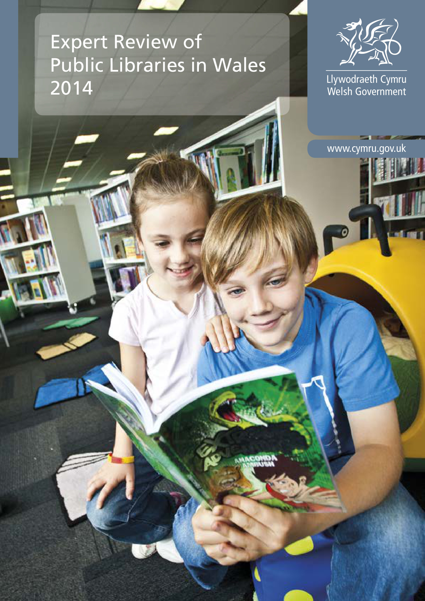

<!-- PAGE: 1 -->

# Expert Review of Public Libraries in Wales 2014

**Expert Review Panel**  
*Welsh Government*  
*October 2014*

---

Expert Review of Public Libraries in Wales 2014 <!-- PAGE: 2 --> <!-- PAGE: 3 -->

Contents

Foreword 5

## 1. Executive Summary Including Recommendations 7

**2.** Introduction and Background 11 Introduction 11 Overview of Current Provision in Wales 12 Recent Surveys of Users and Non-Users 12 Welsh Government Policy 13 National Assembly for Wales’ Communities, Equality and 15 Local Government Committee Short Inquiry into Public Libraries

**3.** Changes to Public Library Service Delivery in 2014-2015 19 Financial Overview 19 Income Generation 19 Impact of Reduced Funding on Public Library Services 20 Local Authority Consultation on Proposed Changes 21 Impact on Users and Communities 24 Strategic Planning 27 Community Managed Libraries 28 Challenging Timescales 29 Impact of Proposed Changes on Performance against the 29 Welsh Public Library Standards Comprehensive and Efficient Service 32

**4.** Future Models of Service Delivery 35 Call for Evidence 35 Future Trends of Public Library Service Delivery 36 Library Workforce 40 Sustainable Models of Service Delivery 42 Time for Change 49 Legislative Framework 50 Other Public Library Acts 51 Legislative Powers 52

## 5. Concluding Remarks 53

Appendix 1: Terms of Reference 55 Appendix 2: Selected Bibliography 58 Appendix 3: Core Entitlements 60 <!-- PAGE: 4 --> <!-- PAGE: 5 -->

Foreword

The key to the delivery of public library services in Wales hinges on the local authority’s statutory duty to provide a ‘comprehensive and efficient’ library service ‘for all persons desiring to make use thereof’. In this Review, the Panel set out to make recommendations as to how statutory requirements might be delivered into the future, albeit with a degree of pragmatism given the current economic climate.

It is clear that maintaining the status quo is no longer an option. There is broad agreement on provision, set out in the Fifth Framework of Welsh Public Library Standards, but how can this best be delivered to maintain the quality and relevance of the service for the people of Wales?

The Panel considered a variety of models, and our report makes a number of recommendations, some for immediate action, others for the longer term. Public libraries must adopt some innovative and proactive solutions to move forward in an age when the public still expect all the

Panel members

traditional services, alongside a whole range of new, digital and community-based services. Cooperative working between and within authorities, co-location with other services, and appropriate engagement with volunteers all seem to be more sustainable options than wholesale divesting of service points to their local communities.

Our deliberations emphasised that the library service is about the benefits for the user and maintaining the statutory nature of provision where service responsibility is defined, whether that be the current local authority structure or something broader. We considered a wide range of evidence from across the UK and around the world, including specific consultation with Welsh library authorities and other interested bodies. The question now is, are Welsh local authorities willing to adopt innovative ideas and new ways of working, to continue to deliver excellent public library services to users across the country?

Claire Creaser Chair

Dr Steve Davies Peter Gomer Prof. Hywel Roberts <!-- PAGE: 6 --> <!-- PAGE: 7 -->

## 1. Executive Summary Including Recommendations

“My children and I love books, the library means that I have been able to get books for me to read to the children, so the children have books for their reading levels. The library has also been there for me to help me with my college course. Also medical knowledge. The world would not be the same without libraries. They are for children and adults now and [in] the future.”1

(Flintshire library user, aged 26-49)

**1.** For over 150 years public libraries have played a central role as cultural and educational hubs in communities across Wales. They have provided free access to resources, information and activities. They promote literacy, lifelong learning and the wellbeing of the people of Wales. Over 14.67 million visits were made to public library buildings in Wales in 2013-14 according to the latest data published by the Chartered Institute of Public Finance and Accountancy.

**2.** Under the Public Libraries and Museums Act 19642 it is a statutory duty for every library authority (local authorities) in Wales to provide a “comprehensive and efficient library service for all persons desiring to make use thereof”. Responsibility for implementing the Act has been devolved to the Welsh Government and it is currently the duty of the Deputy Minister for Culture, Sport and Tourism to “superintend and promote” the improvement of public library services in Wales.

**3.** In October 2013 it became apparent that there would be significant pressure on local authority funding in Wales from 2014-15 onwards due to the constraints on public funding in the UK in general. In October and November it became clear that the resulting pressure on local authority funding would result in far reaching changes and a reduction in public library service provision in Wales.

**4.** In a Written Statement to the National Assembly of Wales on 3 December 2013 the then Minister for Culture and Sport announced that he would be commissioning an expert review of the current and future plans by local authorities to deliver public library services in Wales. The Panel began on its work in February 2014 and reviewed a substantial body of evidence with support provided by CyMAL: Museums Archives and Libraries (CyMAL), a division of the Welsh Government, from a range of stakeholders covering a wide spectrum of opinions as well as reviewing developments across the globe.

**5.** The review reaffirmed the importance of the public library service and that it will continue to make a positive impact to the life of individuals and their communities in the future. Libraries will play a vital role in the ongoing delivery of local and national priorities such as social inclusion, lifelong learning, literacy, digital inclusion, health and wellbeing and community cohesion.

**6.** The Panel noted that much progress had been achieved in delivering improved services as part of previous Welsh Government library strategies and the current Libraries Inspire strategy. The improvements include, modernising library buildings, the joint procurement of e-services, the roll-out of new initiatives such as ‘Every Child a Library Member’ and a library management system for Wales. However it concluded that unless there was a step-change in the level of collaboration between local authorities, the Welsh Government and other stakeholders to work together to address the practical challenges and the financial imperative, public library provision in Wales will be irreparably damaged and will no longer be able to address local community needs.

1 Welsh Government. (2011). Libraries Inspire: The strategic development framework for Welsh Libraries 2012-16. Available from http://tinyurl.com/d5klr9y

2 Her Majesty’s Stationery Office. (1964). Public Libraries and Museums Act 1964. Available from http://www.legislation.gov.uk/ ukpga/1964/75 <!-- PAGE: 8 --> **7.** The panel considered that the proposed changes by local authorities for the delivery of public library services from April 2014 will significantly impact on the level of service provided to the public and, as a consequence, on library usage. Reductions made prior to 2014 are already contributing to a levelling off of the increase in visitor numbers and it is reasonable to infer that lower expenditure on provision makes the offer to the public less attractive. The impact of the expenditure reductions required from 2014-15 onwards is likely to replicate the situation in England where there has been a significant reduction in funding resulting in fewer library service points, visits, items loaned and staffing since 2011-12. The number of library volunteers has increased and more community managed libraries have been introduced.

**8.** There was unanimous agreement that to wait until after the local government reorganisation currently scheduled for 2018-19 is not an option due to the significant changes that are likely to take place in public library service delivery before then. It is therefore essential that collaborative models of service delivery are actively considered, assessed and, if suitable, implemented as soon as possible in advance of any formal mergers of local authorities.

**9.** The Panel would commend the following recommendations to the Deputy Minister for consideration, many with immediate effect. Others, regarding radical new sustainable models of public library service delivery should be the subject of further consultation, and should be core to the development of a new library strategy for Wales post 2016.

Recommendations

Managing Change I. The Welsh Government, Welsh Local Government Association (WLGA) and local authorities should work with stakeholders to continue to develop good practice guidance which will assist local authorities and their public library services to consult on services. This should include training and promoting the

effective use of the wealth of online resources available, including the National Principles of Public Engagement, Practitioners’ Manual for Public Engagement; Evaluation toolkit.

II. The Welsh Government, Welsh Local Government Association and local authorities should work with stakeholders to continue to develop good practice to assist local authorities to undertake Equality Impact Assessments. This will include training and promoting the use of the forthcoming Equality Impact Assessments Practice Hub being developed by the WLGA and NHS Centre for Equality and Human Rights among public library services.

III. Proposed changes to public library services should only be progressed following the production of costed options which should be appraised according to:

a)	the identification of appropriate timescales;

b)	the completion of required impact

assessments;

c)	 the opportunities for collaborative working

with neighbouring authorities or other delivery partners.

This recommendation should be applied with immediate effect.

IV. CyMAL should take immediate steps to collect evidence and assess the impact of proposed changes to library service provision on the communities affected within the context of statutory requirements in Rhondda Cynon Taf CBC, Neath Port Talbot CBC and Blaenau Gwent CBC to inform future decisions by other local authorities. CyMAL should publish a report after an initial 3 month period of research and a full report after 12 months.

Strategic Improvements V. Every public library service should develop an evidence and outcomes based strategy to begin in 2015-16, outlining how the library service contributes to local, regional and national priorities, which is published on the library service’s website. This document should be used as a strategic planning tool and regularly revised and updated in accordance <!-- PAGE: 9 --> with existing corporate practice. The library service strategy should be supported by a delivery plan outlining how the strategy will be implemented, including a Results Based Accountability scorecard assessment. An example of best practice is Caerphilly CBC’s five year development plan which is based on their 10 year strategy.

VI. CyMAL should work with staff, employers, SCL Wales, CILIP Cymru and trade unions to develop a comprehensive five-year workforce development plan to start in 2015-16 for public libraries to meet future staffing needs. It is the Panel’s view that volunteers should be provided with tailored training as a discrete group to meet their specific needs.

VII. Local authorities should recognise and respond to the need for more urgent and greater emphasis on collaborative schemes in their future strategies for public library provision, especially between and among local authority departments, across local authority boundaries, and with other public sector libraries. The Deputy Minister for Culture, Sport and Tourism should take into account, in deciding what constitutes a “comprehensive and efficient” service, the local authority’s record and commitment in collaborative service delivery.

VIII. Community managed libraries (as outlined in para. 83) should not be considered as part of statutory library provision at the present time, subject to the findings of the research proposed in recommendation IV and IX. Data relating to libraries which are not part of statutory provision should not be included in returns under the Welsh Public Library Standards Framework.

IX. CyMAL should work with stakeholders to develop guidelines and appropriate documentation for partnership agreements

setting out the minimum requirements which would enable a community supported library to be considered as part of an authority’s statutory provision. Relevant legal advice should be sourced as part of this process. The criteria for a community supported library to be included as part of the statutory provision should be developed by CyMAL by January 2015 for implementation from April 2015.

Future Models of Service Delivery X. The Welsh Government should work with the WLGA and local authorities to progress the following strategic actions:

a)	promote greater collaboration on a more

extensive scale between authorities as an immediate priority;

b)	develop public library services in-line with

any future model for local government in Wales, as an ongoing commitment;

c)	 develop a regional or national consortium

approach to the delivery of public library services in the medium-term (3-5 years), to be facilitated by a suitably funded organisation supported by the Welsh Government;

d)	create a nationally co-ordinated library

service for Wales as the ultimate goal.

XI. The Welsh Government should undertake the necessary legislative process which would make the Welsh Public Library Standards statutory guidance in relation to the duties imposed by the Public Libraries and Museums Act 1964. The Welsh Government should also consider introducing new legislation to reflect the changing requirements for the public library to deliver services collaboratively in digital environments.

<!-- PAGE: 10 -->

<!-- PAGE: 11 -->

## 2. Introduction and Background

Introduction

Libraries will inspire the people of Wales to enjoy reading, enhance their knowledge and skills, to enrich their quality of life and empower them to realise their full potential. Libraries Inspire3

**10.** For over 150 years public libraries have played a central role as cultural and educational hubs in communities across Wales. They have provided free access to resources, information and activities. They promote literacy, lifelong learning and the wellbeing of the people of Wales. Knowledge is power and libraries, as stated in the Libraries Inspire vision statement above, empower people and make a real difference to their lives.

**11.** Under the Public Libraries and Museums Act 19644 it is a statutory duty for every library authority (local authorities) in Wales to provide a “comprehensive and efficient library service for all persons desiring to make use thereof”. It goes on to state that local authorities are under a mandatory duty to provide facilities for borrowing books and other materials to those resident in the local authority area, those whose place of work is in that area or those undergoing full time education in that area.

**12.** Responsibility for implementing the Act has been devolved initially to the Assembly under the National Assembly for Wales (Transfer of Functions) Order 1999 and subsequently to Welsh Ministers under section 162 and paragraph 30 of schedule 11 to the Government of Wales Act 2006. It is currently the duty of the Deputy Minister for Culture, Sport and Tourism to “superintend and promote” the improvement of public library services in Wales.

**13.** On 3 December 2013 as part of his statutory duty, the then Minister for Culture and Sport announced an Expert Review of Public Libraries in Wales (Review) as part of his duty to superintend and promote the improvement of public library services. The purpose of this Review was two-fold:

To review the proposed changes by local authorities for the delivery of public library services from April 2014 in order to assess whether the revised delivery provides a comprehensive and efficient service throughout Wales, highlighting best practice and any areas of concern.

To identify potential sustainable future models of service delivery which will maximise the opportunities obtained through collaboration, partnership and innovation.

The full Terms of Reference are provided in Appendix 1.

**14.** The Review was undertaken by a Reference Panel (Panel) chaired by Claire Creaser, Director of LISU, Loughborough University; with Prof. Hywel Roberts, library expert; Dr Steve Davies, Lecturer, Cardiff University; and Peter Gomer, Policy Officer, Welsh Local Government Association. The final report and recommendations were presented to the then Minister for Natural Resources, Culture and Sport in July 2014 as tasked.

**15.** Detailed evidence was collected and considered from a number of sources including:

* Desk research, with the assistance of CyMAL staff, on a wide range of topics:

–– Current public library provision in Wales

and the rest of the UK, Republic of Ireland and beyond,

3 Welsh Government. (2011). Libraries Inspire: The strategic development framework for Welsh Libraries 2012-16. Available from http://tinyurl.com/d5klr9y

4 Her Majesty’s Stationery Office. (1964). Public Libraries and Museums Act 1964. Available from http://www.legislation.gov.uk/ ukpga/1964/75 <!-- PAGE: 12 --> –– Examples of national library strategies

and service delivery models from Wales and beyond,

–– Future library trends, and

–– 	Public library legislation;

Information collected from local authorities in relation to proposed changes to funding and the provision of public libraries in 2014-15 including consultation activities and impact assessments undertaken;

Information collected as part of the National Assembly for Wales’ Communities, Equality and Local Government Committee’s inquiry into public libraries in Wales;

Extensive correspondence from the public to CyMAL in relation to proposed public library closures and service delivery changes;

* Written evidence to the Panel in terms of ideas for future models of service delivery; and

* The contribution of specialist expertise from Panel members.

**16.** In addition to the sharing of information and undertaking individual pieces of research, four meetings of the Panel and three teleconferences were held to discuss the evidence and to develop the recommendations. The Draft Report with recommendations was discussed with the then Minister for Natural Resources, Culture and Sport during the Panel meeting of 8 July, 2014. The Final Report was presented to the Minister in August.

**17.** This Report and its recommendations will inform and stimulate debate on current library policy and influence a new strategic libraries development framework for Wales to succeed the Libraries Inspire framework which will be completed in 2016. The Panel welcome the proposal to issue this report for comment in the autumn of 2014.

An Overview of Current Provision in Wales

**18.** There are currently 22 public library authorities in Wales with the public library service being delivered by the local authority. From October 2014, in Blaenau Gwent CBC the library service is scheduled to be delivered as part of a leisure and culture trust. In Bridgend CBC, the operational side of the co-located library service at three leisure centres is delivered by a trust.

**19.** According to the most recent available annual statistics, for 2012-135, published by the Chartered Institute of Public Finance and Accountancy (CIPFA) there are:

* 291 public library service points open 10 hours per week or more;

* 14.675 million visits to public libraries in Wales;

* 13.969 million items loaned to the public;

* 1.9 million hours of PC and Internet use in public libraries;

* 1,112.4 full time equivalent members of staff are employed in public libraries in Wales; and

* £17.191million of revenue funding invested in public library services in Wales.

**20.** The situation has remained fairly static until recently, when some authorities reduced provision in order to implement expenditure reductions following budget settlements from the Welsh Government. It should be noted that the budget reductions for public library services were greater than the overall headline budget reductions, due to the protection afforded to health budgets and the growth in schools budgets.

Recent Surveys of Users and Non-Users

**21.** The most recent comprehensive survey of public library use and non-users was carried out by IPSOS Mori for the Carnegie UK Trust.

5 CIPFA. (2014). Public Library Statistics 2013/14 Estimates and 2012/13 Actuals.

<!-- PAGE: 13 -->

The research report, entitled A New Chapter – Public Library Services in the 21st Century6, was published in 2012. This report reviewed the situation in England, Scotland, Northern Ireland, the Republic of Ireland and Wales. It provides a useful benchmark as the omnibus survey was carried out in a consistent manner in each of the nations. A total of 1,018 adults aged 16 and over were surveyed in Wales.

**22.** The Carnegie UK Trust produced a summary factsheet of Welsh data on attitudes to and use of public library services which is available in full online7. The results for Wales showed that:

* Over three quarters (77%) of people in Wales said that libraries were very important or essential to their community;

* 45% of those surveyed had used a public library in the previous 12 months;

Frequent users were more likely to be working part-time, not be working or be retired, than they were to be working full-time;

Despite the fact that those in social group E were least likely to have visited a library in the last 12 months, those that had done so were most likely to say that they visited their local library ‘at least once a week’ (30%), whereas those in social groups AB and C were the least likely ‘to have visited at least once a week’ (18% and 17% respectively); and

In Wales, there was a statistically significant, positive, relationship between two factors and frequency of library use: being a prolific reader, and living in an urban area.

**23.** A New Chapter also provides comparative data on current trends of library usage, core services and the public’s views and needs in relation to library services across the UK and Ireland.

**24.** The most recent data relating to user satisfaction submitted as part of the Fourth Framework of the Welsh Public Library Standards Framework in 2013-14 reflects a very high satisfaction rating of between 95% and 100%. The only areas indicated by users as being less than satisfactory were older buildings and diminishing book stocks.

**25.** The Panel also considered a range of other reports, including research commissioned by CyMAL, which is outlined in the bibliography (see Appendix 2).

Welsh Government Policy

**26.** From 2002, the Welsh Government implemented the Welsh Public Library Standards (the Standards) in frameworks of three-year cycles to monitor public library provision in Wales. The Standards are used by Welsh Government officials to monitor and assess the performance of local authority library services as part of the statutory Ministerial requirement to superintend public libraries. The most recent review of local authorities’ compliance with the Standards and the potential impact of proposed changes in 2014-15 are outlined in paras. 92-104.

**27.** In 2004, the Welsh Government established CyMAL: Museums Archives and Libraries Wales division to advise Ministers and to develop library policy for Wales. CyMAL was also given an outward-facing role to support improvements in library provision in Wales and encourage innovative approaches. A revenue grant programme was supplemented by a capital funding stream for the modernisation of public libraries from 2007-08.

**28.** CyMAL has worked with the sector to implement three strategic development frameworks since 2004 – @ Your Library, Libraries for Life, and the current Libraries Inspire framework (2012-2016). Independent evaluations of previous frameworks are

6 Carnegie UK Trust. (2012). A New Chapter: Public library services in the 21st century. Available from http://carnegieuktrust. org.uk/publications/2012/a-new-chapter

7 Carnegie UK Trust. (2012). A New Chapter: Public library services in the 21st century – Welsh data about attitudes to and use of public libraries. Available http://carnegieuktrust.org.uk/publications/2012/a-new-chapter---wales-factsheet <!-- PAGE: 14 --> available on the CyMAL pages of the Welsh Government website8. The evaluation process included evidence gathering using focus groups and surveys of staff, users and non-users.

## 29. The priorities of the Libraries Inspire strategy are to:

work together to review existing models of service delivery in response to the current economic climate, and develop new innovative models of delivery;

develop partnership working in procuring and improving access to resources, including new online services such as e-books;

* modernise public library buildings to meet the changing needs of their users;

maximise the contribution of libraries in developing people’s skills to help everyone reach their potential, reduce inequality, and improve economic and social well-being;

Figure a: Public library visits in Wales, Scotland, Northern Ireland and England (CIPFA Actuals)

6000

Library visits per 1000 population

5000

4000

3000

2002-03 2003-04 2004-05 2005-06 2006-07 2007-08 2008-09 2009-10 2010-11 2011-12 2012-13

England Wales Scotland Northern Ireland

* invest in developing the skills of library staff;

implement a co-ordinated audience development programme across Wales to enrich the lives of individuals and communities; and

* ensure the provision of a high quality service through initiatives such as the Welsh Public Library Standards.

**30.** Following the introduction of a strategic policy for libraries, including development of the Standards, and an increasing level of collaboration between local authorities and their library services, there have been increases of 5% in public library visits (figure a), and 19% in investment (figure b) in Welsh public libraries over the last 10 years.

**31.** Comparison with the rest of the UK suggests that, over the last 10 years, the Standards have been instrumental in delivering a more consistent offer of service across Wales and have led to improvements in service provision and delivery. Through close working relationships

8 Simon, A. and Horton, S. (2008). Evaluation of @ your library: an initial strategic development programme 2005-2007. Available from http://tinyurl.com/m7sdyr8

Scotinform. (2011). Evaluation of Libraries for Life. Available from http://tinyurl.com/6d2y97b <!-- PAGE: 15 --> Figure b: Revenue expenditure on public library services in Wales, Scotland, Northern Ireland and England (CIPFA Actuals)

25000

Total Revenue Expenditure per 1000

resident population

20000

15000

2002-03 2003-04 2004-05 2005-06 2006-07 2007-08 2008-09 2009-10 2010-11 2011-12 2012-13 England Wales Scotland Northern Ireland

between the Welsh Government, the WLGA and local authorities, the Welsh Public Library Standards have become established as the main mechanism for monitoring public library provision in Wales.

**32.** The Fifth Framework of the Welsh Public Library Standards9 was launched by the then Minister for Natural Resources, Culture and Sport in May 2014 and has been developed to include outcome indicators to measure the impact of public library services on people’s lives.

The National Assembly for Wales’ Communities, Equality and Local Government Committee Short Inquiry into Public Libraries

**33.** The National Assembly for Wales (NAfW) Communities, Equality and Local Government Committee (Committee) undertook a short

inquiry into public libraries in Wales10. In November 2013 the Committee’s Chair, Christine Chapman AM, invited written evidence and the Committee also took oral evidence from key stakeholders at the Committee’s meetings in early 2014. In addition focus groups and an online survey were conducted, in order to broaden public engagement.

**34.** The Committee invited contributions on the following themes:

Progress made by the Welsh Government towards achieving its Programme for Government commitments relating to libraries, and how sustainable any progress is in the current climate;

Extent to which the current legislative and policy frameworks are suitable to meet the challenges facing local authorities delivering library services in Wales;

9 Welsh Government. (2014). Libraries making a difference: The fifth quality framework of Welsh Public Library Standards

2014-2017. Available from http://tinyurl.com/pde7toz

10	 The National Assembly for Wales; Communities, Equalities and Local Government Committee. (2013/14). Inquiry into Public Libraries in Wales. Available at http://tinyurl.com/q4mu9k5 <!-- PAGE: 16 --> How well-prepared the Welsh Government and local authorities are to mitigate the impact of public sector cuts on library services;

Options for improving the financial sustainability of library services, including alternative models of provision; and

The contemporary and community role of public libraries in Wales.

**35.** The Committee’s report, Public Libraries in Wales11, was published on 23 July 2014. The report highlighted the “very important” role that public libraries play in our communities and the contribution they make to a range of portfolio areas. The Committee made 10 recommendations to the Minister.

**36.** These recommendations were considered by the Panel and its considerations are outlined below.

Committee Recommendation 1 We recommend that the Minister produces and publishes an annual report on the state of public libraries in Wales.

The Panel support this recommendation. In addition to monitoring progress in relation to the delivery of public library services in Wales. It would provide an opportunity to highlight the excellent examples of best practice in delivering innovative library services. The annual report could draw on existing sources of information such as the Welsh Public Library Standards, the Results Based Accountability scorecard assessment undertaken by authorities and the Libraries Inspire Delivery Plan. However, as the Libraries Inspire strategy embraces different library sectors in Wales, it would be beneficial if the annual report was also cross-sectoral in nature.

Committee Recommendation 2 We recommend that the Minister makes arrangements for the central publication of disaggregated data showing the use of public libraries by demographic groups.

The Panel acknowledges the need to collect data on users and non-users in order to inform public library service delivery. It is aware that some authorities are using such data to target specific groups within their community. There is a need to identify the most efficient method of collecting this data that will not place a significant additional burden on public library services. A number of Welsh Government funded national surveys on related areas are undertaken and the possibility of adding questions to existing surveys should be investigated.

Committee Recommendation 3 We recommend that the Minister works with partners to develop a contemporary definition of – comprehensive and efficient library services for local authorities to deliver under the Public Libraries and Museums Act 1964. Such a definition should include the provision of internet access which, we believe, should remain free of charge.

The Panel has given this issue due consideration and has identified a clear need to define what is meant by “comprehensive and efficient”, as highlighted by the responses to the call for evidence (para. 128). The Panel’s recommendation XI recommends making the Welsh Public Library Standards statutory guidance.

Committee Recommendation 4 We recommend that the Minister considers developing a voluntary accreditation scheme for individual libraries in Wales.

Introducing an accreditation scheme, similar to museums and archives, in addition to the Welsh Public Library Standards would require significant investment in time and money. The new Fifth Framework of Welsh Public Library Standards outlines core public library entitlements that Welsh citizens should expect from any library and library service. The Panel considers that its Recommendations VIII and IX and the continued implementation of the Standards address the issue of quality assurance.

11	 The National Assembly for Wales; Communities, Equality and Local Government Committee. (2014). Public Libraries in Wales. Available from http://tinyurl.com/q4mu9k5 <!-- PAGE: 17 --> Committee Recommendation 5 We recommend that the Minister continues to work with local authorities and their partners to identify and promote further opportunities for collaboration and co-location arrangements in the delivery of library services.

One of the key recommendations of the Panel is to increase the level of collaboration to develop a more sustainable model of public library service delivery in Wales and the Panel therefore supports the Committee’s recommendation. The Panel’s Recommendations VII and X highlights the emphasis placed by the Panel on the need to develop greater collaboration on a local, regional and national level.

Committee Recommendation 6 We recommend that the Minister ensures that the necessary ongoing support and guidance is available in order to increase the long-term sustainability of community managed libraries.

The Panel has noted the need to develop guidance for community managed and supported libraries in its Recommendation IX. The Panel’s Recommendation IV, if implemented, will also provide useful evidence to inform this work.

Committee Recommendation 7 We recommend that the Minister ensures adequate support and guidance continues to be available to local authorities to identify and pursue all available funding opportunities.

The Panel supports this recommendation and notes the ongoing work of the Welsh Government, via the CyMAL grant schemes, in providing funding for the development of innovative and collaborative projects. CyMAL also provides advice on funding sources and provides courses on fundraising as part of its workforce development programme.

Committee Recommendation 8 We recommend that, whilst core library services should remain free of charge, the Minister should explore with local authorities all other available options for libraries to raise revenue.

The Panel has considered the challenges faced by public libraries to increase income from various sources in paras. 45-49 it concluded that:

The evidence available to the Panel demonstrates that the opportunities for income generation currently under consideration are limited and unlikely to have any significant impact on the current funding situation.

The evidence also highlighted potential knock-on impact/costs on other public-funded services if for example charges were introduced for Internet access.

Committee Recommendation 9 We recommend that the Minister works with local authorities and partners to promote better the wide range of services provided by public libraries.

The Panel supports the need to raise awareness of the services provided by public libraries. It supports the continued expenditure and emphasis placed on audience development as part of the Libraries Inspire strategy with its mixture of national campaigns, festivals and staff training.

Committee Recommendation 10 We recommend that the Minister continues to pursue the case for additional funding from the UK Government in recognition of the increasing responsibilities for library staff in Wales in supporting the delivery of digital-by-default welfare reforms.

**37.** The Panel fully supports the provision of free access to ICT and commends the key roles that public libraries and their staff play in promoting digital inclusion and assisting people access the increasing number of public services primarily delivered online, such as Universal Credit and Universal Jobmatch. It is important that this role is recognised in the distribution of funding by the Department of Works and Pensions to support the roll-out of Universal Credit.

<!-- PAGE: 18 -->

<!-- PAGE: 19 -->

## 3. Changes to Public Library Service Delivery in 2014-2015

Financial Overview

**38.** In October 2013 it became clear that there would be significant pressure on local authority funding in 2014-15 onwards due to the constraints on public funding in the UK in general. In a Written Statement to the National Assembly for Wales in October 2013, the Minister for Local Government and Government Business stated:

Despite the reductions to the Welsh Block Grant since the 2010 Spending Review, Welsh Government has maintained funding support for Local Authorities in Wales over the past three years in cash terms. This was protected to enable Local Government to prepare for and invest in transforming the delivery of services in expectation of tougher times ahead.12

**39.** As a result of these constraints, the Welsh Government’s settlement for local authorities in 2014-15 was on average reduced by 3.5% and ranged from –1.2% to 4.6%. Due to the protection afforded to funding for schools and social services, the impact of the reduction in local authority funding on the remaining services was greater. In addition to the reduction in funding, the impact of inflation is also a significant issue.

**40.** In June 2014, the then Minister for Local Government and Government Business wrote to local authorities informing them to prepare for further reduction in local government funding of between 1.5% and 4.5% in 2015-16. Initial indications are that some public library services have been asked to revise services as the result of further reductions in their funding in 2015-16.

**41.** Information provided to the Panel from local authorities demonstrated that public library services have been directed to reduce expenditure by between 0.7% (£20,000) and 19.9% (£1m) during 2014-15. However this does not reflect the full picture.

**42.** The information provided demonstrates that there are three approaches:

those which are front-loading the reduction in funding for libraries, hence showing a higher percentage reduction in 2014-15;

those which are delaying their main funding reductions until the third year (2016-17) and hence showing a low percentage reduction in 2014-15; and

* those which are spreading the savings over the three-year period.

**43.** No clear pattern has emerged regarding percentage reductions in terms of the region or size of authority and they reflect local decisions made by individual local authorities.

**44.** There is also little or no evidence that, in the decision-making process, an assessment was made of the actual knock-on impact/costs on other public-funded services such as learning and education, e.g. literacy and digital literacy, access to employment information and social welfare.

Income Generation

**45.** In Wales there is a strong tradition of providing the vast majority of public library services free at the point of use to support tackling poverty and social inclusion agendas. The consultation process revealed that a number of local authorities were investigating opportunities to generate income to cover some of the shortfall in funding. Some of the areas being considered include charging for computer and Internet use, and reservations for items available in other Welsh libraries. Both these options are contrary to the agreement on user entitlements to free services agreed between the Welsh Government, WLGA and library services.

**46.** The evidence available to the Panel demonstrates that the opportunities for income generation currently under consideration are

12	 Welsh Government. (2013). Written Statement – Provisional Local Government Settlement 2014-2015. Available from http://tinyurl.com/mbdzepb <!-- PAGE: 20 --> limited and unlikely to have any significant impact on the current funding situation. Indeed, the evidence suggests that minor fundraising initiatives such as charging for the use of ICT are costly to introduce and administer. In addition, such actions (especially in relation to disadvantaged members of the public) are counterproductive in view of the increasing corporate and national priority to address digital inclusion when access to welfare benefits and assisting people into work require Internet access and digital skills.

**47.** In other countries such as the Republic of Ireland, public libraries are actively seeking gifts and donations, e.g. Galway County Library Service13 is administering a Book Endowment scheme with a minimum contribution of 1,250 Euros.

**48.** To date, very few ‘Friends of the Library’ groups in Wales have emerged and a discussion with the Rhydyfelin Library Support Group identified a need to potentially share best practice with Friends Groups in other sectors such as museums. One of the potential roles for a Friends Group could be to assist with income generation. It would be advantageous for CyMAL to organise a cross-sectoral event bringing together the ‘Friends’ of museums, archives and libraries in the autumn of 2014.

**49.** The Welsh Ministers have powers to specify in regulations the charges a library authority may issue in relation to the provision of library services as outlined in section 8(2) of the 1964 Act. The relevant regulations in Wales are the Library Charges (England and Wales) Regulations 1991/271214.

Impact of Reduced Funding on Public Library Services

**50.** Evidence of a significant impact of reduced funding on services and users is already apparent in those local authorities which

have front-loaded reductions in 2014-15. The reductions impact on a wide-range of public library service areas including:

* Branch library closures

–– The highest being an initial proposal to

originally close 14 out of the network of 26 branch libraries in Rhondda Cynon Taf (However Rhydyfelin Library has since been re-opened and 2 other library service points will be run by volunteers).

Introduction of community managed libraries with varying degrees of volunteer involvement (for more details see paras. 162-174)

–– Neath Port Talbot are transferring 9 of

their 17 branch libraries to community managed libraries.

* Reduction in opening hours including:

–– Closing the library for an extra day

–– Reduced Saturday opening

–– Reduced late opening

* Reduction in library staffing levels

–– Restructuring

–– Deletion of a layer/grade

–– Reduction in professional posts

–– Reduction in library assistants

* Reduction in funding to purchase resources

–– Reduction in book fund

* Reduced mobile library provision

–– Less frequent library stops, e.g. increase

from 3 week to 4 week cycle

–– Deletion of mobile library services, but

with continued housebound services; and

* Revisions to school library services

–– Reduction in services

–– Restructuring of services

–– Withdrawal of service.

13	 Galway County Council. Gifts and Donations Galway Public Library Service. Available from http://www.galway.ie/en/Services/ Library/GiftsDonations/ (Accessed 14 July 2014)

14	 HMSO. (1991). Library Charges (England and Wales) Regulations 1991/2712. Available from http://www.legislation.gov.uk/ uksi/1991/2712/made <!-- PAGE: 21 --> **51.** The changes outlined above will significantly impact on the level of service provided to the public and, as a consequence, on public library usage. In Wales, the reductions made prior to 2014 are contributing to a levelling off of the increase in visitor numbers and are reflected in the revenue expenditure on public libraries outlined in figures a and b on pages 14 and 15. It is reasonable to infer that the lower expenditure on provision makes the offer to the public less attractive, e.g. there is evidence of a significant reduction in items loaned following a reduction in expenditure on book stock.

**52.** It is the Panel’s view that it will be important to ensure that the evidence of the impact of changes being implemented and lessons learned in authorities such as Rhondda Cynon Taf, Neath Port Talbot and Blaenau Gwent is captured to inform decisions by other local authorities in the future (see Recommendation V).

**53.** However the impact of the expenditure reductions required from 2014-15 onwards is likely to replicate the situation in England where there has been a significant reduction in funding resulting in fewer public library service points, visits, items loaned and staffing since 2011-12. The number of library volunteers has increased and more community managed libraries have been introduced.

**54.** Data collected by CIPFA show that the numbers of volunteers in public libraries in England, Wales and Scotland has increased since the data was first collected in 2006-07. Although the percentage rate of increase in Wales is considerably greater than in England, it started from a very low base of 21 volunteers, rising to 93 in 2012-13. In England, there were 11,802 volunteers in 2006-07, rising to 32,029 in 2012-13.

Local Authority Consultation on Proposed Changes

**55.** Section 5 of the Local Government (Wales) Measure 200915 places a duty to consult upon Welsh local authorities. Under section 5 a local authority is required to carry out a consultation for the purposes of determining how to fulful the duty to achieve continuous improvement in the delivery of its functions (section 2 (1)) and the duty to set achievement objectives (section 3 (1)).

**56.** In his letter to local authorities in December 2013, the then Minister for Culture and Sport highlighted the need to consult in relation to proposals to revise public library services. All library services which have proposed significant changes have undertaken some form of consultation, although this has varied significantly between local authorities viz:

Consultation on a range of services, including public libraries, outlining specific proposals, e.g. named library closures;

* Consultation on a range of services, including public libraries, prior to announcing specific proposals;

* Consultation specifically on public library services outlining specific proposals; and

Consultation specifically on public libraries as part of a review of library services prior to developing proposals including:

–– Research including wider use of public

buildings,

–– Citizen Panels, and

–– Public consultation meetings and

invitations to submit comments.

15	 Stationery Office Ltd. (2009) Local Government (Wales) Measure 2009. Available from http://www.legislation.gov.uk/ mwa/2009/2/contents <!-- PAGE: 22 --> <!-- PAGE: 23 -->

**57.** Some local authorities utilised a combination of the above. The form of consultation varied, including citizen focus groups and a general public consultation exercise. The period of consultation also varied with a consultation period of a month being most common.

**58.** In preparing their proposals for changing public library service provision, there are examples where the local authority has been undertaking a review of library and other services through conducting a series of citizen focus groups in advance of publishing their proposals for wider and continuous consultation, e.g. Cardiff City Council. A comprehensive research and consultation process was undertaken by Conwy CBC in 201116 as part of their review of public library services.

**59.** The importance of a suitable consultation process was highlighted as part of A Local Inquiry into the Public Library Service Provided by Wirral Metropolitan Borough Council led by Sue Charteris17. The final report stated:

“I believe there is a strong case for reviewing the decision and/or retaining a physical service (not necessarily as it is now) at some sites earmarked for closure.”

## 60. One of the reasons for this decision was:

“where the Council’s decision on which libraries to close changed: due to the lack of consultation with residents when the decision to close Bromborough Library was substituted for Eastham, and Upton Library for Woodchurch, meaning that the Council did not consider the needs of those communities affected by the changes.”

16	 Conwy County Borough Council. (2011). Library Modernisation. Available from http://www.conwy.gov.uk/section. asp?catid=8955

17	 Department of Culture and Sport. (2009). A Local Inquiry into the Public Library Service Provided by Wirral Metropolitan Borough Council Led by Sue Charteris. Available from http://tinyurl.com/ogzr3qw

**61.** The need to ensure a robust consultation is essential in order to take into account the views of the public. It is also important in avoiding some of the costly judicial reviews brought against the local authority by community groups. It is essential that legal advice is sought in preparing the consultation process in order to comply with the Duty. This is especially relevant to those local authorities that are currently undertaking a review of their public library services to meet funding reductions for 2015-16 onwards. The Review Panel concluded that consultation in Wales was variable in quality, length and objectives. This is a matter that merits further guidance.

**62.** A judicial review was scheduled to take place in relation to the consultation process undertaken regarding the proposed closure of Rhydyfelin Library. Rhondda Cynon Taf withdrew their proposals to close the Library before the judicial review hearing took place, and undertook to re-open the Library and discuss its future with the library support group.

**63.** For a number of years the WLGA has provided support to local authorities on improving citizen engagement techniques and consulting within the law. This has been provided through accredited training programmes, national shared learning events for Local Service Board engagement practitioners and a range of toolkits and research which are available on-line and include: National Principles of Public Engagement18, Practioners’ Manual for Public Engagement19; Evaluation toolkit20 and new documents are under development. In addition the WLGA recently piloted a training programme about engaging

18	 Participation Cymru. National Principles for Public Engagement in Wales. Available from http://tinyurl.com/katmvfb (Accessed 1August 2014).

19	 Participation Cymru. Practitioners’ Manual for Public Engagement. Available from http://tinyurl.com/oeqgvyq (Accessed 1August 2014).

20	 Participation Cymru. The Evaluation Toolkit. Available from http://tinyurl.com/n6amfux (Accessed 1August 2014).

<!-- PAGE: 24 -->

with communities on budget cuts and on-going engagement with communities. Following a successful evaluation the WLGA plan to roll-out this course to interested local authorities. The programme provides an overview of engagement techniques, including Consultation Law & Equalities Impact Assessments.

Recommendation: I. The Welsh Government, Welsh Local Government Association and local authorities should work with stakeholders to continue to develop good practice guidance which will assist local authorities and their public library services to consult on services. This should include training and promoting the effective use of the wealth of online resources available, including the National Principles of Public Engagement , Practioners’ Manual for Public Engagement; Evaluation toolkit.

Impact on Users and Communities (including Impact Assessments)

Correspondence received 64. An important aim of the Review is to consider the impact of the proposed changes on individuals, families and communities. Around 76 items of correspondence have been sent by the public to the then Minister for Natural Resources, Culture and Sport or directly to CyMAL highlighting the impact of the proposed changes on the public and communities. In summary, these letters have highlighted the importance of local public libraries and their contribution to:

* Improving literacy, especially for children;

Delivering digital inclusion, including free access and assistance in using computers and the Internet for those who cannot afford to get online at home;

* Supporting lifelong learning;

* Providing a safe community venue for a range of activities and meetings; and

* The difficulty, due to a lack of personal transport, of reaching alternative libraries.

**65.** The high value placed by public library users on the support and assistance provided by library staff was highlighted and the impact of the loss of paid staff in some community managed libraries was noted.

**66.** A number of the letters also asked the Welsh Government to intervene to delay the implementation of decisions to close libraries to provide more time for discussions with community groups in relation to the future of some libraries. In most cases the local authorities responded to these requests and extended the consultation period prior to any closures.

**67.** Of the 76 items of correspondence that have been received to date, 54 relate to two authorities – 37 relate mainly to Rhydyfelin, Maerdy and Beddau Libraries in Rhondda Cynon Taf and 17 relate to Pennard Library in Swansea. The remaining items included 15 items covering another 6 local authorities, 5 from Assembly Members, the Chartered Institute of Library and Information Professionals Wales and the Society of Chief Librarians Wales.

Equality impact assessments 68. In proposing changes to their public library services, local authorities have to comply with the Public Sector Equality Duty as set out in section 149 of the Equality Act 2010. The guidance from the Equality and Human Rights Commission states that:

Your authority has legal duties around eliminating unlawful discrimination, advancing equality of opportunity and fostering good relations on the basis of protected characteristics such as gender, race, disability or age. These duties do not prevent you from reducing services where necessary, but they offer a way of developing proposals that consider the needs of all members of your community.21

21	 Equality and Human Rights Commission. (last updated 2010). Equality Impact Assessments. Available from http://www.equalityhumanrights.com/wales/equality-impact-assessments/ <!-- PAGE: 25 --> **69.** As part of this duty local authorities are required to undertake Equality Impact Assessments (EIAs).

**70.** Failure to demonstrate that due regard had been given to the public sector equality duty resulted in a court case between (R. Green and others) v Gloucestershire County Council & Somerset County Council [2011] EWHC 2687 (Admin). The Judge McKenna stated:

These are of course all relevant considerations in the exercise of my discretion, but I have no doubt that they are significantly outweighed by a number of other factors, not least of which is the fact that the decisions under challenge failed to give effect to the public sector equality duties and were not merely unlawful decisions but were, in substance, as Ms Mountfield submits, amounted to bad government. It is important to the rule of law to give due respect to these issues of equality. The breach of the equality duties is a substantive and not merely a technical or procedural defect.22

**71.** The then Minister for Culture and Sport highlighted the need to undertake EIAs in his letter to local authorities in December 2013. The WLGA is to be commended in delivering training for local authorities on undertaking EIAs.

**72.** All the local authorities which are undertaking significant changes to public library provision provided evidence that EIAs had been undertaken. There were clear examples, for example Pembrokeshire, where the local authority had revised proposals to mitigate the impact of the proposed changes to the library service on various groups of people. Where there were proposals to reduce or withdraw the mobile library service, the housebound/home delivery service was strengthened to mitigate the impact on people who could not visit alternative library facilities.

Also some charged services have remained free for people with disabilities. A number of local authorities are revising their mobile library service and this will have significant impact of library users in rural areas of Wales.

**73.** However in some cases, whilst the EIAs outlined the impact on sections of the community, for example, the elderly, children, those digitally excluded and in areas of deprivation, the information provided did not outline how the EIA had influenced the final decisions and full details of the actions taken to mitigate the impact.

**74.** There was little evidence of the use of research reports to support the impact on service delivery. For example, the findings of the research carried out by Child and Goulding in the Midlands (England), entitled Public libraries in the recession: the librarians’ axiom23 showed that:

The principal finding is that more people used libraries during the recession, particularly for job-seeking activities, advice and training.

**75.** In July the Carnegie UK Trust published a leaflet, Speaking Volumes24, outlining the impact of public libraries and how they contribute to four major policy areas: social, economic, cultural and education policy. To accompany the leaflet, a series of databases containing a range of examples on public libraries’ contributions to the policy areas have been published.

**76.** Along with the consultation process, EIAs is another area that the WLGA have been proactive in providing training to local authority staff to improve their knowledge and skills. The WLGA and the NHS Centre for Equality and Human Rights have recently completed research and are launching an Equality Impact Assessments Practice Hub which will contain a wide range of resources to support local authority staff.

22	 High Court of Justice. (2011). The Queen on the Application of Green v Gloucestershire and the Queen on the Application of Rowe v Somerset County Council. Available from http://foclibrary.files.wordpress.com/2011/12/1611kr01marked-2.pdf

23	 Child, R. and Goulding A. (2012). Public libraries in the recession: the librarian’s axiom. Available from Library Review, Vol. 61 Iss: 8/9, pp.641 – 663

24	 Carnegie UK Trust. (2014). Speaking Volumes. Available from http://preview.tinyurl.com/n9qdrsc <!-- PAGE: 26 --> <!-- PAGE: 27 -->

Recommendation: II. The Welsh Government, Welsh Local Government Association and local authorities should work with stakeholders to continue to develop good practice to assist local authorities to undertake Equality Impact Assessments. This will include training and promoting the use of the forthcoming Equality Impact Assessments Practice Hub being developed by WLGA and NHS Centre for Equality and Human Rights among public library service staff.

Strategic Planning

**77.** In reviewing the evidence provided by local authorities, the Panel sought examples where the proposed changes were linked to a strategic change agenda associated with the public library service. A limited number of responses demonstrated that the proposed changes were being considered as part of a review of local library services. Some of these reviews were already underway prior to the announcement of the local government settlement in October 2013, others had commenced the process of identifying targeted funding reductions, primarily from 2015-16 onwards.

**78.** However, in the opinion of the Panel, the majority of responses would have benefitted from evidencing the proposed changes in the context of strategic planning for the public library service, the priorities for the local authority and wider priorities. It is also the Panel’s view, based on the information provided by the local authorities, that too few alternative options for service provision appear to have been considered. In addition, there is evidence that the involvement of senior library staff in the decision making and planning process varies across authorities.

**79.** Examples of well-established good practice in Caerphilly, Bridgend, Denbighshire, Wrexham and Cardiff were noted where there is a clear policy of developing multi-use/ co-located facilities with the aim of creating a more sustainable service or resulting in

enhanced services. Examples of co-locating local authority and other services with libraries include:

* Council information services, including merging the services in two cases

* Tourist information services

* Leisure services

* Archive services

* Community centres

* Lifelong learning centres.

**80.** Evidence from the Welsh Government’s Community Learning Library programme to modernise service points shows clearly that co-location can offer the potential to improve the profile and visibility of the public library service. It has also led to increased levels of use in terms of visitor numbers, loans and activities in libraries. In the current climate it is also necessary to consider the potential for service integration. There is no single approach and each co-location project should be assessed on local needs and potential synergies with appropriate partners.

**81.** A number of leisure services in Wales have already been transferred to trusts or not-for-profit companies. However the only whole public library service to become part of a trust is Blaenau Gwent Library Service which will join leisure and cultural services as part of the new Blaenau Gwent Life Leisure Trust. Other local authorities noted that this option was under consideration, for example, Wrexham and Merthyr Tydfil. Interestingly all these leisure trusts or not for profit companies operate within existing local authority boundaries, even though a number of them border each other.

**82.** Although there are examples of joint procurement of resources and systems in place or being developed, no convincing evidence was identified of any major new strategic initiatives to develop cross-border public library services. The Panel believes that failure to promote major collaborative cross-authority initiatives is a significant weakness in the

<!-- PAGE: 28 -->

response of local authorities to the current economic climate, and resorting to short-term solutions such as volunteer libraries would be storing significant problems for the future.

Recommendation: V. Every public library service should develop an evidence and outcomes based strategy to begin in 2015-16, outlining how the library service contributes to local, regional and national priorities, which is published on the library service’s website. This document should be used as a strategic planning tool and regularly revised and updated in accordance with existing corporate practice. The library service strategy should be supported by a delivery plan outlining how the strategy will be implemented, including a Results Based Accountability scorecard assessment. An example of best practice is Caerphilly CBC’s five year development plan which is based on their 10 year strategy.

Community Managed Libraries

**83.** The term “community managed libraries” has been used in this report primarily because it is the most commonly adopted term by the public library sector and is used by CIPFA. It refers to maintaining individual libraries designated for closure by means of community intervention of different types. The development of community managed libraries was already underway in Conwy and Carmarthenshire prior to October 2013. However, these developments were minimal compared to the number of community managed libraries established in England since 2011, as a result of budgetary reductions.

**84.** In October 2013, Neath Port Talbot undertook a consultation on the possible closure of nine libraries, unless alternative community managed libraries could be developed. Due to a strong response by the communities affected, Neath Port Talbot Library Service has worked closely with community groups to develop the community managed library model in all 9 of the libraries threatened with closure. Since the confirmation

of the library closures in Rhondda Cynon Taf, a number of community groups submitted business cases to maintain a volunteer run library in their community. On 24 June, Rhondda Cynon Taf announced that two community groups had been successful with their applications to provide library provision in Maerdy, and Beddau and Tynant.

**85.** The different models of community managed libraries in Wales can be broadly summarised as follows:

Elements of resources and staff provided/ co-ordinated by the local library service, with the building in community ownership and a contribution towards staffing from the community council with the staff employed by the library service (Carmarthenshire).

Limited resources and regular staffing (defined hours) provided by the local library service, the building in community ownership and assistance from volunteers. To date this model has yet to be implemented in full (Conwy).

Resources and some assistance in terms of supervision and guidance provided by more senior staff by the local library service with the building in community ownership and mainly run by volunteers (Neath Port Talbot).

The transfer of the building and resources to the community and entirely run by volunteers with no ongoing assistance from the local library service in managing the facility (Rhondda Cynon Taf).

**86.** There are variations on each of these models and the situation is continually changing. The Panel was not provided with significant and persuasive evidence regarding the sustainability of any of these models and their success or otherwise needs to be monitored. Community groups that have been actively objecting to public library closures have indicated that their preference would always be for a library authority funded and staffed facility and view a volunteer-led library as a last resort.

<!-- PAGE: 29 -->

**87.** It is recognised however, that without the invaluable support of volunteers, it is possible that Wales could face the closure of even more public libraries, for example, 9 public libraries in Neath Port Talbot would have closed without the involvement of volunteers. Nevertheless, in several instances there has already been a significant reduction in public library opening hours when establishing community managed libraries, compared to prior local authority provision. The Panel is concerned whether investing in the stock and facilities of a library open for such limited hours would offer good value for money regardless of the source of funding and support. Once a public library is closed, past experience indicates that it is highly unlikely to ever re-open. In the last ten years, there are only two known examples of a closed (excluding temporary closures) public library re-opening.

**88.** One of the models for community involvement that merits further research is the community supported/partnership library model. This is a partnership between the local authority public library service and a community group. This involves a commitment from the library service to provide ongoing support in terms of resources, for example bookstock, ICT and staff time which, together with an equivalent commitment from the community partner, would provide a more sustainable model for a community managed library.

**89.** The issue of community managed libraries, and their implications for future service delivery, are considered further in paras 162-174.

Challenging Timescales

**90.** As noted in para. 77, some public library services were already the subject of a review and were developing policies in the context of the funding pressures on the horizon. However it is clear from the evidence provided that those library services facing significant reductions in funding in 2014-15 have had very little time to undertake research and detailed planning to develop alternative

models of service delivery or planned change. The tight timescales have certainly limited opportunities for collaboration between local authority services, local authorities and other public services in developing solutions. Collaboration takes time and there are normally associated set-up costs.

**91.** Local authorities have been restricted to identifying ‘quick wins’ in terms of meeting financial targets, but these can have negative impacts. For example, early retirement and voluntary redundancies to meet savings targets result in un-planned skills gaps in the workforce. There is also a need to review the longer term impact and costs of the ‘quick-wins’ and identify future interventions to mitigate the impacts.

Recommendation: III.	Proposed changes to public library services should only be progressed following the production of costed options which should be appraised according to:

a)	the identification of appropriate timescales;

b)	the completion of required impact

assessments; and

c)	 the opportunities for collaborative working

with neighbouring authorities or other delivery partners.

This recommendation should be applied with immediate effect.

Impact of Proposed Changes on Performance against the Welsh Public Library Standards

**92.** Prof. Hywel Roberts undertook research based on the Annual Returns submitted by Welsh public library authorities for 2013-14 in July 2014 in relation to the final year of the Fourth Welsh Public Library Standards Framework (2011-14). Most authorities submitted a complete set of data for their performances in the Standards, but not all could submit data relating to the Framework’s Performance Indicators in time to facilitate a complete analysis. The following are the main

<!-- PAGE: 30 -->

observations made by Prof. Roberts following his work based on the data available in July 2014.

**93.** The Annual Returns showed that very few authorities had undertaken any detailed or specific forward planning activity in anticipation of the financial settlement from the Welsh Government announced in October 2013. Most authorities had continued the process of gradually reducing their expenditure on public library provision during 2013-14. Cumulatively those reductions have had an increasing impact on provision and on infrastructure since 2011, with most aspects of service being reduced, others removed, by several authorities.

**94.** The announcement of the financial settlement in October 2013 for local authorities prompted the majority to undertake immediate and substantial reviews of library provision, a process that is still continuing in most authorities and is largely governed by the need to achieve stipulated spending reductions. It is therefore largely a planning process to achieve financial imperatives, but there are some consultation processes incorporated within it in most instances. The consultation process will invariably present unavoidable (as defined by the authority) reductions in expenditure and provision, with very few alternative options offered to closure of service points, withdrawal of mobile services, lower book funds and much reduced staffing budgets.

**95.** Even though the expenditure reductions indicated or envisaged for 2014-15 and subsequent years will be in addition to the gradual reductions which have already taken place since at least 2011, over the period of the Fourth Framework of Standards most authorities appear not to have imposed disproportionate reductions on the provision of library services, but have adopted, and will continue to adopt, a more flexible and challenging interpretation of their statutory responsibilities, and it is that approach that could have the greatest impact on expenditure on library services in the coming years.

**96.** Expenditure on public library services on average in Wales as a percentage of total authority revenue expenditure has fallen gradually from 0.91% in 2011-12 to 0.85% in 2013-14, but average net library authority expenditure on library services has increased slightly from £16,001 per 1,000 population in 2011-12 to £16,344 in 2013-14. Broad calculations based on the 22 authorities in Wales are of course prone to be affected by transient or unusual circumstances, but the range of expenditure between authorities has become more pronounced during the same period. By 2013-14 the range of annual expenditure on library provision was from £10,608 to £23,188 per 1,000 resident population.

**97.** In some authorities, but not all, substantial increases in central internal re-charges levied on library services were identified as an important component of increased headline expenditure on library provision, and they served to inflate authority expenditure on their library services and overall in Wales. The public library user would not have seen any of the benefits of seemingly higher expenditure on library provision in such instances.

**98.** The performances reported by Welsh public library authorities in their Annual Returns for 2013-14 improved slightly, compared to 2012-13 as planned action and internal improvement targets raised the Welsh average number of Standards achieved to 6.5. In a context of reducing budgets, this achievement reflects well on library services and their managers. In 2012-13 the average was 6, in 2011-12 the average number achieved was 5.5. Nevertheless, in previous Frameworks authorities normally secured a better performance trajectory in the final year of the three-year cycle.

**99.** Previous analysis and research has shown that in many Welsh library authorities the margins between success or failure against Standards can be very small, and that performances tend to be rather fragile from year to year. Very small changes to staff numbers can have a significant effect

<!-- PAGE: 31 -->

on performances one way or the other and reductions in book funds can affect performances in several of the inter-related Standards. However, any additional investment in aspects of service provision, even of a very modest kind, can improve achievements significantly.

**100.** The Welsh Government set lower targets and benchmarks in the Fourth Framework of Standards and Performance Indicators, in anticipation of lower public expenditure. It was reasonable therefore to expect that achievements in respect of the Standards should improve. Of the 22 public library authorities in Wales, in the final year of the fourth Framework of Standards, 14 authorities achieve one or more additional Standards, 5 maintained the status quo, and 2 saw a fall in their achievements, compared to 2012-13. However, the fragility of the position is best shown by the fact that only 11authorities achieved more Standards overall over the three year period from April 2011, the remaining 11 did not achieve any headline progress against the Standards. Most authorities also saw variations within performances over the three year period.

**101.** The areas measured by the Standards presenting the sternest challenge to authorities, and where performances have declined steadily, are staffing (only 5 authorities were meeting the Standard in 2013-14), and the books and materials purchasing funds (only 12 of the 22 authorities were meeting the requirements stipulated by the Standard by 2013-14). These are the two expenditure areas that have borne the brunt of gradual reductions in recent years, and they are also the areas primarily earmarked for substantial further reductions in future years if all current authority expenditure plans are fully implemented.

**102.** Even though many authorities have modernised many of their public library buildings in recent times, some with

Welsh Government support, relatively few are currently meeting the indicative adequate space Standard, and it is known that library closures have, and will take place, so that provision will inevitably decline in this area. Ironically, geographical provision – providing convenient public access to service points close to most of the population, is an aspect of provision where Welsh library authorities are performing well at the present time, but it is very unlikely that this level of provision will be sustained. Too little time and effort has been invested in identifying new collaborative and co-locative approaches to service provision, and too little consideration has been given to the impact of removing library services and provision from communities in a swift and peremptory fashion.

**103.** It is for those reasons that the nature and quality of public library service provision in Wales can be expected to decline significantly over the next three to five years. An initial comparative analysis between current performances and indicative trends, and the quality measurement criteria in the Fifth Standards and quality indicators Framework issued by the Welsh Government for the period 2014-17, suggests that performances and the overall quality of provision could fall significantly.

**104.** Library authorities, if they implement all their proposed expenditure reductions planned from April 2014, are likely to fall some way short of providing adequate provision in terms of staffing, providing convenient locations and access to service points for many communities, particularly in the more rural areas, and will also fall short of investing at suitable levels in adequate stock provision and will struggle to provide adequate investment in the maintenance and improvement of ICT provision. These are all key service component areas in what is regarded as a modern ‘comprehensive and efficient’ library service.

<!-- PAGE: 32 -->

A Comprehensive and Efficient Service

**105.** As stated in para. 11 of this Report, the Public Libraries and Museums Act 196425 places a statutory duty on local authorities in Wales to provide a “comprehensive and efficient library service for all persons desiring to make use thereof”. Responsibility for implementing the Act has been devolved to the Welsh Ministers and it is currently the duty of the Deputy Minister for Culture, Sport and Tourism to “superintend and promote” the improvement of public library services in Wales.

## 106. The Fifth Framework of Standards states that:

The performance indicators listed here will assist the Welsh Government in assessing whether or not local authorities in Wales are complying with their duties under the 1964 Act, and in assessing the efficiency of the manner of delivery of library services in Wales.

**107.** The Welsh Public Library Standards are currently non-statutory guidance, but the Standards are the most consistent and comprehensive information across local authorities to inform a decision as to whether a local authority is meeting their statutory obligation to provide a “comprehensive and efficient” service.

**108.** Evidence in relation to research carried out in paras. 92-104 above concludes that “Performances will diminish significantly against various Quality Indicators compared to 2011-14 between 2014 and 2017”. The first full set of data in relation to local authorities’ performance against the Fifth Framework of Standards will not be collected until June 2015, with the data analysed over the summer and the letters from the Deputy Minister outlining local authorities’ performance issued in September 2015.

25	 Her Majesty’s Stationery Office. (1964). Public Libraries and Museums Act 1964. Available from http://www.legislation.gov.uk/ ukpga/1964/75

**109.** The projected significant reduction in service provision and its impact on the people of Wales is a cause of grave concern to the Panel. However in consideration of providing advice to the Deputy Minister regarding potential compliance with the 1964 Act, a number of other factors were considered.

**110.** Comments have been made by some local authorities that the Standards are unrealistic in their expectations of what should be considered as “comprehensive and efficient” in light of the current financial climate. Local authorities have to comply with legislative safeguards which are in place to ensure that local authorities do not over commit themselves financially including:

Delivering a balanced budget The Local Government Finance Act 1992 requires billing and precepting authorities to calculate their expected outgoings and income for the year – including any additions to or use of reserves. Where expected outgoings exceed expected income, the difference is the authority’s council tax requirement for that year.26

**111.** The Fourth and Fifth Standards Frameworks27 were developed within the context of continued financial austerity, however it was deemed appropriate to neither significantly reduce nor to significantly increase the targets for standards in the Fifth Framework from those in the Fourth Framework. Changes focused on demonstrating the benefits and impact of libraries, and providing opportunities for libraries to deliver services in innovative ways, with the flexibility to make best use of available resources. Where targets were increased compared to the fourth Framework, the scope was widened to include electronic resources and new media such as mobile devices.

26	 Audit Commission. (2012). Striking a Balance. Available from http://tinyurl.com/o6q4tts

27	 Welsh Government. (2014). Libraries making a difference: The fifth quality framework of Welsh Public Library Standards 2014-2017. Available from http://tinyurl.com/pde7toz <!-- PAGE: 33 --> **112.** The 1964 Act also allows for the Welsh Ministers to call for a local enquiry, and if following the enquiry the Welsh Ministers are satisfied that the library authority has failed to carry out its duties relating to the public library service, the Welsh Ministers can make an order declaring it “to be in default”. An order declaring a local authority in default can be made, “directing the local authority for the purpose of removing the default to carry out such of its duties, in such manner and within such time, as may be specified in the order”.

**113.** A failure by the library authority to comply with the order could lead to the Welsh Ministers making a further order transferring to Welsh Ministers the functions of the local authority relating to the public library service. (1964 Act: Section 10). However there is another key legal consideration for the provision of Ministerial advice relating to this matter, that of the lack of a clear legal definition of what constitutes “comprehensive and efficient” in terms of the 1964 Act.

**114.** This lack of clarity may be a contributory factor for the limited number of interventions by governments citing statutory powers under 1964 Act. To date, relevant Welsh Ministers have preferred to adopt an approach which works with local authorities to improve areas identified as weak by the annual Welsh Public Library Standards assessment process.

**115.** Due to the profound nature of the changes in public library provision which have been implemented in two authorities since April/May 2014, namely Rhondda Cynon Taf and Neath Port Talbot, the Panel

considers it important that a staged and phased analysis of provision and performance should be undertaken as soon as is practicable, including the identification of meaningful data. Such work should encompass the strategic and planning processes, the nature of the new provision (geographical spread and accessibility), opening hours, stock provision, maintenance of facilities, the relationship with the local library authority and the sustainability of financial and other resource arrangements. These data should be compared to a similar period prior to the changes to provide an insight into the impact of the changes. The study should consider both input and output measures.

**116.** The Panel also recommends that CyMAL monitors the development of the newly formed culture and leisure trust which is delivering public library services in Blaenau Gwent. Taking such action would help the Welsh Government and local authorities better understand how alternative service models measure up to the requirements of the Fifth Standards Framework.

Recommendation: IV. CyMAL should take immediate steps to collect evidence and assess the impact of the proposed changes to library service provision on the communities affected within the context of statutory requirements in Rhondda Cynon Taf CBC, Neath Port Talbot CBC and Blaenau Gwent CBC to inform future decisions by other local authorities. CyMAL should publish a report after an initial 3 month period of research and a full report after 12 months.

<!-- PAGE: 34 -->

<!-- PAGE: 35 -->

## 4. Future Models of Service Delivery

Call for Evidence

**117.** The majority of the evidence provided to the National Assembly for Wales Communities, Equality and Local Government Committee, the information provided by local authorities in response to the letter issued by CyMAL in January, and correspondence from the public, naturally focused on the value of the services to individuals, families and communities, together with the immediate impacts of proposed changes. Therefore the Panel agreed that the call for evidence issued on 13 May, with a closing date of 20 June, should focus on obtaining information and views on future models of public library service delivery.

**118.** The call for evidence was publicised via targeted e-mails to a range of stakeholders, promoted on library discussion lists and on social media. Two invitation only consultation events to discuss the Welsh Public Library Standards and the Expert Review were attended by 43 individuals.

**119.** 42 responses were received as a result of the call for evidence and contributions were received from a wide range of stakeholders – the public, library support groups, local authorities and their library services, library staff, library organisations and other interested organisations and agencies. A summary of responses and a list of respondents are available at http://tinyurl. com/okdznb5.

**120.** Below is a summary of responses under each of the 4 questions issued.

a)	What services should public libraries provide

in the future to meet the changing needs of the people of Wales?

**121.** The majority of responses underlined that public libraries should continue to deliver on their core roles that have been central to their services since their inception. They include:

* Promoting lifelong learning

* Promoting literacy

* Community cohesion/hub

* Providing knowledgeable staff to assist users

* Promoting health and well-being

* Delivering a range of cultural and educational activities

* Promoting Welsh literature and language

* Promoting culture and heritage

* Tackling poverty.

**122.** In addition respondents highlighted the increased role of public libraries in responding to newer challenges such as enhanced digital services and supporting people to access new online public services such as Universal Credit.

**123.** Respondents also emphasised how these roles contribute to key local government and Welsh Government priorities.

b)	What should be the role and functions of

the public library workforce in the future?

**124.** The majority of respondents highlighted the role of knowledgeable and skilled staff in assisting library users. They also indicated that there is an increasing role for library staff in taking a more proactive role as educators in delivering literacy, information literacy, and digital, skills. In order to carry out these duties and to keep abreast of technological developments, respondents underlined the importance of a workforce development programme to ensure that staff have the necessary skills to deliver these services. There was continued support for the training partnerships that are being delivered on a regional basis in Wales.

**125.** The Society of Chief Librarians Wales provided quotes highlighting the value library users place on the library staff and the assistance that they provide.

* Continued free access to resources and information

**126.** Many respondents voiced their concern that this level of skilled service may not be

<!-- PAGE: 36 -->

available in the future in some community managed libraries. Whilst recognising the increase in community managed libraries, there was support from the library and voluntary sector for a partnership model involving resource and staff provision by the local authority library service.

c)	 How can libraries in Wales work together in

the future to offer an efficient and effective library service on a local, regional and national basis?

**127.** There was strong support for continuing and developing the wide range of collaboration initiatives already in place in Wales between all types of libraries in delivering services. Cross-sectoral collaboration mentioned the importance of borrowing and access arrangements between public and academic libraries, and the current regional library partnerships operating in Wales.

**128.** Respondents also highlighted the various national joint procurement initiatives in Wales around print and electronic resources, and the benefits of the joint procurement of a public library management system for Wales.

**129.** There was also clear recognition that greater collaboration is essential in order to deliver sustainable services. Written and verbal responses from the seminars also indicated that sharing specialist library staff across local authority boundaries and shared back-office services should be explored.

**130.** There was support for developing the co-location of public services, where suitable, and for the continuation of national audience development initiatives.

d)	Do we require a new legislative framework

and/or delivery model for public library services in Wales?

**131.** Whilst there was some support for a new library Act for Wales, there was greater support from the public library sector, especially in the seminars, to make the Welsh Public Library

Standards statutory guidance. A clear need to define what is meant by a “comprehensive and efficient library service” under the Act was identified. There was support for using the Standards to help define this, although many respondents also requested greater clarity as to when and how any intervention would be implemented if local authority library services failed to make progress in complying with the Standards.

**132.** The highest response in this section was in support of a national model of library service delivery in Wales. A number of different models were mentioned. These ranged from a national service, similar to Libraries NI in Northern Ireland, to the co-ordination of library service by a national body with delivery on a local or regional basis.

Future Trends of Public Library Service Delivery

Demographic and economic trends 133. In looking at future trends of public library service delivery it is essential to take into account key demographic and socio-economic factors that will influence future user requirements and service delivery over the next decade. These are outlined in Understanding Wales’ Future28.

**134.** Wales’ population is projected to increase to 3.19 million by 2022. Overall the numbers of children and of people aged 65 years and over are set to increase by 2% and by 50% respectively between 2012 and 2037. The number of people between 16 and 64 years of age is set to decrease by 3% during the same period.

**135.** A key influence on the future provision of public library services in Wales is the public funding outlook. Research by the Institute of Fiscal Studies published in 2013 entitled Scenarios for the Welsh Government Budget to 2025-2629 states:

28	 Welsh Government. (2012). Understanding Wales’ Future. Available from http://tinyurl.com/pfuqcb5

29	 Institute of Fiscal Studies. (2013). Scenarios for Welsh Government Budget to 2025-26. Available from http://www.ifs.org.uk/ comms/r83.pdf <!-- PAGE: 37 --> The Government’s plans imply the fiscal consolidation will be complete in 2017-18. This implies that spending could then begin to grow again in 2018-19 and beyond. However, it is possible that further fiscal consolidation is required beyond 2017-18, which might take the form of additional spending cuts. Because of this, and because the long-term rate of economic growth in the years ahead is unclear, the path for total UK government spending between 2017-18 and 2025-26 is uncertain.

The block grant for Wales will depend upon not only the overall level of government spending, but also how the UK government decides to allocate that spending between benefits and tax credits and various Whitehall departmental budgets. If, as in our most pessimistic scenario yet-to-be-allocated cuts in 2016-17 and 2017-18 fall entirely on departmental spending, and Whitehall offers no protection to English health and education spending, the Welsh block grant is set to fall by 9% in real terms to £13.7 billion in today’s prices in 2017-18. Under our most optimistic scenario, where there are a further £10 billion of benefit cuts or tax increases by 2017-18, and where health and education spending are protected, the Welsh block grant would instead be 5% lower than today (at £14.3 billion).

**136.** The information above indicates that the outlook for public funding until the end of 2017-18 at the very least is challenging, with further reduction in public spending and increased pressure on Welsh Government and local government funding.

Future core roles 137. Research reports into future trends of public library service delivery are numerous

30	 Danish Agency for Libraries and Media. (2010). Public Libraries in a Knowledge Society: Summary from the committee on public libraries in the knowledge society. Available from http://tinyurl.com/n5cul3k

31	 Arts Council England. (2012/13). Envisioning the library of the future. Available from http://tinyurl.com/p9qcyk3

and include reports such as the seminal Public Libraries in a Knowledge Society30 (Denmark) in 2010; and the more recent Envisioning the library of the future (England)31 and Tomorrow’s Library32, (Victoria, Australia).

**138.** In identifying the future core role of public libraries, the reports outline many familiar core roles such as promoting access to information and knowledge, lifelong learning, wellbeing, social inclusion and community cohesion. The major change that they indicate is how these core roles will be delivered in future to meet the changing nature of society, the habits and needs of citizens and technological developments.

Technology 139. One of the biggest drivers of change is technology. It raises a number of challenges for public libraries that include:

Providers are able to deliver free/low cost resources direct to people wherever they are, as citizens become ‘always connected’ to the Internet.

* More people are increasingly accessing books, newspapers, magazines, information, films and music online.

73% of households and 77% of adults currently use the Internet according to the National Survey of Wales, 2012-13: Digital Inclusion.33

Statistics of public library use in Sweden show a significant decline in the use of printed books, newspapers and journals, including the loans of children’s books in public libraries. The increase in the loans of e-books does not compensate for this decrease. One of the reasons for this decrease may be this lack of suitable e-content in public libraries.34

32	 State Government of Victoria. (2012/13). Tomorrow’s Library: Stage 1 and 2. Available from http://tinyurl.com/ptldym3

33	 Welsh Government. (2014). National Survey of Wales, 2012-13: Digital Inclusion. Available from http://tinyurl.com/po5bryl

34	 Maceviciute, E. and Wilson, T. D. (2013). E-Books in Swedish Public Libraries: Policy Implications. Available from http://tinyurl.com/ltthy2f <!-- PAGE: 38 --> <!-- PAGE: 39 -->

* Declining income from the loan of non-book media and withdrawal of some services as a result.

Current varied licencing agreements with publishers are a barrier to the development of a comprehensive digital public library.

The pace of technological change and the obsolescence of e-formats and hardware make keeping abreast of developments expensive for public libraries and will certainly be an issue for smaller community managed libraries.

**140.** However technology also provides opportunities to enhance public library services and reach new users wherever they are and at whatever time they need access via mobile technology:

* There is an ongoing role for library staff as trusted intermediaries to online information.

The delivery of public services such as Universal JobMatch and Universal Credit has highlighted an ongoing role for public libraries in developing people’s ICT skills, providing assisted access to services and tackling digital exclusion.

Co-ordinating the disparate range of e-services provided by public libraries into an integrated and attractive digital library offer.

* Social media provides low-cost and more targeted opportunities to market library services.

* The ability to create online communities such as reading groups.

* The public library service can create and publish its own information resources.

Library buildings 141. The number of physical visits to public libraries in Wales, following a period of growth, is currently showing a slight decline (figure a, page 13). However, for individual

modernised service points there is evidence of continued growth in use, especially among families and young children. Even though there is a decrease in the number of books being borrowed in Wales, borrowing books continues to be the main reason for people to visit public libraries. A survey carried out by Scotinform as part of their evaluation of Libraries Inspire showed that 82% of respondents used the library to borrow books. This highlights one of the challenges for public libraries, which is to balance the changing demands between print and electronic resources. Public libraries have yet to see such a significant shift from print to electronic resources seen by academic libraries in Wales.

**142.** An analysis of trends indicates that public library buildings have a continuing and evolving role at the heart of the library service as creative, cultural and educational community hubs. As a result:

The interior design of the library will increasingly need to be flexible with spaces where libraries can deliver a wide programme of activities including those in partnership with other agencies. One of the successes of the current Community Learning Libraries modernisation programme in Wales has been to create an attractive venue for use by partners.

This concept is being taken a step further in Library 10 in Helsinki where the library is enabling local users to take an active role in developing their own programme of activities to meet their needs. The library features a performance space with a sound system and lights.35

* There is an increasing trend to co-locate other public services alongside library services in a shared facility.

* There will be a continued demand for libraries to provide a quiet study space for individual and group study.

35	 Danish Agency for Culture. (2013). Model Programmes for Public Libraries (conference presentation by Kari Lämsä on the Library 10 project). Available at http://tinyurl.com/nl9rtne <!-- PAGE: 40 --> **143.** These and other trends in public library design to meet the changing needs of the public are outlined on the excellent Danish Agency for Culture website, Model Programmes for Public Libraries36.

**144.** At the 2014 CILIP Scotland Conference, Rolf Hapel, Director of Citizens’ Service and Libraries in Aarhus, Denmark outlined the overall movement in the service profile from purely transactional service (loans and search) towards relational services – new services based on facilitating relational communication (meetings, programmes, exhibitions, workshops etc.).37 He stated that more and more of the traditional transactional services carried out by staff will be automated and that the role of library staff will inevitably change.

Library Workforce

**145.** Research commissioned by CyMAL in 2009, the Welsh Library Service Mystery Shopper stated:

The overall result of the exercise has proved to be very positive with libraries scoring very well against many of the criteria set for presentation and customer service and satisfaction. The staff were almost always seen as the key element and as having had the most impact on the customer experience.38

**146.** This finding reinforced the results of research carried out by Twelfth Man in developing a National Marketing Strategy (2006-2011)39 for Welsh libraries which found that:

Staff are the singularly most vital aspect of the library user experience.

**147.** Public library services across Wales are gradually introducing self-service facilities. The main aim should be to release library

36	 Danish Agency for Culture. (2013). Model Programmes for Public Libraries. Available at http://modelprogrammer. kulturstyrelsen.dk/en/

37	 Hapel, R. (2010). Urban Mediaspace Aarhus. Available from http://tinyurl.com/msh2zrw

staff from transactional duties to assist people to get the maximum benefits from public library resources.

**148.** More than half of all public library expenditure is spent on staff. UK library statistics show that c. 60% of public library revenue expenditure was spent on staffing costs in 2012-13.40

**149.** Evidence in para. 101 of this report indicates that only 5 out of 22 library authorities are likely to meet the standard on public library staffing in 2013-14. In addition, the evidence indicates that further reductions in staffing will take place in 2014-15. This is a major cause of concern as “Libraries in Wales will ensure friendly, knowledgeable and qualified staff are on hand to help” is a core entitlement of the current Fifth Standards framework. The unplanned nature of the staff reductions is likely to cause skills shortages in some local authorities as posts are deleted.

**150.** The Panel considered a number of additional historical issues and impacts of recent changes on staffing and staffing structures, including:

Historical Issues •	 Following the reorganisation of local government in 1996 into smaller authorities, there has been a general movement away from the employment of specialist staff with a wide range of subject expertise to a greater generalisation with individual staff expected to cover a number of subject areas.

The senior professional librarian is now generally lower down in the management structure of the local authority than was the case prior to 1996.

38	 Twelfth Man. (2009). Mystery Shopper. Available from http://tinyurl.com/plwdenz

39	 Twelfth Man. (2005). National Marketing Strategy (2006-2011). Available from http://tinyurl.com/or5pu8j

40	 Loughborough University. (2014). LISU’s UK Library Statistics/000003/02/2014: Library Expenditure. Available from http://tinyurl.com/nmgkf8a <!-- PAGE: 41 --> Impact •	 The public library staffing structure within local authorities has become increasingly flat as a result of staff restructuring, leading to:

–– a lack of opportunities for progression

and for developing future leaders;

–– the library profession being less attractive

to new entrants compared to other professions; and

–– the de-skilling of professional posts.

A number of experienced senior managers have retired in recent years and have either not been replaced or the post has been downgraded.

There is little or no professional library training for staff organised directly by individual local authorities and an increasing reliance on regional/national training programmes funded or organised by CyMAL and professional library organisations. Increasingly, local authorities are finding it difficult to release staff to attend these courses, even when free of charge, due to the cost of funding staff cover.

**151.** The biggest impact on paid staffing levels now and in the near future will be the potential replacement of local authority managed public libraries with community managed libraries, resulting in a reduction in the number of experienced and skilled library staff. Trade unions and professional library bodies41 have raised this issue in their contributions to the Panel. It is also contrary to the Wales Council for Voluntary Action’s (WCVA) model volunteering policy guidelines, which state:

Volunteering is a legitimate and crucial activity that is supported and encouraged by <Name of organisation> and is not intended to be a substitute for paid employment.42

**152.** The changes outlined above and the new range of skills which staff will require in the future as services evolve, for example enhanced ICT skills and skills as an educator, sets a real challenge for ensuring the development of a motivated and skilled workforce to deliver the public library of the future.

**153.** In order to address these issues and also to prepare for the likely restructuring of local government following the recommendations of the Commission on Public Service Governance and Delivery there is a need to develop a detailed Workforce Development Plan including:

* the development of a clear career path;

ensuring that relevant training courses (vocational and academic) are available to obtain appropriate qualifications at all career stages;

* an on-going programme of training events;

* the provision of leadership and management skills training for library managers; and

* financial support via bursaries to complete training courses.

**154.** In Wales the building blocks have already been put in place to deliver many of these elements for public library services. The work of Group Llandrillo Menai College and Glyndwˆ r University to develop vocational and foundation degree courses in library and information management is to be commended, alongside the on-going work of the Department of Information Studies at Aberystwyth University. CyMAL is also providing financial support to develop regional training programmes and bursaries. However, with the impact of the current changes and the potential restructuring of local authorities, it would be beneficial to undertake a fundamental review of

41	 The Society of Chief Librarians. (Wales). (2013). Position Statement on Volunteering in Public Libraries. Available from http://tinyurl.com/meaxy7s

42	 Wales Council for Voluntary Action. (2013). Model volunteering policy. Available from http://tinyurl.com/khhos8w <!-- PAGE: 42 --> workforce development in Wales leading to a comprehensive Workforce Development Plan as part of the Investing in People strand of Libraries Inspire43.

**155.** This Workforce Development Plan should also address issues such as the recruitment and retention of library staff, and take into consideration the shortage of Welsh language skills. The Society of Chief Librarians Wales’ Public Libraries in Wales: Workforce44 and the Human Resources in the Public Library Service in Wales45 reports, and the forthcoming CILIP workforce research will provide useful evidence to inform the development of the Plan.

**156.** The issue of appropriate training for volunteers in libraries was addressed under the Fourth Standards Framework. However, the evidence demonstrates that many local authorities are still in the process of establishing appropriate management structures for the volunteer workforce. This is therefore a matter that requires further attention and action to ensure that volunteers are managed and trained as a discrete group. CyMAL already provides training courses for volunteers and their managers, initially targeted at museums, but increasingly library volunteers and their managers are attending these courses.

Recommendation: VI. CyMAL should work with staff, employers, SCL Wales, CILIP Cymru and trade unions to develop a comprehensive five-year workforce development plan to start in 2015-16 for public libraries to meet future staffing needs. It is the Panel’s view that volunteers should be provided with tailored training as a discrete group to meet their specific needs.

43	 Welsh Government. (2011). Libraries Inspire: The strategic development framework for Welsh libraries 2012-2016. Available from http://tinyurl.com/d5klr9y

Sustainable Models of Service Delivery

Collaboration 157. Collaboration has been a prominent element in public library strategies in Wales to develop more sustainable models of service delivery. Wales has been at the forefront of such developments in the UK. These include:

National •	 first national strategy for libraries;

* Welsh Public cross-sector Library Standards;

* procurement of print and e-resources;

* national audience development initiative;

* national libraries portal – Welshlibraries.org;

* national procurement of a library management system for Wales;

* national searchable catalogue of library resources – CatCymru;

* National Library of Wales as a key partner in digital initiatives; and

co-operating with partners such as the Communities 2.0 Programme and Jobcentre Plus to assist people into work at suitable library locations.

Regional •	 regional interlibrary loan initiatives;

* regional training programmes;

* regional literacy initiatives in north Wales; and

* regional health information initiatives with partners such as Macmillan Cancer Support.

44	 The Society of Chief Librarians. (Wales). (2013). Public Libraries in Wales: Workforce. Available from http://tinyurl.com/ p2fz8om

45	 Roberts, H. (2006). Human Resources in the Public Library Service in Wales. Available from http://tinyurl.com/pcqm3o2 <!-- PAGE: 43 --> Local •	 opening-up public access to the collections of academic (HE and FE) libraries; and

* co-location and the integration of the public library service within a shared community facility.

All the above collaborative schemes are delivered or accessed locally.

**158.** However, the Panel is of the view that achievements to date are rather more limited than the broad strategies would imply and that there is abundant scope for further developments in this sphere. Current Welsh Government policies emphasise the need for further collaboration in order to improve the sustainability of public services. The reduction of public library funding in England has led to a surge in the number of collaborative projects, especially on a regional basis, such as the North West Libraries partnership.

**159.** In its consideration of current and future initiatives in the short-term, the Panel concluded that too little emphasis has been placed on the value of collaboration as a means of addressing reductions in resource availability. Therefore the Panel strongly recommends that the strategies for the provision of public library services in future should place a greater and urgent emphasis on collaborative schemes, especially between and among local authority departments and across local authority boundaries. CyMAL needs to continue to prioritise collaborative projects as part of its capital and revenue grant programmes to assist organisational change and collaborative service delivery.

**160.** Increased collaboration in order to deliver more efficient and sustainable services should continue to be central to future library policy in Wales as it is in England, Scotland and the Republic of Ireland. Co-operation, Partnership and Promotion forms one of the

7 programmes central to the Irish Republic’s new strategy Opportunities for All46 which will run until 2017.

**161.** The Panel also noted the need for CyMAL and the library sector to actively engage with relevant initiatives such as the Sustainable Public Services Task & Finish Group, which is looking at alternative models and provision of citizen centred services, and the work of the Wales Audit Office in supporting a multi – agency network dealing with alternative models of service delivery.

Recommendation: VII. Local authorities should recognise and respond to the need for more urgent and greater emphasis on collaborative schemes in their future strategies for public library provision, especially between and among local authority departments, across local authority boundaries, and with other public sector libraries. The Deputy Minister for Culture, Sport and Tourism should take into account, in deciding what constitutes a “comprehensive and efficient” service, the local authority’s record and commitment in collaborative service delivery.

Community managed libraries 162. One of the most significant changes in the provision of public library services in England over the last three years has been the development of what have become known as community managed libraries. Research carried out by Arts Council England entitled, Community Libraries – Learning from experience: guiding principles for local authorities47 stated that:

We found over 170 community libraries presently in operation, representing approximately five per cent of all public libraries in England. Most have come into operation in 2011 or 2012.

46	 Department of the Environment, Community and Local Government. (2013). Opportunities for All: The public library as a catalyst for economic, social and cultural development – A strategy for public libraries 2013-17. Available from http://tinyurl.com/novm97u

47	 Arts Council England. (2013). Learning from experience: guiding principle for local authorities. Available from http://tinyurl.com/nobhgj6 <!-- PAGE: 44 --> <!-- PAGE: 45 -->

**163.** The report categorised the following types of community involvement in delivering public library services:

Community Managed Co-produced Library – These are community-led and largely community delivered, rarely with paid staff, but often with some form of ongoing council support and often still part of the public library network.

Community Supported Co-produced library – These are council-led and funded, usually with paid professional staff, but given significant support by volunteers.

Commissioned Community Co-produced Library – These are commissioned and fully funded by the council, but delivered by a not-for- profit community, social enterprise or mutual organisation, either existing or newly created. Councils might commission:

a)	individual libraries or

b)	the whole library service.

**164.** CIPFA Public Library Actuals 2012-13 indicated significant growth to 288 libraries in the three categories outlined above. However press reports would suggest that some of these arrangements are now in difficulty, for example Alford Library in Lincolnshire.48

**165.** The same CIPFA statistics noted that there were 2 public libraries in Wales, one in Carmarthenshire and one in Bridgend which were included in the above community categories. However this is set to increase significantly from 2014-15 onwards and therefore it is not surprising that community managed libraries has emerged as one of the main discussion points in the debate on the future of public libraries in Wales.

**166.** As already outlined in para. 85 there are currently 4 models of community managed libraries in Wales, based on varying levels of support from the local authority’s library service in terms of collections, ICT and staffing.

To inform discussions, the Panel considered a number of reports including those from Arts Council England; new research undertaken by Mike Cavanagh, Head of Cultural Services, Pembrokeshire CC and Conwy CBC’s community managed library project. Panel member Peter Gomer undertook further research relating to developments in Dorset.

**167.** All the reports provided a varied picture which ranged from successful projects such as in Buckinghamshire, where community managed libraries have developed over a number of years, to issues around sustainability highlighted by Alford Library in Lincolnshire where a team of volunteers which had managed the library for 16 months decided to withdraw their services in July 2014.

**168.** The development of community managed libraries has raised many issues, including:

In what circumstances, if any, should community managed libraries form part of the local authority’s statutory provision?

The need to identify sources of income to maintain community managed libraries including building maintenance, collections development, ICT and other running costs.

* Volunteer training needs;

* Legal issues, e.g. data protection, CRB checks and Public Lending Right;

Development of standards or Accreditation for community managed libraries along the lines of Museums and Archive Accreditation schemes;

* Paid staff working alongside volunteers;

* Differing levels of service between community managed libraries and local authority run public libraries; and

* Differing models of community managed libraries also impacts on the level of savings achieved by local authorities.

**169.** The conclusion of Mike Cavanagh’s research49 sums up the current situation in the UK:

48	 Lincolnshire Echo. (2014). Alford Library blow as volunteers stand down. Available from http://preview.tinyurl.com/pjfvffq

49	 Cavanagh, M. (2014). Are Community Managed Libraries Effective? Available from http://tinyurl.com/pqy2uth <!-- PAGE: 46 --> * The study found widespread variation in the range of services offered and the extent of training received, across the community library network. Further, it found significant differences of opinion and priorities between the two research groups in respect of the relative importance of various effectiveness criteria and the ability of community managed libraries to deliver against these criteria.

The evidence from this study points to a fragmented and inconsistent network of volunteer delivered libraries. A key reason is the variation in approach and level of support from local authorities. Some libraries have benefitted from financial support and ongoing professional advice and training, whilst others have had no financial assistance and limited support.

The paper argues that the lack of national library standards [in England] is a contributory factor to this variation in service offerings and quality. As such, it advocates for the reintroduction of a standards framework and for more consistent provision of professional advice.

These findings have important implications for policy makers at a national level, in respect of the case made for the reintroduction of a standard/quality framework to reduce service variability. The findings will also be of value to local authorities that are considering implementing a community managed library model, ...

**170.** What is not in doubt is the value placed by the public on their local public library, their commitment to try and save the library and its staff and it is only as a last resort that volunteers step forward to manage and run their local library.

**171.** Whether community managed libraries should be considered as part of statutory provision in the future is a matter that was given detailed consideration by the Panel, drawing upon evidence submitted by various stakeholders in writing or during consultation meetings held in north and south Wales.

Clarification on this issue was requested by the sector and users. Current practice in England varies with some authorities including the contribution of community managed libraries as part of their statutory provision whereas others do not. No clear consensus of opinion on this matter was expressed in Wales. Consequently, the Panel is unable to recommend that community managed libraries should be considered as part of the statutory provision at the present time. However should the monitoring exercise outlined in para. 115 provide conclusive evidence to the contrary, then the matter could justifiably be reconsidered.

**172.** The Panel felt that the community supported library model is one that merits particular reconsideration based on clear criteria, which could be based on the core entitlements outlined in the Fifth Standards Framework Annex 3.

**173.** The Panel supports the requests, noted in the call for evidence and informal discussions with librarians, to collect and share documentation in relation to the management of community managed libraries, e.g. service level agreements and other legal documentation. Conwy has developed a near-complete set of legal documentation which it has indicated could be shared. This documentation will assist local authorities, public library services and community groups that are considering this option.

**174.** Integral to maintaining the sustainability of community managed libraries is the level of on-going partnership/support that will be provided by the local public library service. The Panel fully supports this partnership library model and notes that further work is required to identify the most effective model for delivery.

Recommendation: VIII. Community managed libraries (as outlined in para. 85) should not be considered as part of statutory library provision at the present time, subject to the findings of the research proposed in recommendation IV and IX.

<!-- PAGE: 47 -->

Data relating to libraries which are not part of statutory provision should not be included in returns under the Welsh Public Library Standards Framework.

IX.	 CyMAL should work with stakeholders to develop guidelines and appropriate documentation for partnership agreements setting out the minimum requirements which would enable a community supported library to be considered as part of an authority’s statutory provision. Legal advice should be sourced as part of this process. The criteria for a community supported library to be included as part of the statutory provision should be developed by CyMAL by January 2015 for implementation from April 2015.

Structure of public library service delivery in Wales 175. Based on the evidence on the future funding of local authorities collected as part of the Review and its indicative impact on the performance of local authorities against the Fifth Standards Framework, the Panel considers that the delivery of public libraries in Wales via 22 local authorities is not viable going forward. It is also clear that the current structure of local authorities is likely to change due to the political imperative and resource constraints.

**176.** In his introduction to the report Commission on Public Service Governance and Delivery50 published in January 2014, which reviewed public service delivery in Wales, Sir Paul Williams states:

Without the changes we propose we believe that Wales would see a progressive failure of services on which our citizens and communities rely. It is far better to invest in reform now, before it is too late, and to create a public sector and services of which we can all be proud, rather than face prolonged and ultimately unsustainable cuts to frontline jobs and services.

**177.** The debate regarding a revised local authority structure in Wales continues and the latest proposals are outlined in the White Paper – Reforming Local Government51 issued for consultation in July 2014. The White Paper states that the preferred option is the Commissions’ first option – the establishment of 12 local authorities in Wales comprising of:

* Isle of Anglesey and Gwynedd;

* Conwy and Denbighshire;

* Flintshire and Wrexham;

* Ceredigion and Pembrokeshire;

* Neath Port Talbot and Bridgend;

* Rhondda Cynon Taf and Merthyr Tydfil;

* Cardiff and the Vale of Glamorgan;

* Blaenau Gwent, Caerphilly and Torfaen;

* Monmouthshire and Newport; and

* With Carmarthenshire, Powys and Swansea unchanged.

**178.** The Panel strongly holds the view that with or without local government reorganisation there is an urgent and pressing need to instigate collaboration between library authorities as an immediate priority.

Alternative models of public library service delivery 179. Research commissioned by CyMAL indicates that a number of models of service delivery are in operation in the UK and Ireland. They fall into two categories.

## 180. Firstly, collaboration:

* a full service merger of public library services on a regional or national basis as in Northern Ireland;

* a merger of back office functions only;

* collaboration on individual functions and not necessarily on geographic lines;

50	 Welsh Government. (2014). Commission on Public Service Governance and Delivery. Available from http://tinyurl.com/on2xp8o

51	 Welsh Government. (2014). Devolution, Democracy and Delivery White Paper – Reforming Local Government. Available from http://tinyurl.com/ls42jn9 <!-- PAGE: 48 --> * the commissioning of one authority to undertake services in another area (e.g. mobile library provision); and

collaboration between libraries of differing types in a geographic area (e.g. university, college etc.). For example, Worcester University and Worcestershire – The Hive.

**181.** Research shows that the financial return is likely to be higher where the breadth and/or depth of collaboration are greater.

**182.** If local authorities are to be merged in response to the Commission on Public Service Governance and Delivery review, the Panel considers that it would be appropriate to also gather further evidence as to the development of a regional library service, possibly based on the three current regional library partnerships in Wales. There are three regional archive services in South Wales which are co-funded by local authorities with suitable governance structures in place. They have been successful and two are located in new state of the art facilities. Their success is in stark contrast to the archive services run by a single authority with many in unsuitable buildings and facing major funding challenges and possible loss of their public record repository status. Education delivery in Wales is also increasingly moving to a regional delivery structure.

**183.** Secondly outsourcing – the running of public library services through inviting tenders (although tendering is not legally required if a local authority takes responsibility for management on behalf of one or more other authorities). It is generally operated through an agreed contract and with a client/contractor relationship between the two parties. In the UK there are examples of these being delivered by:

* a trust – normally as part of a leisure or culture trust (numerous in England and Scotland);

* a charitable social enterprise (Greenwich Leisure Ltd. manages Greenwich and Wandsworth Libraries);

another library authority providing the service (Essex won the tender to manage public library service delivery in Slough); and

the private sector (Carillion after their take-over of John Laing Integrated Services took over the management of public libraries in Croydon, amongst others).

**184.** Blaenau Gwent CBC is scheduled to complete the transfer of its public library service to a leisure and culture trust in October 2014. However, it is known that more local authorities are considering this option as part of a leisure/culture trust. Bridgend has entered into an agreement with a not-for-profit company to manage certain aspects of its co-located libraries at three leisure centre locations. Divesting responsibility for parts of the library service to, for example a community managed library, could also be a form of outsourcing.

Time for Change

**185.** ‘Do nothing’ is not an option as the likely restructuring of local authorities in Wales in one way or another will probably result in mergers amongst current public library services. On 8 July the Welsh Government issued for consultation its White Paper, Devolution, Democracy and Delivery White Paper – Reforming Local Government52. The paper outlined a proposed timescale for legislation in relation to local authority mergers:

In January 2015, we will introduce into the Assembly a first Bill which will provide the powers necessary to enable and facilitate important preparatory work for a programme of mergers, but it would not contain specific merger proposals.

Shortly after the May 2016 elections to the Assembly we will introduce this second Bill into the Assembly, and subject to Assembly consideration we envisage the Bill would receive Royal Assent in summer 2017.

52	 Welsh Government. (2014). Devolution, Democracy and Delivery White Paper – Reforming Local Government. Available from http://tinyurl.com/ls42jn9 <!-- PAGE: 49 --> * In May 2019, the first elections for the new Authorities, merged under the provisions of the second Bill, would be held, with Councillors elected for three year terms. The resulting Councils would exist as Shadow Authorities until Vesting Day on 1 April 2020, when they would assume full functions, with the old constituent Authorities abolished.

**186.** The WLGA has highlighted the danger that strategic decisions will be put on hold until the new organisations are established.

**187.** There was unanimous agreement amongst the Panel that to wait until after 2018-19 is not an option due to the significant changes that are likely to take place in public library service delivery before then. Indications are that some library services will no longer be able to provide a high quality service to the citizens of Wales in the short term and are not sustainable in the medium term. It is therefore essential that collaborative models of service delivery are considered, assessed and, if suitable, implemented as soon as possible in advance of any formal mergers of local authorities.

**188.** There is an increasing body of evidence from the roll-out of collaborative models to support greater collaborative working in public service delivery and the Panel would recommend that three options are investigated and progressed:

* Public library services delivered locally around any future local authority structure;

* Further develop regional and national consortia to deliver services such as the:

–– national procurement and delivery of

a public library management system

–– regional delivery of training, sharing of

specialist posts; and

The Panel considers that Wales is of the appropriate size to deliver a national public library service for the benefit of the people of Wales co-ordinated by a national body as

in Northern Ireland. Further work is required as to whether/how such a body should be constituted and run, and what the benefits of such an arrangement would be.

Recommendation: X. The Welsh Government should work with the WLGA and local authorities to progress the following strategic actions:

a)	promote greater collaboration on a more

extensive scale between authorities as an immediate priority;

b)	develop public library services in-line with

any future model for local government in Wales, as an ongoing commitment;

c)	 develop a regional or national consortium

approach to the delivery of public library services in the medium-term (3-5 years), to be facilitated by a suitably funded organisation supported by the Welsh Government;

d)	create a nationally co-ordinated library

service for Wales as the ultimate goal.

Legislative Framework

**189.** As stated in the introduction, the Public Libraries and Museums Act 1964 outlines the duty on library authorities as follows: It shall be the duty of every library authority to provide a comprehensive and efficient library service for all persons desiring to make use thereof.

Section 7(2) of the 1964 Act does provide some indication of what compliance with the Act entails. It states that, “a library authority shall in particular have regard to the desirability –

(a) of securing, by the keeping of adequate

stocks, by arrangements with other library authorities, and by any other appropriate means, that facilities are available for the borrowing of, or reference to, books and other printed matter, and pictures, gramophone records, films and other <!-- PAGE: 50 --> materials, sufficient in number, range and quality to meet the general requirements and any special requirements both of adults and children; and

(b) of encouraging both adults and children to

make full use of the library service, and of providing advice as to its use and of making available such bibliographical and other information as may be required by persons using it; and

(c) of securing, in relation to any matter

concerning the functions both of the library authority as such and any other authority whose functions are exercisable within the library area, that there is full co-operation between the persons engaged in carrying out those functions.”

**190.** However it does not provide a detailed definition of what constitutes “comprehensive and efficient”. This has been described as a major weakness in the 1964 Act which has made the Act extremely difficult to implement and superintend. There are many aspects of the 1964 Act that are dated and reports have questioned its suitability in relation to the ever evolving modern library service.

**191.** The Act was introduced in 1964 and does not mention formats such as CDs and DVDs, which are themselves now being replaced by downloadable files available via the Internet. The Act does refer to “books and other materials” and it has been possible to justify the provision of new formats as a result of this wording. The 1964 Act importantly ensures that no charge should be made by libraries for borrowing books, but allows charges for other material. In the multimedia world of today this disadvantages borrowers who wish to read, view or listen to a publication in a format that suits their particular needs. Fortunately public libraries in Wales have taken an enlightened view and are providing free access to services such as e-books and e-magazines which would have been traditionally provided in print.

Other Public Library Acts

**192.** Sweden, Denmark, Norway and Finland have been at the forefront of public library development in recent decades and all have library legislation. Many of these Acts were published in the late 1990s and early 2000s. Initial research indicates that these library Acts are all high level with little in-depth detail on provision, funding, delivery and governance. The statutory nature of the service and free borrowing of library collections (but not specific formats) are enshrined in the acts. Many also make reference to access arrangements for public funded libraries, for example academic libraries, and also to the provision of school libraries. Summaries of a number of public library Acts are available on the International Federation of Library Associations website.53

**193.** The Libraries Act (Northern Ireland) 200854 is the most recent major legislation in relation to public libraries in the UK and Ireland. Once again the details regarding library service delivery are high level and it states:

In carrying out its duty under subsection (1), the Authority shall—

a)	secure that facilities are available for

the borrowing of, or reference to, library materials sufficient in number, range and quality to meet the general requirements of adults and children (whether by keeping adequate stocks, by arrangements with other bodies concerned with library services or by any other appropriate means);

b)	have regard to the desirability of—

(i)  encouraging both adults and children

to make full use of the library service;

(ii) providing advice as to the use of the

library service and making available such bibliographical and other information as may be required by persons using the service;

53	 IFLA. (updated 2012). Public Library Acts. Available at http://www.ifla.org/publications/public-library-acts

54	 Stationery Office Limited. (2008). Libraries Act (Northern Ireland) 2008. Available from http://www.legislation.gov.uk/ nia/2008/8/section/2 <!-- PAGE: 51 --> (iii) promoting literacy and lifelong learning;

(iv) maintaining a collection of library

materials relevant to the cultural heritage of Northern Ireland;

(v)  making library premises available for

cultural and community activities; and

(vi) meeting any special requirements

of adults and children by any appropriate means.

**194.** The Act was a forerunner of establishment of a single library authority to run library services in Northern Ireland, Libraries NI (http://www.librariesni.org.uk/).

Legislative Powers

**195.** If required the National Assembly of Wales does have competence to legislate in relation to public libraries. Public libraries are a devolved matter and under Part 4 of the Government of Wales Act 2006 the National Assembly can pass primary legislation, known as “Assembly Acts”, in matters where it has legislative competence. Section 108 of the 2006 Act, along with Part 1 of Schedule 7, sets out the extent of the Assembly’s legislative competence by listing 20 broad subject areas including culture which includes, “Arts and crafts. Museums and galleries. Libraries. Archives and historical records. Cultural activities and projects”.

**196.** Following a consideration of the above evidence, the Panel concluded that it would be beneficial to develop a more modern high level library Act to be accompanied by more detailed statutory guidance.

**197.** However there is an urgent need to develop statutory guidance to help inform and define what constitutes a “comprehensive and efficient service” under the terms of the current Act. The deliberations of the NAfW Community, Equality and Local Government Committee and CyMAL discussions with local authorities regarding the Welsh Public Library Standards has highlighted the need for clarification regarding the statutory/ non-statutory nature of the Standards. There was a consensus among the Panel that the Welsh Public Library Standards have encouraged a more consistent offer of service across Wales and have led to improvements in service provision and delivery over the last 10 years. It would therefore be appropriate to consider developing statutory guidance based on the Welsh Public Library Standards framework, where the detail could be amended on a regular basis to reflect changes in evolving public library services.

Recommendation: XI.	The Welsh Government should undertake the necessary legislative process which would make the Welsh Public Library Standards statutory guidance in relation to the duties imposed by the Public Libraries and Museums Act 1964. The Welsh Government should also consider introducing new legislation to reflect the changing requirements for the public library to deliver services collaboratively in digital environments.

<!-- PAGE: 52 -->

<!-- PAGE: 53 -->

## 5. Concluding remarks

**198.** The Panel reviewed a substantial and valuable body of evidence from a range of stakeholders covering a wide spectrum of opinions. This evidence reaffirmed the importance and popularity of the public library service and the positive impact that libraries have on people’s lives. Public libraries will continue to play a vital role in the ongoing delivery of local and national priorities such as social inclusion, lifelong learning, literacy, digital inclusion, health and wellbeing and community cohesion.

**199.** Public library services are facing significant challenges in the short-term and medium-term due to the current pressures on local authority funding. The coming years will also see significant changes to corporate structures, increasing digital delivery of services, a changing role for library buildings and the skills required of staff as evidenced by developments from around the world. Together, these will pose the most significant challenge to public library service delivery that Wales has seen for many decades.

**200.** Unless library authorities, the Welsh Government and other stakeholders work together in a spirit of collaboration to address these challenges and the financial imperative, public library provision in Wales will be

irreparably damaged and will no longer be able to address local community needs.

**201.** Maintaining the status quo is not an option. There needs to be a clear library strategy and leadership in place to ensure that people who are already disadvantaged are not further disadvantaged, especially by the introduction of the online delivery of Universal Credit, resulting in additional costs to other public funded services. Libraries have a vital role to play supporting the most vulnerable in society, in working with other support organisations.

**202.** We consider that the principle of free public access to knowledge and information for all continues to underpin our public library services. However, new models for the management and delivery of library services need to be actively considered to meet the financial imperatives, changing requirements and user expectations.

<!-- PAGE: 54 -->

<!-- PAGE: 55 -->

Appendix 1

Terms of Reference

**1.** Introduction 1.1 In a Written Statement to the National Assembly of Wales on 3 December 2013 the Minister for Culture and Sport announced that he would be commissioning an expert review of the current and future plans by local authorities to deliver public library services in Wales. The review would also be tasked to consider the potential for new delivery models based on partnership working.

1.2 It is the statutory duty of every local authority in Wales to provide a ‘comprehensive and efficient library service for all persons desiring to make use thereof’ under the Public Libraries and Museums Act 1964. Under the Act, Welsh Ministers have a duty to superintend, and promote the improvement of, the public library service provided by local authorities in Wales.

**2.** Background 2.1 Public library services in Wales are currently delivered by 22 local authority library services.

2.2 Since 2004, the Welsh Government through CyMAL has led a strategic approach to public library service development in partnership with local authorities and the Welsh Local Government Association. Over £20m has been invested in improving local libraries, delivering national digital services, a national training scheme and encouraging regional partnerships. As a result, Wales has the only strategic framework for library development in the UK.

2.3 Since 2002, the Welsh Government has implemented the Welsh Public Library Standards (the Standards) in frameworks of three-year cycles. The Standards are used by Welsh Government officials to monitor and assess the performance of local authority library services, and to thereby support the Minister in carrying out his duty to superintend public libraries.

2.4 Over the last 10 years the Standards have encouraged a more consistent offer of service across Wales and have led to improvements in service provision and delivery.

2.5 In response to the current challenging financial context, some local authorities have published proposals that will have a significant impact on the delivery of public library services in Wales. In order to establish a more resilient and sustainable delivery and management model for public library services, the Minister has announced an expert review.

**3.** Purpose of the Expert Review 3.1 The purpose of the Review is two-fold:

It will review the proposed changes by local authorities to the delivery of public library services from April 2014 in order to assess that the revised delivery provides a comprehensive and efficient service throughout Wales, highlighting best practice and any areas of concern.

It will identify potential sustainable future models of service delivery which will maximise the opportunities obtained through collaboration, partnership and innovation.

**4.** Scope of the Review 4.1 The scope of the Review will be limited to public library services in Wales and the opportunities for partnership working with other organisations.

4.2 The Review will be evidence based. Detailed evidence will be collected in relation to:

* current provision;

* proposals for the future delivery of local authority library services after April 2014 in terms of,

–– local strategies;

–– consultations undertaken; <!-- PAGE: 56 --> –– impact assessments (public body

equality duties under Section 149 of the Equalities Act 2010);

* stakeholder views;

* the likely impact of changes on performance under the 4th and 5th Welsh Public Libraries Standards Framework;

* existing examples of best practice in joint working and co-location of services; and

* comparisons with other national public library strategies.

4.3 Following an examination of the existing position, the Review will consider potential sustainable models of service delivery identified from research (UK and abroad) and stakeholder evidence on:

* future trends in public library services;

* suitable models of service delivery; and

* suitable legislative frameworks.

**5.** Process 5.1 The Minister has agreed the terms of reference and has appointed an independent expert panel chaired by Claire Creaser, Director LISU, Loughborough University. The other members of the panel are Prof Hywel Roberts, Dr Steve Davies, Cardiff University and Peter Gomer, WLGA.

5.2 The Panel will be supported by officials in CyMAL: Museums Archives and Libraries division.

5.3 The Review will: •	 consider the written evidence submitted to the NAfW Communities, Equality and Local Government Committee’s short inquiry into public libraries;

note the findings of the Commission on Public Service Governance and Delivery and the Baroness Kay Andrews report Culture and Poverty; Baroness Andrews report Culture and Poverty; Harnessing the Power of the Arts, Culture and Heritage to Promote Social Justice in Wales;

* consider the evidence collated from the survey of local authority budget plans; and

* consider the findings of relevant literature reviews and comparative surveys.

**6.** Interested Stakeholders 6.1 In addition, the Reference Panel will consider evidence in relation to:

* Other library services

* Library users and non-users

* Community groups

* Professional organisations

* Public sector bodies

* Third sector organisations

* Private sector organisations and trusts.

<!-- PAGE: 57 -->

## 7. Timescale and Key Milestones

Phase 1

February 2014 Draft Terms of Reference developed Expert Reference Panel members appointed by the then Minister for Culture and Sport

August 2014 Initial draft report submitted to the then Minister for Culture and Sport

Phase 2

September 2014 – January 2015 Review Report agreed with the Deputy Minister for Culture, Sport and Tourism

Ministerial agreement to publish and invite comments

February 2015 – March 2015 Review research and actions carried out following the report’s recommendations

Spring 2015 New proposals announced and planning work commenced for the new strategy for 2016.

**8.** Outputs 8.1. In Phase 1, the review will culminate in an all Wales report by the Panel which will provide research, analysis and comment on the current delivery of public library services, together with recommendations for a limited number of potential models for the future delivery of public library services.

8.2. In Phase 2, work carried out under the recommendations of the report will be fed into the development of a new strategic framework for the delivery of public library services to succeed Libraries Inspire. The next national strategy for libraries will be implemented in 2016.

<!-- PAGE: 58 -->

Appendix 2

Selected Bibliography

Arts Council England. (2012/13). Envisioning the library of the future.

Arts Council England. (2013). Learning from experience: guiding principle for local authorities.

Audit Commission. (2012). Striking a Balance.

Carnegie UK Trust. (2012). A New Chapter: Public library services in the 21st century.

Carnegie UK Trust. (2012). A New Chapter: Public library services in the 21st century – Welsh data about attitudes to and use of public libraries.

Carnegie UK Trust. (2014). Speaking Volumes.

Cavanagh, M. (2014). Are Community Managed Libraries Effective? (Unpublished thesis).

Child, R. and Goulding A. (2012). Public libraries in the recession: the librarian’s axiom”. Library Review, Vol. 61 Issue: 8/9, pp.641 – 663.

CIPFA. (2014). Public Library Statistics 2013/14 Estimates and 2012/13 Actuals.

Conwy County Borough Council. (2011). Library Modernisation.

Danish Agency for Culture. (2013). Model Programmes for Public Libraries.

Danish Agency for Libraries and Media. (2010). Public libraries in a knowledge Society: Summary from the committee on public libraries in the knowledge society.

Department of Culture and Sport. (2009). A Local Inquiry into the Public Library Service Provided by Wirral Metropolitan Borough Council Led by Sue Charteris.

Department of the Environment, Community and Local Government. (2013). Opportunities for All: The public library as a catalyst for economic, social and cultural development – A strategy for public libraries 2013-17.

Equality and Human Rights Commission. (2010). Equality Impact Assessments.

Galway County Council. Gifts and Donations Galway Public Library Service. Accessed 14 July 2014.

Hapel, R. (2010). Urban Mediaspace Aarhus. BFP, Vol. 34, pp. 331-336.

Her Majesty’s Stationery Office. (1964). Public Libraries and Museums Act 1964.

Her Majesty’s Stationery Office. (1991). Library Charges (England and Wales) Regulations 1991/2712.

High Court of Justice. (2011). The Queen on the Application of Green v Gloucestershire and the Queen on the Application of Rowe v Somerset County Council.

IFLA. (2012). Public Library Acts.

Institute of Fiscal Studies. (2013). Scenarios for Welsh Government Budget to 2025-26.

Lincolnshire Echo. (26 June 2014). Alford Library blow as volunteers stand down.

Loughborough University. (2014). LISU’s UK Library Statistics/03/02/2014: Library Expenditure.

Maceviciute, E. and Wilson, T. D. (2013). E-Books in Swedish Public Libraries: Policy Implications.

The National Assembly for Wales; Communities, Equalities and Local Government Committee. (2013/14). Inquiry into Public Libraries in Wales.

<!-- PAGE: 59 -->

The National Assembly for Wales; Communities, Equality and Local Government Committee. (2014). Public Libraries in Wales.

Participation Cymru. National Principles for Public Engagement in Wales (2011).

Participation Cymru. The Evaluation Toolkit. (2011).

Participation Cymru. Practitioners’ Manual for Public Engagement (2012).

Roberts, H. (2006). Human Resources in the Public Library Service in Wales.

Scotinform. (2011). Evaluation of Libraries for Life.

Scottish Executive/Scottish Library and Information Council. (2007). Building on success: a public library quality improvement matrix for Scotland.

Simon, A. and Horton, S. (2008). Evaluation of @ your library: an initial strategic development programme 2005-2007.

The Society of Chief Librarians. (Wales). (2010). Addressing the Digital Divide.

The Society of Chief Librarians (Wales). (2013). Public Libraries in Wales: Workforce.

The Society of Chief Librarians. (Wales). (2013). Position Statement on Volunteering in Public Libraries.

Stationery Office Limited. (2008). Libraries Act (Northern Ireland) 2008.

Stationery Office Ltd. (2009). Local Government (Wales) Measure 2009.

State Government of Victoria. (2012/13). Tomorrow’s Library: Stage 1 and 2.

Twelfth Man. (2005). National Marketing Strategy (2006-2011).

Twelfth Man. (2009). Mystery Shopper.

Wales Council for Voluntary Action. (2013). Model volunteering policy.

Welsh Government. (2011). Libraries Inspire: The strategic development framework for Welsh libraries 2012-2016.

Welsh Government. (2012). Understanding Wales’ Future.

Welsh Government. (2013). Written Statement – Provisional Local Government Settlement 2014-2015.

Welsh Government. (2014). Commission on Public Service Governance and Delivery.

Welsh Government. (2014). Libraries making a difference: The fifth quality framework of Welsh Public Library Standards 2014-2017.

Welsh Government. (2014). National Survey of Wales, 2012-13: Digital Inclusion.

Welsh Government. (2014). Devolution, Democracy and Delivery White Paper – Reforming Local Government.

<!-- PAGE: 60 -->

Appendix 3 Core Entitlements (Fifth Framework of Welsh Public Library Standards)

Customers and communities

Ensure friendly, knowledgeable and qualified staff are on hand to help. •	 Stage a range of activities to support learning, enjoyment and enable users to obtain the maximum benefit from the available resources. •	 Provide access to a range of services and resources to support lifelong learning, personal well-being and development, and community participation.

Access for All

Be open to all members of their communities. •	 Be free to join. •	 Provide a safe, attractive and accessible physical space with suitable opening hours. •	 Provide information resources for individuals and groups with special needs.

Learning for Life

Lend books for free •	 Deliver free access to information •	 Provide free use of the Internet and computers, including Wi-Fi. •	 Deliver free use of online information resources 24 hours a day. •	 Provide access to high quality resources in a range of formats, including those in the Welsh language, reflecting changing forms of publication. •	 Share their catalogues, to enable a single search of all Welsh library resources.

Leadership and Development

Promote libraries to attract more people to benefit from their services. •	 Regularly consult users to gather their views on the service and information about their changing needs. •	 Work in partnership to open up access to the resources of all Welsh libraries. •	 Provide access to the library service’s strategy, policies, objectives and vision, in print and online, in a range of languages appropriate for the community. •	 Provide a clear, timely and transparent complaints process if things go wrong.

<!-- PAGE: 61 -->

For further information and Large print, Braille and alternate language versions of this related documents document are available on request.

Contact details Libraries Development Team CyMAL: Museums Archives and Libraries Wales Welsh Government Rhodfa Padarn, Llanbadarn Fawr Aberystwyth SY23 3UR

E-mail: cymal@wales.gsi.gov.uk

Telephone: 0300 062 2112

Web address: www.wales.gov.uk/cymal

Photo credits: Images © Welsh Government – Libraries Inspire <!-- PAGE: 62 --> Digital ISBN 978 1 4734 2069 4 WG22038 © Crown Copyright 2014
