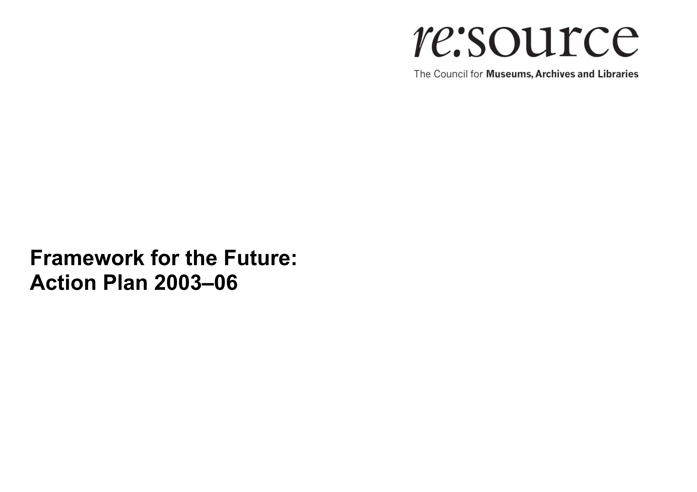

<!-- PAGE: 1 -->

# Framework for the Future: Action Plan 2003–06

<!-- PAGE: 2 -->

**Resource: The Council for Museums, Archives and Libraries**  
16 Queen Anne’s Gate  
London SW1H 9AA  

© Resource September 2003  

Resource: The Council for Museums, Archives and Libraries is a strategic agency working for and on behalf of museums, archives and libraries and advising the Government on policy and priorities for the sector. Our mission is to enable the collections and services of museums, archives and libraries to touch the lives of everyone. Resource is a Non-Departmental Public Body sponsored by the Department of Culture, Media and Sport.

A CIP catalogue record of this publication is available from the British Library.

ISBN 1-903743-34-7

Resource provides the strategic leadership, advocacy and advice to enable museums, archives and libraries to touch people’s lives and inspire their imagination, learning and creativity.

Current news, developments and information on our activities are available to view or download from our website: [www.resource.gov.uk](http://www.resource.gov.uk)

<!-- PAGE: 3 -->

## Contents

- **Work package 1: Building capacity to deliver transformation** (p. 6)
  - Strategic objective 1: Develop and promote the role and contribution of public libraries through a clear vision supported by effective advocacy and communication (p. 7)
  - Strategic objective 2: Build libraries’ capacity to improve through better quality of leadership and workforce skills (p. 10)
  - Strategic objective 3: Implement innovative solutions to achieve maximum impact from available resources (p. 12)
  - Strategic objective 4: Achieve excellent planning and quality assurance systems to ensure sustained improvement (p. 14)
- **Work package 2: Books, reading and learning** (p. 16)
  - Strategic objective 5: Promote literacy skills and an appetite for reading and learning (p. 17)
  - Strategic objective 6: Widen participation and demonstrate impact of libraries in supporting learning (p. 22)
- **Work package 3: Digital citizenship** (p. 24)
  - Strategic objective 7: Provide access to the services people need through effective use of ICT (p. 25)
  - Strategic objective 8: Contribute to achievement of e-government (UK online) targets for service take-up and audience engagement (p. 29)
- **Work package 4: Community and civic values** (p. 30)
  - Strategic objective 9: Deliver an inclusive service that reflects and helps build cohesive communities (p. 31)
  - Strategic objective 10: Provide library premises that meet the needs of twenty first century communities (p. 34)
- **Appendix 1: Abbreviations used** (p. 35)

---

### Note on outcomes

Actions contained in the implementation plan support improvement of services to customers. Outcomes are shown by cross referencing each action line with the Local Government Association/central government shared priorities, in particular:

1. Raise standards across our schools (including the contribution that other services can make)
2. Improve the quality of life of older people and of children, young people and families at risk
3. Create safer and stronger communities
4. Promote the economic vitality of localities (including improving adult skills)

In addition, actions support the DCMS objective:

5. To modernise delivery to the customer by ensuring that the Department and its sponsored bodies improve performance and pursue institutional excellence.

<!-- PAGE: 4 -->

## Executive Summary

Public libraries have huge potential to reach out and engage everyone. More people go to libraries than to cinemas or football matches. 60 per cent of the population of England are members of a public library. Last year the biggest one-off investment in our public libraries made the internet available to all, with computers provided in virtually all public libraries through the Lottery-funded People’s Network project.

*Framework for the Future: Libraries, Learning and Information in the Next Decade*, published by the Department for Culture, Media and Sport (DCMS) in February 2003, is the government’s ten-year vision for public libraries – how libraries can best serve their communities in the 21st century. Framework for the Future aims to promote public libraries, give them improved visibility, and to set out why libraries matter. Each year, local government spends around £800 million on public libraries. There are many excellent library services that are focal points for their communities, working at the heart of local and central government objectives for learning, and social cohesion. The Government wishes to see every public library achieve this potential for the benefit of all communities.

The central themes of Framework are:

- **Books, reading and learning**: Knowledge, skills and information are at the heart of economic and social life. Libraries can provide access to virtually all books ever published and much more. In an informal, supportive and stimulating environment, libraries can encourage reading and provide access to learning for everyone.
- **Digital citizenship**: Libraries are providing access to vastly more information than ever before through the internet. They enable all citizens to have access to information and services and are central to the delivery of electronic government.
- **Community and civic values**: Libraries are safe, welcoming, neutral spaces open to all the community. They are particularly well placed to engage hard to reach groups, working with education, social, health and leisure services.

Following publication, DCMS commissioned Resource: The Council for Museums, Archives and Libraries to prepare a three-year Action Plan. This Action Plan, developed with a wide range of partners, aims to help library services to achieve the Framework vision. It presents a range of projects and programmes covering the three key development themes for public libraries identified in the report and listed above.

However, to achieve the ambitions of these themes, all libraries will need to adapt to meet the changing needs of their communities. The first and principal area of work will therefore be to support the transformation of library services so that they can deliver what communities expect and need in the 21st century.

<!-- PAGE: 5 -->

This emphasis on capacity building reflects the priorities of other work that DCMS is doing to develop a stronger partnership with local authorities to harness the cultural activity towards national and local priorities. This work is being undertaken jointly with the Local Government Association, the Innovation and Development Agency, and ‘excellent’ councils.

Communication and advocacy are central to the Action Plan. The power of public libraries to deliver wider agendas must be understood by national policymakers, but must also be clear to service managers in local authorities so that the library service’s role in community planning is recognised.

Libraries have vital roles to play in delivering the shared priorities of central and local government:

- in education for children, adults and families;
- in building stronger, more sustainable and safer communities;
- in improving the quality of life for older people and people at risk;
- in communicating messages about the whole range of public services and meeting information needs.

Buy-in at local authority level is essential to the success of the Framework Action Plan and DCMS wishes to work closely with local authorities to achieve change. The Action Plan will be funded by a £3 million investment over three years. The full Action Plan is available on the Resource website at `www.resource.gov.uk/action/framework/framework.asp`.

<!-- PAGE: 6 -->

# WORK PACKAGE 1: Building capacity to deliver transformation

| Feature | Detail |
| :--- | :--- |
| **Lead** | Andrew Stevens |
| **What are the strategic objectives?** | **1.** Develop and promote the role and contribution of public libraries through a clear vision supported by effective advocacy and communication **2.** Build libraries’ capacity to improve through better quality of leadership and workforce skills **3.** Implement innovative solutions to achieve maximum impact from available resources **4.** Achieve excellent planning and quality assurance systems to ensure sustained improvement *See also:* All other work packages for Advocacy and evaluation and impact; Transformative service improvements |
| **Who are the key stakeholders?** | Audit Commission; CILIP; DCMS; DfES; IDeA; LGA; ODPM; RAs; Resource; SCL; SOLACE |
| **Budget** | • **2003/04:** Framework: £475,000 \| Other: — • **2004/05:** Framework: £508,000 (est) \| Other: — • **2005/06:** Framework: £752,000 (est) \| Other: — |

<!-- PAGE: 7 -->

| Action | Deliverables | Dates | Outcome | Lead | Partners | Budget |
| :--- | :--- | :--- | :--- | :--- | :--- | :--- |
| 1.1 Develop and implement a marketing strategy to support the delivery of twenty first century public library services |  |  |  |  |  |  |
| 1.1.1 Position public libraries to ensure they deliver key national, regional and local priorities | • Complete review of public libraries to understand their role and value in relation to their markets and stakeholders and delivery of key national, regional and local priorities • Define a clear vision, values and positioning for public libraries and complete advocacy and marketing strategies • Use marketing strategy to focus impact evaluation, advocacy and promotional initiatives and to support delivery of key priorities See also 1.2 (impact and advocacy) | Sep 2004 Dec 2004 Jan 2005+ | 1,2,3,4,5 | Resource | -ACL -BL -CILIP -DCMS -DfES -LGA -RAs -SCL -SOLACE -TRA | 2003/4 £75,000 2004/5 £125,000 2005/6 £75,000 |
| 1.2 Evaluate and promote libraries’ impact and contribution effectively |  |  |  |  |  |  |
| 1.2.1 Evaluate and promote libraries’ impact and value at national, regional and local levels | • Apply the Inspiring Learning framework to build an evidence base of the impact of libraries in supporting learning and learner progression and outcomes. • Identify how the economic impact of libraries will be assessed and demonstrated • Collect, evaluate and make available case studies and qualitative and statistical evidence of the cultural, economic, educational and social impact of public libraries • Prepare advocacy materials using case | From Jun 2003 Mar 2004 From Oct 2003 Mar 2004 | 1,2,3,4,5 | Resource | -ACE -Audit Comm -CILIP -DCMS -DfES -LGA -NLT -RAs -SCL -SOLACE -TRA | Impact & advocacy: 2003/4- 2005/6 £50,000 pa (plus existing budgets) |

<!-- PAGE: 8 -->

| Action | Deliverables | Dates | Outcome | Lead | Partners | Budget |
| :--- | :--- | :--- | :--- | :--- | :--- | :--- |
|  | studies and research evidence for heads of service and local authority Chief Executives • Using best practice models, develop practical strategies for partnership and advocacy for library and information services for each region • Complete preparation of series of advocacy materials for use with education authorities, learning providers, regional bodies and other government departments and stakeholders See also 1.1.5 (relationship with business community); 2.1.3 (supporting elected Members); 5 and 6 (reading and learning) | Jun 2004 Dec 2004 |  |  |  |  |
| 1.2.2 Establish more effective joint working on library issues across government departments | • Initiate joint activity with the DfES to promote libraries and exploit their capacity to support key government targets in learning and skills • Map government departments’ work relating to library services • Establish key national and local government expectations of library performance and identify future trends affecting funding priorities and the role libraries can play • Agree effective joint approaches between central and local government to modernise services and underpin all aspects of delivery of Framework • Establish programme of work and advocacy with all relevant government | Apr 2003+ Sep 2003 Dec 2003 Feb 2004 Feb 2004 | 1,2,3,4 | DCMS | -ACL -All Govt depts -Audit Comm -CILIP -LGA -Resource -SCL -SOLACE | (Existing budgets) |

<!-- PAGE: 9 -->

| Action | Deliverables | Dates | Outcome | Lead | Partners | Budget |
| :--- | :--- | :--- | :--- | :--- | :--- | :--- |
|  | departments, including ODPM • Establish the basis for effective liaison with health policy and planning to identify potential roles and contribution of public libraries See also 1.1.1 (marketing) | Mar 2004 |  |  |  |  |
| 1.2.3 Work with advocates for libraries to promote services and support improvement | • Identify the best means of achieving high level advocacy nationally and in regions and establish strong links with communities and business partners | Oct 2003 | 1,2,3,4 | DCMS | -ACL -RAs -Resource -SCL | (Existing budgets) |
| 1.2.4 Develop a new relationship with the business community | • Prepare evidence to support effective partnerships and advocacy with business in regions based on the economic impact of libraries • Prepare proposals for developing regional libraries services for Small and Medium Enterprises in liaison with the British Library • Establish effective partnerships with businesses to implement corporate and social responsibility programmes • With the DTI establish options to improve business information services • Showcase best practice models of working with business to support reading • Work with Arts and Business to develop models of business-library partnership, including mentoring schemes See also 1.2.1 (Advocacy –contribution to regional economic agendas) | From Jun 2004 Nov 2003 From Apr 2004 May 2004 Jun 2004 Dec 2004 | 4,5 | RAs | -Arts & Business -Business & the Comm’ty -CILIP -DCMS -DTI -LGA -Resource -SCL -TRA | 2003/4 £25,000 2004/5 £25,000 |

<!-- PAGE: 10 -->

| Action | Deliverables | Dates | Outcome | Lead | Partners | Budget |
| :--- | :--- | :--- | :--- | :--- | :--- | :--- |
| 1.2.5 Present and promote public library services effectively | • Launch the Framework for the Future implementation plan nationally and in each region to raise the profile of public libraries and advocate their role • Plan a major promotion initiative, seek funding and partners • Implement promotion campaign(s) subject to funding | By Sep 2003 Sep 2004 Jun 2005 | 1,2,3,4 | Resource | -ACE -ACL -BL -CILIP -DCMS -DfES -LGA -RAs -SCL -SOLACE -TRA | 2003/4 £20,000 2004/5- 2005/6 To be determined |
| 2.1 Develop transformational leadership for public libraries |  |  |  |  |  |  |
| 2.1.1 Implement a nationally co- ordinated leadership development and management skills programme to build libraries’ capacity to improve | • Complete Resource workforce needs review • Evaluate longer term options and produce proposals which meet the needs of public libraries in the context of an overall workforce strategy • Pilot model for leadership and management skills programme building on the strengths of existing models to embed leadership behaviour through services • Implement proposals for medium term leadership and management skills programme, ensuring effective co- ordination with existing programmes • Implement secondment scheme and network of mentors and critical friends for middle and senior managers and heads of service | Sep 2003 Mar 2004 Mar 2004 2004/5+ Mar 2004 | 5 | Resource | -Arts & Business -CILIP -DCMS -IDeA -LGA -NMDC -RAs -SCL | Leadership prog: £80,000 Mentoring: £10,000 2004/5- 2005/6 To be determined |

<!-- PAGE: 11 -->

| Action | Deliverables | Dates | Outcome | Lead | Partners | Budget |
| :--- | :--- | :--- | :--- | :--- | :--- | :--- |
| 2.1.2 Implement support for local elected Members in developing and implementing policy for libraries | • Develop and produce case studies highlighting good practice to help Members focus their expectations and develop an effective role in policy formulation and challenging and improving delivery of services | May 2004 | 1,2,3,4,5 | DCMS | -CILIP -IDeA -LGA -RAs -SCL -SOLACE | 2003/4 £10,000 |
| 2.2 Improve the skills of all library staff to deliver excellent twenty first century library services |  |  |  |  |  |  |
| 2.2.1 Implement a nationally co- ordinated workforce development programme that improves staff skills in delivering high quality services | • Complete Resource workforce needs review • Evaluate longer term options and produce proposals which meet the needs of public libraries in the context of an overall workforce strategy. Include joint development with other sectors and existing models • Implement proposals for workforce development, ensuring effective co- ordination with existing regional and other cross domain programmes • Develop Their Reading Futures (TRF) model for children’s/school library services to support outcomes based planning; evaluation; advocacy work; staff training; core skills/recruitment. • Deliver an online adult reader development training programme including modules on readers, books, design and evaluation as part of Branching Out programme • Explore accreditation of learning packages in association with CILIP | Sep 2003 Mar 2004 2004/5+ From Sep 2003 2004/5+ Sep 2004 | 5 | Resource | -ASCEL -CILIP -DCMS -IDeA -NMDC -OtB -RAs -SCL -TRA -YLG | Workforce: See also 2.1.1 Leadership for workforce funding Their Reading Futures: 2003/4 £60,000 2004/5 £70,000 2005/6 £50,000 (plus existing budgets) |

<!-- PAGE: 12 -->

| Action | Deliverables | Dates | Outcome | Lead | Partners | Budget |
| :--- | :--- | :--- | :--- | :--- | :--- | :--- |
| 2.2.2 Improve the quality of recruitment to public libraries | • Identify barriers to effective recruitment through the Resource workforce strategy (see also 2.2.1) • Agree proposals to address recruitment in terms of qualifications and skills with local authority libraries, CILIP and library schools. | Dec 2003 Jun 2004 | 5 | Resource | -ACL -CILIP -DCMS -Library schools -RAs -SCL | (2004/5+ Existing budgets) |
| 3.1 Ensure that all libraries can learn from the best |  |  |  |  |  |  |
| 3.1.1 Establish the critical success factors for the best library services and identify and address barriers to high performance | • Review evidence from high performing authorities and those achieving significant improvement, to establish and measure best practice and the factors that produce market leaders • Identify with library authorities barriers to high performance and reasons for variable levels of service • Implement proposals to address identified barriers to high performance • Produce case studies and practical guides based on best practice and make them available through the Resource website. See also 2.1.1 (mentoring & secondment); 4.1.3 (standards); 9.2.1 (model for supporting authorities in establishing libraries at the heart of local communities) | Mar 2004 Mar 2004 From Apr 2004 From Nov 2003 | 5 | Resource | -ACL -Audit Comm -CILIP -DCMS -IDeA -LGA -RAs -SCL | 2003/4 £70,000 2004/5 £28,000 |

<!-- PAGE: 13 -->

| Action | Deliverables | Dates | Outcome | Lead | Partners | Budget |
| :--- | :--- | :--- | :--- | :--- | :--- | :--- |
| 3.2 Develop models for innovative solutions and best use of existing resources |  |  |  |  |  |  |
| 3.2.1 Achieve improved value through innovative approaches to library stock procurement | • Agree specification for work to review evidence and establish options and potential models • Identify impact of different models of stock acquisition, inc consortiums and supplier selection • Commission further evaluation of potential benefits of alternative models for stock acquisition as required • Develop best practice models and toolkits of stock acquisition based on evidence of cost and benefit and promote through regional seminars See also 7.2.1 Virtual reference shelf – ICT procurement | Jul 2003 Mar 2004 From Apr 2004 From Sep 2004 | 3,4,5 | ACL | -Audit Comm -IDeA -LGA -NAG -RAs -SCL | 2003/4 £25,000 2004/5 £25,000 |
| 3.2.2 Promote best practice models for joint provision of library services across local authority and sectoral boundaries | • Map current best practice models and identify barriers and political issues • Compile and publish nationwide profile of best practice, including other home countries and international examples • Seed fund projects to encourage and embed best practice models through regions | Jun 2004 Sep 2004 Dec 2004+ | 5 | SCL | -ACL -DCMS -LGA -RAs -Resource -SOLACE | 2004/5 £20,000 2005/6 £50,000 |

<!-- PAGE: 14 -->

| Action | Deliverables | Dates | Outcome | Lead | Partners | Budget |
| :--- | :--- | :--- | :--- | :--- | :--- | :--- |
| 3.3 Achieve a clear understanding of public library funding and priorities for action |  |  |  |  |  |  |
| 3.3.1 Establish underlying issues in public library funding and propose a way forward | • Establish a basis for comparison of funding levels between local authorities, identifying allocations to frontline and support functions, external funding sources, etc. • Clarify how the total spending on public libraries nationally (c£780m) is distributed and allocated • Identify and quantify any investment requirements and propose solutions | Apr 2004 Apr 2004 Sep 2004 | 5 | CILIP | -ACL -CIPFA -DCMS -LGA -Resource | 2003/4 £50,000 2004/5 £30,000 |
| 4.1 Implement planning, advice and performance management systems that facilitate and ensure improved standards |  |  |  |  |  |  |
| 4.1.1 Improve the quality of planning for public libraries and ensure improved delivery | • Ensure planning for public libraries is focused on delivering the vision in Framework for the Future • Advocate principles of quality planning and performance management with all local authorities • Encourage incorporation of libraries in key strategic plans, including Community Strategies • Develop measures for success using framework of existing models (IIP, EFQM, Charter Mark, IAG etc) See also 1.2 (impact evaluation and advocacy) | Mar 2004 Mar 2004 Mar 2004 Mar 2004 | 5 | DCMS | -ACL -Audit Comm -IDeA -LGA -Resource -SCL -SOLACE | (Existing budgets DCMS) |

<!-- PAGE: 15 -->

| Action | Deliverables | Dates | Outcome | Lead | Partners | Budget |
| :--- | :--- | :--- | :--- | :--- | :--- | :--- |
| 4.1.2 Ensure libraries are taken fully into account in assessing local authority performance | • Agree proposals for effective evaluation of performance • Implement performance assessment regime as agreed | Mar 2004 From Apr 2004 | 5 | DCMS | -ACL -Audit Comm -LGA -ODPM -Resource -SCL -SOLACE | (Existing budgets DCMS) |
| 4.1.3 Implement relevant and rigorous public library standards to support service improvement | • Review and update public library standards • Research the impact of standards on performance and external assessment | Mar 2004 Jun 2004 | 5 | DCMS | -ACL -Audit Comm -CILIP -LGA -ODPM -Resource -SCL -SOLACE | (Existing budgets DCMS) |

<!-- PAGE: 16 -->

# WORK PACKAGE 2: Books, Reading and Learning

| Feature | Detail |
| :--- | :--- |
| **Lead** | Andrew Stevens |
| **What are the strategic objectives?** | **5.** Promote literacy skills and an appetite for reading and learning **6.** Widen participation and demonstrate impact of libraries in supporting learning *See also:* 1.2 Advocacy and evaluation and impact; 7.2 People’s Network |
| **Who are the stakeholders?** | Arts Council; ASCEL; CILIP; DCMS; DfES; Learning and Skills Councils; National Literacy Trust; Open University; Opening the Book; The Reading Agency; Resource; SCL; UfI/LearnDirect |
| **Budget** | • **2003/04:** Framework: £381,000 \| Other: £700,000 (est) • **2004/05:** Framework: £347,000 (est) \| Other: £85,000 (est) • **2005/06:** Framework: £213,000 (est) \| Other: — |

<!-- PAGE: 17 -->

| Action | Deliverables | Dates | Outcome | Lead | Partners | Budget |
| :--- | :--- | :--- | :--- | :--- | :--- | :--- |
| 5.1 Build confidence and promote reading and language development in the early years |  |  |  |  |  |  |
| 5.1.1 Create national awareness that every parent and child can turn to their library for support in encouraging and early enjoyment of reading | • Identify and aggregate current early years library activity to identify good practice (Early Years Library Network - EYLN) • Complete research into development needs • Formulate and agree how service offer will be expressed • Promote service offer to communities and stakeholders • Implement quality control mechanisms, including a self evaluation schedule • Identify sustainable medium term funding for Bookstart | May 2003 Sep 2003 Mar 2004 From Apr 2004 From Jun 2004 Dec 2003 | 1,2 | EYLN | -ACE -ASCEL -Book Trust -CILIP -DfES -NLT -Resource -SCL -TRA | EYLN: offer develop’t: 2003/4 £86,000 Bookstart: (£500,000 DCMS 2003/4 only) |
| 5.2 Enable and encourage children to become enthusiastic readers and learners |  |  |  |  |  |  |
| 5.2.1 Increase the access to and improve the quality of study support for children and young people in libraries | • Complete baseline mapping of current study support in libraries • Research need for library study support amongst students and needs and perceptions of teachers and benefits of different models, including online • Complete a development plan for library study support, based on research, and focusing on disseminating best practice and advocacy | Nov 2003 Jun 2004 Jul 2004 | 1 | ASCEL | -CILIP -DfES -Resource | 2003/4 £15,000 2004/5 £15,000 |

<!-- PAGE: 18 -->

| Action | Deliverables | Dates | Outcome | Lead | Partners | Budget |
| :--- | :--- | :--- | :--- | :--- | :--- | :--- |
| 5.2.2 Give all school age children access to holiday programmes to encourage reading and build literacy skills | • Develop and extend holiday reading programmes o Pilot website for holiday reading to extend access and build engaging reading activities, linking with other web-based library activity for children o Implement nationally available website o Evaluate the scheme using principles based on the Inspiring Learning framework o Extend support for library involvement in Positive Activities for Young People in 2003/4 and again in 2004/5 - accessing funding, sharing best practice, building in additional dissemination, best practice support and regional briefings. | Jun 2003 Jun 2004+ Oct 2003 Apr-Aug 2003/4 + Apr-Aug 2004/5 | 1 | TRA | -ACE -ASCEL -Birming’m Libraries -CILIP -DfES -Resource -SCL -YLG | Online holiday reading: 2003/4 £69,000 2004/5 £92,000 2005/6 £23,000 |
| 5.2.3 Establish an online reading support for children (aged 8- 14), linking them with authors and publishers both in and out of school | • Establish and test a subscription based model for Stories from the Web (online reader support model) • Develop models to test the feasibility of extending Stories from the Web as a sustainable national service | Sep 2003 Jun 2004 | 1 | Birming’m Libraries | -ASCEL -CILIP -SCL - TRA | 2003/4 £40,000; 2004/5 £15,000 |
| 5.2.4 Develop, pilot and launch a self- evaluation tool for school library resource centres to promote continuous improvement and to embed them in the educational outcomes of the school | • Develop model for audit/self evaluation, linking with Empowering the Learning Community • Pilot model in selected authorities • Make model available nationally | Dec 2003 Jul 2003 Sep 2003 | 1 | DfES | -ASCEL -CILIP -Ofsted -SCL | 2003/4- 2004/5 (£50,000 partner funding to be confirmed) |

<!-- PAGE: 19 -->

| Action | Deliverables | Dates | Outcome | Lead | Partners | Budget |
| :--- | :--- | :--- | :--- | :--- | :--- | :--- |
| 5.2.5 Support young readers through joined-up school and public library work | • Develop training support for school library managers and teachers. Make proposals to develop of the school librarian in relation to the Key Stage 3 Strategy and maximise the use made of the school library in raising standards in schools • Promote the potential of School Library Service (SLS) support for pupils and teachers through: o Scenario planning o Research into the efficiency of SLS provision and its impact on schools and their partnerships with the library sector o Dissemination to support and advocacy and best practice • Ensure libraries can play an active part in Creative Partnerships o Develop the case for libraries and reading at the heart of Creative Partnerships o Develop and share pilot models with local partnerships | Mar 2004 Aug 2003 Jun 2004 Jul 2004 Mar 2004 Mar 2005 | 1,2 | DfES | -ACE -ASCEL -CILIP -NLT -Resource -SCL -SLA -TRA | School librarian: (Partner funding to be confirmed) SLS support: (2003/4 £20,000 2004/5 £10,000 - partner funding to be confirmed) Creative Part’ships: 2003/4- 2004/5 £20,000 |

<!-- PAGE: 20 -->

| Action | Deliverables | Dates | Outcome | Lead | Partners | Budget |
| :--- | :--- | :--- | :--- | :--- | :--- | :--- |
| 5.2.6 Help young people find the reading and information they need to support their personal development and participation in society | • Audit recent policy developments affecting services to young people, new funding streams, pilot models such as YouthBOOX and local authority specialist posts. Build on TRA/NYA partnership to investigate closer links to youth sector, integration of reading and information and active participation agenda including Hear by Right. • Develop a strategy for teenage reader development, information and involvement of young people work which integrates libraries’ work with youth services and Connexions policy developments, especially Transforming Youth Work. Explore application to other sectors and disadvantaged young people and young people in care • Deliver plans emerging from strategy. | Apr 2004 Sep 2004 From Dec 2004 | 1,2,3 | TRA | -ASCEL -CILIP -DfES -NYA -Resource -SCL -YLG -CYPU Connexions | 2003/4 £10,000 2004/5- 2005/6 £50,000 pa |
| 5.3 Provide stimulating and contemporary reading experiences for adults |  |  |  |  |  |  |
| 5.3.1 Improve the quality of library stock and its presentation | • Develop a toolkit and training package for all stock based on best practice for stock management and presentation (drawn from high performing libraries and retail sector) • Update and implement stock assessment tool used in Best Value inspections as a self-evaluation model See also 3.2.1 (procurement) | Jun 2004 Jun 2004 | 1,2,4 | SCL | -Audit Comm -DCMS -RAs -OtB -Resource | Toolkit: 2003/4 £25,000 2004/5 £10,000 Stock self- assess’t: 2004/5- 2005/6 £10,000 pa |

<!-- PAGE: 21 -->

| Action | Deliverables | Dates | Outcome | Lead | Partners | Budget |
| :--- | :--- | :--- | :--- | :--- | :--- | :--- |
| 5.3.2 Develop a strategy and a core annual programme of innovative library activities based on reading | • Develop a reading partnership strategy, based on review of 2000/2002 partnerships and other possibilities. • Implement partnership strategy and initiate innovations (eg distributing book marketing materials; menu of prize partnerships; author tours ; joint research) and secure sustainable private sector match funding • Develop partnerships with broadcasting to support reader development on air and through national and regional learning and cultural partnerships • Showcase current East Midlands Books Connect pilot as model for all regions in libraries working with galleries and museums to promote reading | May 2004 From Jul 2004 From Sep 2003 From Sep 2003 | 2,4 | TRA | -ACE -BBC -CILIP -SCL | Strategy: 2003/4 £20,000 2004/5 £15,000 Broadcst’g: 2003/4- 2005/6 £15,000 pa Books Connect: 2003/4 £6,000 |
| 5.3.3 Develop and implement a strategy for reading groups in libraries to meet identified needs | • Building on existing research, evaluate readers groups in libraries for both adults and children and develop a strategy for their development • Develop and implement a model for online reading groups for adults o Develop content and technical model for online reading groups in line with national strategy o Pilot online reading group o National rollout completed See also 5.2.2-3 (children’s reading support); 7.2 (digital services) | Jun 2004 May 2004 Sep 2004 Sep 2005 | 2,4 | Resource | -ASCEL -CILIP -OtB -SCL -TRA | Strategy: 2003/4 £15,000 Online: (2003/4 £25,000 2004/5 £50,000 NOF) |

<!-- PAGE: 22 -->

| Action | Deliverables | Dates | Outcome | Lead | Partners | Budget |
| :--- | :--- | :--- | :--- | :--- | :--- | :--- |
| 6.1 Widen participation and demonstrate the impact of libraries in supporting learning |  |  |  |  |  |  |
| 6.1.1 Ensure libraries play a full part in integrated strategies to improve access to adult learning support and resources | • Revise the terms of reference for the existing DCMS, DfES, CILIP, Ufi/learndirect Resource Working Group and change and extend its membership to become a Libraries Adult Learning Steering Group (LALSG). The Group will steer and agree future strategies for libraries’ support for learning including how they will work with UfI/learndirect • Develop existing learndirect links on People's Network web site into a fully functioning portal • Agree with DfES the minimum ICT skills offer that libraries and other UK Online centres will offer based on the UK Online centre First Steps pilots • Implement links on the People’s Network web site to Open University tasters and introductory materials and agree further developments (inc testing video streaming) • Explore and agree how libraries may work with the NHS University to improve access to learning • Work with the Learning and Skills Council and DfES to ensure that local LSCs see libraries as key partners in their local widening participation strategies and to support the Government’s Skills Strategy • Following the completion and evaluation of the current library and UK | Aug 2003 Dec 2003 Mar 2004 Mar 2004 Sep 2003 Dec 2003 Mar 2004 | 2,4 | DfES | -BSA -CILIP -DCMS -LALSG -learndirect -NHSU -NLT -OU -RAs -Resource -SCL | (Existing budgets/ partner funding) plus: Vital Link: 2003/4 £60,000 2004/5 £85,000 2005/6 £75,000 |

<!-- PAGE: 23 -->

| Action | Deliverables | Dates | Outcome | Lead | Partners | Budget |
| :--- | :--- | :--- | :--- | :--- | :--- | :--- |
| 6.1.1 (cont.) | online centres pilots for Skills for Life programme, agree a minimum offer that libraries can make to reluctant learners and people with literacy problems • Roll out Vital Link programme providing support for libraries to use reader development as a basis for building partnerships with basic skills providers, working with Learning and Skills Councils. Develop quality mark • Identify how the People's Network online content can be fitted with DfES and LSC's "College on line" plans for developing online learning content for adults to ensure all learners can access online learning materials • Agree a minimum offer that libraries can make with Information Advice and Guidance partnerships to provide potential adult learners with information and advice on learning provision | From Sep 2003 Mar 2004 Mar 2004 |  |  |  |  |
| 6.1.2 Implement best practice models to improve customer access to resources in academic and public libraries | • Roll out INSPIRE model for access agreements between academic and public libraries to four additional regions (Empowering the Learning Community) • Roll out INSPIRE to final four regions • Work with DfES, LSC, HEFCE and JISC to disseminate models of good practice of public libraries working in partnership with educational libraries to share resources and improve services to users | Mar 2004 Mar 2005 From Jun 2003 | 2,4 | RAs | -BL -CILIP -DCMS -HEFC -NFIP -OeE -Resource -SCL -SCONUL | 2003/4 (£40,000 DfES) 2004/5- 2005/6 £40,000 pa |

<!-- PAGE: 24 -->

# WORK PACKAGE 3: Digital Citizenship

| Feature | Detail |
| :--- | :--- |
| **Lead** | David Potts |
| **What are the strategic objectives?** | **7.** Provide access to the services people need through effective use of ICT **8.** Contribute to achievement of e-government (UK online) targets for service take-up and audience engagement *See also:* 1.2 Workforce; 5 Reading and learning; 6.1 e-learning |
| **Who are the stakeholders?** | British Library; CILIP; DCMS; DfES; learndirect; NOF; Office of the e-Envoy; Resource; SCL; SOCITM; UKOLN |
| **Budget** | • **2003/04:** Framework: £0 \| Other: £250,000 (NOF) • **2004/05:** Framework: £0 \| Other: £175,000 (NOF) • **2005/06:** Framework: £0 \| Other: — |

<!-- PAGE: 25 -->

| Action | Deliverables | Dates | Outcome | Lead | Partners | Budget |
| :--- | :--- | :--- | :--- | :--- | :--- | :--- |
| 7.1 Create a new web-based access point into national People's Network services |  |  |  |  |  |  |
| 7.1.1 Design an appropriate user- interface to deliver key digital services | • Determine the key factors that will engage potential users of a ‘public facing’ People's Network service • Build a first working version of the new service model | Sep 2003 Dec 2003 | 1,2,3,4 | Resource | -DCMS -DfES (Cybrarian) -SCL -UKOLN -Web designers | 2003/4 (£65,000 NOF) |
| 7.1.2 Evaluate the effectiveness of the model | • Identify library services that can help provide feedback on use of the new service • Evaluate feedback from library services and users • Build a second version of the model based on lessons from the first • Formally launch service | Dec 2003 Jun 2004 Jul 2004 Dec 2004 | 3,4 | Resource | -CILIP -SCL -SOCITM -UKOLN | 2003/4- 2004/5 (£25,000 pa NOF) |
| 7.1.3 Implement technical standards that will enable integration of all elements of the new model | • Assess level of accessibility and integration potential of identified services • Test effectiveness of integration model | Sep 2003 Dec 2003 | 2 | UKOLN | -Resource -SOCITM | 2003/4 (£5,000 NOF) |
| 7.1.4 Work with a high level expert group to promote the new People's Network service and support improvement | • Identify the role and constitution for a high level expert group to engage with wider national agendas and act as advocates for the gateway and inform its development • Identify the best means of achieving high level advocacy in regions and establish strong links with communities and other partners • Promote People's Network service as a national resource for all UK online centres | Jan 2004 Jun 2004 Jun 2004 | 2,3,4 | Resource | -CILIP -Cybrarian -DCMS -DfES (UK online) -RAs -SCL | 2003/4- 2004/5 (£2,500 pa NOF) |

<!-- PAGE: 26 -->

| Action | Deliverables | Dates | Outcome | Lead | Partners | Budget |
| :--- | :--- | :--- | :--- | :--- | :--- | :--- |
| 7.1.5 Examine the sustainability issues related to the new People's Network service | • Identify the resources required to sustain an up-to-date People's Network service • Clarify the role of Resource and other national organisations in maintaining the new service after completion in December 2004 | Ongoing Sep 2004 | 5 | Resource | -CILIP -SCL | (Existing budgets) |
| 7.2 Develop key People's Network services |  |  |  |  |  |  |
| 7.2.1 Present a range of key electronic services together under the new People's Network interface | • Electronic enquiry service o Scope project to provide support where necessary to existing initiatives and widen to a national service o Deliver service improvements as required | Dec 2003 Mar 2005 | 2,4,5 | Resource | -CILIP -DCMS -DfES -RAs -SCL -SOCITM -UKOLN | 2003/4- 2004/5 (£25,000 pa NOF) |
|  | • NOF Sense of Place o Explore how the resources can be searched by place, topic, etc to demonstrate potential o Develop and deliver improved services as required | Dec 2003 Mar 2005 | 2,4,5 | Resource | -DCMS -NOF -SCL -UKOLN | 2003/4- 2004/5 (£30,000 pa NOF) |
|  | • Community Information o Explore integration of existing Community Information initiatives into the People's Network gateway and examine scope for widening database and its value in supporting local strategies o Deliver service improvements as required | Mar 2004 Mar 2005 | 2,4,5 | Resource | -SCL -SOCITM -UKOLN | 2003/4- 2004/5 (£25,000 pa NOF) |

<!-- PAGE: 27 -->

| Action | Deliverables | Dates | Outcome | Lead | Partners | Budget |
| :--- | :--- | :--- | :--- | :--- | :--- | :--- |
|  | • Virtual reference shelf o Establish a group of electronic reference experts o Agree specification to review evidence and establish options and potential models. o Review impact of different models of acquisition, including benefits and barriers and potential costs o Determine the key free or low cost electronic resources required to answer common enquiries o Identify steps required to present relevant resources through the People's Network gateway o Engage with content providers to achieve best value for library services and implement Service Level Agreements with relevant organisations co-ordinating identified services o Launch ‘virtual reference shelf’ to be available in all libraries See also 2.2.1 (workforce/training); 5.2.1 (study support/homework); 5.3.3 (online reading groups); 6.1.1 (e-learning) | Jun 2003 Sep 2003 Dec 2003 Dec 2003 Jun 2004 Dec 2004 Dec 2004 | 2,4,5 | Resource | -CILIP -DCMS -SCL -UKOLN | 2003/4- 2004/5 (£35,000 pa NOF) |

<!-- PAGE: 28 -->

| Action | Deliverables | Dates | Outcome | Lead | Partners | Budget |
| :--- | :--- | :--- | :--- | :--- | :--- | :--- |
| 7.2.2 Support the application of relevant assistive technology across the People's Network to provide access to digital services for those with Special Needs | • Stage workshop to raise awareness of different types of assistive technology • Learn from and apply existing assistive technology research (e.g. People's Network Excellence Fund) • Compile central resource for information on assistive hardware and software in public libraries • Investigate existing assistive technology initiatives and assess their potential to support public libraries (e.g. Techdis) | Dec 2003 Jun 2004 Dec 2004 Mar 2004 | 2 | Resource | -AbilityNet -DfES/ Cybrarian -JISC -NLB -SCL | 2003/4- 2004/5 (£2,500 pa NOF) |
| 7.2.3 Support targeting of excluded groups in the take-up of digital library services | • Stage workshops to highlight good practice amongst library services in engaging excluded groups • Produce a practical guide for library services based on workshop outcomes • Champion public libraries as the first access point for excluded groups | Mar 2004 Jun 2004 Ongoing | 2 | Resource | -AbilityNet -DfES -NLB -OeE -SCL -SOCITM - UfI/learn direct | 2004/5 (£10,000 NOF) |
| 7.2.4 Assess the potential to improve access to library stock through networks | Review existing models and recommend solutions. For example: • Library catalogues • Interlending of library materials • Implement as required | Sep 2004 | 1,2,4,5 | Resource | -SCL | 2003/4-4/5 (£5,000 NOF) |

<!-- PAGE: 29 -->

| Action | Deliverables | Dates | Outcome | Lead | Partners | Budget |
| :--- | :--- | :--- | :--- | :--- | :--- | :--- |
| 8.1 Establish public libraries as a main access point for e-government (e-gov) services |  |  |  |  |  |  |
| 8.1.1 Provide a presence for e- government services in all public libraries | • Assist the Office of the e-Envoy (OeE) in selecting the most appropriate models for e-government delivery • Pilot new e-gov services (selected libs) • Develop e-gov toolkit for People's Network | Sep 2003 Mar 2004 Sep 2004 | 2,5 | Resource | -Cybrarian -DfES -OeE -SCL -Ufi/learn direct | 2003/4- 2004/5 (£10,000 pa NOF) |
| 8.1.2 Promote take-up of e- government by excluded groups | • Identify good practice where library services have engaged excluded groups with successful outreach work • Promote best practice in local e-gov to other library services | Sep 2003 Mar 2004 | 2,5 | Resource | -DfES -NIACE -OeE -SCL -SOCITM - Ufi/learn direct | 2003/4- 2004/5 (£5,000 pa NOF) |
| 8.2 Promote libraries as e-government (e-gov) access points |  |  |  |  |  |  |
| 8.2.1 Demonstrate value of libraries and e-government services working together. | • Identify local models of good practice in e-gov and how libraries contribute • Compile relevant list of government department e-targets to identify specific delivery role for libraries • Broker partnerships between library services and government departments to deliver e-gov targets • Implement update mechanism for libraries and new e-gov services | Sep 2003 Jun 2004 Dec 2004 Dec 2004 | 2,3,4,5 | Resource | -DCMS -DeFRA -DfES -DTI -ODPM -OeE -SCL -SOCITM - Ufi/learn direct | 2003/4- 2004/5 (£5,000 pa NOF) |
| 8.2.2 Demonstrate how libraries can enable an online environment for community content creation | • Stage workshop with relevant national organisations to highlight existing successful initiatives • Complete feasibility to translate best local models of e-citizen engagement into regional or national provision | Jun 2004 Sep 2004 | 3 | Resource | -BECTA -CDF -DfES -OeE -SCL -SOCITM | 2003/4 (£10,000 NOF) |

<!-- PAGE: 30 -->

# WORK PACKAGE 4: Community and civic values

| Feature | Detail |
| :--- | :--- |
| **Lead** | Andrew Stevens |
| **What are the strategic objectives?** | **9.** Deliver an inclusive service that reflects and helps build cohesive communities **10.** Provide library premises that meet the needs of twenty first century communities *See also:* 1.1 Marketing; 1.2 Impact and advocacy; 8 e-government |
| **Who are the stakeholders?** | CILIP; CDF; DCMS; IDeA; LGA; RAs; ODPM; Resource; SCL; SEAPN; SOLACE |
| **Budget** | • **2003/04:** Framework: £100,000 \| Other: £100,000 (est) • **2004/05:** Framework: £105,000 (est) \| Other: £300,000 (est) • **2005/06:** Framework: £35,000 (est) \| Other: £100,000 (est) |

<!-- PAGE: 31 -->

| Action | Deliverables | Dates | Outcome | Lead | Partners | Budget |
| :--- | :--- | :--- | :--- | :--- | :--- | :--- |
| 9.1 Understand and respond effectively to community needs |  |  |  |  |  |  |
| 9.1.1 Improve libraries’ knowledge of community needs | • Develop best practice guides for effective use of existing tools for surveying communities and library users • Publish toolkits to enable libraries to use data effectively to improve services | Aug 2004 Dec 2004 | 1,2,3,4 | IPF-PLUS | -DCMS -LGA -Resource -SCL | 2004/5 £20,000 |
| 9.1.2 Promote community involvement in libraries | • Test the feasibility of involving volunteers for specific functions in public libraries, linking with existing programmes for volunteering • Identify and promote through case studies best practice models for community involvement in libraries, including decision making, service presentation, promotion, stock, etc | Mar 2004 Jun 2004 | 3,5 | DCMS | -CILIP -LTI -Library schools -RAs -Resource -SCL | 2003/4 (Existing budgets DCMS) |
| 9.1.3 Ensure all people with disabilities can visit any public library and receive an equivalent service | • Identify best practice and share the learning to develop public libraries as a gateway to other specialist services available (eg National Library for the Blind). Develop service standards • Introduce and continue to sustain the Reveal database of materials for people with disabilities • Complete a feasibility study of the potential for publishers to provide the electronic files of books to agencies for people with visual disabilities before publication See also 7.2.2 (ICT assistive technologies) | Jun 2005 Sep 2003 Sep 2004 | 2 | Resource | -DCMS -NLB -OtB -RNIB -SCL -StV -TRA | Gateway to resources: 2004/5- 2005/6 £25,000 pa Publishers: 2004/5 £20,000 Reveal: (2003/4- 2005/6 £100,000 pa Resource) |

<!-- PAGE: 32 -->

| Action | Deliverables | Dates | Outcome | Lead | Partners | Budget |
| :--- | :--- | :--- | :--- | :--- | :--- | :--- |
| 9.2 Engage effectively to strengthen libraries’ role in building cohesive communities and addressing social exclusion |  |  |  |  |  |  |
| 9.2.1 Work with local authorities to develop and test models to assist all libraries to improve performance and establish their role at the heart of local communities | • Evaluate the potential for developing a programme to support 2-4 library services with identified areas of significant weakness through Comprehensive Performance Assessment (CPA) and library plans to model how libraries’ role as agents for community cohesion may be achieved • Scope programme and develop menu of support available (inc. targeted work on workforce, premises, partnerships, advocacy, targeted investment in services, etc) with support from range of partners • Identify library services which will benefit from targeted support to improve services and refine programme with them • Initiate programmes, working with local authorities’ senior managers, Members and library staff to enable them to shape programmes to meet local needs and test transferable lessons. Keep other libraries informed of progress • Complete programmes and disseminate findings • Use findings to identify the best way to support local improvement of library services See also 2.1.1 (mentoring and secondment) | Dec 2004 Feb 2004 Mar 2004 Apr 2004 Mar 2005 From Apr 2005 | 2,3,4,5 | IDeA | -Audit Comm -CILIP -CDF -DCMS -LGA -Local authorities -RAs -Resource -SCL -SEAPN -SOLACE | 2003/4 £30,000 (2004/5 £200,000 partner funding to be confirmed) |

<!-- PAGE: 33 -->

| Action | Deliverables | Dates | Outcome | Lead | Partners | Budget |
| :--- | :--- | :--- | :--- | :--- | :--- | :--- |
| 9.2.2 Identify and promote good practice in libraries engaging in supporting community cohesion and diversity | • Audit good practice in community cohesion and diversity and establish progress and barriers to improvement by comparison with previous benchmarks including Open to all. • Apply cohesion indicators developed by CDF to assess how well libraries support diversity and potential areas for improvement | Apr 2004 Apr 2005 | 2,5 | CDF | -CILIP -Resource -SCL -SEAPN | 2003/4 £10,000 |
| 9.3 Improve access to library services through better opening hours |  |  |  |  |  |  |
| 9.3.1 Improve access to libraries by optimising library opening hours | • Identify models where opening hours have been improved • Develop and promote case studies to help others adopt good practice | Jul 2004 Oct 2004 | 2,5 | LGA | -RAs -Resource -SCL | 2004/5 £10,000 |

<!-- PAGE: 34 -->

| Action | Deliverables | Dates | Outcome | Lead | Partners | Budget |
| :--- | :--- | :--- | :--- | :--- | :--- | :--- |
| 10.1 Improve the quality of library buildings to meet community needs |  |  |  |  |  |  |
| 10.1.1 Improve the quality of library buildings through improved planning and design | • Produce introductory guide to good practice in library design • Establish a database of new library building projects and refurbishments • Produce best practice case studies in planning and strategy, use of premises, funding models and project management, including academic library models • Promote best practice models through regional and national forums • Refocus public library building awards to encourage innovative and effective design • Audit the current quality of library buildings and identify investment required to bring them to an acceptable level of repair and standard of presentation • Establish benefits of investment, cost work required, build case for investment and seek funding • Deliver regional workshops for all library authorities to build skills and spread best practice in library layout and display • Implement plans for improvement subject to identifying funding | Aug 2003 Apr 2004 From Sep 2004 From Sep 2004 Apr 2004 Jul 2004 Sep 2004 By Aug 2004 2005/6+ | 2,3,5 | CILIP | -CABE -DCMS -RAs -Resource -SCL | Case studies & database: 2003/4- 2005/6 £10,000 pa Audit: 2003/4- 2004/5 £30,000 Layout & display: 2003/4- 2004/5 £20,000 pa |

<!-- PAGE: 35 -->

# APPENDIX 1: Abbreviations used

| Abbreviation | Meaning |
| :--- | :--- |
| **ACE** | Arts Council of England |
| **ACL** | Advisory Council on Libraries |
| **ASCEL** | Association of Senior Children’s and Education Librarians |
| **Audit Comm** | Audit Commission |
| **Becta** | British Educational Communications and Technology Agency |
| **BL** | British Library |
| **BSA** | Basic Skills Agency |
| **CABE** | Commission for Architecture and the Built Environment |
| **CDF** | Community Development Foundation |
| **CILIP** | Chartered Institute of Library and Information Professionals |
| **CPA** | Comprehensive Performance Assessment |
| **CSV** | Community Service Volunteers |
| **DCMS** | Department for Culture, Media and Sport |
| **DEFRA** | Department for Environment, Food and Rural Affairs |
| **DfES** | Department for Education and Skills |
| **DTI** | Department for Trade and Industry |
| **EYLN** | Early Years Library Network |
| **HEFC** | Higher Education Funding Council |
| **IDeA** | Improvement and Development Agency |
| **INSPIRE** | Information Sharing Partners In Resources for Education |
| **LALSG** | Libraries Adult Learning Steering Group (proposed) |
| **LGA** | Local Government Association |
| **LSC** | Learning and Skills Council |
| **LTI** | Lending Time Initiative |
| **NAG** | National Acquisitions Group |
| **NFIP** | National Forum for Information Planning and Co-operation |
| **NHSU** | National Health Service University |
| **NLB** | National Library for the Blind |
| **NLT** | National Literacy Trust |
| **NMDC** | National Museum Directors Conference |
| **NYA** | National Youth Agency |
| **ODPM** | Office of the Deputy Prime Minister |
| **OeE** | Office of the e-Envoy |
| **OtB** | Opening the Book |
| **OU** | Open University |
| **RAs** | Regional Agencies for Museums, Libraries and Archives |
| **Resource** | The Council for Museums, Archives and Libraries |
| **RNIB** | Royal National Institute of the Blind |
| **RNID** | Royal National Institute for Deaf People |
| **SCL** | Society of Chief Librarians |
| **SCONUL** | Society of College, National and University Libraries |
| **SEAPN** | Social Exclusion Action Planning Network |
| **SLA** | School Library Association |
| **SOCITM** | Society of Information Technology Management |
| **SOLACE** | Society of Local Authority Chief Executives and Senior Managers |
| **StV** | Share the Vision |
| **TRA** | The Reading Agency |
| **UKOLN** | UK Office for Library and Information Networking |
| **YLG** | Youth Libraries Group |

<!-- PAGE: 36 -->

**Resource: The Council for Museums, Archives and Libraries**

Resource provides the strategic leadership, advocacy and advice to enable museums, archives and libraries to touch people’s lives and inspire their imagination, learning and creativity.

Current news, developments and information on our activities are available to view or download from our website:  
[www.resource.gov.uk](http://www.resource.gov.uk)

Copies of this publication can be provided in alternative formats. Please contact Resource Publications on 020 7273 1458.

Resource: The Council for Museums, Archives and Libraries  
16 Queen Anne’s Gate  
London SW1H 9AA  

- **Tel:** 020 7273 1444  
- **Fax:** 020 7273 1404  
- **Email:** info@resource.gov.uk  
- **Registered Charity No:** 1079666
