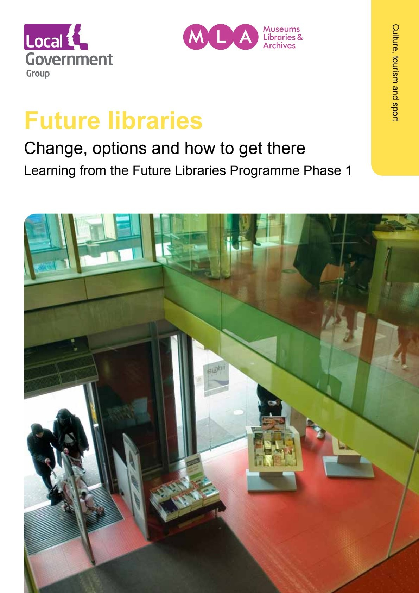
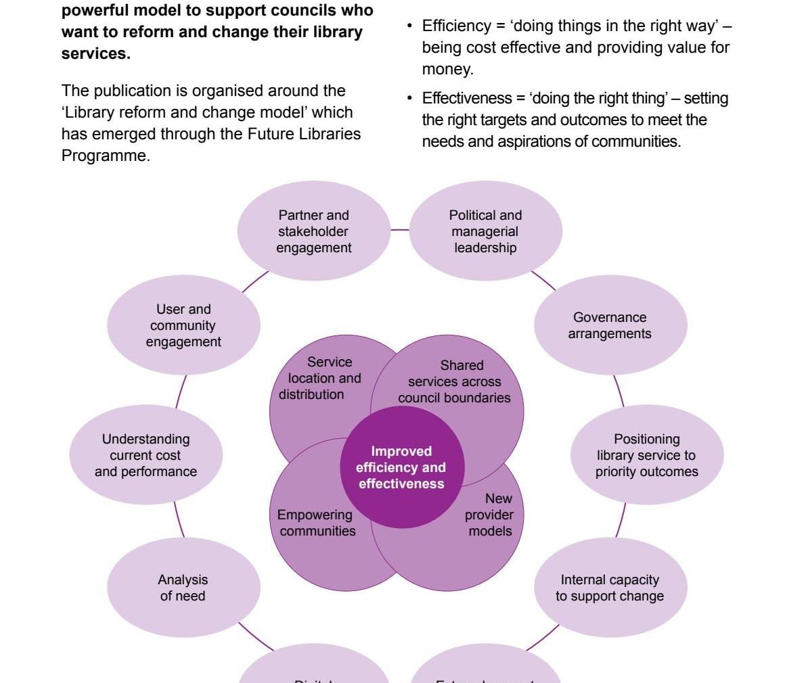
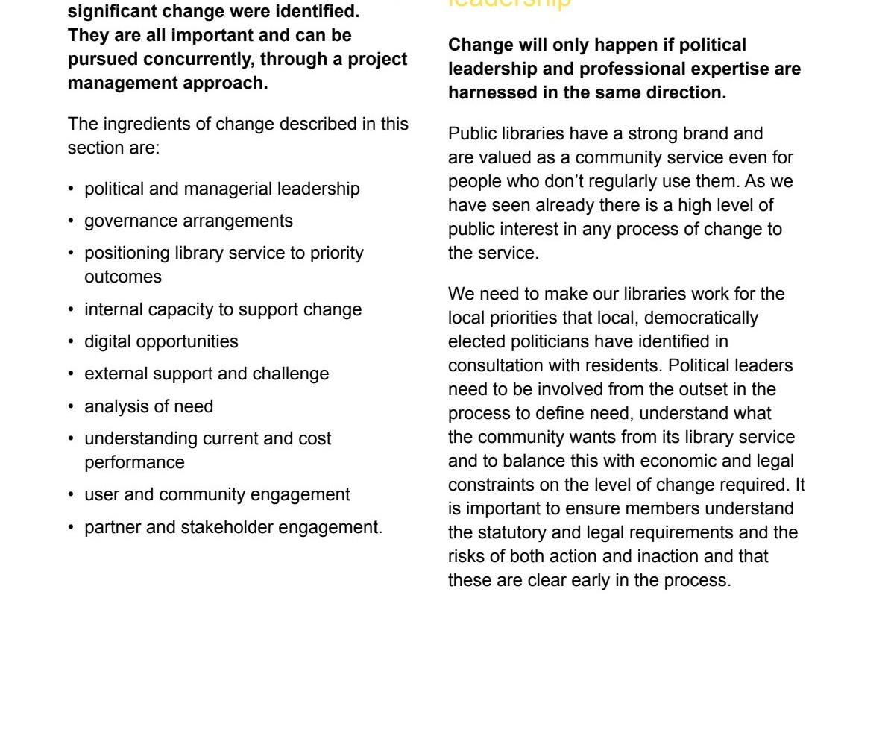

# Future Libraries: Change, Options and How to Get There

## Learning from the Future Libraries Programme Phase 1.

<!-- PAGE: 1 -->

**Future Libraries**

**Change, options and how to get there**

Learning from the Future Libraries Programme Phase 1.

Local Government Group | Museums, Libraries and Archives Council (MLA)

<!-- PAGE: 2 -->

*(Page left intentionally blank)*.

<!-- PAGE: 3 -->

## Contents

- Preface (Page 2 / Page 4)
- Executive summary (Page 4 / Page 6)
- Introduction (Page 5 / Page 7)
- The reform and change model (Page 6 / Page 8)
- Part One: Four models of reform (Page 9 / Page 11)
  - Service location and distribution (Page 9 / Page 11)
  - New provider models (Page 10 / Page 12)
  - Shared services across council boundaries (Page 12 / Page 14)
  - Empowering communities to do things their way (Page 13 / Page 15)
- Part Two: The ingredients for generating change (Page 16 / Page 18)
  - Political and managerial leadership (Page 16 / Page 18)
  - Governance arrangements (Page 17 / Page 19)
  - Positioning library services to help achieve priority council outcomes (Page 19 / Page 21)
  - Internal capacity to support change (Page 20 / Page 22)
  - Digital opportunities (Page 22 / Page 24)
  - External support and challenge (Page 23 / Page 25)
  - Analysis of need (Page 24 / Page 26)
  - Understanding current cost and performance (Page 26 / Page 28)
  - User and community engagement (Page 27 / Page 29)
  - Partner and stakeholder engagement (Page 27 / Page 29)
- Future libraries (Page 31 / Page 33)
- Further information (Page 32 / Page 34)
- Appendix: The pilot change projects (Page 33 / Page 35)

<!-- PAGE: 4 -->

## Preface

When we launched the Future Libraries Programme in August last year, it was in recognition of our shared belief that innovation, led by the energy and experience of local authorities themselves, was going to provide the best recipe for modernising libraries.

There was an exceptional level of interest in the programme – 51 projects submitted expressions of interest with the participation of over 100 local authorities. Ten were taken forward involving 36 councils. This publication brings the learning so far to the attention of a wider audience.

The Future Libraries Programme is a partnership between the Local Government Group (LG Group) and Museums, Libraries and Archives Council (MLA), and is driven by local authorities themselves. It is about sharing good practice. It is about library sector professionals increasingly looking to each other, and beyond their own service, to share and capture knowledge and to develop imaginative solutions that can save money and improve outcomes for communities. And, crucially, it is about harnessing local political leadership and professional expertise in the same direction.

We have been hugely encouraged by the progress so far and with the partnerships that have developed. The ten phase one projects have commissioned practical support and advice to develop a wide range of options and ideas to save money while minimising the need for cuts to front line services and meeting communities’ needs. These include new collaborations across council and organisational boundaries, the use of digital opportunities and closer engagement with communities.

We have widely shared the learning so far with councillors and senior managers responsible for library services through events, online case studies and regular communications. But the vivid examples given in this document resonate far beyond library services. The best libraries are at the heart of the council’s approach to everything from lifelong learning to wellbeing, job seeking, volunteering, education and encouraging more people to get online.

We hope that the early ideas presented here will add to those you are exploring locally with your communities, partners and neighbouring authorities. We are extremely grateful to the participating local authorities for their commitment to this project.

<!-- PAGE: 5 -->

We would be very interested in receiving your comments on this document. Please email feedback to `museums.libraries@artscouncil.org.uk` and we look forward to keeping you updated on progress.

**Ed Vaizey**  
Minister for Culture, Communications and Creative Industries.

**Councillor Chris White**  
Chair, LG Group Culture, Tourism and Sport Programme Board.

<!-- PAGE: 6 -->

## Executive Summary

Big challenges demand big solutions. Innovative approaches are opening up through the need to address the complex challenges faced by communities and their councils. Library services can become more effective and sustainable in the future by working with key partners, for example communities, neighbouring councils and creative partnerships.

The Future Libraries Programme has distilled some of the headline approaches that councils are pursuing and the essential success factors in developing, planning and implementing change.

The emerging delivery models are frequently hybrid – a combination of approaches to meet local political priorities, community needs and aspirations and the ambitions of other partners. The models in summary are:

- Delivering the service network in different ways through co-location or new, non-traditional outlets and service points.
- Using external providers such as Trusts and charitable companies, other councils or through the private sector.
- Sharing services with other councils to varying degrees of integration.
- Empowering communities to do things in their own way.

In order to identify and secure sustainable efficiencies and serve communities, the journey requires:

- Time to deliver the change before savings begin to kick in (12 to 18 months), with more time needed as partnerships get more complex (tendering services out also takes time and needs to be planned into timelines).
- Commitment and appropriate engagement on key issues from council leadership (political and officer).
- Good quality management capacity.
- Strategic needs analysis that drives changes in provision.
- Effective engagement and communications with communities and the media.
- Open encouragement of external challenge and support.
- Ability to clearly and fairly apportion costs and benefits from new arrangements between participants.

Investment in a good process will achieve the best outcomes both in terms of efficiency and effectiveness for local residents and communities. The publication sets out the main ingredients of the process, which aims to open up the possibilities and harness the ideas of communities and partners.

Change will only happen if political leadership and professional expertise are harnessed in the same direction. Hence this publication is aimed at those leaders who will drive the change.

<!-- PAGE: 7 -->

## Introduction

This publication is for leading members and chief officers and charts a route along a change process for public libraries towards a choice of destinations.

All public services face continual challenges of improved efficiency and effectiveness. More than ever, the current financial environment is testing and challenging the ability of political and managerial leadership to deliver change, meet community needs and save money.

Public library services are one of the most highly valued local authority elective services. They attract a wide spectrum of the community, from young to old and from all backgrounds. They are valued not just for the range of services they provide but also for the shared public spaces and focal points they provide in communities – from town and city centres to urban neighbourhoods and rural villages. As a result, any proposed changes to library services can spark voluble campaigns and legal challenges, as has been the case over recent months.

This publication is for leaders of councils, elected members, chief executives, corporate directors and senior managers who are reviewing their approach to the public library service. It sets out the learning from the ‘Future Libraries Programme’ which supported 10 change projects involving 36 councils, helping them to innovate and develop robust solutions to the challenges they face. It also includes learning from other councils developing innovative approaches.

The Future Libraries Programme is still ‘work in progress’ and does not purport to have all the answers. However it has invested time and effort and generated enough learning to be worthy of sharing at this stage, so that councils considering the future shape of their library services can benefit from the knowledge, experiences and emerging solutions.

This publication does not aim to be a technical ‘step by step guide’ to follow sequentially or to a specific blueprint. There are other documents produced by MLA and LG Group and available through their websites which address specific aspects of library service provision in more detail. Rather, it distils some of the potential delivery models for future libraries and the key ingredients in a change process to determine the best options for your council and communities.

It invites political and managerial leaders to invest in a change process that will have the greatest potential to deliver the statutory requirements for a ‘comprehensive and efficient library service’ which not only saves money but serves communities in a twenty first century context in terms of demographic and social trends and digital opportunities.

<!-- PAGE: 8 -->

## The Reform and Change Model

The learning from the Future Libraries Programme has enabled us to develop a powerful model to support councils who want to reform and change their library services.

The publication is organised around the ‘Library reform and change model’ which has emerged through the Future Libraries Programme.

At the heart of the model is ‘improved efficiency and effectiveness’, in which, simply put:

- **Efficiency** = ‘doing things in the right way’ – being cost effective and providing value for money.
- **Effectiveness** = ‘doing the right thing’ – setting the right targets and outcomes to meet the needs and aspirations of communities.

The model links four delivery models (the inner circle) with ten ingredients for generating change (the outer circle):

- **Delivery Options (Inner Circle)**: Service location and distribution; New provider models; Shared services across council boundaries; Empowering communities.
- **Ingredients for Change (Outer Circle)**: Political and managerial leadership; Governance arrangements; Positioning library service to priority outcomes; Internal capacity to support change; Digital opportunities; External support and challenge; Analysis of need; Understanding current cost and performance; User and community engagement; Partner and stakeholder engagement.

<!-- PAGE: 9 -->

Part One of the document describes the four inner circles which are delivery options for public libraries, some already existing and others emerging. These are not single models – they contain variables within them – nor are they mutually exclusive – they overlap and can be explored and developed together.

Part Two of the document sets out ten ingredients of change indicated in the outer circle. These can be pursued concurrently and built into a project plan. They were all identified as important success factors in developing, planning and implementing change.

<!-- PAGE: 10 -->

### Overview of Four Delivery Models

| Delivery Model | Core Concept | Key Variants |
| :--- | :--- | :--- |
| **1. Service Location and Distribution** | Adapting physical network, co-locating with other services, and introducing self-service access points. | Co-location in council customer centres, health hubs, schools, shops, and community centres; Library Link points. |
| **2. New Provider Models** | Alternative management and operating arrangements through external organisations. | Leisure/cultural trusts, social enterprises, mutuals, public-public partnerships, and private contractors. |
| **3. Shared Services across Boundaries** | Cross-boundary collaboration between two or more local authorities to achieve economies of scale. | Shared library management systems, joint procurement, shared management teams, or fully integrated services. |
| **4. Empowering Communities** | Transferring assets, governance or operational responsibilities directly to community groups. | Community-managed libraries, volunteer-supported models, asset transfer to development trusts, parish council agreements. |

<!-- PAGE: 11 -->

## Part One: Four Models of Reform

Library services can be delivered in new and creative ways which engage and serve communities. This change process should be led by the energy and expertise of councils themselves. The solutions will reflect local needs and aspiration and use aspects of several delivery models.

The four models outlined in part one are:
- Service location and distribution.
- New provider models.
- Shared services across council boundaries.
- Empowering communities to do things their way.

### Model 1: Service Location and Distribution

By breaking down the barriers of tradition, councils are bringing libraries into the 21st century and meeting the needs of a new generation of library users. Co-location provides opportunities for increased access and reduced costs.

For many councils, the starting point for change has stemmed from the need to rationalise often outdated and inefficient building stock. In other cases councils have looked at rationalisation options for libraries with lower usage, such as reduced hours. Customer expectations are also changing in terms of the kinds of information and services people want and how they want to access them.

‘Rationalisation’ must be underpinned by a thorough analysis of people’s needs and councils must be able to demonstrate that those needs will continue to be met from the rationalised service. In terms of defining need, it is both the needs of the population as a whole and the specific needs of particular groups such as children, older people, and those experiencing social and economic deprivation that need to be analysed and addressed. This approach requires a strong commitment to collecting data and evidencing the required patterns of service provision that best meets these needs within the context of the overall envelope of resources available.

A number of the pilot projects have developed comprehensive approaches to needs analysis and assessment in the general and specific context, more sophisticated than perhaps in the past. There is more about this in Part Two.

Many councils have already used the ‘service location’ approach to co-locate a range of other council and public services in one building. Some councils are putting existing libraries at the heart of their communities by opening up council customer service points and using them as a venue for police surgeries, health centres and volunteer groups.

<!-- PAGE: 12 -->

Others are co-locating libraries in shops, sports centres, village halls and children’s centres, enabling services to share costs, extend opening hours and provide a more accessible service.

The Bradford pilot is developing ‘Library Link points’ in shops across the city. This will require an initial investment in self-service hardware and shelving, which will be offset by future savings.

The key support required is needs and data identification, service planning tools and external consultant or peer support and challenge to the service planning process.

> *"The focus for the service will be to extend access to the service involving partner organisations and commercial outlets and use self-service, digital access and outreach services to bring the service to a wider community than is currently served by the network of static libraries and mobile library provision."*  
> — **Bradford Council**

When services are co-located it becomes easier to create community hubs that offer a range of services from the library. For example, Essex County Council’s library staff provided customers of Braintree District Council with a front office service that includes giving advice and recording details. This includes a range of services from waste and recycling to parking and council tax advice.

### Model 2: New Provider Models

A new delivery partner as an alternative to in-house provision requires a thorough options appraisal prior to procurement.

A number of councils are investigating delivering library services with new partners or in different arrangements such as trusts, private sector providers or other council partners – as in the case of Essex County Council working with Slough Borough Council. Some are including their library services within wider delivery arrangements by including sport, leisure and/or arts to serve wider community needs in one place. This approach, above all, requires a thorough options appraisal ahead of taking procurement decisions.

In some cases, where councils have existing leisure trusts, they are looking to them to deliver library services. Wigan, Rochdale and Salford and others amongst the pilots have already implemented this.

A private sector provider now operates in Hounslow and other new providers are entering the market opening choices and options for councils. The options appraisal must be based on a clear analysis of current costs, the desired outcomes and needs of communities, a transparent model to test future costs and quality of service and an assessment of risk.

<!-- PAGE: 13 -->

Perhaps because library service managers have not had the experience of compulsory competitive tendering and externalisation, as experienced in other services such as leisure management, they may be less familiar with commissioning and procurement processes. A service specification will be needed and other support will be required from the council’s corporate procurement and legal teams. The key support required appears to be in commissioning, procurement and options appraisal.

> *"We had legal advice in relation to external providers, looking at different delivery models including private sector provision, trusts and social enterprises. We needed to understand the procurement, governance, property and employee/pension issues, and the impact of the statutory duty for each model."*  
> — **Lewisham Council**

> *"Slough has commissioned library management support from Essex County Council. Under this arrangement a service head from Essex is managing Slough’s library service for an initial two year period, helping to modernise the service and identify efficiencies."*  
> — **Slough Borough Council and Essex County Council**

### Model 3: Shared Services Across Council Boundaries

Shared services between authorities offer potential to save money, streamline systems and protect frontline services.

A growing number of councils are looking to share services across council boundaries. This can range from sharing a library management system or joint book purchasing, to sharing a management team, or to completely integrating library services.

Joint purchasing consortia for book stock are well established across the country, but there is significant potential to extend shared systems into joint library management systems (LMS), shared bibliographic services, and unified digital catalogues.

<!-- PAGE: 14 -->

Shared services across council boundaries: A growing number of councils are looking to share services across council boundaries. This process must be underpinned from the outset by a consistent and transparent way of measuring and comparing service costs.

The Tri-Borough initiative (Westminster, Kensington and Chelsea, and Hammersmith and Fulham) is exploring the full integration of library management and operations across three London boroughs, seeking substantial savings in management overheads while protecting local branches.

Similarly, the South West Peninsula pilot (Devon, Torbay, Plymouth and Cornwall) examined establishing a joint entity for back-office systems, stock procurement, cataloguing and logistics.

The key support required includes financial expertise to develop transparent costing models, officer and member peer brokerage skills, and support for organisational culture change.

<!-- PAGE: 15 -->

> *"The aim of the south west consortium was to design a single entity to be able to deliver the ‘library technical’ elements of library provision – particularly systems and processes relating to stock procurement and management. Through this collaborative approach it was estimated that savings between 4 per cent and 15 per cent could be achieved."*  
> — **South West Peninsula**

> *"Our pilot involved the preparation of a feasibility business case for a combined library service. We believe that the proposal to operate as a combined service is a significant step change in service delivery; one that has potential to enable existing vulnerable specialist services thrive whilst offering users access to a much larger and deeper collection across a significantly larger geographical area."*  
> — **Kensington and Chelsea, Hammersmith and Fulham and Westminster Councils**

### Model 4: Empowering Communities to Do Things Their Way

In some areas local people want to play a more active role in running libraries, and councils are working through the implications of this for their statutory duty under the Public Libraries and Museums Act 1964 to provide a comprehensive and efficient service.

There are a range of approaches already underway or being explored. These include:

- Transfer of the library asset to an existing established community development trust, voluntary body or social enterprise.
- Transfer of the library asset to a newly formed community organisation or social enterprise.
- Transfer of library management to an existing or new community organisation.
- New arrangements with town or parish councils.
- Increased use of volunteers to run libraries or to work alongside professionals to support opening hours and services.

These approaches could vary from library to library with bespoke arrangements appropriate to local capacity and circumstances. In some communities there may be a well established community trust or voluntary body which has the necessary skills and experience and is readily able to take on new services. Other areas may require a programme to build capacity and skills which may take time.

<!-- PAGE: 16 -->

The pilot with Suffolk County Council is focused on community governance. Giving local people a bigger role in running library services is an opportunity to strengthen local civic society but it poses challenges too. In particular, how does a community governance model reflect the fact that the statutory requirement to provide a library service rests with the council? What is a core library service? How will the council guard against, and respond to, service failure, or if local people decide they no longer want to run the library?

The early learning from the Future Libraries Programme suggests that councils who follow this path need to develop a strong commissioning model that provides a clear framework setting out how the council is discharging its statutory functions and giving clarity about what services the council provides and what services the council has commissioned local people to deliver.

Many councils will observe progress in places like Suffolk County Council before moving ahead in this direction in a ‘wholesale’ manner. However, many are exploring and implementing aspects of this approach where there is local community readiness around individual libraries.

The key support required for this approach appears to be legal. The Suffolk County Council project is clear that having external legal support has been extremely beneficial. Going forward, as councils try to judge what they wish to achieve against the statutory requirement, this sort of support will continue to be needed. Sophisticated community engagement skills are also essential to encourage creative solutions but also to connect with the most disadvantaged and disempowered communities.

> *"The main objective is to implement Suffolk County Council’s new strategic direction in a library context. This includes investigating options for community governance of libraries, along with other council services. Communities will be given more say and choice over services so that library services can be delivered through, for example, town or parish councils or other community organisations."*  
> — **Suffolk County Council**

> *"Staff and councillors have been meeting with people and organisations expressing an interest in taking on their library and attending parish council meetings. They have also taken part in technical meetings organised by SALC (Suffolk Association of Local Councils) with representatives from other council services preparing for divestment."*  
> — **Suffolk County Council**

<!-- PAGE: 17 -->

*(Section illustration divider)*.

<!-- PAGE: 18 -->

## Part Two: The Ingredients for Generating Change

In distilling the learning from the ten pilots, 10 key ingredients for generating significant change were identified. They are all important and can be pursued concurrently, through a project management approach.

The ingredients of change described in this section are:
- Political and managerial leadership.
- Governance arrangements.
- Positioning library service to priority outcomes.
- Internal capacity to support change.
- Digital opportunities.
- External support and challenge.
- Analysis of need.
- Understanding current cost and performance.
- User and community engagement.
- Partner and stakeholder engagement.

### Ingredient 1: Political and Managerial Leadership

Change will only happen if political leadership and professional expertise are harnessed in the same direction.

Public libraries have a strong brand and are valued as a community service even for people who don’t regularly use them. As we have seen already there is a high level of public interest in any process of change to the service.

We need to make our libraries work for the local priorities that local, democratically elected politicians have identified in consultation with residents. Political leaders need to be involved from the outset in the process to define need, understand what the community wants from its library service and to balance this with economic and legal constraints on the level of change required. It is important to ensure members understand the statutory and legal requirements and the risks of both action and inaction and that these are clear early in the process.

<!-- PAGE: 19 -->

The delivery models outlined in part one have very clear political implications for the future delivery of services – whether they are retained in-house, delivered through a partner, trust or private contractor, co-located with other public or commercial services, shared with neighbouring authorities or delivered by communities. These are important political choices with short and long term implications.

Managerial leadership is equally important, not only at a library head of service level but also corporately at chief executive and director levels to secure corporate input and maximise cross-service opportunities. A ‘champion’ at executive director level is essential.

> *"Through the member based sessions, the programme has enabled the political process, which will lead to key decisions being better informed around the needs, aspirations and challenges facing the library service."*  
> — **Herefordshire and Shropshire Councils**

> *"The local political desire to share more services across three areas served to ensure that savings should be identified as part of this process. A specific, facilitated session was held with senior officers and finance specialists from each borough and savings identified, initially by proposing to rationalise management costs."*  
> — **Kensington and Chelsea, Hammersmith and Fulham and Westminster Councils**

### Ingredient 2: Governance Arrangements

There is a balance to be struck between how radical the change should be, the future governance and accountability arrangements for the council and the level of savings that can be achieved.

Whichever delivery model is adopted, the council retains statutory accountability for the library service within its boundaries. Where working across boundaries or with communities, mechanisms need to be identified and put in place to ensure good governance and clear accountability and some councils are negotiating ‘sovereignty guarantees’. Potentially greater levels of savings can be achieved through greater levels of merger. However this needs to be balanced with responsibilities and political will and direction.

<!-- PAGE: 20 -->

In the models that move away from in-house direct provision a commissioning model is emerging. Here, the council defines the needs and priority outcomes, appraises the options and procures a provider. It is important to retain professional expertise in house to specify, select, monitor and review the contractual arrangements with the provider, be they a trust, private contractor or a series of community organisations.

The ‘Lincolnshire group’ of councils combined working across boundaries and commissioning through developing a single specification for a library management system across several councils.

Suffolk County Council is developing a commissioning model for its libraries based on a core service specification and service level agreements with community providers.

> *"The pilot helped to identify the political and constitutional requirements for the development of a joint committee to govern a shared library management service."*  
> — **Herefordshire and Shropshire Councils**

### Ingredient 3: Positioning Library Services to Help Achieve Priority Outcomes

Library services contribute to many of the council’s priority outcomes, helping people improve their literacy, gain skills, find work, access health information, trace family histories, and connect online.

Positioning library services strategically within corporate plans ensures that libraries are seen as key enablers of wider council goals rather than standalone budget lines.

<!-- PAGE: 21 -->

The alignment can operate at a number of levels, from how libraries contribute towards high level outcomes for individuals and communities (such as improving literacy, skills and health) to specific service linkages. For example, co-locating with children's centres, adult learning, or customer service points.

Demonstrating this contribution with hard data and compelling case studies helps build corporate support across council directorates.

> *"Libraries are uniquely placed in the hearts of communities. By linking our review directly to the council's wider regeneration, health and customer access strategies, we have shown how modern library spaces can deliver on cross-cutting corporate priorities."*  
> — **Future Libraries Pilot Participant**

<!-- PAGE: 22 -->

> *"The project linked into the ‘Changing our Council’ (CoC) programme underway across both authorities. This ensured that our library redesign aligned with corporate transformation priorities and secured the active engagement of corporate transformation teams."*  
> — **Northumberland and Durham Councils**

### Ingredient 4: Internal Capacity to Support Change

Managing complex service reform requires dedicated capacity and multidisciplinary expertise. Projects that rely solely on operational library managers often struggle to maintain momentum alongside day-to-day service delivery.

Successful pilots assembled cross-departmental project teams comprising:

- Dedicated project management resource.
- Legal expertise to advise on statutory duties, contracts, asset transfer and governance.
- Finance and accountancy specialists to develop robust, transparent unit costs and savings projections.
- Human resources and organisational development officers to manage consultation, staffing reviews and TUPE requirements.
- Property and IT specialists to assess buildings, leases, networks and technology infrastructure.

<!-- PAGE: 23 -->

Human resource support is also vital, especially to support regular engagement of staff and trades unions and to keep everyone informed of the personnel implications and regulations. This clearly increases as the models develop and move towards consultation and decision making, prior to implementation, but early involvement of staff and trades union is essential to the success of the process.

> *"Day to day management of the project was through a joint project team convened with senior membership. This was key to the success of the project. The joint Northumberland and Durham council project team met weekly throughout the project in person or by conference call. It was co-chaired by the heads of libraries and culture in Northumberland and Durham and also included senior library service managers, senior ICT officers, other services as required and the MLA. Northumberland also assigned a project co-ordinator to support the project team."*  
> — **Northumberland and Durham Councils**

> *"We had the support of a member of the council’s legal team to assist us in our meetings with our external consultancy support, Bevan Brittan, to get the most from our time with them and who also found their advice helpful. Similarly the ‘in-house’ finance team were able to analyse and represent budgetary information to provide ourselves and our communities with indicative costings and comparative unit costs. Our key learning from the project is around understanding our statutory responsibilities under the Public Libraries and Museums Act and how they could be discharged through a delegated service model. We have also worked up a core service offer. This has resulted in a devolved governance model with a light touch service description which we feel will work in Suffolk with its emphasis on communities, but could be used elsewhere. We have learned that the model we are following is far more complex to achieve than we originally thought, and things we thought were straight forward such as TUPE and asset transfer are not that clear cut."*  
> — **Suffolk County Council**

<!-- PAGE: 24 -->

### Ingredient 5: Digital Opportunities

The digital revolution presents a huge opportunity for library services to broaden their appeal and improve at doing what they do best.

Research undertaken for the Future Libraries Programme considered how digital technologies could support the future of public libraries in delivering more efficient and effective services. This research considered the experience of the pilots, best practice in the sector and innovative ideas from other sectors.

Broadly, there are digital opportunities in four spheres:

- **Engaging users and communities**: Using digital technology and insight to connect with users and communities in a new way. These include customer insight, SMS, email and social media communications, and exploring a single library card across authorities.
- **Combining and consolidation**: Combining existing library services, in whole or in part, to achieve scale and reduce costs. Initiatives include shared LMS, single service business cases, shared cataloguing and centralised enquiry handling.
- **Reconfiguring services**: Changing the way library services are delivered through new locations, self-service RFID technology, digital access and community partnerships.
- **New technology and innovation**: Exploring how emerging technology transforms services, such as eBooks, digital archives, mobile apps, online fundraising, APIs and catalogue mashups.

Some digital initiatives require investment up front in order to realise savings. Others generate savings or open up new opportunities for users without necessarily reducing costs.

> *"Library Lookup is a way of checking whether books on Amazon are available in your local library. Library Lookup is released under ‘creative commons’, so can be implemented for free. It uses two accessible datasets (the Amazon catalogue and the library catalogue) and compares ISBN numbers. This ‘mashup’ creates a new service that wasn’t available before."*  
> — **Future Libraries Programme Digital Research Project**

> *"Age UK and Sure Start centres are involved in the e-Reader pilot so that outcomes for older people and children and young people can be evaluated."*  
> — **Northumberland and Durham Councils**

<!-- PAGE: 25 -->

### Ingredient 6: External Support and Challenge

Specialist advice can help unlock some difficult challenges, avoid pitfalls and open up new opportunities. Challenge sessions can assist members and senior teams to clarify their thinking and direction.

Each of the pilots in the Future Libraries Programme was allocated £10,000 to meet the cost of external support. Initially, each project had access to MLA support to enable them to put together a bespoke and appropriate support package to help them meet their individual challenges. Councils could commission support from specialist advisers appointed by MLA or LG Group or they could commission their own support from other providers.

The advisors provided a range of support including specialist knowledge and expertise in library services, specific disciplines such as legal advice, knowledge from around the country, facilitation of learning and development sessions with project teams, members, staff, partners and communities and brokerage of cross-boundary relationships. They also added capacity by writing up reports and distilling key lessons.

The pilots also had access to appropriately qualified and experienced member and officer peers to help build capacity, confidence and sustainability by sharing knowledge and experience and providing challenge within the process. The Future Libraries Programme found member peers to be of particular value and they are a resource that councils can potentially make more use of in their change process.

The programme nationally invited partners to offer expertise, knowledge and challenge – partners included The Reading Agency, Audiences UK, Royal National Institute of Blind People (RNIB), and the Development Trusts Association. At a local level, a number of the pilots similarly involved external partners on their boards.

This range of external support is a key ingredient to help councils learn from the experiences of others and to provide a check and challenge to their emerging approach.

> *"The support provided was initially used to facilitate meetings and discussions between senior officers from the three boroughs to identify the preconditions of success for this proposal (e.g. identifying a common core libraries offer and identifying material considerations such as buildings and technology). Views of local lead members were also captured via this support package. Further support was provided to undertake business analysis (user data, staffing rates and structures) on behalf of the three boroughs. In the latter stages, the consultancy support pulled together the information gathered from the above activities into a draft report for officers in each of the boroughs to consider."*  
> — **Kensington and Chelsea, Hammersmith and Fulham, and Westminster Councils**

<!-- PAGE: 26 -->

> *"We had the input of a peer who challenged and stimulated the pilot."*  
> — **South East London Libraries Performance Improvement Group**

### Ingredient 7: Analysis of Need

Planning future library services requires a sophisticated understanding of local needs. An effective service can only be achieved by understanding community needs in general and specifically in relation to particular sections of the community.

Joint strategic needs assessments (JSNAs) are already a rich data source in relation to demographic trends and social, economic, health and wellbeing measures. A number of the pilots supplemented this with data from regional observatories.

In terms of the needs of particular sections of the community, a number of pilots supplemented ward profiles and deprivation indices with commercial data sets relating to shopping patterns, travel maps and demographic mapping.

Needs assessment must take account of trends and future projections and particularly the needs of the most disadvantaged communities. Equality analyses (which have replaced equality impact assessments) should be applied rigorously throughout the process.

> *"Audiences UK (through &Co) were commissioned to carry out geographical data assessment (including mapping) of service usage, need and demand in the boundary zones. The partners asked for intelligence on the crossover of catchments of libraries on the borders of councils, the variations and themes in levels of provision (including socio-demographic information, travel/drive times, multi-service point usage and over/under provision) and for Audiences UK to make recommendations for a standard approach to analysing library data across council boundaries."*  
> — **Beyond Boundaries (Lincolnshire, Rutland, Cambridgeshire, North East Lincolnshire, Peterborough)**

<!-- PAGE: 27 -->

> *"The main objective of our project was to understand better user and non-user needs and behaviours. We are using the analytical tool that we have developed to progress this work further in a number of areas. These include: examining the geographic and demographic profile of active borrowers; analysing the physical capacity of our libraries; mapping drive-time and walk-time accessibility; and segmenting our customer base to inform targeted services."*  
> — **Greater Manchester Libraries Pilot**

### Ingredient 8: Understanding Current Cost and Performance

Any robust business case for reform depends upon having a clear, transparent and accurate understanding of current costs and operational performance.

Comparing costs across authorities or between in-house and alternative delivery models requires establishing consistent accounting baselines. This includes calculating unit costs per visit, per loan and per opening hour, distinguishing between direct service costs, property overheads, central support recharges and capital financing.

<!-- PAGE: 28 -->

At this point in the Future Libraries Programme most of the pilots have identified the level of potential savings, but as these are subject to formal political decisions and consultation, final figures remain commercially and politically sensitive.

The pilots have shown that significant savings can be achieved across back-office functions, senior management rationalisation, joint procurement, shared technology and streamlined logistical operations without reducing service quality.

> *"The aim was to drive out costs in the library back office function and to encourage channel shift towards digital and self-service, protecting frontline services while achieving essential budget targets."*  
> — **Future Libraries Pilot Participant**

### Ingredient 9: User and Community Engagement

Meaningful engagement and consultation with communities are essential for any successful library change programme.

Libraries inspire intense community affection. Proposals for change must be handled with sensitivity, transparency and genuine openness. The most successful approaches engaged residents early in the process—before proposals were finalised—explaining the financial realities and seeking community ideas on how best to sustain services.

<!-- PAGE: 29 -->

There needs to be confidence from the community that the process is an open and transparent one, that options can be explored before a preferred option is identified and that there will be no decisions until after effective consultation. New ideas should be piloted transparently to test if they can work, focusing on identifying the “bottom up benefits” to users and communities before top down benefits in terms of savings, so generating greater “buy in”.

> *"The solution is likely to be different in each community. Through the continued support of and communication with community groups, the ‘prototypes’ that have emerged through the pilot could achieve real ‘bottom up’ benefits to both councils. Delivering prototypes is actually a form of action research where communities are fully engaged in the trial and its evaluation, to help identify the benefits and disadvantages of the scheme. This will enable any subsequent roll out to be based on sound and robust information and experience. It will increase the chance of obtaining widespread community support."*  
> — **Northumberland and Durham Councils**

> *"The engagement and consultation has had a significant impact on the recommendation of the report. This will inform the future community engagement activity, including service level agreements with voluntary organisations and development of community libraries in community shops and post offices to enable access to stock. However, the engagement also highlighted the need to have ‘professional’ support and backing through the local authority."*  
> — **Herefordshire and Shropshire Councils**

### Ingredient 10: Partner and Stakeholder Engagement

Collaboration opens more doors more widely.

Library staff are key stakeholders. They have the knowledge, skills and experience of working with communities and the technical and operational know-how which needs to be harnessed and their input ensured. These are difficult times for staff, but, as with communities, the earlier the engagement and the better the communication, the better the outcomes overall.

The benefits of partnership are well documented and those pilots that invested time with stakeholders found real benefits and value to the process and the long term sustainability of the service.

<!-- PAGE: 30 -->

> *"We have had three workshops with staff. The first two were intended to get staff thinking on the library offer and to look at the proposed governance model in a way that would challenge our initial ideas. The third was for mainly frontline staff who had been less involved in the project, to review the final documentation and how it would work in practice. We found the sessions challenging and interesting. They have definitely helped to engage staff in the process. We had a representative from SAVO (Suffolk Association of Voluntary Organisations) on the project board who was looking at the process from the potential provider standpoint which was helpful when we came to the service description. This in turn helped them gain an insight into the potential help community groups might need to undertake running a library. Stradbroke Parish Council reviewed the documentation and gave us feedback on its helpfulness. The Suffolk Association of Local Councils has been very supportive, circulating information, giving feedback and facilitating events for town and parish councils to discuss the issues with Suffolk County Council representatives."*  
> — **Suffolk County Council**

> *"What has been striking about the project is the extent that other partners and stakeholders have been willing to help us as library managers confront the challenges we face, solve problems, and seek innovative new service models. The project has received direct support from individuals in over 50 partner organisations who attended the 2 cross authority prototype development workshops. Those who contributed to the process have come from other teams in the two local authorities (e.g. Sure Start and Connexions); other public agencies including colleges and universities; local community organisations, village halls, charities and development trusts; and businesses including the Post Office. The workshops were then followed up with individual meetings to develop viable prototypes for trial."*  
> — **Northumberland and Durham Councils**

<!-- PAGE: 31 -->

The key point is that willingness to help has not been confined to contributing to discussions – but has extended to taking practical action. As a result, prototypes being taken forward in 2011, Community Book Points and the e-Book Reader trial will be delivered in partnership with community organisations and other statutory agencies. Partners (including community and village halls, Age UK and Sure Start) have agreed to take on practical roles in the day-to-day delivery of the prototypes.

<!-- PAGE: 32 -->

*(Page left intentionally blank)*.

<!-- PAGE: 33 -->

## Future Libraries: Phase 2 and Next Steps

The best solutions come from the best processes. This is the learning so far from the Future Libraries Programme.

It must be recognised that the pilot projects now have to be implemented. Many of the councils are only just embarking on consultation ahead of taking final decisions on the future shape of services. It may be that as a result of consultation proposals change. It will also be important to track implementation in these projects if we are to confirm that the proposals work and actually improve efficiency and effectiveness and it could be a number of years before a final judgement can be made on this.

Nevertheless, there is sufficient emerging thinking and learning from the process so far for this to be shared, particularly as time is pressing in many authorities to address this.

In summary, the four delivery models are not single simple arrangements – there are alternative options within them and evidence of ‘mix and match’ arrangements being adopted across councils.

The ten key ingredients for planning for change are not sequential but broadly fall into four groups:

1. **The Strategic Framework**: Leadership, governance and corporate priorities.
2. **Capacity Issues**: Internal capacity to support change, external support and challenge, and digital solutions.
3. **The Technical Information Basis**: Community needs analysis and understanding current cost and performance.
4. **Essential Relationships**: Sustained dialogue with communities, staff, unions and wider partners.

There is other documentation coming from this project, other sources of information and a community of practice to share learning and experiences as authorities take their plans forward. Some of these are listed on the ‘Further information’ page at the end of this publication. Phase two of the Future Libraries Programme is also being scoped, to ensure that innovation is encouraged, lessons learned and achievements celebrated.

What is already clear, as ever, is that investment in a good process will achieve the best outcomes both in terms of efficiency and effectiveness for local residents and communities.

<!-- PAGE: 34 -->

## Further Information and Resources

- **Future Libraries Programme: Final Reports from Pilots (March 2011)**  
  MLA documentation and project summaries detailing the ten phase one pilot initiatives.
- **Future Libraries Programme: Final Report to Governance Board**  
  Executive summary of programme outcomes, financial analysis, and strategic recommendations.
- **Future Libraries Programme: Thinking About Digital Initiatives**  
  Research paper exploring digital innovation, eBooks, APIs, shared catalogues, and web 2.0 tools for public libraries.
- **Community Managed Libraries Toolkit**  
  Guidance on legal frameworks, volunteering, asset transfer, and service level agreements for community-led provision.
- **What Do the Public Want from Libraries: A Practitioner Guide (2010)**  
  Research into user and non-user perceptions, priorities, and modern customer expectations.
- **A Local Inquiry into the Public Library Service Provided by Wirral Metropolitan Borough Council (September 2009)**  
  The landmark Sue Charteris inquiry report defining statutory requirements for comprehensive and efficient library services under the 1964 Act.
- **Advice and Guidance on Engaging and Consulting with Communities During Change**  
  MLA and LGA good practice guidance for lawful, inclusive, and effective consultation.
- **The Shared Services Architect’s Toolbox (2009)**  
  Frameworks, roadmaps, and governance templates for cross-boundary public service collaboration.
- **LG Group Libraries Community of Practice**  
  Interactive peer platform for councillors, library authorities, and sector professionals to share resources and case studies.

<!-- PAGE: 35 -->

## Appendix: The Pilot Change Projects

The ten Phase 1 pilot projects involved 36 local authorities exploring innovative approaches to reform:

1. **Northumberland with Durham Councils**  
   Exploring shared services, cross-boundary mobile library routes, community book points, and rural digital access.
2. **Greater Manchester**  
   Bolton, Bury, Manchester, Oldham, Rochdale, Salford, Stockport, Tameside, Trafford, and Wigan councils exploring collaborative procurement, joint LMS feasibility, and customer analytics.
3. **Bradford Metropolitan Borough Council**  
   Developing urban ‘Library Link points’ in retail outlets and community venues with self-service technology.
4. **‘Beyond Boundaries’**  
   Lincolnshire, Rutland, Cambridgeshire, North East Lincolnshire, and Peterborough councils analysing cross-border user flows and joint LMS procurement.
5. **Suffolk County Council**  
   Investigating community governance, divestment, and a new commissioning model for local community-run libraries.
6. **Oxfordshire with Kent Councils**  
   Benchmarking costs, exploring shared back-office models, and investigating mutualisation and trust models.
7. **Herefordshire with Shropshire Councils**  
   Designing a shared library management structure, joint committee governance, and integrated rural service delivery.
8. **South West Peninsula**  
   Cornwall, Devon, Plymouth, and Torbay councils creating a business case for a shared technical entity for stock procurement and management.
9. **South East London Libraries Performance Improvement Group**  
   Lewisham with Bexley, Bromley, Croydon, Greenwich, Lambeth, and Southwark councils reviewing alternative business models and shared cataloguing.
10. **Tri-Borough**  
    Kensington and Chelsea with Hammersmith and Fulham, and Westminster City Council developing a combined library service across three central London boroughs.

<!-- PAGE: 36 -->

**Local Government Group**  
Local Government House  
Smith Square  
London SW1P 3HZ  
Website: `www.local.gov.uk`

**Museums, Libraries and Archives Council**  
Wellcome Wolfson Building  
165 Queen’s Gate  
London SW7 5HD  
Website: `www.mla.gov.uk`

*Published August 2011.*
