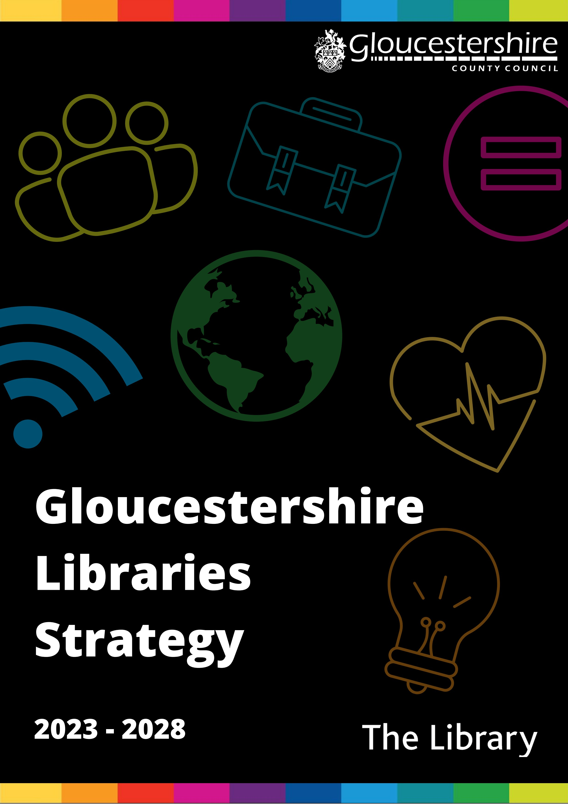
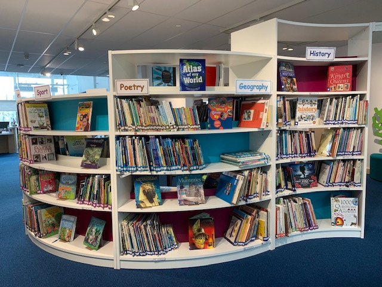

<!-- PAGE: 1 -->

# Gloucestershire Libraries Strategy 2023–2028

<!-- PAGE: 2 -->

Defining and enhancing our CORE Service
Responding to the CLIMATE emergency
Ensuring our libraries continue to meet the needs of their COMMUNITY 
CONNECTING people 
Using CREATIVITY to enhance people’s lives
Gloucestershire Libraries are welcoming, vibrant safe places at the heart of our diverse
communities and as such are an integral part of the County Council helping us deliver our
Council Strategy - Building Back Better in Gloucestershire.
The library service has changed significantly since the last strategy was written in 2012 and I’m
pleased that our new library strategy provides a forward-thinking vision and ambition for library
services in Gloucestershire.
Our libraries are far more than a place to borrow books – their core purpose is still to provide
free access to a wide range of physical books and information, but this also now extends to e-
books that can be accessed from your own home, place of work or study. We have introduced
library innovation labs, located within each of our 6 districts, which are designed to build
confidence and skills and connect businesses, schools, and entrepreneurs with the digital
technology of the future.
We are committed to keeping our libraries open and delivering a high quality and constantly
evolving service across our 31 locations. We continue to support our 8 community run libraries
and would like to recognise the hard work undertaken by these communities who have been
running their libraries successfully since 2011/12.
This Strategy sets out our ambitions for the next five years under the 5 C’s which are:
WELCOME TO THE
LIBRARIES STRATEGY
Councillor Dave Norman MBE
Cabinet Member for Fire, Community Safety and Libraries
Gloucestershire Libraries will continue to evolve to meet the needs of
the people who wish to use them and our new strategy outlines how our
buildings and services will continue to develop to meet these ever
changing demands whilst still retaining libraries core purpose.

<!-- PAGE: 3 -->

I use my library daily, lovely friendly staff 
 and a great selection of books. I don't
know what I'd do without it!  
Library Customer 2021 <!-- PAGE: 4 --> Libraries are the lifeblood of the community,
what would we do without them?
## INTRODUCTION
Gloucestershire Libraries have changed significantly in the last 11 years since the last strategy
was produced in 2012. Libraries contribute to the social, economic and cultural wellbeing of
communities and are a key factor in driving early years literacy. 
Public libraries have long been one of the most important shared civic spaces. Our libraries
continue to be trusted spaces in local communities that are accessible to all who wish to use
them and for many the doors to the library open a world of exploration, escape, learning and
research. 
Since inception, library spaces have flexed to meet the needs of the surrounding communities.
The ability to adapt and develop has never been more important as services have emerged from
the challenges of physical closures. Public libraries were historically designed to house books;
however, a modern library not only offers books to read, but the future is also firmly focussed on
welcoming people both physically and in the digital world.

<!-- PAGE: 5 -->

Libraries in Gloucestershire support and facilitate education 
and skills development, they complement mainstream 
education and provide a space for adults and children to 
learn and develop. They support economic development 
and the delivery of important local services and work in 
partnership supporting businesses, enterprise, and 
employment creation. The network of Growth Hubs and 
Innovation labs link people with jobs by developing 
employability skills and sharing job seeking support. They 
support the development of digital skills and literacy and 
provide a cultural programme that empowers communities, 
reduces isolation, and opens Art and Culture to all. 
Co-design where libraries listen and learn from communities 
is crucial to success. Libraries need to re-build confidence 
in physical spaces, level-up the digital space and make 
the library visible in the community. The place-making role 
libraries play in communities brings vital social benefit: a sense
of belonging, companionship, support, and inspiration.  
The global COVID-19 pandemic saw library
services in Gloucestershire respond quickly to
develop an enhanced digital offer to support
people during lockdown. Creativity and
innovation flourished as services introduced
new models of delivery such as “reserve and
collect”, “ring and read” and “off the shelf”,
extended digital business support and virtual
programmes to address social isolation. This
response has brought about a longer-term
change in how people wish to access services
which are addressed through this strategy. 
The enforced closure of libraries exacerbated
existing issues, such as digital exclusion and
social isolation, and brought new challenges into
sharp focus. The closures significantly
disadvantaged those who could not access
reading and digital services.
Libraries will continue to adapt and respond
to emerging social issues ensuring that 
appropriate services are inclusive and
accessible at a local level.

<!-- PAGE: 6 -->

Have regard to encouraging both adults and children to make full use of the library space and provide
advice as to its use.
Lend books and other printed material in sufficient quality and quantity free of charge to those who live,
work or study in the area;
Secure co-operation between the library authority and others exercising public functions within the
county
Eliminate discrimination, harassment, victimisation and any other conduct that is prohibited by or under
the Act;
Advance equality of opportunity between persons who share a relevant protected characteristic and
persons who do not share it;
Foster good relations between persons who share a relevant protected characteristic and persons who
do not share it.
age 
disability 
gender reassignment 
pregnancy and maternity 
race; religion or belief 
sex 
sexual orientation
marriage and civil partnership
Under the Public Libraries and Museums Act 1964   (PLMA) Gloucestershire County Council, as a library
authority, has a statutory duty (not a discretionary power) to provide a comprehensive and efficient library
service for all people working, living or studying full time in Gloucestershire who wish to make use of it.
The PLMA does not define what is meant by “comprehensive and efficient”. However in providing this
service, Gloucestershire County Council must, amongst other things:
Section 149 of the Equality Act 2010
In formulating the new library strategy, the Council must also comply with the statutory duty contained in
section 149 of the Equality Act, known as the public sector equality duty. This requires the council, and
Cabinet Members as decision makers in particular, to have due regard to the needs to:
The relevant protected 
characteristics 
referred to in section 149 are:
BACKGROUND 
 
The Legal Framework <!-- PAGE: 7 --> 

Libraries
Community Libraries 
Members of Staff  
31
8
179
Items of e-Stock Loaned 
Items of Stock Issued 
Items of Library Stock Available 
1,860,457
561,123
193,479 
Library visits1,992,468
Children's Learning 
Activities & Events 3,912
Adult Learning 
Activities & Events2,009
Over 12,000 hours 
of Volunteer Support 
FREE WiFi in 
Every Library 
 
Virtual Visits  180,548
An Innovation Lab 
in Coleford 
Public Computers 
Hours of Public Use
261
161,844
LET'S CELEBRATE 
1 April 2019 – 31 March 2020 <!-- PAGE: 8 --> Investing in digital skills for library staff
Using digital innovation through our network of Labs to improve customer experience
Seek to increase diversity within our workforce
Review our strategies & policies to ensure they are inclusive to all
Participating in equality and inclusion learning and development
Providing a range of stock that reflects the diversity of the Gloucestershire population 
Explore further opportunities for co-location or re-location of library services
Demonstrate how libraries can offer additional social, economic, and environmental benefits for local
people and communities through the delivery of services, events and activities
Work with partners to introduce wildlife and tree planting in library gardens and encourage participation
in conservation activities
Explore installation of electric vehicle charge points in identified library car parks
Work with communities and partners to increase local recycling opportunities
Education and information – we will raise awareness of the things we can all do to reduce our impact on
the environment, providing ‘Greener Together’ collections in all our Libraries and actively promote key
messages and events
 
How Libraries link with the County Council’s Strategy
 
Building Back Better in Gloucestershire
 
Our core services and ambitions assist in the delivery of the County Council strategy in the following ways:
GETTING OUR OWN HOUSE IN ORDER
ICT
Equalities, Diversity and Inclusion
Maximising the use of our estate
TACKLING CLIMATE CHANGE <!-- PAGE: 9 --> Connect businesses, schools, and entrepreneurs with the digital technology of the future
through our network of Innovation Labs
Support individuals to develop new skills, confidence and understanding in digital
technology through our network of Innovation Labs
Partner with Adult Education and Gloucestershire Employment and Skills Hub to ensure
skills, training and education are directly accessible in local communities
Shape our library services to make sure they adapt to the needs and aspirations of local
residents
Explore whether Family Hub services can be delivered from identified library locations
Provide children’s library services that support literacy, learning and confidence
Deliver an inclusive immersive storytelling experience from our Oakley centre
Deliver a programme of events aimed at reducing social isolation in both younger and older
people
Deliver a programme of events aimed at supporting those with Dementia
Explore how the digital technology within our Innovation Labs can support the county
councils Technology Strategy to support people to live independently
Signpost customers to right part of the County Council so they can get the advice or support
they need
Refresh library customer service and presentation standards
Train and support staff and volunteers to deliver a consistently positive/fair experience for
all customers
SUSTAINABLE GROWTH AND LEVELLING UP OUR COMMUNITIES
TRANSFORMING CHILDREN’S AND ADULT SOCIAL CARE
IMPROVING CUSTOMER EXPERIENCE <!-- PAGE: 10 --> Gloucestershire Libraries are welcoming,
inclusive, innovative, and inspiring.
 
Vibrant safe spaces at the heart of our diverse
communities, they encourage connections
and creativity, providing equality of access to
reading, culture, technology, trusted
information, and learning opportunities.
  
Working with and for their communities,
libraries will continue to adapt and respond to
their changing needs, championing
sustainability and promoting health &
wellbeing.
  
Vision for the 
Library Services 
in Gloucestershire <!-- PAGE: 11 --> ## THE 5 C'S 
### CORE
### CLIMATE
COMMUNITY 
### CONNECT
### CREATIVITY

<!-- PAGE: 12 -->

## KEY AIMS & OBJECTIVES
GREENER 
TOGETHER 
HEALTH & 
WELLBEING 
DIGITAL & 
INNOVATION CHILDREN & 
FAMILIES 
READING & 
LITERACY
WORKFORCE & 
VOLUNTEERS
EQUALITY & 
DIVERSITY
CREATIVITYBUSINESS 
DEVELOPMENT <!-- PAGE: 13 --> Free access to reading through physical and electronic book stock. Access to
information through the network of Gloucestershire Libraries, the Virtual Reference
Library (VRL) and Ask Us.  
Promotion of the benefits of reading for pleasure and support basic literacy skills to
adults and children.
Provide access to local studies collections within libraries. 
Support Home Educators through the provision of resources and spaces.
A trained workforce who can signpost to partner and other council services. 
Free access to books that support mental and physical health and wellbeing
including books on prescription.
Provide home delivery services to housebound residents. 
Providing welcoming, accessible, inclusive, safe spaces for all and a positive
experience for people using library services or volunteering with us. 
Provide self service options so that customers can access the services they want
when they want. 
Provide access to the internet, printing and Wi-Fi through our network of buildings
Support people to build digital skills and confidence.
Offer a core programme of events and activities including those that aim to reduce
social isolation. 
Work with housing developers to secure contributions so libraries can continue to
meet the needs of residents of new developments. 
### CORE
A comprehensive and efficient Library Service for Gloucestershire  
Libraries are more than just books, my local library
is full knowledge and support. 
Library Customer 2021 <!-- PAGE: 14 --> Equip staff and volunteers with the skills to deliver a progressive service and
encourage development at all levels.
Commit to investing further skills and training opportunities through work
experience, apprenticeships, and volunteering.
Further develop and expand customer self-service options, enabling easier and
extended access to library services. 
Work with Adult Education to expand access to basic reading and other training
opportunities. 
Become more inclusive and better reflect the equality and diversity of our
communities through our book stock, accessible events, and recruitment of staff
and volunteers.
Strengthen support and accessibility to reading for reluctant readers and those in
local communities whose first language is not English.  
Ensure libraries physical and digital services are fully accessible to all, including
use of digital platforms such as 360-degree virtual tours. 
Develop opportunities for library membership at each stage of a child's
development and reading journey.
Develop a strong marketing strategy that promotes the relevance of libraries and
encourages greater use.
Develop further opportunities to deliver the County Council's 'Build Back Better in
Gloucestershire' strategy.  
Develop a programme of income generation to support the delivery of ambitions.
Work with schools to support class visits to local libraries to promote reading for
pleasure to children. 
AMBITION 
Libraries store the energy that fuels imagination, they open
windows to the world and inspire us to explore 
Sidney Sheldon
we will...

<!-- PAGE: 15 -->

### Case Study: Cheltenham Care Home Delivery Service

 
Cheltenham Library provided a full service to the most
vulnerable and isolated in the community called the Care Home
Delivery Service. From June 2020 the library staff have been
delivering books and their time to local care homes. 
This project has been such a success, following the pandemic
the aim is to support care home residents to physically visit the
library and choose books. 
"I am always very pleased to have books delivered, without this very
helpful service my life would be greyer without a selection of books". 
### CORE
CASE STUDY 
A SAFE SPACE FOR ALL 
Libraries are safe spaces, designed for community use: 
"I just wanted to say a huge thank you to your kind staff who allowed six staff and seven disabled children to
have lunch in the library when our alternative plans fell through and had nowhere to go in the rain. We didn't
feel rushed at all and there was a lovely clam atmosphere which was exactly what our children need whilst
they are eating. 
Many thanks to the staff and volunteers".  
- Karen Childs from St Roses School, Stroud

<!-- PAGE: 16 -->

Provide Greener Together stock collections and initiatives that promote Information
and resources related to sustainable living, the environment and wildlife so that
people can make informed choices.  
Plant trees and wildlife gardens within our library outdoor spaces. 
Engage communities in activities, events and conversations that address the climate
crisis to promote and affect change. 
Provide local access in communities- avoiding the need for people to travel to
access wider council services. 
Work with Gloucestershire County Council partners assisting with the delivery of the
Council's Climate Strategy. 
Choose suppliers and partners who demonstrate environmental integrity and
sustainable work practices.
Deliver initiatives that encourage and promote swaps, re-use and repair. 
Invest in book stock and e-lending to promote re-use rather than single use. 
### CLIMATE
Borrow Don't Buy 
Libraries by their nature are recyclers - reuse is
the way forward <!-- PAGE: 17 --> Challenge and adapt our behaviours to embrace positive change in respect of
climate and sustainability. 
Roll out successful local initiatives that support climate and sustainability across our
network of libraries. 
Explore more sustainable travel options for people wishing to visit libraries including
a review of cycle parking provision and exploring car e-charging points in libraries. 
Explore the provision of free water re-fill points in libraries.
Offer local recycling points at libraries for residents (i.e batteries).
Strengthen policies and procedures to address climate issues and sustainability.
Review and reduce the carbon footprint of our library van deliveries.
Work with property colleagues to ensure the environmental impact of future library
refurbishments are considered and libraries, where possible, become carbon
neutral.
Explore the provision of a Library of Things to enable people to borrow useful items
rather than having them buy them. 
Develop a programme of Environmental events to be delivered through the network
of libraries.
Partner with local community groups to enhance and expand the use of the
outdoor spaces - creating community gardens to support healthy living. 
Develop outdoor spaces to provide library activities and events in a garden
environment, encouraging better health and wellbeing. 
Work with suppliers to ensure our book stock has the lowest possible
environmental impact. 
Explore and implement more sustainable work practices in libraries.
AMBITION we will...

<!-- PAGE: 18 -->

### Case Study: Greener Together

 
In 2021 the library service created a sub-group of a cross
section of staff to form the Greener Together committee, this
group take on responsibility for thinking about how the library
service can promote re-use and the climate change agenda
through book stock, events and partnerships. 
COSTUME SWAP 
One of the biggest achievements, so far, has been the
costume swap initiative promoted by individual libraries. The
concept is that residents bring in unwanted costumes for
children into the library and swap it with another size or
theme of costume. 
This initiative has worked really well around halloween and
World Book Night, with an emphasis that children will dress up
to promote the occasions . 
### CLIMATE
CASE STUDY 
In 2022 we included free sewing workshops alongside the swaps, to try and encourage customers to make
and mend. We held supportive sessions of the elements of sewing and the positive impact it can have on the
environmentif clothes are mended not thrown away.

<!-- PAGE: 19 -->

Provide open and accessible library buildings which sit at the heart of our diverse
communities.
Encourage community use of library buildings.
Communicate and consult with all residents when changes to library services are
planned. 
Support the network of community run libraries. 
Provide a network of community library access points in local venues where there is
sufficient demand from people unable to access a static library.  
Provide temporary and ad hoc pop up libraries in targeted areas.  
Use developer contributions to ensure local libraries can continue to meet the
needs of growing and changing communities. 
Provide local access to partner organisations and wider council services. 
Work with local partners to attract funding and deliver community projects. 
Launch and embed the new Stroud Library within the Five Valley's Shopping Centre.  
Provide volunteering opportunities for local people to provide skills, experience and
reduce social isolation.  
Provide activities and events that are aimed at the individual needs of the residents.
### COMMUNITY
I am passionate about my local library space. I help out
where I can in this essential space for the community  
Library Volunteer 2021 <!-- PAGE: 20 --> Explore how the pop up library programme can reach people who do not use
libraries, through increased use of local venues. 
Explore targeted expansion of the community library access points where people
cannot access a library building. 
Co-create library services which reach the heart of communities and engage with
new audiences. 
Create a programme of library refurbishment to ensure libraries align with
community needs and to provide a modern accessible library service. 
Work with the University of Gloucestershire on the relocation of Gloucester Library
to the new City Campus building. 
Work with developers to ensure new library provision is considered within identified
strategic allocation sites and continue to review library provision in the light of new
housing developments ensuring growing communities have access to public library
services. 
Advocate for public libraries role in the regeneration of high streets and explore
further relocation opportunities that will enable easier access to library services.
Set up a youth advisory board to ensure young people are able to influence how the
services can meet the needs of customers. 
 
AMBITION
These dynamic and modern institutions and the librarians
who staff them add immeasurably to our quality of life 
George W Bush
we will...

<!-- PAGE: 21 -->

### Case Study: Pop Up Libraries

During the refurbishment of Matson Library in 2021,
Gloucestershire Libraries provided a continued service for the
community at four different sites around Matson. 
This was a great time for the Library Service to reach out to
pockets of communities and rebuild relationships with
customers. At the pop up sites customers are able to join the
library, borrow and return items, request stock, talk about
book choices as well as having a general chat. 
The four sites included: Matson Baptist Church, The Phoenix
Centre, The Venture and The Redwell Centre. The venues were
welcoming and accomadating. Each pop up, due to it's
location had a different emphasis and characteristic and it has
been an uplifting opportunity to talk directly with communities,
many of which hadn't been in the library. 
Due to the success of this project pop up libraries have been
integrated into core activities as an excellent way to reach hard
to reach groups.
In 2021 this project won the David Vaisey Prize.  
COMMUNITY 
CASE STUDY 
THE IMPACT -   
For non library users, recreating the library experience in an external setting has done away with some
barriers that have prevenyed them in the past from coming through the doors of Matson Library.
The mission of creating the pop up was generated by countering customer comments like:
"I wouldn't borrow a book, I might lose it" or "There's so much going on in my life, I'll never remeber to bring it
back".  
Mural at the newly refurbished Matson Library
Member of staff manning a pop up library <!-- PAGE: 22 --> Provide access to ICT and language courses through Adult Education.
Deliver STEAM and code clubs in local libraries. 
Connecting people with digital technology.
Offer digital device surgeries.
Partner with businesses and deliver school workshops through Innovation Labs to
spark interest in STEAM. 
Connect children and young people with library services through liaison with early
years, schools and education providers.  
Connect new parents with library services providing membership and BookStart
packs at birth registration appointments.
Provide access to information that supports businesses through Growth Hub access
points and Ask Us.
Connect people with stock through the inter library lending services.
Connect people to reduce social isolation through clubs and activities.
Connecting people with information and providers through signposting to wider
council information and partners.  
### CONNECT
The Lab space is such a treasure trove of tech! 
Lab Member 2021 <!-- PAGE: 23 --> Connect people with skills and opportunities by partnering with Adult Education and
Gloucestershire Employment and Skills Hub.
Expand the provision of meeting spaces within libraries.
Explore the expansion of the network of Innovation Labs and continue to invest in
up-to-date equipment that supports business start-ups and entrepreneurs.
Continue a programme of modernisation introducing new digital services such as 
Wi-Fi printing and improving digital access to library buildings. 
Continue to develop the provision of library services, including digital engagement
with the development of reading and literacy. This includes using provisions such as
Immersive Reality to provide new and engaging interaction. 
Develop partnership which support more resilient, fairer and healthier
communities.
Introduce an ask a librarian service.
Explore 'Human Lending libraries' with the aim of reducing social isolation by giving
people someone to talk to.
 
AMBITION
Libraries promote the sharing of knowledge, connecting people
of all ages with valuable information and resources.
George W Bush
we will...

<!-- PAGE: 24 -->

### Case Study: Award-Winning Innovation Lab

 
An Innovation Lab run by Gloucestershire Libraries has achieved national recognition for a series of
school workshops it delivered in partnership with SPP Pumps.The Contribution to Skills and Training
Award was given to SPP Pumps at the Pump Industry Awards 2020, recognising its work with the
Innovation Lab at Coleford Library.
It was among four finalists in that category at the awards, which were held recently after being
postponed last year due to Covid.
The STEAM (Science, Technology, Engineering , Arts and Maths) based workshops took place at the lab
throughout 2019 and were aimed at primary aged children from local schools, to raise awareness of
local job opportunities and to inspire future careers.
The sponsorship and support from SPP Pumps enabled more than 300 children to get hands on with
digital technology including 3D printing, virtual reality, digital design and 360° photography.
YOUR BOOK CLUB FACEBOOK GROUP
An online area on social media for users of the library service
to connect. This was formed during Covid-19 as a way of
connecting people through discussions of books and reading. 
As at April 2022, the book club has over 1.7K members. 
### CONNECT
CASE STUDY <!-- PAGE: 25 --> Develop and promote reading through initiatives like the David Vaisey Prize, which is
an internal competition designed to encourage libraries to work with partners on
encouraging reading and literacy. 
Use librarian blogs and social media to promote reading. 
Use creativity within the library workforce and volunteers to deliver activities and
events.  
Provide Innovation Labs as spaces for customers to try new and emerging
technology and gain skills and confidence.
Creation of an Immersive Reality centre to encourage digital and creative
engagement - Oakley digital immersive and storytelling centre.  
Deliver a programme of online events and activities. 
Use creative ways to tackle social issues. 
Work with partners on a creative use of library spaces to develop and highlight new
and emerging talent. 
 
 
### CREATIVITY
Creativity and community equals libraries of
the future <!-- PAGE: 26 --> Embed Gloucestershire Libraries at the forefront of existing cultural groups and
activities.
Develop and deliver a programme of touring events to library sites.
Expand and further develop creative writing workshops and activities, supporting
local talent.
Expand the network of our creative partnerships and identify existing creative talent
within the local community.
Challenge ourselves to come up with a creative approach to the promotion and
marketing of our services. 
Create a skills camp to develop talent within the library team and wider community. 
Further promote Gloucestershire libraries as spaces to trial local creative talent,
including creative businesses. 
Develop creative and flexible uses of library services when closed to the public to
offer cultural activity.
Use the network of libraries to deliver the Arts Award.  
Reflect the rich and diverse communities in library programming to make events
accessible to all. 
Expand and develop social prescribing.
Deliver a programme of activities and events which are accessible to all as an Arts
Council National Portfolio Organisation. 
 
AMBITION
Libraries are all things to all people
we will...

<!-- PAGE: 27 -->

### Case Study: Art of Libraries Toolkit

The toolkit marks the culmination of Art of Libraries, a three year 
pilot project to re-imagine libraries as a first place for creativity, 
discovery and play for children, families and young people.
The pilot was led by Create Gloucestershire with 
Gloucestershire Libraries, with investment from 
Esmée Fairbairn Foundation and support from Real 
Ideas and The Barnwood Trust.
During these uncertain times, libraries play a vital and 
tangible role in the local cultural, social and economic 
recovery. As trusted spaces in the community, libraries 
are needed more than ever; helping children and young 
people reconnect in a safe, local space, supporting their 
physical and mental wellbeing and engaging those 
individuals and communities who are most isolated or disadvantaged.
This toolkit is designed to inspire anyone working with libraries whether as a librarian, artist, arts company or
library user. It shares our learning about how to incubate creative and innovative approaches and
partnerships.
### CREATIVITY
CASE STUDY
