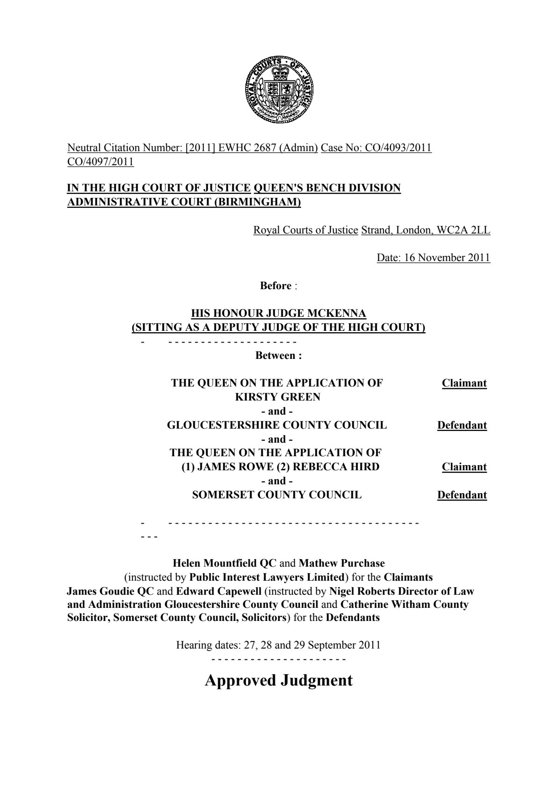

<!-- PAGE: 1 -->

Neutral Citation Number: [2011] EWHC 2687 (Admin) Case No: CO/4093/2011
CO/4097/2011
IN THE HIGH COURT OF JUSTICE QUEEN'S BENCH DIVISION
ADMINISTRATIVE COURT (BIRMINGHAM)
Royal Courts of Justice Strand, London, WC2A 2LL
Date: 16 November 2011
Before :
HIS HONOUR JUDGE MCKENNA
(SITTING AS A DEPUTY JUDGE OF THE HIGH COURT)
- - - - - - - - - - - - - - - - - - - - -
Between :
THE QUEEN ON THE APPLICATION OF
KIRSTY GREEN
- and -
Claimant
GLOUCESTERSHIRE COUNTY COUNCIL
- and -
THE QUEEN ON THE APPLICATION OF
Defendant
(1) JAMES ROWE (2) REBECCA HIRD
- and -
Claimant
SOMERSET COUNTY COUNCIL Defendant
- - - - - - - - - - - - - - - - - - - - - - - - - - - - - - - - - - - - - - -
- - -
Helen Mountfield QC and Mathew Purchase
(instructed by Public Interest Lawyers Limited) for the Claimants
James Goudie QC and Edward Capewell (instructed by Nigel Roberts Director of Law
and Administration Gloucestershire County Council and Catherine Witham County
Solicitor, Somerset County Council, Solicitors) for the Defendants
Hearing dates: 27, 28 and 29 September 2011
- - - - - - - - - - - - - - - - - - - - -
Approved Judgment <!-- PAGE: 2 --> His Honour Judge McKenna :
Introduction

**1.** In these proceedings, the Claimants, residents respectively of Gloucestershire and
Somerset, seek to challenge the following decisions made by Gloucestershire County
Council (“GCC”) and Somerset County Council (“SCC”), made in the exercise of
their duties under Section 7(1) of the Public Libraries and Museums Act 1964 (“the
1964 Act”) to provide comprehensive and efficient library services in their respective
counties, to make changes to their respective public library services:-
i) In respect of GCC, the decisions taken by the Executive on 2 February 2011
and 12 April 2011 and by the full Council on 16 February 2011;
ii) In the case of SCC, the decisions taken by the Executive on 2 February 2011
and the full Council on 16 February 2011.

**2.** The GCC decisions were to withdraw funding from 10 of its 38 static libraries
(subject to the possible “big community offer” if volunteers came forward to run
them,) and to provide 7 libraries with a library link which would open 12 hours a
week (or more if volunteers came forward from the communities); to withdraw its
mobile library services altogether and radically to reduce its expenditure on and the
opening hours of 5 of the remaining 21 libraries.

**3.** The SCC decisions were to withdraw full funding from 11 of its 34 static libraries; to
reduce its fleet of mobile libraries from 6 to 2 and to cut the opening hours of the
remaining libraries by 20% and “in the case of all …. unfunded libraries” to explore
options for management by the community.

**4.** The Claimants in these two joined claims are users of libraries in Gloucestershire and
Somerset respectively. Ms Green, the Claimant in the first (Gloucestershire) challenge
is an unemployed single mother who lives in one of the most deprived areas of the
country in Gloucestershire and is a user of Hester’s Way Library, a library which,
under the proposals, will close completely unless a community group is willing and
able to run it. Mr Rowe, the First Claimant in the Somerset challenge is an
unemployed man who uses his local library at Wiveliscombe, a library whose opening
hours will be reduced by 20% under SCC’s proposals, for leisure and social contact,
to seek work and to assist his son with his education. Ms Hird, the Second Claimant
in the SCC challenge has a reading disability. She uses her library (Watchet) for
books especially audio books and internet access. That library will no longer be
funded under SCC’s proposals and will therefore close unless its running can be taken
over by a local group.

**5.** The cases have generated considerable strength of feeling in the respective
communities and raise similar issues albeit in different factual contexts. The Claimant
in the GCC case was granted permission by Beatson J after an oral hearing on 7 July
2011 and on 21 July 2011 Beatson J ordered that the SCC case should proceed to a
rolled up hearing to be heard at the same time as the substantive hearing in the GCC
case.

**6.** The Claimants’ case is that the decisions were taken <!-- PAGE: 3 --> i) in breach of the respective councils’ duty to provide a comprehensive and
efficient library service pursuant to Section 7 of the 1964 Act;
ii) in breach of the Public Sector Equality Duties under Section 49A of the
Disability Discrimination Act 1995 (“the DDA”) and Section 76A of the Sex
Discrimination Act 1975 (“the 1975 Act”) and in respect of those decisions
postdating 5 April 2011, section 149 of the Equality Act 2010 (“the 2010 Act”)
and;
iii) without adequate consultation.

**7.** It was submitted on behalf of the Claimants that they readily appreciated the pressure
on local authorities to cut spending in the face of significant funding cuts from central
government but that limited resources could not justify a failure to comply with the
statutory duties or the requirements of public law. The Claimants believed that each
of the Defendants had adopted a fundamentally flawed and unlawful approach to the
objective of making savings in their respective budgets, in particular, because they
had each started by identifying budget cuts and then worked backwards to what would
be provided (and thereby failed to identify with adequate particularity the needs which
their services were required to address); failing to comply with equality legislation
and properly to consult.

**8.** For their part it was conceded by the Defendants that whilst local authorities could not
but face economic reality, it was no part of their case that challenging financial
circumstances excused compliance with the requirements of public law or that those
requirements were in any sense thereby diluted. On the contrary it was the
Defendants’ case that their decision making processes were undertaken with great
care, were reasonable and lawful and that the decisions ultimately reached were well
within the permissible bands of legality and reached with appropriate regard to all
relevant considerations and as such should not be disturbed.
Legal Framework The 1964 Act

**9.** Section 7 of the 1964 Act imposes a statutory duty on library authorities to “provide a
comprehensive and efficient library service” to everyone who lives, works or attends
full time education in the library area. The duty is contained in Section 7(1) which
provides as follows:-
“(1) It shall be the duty of every library authority to provide a
comprehensive and efficient library service for all
persons desiring to make use thereof …
Provided that although a library authority shall have
power to make facilities for the borrowing of books and
other materials available to any person it shall not by
virtue of this subsection be under a duty to make such
facilities available to persons other than those whose
residence or place of work is within the library area of
the authority or who are undergoing full time education
within that area”.

**10.** Section 7(2) provides further statutory instruction as to the factors which a library
authority must take into account in order to fulfil its duty under Section 7(1): <!-- PAGE: 4 --> “(2) In fulfilling its duty under the preceding subsection, a
library authority shall in particular have regard to the
desirability:
(a) of securing, by the keeping of adequate stocks, by
arrangements with other library authorities, and by
any other appropriate means, that facilities are
available for the borrowing of, or reference to, books
and other printed matter, and pictures, gramophone
records, films and other materials, sufficient in
number, range and quality to meet the general
requirements and any special requirements both of
adults and children; and
(b) of encouraging both adults and children to make full
use of the library service, and of providing advice as
to its use and of making available such
bibliographical and other information as may be
required by persons using it; and
(c) of securing, in relation to any matter concerning the
functions both of the library authority as such and
any other authority whose functions are exercisable
within the library area, that there is full co-operation
between the persons engaged in carrying out those
functions”.

**11.** The expression “library service” is not defined nor are the concepts “comprehensive”
and “efficient”. Library facilities are referred to but not defined but they are clearly
not the same as library premises which are defined (in Section 8(7)).

**12.** Section 9(1) confers a power on a library authority to contribute towards the expenses
of “any other person” providing “library facilities for the public” and Section 20
empowers local authorities to generate revenue by allowing library premises to be
used for holding meetings, performances and the like in return for payment.

**13.** Section 1(1) is also material and provides:-
“From the commencement of this Act it shall be the duty of the
Secretary of State to superintend, and promote the
improvement of, the public library service provided by local
authorities in England and Wales, and to secure the proper
discharge by local authorities of the functions in relation to
libraries conferred on them as library authorities by or under
this Act”.

**14.** Section 10 provides the Secretary of State with default powers as follows:-
“(1) If –
(a) a complaint is made to the Secretary of State that any
library authority has failed to carry out duties relating to <!-- PAGE: 5 --> the public library service imposed on it by or under this
Act; or
(b) the Secretary of State is of the opinion that an investigation
should be made as to whether any such failure by a library
authority has occurred,
and, after causing a local enquiry to be held into the matter, the
Secretary of State is satisfied that there has been such a failure
by the library authority, he may make such an order declaring
it to be in default and directing it for the purpose of removing
the default to carry out such of its duties, in such manner and
within such time, as may be specified in the order”.

**15.** In the cases of GCC and SCC no decision has been made by the Secretary of State to
cause a local enquiry to be held.

**16.** At the time of the hearing of these claims there was no direct authority on the proper
construction of the Section 7 duty although the duty was considered in the particular
circumstances of two cases R -v- London Borough of Ealing ex-parte Times
Newspapers [1987] IRLR 129 and Attorney General -v- Observer Limited [1988] 1
All ER 385. However, it was submitted on behalf of the Claimants that there is an
implied duty under Section 7 of the 1964 Act to conduct an adequate assessment of
local needs and that that requirement was an inherent component of the duty to
provide a comprehensive and efficient library service, a submission rejected by
counsel for the Defendants.

**17.** On 13th October 2011 Judgment was handed down by Ouseley J in R (Bailey &
others) v London Borough of Brent [2011] EWHC 2572 (Admin), a case concerning a
decision to close six libraries in Brent. Albeit in the context of very different factual
matrices, similar grounds were relied on as in the instant cases, and on the facts of the
Brent case Ouseley J refused the substantive applications. In that case however the
primary dispute was whether the needs assessment which had been performed was
adequate and not as to the construction of the section 7 duty. I am indebted to counsel
for both parties for letting me have helpful notes containing their respective
submissions on the relevance of the Brent case.

**18.** In support of the Claimants’ submission as to the proper construction of Section 7 of
the 1964 Act, reference was made to three sources, the Oxford English Dictionary for
definitions of the words “comprehensive” and “efficient”; the Bourdillon Report1
 of
1962 and the Wirral Report2
 which followed an intervention by the Secretary of State
into library provision by Wirral Metropolitan Borough Council in 2009.

**19.** In the Oxford English Dictionary, the definition of “comprehensive” includes “having
the attribute of comprising or including much; of large content or scope” and the
definition of “efficient” included “fitness or power to accomplish, or success in
accomplishing, the purpose intended; adequate power, effectiveness, efficacy”. Thus
Charteris in September 2009 GCB page 792 and following <!-- PAGE: 6 --> it is said that the duty is to provide a library service which enables users to gain access
to material which is comprehensive in the sense of being broad in range.

**20.** The Bourdillon Report1
 was extensively referred to during the parliamentary passage
of the 1964 Act and considered “the basic requirements of an efficient library service”
to include the following: -
“There are certain functions which should be within the
capacity of any library unit setting out to provide the basic
range of library service to its readers. The scope of a public
library increases in relation to the size or density of the
population served but in some fundamental respects the
requirements which can be laid down for the basic service
remain valid all the way up the population scale” (paragraph
13).
“There are areas where the population is too small or too
sparse to justify the provision of a full library service, and
where reliance must be placed on mobile units or small
branches” (paragraph 13).
“The provision of books and other printed materials has two
aspects: the provision on the spot of a wide range of books and
related material for reading in the home or for reference in the
library itself, and the ready access which the public library
should afford to the far wider range of material which is not
immediately at hand. Unless the public library performs both
of these functions it is not doing its job properly” (paragraph
14).
“In urban areas no person should normally have to travel more
than one mile to a library” (paragraph 103).
This was a report to which, the Claimants submitted, the Defendants should at least
have had regard.

**21.** In the Wirral Report the following passage appears under the heading Conclusions
and Recommendations on which reliance was placed by the Claimants:-
“The Inquiry has accepted the implicit and explicit
interpretation of the 1964 Act that a comprehensive and
efficient service is one that is based on local needs (hence why
there can be no single definition which is true to all library
authorities in England) and if those needs are not fully
assessed and taken in to account, it becomes a rational
impossibility for a library authority to provide a service which
comprehensively and efficiently meets those needs in a
demonstrable way”.

**22.** Earlier in the Report and under the heading Executive summary the following
passages also appear:- <!-- PAGE: 7 --> “14. … the inquiry has found the Council to be in breach of its
statutory duties under the Public Libraries and Museums Act
1964, because it failed to make an assessment of local needs in
respect of its library services. It therefore cannot have acted
reasonably in meeting such needs in the context of its statutory
duties and available resources, as, in the absence of such
assessment or demonstrable knowledge of local needs, it was
incapable of identifying a reasonable option for meeting such
needs both comprehensively and efficiently.

**15.** In particular, there are some specific needs for adults
that have not been addressed. These include the specific
requirements for older people, disabled people, unemployed
people and those living in deprived areas.

**16.** The Council has not been able to demonstrate that it
had due regard to the general requirements of children which I
consider to be a breach of its statutory duties.

**17.** The Council took the decision to close eleven of its
libraries in the absence of a strategic plan for or review of the
library service. As such, I believe that the Council’s approach
to the re-visioning the service was fundamentally flawed,
because their approach focused specifically on the issue of
asset management and cost savings.

**18.** I also believe that the decision was made without a
clear understanding of the extent and range of services
currently being provided in the libraries, including those which
are “core” to the service and those which are ancillary. This
makes it difficult to see how the Council could plan for ceasing
or re-locating aspects of the current service.”

**23.** Thus submitted counsel for the Claimants as a matter of legal principle, in order to
comply with Section 7 of the 1964 Act, a library authority must undertake a proper
analysis of the library related needs, both general and specific, of all persons desiring
to make use of its library service before reaching a rational judgment as to what
services would meet those assessed needs.

**24.** Moreover it is a cardinal principle of public law, as enunciated by Lord Diplock in
Secretary of State for Education -v- Tameside [1977] AC 1014 at page 1065 that a
decision maker must “ask himself the right question and take reasonable steps to
acquaint himself with the relevant information to enable him to answer it correctly”
with the role of the court being as follows:-
“… it is not for any court of law to substitute its own opinion
for his; but it is for a court of law to determine whether it has
been established that in reaching his decision unfavourable to
the Council he had directed himself properly in law and had in
consequence taken into consideration the matters which upon
the true construction of the Act he ought to have considered
and excluded from his consideration matters that were <!-- PAGE: 8 --> irrelevant to what he had to consider … Or put more
compendiously, the question for the court is, did the Secretary
of State ask himself the right question and take reasonable
steps to acquaint himself with the relevant information to
enable him to answer it correctly?”

**25.** The Defendants for their part submit that neither the Bourdillon Report nor the Wirral
Report is of any assistance since:-
i) The Bourdillon Report merely represented the views of a pre-legislative
working party and was concerned with a legislative proposal to provide an
efficient library service at a time when the word comprehensive was not part of
the then legislative proposal and therefore did not form part of the
Committee’s considerations. Furthermore, the report dated from an era in
which modes of the public access to information were incomparable with those
of the present day; and
ii) The Wirral Report has no authoritative status whatsoever as an aid to
construction and simply represented one lay inspector’s view of the shape and
adequacy of one local authority’s library service and had no factual application
to the current proceedings.

**26.** Counsel for the defendants submitted that comprehensive merely required a service
which was evenly spread across an authority’s geographical area and which provided
an even spread of the media most commonly found in modern libraries whilst the
word “efficient” tempered the requirement of comprehensiveness by introducing an
element of economic reality into the content of the duty so that what was required was
not only a service which was internally efficient but also one which was efficient in
the context of all of the local authority’s functions. Moreover, the phrase “shall in
particular have regard to the desirability” had 2 elements namely that the list was not
exhaustive but indicative and secondly that the authority was not bound to achieve the
stated goals but merely had to have regard to their desirability.

**27.** Counsel for the Defendants also submitted that the statutory language of Section 7 of
the 1964 Act makes it clear that it is a type of a statutory duty characterised by Woolf
LJ (as he then was) in R -v- ILEA ex parte Ali (1990) 2 Admin LR 882 as a “target
duty”. In his earlier decision in R -v- Secretary of State of the Environment and
Others ex parte Ward (1984) 1 WLR 834 which concerned a similar target duty in
section 6 of the Caravan and Sites Act 1968 Woolf J, as he then was, had stated:
“(The statutory duty) is qualified by the fact that what is or is
not adequate accommodation is a question in the first instance
for the authority concerned, which has to make a value
judgment, taking into account all the circumstances. It is also
qualified by the fact that except in exceptional circumstances,
the court will not seek to enforce that duty, but leave the matter
to the Secretary of State who can be expected to only exercise
its powers when it is appropriate to do so.
In R -v- ILEA ex parte Ali which related to section 8 of the Education Act 1944
Woolf LJ held at page 828A-C:- <!-- PAGE: 9 --> “The duty … is in very broad and general terms … In the
language of (counsel for ILEA) there is built into section 8(a) a
“degree of elasticity”. While there are a number of standards
which are required to be achieved by the local education
authority, the setting of those standards is, in the first instance,
for the local education authority alone to determine as long as
those standards are not outside the tolerance provided by the
section”.

**28.** The Secretary of State in the instant cases has default powers under the 1964 Act and,
submitted counsel for the Defendants, Parliament has thus seen fit to leave detailed
oversight of the content of those target duties to the Secretary of State and not to the
Court. This does not of course mean that the duty is incapable of being assessed or
enforced or that judicial review has been ousted. What it does mean however is that
the standard of review is lower and that the Court will intervene only exceptionally,
the issue being one of relative institutional competence.

**29.** To my mind the duty under Section 7 of the Act could not be fulfilled unless an
assessment of the needs which the library service should meet had been undertaken.
In the absence of such information, the Defendants could not possibly form a lawful
or rational view of whether the service was comprehensive and efficient and I accept
the submission of counsel for the Claimants that this is really no more than a
straightforward application of the Tameside principle enunciated by Lord Diplock. I
note in passing that this was common ground in the Brent case. However I also accept
the thrust of the Defendants’ submissions that it is only if the Claimants can show that
something has gone seriously wrong in that information gathering process that this
court should intervene. Otherwise it is a matter for the Secretary of State under
Section 10 of the 1964 Act. This is not in my judgment an abdication of
responsibility by the Court but a recognition of the Court’s more limited role in the
light of the Secretary of State’s default powers.

**30.** Moreover, I accept the thrust of the criticism of counsel for the Defendants as to the
appropriateness or otherwise of reliance on the Bourdillon and Wirral Reports when
considering the measure of a comprehensive and efficient library service and to the
effect that the availability of resources is highly material to the question of what
constitutes a comprehensive and efficient library service. The section 7 duty cannot be
exempt or divorced from resource issues and cannot in law escape the reductions
which have been rendered inevitable in the light of the financial crisis engulfing the
country. There is to my mind nothing unlawful in each of the Defendants seeking to
make overall budget decisions and then considering how best to structure their
respective library service provision in the light of the available funding resulting from
those budget decisions assuming, of course, an adequate assessment of needs. I also
reject the substance of the submissions made on behalf of the Claimants that in these
cases the Defendants closed their minds to alternatives or that they acted in any way
improperly at the planning stage in anticipating the likely affect of the very changed
financial landscape on their respective budgets as a whole and of the proportion of
those budgets available for library service provision. This is not an example of asking
the wrong question but of facing economic reality.

<!-- PAGE: 10 -->

The Public Sector Equality Duties

**31.** Public authorities are required in the exercise of their functions to give “due regard” to
three specific albeit overlapping statutory equality needs. These public sector equality
duties are ongoing duties to have “due regard” to these three mandatory provisions.
The decision making process in these cases spanned two separate statutory equality
regimes. Prior to 6 April 2011 public authorities were subjected to general equality
duties to give due regard to race, sex and disability equality. On 5 April 2011 those
separate equality duties were replaced by Section 149 of the 2010 Act which put in
place a consolidated and expanded general public sector equality duty covering all
equality strands. In this case the Claimants rely on breaches of PSEDs in relation to
disability, gender and age.

**32.** Section 49A of the DDA provides as follows:-
“(1) Every public authority shall in carrying out its functions have due regard
to:-
(a) the need to eliminate discrimination that is unlawful under this
Act;
(b) the need to eliminate harassment of disabled persons that is
related to their disability;
(c) the need to promote equality of opportunity between disabled
persons and other persons;
(d) the need to take steps to take account of disabled persons’
disabilities, even where that involves treating disabled persons
more favourably than other persons;
(e) the need to promote positive attitudes towards disabled
persons; and
(f) the need to encourage participation by disabled persons in
public life. ”

**33.** Section 76A of the 1975 Act provides as follows:
“(1) a public authority shall in carrying out its functions have
due regard to the need:
(a) to eliminate unlawful
discrimination and harassment,
and
(b) to promote equality of opportunity between men
and women”

**34.** Section 149 of the 2010 Act provides as follows: <!-- PAGE: 11 --> “(1) a public authority must, in the exercise of its functions,
have due regard to the need to:
(a) eliminate discrimination,
harassment, victimisation and any other
conduct that is prohibited by or under this Act;
(b) advance equality of opportunity between
persons who share a relevant protected
characteristic and persons who do not share it;
(c) foster good relations between persons who
share a relevant protected characteristic and
persons who do not share it.
(2) Having due regard to the need to advance equality of
opportunity between persons who share a relevant
characteristic and persons who do not share it involves
having due regard, in particular, to the need to:-
(a) remove or minimise disadvantages suffered by
persons who share a relevant protected
characteristic that are connected to that
characteristic;
take steps to meet the needs of persons who
share a relevant protected characteristic that
are different from the needs of persons who do
not share it;
(b) encourage persons who share a relevant
protected characteristic to participate in public
life or in any other activity in which
participation by such persons is
disproportionately low.
(3) The steps involved in meeting the needs of disabled
persons that are different from the needs of persons who
are not disabled include, in particular, steps to take
account of disabled persons’ disabilities.
(4) Having due regard to the need to foster good relations
between persons who share a relevant protected
characteristic and persons who do not share it involves
having due regard, in particular, to the need to:
(a) tackle prejudice, and
(b) promote understanding.
(5) Compliance with the duties in this section may
involve treating some persons more favourably than
others; but that is not to be taken as permitting <!-- PAGE: 12 --> conduct that would otherwise be prohibited by or
under this Act.
(6) The relevant protected characteristics are: “age;
disability;
gender Reassignment;
pregnancy and
maternity; race; religion
or belief; sex;
Sexual orientation.”

**35.** The public sector equality duties are mandatory relevant considerations but of course
it must be remembered that they are only some of many relevant considerations, both
mandatory and discretionary to which a local authority will have regard when taking
decisions.

**36.** The Equality and Human Rights Commission (EHRC) has produced statutory and non
statutory guidance giving advice on fulfilment of the equality duty, as did its
predecessor bodies. Failure to follow this guidance is not itself a free standing error
of law, but if the guidance is ignored, departed from, misconstrued or misapplied, that
may be a powerful factor which leads the Court to conclude that there has been a
breach of the public sector equality duties.

**37.** There are important statements of principle set out by the Court of Appeal and the
Divisional Court respectively in R (Baker) v Secretary of State for Communities and
Local Government [2009] PTSR 809 and R (Brown) v Secretary of State for Work
and Pensions [2009] PTSR 1506.

**38.** In Baker, Dyson LJ (with whom Sir Robin Auld and May LJ agreed) emphasised that
the equality duty is about process and not outcome. Thus at paragraph 31 he said as
follows:
“In my judgment, it is important to emphasise that the Section
71(1) duty is not a duty to achieve a result namely to eliminate
unlawful racial discrimination or to promote quality of
opportunity and good relations between persons of different
racial groups. It is a duty to have due regard to the need to
achieve these goals. The distinction is vital. …What is due
regard? In my view, it is the regard that is appropriate in all
the circumstances. These include on the one hand the
importance of the areas of life of the members of the
disadvantaged racial group that are affected by the inequality
of opportunity and the extent of the inequality: and on the other
hand, such countervailing factors as are relevant to the
function which the decision maker is performing.”

**39.** In Brown, Aikens LJ giving a judgment with which Scott Baker LJ agreed, set out a
number of guiding principles at paragraphs 90-96 inclusive as follows: <!-- PAGE: 13 --> “89. Accordingly, we do not accept that either section 49A(1) in
general, or section 49A(1)(d) in particular, imposes a
statutory duty on public authorities requiring them to
carry out a formal Disability Equality Impact
Assessment when carrying out their functions. At the
most it imposes a duty on a public authority to consider
undertaking a DEIA, along with other means of
gathering information, and to consider whether it is
appropriate to have one in relation to the function or
policy at issue, when it will or might have an impact on
disabled persons and disability. To paraphrase the
words of WB Yeats in An Irish Airman Foresees his
Death, the public authority must balance all, and bring
all to mind before it makes it decisions on what is going
to do in carrying out the particular function or policy in
question.

**90.** Subject to these qualifications, how, in practice, does
the public authority fulfil its duty to have “due regard”
to the identified goals that are set out in section 49A
(1)? An examination of the cases to which we were
referred suggests that the following general principles
can be tentatively put forward. First, those in the public
authority who have to take decisions that do or might
affect disabled people must be made aware of their duty
to have “due regard” to the identified goals: compare,
in a race relations context R(Watkins – Singh) v
Governing Body of Aberdare Girls’ High School
[2008] EWHC 1865 at paragraph 114 per Silber J.
Thus, an incomplete or erroneous appreciation of the
duties will mean that “due regard” has not been given
to them: see, in a race relations case, the remarks of
Moses LJ in R (Kaur and Shah) v London Borough of Ealing
[2008] EWHC 2062 (Admin) at paragraph 45.

**91.** Secondly, the “due regard” duty must be fulfilled before
and at the time that a particular policy that will or
might affect disabled people is being considered by the
public authority in question. It involves a conscious
approach and state of mind. On this compare, in the
context of race relations: R(Elias) v Secretary of State
for Defence [2006] 1WLR 3213 at para 284 per Arden
LJ. Attempts to justify a decision as being consistent
with the exercise of the duty when it was not, in fact,
considered before the decision, are not enough to
discharge the duty: compare, in the race relations
context, the remarks of Buxton LJ in R(C) v Secretary
of State for Justice [2008] EWCA Civ 882 at
paragraph 49.

<!-- PAGE: 14 -->

**92.** Thirdly, the duty must be exercised in substance, with
rigour and with an open mind. The duty has to be
integrated within the discharge of the public functions
of the authority. It is not a question of “ticking boxes.”
Compare, in a race relations case the remarks of Moses
LJ in R(Kaur and Shah) v London Borough of Ealing
[2008] EWHC 2062 (Admin) at paragraph 24-25.

**93.** However, the fact that the public authority has not
mentioned specifically section 49A (1) in carrying out
the particular function where it has to have “due
regard” to the needs set out in the section is not
determinative of whether the duty under the statute has
been performed: see the judgment of Dyson LJ in Baker
at paragraph 36. But it is good practice for the policy
or decision maker to make reference to the provision
and any code or other non-statutory guidance in all
cases where section 49A (1) is in play. “In that way the
[policy or] decision maker is more likely to ensure that
the relevant factors are taken into account and the
scope for argument as to whether the duty has been
performed will be reduced:” Baker at paragraph 38.

**94.** Fourthly, the duty imposed on public authorities that
are subject to the section 49A (1) duty is a nondelegable
duty. The duty will always remain on the public
authority charged with it. In practice another body may
actually carry out practical steps to fulfil a policy stated
by a public authority that is charged with the section
49A (1) duty. In those circumstances the duty to have
“due regard” to the needs identified will only be
fulfilled by the relevant public authority if (1) it
appoints a third party that is capable of fulfilling the
“due regard” duty and is willing to do so; and (2) the
public authority maintains a proper supervision over
the third party to ensure it carries out its “due regard”
duty. Compare the remarks of Dobbs J in R (Eisai
Limited) v National Instituted for Health and Clinical
Excellence [2007] EWHC 1941 (Admin) at paragraph
92 and 95.

**95.** Fifthly, (and obviously), the duty is a continuing one.

**96.** Sixthly, it is good practice for those exercising public
functions in public authorities to keep an adequate
record showing that they had actually considered their
disability equality duties and pondered relevant
questions. Proper record – keeping encourages
transparency and will discipline those carrying out the
relevant function to undertake their disability equality
duties conscientiously. If records are not kept it may <!-- PAGE: 15 --> make it more difficult, evidentially, for a public
authority to persuade a court that it has fulfilled the
duty imposed by Section 49A(1): see the remarks of
Stanley Burnton J in R(Bapio Action Limited) v
Secretary of State for the Home Department [2007]
EWHC 199 (Admin) at paragraph 69, those of Dobbs J
in R(Eisai Ltd) v NICE (supra) at 92 and 94, and those
of Moses LJ in Kaur and Shah (supra) at paragraph
25.”

**40.** The principles set out in the Brown case have been approved by the Court of Appeal
in R(Domb) v Hammersmith and Fulham London Borough Council [2009] EWCA
Civ 941.

**41.** During the course of argument I was taken to a number of authorities both first
instance and higher in which these principles were applied in particular factual
matrices and of course they were considered by Ouseley J. in the Brent case.
Consultation

**42.** It is common ground that there was no statutory obligation to consult in this case.
However having chosen to consult GCC and SCC were obliged to act in accordance
with the principles set out by Hodgson J in R v Brent LBC ex parte Gunning [1985]
84 LGR 168, as restated by Lord Woolf MR in R v North and East Devon Health
Authority Ex Parte Coughlan [2001] QB 213 at paragraph 108:-
“It is common ground that, whether or not consultation of
interested parties in the public is a legal requirement, if it is
embarked upon it must be carried out properly. To be proper,
consultation must be undertaken at a time when proposals were
still at a formative stage; it must include sufficient reasons for
particular proposals to allow those consulted to give intelligent
consideration and an intelligent response; adequate time must
be given for this purpose; and the product of consultation must
be conscientiously taken into account when the ultimate
decision is taken”

**43.** In the recent case of Vale of Glamorgan Council v the Lord Chancellor and Secretary
of State for Justice [2011] EWHC 1532 the position was restated in this way at
paragraph 24 by Elias LJ:-
“… First, there is no general principle that a Minister entering
into consultation must consult on all the possible alternative
ways in which the specific objective might arguably be capable
of being achieved. It would make the process of consultation
inordinately complex and time consuming if that was so.
Maurice Kay J (as he then was) recognised this in the Medway
Case itself at paragraph 26:
“Other things being equal, it was permissible for him (that is
the Secretary of State) to narrow the range of options within
which he could consult and eventually decide.”

<!-- PAGE: 16 -->

Consultation is not negotiation. It is a process within which a
decision maker at the formative stage in the decision making
process invites representations on one or more possible courses
of action. In the words of Lord Woolf MR in ex parte Coughlan
[2001] QB23 at paragraph 112, the decision maker’s
obligation “is to let those who have potential interest in the
subject matter know in clear terms what the proposal is and
why exactly it is under positive consideration, telling them
enough (which may be a good deal) to enable them to make an
intelligent response. The obligation, although it may be quite
onerous, goes no further than this.”
The Facts Gloucestershire

**44.** The decisions which GCC have taken are in summary as follows:-
To make a 9.4% reduction in the libraries budget from £5.58m in 2010/11 to
£5.28 million in 2011/12 and to plan a reduction in budget across four years of
30.9%.
To restructure its library service into three tiers: Main, Express and Library
Link;
To withdraw funding from 11 of its existing 38 static libraries and offer them
to the community to be run as part of its “Big Community Offer;”
To reduce opening hours in the remaining Council funded static libraries by
7%;
To withdraw funding from its existing mobile library service and offer
alternative transport arrangements to static libraries for those with mobility
difficulties who require it.

**45.** GCC’s population is 589,100. In 2008-9 a national survey indicated that 43.2% of
people in the county use the library service. This was a reduction from 48.5% the
previous year and placed GCC in the lower quartile when compared with other similar
authorities. In 2009/10 there were 564,392 registered borrowers of whom just 113,457
(19.25% of the population) were active, that is to say borrowing at least one item per
annum.

**46.** In 2009/10 there were 2,905,187 visits (including repeat visits) of which 708,263 or
approximately 25% were to the two largest static libraries in the county at Cheltenham
and Gloucester. In respect of mobile libraries, in 2009/10 there were 2,124 active
borrowers making 23,000 visits and being responsible for 133,869 issues. By way of
illustration however, the cost per visit at the East mobile was £8.72 which is nearly
seven times more than at the Claimant’s local library, Hester’s Way (£1.30).

**47.** Libraries also provide important additional services such as access to computers and
the internet and they also act as a community hub not only because people meet there
during ordinary visits but also because they are used as specific meeting places for
community groups. They are also used by people searching for employment and to
access public services. Librarians visit housebound people in the local area and
libraries also provide a quiet area for study by local school children and adults. They <!-- PAGE: 17 --> are used and valued by vulnerable groups such as the elderly and the disabled and by
single mothers with children. It is also said that libraries are particularly important for
such groups not just for the purpose of access to materials and educational
opportunities but also as an opportunity for social interaction and strengthening the
ability of users to participate in their communities and public life. In short they
provide a highly valued service for those who use it.

**48.** Although GCC’s budget decision was taken on the 16 February 2011, work actually
began on redesigning its library service in late 2009. As part of that process it is clear
from the evidence of Ms Laurence 3
 GCC’s Library Services Manager, that a
significant amount of information as to users needs was considered including the
Library Users Surveys of 2006 and 2007, the Manda Glen research report GWB pages
354-410 the data collected on the five year performance trends from 2005/6 to
2009/10 as well as data on library usage from 2009-10.

**49.** Throughout 2010 GCC continued to gather and collate information in order to inform
itself as to the needs of its users. This included gathering data from its Multi Agency
Information Database for Neighbourhoods (Maiden) on the social and economic
profile of each library catchment area, mapping data from the Indices of Multiple
Deprivation to library catchment areas and information on the accessibility by public
and private transport of each library.4

**50.** During August and September 2010, GCC’s Library Strategy Document was being
drafted on the basis of the information which had been collated and on the basis of
discussions between members and officers. Two drafts of that document are at GWS
pages 472-503 and 636-666 respectively. Its introduction makes it plain that it
recognises that the 1964 Act remains the key piece of legislation governing library
service provision and recited the duty to provide a comprehensive and efficient library
service. The document went on to recognise that the service had been operating under
increasing financial pressures and included the following sections :-
“Priorities
Living within our means
Providing the basics
Helping communities help themselves
Financial
The present net revenue budget for the library service is
£5,811,000 which rises £6,549,000 gross when income is
taken into account.
The revenue budget has been under severe pressure for
several years and existing service arrangements will not be
sustainable within present budgets.”

**51.** GCC’s vision was set out as follows:- <!-- PAGE: 18 --> “Our vision is that by 2013-14 Gloucestershire will have a
library service that is financially sustainable, modern, relevant
to customers and consistently able to meet people’s reading,
information and learning needs, and also support the delivery
of other outcomes. Appendices 1, 2 and 3 show how libraries
currently support the outcomes of the Children and Young
Peoples’ Directorate, Adult Social Care and government
policies and we believe the service could build on this.
Co-location and joined up working arrangements with partners
on a strategic basis to deliver desired outcomes will be
common place, making optimum use of property assets and
shared staffing to achieve efficiencies as well as provide local
communities with a shared facility.
In this way libraries will be an integral part of “hub”
arrangements for local access to council and partner services,
contributing to improving people’s lives and life chances, and
shaping, and being shaped by the people who use them.
Technological enhancements will both support customer access
to services at co-location premises, and also ensure that virtual
access to information and resources is available 24/7 on a
county wide basis wherever internet access is available.”

**52.** The criteria adopted were said to be:-
“The principal criterion in establishing a new physical network
has been to ensure a minimum, comprehensive geographical
spread of high level provision service points, giving access
within reasonable driving time across the county. See Tier 1
below.
The second criterion has been to ensure informed by MAIDEN
data access to some point of physical access to library services
for all parts of the country within 15 minutes drive time
through some level of provision at locations additional to those
in tier 1.
The third criterion has been to take advantage of current and
potential co-location opportunities with partners to provide
both one stop advantages for the public and to maximise
operational efficiencies.
Other considerations have been taken into account but are
secondary to the two criteria above. These include
performance (number of visits) and multiple deprivation
indicators”

**53.** The results of the application of these criteria was said to be
“Nine libraries have been identified to give a comprehensive
geographical spread of high level provision service points, <!-- PAGE: 19 --> allowing access within reasonable driving time for residents
across the county.
Fourteen twelve.(Including Longlevens note reduced
provision and query on stonehouse. additional locations
have been identified which through their geographical
position or/and their opportunities for co-location with
other partners will provide access to library services albeit
at a range of levels from absolute Library Links’ giving
virtual access and collection drop off points to Library
Express which offer a scaled down version of the nine
“Primary libraries”……..
Tier 1
Nine “primary libraries” spread geographically to give
reasonable access to people across the county
(Cheltenham, Gloucester, Tewkesbury, Stroud, Cirencester,
Newent, Dursley, Coleford, Stowe) and provide full traditional
service and new technological enhancements.
Minimum standards of service provision
32 opening hours per week
Stock of fiction and non fiction books (including bestsellers)
for all ages, information material; DVDs, audio books;
magazines; e-books
Peoples’ network PCs
Access to virtual information resources
Self service facilities
Library clubs for older people
Special events programmes to support council priorities
and outcomes
Hubs for council and other partners’ information services
as possible
Venue for use by communities
Tier 2
Mixed level of provision as follows
Secondary “library express” libraries offering, where
possible, co-location with other partners and hub
arrangements for council and partners’ information and
services. Minimum standards of service provision will be: <!-- PAGE: 20 --> 14 opening hours per week (extendable with
community/partners support)
Basic bookstock Collection for all ages with few brand new
books added, but additions exchanges “handed down”
from Primary Libraries. Limited DVD and audio books
People’s network PCs
Access to virtual library and its information resources
Venue for use by communities
Order, collection and return points for books and other
items
Management oversight from nearest Tier 1 library
Library Links with basic provision
3 hours per week access (extendable with
community/partner support)
People’s Network PC
Access to virtual library through PC
Self service point
1,000 book stock
Order/delivery/collection/return point
Management oversight from nearest Tier 1 library”
There is also reference to the named libraries not falling under category Tier 1 and
Tier 2.

**54.** In November 2010 the Consultation Paper entitled Meeting the Challenge,
Developing proposals for a new Library Strategy5
 (“the developing proposals
document”) was produced. Under the heading Context the following appears:-
“Over the next four years the County Council estimates it will
need to find savings of around £108 million because of national
debt, spending pressures and government cuts. We are making
decisions on where to cut services, our cabinet are working to
the following principles (values).”

**55.** Under the heading “the Legal Context” it included the following:-
“The Public Libraries and Museums Act 1964 remains the key
piece of legislation governing library service provision. Under
this Act the county council is required to provide a <!-- PAGE: 21 --> comprehensive and efficient library service for all persons
desiring to make use thereof…
The relevance and appropriateness of the Public Libraries and
Museums Act 1964 in the 21st century remains a matter of
debate. The broad requirement to provide a “comprehensive
and efficient” library service leaves local authorities to
determine how they will meet it”

**56.** Under the heading “Vision” is set out GCC’s main aims as being:-
“Invest in a core network of main libraries geographically
spread across the country.
Make best use of technology in areas of service where
customers value it most.
To be creative in how we sustain services in many communities
where sharing costs and premises with partners.
Give the community the opportunity to run community library
themselves.”

**57.** Under the heading “Objectives” is set out the following:-
“(1) Achieve a strategic spread of main libraries around the
county supplemented by a modern library service.
(2) Retain our most used libraries
(3) Identify co- location opportunities that financially
support the retention of the local library
service.”

**58.** The document also included the following provision:
“We will consult with individuals and groups with special needs
within communities where library provision, either static or
mobile, has been withdrawn to identify alternative ways for
them to access library services.”

**59.** The Developing Proposals Document set out a proposal which provided for GCC to
continue to fund nine main libraries open for at least 44 per hours per week, eleven
library express libraries opened for 28 hours a week and up to 7 possible library link
services where the library service would share facilities with “strategic partners open
for just 3 hours per week with the potential for extension. GCC would cease to fund
11 static libraries and all of its mobile library services. In the case of the static
libraries but not the mobile libraries GCC would offer the community the opportunity
to take over the building for some form of community use.

**60.** On the 18 November 2010 Councillor Antonia Noble (Cabinet member for People
with long-term support), was asked in a members question to explain the precise and
transparent criteria (including weighting) which were used to determine into which
category each library should be placed. Her reply was as follows: <!-- PAGE: 22 --> “The primary criterion used was geographical access to a main
library within a reasonable travel time. Nine main libraries
were identified in this way. Additional libraries were then
added to supplement the nine main libraries and to reduce
travel time. The next criterion was to include the top most used
libraries as additional Library Express. The final element was
to consider co location with strategic partners where there was
potential for sharing costs. Additionally as more people now
access information services electronically; it was also decided
to improve the virtual library as a more modern form to access
library services.”

**61.** On 9th November 2010 GCC prepared a Equality Impact Assessment (“EIA”) GCB
pages 144-147. This document did not refer to the relevant statutory provisions but in
terms of evidence used noted:
“Library usage figures were considered as part of the criteria
for proposing a new network of libraries but the prime
consideration was to provide reasonable geographic access to
libraries across the county.”

**62.** The EIA concluded in respect of all categories of individuals, including those defined
by age, disability and gender that the proposals would have a “neutral” impact. In
respect of each protected group it is stated;
“Reducing the number of GCC provided libraries may impact
on all potential library users and this group is no more of less
affected by it. The consultation process will enable this to be
examined further.”

**63.** On the 18 November 2010 a decision was taken by Cabinet to consult on the draft
corporate strategy 2011 - 14 and the Developing Proposals Document was published
on the Council’s website at the same time, together with a summary and a consultation
questionnaire which was available online, in all libraries and on request.

**64.** Consultation took place between the 18 November 2010 and the 11 February 2011.
Eighteen drop in road shows were held in communities, the majority of which were
attended by Councillor Noble who also received 20 petitions as well as letters and
emails from residents. Invitations to take part in the consultation were also sent to
groups representing particular needs including those with protected characteristics.
Letters were sent to mobile library users, to reading groups and to music service users.

**65.** At the same time as the general consultation was taking place, there were a series of
meetings with community representatives to discuss the Big Community Offer and the
possibility of community owned and operated libraries.

**66.** On the 20 January 2011 in advance of the meeting of Cabinet of 2 February and
Council of 16 February 2011 and based on the information collated and consultation
feedback received to that point, a second EIA was prepared.6
 This was the equality
impact assessment which was relied upon by the Cabinet when making its decision of
2 February 2011 and by the full Council when they reached their decision on 16 <!-- PAGE: 23 --> February. Like the first EIA, it did not refer to the relevant statutory provisions or to
the substance of the statutory objectives.

**67.** This second EIA was prepared whilst there was still approximately three weeks of
consultation still to run. It noted that 3,000 responses had been received and that a
higher proportion of elderly people and women were responding and that 13.8% of
respondents considered themselves to have a disability. This second EIA noted that
common themes arising from the consultation included accessing a library for those
reliant on public transport and that the proposals might have a disproportionate impact
on vulnerable adults and children.

**68.** By the time the consultation had closed approximately 2,000 further responses had
been received which were accordingly not taken into account for the purposes of this
second EIA.

**69.** In terms of evidence the second EIA stated as follows:
“Maiden data was analysed for each of the current libraries
catchment areas with note of any “hotspots” where the data
significantly differed to the Gloucestershire “norm”. Areas
where multiple deprivation indices applied were assessed.
Catchment populations and library usage figures were also
considered as part of the criteria as was presence of children’s
centres. The prime consideration in developing the proposals
for the new network of libraries was however to provide a
consistent level of service from a main library in all parts of the
County within a reasonable travel time. Travel distances and
the catchment coverage of main libraries was calculated by
“Accession” software which produced maps illustrating the
catchment and accessibility.”

**70.** Under the heading “Disability” GCC concluded as follows:
“Neutral: Although the number of GCC provided libraries may
be reduced the ones that remain will still be accessible.
Neutral: The service for visually impaired people will continue
so no adverse impact is expected.
Negative: The removal of the homelink service to older
people’s homes may have some impact as may removal of the
mobile library service.”

**71.** On 2nd February 2011 and in light of the consultation feedback received to that date,
GCC’s Cabinet took the provisional decision to approve the new library strategy with
certain revisions. In so doing the Cabinet had sight of a report on the library
proposals, the second EIA and an interim consultation feedback report.7

**72.** Significant changes had by this time been made to the original proposals in the light
of the consultation feedback. These included: <!-- PAGE: 24 --> An extra £800,000 for the libraries budget: £650,000 in revenue funding for the
service, a £50,000 grant to support community and library transition costs, and
£100,000 to boost the book fund;
A Library Express for Cinderford to open 32 hours per week;
An increase in opening hours for Library Express locations;
A 75% increase in opening hours for Library Links (from 3-12 hours per week);
£20,000 each for Matson and Hester’s Way to help towards the costs of providing
community run library as part of the Big Community Offer.

**73.** That that decision could only be provisional is clear from the fact that the full Council
had not at that point met to set the budget for the coming year, responsibility for
which falls to the full Council under GCC’s constitution.

**74.** On 14th February 2011 the Council’s Overview and Scrutiny Management Committee
held a meeting to consider the call-in of the Cabinet decision of 2nd February 2011.
The call-in was rejected on all grounds. In a response to that calling in Councillor
Noble confirmed that:
“Any subsequent responses (to the consultation) will be
evaluated and taken fully into account when further executive
decisions are taken on the practical implementation of the
proposals agreed by cabinet.”

**75.** At the call-in Councillor Noble also confirmed the criteria which were taken into
account when the Cabinet agreed the proposals on the 2nd February. She stated that
these principles for outlining future library provision were not solely a matter of
geography as usage was also a very important factor. She then set out a five fold
approach to the criteria adopted. Social and economic deprivation and the potential
impact on vulnerable groups did not feature.

**76.** On the 16 February 2011 the full Cabinet approved the 2011/12 budget, the Medium
Term Financial Strategy (MTFS) to 2014 - 2015 and the Council Strategy. Before the
full Council on that occasion was the full consultation feedback report GCB 644-651
which included a number of further revisions to the proposals and the second EIA.

**77.** On the 12 April 2011 Councillor Noble took the final executive decision on
implementation of the library proposals. This decision was taken with the benefit of
additional consultation feedback and an updated EIA which was completed on the 24
March 2011 a copy of which is to be found at GCB pages 162-170 which again made
no reference to the statutory obligations.
Somerset

**78.** The decisions which SCC have taken are, in summary, as follows:-
To make a 9.26% reduction in the libraries budget from £5.420 million in
2010/11 to £4.9 million in 2011/12 and to plan a reduction in budget across 3
years of 25.94%; <!-- PAGE: 25 --> To restructure its library service into 3 tiers: Hub Libraries, Market Town
Libraries and Community Libraries of which there are 3 types: those which will
be fully funded and run by SCC; community supported libraries which will be
mainly funded by the community but continue to be part of SCC’s statutory
provision and community run libraries which will receive no funding from SCC
and not be part of the statutory provision.
To withdraw funding from 11 of its 34 static libraries and offer them to the
community to support or run.
To reduce opening hours in the remaining Council funded static libraries by 20%
To withdraw funding from 4 of its existing 6 mobile libraries.

**79.** Somerset’s population is 528,800. There was a reduction of 8% in the number of
physical visitors from 2008/09 to 2009/10 but an increase of 75% in online visits. In
2009/10 there were just over 93,000 active borrowers (that is to say persons
borrowing at least 1 item per year) which is 17.7% of the county population.

**80.** In 2009/10 there were around 2.9 million physical visits to libraries (a figure which
includes repeat visits) and 3.5 million issues, but 4.5 million visits to the library
service website. In respect of mobile libraries, in 2009/10 there were just over 5,500
active borrowers but by way of illustration the net cost per visit at a mobile library
was £4.18 compared with an average of just £1.78 per visit at a static library and 500
people took advantage of the Home Library Service.

**81.** As with GCC, SCC’s libraries also provide important additional services including
access to computers and the internet. Library users spent 240,000 hours using library
computers in 2009/10. They also operate as a community hub, not only because
people meet there during ordinary visits but also because they are used as specific
meeting places for community groups and for exhibitions. They provide story time
and rhyme time sessions for children and various family events so that for example
some 6,000 children joined the Summer Reading Challenge in 2010. There are over
370 participants in reading groups and book clubs some of which are designed for
visually impaired people. Libraries are also used by people searching for employment
and to access public services and as quiet areas for study for children and adults alike.
Libraries are much used by vulnerable groups such as the elderly and/or disabled and
are also valuable to groups such as single mothers who use libraries with their
children. In short SCC’s libraries provide a highly valued service to those who use
them.

**82.** In 2008 SCC gave consideration to making changes to its library service as part of a
cultural services review undertaken by a Scrutiny Committee Cross Party Task and
Finish Group on which Kay Allen was the lead officer. She was Head of Service for
Community Regeneration. So far as the library service was concerned this involved
the appointment of an external consultant, Mr Crawshaw, who, together with SCC
officers, collated data on budgets and performance in order to look at new methods of
service delivery and the achievement of economic efficiencies. A number of reports
were presented to the Committee in 2008 on the work undertaken. In one such paper
prepared for a scrutiny sub-committee meeting on 26 June 2008, SCC noted that there
had been successive reductions in the libraries budget and stated: <!-- PAGE: 26 --> “Because budget pressures on the library service have not been
a priority in recent Medium Term Financial plans the Service
has now reached a position where further savings cannot be
realised without affecting the County Council’s statutory duty
to provide a comprehensive and efficient service within the
terms of the Public Library and Museums Act 1964. The only
place to seek further savings would be through the closure of
libraries. A strength of the service in Somerset is that careful
planning has ensured that it has public library provision in
every community over 4,000 residents. It has not been faced
with a need to close libraries in small communities because of
over provision. A network of 6 mobile libraries provides
appropriate service to such communities.”

**83.** There are copies of a PowerPoint presentation of the Consultant’s final
recommendations at SWB page 260 and following.

**84.** The Task and Finish Group recommended that SCC develop a new model of service
within the existing resources based on a process of public consultation; that it consider
rebranding the libraries as resource centres where possible with partners and that it re￾establish the book fund as part of the 2010/11 Medium Term Financial Plan process.

**85.** Following the Task and Finish Group’s recommendations, in 2010 a detailed review
into the library service was commenced. The review was in two phases. Phase one
was intended to identify changes which could be made to SCC’s in-house library
service in the context of a reduced budget for 2011/12 and subsequent years, arising
out of the most recent local government finance settlement. Phase two which is
ongoing, was intended to investigate alternate models of service delivery for SCC’s
library and heritage services.

**86.** In April 2010, following discussion with the Museums Libraries and Archives
Council (MLA) and a competitive bidding exercise, SCC together with North
Somerset District Council commissioned external consultants Shared Intelligence who
delivered a report on the library service in August 2010 (SWS pages 274-308).The
report was based on an initial desktop exercise and a series of joint workshops in May
2010 with service staff, library users and representatives of other public bodies such
as Job Centre Plus, District Town and Parish Councils.

**87.** The Shared Intelligence report recognised the very difficult fiscal circumstances in
which SCC was operating and included the following:
“Context”
“1.6 This is a time of radical change in all public services not
least libraries. The pressure is on to accelerate
improvement, share new lessons as they emerge, and
provide leadership and support for difficult changes to
be made.
1.7 Public libraries are well loved local resources for
many; serving, in the words of Ed Vaizey “a tribe of
incredibly diverse and passionate customers”. For
many they are a vital public service providing access to <!-- PAGE: 27 --> knowledge, learning information, communication and
enjoyment of reading. Reflecting their importance, and
the value attached to them, they are also well protected
and local authorities have a legal obligation to provide
“comprehensive and efficient public library services”.
This is backed up by routes for government intervention
– as we have seen recently through the Wirral Inquiry.
1.8 However, there are major challenges for libraries and
for heritage services, the toughest of which is the
spending crisis; and the law does not insulate them
from cuts. This, coupled with acknowledged variability
in the quality and nature of services, fast changing
consumer tastes, and new media technology mean that
services must change and adapt faster than ever before.
The March 2010 policy statement The Modernisation
Review of Public Libraries attempted to guide this
change with a recommended “core offer” for all
libraries. This offer would encapsulate “the
established” service most library users would
recognise, but would be complimented by a varied local
offer of events, family activities, community run “open
space” activities, cafes and local events. That policy
statement was an attempt to answer five of the toughest
challenges: reversing declining usage and attracting
new users; respond to cuts; serving 24/7 instant access
expectations; grasping the opportunities of digitisation;
and making the case to citizens and other stake holders.
1.13 Transition will be difficult and the public will continue
to expect high service standards and Councils will want
to do their upmost to keep the public on their side.
Library authorities will be wise to take account of the
Charter for Public Libraries just published by a group
of library users.
1.14 Yet the extent of budget cuts mean the services cannot
stay the same. New approaches will be needed and
local communities will have to be consulted on the
service changes that will affect them. So this will mean
working across services, and local authority
boundaries, service user involvement and consultation,
developing community led provision, community
enterprise, and rapid decision making. This is a major
challenge but one that must be tackled. This report
shows North Somerset and Somerset Councils have the
appetite to take on this challenge, and in fact have
already started; but they will need other partners too.”

**88.** In chapter 4 at pages 294 and following the report sets out a possible route map.

<!-- PAGE: 28 -->

**89.** Among the recommendations in the Shared Intelligence report was the adoption of a
three tier system of libraries. It also suggested that consideration be given to shared
services; streamlining the mobile outreach service and the development of greater
freedom to allocate opening hours. It also recommended the development of proposals
for community libraries and among other things in a “draft decisions criteria for
community libraries” section suggested under the heading “what are the options for
reducing costs” the question “does the site have an asset value that could be realised?”

**90.** Phase one of the service review also comprised what was termed a community needs
analysis. This analysis used transaction data for the year 2009/10 to define the most
regularly used library for each district electoral ward. Community needs were
assessed by considering the catchment population of each library by age, by
geographical access to services and by use of the index of multiple deprivation. A
performance cost analysis was also undertaken. The methodology of the needs
analysis is explained at SWS pages 310-311 and by Kay Allen in her first witness
statement in which she also indicated that SCC noted the Wirral recommendation to
act reasonably in meeting needs with reference to statutory obligations and in the
context of available resources. She continued at paragraph 14 at page 219 as follows:-
“In formulating proposals for the new service, we endeavoured
to reach as many people as possible. The original proposal was
to fund libraries that accounted for 80% of users, 78% of issues
and 78% of active members. We also considered geographical
spread: Dulverton, Castle Cary and Wiveliscombe were funded
following public consultation feedback to address perceived
gaps in isolated and rural areas”.

**91.** In order to gather further information on the needs of service users during the summer
and autumn of 2010 SCC also held a “total place workshop” (SWS page 220) and a
series of 13 focus groups around the county to seek the views on the emerging policy
proposals. A presentation was made at these focus groups which set out to participants
SCC’s library vision as it then stood (SWS pages 316-344) whose feedback helped to
inform SCC’s draft Vision and strategy document.

**92.** At the same time as the library strategy document was being developed, SCC also
developed its MTFP on which it held an on street tracker survey of 900 individuals in
October 2010. This also included a questionnaire on cuts to SCC spending generally
which asked respondents to score the impact of specified changes on them and asked
for some equality specific information from them (SWS page 409).

**93.** On 1 November 2010 SCC’s Cabinet met and authorised a public consultation on the
proposed budget reduction for the library service. In December 2010 the consultation
document “A Library Service for Somerset” was finalised (SCB pages 163-172). The
consultation ran only from 15 December 2010 to 14 January 2011 and the
consultation document was available online from 15th December in libraries and on
request and in a variety of formats. All library members with an email address on
record (52,000) were sent the hyperlink to the consultation documents on the SCC
website.

**94.** Consultation also consisted of an article included in the SCC newspaper in December
2010, 6 public meetings held on different dates in large central locations in January
2011 at which over 900 people attended and 12 community meetings held which were <!-- PAGE: 29 --> attended by officers and members. There were nearly 11,000 completed
questionnaires, 1 petition and over 200 letters and emails received. An analysis of the
consultation results was produced (SCB pages 173-204) the feedback being
overwhelmingly against the proposals.

**95.** On 24 January 2011 an EIA was produced (SCB pages 205 to 216) which made no
specific reference to the statutory provisions and which was based on data held by
SCC on service users, the general county population, service staff, volunteers and
library usage, and running costs. It identified negative impacts in particular on
“children and young people and adults and children with a wide range of disabilities”
and set out mitigating actions which could be undertaken to try and reduce the
identified impact.

**96.** The EIA noted that SCC had by this stage decided to alter its proposal so that 11
rather than the original proposal of 20 of its existing 34 static libraries would be
wholly unfunded but with a corresponding reduction in opening hours of 20%, higher
than previously planned in the remaining static libraries. It stated that,
“Under the proposed new models, library provision would be
split as equitably as possible with the aim of reaching as many people
who wished to use the service as the budget allows.” And it
acknowledged that:
“It is probable that the proposals would have the greatest
impact on library users from the groups identified in section
2A, in particular children and young people and adults with a
wide range of disabilities.”

**97.** The EIA went on to state that:
“12% of questionnaires were completed by people with a
disability, 59% were completed by females which matches the
breakdown by gender of library users. When compared with
gender breakdown for Somerset (51% female) this suggests a
disproportionate impact by gender.”

**98.** The EIA also noted that people with physical or learning disabilities, frailty, sensory
loss or mental health issues might be less able to access libraries and might become
more socially isolated.

**99.** On 2 February 2011 SCC’s Cabinet received two relevant reports. The first was the
Future Shape of Library Services which set out SCC’s vision and strategies for the
service and a series of principles on which the budget proposals were based and which
referred to Section 7(1) and Section 7(2) (a) of the 1964 Act, the Wirral report and
gave an account of the review process which had been undertaken (SCB pages 469 to
475.) The second report was the MTFP report and supporting appendices which set
out in detail proposals to achieve the recommended savings (SCB pages 476
onwards). In the case of the library service, details of all the actions to be taken to
implement the recommended reduction across the 3 years were included, including the
names of the libraries that were to have their funding withdrawn. In addition a detailed
analysis of the consultation feedback was available.

<!-- PAGE: 30 -->

**100.** Following consideration of the reports and the consultation feedback and the EIA all
the budget proposals were endorsed including those relating to the library service and
they were recommended for approval by Council.

**101.** On 16 February 2011, having given consideration to the reports, the consultation
feedback and the EIA the full Council approved the libraries budget the MTFP and
related proposals.

**102.** Since the Council decision of 16 February 2011, SCC has taken further executive
decisions to implement the library service proposals. Each of those decisions was
taken by Councillor Lawrence ( Cabinet member, Community) after consideration of
detailed reports and separate EIAs. The decisions in question are as follows:-
On 3 May 2011 concerning achievement of the planned 25% budget reduction.
On this occasion Councillor Lawrence also considered an alternative budget
proposal put forward by the Friends of Glastonbury/Somerset libraries (FOSL)
and whilst deciding to move forward with the SCC proposal she did decide to use
the additional £30,000 identified in the FOSL proposal to provide one off grants
to communities looking to run or support their library.
On 3 May 2011 concerning the reduction in opening hours for 23 libraries.
On 25 May 2011 concerning the withdrawal of funding from 11 libraries across
the next 2 financial years.
On 15 June 2011 concerning reductions in mobile library service.
Grounds for Judicial Review

**103.** I now turn to consider the Claimants’ various grounds for judicial review in each of the
two claims.
Ground 1: Failure to comply with Section 7 of the 1964 Act (a) Demonstrable failure to
provide a “comprehensive and efficient library service for all persons wishing to make
use thereof” (Somerset)

**104.** On this ground the Claimants rely on what they characterise as SCC’s own admission
that its new reduced library provision will not provide a comprehensive and efficient
service for all people in its area who wish to use it. By way of example the Claimants
point to the following passages:
“Further savings (as of 2008) cannot be realised without
affecting the County Council’s statutory duty to provide a
comprehensive and efficient service”. (SWB page 243)
“We should use available funding to reach as many Somerset
residents as we can.” (SCB page 166)
“Fourteen smaller community libraries would not be funded
under this proposal, and unless they were taken over by the
community they would close. The two mobile libraries in the
service for the homebound could help to fill some of the gaps.”
(SCB page 168)

<!-- PAGE: 31 -->

“Under the proposed new models, library provision would be
split as equitably as possible with the aim of reaching as many
people who wish to use the service as the budget allows.”
(SCB page 206)

**105.** What is said on behalf of the Claimants is that it is clear from these quotations that
SCC were demonstrably not aiming at a proper library objective, but instead, and
impermissibly, were working backwards from the budget and asking themselves what
range of services could they provide within that budget. In short, a service which had
admitted gaps and which did not reach all the people who wished to use it did not by
definition comply with the Section 7 duty under the 1964 Act. This it is said is to
perform the duty irrationally.

**106.** While superficially attractive, I am not persuaded by this argument. Read fairly, I do
not regard the passages quoted as amounting to an admission that SCC would under
its proposals be failing to comply with the Section 7 duty particularly as the public
consultation document from which two of the quotations are taken explicitly referred
to the 1964 Act and the duty thereunder to provide a comprehensive and efficient
service in the context of the proposals. Nor, does it seem to me that the phrase
“comprehensive and efficient” imports a requirement of blanket coverage across what
is a large and geographically disparate county.

**107.** In the absence of an unlimited budget there will always be gaps in the service that can
be offered in the sense that distance to and from and journey times for some people
might increase and the passages relied upon are in reality no more than an acceptance
of economic reality and in those circumstances given the nature of the duty in this
case it is not for this Court to interfere with SCC’s judgment of how best to deploy its
resources so as to reach those who require to use the library service in the county. As I
have already concluded, the Section 7 duty cannot be exempt from resource issues
which inevitably lead to difficult decisions as to how best to structure the library
services.
(b) Inadequate assessment of whether the proposals provided a “comprehensive and
efficient library service for all persons wishing to make use thereof” (GCC and SCC)

**108.** What is said here is that GCC and SCC’s decisions to alter the way they fulfilled their
duty under Section 7 of the 1964 Act were fundamentally flawed because neither was
informed by any adequate prior assessment of the needs of potential library users and
sub groups of them, which its services were intended to meet. In order for there to be
compliance with the Section 7 duty it was necessary for GCC and SCC to assess the
needs of all persons desiring to make use of the library services and then to address
whether the library service “comprehensively and efficiently” met those needs as
identified. This obligation it is said required GCC and SCC to inform themselves of
and analyse the library related needs of people living in particular areas, the needs of
particular groups of people and the particular ways in which people use libraries in
different contexts. Further, in order to design a comprehensive and efficient service it
was necessary to assess such factors as who used libraries in particular areas, what
they use them for, when they use them and how they travel to them. Before deciding
to withdraw funding from a library in a particular area or deciding what service levels
to provide at a library there must be an assessment of the library needs and usage of
persons in the specific area including persons with specific needs such as the elderly,
the disabled, the poor, the unemployed and parents of children.

<!-- PAGE: 32 -->

**109.** In the case of GCC it is said that the only criteria which had any meaningful influence
on the new library service were geographical spread and library usage and that such
analysis as was done fell short of what was required.

**110.** It is fair to say that on several occasions GCC did indeed identify geographical spread
and library usage as criteria and I have referred earlier in this judgment to examples of
those criteria being identified. However, they are not the only criteria identified by
GCC. Susan Laurence, Library Services Manager (Strategy) for GCC, in her second
witness statement at GWB page 316 at pages 322 and following includes the
following:-
“15. I contacted the Council’s research team to discuss the type
of data we would need to help us identify demographic,
social and economic and other needs of the residents
surrounding our current network libraries and tailor￾made neighbourhood reports were produced. A sample
of these reports, of which there are 39, is exhibited to
the witness statement of Councillor Noble. A report was
provided for every library area and they are broken
down according to the Council’s priorities as identified
in the Council strategy. A traffic light indicator system
was used to identify where there was a move away from
the “norm” for the county. In this way it highlighted
areas of significance. My colleague John Holland and I
also undertook an overview of these for three districts
each and produced a key points report for the HL in
May 2010 attached marked “SLG6”.

**16.** During the period from May to August 2010 I was aware
that much discussion was going on between the HL, the
Group Director and the Cabinet Member about the
development of a new library strategy. During this
period the HL did not involve me or any other of the
assistant heads in wider discussion about this as this
was a period where he was reducing the senior
management team and we were all at risk of
redundancy as part of the “Building Our Future” cost
saving plans. My colleague John Holland left the
service in August 2010….

**18.** I was aware that Council colleagues in the Asset
Management Team had also been undertaking some
research and gathering further data and information for
the library strategy development. This included
spreadsheets showing the various criteria being
considered. It included, library performance data,
running costs, areas of deprivation, co-location with
children’s centres, building condition and improvement
and listed other possible partners for co-location. There
were several different maps produced showing travel
times and combinations of libraries. These maps were
generated by use of “Accession” software, the <!-- PAGE: 33 --> Department for Transport’s recommended tool for local
authorities to apply when determining accessibility of
services, and they too are exhibited by Councillor
Noble.

**19.** To the best of my knowledge I think the following
elements contributed overall to the assessment of both
general and specific local needs:
The tailored neighbourhood profiles of key economic
and service data on population living in each library
catchment area as provided from MAIDEN the multi￾agency database for neighbourhoods in
Gloucestershire.
Plotting and collating all relevant Office of National
Statistics and GCC data sets by the asset team at the
Cabinet Member and HL’s request.
Mapping travel and distances using Accession software
by the asset team and cabinet member and HL’s
request.
Library population catchments and usage data
including visits to libraries, library issues, People’s
Network PC use and active borrower figures. I attach
as “SLM7” performance data on the visits to all
individual libraries.
These built on the knowledge already acquired from the
following sources:
Information gathered from the library network strategy
2006/09 and the consultation and discussions with
communities that had taken place in this period,
Public Library User Surveys (Adult 2006, Children
2007)”

**111.** There is then the evidence of Councillor Noble in her second witness statement to be
found at GWB page 589 and following under the heading “Needs analysis and
development of the criteria for revised library strategy”:
“11. I would like to state at the outset that the allegation that
the Council had no understanding of local needs omits
to recognise that councillors cannot do their job as
elected community leaders without an inherent
understanding of the economic and social conditions of
their Gloucestershire communities. I am confident that I
and all my cabinet colleagues have such an
understanding.

<!-- PAGE: 34 -->

**12.** In the spring of 2010 Sue Laurence who was then an
Assistant Head of Libraries, arranged with colleagues
in the Chief Executive’s unit to assemble a series of
data from the Authority’s Multi-Agency Information
Database for Neighbourhoods (“MAIDEN”) detailing
the economic and social profile of each of the library
catchment areas. A sample of the spreadsheets which
were compiled showing the neighbourhood profiles is
attached marked “ACN2”.

**13.** In addition to MAIDEN, information was taken from the
“Indices of Multiple Deprivation” which is a model
used by central government to measure the relative
deprivation of every neighbourhood in England. It was
developed by the Social Disadvantage Research Centre
of the Department of Social Policy and Social Work at
the University of Oxford. The model divides England
into 34,378 geographical areas or neighbourhoods with
an average population of 1,500 each. For each
geographical area the model calculates the level of
deprivation combining a range of statistics about the
area. This includes statistics about income, health,
employment, education, housing, living environment
and crime. It then ranks each neighbourhood from the
most deprived to the least deprived. Using this data,
officers compiled a spreadsheet for Gloucestershire
indicating wards where there are ‘hotspots’ i.e. wards
in the top 10% of the county’s most deprived areas.
Thus I can say that we considered those deprivation
factors such as income, employment and so forth. All
were incorporated into our thinking. A copy of the
spreadsheet showing indices of Deprivation 2007 with
those wards in the top 10 highlighted in red is attached
marked “ACN3”. Furthermore in July 2010 officers in
the Council’s Asset Management team prepared a map
showing this data in the context of the library areas.
Further maps were produced showing areas where
there are the greatest barriers to education, skills and
training; also a map showing adult literacy data. These
spreadsheets and maps were then used to inform the
options leading to a revised library strategy. These
maps are attached marked “ACN4”.”

**112.** The requirement to conduct an assessment of needs does not in my judgment require a
library authority to carry out a discrete exercise of information gathering. It is entitled
to rely on the expertise and experience of its professionals and on information
gathered from a variety of reliable sources. To my mind it is plain from the evidence
of Susan Laurence and Councillor Noble that GCC did in fact, by a variety of methods
and information gathering and consultation, have sufficient information in order to
make a lawful decision as to their future library service provision. To my <!-- PAGE: 35 --> mind, the criticisms made of GCC’s needs assessment do not come close to
demonstrating that it was so deficient as to be unlawful.

**113.** In the case of SCC too a number of allegations are made as to the sufficiency of its
needs assessment. By way of example, criticism is levelled at the needs score
allocated to individual libraries in the presentation document which is to be found in
SCB12/135 at 145-157 which was said to be singularly opaque and where there was
said to be no attempt to identify the particular needs of library users either in any
particular community defined geographically or by reference to such characteristics as
disability, age, means or employment status.

**114.** To my mind these criticisms are unfounded in the light of the totality of the evidence
led by SCC on this issue to which I have already referred at least in part and really
amount to a type of merits based attack better made under section 10 of the 1964 Act
and whilst it can always be argued that more information could have been gathered
and that it could have been more up-to-date and/or subjected to more analysis, I
conclude that both GCC and SCC had sufficient information to draw the conclusions
they did and to make lawful decisions as to the future of their respective library
services. This is not a case where it can be said that something went so seriously
wrong in the information gathering or analysis process to justify intervention by this
Court.
(c) Failure to have “due regard” to the factors set out in Section 7(2).

**115.** What is said here is that so far as the material placed before GCC’s Cabinet or full
Council is concerned, none of it made councillors aware of their obligations to have
regard to the matters set out in Section 7(2) of the 1964 Act and there is no evidence
that they did have regard to those matters and that so far as SCC is concerned
although a small part of sub-section 2 was cited in one of the reports available to
Cabinet this was wholly inadequate.

**116.** Having regard to the totality of the evidence led by the Defendants I am not satisfied
that either of these criticisms can be made out on the facts. The language of Section
7(2) merely requires an authority to “in particular have regard to the desirability” of
securing by various means that “facilities are available for the borrowing of, or
reference to “various types of media” sufficient … to meet the general requirements
and any special requirements both of adults and children.” On the evidence, it is plain
that GCC and SCC did have such regard.
(d) The role of community libraries

**117.** On my findings I do not regard this criticism as adding anything to the debate. Both
Defendants have made clear that community run libraries will not form part of their
statutory provision and that they are not seeking to delegate their statutory duty to
volunteer organisations. It follows that both Defendants regard the library service
which they plan to continue to provide to be in compliance with Section 7 of the 1964
Act and that whilst it may be desirable that community libraries whether community
run or community supported come into existence it is not legally necessary. If
community libraries do not come into existence in certain areas or if they do not stand
the test of time, each Defendant’s statutory provision on my findings will continue to
be comprehensive and efficient for all persons desiring to make use thereof.

<!-- PAGE: 36 -->

Ground 2: Failure to comply with the public sector equality duties

**118.** The public sector equality duties impose important and onerous burdens on public
authorities. In carrying out all of their functions they must have due regard to the
statutory equality needs. It is common ground that the question is whether the duties
have been carried out in substance by the persons responsible for the decisions in
question rather than whether a document referred to as an EIA has been produced.
Carrying out an EIA is not an invariable necessity for conformity with the public
sector equality duty but nor (conversely) is evidence that an EIA has been produced,
evidence that “due regard” has been given to the statutory equality needs. The
substance of the analysis is the key in this area.

**119.** The Claimants contend that the public sector equality duties were breached in a
number of ways by both Defendants. Thus it is said that the substantive requirements
of the legislation were not drawn to the attention of the councillors making their
respective decisions and that it is not enough to have an EIA which in general terms
identifies impacts and actions in respect of particular groups. The decision makers
must know and comply with their particular duties and it is said that there is no
evidence in this case that either GCC or SCC did so.

**120.** For my part I do not accept that there is any force in the submission that the decision
makers were unaware of their duties. There is no obligation to refer to the statutory
language; the decision makers clearly had EIAs at the time that the relevant decisions
were made and evidence was led by both Defendants to the effect that the decision
makers were fully aware of the legal requirements in connection with the equality
duties. I accept the substance of that evidence. That said it would have been far better
practice had the equality duties been expressly brought to the attention of the relevant
decision makers in the documentation before them.

**121.** It was also submitted that the duty was not exercised in substance and with rigour and
was not based on sufficient information and was not integrated into the discharge of
the respective Defendants’ public functions on or before and at the time that the
policies in question were formally being considered and that none of the EIAs
considered whether the substance of the policies in question should be changed in the
light of adverse impacts on vulnerable groups or in order to take positive steps to
promote the statutory needs. Rather the EIAs proceeded as though their only function
was to look at what mitigating steps might be taken to soften the negative impacts of
an already formed policy. Indeed, it was submitted that much of the analysis of the
effects on the protected groups took place after the formal decisions had been made
rather than at a formative stage. To my mind there is no substance in this latter
criticism. The formative stage at which the duty is to be performed is not at the early
stage when officers are contemplating policy options but as part of the decision
making process.

**122.** It must be borne in mind that the withdrawal of a local library might well indirectly
discriminate against people with physical disabilities perhaps because they might find
it more difficult to travel further than others; against women because they are more
likely to be responsible for child care and in rural areas against the elderly not only
because they might find it disproportionately more difficult to travel the extra distance
but also because there might be proportionately more of them living in a particular
area. Such discrimination would be unlawful unless objectively justified balancing the
disadvantages with the strength of the need to pursue the policy in question.

<!-- PAGE: 37 -->

**123.** In particular, so far as GCC is concerned, the first EIA is criticised for the absence of
evidence that the needs of any vulnerable groups played a part and in particular for
concluding that the proposals would have a neutral impact. There is of course
considerable force in that criticism.

**124.** However, regard must be had to the fact that in total three EIAs were prepared by
GCC so I turn to consider the criticism which has been made of the second EIA so far
as its timing is concerned and as to its failure to analyse and or draw conclusions from
its realisation that common themes arising were that accessing a library for those
reliant on public transport might be difficult and that the proposals might have a
disproportionate impact on vulnerable adults and children. Thus it was said that the
assessment of the likely equality impact of the proposals was at best cursory and
inadequate. The only potential negative impact identified was in respect of the
removal of mobile libraries. There was no consideration of the potential impact of the
closure of static libraries or of the reduction in opening hours. By way of example it
was also said there was no analysis of whether particular disabled people had
particular needs or used the library services for particular purposes such as reducing
social isolation, undertaking particular educational activities or that they were more
likely to be unemployed or whether particular communities might have greater
concentrations of disabled people or whether they might be less likely to be able to
travel significant distances or be less likely to have home internet access.

**125.** So far as gender was concerned there was no analysis undertaken of the impact of
closures on female users such as for example whether single mothers might be more
reliant on libraries than others. To my mind there is significant force in these
submissions.

**126.** The third EIA was also criticised as being too late to inform the Cabinet decision and
the Council decision and in any event on the basis that essentially it repeated the flaws
of the previous EIAs and was no more than a classic example of the rear guard action
criticised in many of the cases to which I was referred.

**127.** So far as SCC is concerned in particular it was said that as with GCC its EIAs made
no assessment of the impact on, for example, children and young people and adults
with disabilities or women and there was no attempt to identify or consider whether
and if so the extent of any different impact on people with disabilities to those
without; whether there was any different impact on people with particular sorts of
disabilities and the nature of that different impact; whether people with disabilities
used libraries for particular purposes compared with others; whether disabled people
had a particular need for libraries; how and to what extent disabled people would be
able to use alternative services; the combined impact of the withdrawal of library
services with proposed cuts to public transport routes; whether there were higher
concentrations of disabled people living in certain areas and how they would be
affected by the proposals; the need to promote equality of opportunity between
disabled people and other people; the need to take steps to take account of people’s
disabilities even where that involves treating disabled people more favourably; the
need to promote positive attitudes towards disabled people and the need to encourage
participation by disabled people in public life. Nor was there any effort to consider
similar issues in respect of women nor any evidence that SCC considered altering its
policy to account for the adverse impact on disabled people or women or even altering <!-- PAGE: 38 --> its mitigated effects. Nor did SCC consider taking positive steps to promote the
objectives set out in the legislation.

**128.** I accept that it is of course the case that the Defendants were not required to achieve
particular outcomes by Section 149 or its predecessors but rather to have due regard to
the need to achieve those listed nor is there a requirement to devise policies to achieve
those outcomes and having due regard permits a degree of latitude in how an authority
approaches its consideration for various needs.

**129.** It is unfortunate, but not by any means determinative, that no specific reference was
made to the statutory duties by the decision makers and I do not consider that in this
case it can fairly be said that GCC or indeed SCC had no regard at all to their
respective statutory duties in the light of the fact that both GCC and SCC produced a
number of EIAs and in the light of the evidence led by both Defendants. On the other
hand, nor do I consider that the existence of EIAs is in any way determinative that due
regard to the statutory duties was had. It is of course substance not form which is the
benchmark.

**130.** The real question on this aspect of the case, it seems to me, is whether there was a
conscious directing of the mind by the decision makers to their obligations under the
legislation and in particular to the need to exercise the duty to have due regard in
substance and with rigour and based on sufficient information, appropriately analysed.

**131.** In my judgment, on the preponderance of the evidence, no such due regard was had in
substance. In order to discharge their respective duties, GCC and SCC should have
undertaken a sufficiently thorough information gathering exercise and then properly
analysed that information. In this case I conclude that both GCC and SCC failed to
comply with that obligation, accepting as I do the substance of the Claimants’
criticisms made of their respective information gathering and analysis to which I have
referred above.
Ground 3: Failure adequately to consult

**132.** I now turn to the final ground albeit briefly in the light of my findings on ground 2.

**133.** Beyond failings adequately to consult on equality issues, it was submitted that both
Defendants have failed adequately to comply with the Gunning criteria for effective
and genuine consultation, namely genuine and open minded consideration of the
responses to questions asked at a formative stage and with sufficient information and
time having been given to enable consultees genuinely to inform the decision making
process.

**134.** So far as GCC’s consultation is concerned, it was said that it was not undertaken at a
formative stage and/or was not conscientiously taken into account because:-
The in principle Cabinet decision of 2nd February 2011 was taken before the
conclusion of the consultation period and therefore the Cabinet did not have
regard and could not have had regard to the 2,000 further consultation responses
received after the decision was made. Further those additional responses also
resulted in changes to the substance as well as the volume of the consultation
responses.

<!-- PAGE: 39 -->

Each of the decisions in question was undertaken before consultation of users of
mobile libraries and users of libraries which were to be withdrawn about
alternative services including the adequacy of such services.
The consultation proceeded on the premise that there would be cuts to the library
service; further or alternatively it did not invite representations on alternative
proposals. Moreover, to be meaningful a consultation process should have
allowed consultees a reasonable opportunity to suggest alternatives and here at
least one of the alternatives namely the status quo had been ruled out. Finally, it
was said that the consultation failed to inform consultees that they could suggest
any alternatives.

**135.** It was also said that the GCC consultation document did not provide sufficient
information to allow for a proper response because:
No information was given about the savings which were likely to flow from
particular library closures or from particular aspects of the proposals.
The consultation documentation did not indicate that all (or any) mobile library
services were to be withdrawn.
The consultation document did not set out the likely impacts of particular closures
and nor did it provide information about travel distances or times or details of the
facilities at the remaining libraries which users of the closing libraries were
expected to be able to use.

**136.** So far as the SCC consultation was concerned it was criticised in that it did not take
place when the library proposals were at a formative stage and consequently it was
said did not inform the decision making process. In particular it was said:
That SCC did not have an open mind about a key issue of principle namely the
level of the budgetary reduction which was set before the consultation process.
That the SCC’s consultation clearly proceeded on the premise that there would be
cuts and that it did not ask for representations on alternatives and did not ask for
information which would properly have informed a genuine assessment of library
users needs for particular services.
That the consultation document did not provide sufficient information to allow
consultees to provide an adequately informative response. In particular because:
No adequate information was given about the intended criteria to be used in
determining whether and if so which libraries were to close.
No information was given as to the savings which it was said were likely to flow
from particular library closures or from particular aspects of these proposals.
The consultation document did not set out the likely impacts of particular closures
nor provide information about travel distances or times or details of the facilities
at the remaining libraries that users of the closing libraries were expected to be
able to use.

**137.** It was also said that the consultation did not allow a sufficient time to respond because
it only ran from the 15 December 2010 to the 14 January 2011 which was too short a
period for so serious an issue given in particular that it ran over the Christmas and
New Year holiday period and included 3 bank holidays.

<!-- PAGE: 40 -->

**138.** I reject the suggestion that either Defendant failed to approach the consultation with
an open mind. There is no conflict between keeping an open mind on the one hand
and consulting on a preferred option on the other. There is no evidence to suggest that
either Defendant was unwilling to reconsider its proposals in the light of the
consultation process and indeed the evidence amply demonstrates that changes were
in fact made in the light of the results of the consultation exercise by both Defendants.
Moreover the Defendants were not obliged to consult on alternative means of
achieving the same end nor can it properly be said that the absence of such
alternatives lead to a conclusion that the Defendants had predetermined the issues
been consulted upon. Nor do I consider that there was anything improper or unfair in
the absence of the provision of any information as to what specific savings were
aimed at by the proposals. There was ample information as to what the proposals were
regarding closure and their rationale and the absence of information as to travel
distance and times did not render the consultation inadequate.

**139.** I have already indicated that in my judgment there is nothing in the argument that the
consultation was not at a formative stage. The final decision in each case was taken
with the benefit of the results of the consultations in both cases. Equally, as it seems to
me, the criticism of GCC that the in principle Cabinet decision of 2 February 2011
was made before the expiry of the consultation period is misconceived given that the
full Council meeting authorising the budget did not take place until the 16th February
2011 by which date the updated consultation results were available and the full
Executive decision was not made until the 12 April 2011 by which date all the
consultation results were available and were considered.

**140.** Nor do I consider that there is anything in the submission that consultees were not
given sufficient information about the proposals to permit intelligent consideration in
response. There was for example no suggestion from those who presented the
petitions (e.g. Friends of Gloucester Libraries or alternative budget scenarios (FOSL)
that they were not able appropriately to engage with the proposals. Where more
information was sought it was provided and to my mind the consultation documents
themselves provided sufficient information as to the nature of the proposed changes.

**141.** As to the complaint about the SCC consultation being too short, whilst it is perhaps
unfortunate that it lasted only a month and that that month straddled both the
Christmas and New Year holidays and coincided with some particularly severe
weather conditions, the suggestion that this made it unfair is in my judgment
untenable given that there was no duty to consult at all; that there is no statutory
minimum period for such consultation and given the very large number of responses
to the consultation in any event.
Conclusion

**142.** Accordingly I grant permission to apply for judicial review in the case of SCC.

**143.** Having reached the conclusion that the decisions under challenge were unlawful for
failure to comply with the public sector equality duties the question then arises as to
what relief, if any should be granted. In this regard in the concluding paragraph of
their Skeleton Argument Counsel for the Defendants submitted that the Court should
exercise its discretion to refuse the relief sought by the Claimants, alternatively that
the Claimants’ relief should be limited to the three libraries which are used by the
Claimants and having regard to the Claimants’ lack of a sufficient interest in the <!-- PAGE: 41 --> mobile library service of either Defendant, any relief granted should certainly exclude
mobile libraries.

**144.** The Claimants by contrast seek declarations and orders quashing the decisions I have
found to be unlawful and requiring the Defendants to restore services to pre- decision
levels.

**145.** Neither Claimants nor Defendants had an opportunity to develop their respective
submissions at the oral hearing and I therefore invite both parties to file and serve
written submissions on the issue of the appropriate relief to be granted within 7 days
of receipt of the draft of this Judgment.

## Footnotes

[^1]: Standards of Public Library Services in England & Wales GCB page 742 and following
[^2]: A local enquiry into the public library service provided by Wirral Metropolitan Borough Council led by Sue Charteris in September 2009 GCB page 792 and following
[^3]: GWB page 316 and following
[^4]: See witness statement of Antonia Noble GWB p589 and following
[^5]: See GCB page 112 and following
[^6]: GCB pages 154-160
[^7]: GCB page 393 - 399
