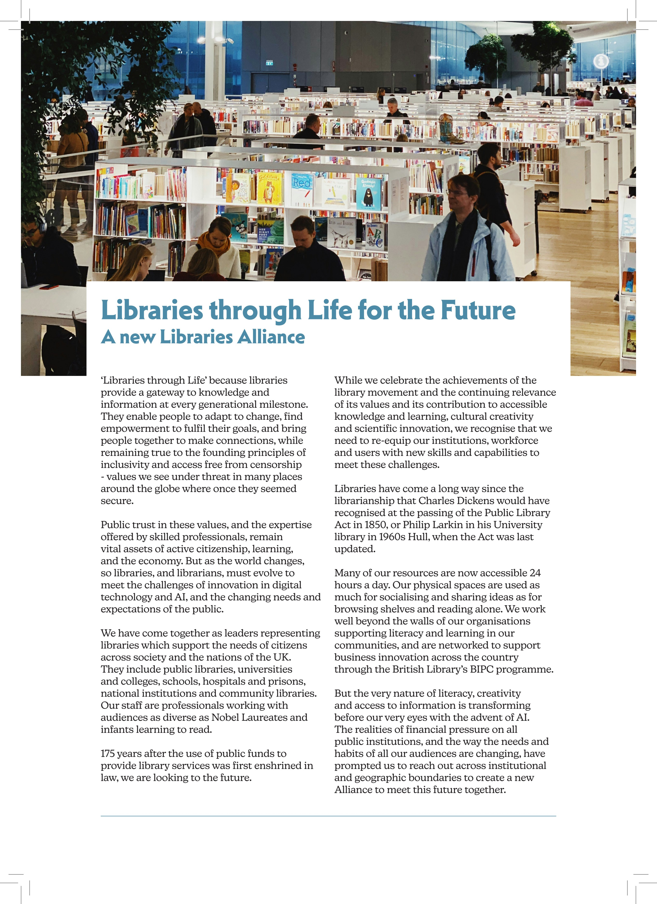

<!-- PAGE: 1 -->

# Libraries through Life for the Future

## A new Libraries Alliance

‘Libraries through Life’ because libraries provide a gateway to knowledge and information at every generational milestone. They enable people to adapt to change, find empowerment to fulfil their goals, and bring people together to make connections, while remaining true to the founding principles of inclusivity and access free from censorship — values we see under threat in many places around the globe where once they seemed secure.

Public trust in these values, and the expertise offered by skilled professionals, remain vital assets of active citizenship, learning, and the economy. But as the world changes, so libraries, and librarians, must evolve to meet the challenges of innovation in digital technology and AI, and the changing needs and expectations of the public.

We have come together as leaders representing libraries which support the needs of citizens across society and the nations of the UK. They include public libraries, universities and colleges, schools, hospitals and prisons, national institutions and community libraries. Our staff are professionals working with audiences as diverse as Nobel Laureates and infants learning to read.

175 years after the use of public funds to provide library services was first enshrined in law, we are looking to the future.

While we celebrate the achievements of the library movement and the continuing relevance of its values and its contribution to accessible knowledge and learning, cultural creativity and scientific innovation, we recognise that we need to re-equip our institutions, workforce and users with new skills and capabilities to meet these challenges.

Libraries have come a long way since the librarianship that Charles Dickens would have recognised at the passing of the Public Library Act in 1850, or Philip Larkin in his University library in 1960s Hull, when the Act was last updated.

Many of our resources are now accessible 24 hours a day. Our physical spaces are used as much for socialising and sharing ideas as for browsing shelves and reading alone. We work well beyond the walls of our organisations supporting literacy and learning in our communities, and are networked to support business innovation across the country through the British Library’s BIPC programme.

But the very nature of literacy, creativity and access to information is transforming before our very eyes with the advent of AI. The realities of financial pressure on all public institutions, and the way the needs and habits of all our audiences are changing, have prompted us to reach out across institutional and geographic boundaries to create a new Alliance to meet this future together.

<!-- PAGE: 2 -->

We pledge to address critical gaps in our skills base, to speak with one voice to make libraries more visible, to campaign for better policy making, and plan changes to the way we work and collaborate.

Beginning now we will start a new plan of action…

### 1. Change How We Work

#### Skilling up together
- Modelling the skills needs, particularly digital, of library professionals and working together to incorporate these into education, training, CPD and collaboration.
- Sharing and exchanging specialist skills with more focus on digital finance and funding, outreach and data.

#### Shaping the library of the future by:
- Providing a space for radical thinking about future service models and resourcing.
- Championing closer collaboration and integration between services and institutions.
- Promoting local sharing of assets, skills and other resources.

#### Improving the user experience by:
- Working together to remove barriers to resources, provide more seamless access and share innovation.
- Reviewing how we best support key needs for each generation of user, particularly for literacy and digital skills.

### 2. Support Better Policy Making
- Improving our data collection to share on library performance, users and impact.
- Calling for stronger co-ordination by government departments, devolved administrations and local government, to give better focus for library policy.
- Building a case for resilience of the sector including long-term funding for public libraries.

### 3. Speak With One Voice

#### Starting a new conversation by:
- Shifting outdated perceptions of libraries.
- Building a coalition of new voices which represent the full range of audiences we are engaging.

#### Standing up for our values by:
- Responding to threats to freedom of knowledge in library collections and spaces.
- Positively promoting the values of democratic exchange of ideas and inclusivity in our institutions and communities.

#### Supporting each other by:
- Working across the sector to offer support and advice.

---

### On the 175th anniversary of the Public Library Act, we call for Government to work with us to publish a new Vision for Libraries which:
- Recognises the key outcomes across which libraries are a vital public asset.
- Charts a path to equipping our libraries with the digital skills necessary to support users in the future.
- Improves co-ordination across government to support libraries’ visibility and funding.
- Restates a commitment to free access to knowledge and learning through libraries, for all citizens, throughout life.
