<!-- PAGE: 1 -->

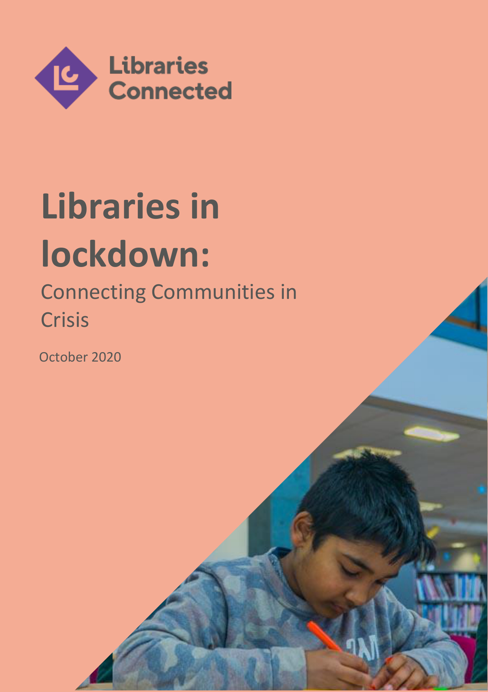

# Libraries in lockdown: Connecting Communities in Crisis

**October 2020**

**Libraries Connected**

<!-- PAGE: 2 -->

## Acknowledgements

Libraries Connected would like to thank all the Heads of Service and library staff who took part in the survey and provided case studies. We would like to thank the members of our reference group for their advice and guidance: Adrienne Adair, Medi Bernard, Kathryn Boothroyd, Kate Bunting, Luke Burton, Liz Edwards, Jane Everiss, Mark Freeman, Peter Gaw, Ed Jewell, Neil MacInnes, Marian Morgan-Bindon, Emma Noyce, Helen Osborn, James Pearson, Alun Prescott and Carol Stump. Thank you to WF Howes and Overdrive for the provision of the Digital Lending Data. Finally, we would like to sincerely thank Activist Group for their work in producing this report.

This report was produced on behalf of Libraries Connected by Activist Group.

### Report details

- **Report author**: Andrew Holden (Activist Group)

- **Contributors**: Mike Wynn, Eric Bohl (Activist Group)

- **Date**: 12 October 2020

<!-- PAGE: 3 -->

Contents

Contents

Introduction from Carol Stump, President, Libraries Connected                                                  5

Key findings 7

**1.** New frontiers for public libraries?                                                                                    10

### Context

10

The lockdown timeline for public libraries

11

Purpose of the report

12

Background to the report

12

Structure of the report

12

**2.** Methodology

13

Research plan

13

Survey

13

Interviews

14

Provider data

14

**3.** Library membership and usage during lockdown

15

Introduction 15

Key findings 15

### Library membership

15

Library members signing up for digital resources

16

User demographics and library data collection

16

4.

#LibrariesfromHome – a dynamic response

18

Introduction 18

Key findings 18

Online lending patterns

18

Ebook checkouts

19

#LibrariesfromHome events online

23

### Case study 1: Suffolk Libraries - lockdown as a platform for a digital revolution in libraries

27

5.

Remote library services – opportunity knocks

28

Keep-in-touch (KIT) or ‘befriending’ calls

28

### Case study 2: Barnsley Libraries – the empathy and resilience of library staff

33

School library services

30

Home Library Service (HLS)

28

### Case study 3: Bracknell Forest home library service - going above and beyond

30

6.

How library staff supported the local pandemic response

34

Introduction 34

Key findings 34

### Redeployment

34 <!-- PAGE: 4 --> ### Case study 4: Awen Cultural Trust (Bridgend BC) – re-opening safely in Wales

37

7.

Re-opening and recovery – learning from lockdown

38

Introduction 38

Key findings 38

### Case study 5: Buckinghamshire – re-opening strategy

39

### Case study 6: St Helens - opening a new library during pandemic recovery

40

### Case study 7: Barking & Dagenham - resident conversations - saving lives in libraries

43

Support and advice for library services

44

8.

Libraries are saving lives and offering hope: recommendations

46

Appendices 48 <!-- PAGE: 5 --> Introduction from Carol Stump, President, Libraries

Connected

When buildings shut in March, libraries did not stop supporting their communities. Online lending surged, with

3.5 million1 more ebooks loaned by the end of July, library staff made thousands of calls to check up on

vulnerable residents, clubbed together with charities to get books out to families, and were redeployed across

local services responding to the crisis.

The experience of lockdown has highlighted the role of libraries and their staff in keeping communities connected

and supporting the most vulnerable in our society. It has also demonstrated their skills, empathy and flexibility to

meet the immediate and long-term changes in what their community needs, for example:

- 

Ongoing engagement with people at risk of isolation: Suffolk Libraries alone made 7,000 phone calls to

library users while the building has been closed.

- 

Growth in digital offering: including rhyming and reading sessions for young children, instruction sessions

to access online services, author led events, school readiness programmes, jobs and art clubs. These

events averaged at around 1,000 views each, with some reaching over 20,0002.

- 

Redeployment of library buildings and staff into community support hubs providing services such as

volunteer support, coordination and delivery of shielding operations, arranging food deliveries, and

contact centres for health and social care.

- 

Demonstrating innovation and creativity: Gateshead Libraries used their 3D printers to create visors and

other PPE for local care homes and health centres.

The role of libraries will be crucial as we begin to see the longer-term impact of Coronavirus on our health, our

economy and our society. The Libraries in Lockdown report demonstrates the amazing achievements of libraries

during lockdown as well as some the challenges they faced, and continue to face, as they begin to reopen their

buildings.

At Libraries Connected, we plan to focus our efforts on ensuring that we build a strong advocacy campaign, with

key sector partners, to emphasise the vital role library services and buildings will play in community rebuilding

after the pandemic. We will gather and share accurate information about the sector and its evolving needs to the

key decisionmakers in central and local government.

We’re all very concerned that the major risk for library services may come in the next few months and years,

when local and national government budgets will be tight, and savings will have to be made. We need to begin to

prepare now to meet these challenges.

Public libraries help people to access employment and job seeking skills; create support networks and local

interventions for families, people at risk of isolation and people with chronic health needs; and engage children

with reading and learning. We offer incredible value for money given all that we deliver.

1 Libraries Connected analysis of Digital Content Aggregator Data

2 Libraries Connected Evaluation of Libraries from Home activities <!-- PAGE: 6 --> When I became President in June, I pledged to do all that I could to ensure that libraries are seen as part of the

**Carol Stump,**,  
President, Libraries Connected

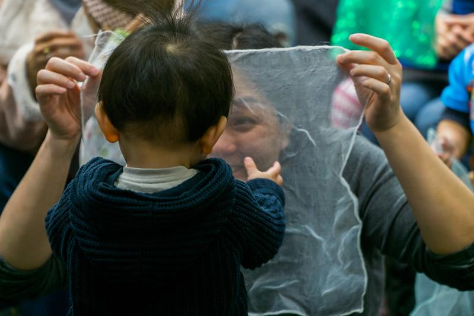

<!-- PAGE: 7 -->

### Key findings

Library membership and usage during lockdown

- 

Despite library buildings being closed for four months, library services managed to

increase membership by up to 32%, while total library membership remained stable

during this period

- 

Membership to access digital resources increased by 27% with some library services

more than doubling the number of those signing up for these services

- 

Data collection about the demographic profile of new members is patchy and

compounded by restrictions on collecting data from third-party platforms which

libraries used to broadcast digital content

- 

Library services are concerned most about the impact of libraries being closed on those

without internet access, people living alone and jobseekers.

#LibrariesfromHome – a dynamic response

- 

Digital lending increased significantly during lockdown. Ebook use increased by 146%.

These increases were largely sustained as libraries re-opened.

- 

Despite the significant increases in digital lending, its scale is still small compared to

lending of physical material.

- 

The increased investment in digital lending by library services may double its costs in

this calendar year, which is unlikely to be sustainable.

- 

Over 75% of library services delivered #librariesfromhome events. More than half 56%

increased their audience for events during lockdown, despite 63% saying they had

limited experience in delivering events online. Many staff developed new skills and

confidence in delivering online events.

- 

The impact of this digital engagement was beneficial for families and individuals in

lockdown but may have exacerbated existing digital divides.

- 

Some library services were restricted in their digital engagement, particularly in the first

weeks of lockdown by corporate policies, IT systems and lack of equipment.

- 

Even services with the strongest online offer recognise that the usability and

interactivity of the digital public library offer still require huge improvement to match

the most popular commercial retail and streaming services.

> ‘We reached new audiences who had previously thought digital was not for them including one 94-year-old who signed up for digital audio. An additional 2,160 residents joined online during lockdown so they could access digital offer, and we offered telephone digital support which was really successful. Elected members and senior officers realised the range of our digital offer. Staff learnt new digital skills very quickly. We realised we could do things we hadn't tried before, and I was reminded how creative, adaptable and capable our library staff are in a crisis!’

<!-- PAGE: 8 -->

Remote library services – opportunity knocks

- 

Library staff demonstrated essential skills and capabilities, which were highly valued by

councils in responding to the pandemic, particularly customer service and communication

and for their flexible and collaborative approach to working with colleagues and partners

- 

60% of services managed to continue delivering a Home Library Service, providing vital

comfort and books to very vulnerable users

- 

Almost one in five library services operated an ‘enhanced’ Home Library Service open to

more people, with additional support to help combat loneliness and improving digital skills

- 

The availability of older volunteers was a significant factor for many services in whether they

could deliver a Home Library Service during lockdown

- 

Keep-in-touch (KIT) calls were a major intervention reaching 100,000s of people nationally,

and showcasing library services and staff skills and knowledge to council colleagues

- 

Remote services will continue to be an important vehicle for creating a ‘blended’ or ‘hybrid’

service marrying the digital and physical offer to reach those who need library services most.

> ‘Many thanks to the member of library staff who very kindly delivered books to my mother. Like many older people, my mother loves her reading and being without books is a great loss in her life as they keep her mentally agile and helps her wellbeing. I know you are all working in very difficult circumstances so taking the time to get a good collection of books together and deliver them was really appreciated. Thank you’

How library staff supported the local pandemic response

- 

Redeployed library staff provided vital capacity to deliver the local pandemic response.

- 

Redeployment often generated a beneficial (two-way) integration of library staff with

other council departments/services for supporting vulnerable people which will

continue to produce value for councils in the future.

- 

Library staff were often singled out for praise by elected members and senior managers.

Large volumes of calls and deliveries were made to residents although data collection

varied.

- 

Opportunities were missed to use library staff skills more in some local authorities.

> ‘I want to pay tribute to my staff - they were superb. They came forward wanting to know what they could do.  They saw the fact that they were serving their communities. It brought out staff skills not fully used previously. Some of them are real community leaders.’

Re-opening and recovery – learning from lockdown

- 

Regular users have welcomed re-opening and footfall is comparable to wider high-

street patterns.

- 

Many library services have built up their offer gradually and are now offering

browsing in addition to click-and-collect and PC access by appointment. However,

there is a wide divergence between library service recovery strategies and services on

offer, which may be confusing for the public.

<!-- PAGE: 9 -->

- 

> ‘Blended’ or ‘hybrid’ models of provision are emerging to meet the challenges of ongoing distancing conditions which offer exciting opportunities. However, these have resource implications which will entail planning and prioritisation especially if local lockdowns continue for the foreseeable future. • The pandemic has inevitably increased the pressure on local authority funding and this poses a significant risk to library services. ‘My concern coming out of this is that… we are about to enter a brutal round of public finances - I cannot expand due to capacity and organisational reasons, the public expect us to, and I know what's likely to come… I also am personally struggling with the fact that the entire job now is about risk management and safety… it is extremely challenging and draining to be where I am and it isn't sustainable long term. I feel really conflicted that I now actively stop people using the service I have given my entire career to.’

<!-- PAGE: 10 -->

## 1. New frontiers for public libraries?

### Context

Public libraries have the broadest reach and usage of any cultural sector in the UK. Although public debate

about the state of public libraries often focuses on the decline in usage, closures and claims of a crisis of

identity for libraries, this reach is still significant, with 3,583 libraries and 226m visits over the last year (CIPFA

2019), a third of the population visiting a library at least once, with a user base which broadly reflects the UK

population (DCMS Taking Part 2019).

The evidence from our research shows that during lockdown the majority of library services responded to the

shuttering of library buildings by innovating online, upskilling staff and reaching out to their communities in

ways which had a profound impact for communities, genuinely saving lives in many cases.

Yet the Institute for Fiscal Studies have now warned of a council funding shortfall as big as £2bn in the current

financial year alone, due to the increased costs of services such as social care and a decrease in income.3 The

LGA estimates that the funding gap may be as large as £9.8 billion by 2023/24.4 Another study suggests that

131 English councils face bankruptcy or cuts because of the pandemic.5

Libraries’ experience of lockdown therefore presents a particularly acute set of challenges and important

questions about digital and in-person services. With social distancing restrictions now in place until at least

Spring 2021 and likely beyond, significant change is the emerging trend in our research, but different

scenarios could emerge for public libraries which need to be considered.

Libraries’ experience during lockdown points to a potential renaissance, in which the huge contribution made

towards supporting communities during this unprecedented crisis puts them front-and-centre of

communities’ social and economic recovery. Opportunities for extending digital engagement are married with

library staff’s strengths in supporting wellbeing for individuals, combatting isolation and bringing people

together, while potentially reinventing how the library offer is delivered physically as well as digitally.

Such an outcome is obviously not a given. As well as pressure on budgets, the library sector is not alone in

wondering to what extent customer habits may be changed permanently by the pandemic, similar to

discussions raised in other cultural sectors like cinema and theatre.

The evidence in this report is encouraging but charting a course towards a more positive future for libraries

will continue to require the considerable leadership and collaboration within the sector that it demonstrated

during lockdown. It will also require a commitment to funding, investment and partnership from government,

to ensure that the benefits of the strongest library services become the standard which the public can expect

wherever they live.

<!-- PAGE: 11 -->

### The lockdown timeline for public libraries

The timeline affecting UK library services was complex, with the English, Welsh and Northern Irish governments issuing separate guidelines at different times. Table 1.1 provides some of the key milestones which set the context for these nuances which we refer to during the report but have not been explored in detail.

#### Table 1.1: Public libraries timeline during lockdown

| Date | Key events |
| :--- | :--- |
| w/c 9 March | Public libraries begin to restrict services, reduce hours and close some branches. |
| 20 March | Northern Ireland libraries begin to close. |
| 23 March | English public libraries required to close under Government announcement of national lockdowns. |
| 1 April | Announcement of additional funds for digital resources in Wales by Welsh Government. |
| 7 April | Libraries Connected launches #LibrariesfromHome website. |
| 23 April | Announcement of additional funds for digital resources in England by ACE. |
| 8 May | First Minister Mark Drakeford announces that Libraries in Wales can begin to plan to re-open. |
| 11 May | Welsh Government Health Protection (Coronavirus Restrictions) amended to allow libraries to reopen. |
| Early June | First library services reopen in Torfaen and Cardiff. Other Welsh libraries begin opening over the course of the month. |
| 29 June | Libraries Connected publishes Service Recovery Toolkit. |
| 4 July | English libraries permitted to re-open under UK Government roadmap. |
| 13 July | Welsh Government publishes guidance on re-opening cultural sector including libraries. |
| 16 July | Joint DCMS/LGA letter to Councils on public library service recovery (see Appendix iv). |
| 20 July | Northern Ireland libraries start to re-open. |

<!-- PAGE: 12 -->

Purpose of the report

This research report explores the impact of the COVID-19 pandemic lockdown on public library services

across England, Wales, Northern Ireland and the Channel Islands. Our findings reveal the scale and scope

of libraries’ support for communities during the lockdown despite physical libraries being entirely closed.

They also highlight some of the challenges and barriers which library staff experienced in trying to do

more for their communities.

Our recommendations are intended to inform policymaking about service recovery; gaps in provision and

support for vulnerable groups; and strategic policymaking as government and councils address the likely

funding crisis and requirements to reconfigure local services. It also complements other research

underway within the sector during the second half of 2020, including LGA case studies and the Carnegie

Trust workforce and public attitudes survey.6

Background to the report

The research aims to address questions about the services which libraries were able to continue online,

and what factors acted as enablers or barriers. It also explores how public library staff were redeployed

by councils to support the pandemic response, and what skills and experience were most valued by

councils. Our research questions focused on:

- 

The extent of digital engagement and use of digital library services during the lockdown

- 

What lessons can be learned from gaps in provision, particularly among vulnerable groups

- 

How redeployed staff were used to deliver other services during the lockdown.

Structure of the report

Each section of the report follows a consistent structure:

- 

Key findings summarising our interpretation of the data

- 

Detailed analysis of the data from our survey, interviews and other datasets

- 

Short ‘postcards’ from heads of service, illustrating the key findings and the range of

experience across the country and feedback from colleagues and users

- 

Seven case studies across the report telling a fuller picture of the major stories and successes

which emerge from the research

- 

Recommendations for national and local governments, sector bodies, and library services.

6 Making a Difference: Libraries, lockdown and looking ahead, Carnegie UK Trust, Oct 2020.

<!-- PAGE: 13 -->

## 2. Methodology

Research plan

In investigating how libraries were able to support their communities during lockdown we framed our

approach through the following research questions:

- 

What particular benefits did libraries deliver and what public health risks did they help to

mitigate?

- 

What lessons can be learned from gaps in provision, particularly among vulnerable groups?

- 

What does their contribution tell us about the potential role of libraries in lockdown and

recovery?

We particularly asked:

- 

How did the lockdown audience compare to the usual audience?

- 

Who missed out or was left behind?

- 

What skills and assets enabled services to continue?

- 

What barriers did services meet in trying to deliver services?

- 

What partnerships were paused?

- 

What skills and capacities were valued in library staff?

We structured our research around three key areas:

- 

The extent of digital engagement and use of digital library services during the lockdown

- 

Libraries’ efforts to continue delivering services to their users

- 

How redeployed staff were used to contribute to the local pandemic response.

Our research plan comprised a mixed methodology including a survey of all heads of service in England,

Wales and Northern Ireland, interviews with a sample of heads of service and an analysis of available provider

data about digital resource usage during lockdown.

Survey

Heads of library services were asked to complete a 30-minute online survey exploring the impact of libraries

during the lockdown.

The response data generated has provided vital quantitative and qualitative evidence to help with future

strategic planning. It is also intended to be used to help positively inform national stakeholders, and assist

Libraries Connected in ensuring library services can access the best possible support and advice in the future.

The survey questions explored audience engagement, the services that were able to be provided during

lockdown, staff redeployment and advice, and the perceptions of the support on offer to help heads of

service manage library services during the lockdown.

A PDF copy of the survey is available from the Activist website: https://www.activistgroup.co.uk/wp-

content/uploads/LC.pdf.

The survey attracted 132 responses (see Appendix i for a summary of the survey responses by region). Survey

responses covered all governance models: local authority in-house services, commissioned services (both

charitable and private sector), arms-length bodies and shared services. A summary of the survey responses,

split by governance model, is shown in Appendix ii.

<!-- PAGE: 14 -->

Interviews

Video interviews were conducted with 18 individual heads of service (or managers with libraries within a

wider portfolio). We also gathered data from many other Heads of Services informally, who shared their

thoughts and experiences in confidence. For the full list, please see Appendix iii.

Libraries Connected and Activist Group would like to thank all Heads of Service and library staff who offered

us their valuable time, energy and thoughtful contributions towards the findings and recommendations made

in this research report, while working at such a challenging time.

Provider data

RBdigital kindly supplied Libraries Connected with usage data for the lockdown period. While not fully

reflecting the entire market’s data, this data from one of the sector’s main providers offers valuable insight

into library users’ behaviours and trends in usage during lockdown.

<!-- PAGE: 15 -->

## 3. Library membership and usage during lockdown

### Introduction

While library buildings were closed, people were only able to join online to access many library resources,

although much of the guidance and information libraries provide online is available without needing to sign

up. Library membership is counted in different ways, with ‘active membership’ being calculated on a rolling

basis year-on-year, while digital memberships are registered separately to access licensed services like

ebooks. In this section we focus on how libraries signed up new members for digital services.

### Key findings

- 

Despite library buildings being closed for four months, library services managed to

increase membership by up to 32%, while total library membership remained stable

during this period

- 

Membership to access digital resources increased by 27% with some library services

more than doubling the number of those signing up for these services

- 

Data collection about the demographic profile of new members is patchy and

compounded by restrictions on collecting data from third-party platforms which

libraries used to broadcast digital content

- 

Library services are most concerned about the impact of libraries being closed on those

without internet access, people living alone and jobseekers.

### Library membership

Overall library membership held fairly steady during the lockdown, considering physical services were closed

for four months. Of 92 services who provided figures, total membership declined by 1% between 1 March and

1 July. Across the country, this picture masks a significant range between those services whose membership

increased significantly (by up to 32%), and those whose membership fell (by up to 24%). The decreases were

often due to special factors, such as services taking the opportunity in the lockdown to cleanse their

membership database. See appendix v for a summary of the differences in membership levels between

authorities.

<!-- PAGE: 16 -->

### Library members signing up for digital resources

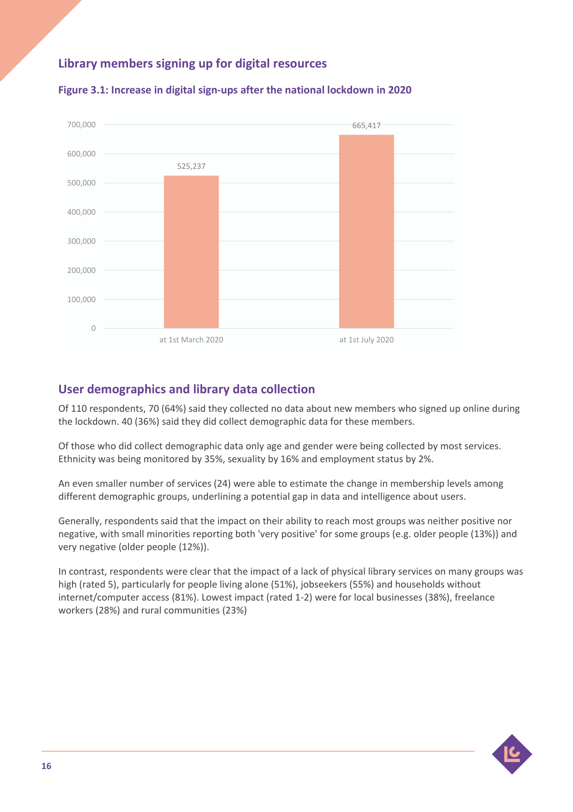

| Date | Digital Sign-ups |
| :--- | :--- |
| at 1st March 2020 | 525,237 |
| at 1st July 2020 | 665,417 |

### User demographics and library data collection

Of 110 respondents, 70 (64%) said they collected no data about new members who signed up online during

the lockdown. 40 (36%) said they did collect demographic data for these members.

Of those who did collect demographic data only age and gender were being collected by most services.

Ethnicity was being monitored by 35%, sexuality by 16% and employment status by 2%.

An even smaller number of services (24) were able to estimate the change in membership levels among

different demographic groups, underlining a potential gap in data and intelligence about users.

Generally, respondents said that the impact on their ability to reach most groups was neither positive nor

negative, with small minorities reporting both 'very positive' for some groups (e.g. older people (13%)) and

very negative (older people (12%)).

In contrast, respondents were clear that the impact of a lack of physical library services on many groups was

high (rated 5), particularly for people living alone (51%), jobseekers (55%) and households without

internet/computer access (81%). Lowest impact (rated 1-2) were for local businesses (38%), freelance

workers (28%) and rural communities (23%)

100,000

200,000

300,000

400,000

500,000

600,000

700,000

at 1st March 2020

at 1st July 2020 <!-- PAGE: 17 --> 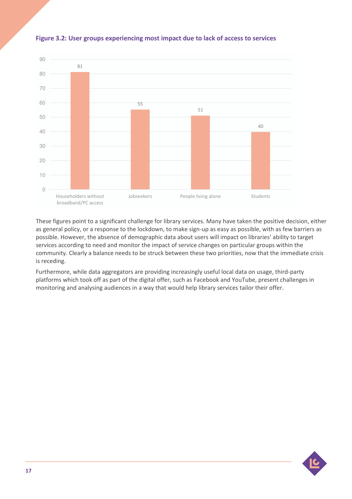

| User Group | Proportion Reporting High Impact |
| :--- | :--- |
| Householders without broadband/PC access | 81% |
| Jobseekers | 55% |
| People living alone | 51% |
| Students | 40% |

These figures point to a significant challenge for library services. Many have taken the positive decision, either

as general policy, or a response to the lockdown, to make sign-up as easy as possible, with as few barriers as

possible. However, the absence of demographic data about users will impact on libraries’ ability to target

services according to need and monitor the impact of service changes on particular groups within the

community. Clearly a balance needs to be struck between these two priorities, now that the immediate crisis

is receding.

Furthermore, while data aggregators are providing increasingly useful local data on usage, third-party

platforms which took off as part of the digital offer, such as Facebook and YouTube, present challenges in

monitoring and analysing audiences in a way that would help library services tailor their offer.

broadband/PC access <!-- PAGE: 18 --> 4. #LibrariesfromHome – a dynamic response

### Introduction

As in other areas of cultural consumption and community services during the lockdown, public libraries

expanded their digital services to support users in a number of ways, which demonstrate the impact and

potential of the digital offer, while also underlining how much physical services were missed by many people.

The market for online resources, particularly ebooks has developed significantly in recent years, although

there the costs and licensing models for online publications are considerably higher.

Equally important to the library offer, many services moved physical events online, often exploring digital

meeting and broadcasting platforms for the first time. In this section we explore evidence of the scale and

impacts of these trends during the lockdown, and their implication for the future direction of library services.

### Key findings

- 

Digital lending increased significantly during lockdown. Ebook use increased by 146%.

These increases were largely sustained as libraries re-opened.

- 

Despite the significant increases in digital lending, its scale is still small compared to

lending of physical material.

- 

The increased investment in digital lending by library services may double its costs in

this calendar year, which is unlikely to be sustainable.

- 

Over 75% of library services delivered #librariesfromhome events. More than half 56%

increased their audience for events during lockdown, despite 63% saying they had

limited experience in delivering events online. Many staff developed new skills and

confidence in delivering online events.

- 

The impact of this digital engagement was beneficial for families and individuals in

lockdown but may have exacerbated existing digital divides.

- 

Some library services were restricted in their digital engagement, particularly in the first

weeks of lockdown by corporate policies, IT systems and lack of equipment.

- 

Even services with the strongest online offer recognise that the usability and

interactivity of the digital public library offer still requires significant improvement to

match popular commercial retail and streaming services.

Digital lending patterns

Lockdown saw significant increases in digital lending by public libraries. This was evident very early in the

lockdown and widely reported in the media.7 In England, ACE provided £150,000 to expand ebook collections.

The Welsh Government provided an additional £250,000 for ebooks in Welsh library services. In March 2020,

Libraries NI invested an additional £783,540 in ebooks. Many other services invested additional resources

from their own budgets to increase availability of the most popular titles.8

Our survey asked public libraries to provide figures on checkouts of online resources in the second quarter of

2020 compared to the same period last year. The following section details the total percentage for each of

these and the range across all library services who provided figures. Important factors influencing the

performance of some library services include when they started offering new online resources.

8 In Wales a single consortium operates for ebook licences via Borrowbox.

<!-- PAGE: 19 -->

Many services are now investigating how they can tackle the evident problem of digital exclusion among

residents who are most in need and isolated, providing equipment and training to help them access the

digital offer.

Ebook checkouts

Based on our survey, among the 100 services which provided data, ebook usage increased by 146%. Increases

in individual services ranged between 38% and 714% (see Appendix v for more on the variations between

authorities).

Figure 4.1: Increase in ebook checkouts during lockdown

Bolinda (one of the UK market’s main online resource providers) reported a 110% increase in total loans

compared to the same period in 2019.9

Figures provided by RBdigital (with around 25% of the UK market) reveal the pattern of lending week by week

during the lockdown. This shows that ebook and audiobook checkouts increased rapidly during the first

weeks of lockdown until the week beginning 10 April when they reached a peak. These increases were

sustained until early May, and have, since libraries started to re-open, seen only a modest decrease to stand

at 10,791 active ebook users and 15,928 active audiobook users in the week commencing 14 August.

553,464

1,360,392

0

200,000

400,000

600,000

800,000

1,000,000

1,200,000

1,400,000

1 April - 30 June 2019

1 April - 30 June 2020 <!-- PAGE: 20 --> #### Table 4.1: Snapshot of active users supplied by RBdigital

| Product | Average pre social distancing rules | w/c 13 Mar | w/c 14 Aug | Increase |
| :--- | :--- | :--- | :--- | :--- |
| Audiobook active users | 5,566 | 10,942 | 15,928 | +186% |
| Ebook active users | 2,544 | 4,833 | 10,791 | +324% |
| Magazine active users | 66,857 | 68,790 | 85,243 | +28% |
| Comic active users | 247 | 324 | 647 | +162% |
| **Total** | **75,213** | **84,889** | **112,609** | **+50%** |

*Source: ‘RBdigital COVID-19 analysis 27.08.2020’, shared with Libraries Connected. Percentage increase from pre-social distancing average to w/c 14 Aug.*

<!-- PAGE: 21 -->

### Figure 4.2: RBdigital data on active book users from March to August 2020

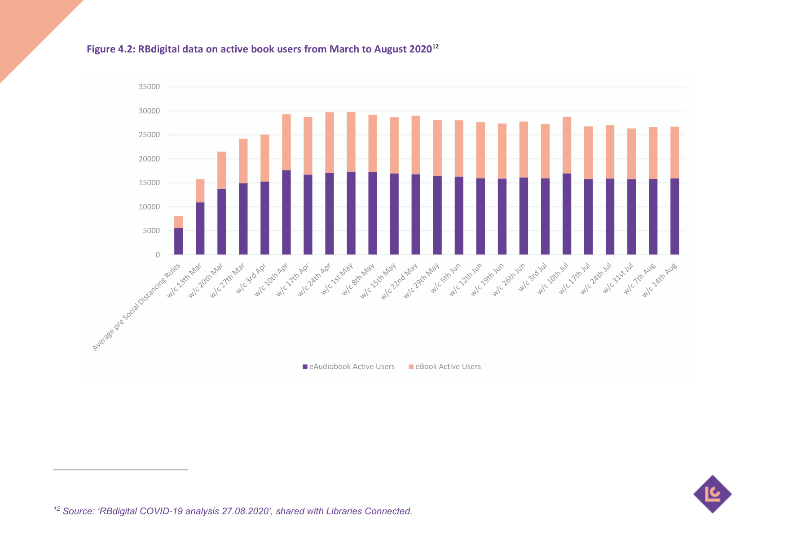

*Source: ‘RBdigital COVID-19 analysis 27.08.2020’, shared with Libraries Connected.*

<!-- PAGE: 22 -->

Using the available data, Libraries Connected estimated that levels of borrowing continued to remain at or above the levels of 10 April for ebooks and around the same level for audiobooks – see Figure 4.3 below.

### Figure 4.3: Libraries Connected analysis of RBdigital data – August 2020

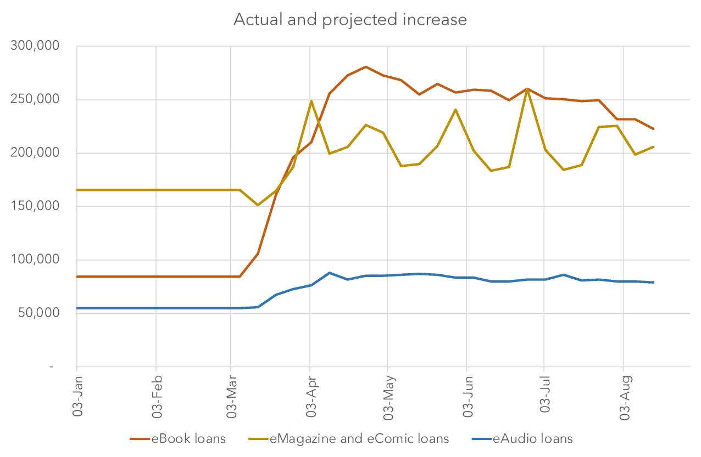

below.

Libraries Connected’s initial analysis identified and developed a model showing the projected need and

use in lockdown, assuming a level plateau at 10 April. This continued until the start of July, before

tapering back to the previous level, with additional increases of 25%-50% to factor in an expected

permanent change in service users’ reading habits.

This suggests that digital borrowing was not just a ‘fad’ at the start of lockdown. After experiencing an

initial surge, the higher level of demand has been sustained.

These patterns are broadly consistent with other research on digital cultural consumption during

lockdown, for example TV, film and performing arts streaming and purchasing (see for example CIPEC,

Digital Culture: consumption in lockdown, August 2020).

Libraries Connected’s analysis suggests the increased cost of providing this unprecedented access to

online lending could exceed current annual spending of £4m on online resources. Heads of library

services are therefore concerned that this additional investment may not be sustainable, particularly as

budgets come under pressure. As the current licensing model continues to operate restrictively for public

libraries, public expectation of availability increases may outstrip supply. This is particularly the case for

children’s ebooks where traditionally the demand for these has been lower than for adult titles.

Lending of other online resources also saw large increases in checkouts during lockdown. The survey

revealed:

•

Audiobook checkouts during lockdown increased by 113%

•

Magazine checkouts increased by 80% <!-- PAGE: 23 --> 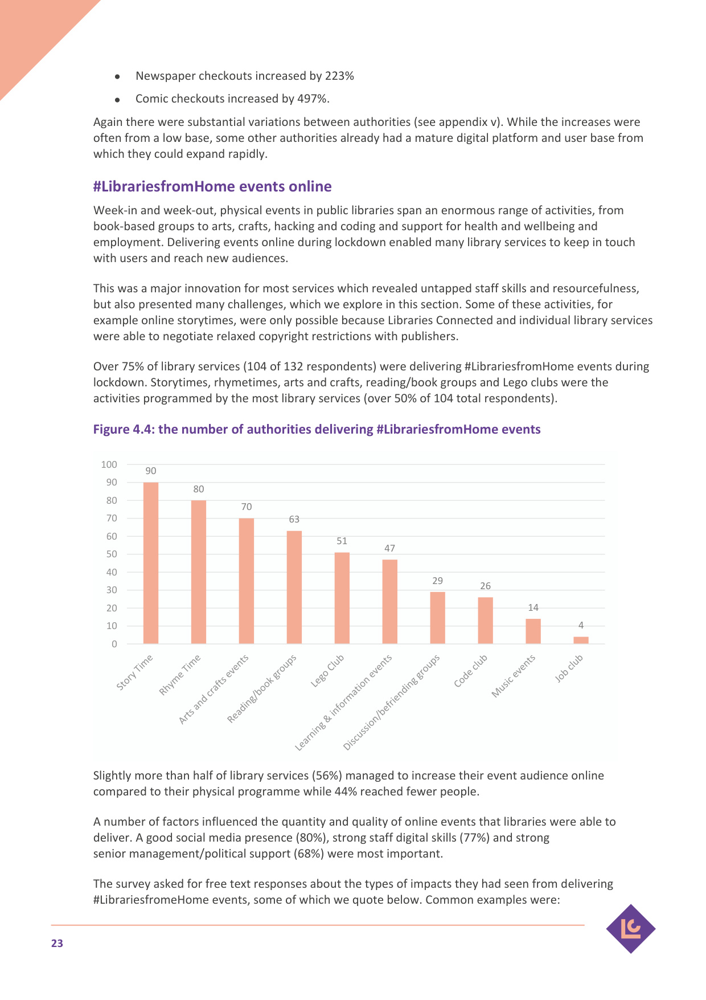

| Activity Type | Number of Authorities Delivering |
| :--- | :--- |
| Storytime / Rhymetime | 90 |
| Arts and crafts | 80 |
| Reading / book groups | 70 |
| Lego club | 63 |
| Health and wellbeing | 51 |
| Quiz / games | 47 |
| Coding / STEM | 29 |
| Local history | 26 |
| Author talks | 14 |
| Other | 4 |

•

Newspaper checkouts increased by 223%

•

Comic checkouts increased by 497%.

Again there were substantial variations between authorities (see appendix v). While the increases were

often from a low base, some other authorities already had a mature digital platform and user base from

which they could expand rapidly.

#LibrariesfromHome events online

Week-in and week-out, physical events in public libraries span an enormous range of activities, from

book-based groups to arts, crafts, hacking and coding and support for health and wellbeing and

employment. Delivering events online during lockdown enabled many library services to keep in touch

with users and reach new audiences.

This was a major innovation for most services which revealed untapped staff skills and resourcefulness,

but also presented many challenges, which we explore in this section. Some of these activities, for

example online storytimes, were only possible because Libraries Connected and individual library services

were able to negotiate relaxed copyright restrictions with publishers.

Over 75% of library services (104 of 132 respondents) were delivering #LibrariesfromHome events during

lockdown. Storytimes, rhymetimes, arts and crafts, reading/book groups and Lego clubs were the

activities programmed by the most library services (over 50% of 104 total respondents).

Slightly more than half of library services (56%) managed to increase their event audience online

compared to their physical programme while 44% reached fewer people.

A number of factors influenced the quantity and quality of online events that libraries were able to

deliver. A good social media presence (80%), strong staff digital skills (77%) and strong

senior management/political support (68%) were most important.

The survey asked for free text responses about the types of impacts they had seen from delivering

#LibrariesfromeHome events, some of which we quote below. Common examples were:

<!-- PAGE: 24 -->

- 

Online events raised the profile and reputation of the library service with elected members and

senior officers, specifically as an asset or exemplar service during the pandemic

- 

They raised the library service’s profile within the community as a different channel of

communication and support

- 

They brought staff together, helped them develop new skills, and supported their own wellbeing

- 

They highlighted gaps in digital capacity and skills, and low levels of online resources and licences

in some places

- 

The audience for online events was often significantly different to physical events, for example

more women participating, or engaging with people who might not usually have come to a library

building

- 

Many services are now re-thinking options for digital provision in the future to build on the

lockdown experience and address the reality of the digital divide.

> ‘The new, expanded digital offer by the library service was seen by senior council officers and the Chief Executive as 'exemplar'. It was regularly referenced in internal communications as a good example of how the library service was pro- active in using digital as a means of interacting with citizens and providing much needed support and service delivery during these difficult times.’

> ‘Staff gained a lot of digital skills and confidence. Some staff had never been on social media and loved the new world presented to them and accessed far beyond work. This helped combat social isolation of staff and we were able to get devices to staff to engage online if we felt they were particularly digitally isolated.’

Impacts for the community of #LibrariesfromHome events included the following:

- 

Strong positive feedback from users for online library services, and anecdotal evidence of

profound benefits for individual and family wellbeing

- 

Clear and widespread reporting of concern about the impact of poor digital access, including

connectivity, equipment, skills and motivation within the community, making digital library

services 'niche' even if use has increased

- 

The potential for the public to become more involved in running library events.

> ‘I think [online Code Club is] a great success. My two 10-year-olds thoroughly enjoyed the projects and on completion happily searched for more to do that were more complex once they had gained their confidence.’

> ‘[Rhymetime online is] Great! My daughter grumbles every time we pass our library as she misses wrigglies so much!’

> ‘This is brilliant we will be watching every week’

<!-- PAGE: 25 -->

> ‘I introduced my elderly auntie to Borrowbox who, being registered blind and mostly housebound, is a real boon for her. Thanks everyone involved in this service that helps avoid mental health issues!’

> ‘My life became even more difficult when I had a stroke which badly affected my eyesight. I couldn’t read at all! Thanks to your audiobook service, I was able to distract myself from the worry and stress and keep myself on an even keel. So you can see how your wonderful Library Service helps one person to feel human in adversity!’

> ‘Joining this [online reading] group is the best thing I have done for me for years. It has made the world of difference to me, even more so in the present circumstances. I just love it.’

Library services received particularly strong feedback from parents and families that online resources,

#LibrariesfromHome events, and newsletters and other communication from library staff, made an

enormous contribution to supporting learning and home schooling during the lockdown.

> ‘Thank you for the amazing online library resources which you have built up at no additional costs to the user.  It's so good to be able to offer this to the school community at a time when I think [they] will be appreciated possibly for the first time by many families.’ [Feedback from a schoolteacher] ‘Feedback tells us it helped parents home-schooling children, seeing staff provided a touch of normality, the activities and econtent gave people something productive to do’

> ‘The service supported the delivery of laptops to a large number of vulnerable children to support online learning.’

> ‘Parents posted that their children were learning new language and skills by watching and participating in Singing Bears, and that seeing familiar faces and hearing familiar rhymes gave a slice of ‘normality’ to the children who would usually visit the library.’

The #LibrariesfromHome experience required staff to adapt quickly and learn new skills. The first weeks

of the lockdown were often challenging, with staff trying to overcome barriers to making content, getting

it online and reaching audiences. A number of key barriers were cited by heads of service, ‘limited

experience in delivering events online’ (66%), ‘inflexible IT systems’ (47%) and ‘staff redeployment’ (37%)

were the most frequently cited.

> ‘My council had a complete comms lockdown. We weren't allowed to do marketing or use social media unless it was signed off centrally. So we weren't able to communicate the digital offer for about three weeks. I learned that as long as you didn't mention COVID or a change of service you could do things. Gradually we found some work-arounds but it was frustrating when I saw what other library services were able to do to build an online audience.’

> ‘People without means to digital have been impacted really negatively - They were not able to borrow books for nearly four months, they did not have access to our virtual services nor could they keep in touch with families or apply for jobs. Many children from low income families were unable to take part in the activities that we moved online or get support to participate in Summer Reading Challenge. We were also unable to run our fit, fed, read programme,

<!-- PAGE: 26 -->

which would have ensured children from low income families would also be

provided with food to support their health and well-being.’

<!-- PAGE: 27 -->

### Case study 1: Suffolk Libraries - lockdown as a platform for a digital revolution in

libraries

### Summary

Suffolk Libraries entered lockdown with a strong digital service and were able to deliver significant

online content during lockdown which is now at the heart of a new recovery strategy for a layered

approach to meeting local needs at a granular level.

### Scope

Lockdown meant losing the most powerful part of what Suffolk Libraries provide beyond book

lending - a programme of 15,000 physical events annually across 44 sites with over 200,000

attendances, meeting very specific local needs particularly in health and wellbeing. During

lockdown they reached over 2,300 people through Facebook Live events every day for three

months online.

They began by asking what staff could contribute in terms of online content, conducting a skills

audit, deploying those who were ready and offering skills training to others. All libraries already

had their own Facebook pages and could therefore create content to engage their local

communities. They created a total of just over 2,500 live streamed sessions between March and

June engaging nearly 100,000 people.

They also considered what they could do for those unable to access digital content, particularly

vulnerable and elderly people. Between March and June they made over 6,700 targeted calls to

those they knew would benefit most, recording call details using Google forms. They described it

as ‘the most impactful thing we did during lockdown’. The calls have continued and to date staff

have made more than 8,000.

### What's unique

Having invested in a strong digital offer as the first library spin-out Suffolk could take advantage of

their independence from the Council's website. Following lockdown their own website was

transformed in a matter of days to reflect the new digital offer. Yet Bruce Leeke is far from

complacent. ‘Our public facing site is good, but it's still not good enough or totally reflective of the

breadth of our offer. In lockdown more than ever we were competing with Netflix and YouTube.’

Suffolk understands that data continues to be a huge challenge. Just one branch library,

Southwold, reached an average of 500 people per event with users coming from as far as

Australia. But getting valuable user data for marketing beyond this is difficult through third party

platforms.

### Results

Now this approach is at the heart of the service's new strategic plan, which is a 'layered' offer

aiming to join up services to meet user needs rather than a reaction to an emergency situation.  As

Bruce says, ‘If you're an older vulnerable person - what is your route into the library now? What

tech do you need? Can we support that process from our IT team? In this uncertain new world

what could we be doing to offer new services to local people?’

### Key learning point

> ‘We've got to make sure that we look at staff skills in a completely different way to deliver a layered service and be as adaptable and flexible as possible. Our aim is to continue to keep people happy, healthy and together.’

<!-- PAGE: 28 -->

## 5. Remote library services – opportunity knocks

### Introduction

In this section we look at responses from library services about the remote services they were still able to

deliver during the lockdown, principally home library services (HLS), school library services (SLS), and keep-in-

touch calls (KIT calls). Remote library services were important for maintaining contact with users, particularly

vulnerable people during the lockdown. They also presented opportunities to support those without digital

access.

### Key findings

- 

Library staff demonstrated essential skills and capabilities, which were highly valued by

councils in responding to the pandemic, particularly customer service and communication

and for their flexible and collaborative approach to working with colleagues and partners

- 

60% of services managed to continue delivering a Home Library Service, providing vital

comfort and books to very vulnerable users

- 

Almost one in five library services operated an ‘enhanced’ Home Library Service open to

more people, with additional support to help combat loneliness and improving digital skills

- 

The availability of older volunteers was a significant factor for many services in whether they

could deliver a Home Library Service during lockdown

- 

Keep-in-touch (KIT) calls were a major intervention reaching 100,000s of people nationally,

and showcasing library services and staff skills and knowledge to council colleagues

- 

Remote services will continue to be an important vehicle for creating a ‘blended’ or ‘hybrid’

service marrying the digital and physical offer to reach those who need library services most.

Keep-in-touch (KIT) or ‘befriending’ calls

KIT calls were widely used by councils and voluntary organisations to offer support and comfort to

shielding, isolated and vulnerable citizens during the lockdown. Many library services delivered these calls

either directly within the library service structure, or while redeployed to other council teams.

The impact for communities and staff was profound, with many instances of vital interventions to combat

isolation and mental health problems, and ensure people were able to access essential services. These

were often challenging situations for staff but enabled many to build on existing skills and see the

contribution of the library service to the community in a new light.

From 72 survey respondents who were able to give figures for the number of KIT calls they made, a total

of 131,425 calls were made in the period between 1 March and 30 June, reaching 83,427 individuals.

Several services made over 10,000 calls.

The key skills and assets which libraries said helped them deliver KIT calls were ‘strong communication

skills (84%), ‘availability of skilled staff’ (82%) and strong senior management/political support (55%). The

main barriers they experienced were ‘staff redeployed to urgent COVID activity’ (40%), ‘staff absence’

(30%) and ‘restrictive corporate policies’ (13%).

> ‘One lady died and her quite elderly son who lived with her was bereft. We made daily calls to help him through his grief as he needed to talk to someone he knew but could not go out and had no one to speak to.’

<!-- PAGE: 29 -->

> ‘People really appreciated that someone cared enough to ring and check on them. It lifted spirits and made vulnerable residents feel supported. Many made use of our digital offer and now want to meet those library staff who phoned them and will visit the library.’

<!-- PAGE: 30 -->

### Case study 2: Barnsley Libraries - the empathy and resilience of library staff

### Summary

During lockdown the majority of library staff supported the pandemic response by taking on keep-

in-touch calls. The experience was often emotional and stressful but staff are already bringing the

learning back to their work now libraries have reopened.

### Scope

Initially library staff made befriending calls to people identified as wanting support. Over three

months they spoke to 70 people, sometimes daily, building up a relationship with them, often

being the only person they would speak to. Calls were scheduled, and followed up if not answered,

staff even visiting to check if residents were safe.

Library staff were then asked to take on a wider set of calls of vulnerable people on behalf of the

council and NHS. Library staff treated each call as an individual offer of help and assisted many

people to resolve their problems and access services. They provided links to other support

networks including food banks and primary care. 20,000 calls were made to nearly 12,000

households, of which 8323 were reached, making 356 referrals to help access vital support. A

further 816 people who they couldn’t reach received a visit from other teams. Outcomes were

automatically sent to GPs for shielding patients, and staff were able to flag those requiring further

support from primary care. As library staff returned to normal duties, anyone who still needed

support was referred to other services to continue with the befriending calls.

### What's unique

Library staff were valued because of their customer contact skills.  The experience gave staff more

confidence but it was emotionally challenging, helping people who were feeling suicidal or in one

case a lady entitled to food help who hadn't eaten for three days. One member of staff recalled:

> ‘I've just been talking to an amazing lady - she's a care worker managing to juggle looking after her clients, but doing so from home as she cares for her dad who's dying of cancer. I’m taking a break after that.’

Positive feedback on the calls often left staff feeling overwhelmed. This work has done a lot for the

profile of the library service in the Council and the team were put forward for a recognition award.

It has brought staff closer together. They also learned more about technology having been thrown

in at the deep-end working from home at the beginning of the lockdown. Kathryn Green, Head of

Library Services, says ‘We've never taken on such a big project with these partners, and it's shown

what library service staff could achieve for the NHS and CCG.’

### Results

Crucially, Barnsley now have an individual level picture of who has been contacted, when they

were contacted, and what their outcomes were. Now that Barnsley libraries have reopened staff

are bringing back this experience to enhance their customer service role having seen its impact in

such close focus.

### Key learning point

Kathryn says ‘As we welcome people back gradually, we're caught between wanting to do more

and doing things safely, starting with the foundations. When we start up more with events we can

show we're ready to take things on as a partner who can deliver for health and social care.’

For further information

https://www.barnsley.gov.uk/services/libraries/

School library services

There are currently 69 school library services (SLS) in England, Wales and Northern Ireland, the majority

of which are provided by public library services.  For many library services these are seen as essential and

operate as a paid-for offer to schools. With most schools operating online lessons only, except for <!-- PAGE: 31 --> children of key workers and vulnerable pupils, opportunities to continue delivering an SLS during

lockdown were limited. Of 28 survey respondents who are SLS providers, 19 offered a restricted or no

service during lockdown, and nine provided a standard or enhanced service.

Among those who managed to offer a ‘standard’ or ‘enhanced’ service, examples were cited of increased

used of their online resources, use of social media to contact school staff, and the importance of

maintaining engagement with schools. Others offered book boxes to schools as an alternative.

Services which delivered an SLS during lockdown cited ‘availability of skilled staff’ (62%), ‘strong

commitment from schools’ (41%) and ‘strong senior management/political support (35%) (34 responses).

> ‘Lack of access to premises’ (61%), ‘corporate policies’ (39%), and ‘school commitment issues’ (35%) were cited as key barriers by those trying to deliver an SLS during lockdown. ‘We managed to post a huge increase in the usage of our SLS ebook/ eaudio offer, and our online news resources. We launched a new private Facebook page was to connect school staff and SLS staff, signposting online educational resources and author readings. Maintaining engagement with schools was so important for us.’

Home library services (HLS)

Home library services are normally run by most library services in the country but have a small client base of

vulnerable users who cannot use in-person services. Some are delivered by volunteers, often in partnership

with voluntary sector organisations. During lockdown, clearly the number of people self-isolating or shielding

was many times greater and some library services widened their criteria for receiving home library services or

relaxed them altogether so anyone could self-refer.

However, this was only possible for a minority of library services. Out of 107 responses, 20 said they provided

an ‘enhanced service’ and 12 a ‘standard service’. Only six services reported an increase in deliveries and

eleven services reported an increase in users reached. Among respondents, the skills and resources most

frequently cited as helping them deliver the HLS was the ‘availability of skilled staff’ (89%), ‘high staff

motivation and morale’ (80%), ‘strong senior management/political support’ (66%), and ‘availability of

transport’ (62%).

<!-- PAGE: 32 -->

### Figure 5.1: Skills and resources enabling provision of a home library service during lockdown

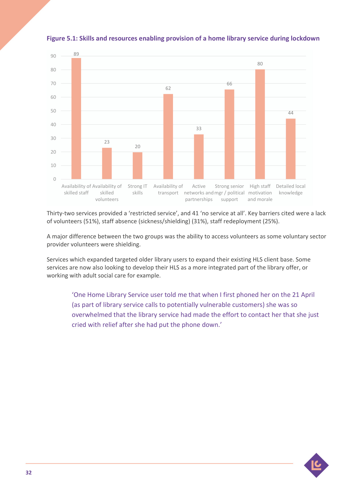

| Factor | Percentage |
| :--- | :--- |
| Availability of skilled staff | 89% |
| High staff motivation and morale | 80% |
| Strong senior mgr / political support | 66% |
| Availability of transport | 62% |
| Detailed local knowledge | 44% |
| Active networks and partnerships | 33% |
| Availability of skilled volunteers | 23% |
| Strong IT skills | 20% |

Thirty-two services provided a ‘restricted service’, and 41 ‘no service at all’. Key barriers cited were a lack

of volunteers (51%), staff absence (sickness/shielding) (31%), staff redeployment (25%).

A major difference between the two groups was the ability to access volunteers as some voluntary sector

provider volunteers were shielding.

Services which expanded targeted older library users to expand their existing HLS client base. Some

services are now also looking to develop their HLS as a more integrated part of the library offer, or

working with adult social care for example.

‘One Home Library Service user told me that when I first phoned her on the 21 April

(as part of library service calls to potentially vulnerable customers) she was so

overwhelmed that the library service had made the effort to contact her that she just

cried with relief after she had put the phone down.’

skilled staff

skilled

volunteers

skills

transport

Active

networks and

partnerships

Strong senior

mgr / political

support

High staff

motivation

and morale

knowledge <!-- PAGE: 33 --> ### Case study 3: Bracknell Forest home library service: going above and beyond

### Summary

From 23 March to 20 July, Bracknell Forest took the rare step of expanding their home library service

(HLS) during lockdown, extending their offer to anyone who was self-isolating, aged over 70, or

vulnerable and in need.

### Scope

HLS normally operates with one dedicated full-time Supervisor / Driver, supported by a 0.15 fte of a

full-time Senior Library Assistant’s workload. During lockdown, they both worked full-time on the

extended service, along with a number of branch staff. While expanding its offer, HLS had to contend

with staff and volunteer absence (mostly due to sickness/shielding).

Stock was quarantined at Bracknell Central Library for 72 hours before being reissued, with all

deliveries double-bagged up to 48 hours in advance by staff using PPE. The bagging enables residents

to put the items to one side and leave sealed if they want to.

### What's unique

Many library staff were moved across to HLS activities, helping customers, plus expanding the offer to

the wider community and signing them up. ‘Staff discussed with residents where to leave the

deliveries (e.g. on doorsteps or in a designated area).

We also did a quick welfare check on the wellbeing of our residents - we didn't just dump and run like

a courier!’. Conscious of the forthcoming demand, Bracknell Forest also purchased additional book

licences – ‘we invested in £10,000 of additional ebook titles for our residents'.

### Results

HLS delivered significant increases, moving from 429 deliveries to 75 users in Apr-Jun 2019, to 1,964

deliveries to 1,044 users in Apr-Jun 2020 - ‘we still have new people joining us now’.

Staff have been busy but are very positive about the work they are undertaking. ‘We conducted check-

in calls with the over-70s in Bracknell Forest, to see if they were OK during lockdown. Quite a few

residents have joined this way - many of them do not use ICT, so they didn't know about HLS’.

HLS has received a lot of positive feedback. ‘It has been a big success. Our most prolific readers can

call to arrange a delivery. We offered an almost tailor-made service, free of charge, during lockdown,

so residents were very happy - HLS is so well received!’.

Key learning points

> ‘Our residents were very appreciative of the support they received throughout lockdown. We received so many positive comments and letters, saying that HLS had meant such a lot and, in some cases, saved people's lives just by seeing a friendly face and having a weekly chat’. For further information To find out more about Bracknell Forest library service's lockdown experiences, and how library staff adopted non-traditional roles, click here to watch a short video: https://www.youtube.com/watch?v=YAxPIxwa3Hk

<!-- PAGE: 34 -->

## 6. How library staff supported the local pandemic

response

### Introduction

Like other teams within local council services which were closed during lockdown, many library staff were

redeployed to support the local pandemic response. From the 86 services which gave data, the equivalent of

1,718 full time staff were redeployed at some point during the lockdown, an average of 26% of the staff in

these authorities. For some library services, this involved most or all staff being redeployed, while elsewhere

very few were used in this way.

### Key findings

- 

Redeployed library staff provided vital capacity to deliver the local pandemic response.

- 

Redeployment often generated a beneficial (two-way) integration of library staff with

other council departments/services for supporting vulnerable people which will

continue to produce value for councils in the future.

- 

Library staff were often singled out for praise by elected members and senior managers.

Large volumes of calls and deliveries were made to residents although data collection is

patchy.

- 

Opportunities were missed to use library staff skills more in some local authorities.

### Redeployment

Library staff were redeployed into a wide range of roles during lockdown. Of the services responding to this

question, 76% redeployed them into customer contact roles; 40% into logistics and transport; 26% into adult

social care, and 20% into emergency planning.

<!-- PAGE: 35 -->

### Figure 6.1: Percentage of authorities that redeployed library staff into these roles during lockdown

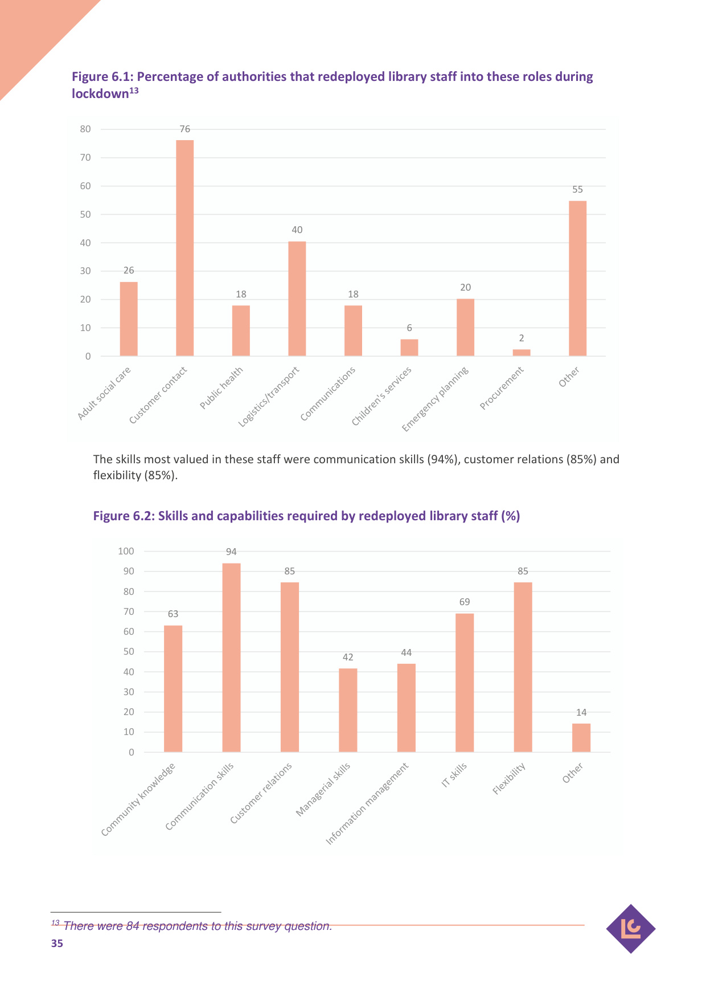

| Redeployment Role | Percentage |
| :--- | :--- |
| Customer contact | 76% |
| Logistics/transport | 40% |
| Adult social care | 26% |
| Emergency planning | 20% |
| Public health | 18% |
| Communications | 18% |
| Children’s services | 6% |
| Procurement | 2% |
| Other | 55% |

The skills most valued in these staff were communication skills (94%), customer relations (85%) and flexibility (85%).

### Figure 6.2: Skills and capabilities required by redeployed library staff (%)

| Skill / Capability | Percentage |
| :--- | :--- |
| Communication skills | 94% |
| Customer relations | 85% |
| Flexibility | 85% |
| IT skills | 69% |
| Community knowledge | 63% |
| Information management | 44% |
| Managerial skills | 42% |
| Other | 14% |

<!-- PAGE: 36 -->

The redeployment process did not allocate opportunities to all staff which they could have. Lack of IT

equipment, particularly at the beginning of the lockdown restricted what staff could do, particularly

working from home, though often some of these barriers were gradually overcome.

Many heads of service reported that library staff skills, particularly for digital communication, social

media, and communication could have been better used by councils, particularly to support the digitally-

excluded and isolated people.

> ‘One woman we helped was down to her last 50p, because of an error with her benefit payment and was reduced to walking into shops to ask for work, as she had no other way to find a job.  Our staff were able to put her in contact with relevant charities quickly, so she could feed herself and get accommodation.’

<!-- PAGE: 37 -->

### Case study 4: Awen Cultural Trust (Bridgend BC) – re-opening safely in Wales

### Summary

Awen's home delivery service was one of the first services it re-started in early June. The service is

now exploring how Welsh Government grant funding (in the shape of the Culture Service Fund) can

best be used to help reconfigure its future service offer.

### Scope

Once lockdown came into effect, all of the trust's library staff were furloughed (except one managing

the ICT systems). As lockdown eased, reopening the service was a considered and phased process.

Helen Pridham, Head of Service, says ‘We were going into buildings that hadn't been used for months.

Following detailed risk assessments, the decision was made to unfurlough small teams, whose

numbers would grow as the service expanded’.

Awen successfully reopened its first, most spacious, library with an order & collect service in early

June, whilst also relaunching its housebound delivery service which had been paused during

lockdown. ‘We were able to do things at a safe pace. We agreed a phased reopening with our

Partnership Manager at the Council, beginning work from mid-May. Our immediate priorities were

staff and customer safety’.

### What's unique

Every Welsh library service received £5K from the Welsh Government, with Awen focusing on PPE,

developing its order & collect service and boxes for home deliveries. ‘As a Trust, we had to source

screens, gloves, sanitiser gel etc. We've spent about £10K on this so far. We can also bid for up to an

extra £100K from Welsh Government, administered by Culture and Sport (prev. MALD). Several of our

libraries have difficult access, so we'll be applying to reconfigure our reception areas, more self-

service, hygienic chairs, and a website refresh’.

### Results

Members have supported reopening, with all six main libraries now open. Two community libraries

are also in the process but have shared usage: ‘there have been hurdles for us all to work through

first. We are gradually increasing our usual hours, and there has been no complaints or extra

pressure. Next, we will try to open Saturdays to reach younger users’.

On return from furlough, staff contacted users to signpost them to the refreshed home delivery

service - ‘every user contacted wanted the service to return ASAP’. By introducing minor changes

around drop-off and delivery, the service was extended - ‘Users are delighted we are back! It's not

quite the same service but we have been told that taking time to have a little chat on the doorstep

with people is really being appreciated’.

Key learning points

> ‘As a cultural trust, the loss of income from theatres and our trading arm will have a huge impact on us. We have a strong relationship with the Council and they've been part of our journey during lockdown. We've been very lucky so far but we know we will need to be extremely careful in the future. Working in staff bubbles has allowed us to isolate teams as required, but we do face resourcing challenges - our Council has had to enforce local lockdowns due to the rising number of COVID cases. Our staff have been incredible so far. We have a comprehensive employee support programme that has helped ensure everyone is in a good place mentally’. For further information To find out more about Awen Trust’s library service, visit http://www.awen-libraries.com/

<!-- PAGE: 38 -->

## 7. Re-opening and recovery – learning from lockdown

### Introduction

Libraries’ experience of planning for re-opening and recovery has varied enormously, due to many factors.

These include how staff were deployed during the lockdown, their governance structure (whether in-house or

independent), the decision-making structure and risk appetite of their local authority, and the scale and space

limitations within their library estate.

Before the lockdown library services were focused on maximising visitor numbers, dwell times and space

usage, so re-opening represents a wholesale re-think of their approach to managing risk, reassuring the public

and protecting staff.

### Key findings

- 

Regular users have welcomed re-opening and footfall is comparable to wider high-

street patterns.

- 

Many library services have built up their offer gradually and are now offering

browsing in addition to click-and-collect and PC access by appointment. However,

there is a wide divergence between library service recovery strategies and what

services are on offer, which may be confusing for the public.

- 

> ‘Blended’ or ‘hybrid’ models of provision are emerging to meet the challenges of ongoing distancing conditions which offer exciting opportunities. However, these have resource implications which will entail planning and prioritisation to ensure value for money. • The pandemic has inevitably increased the pressure on local authority funding and this poses a significant risk to library services. Most library services initially prioritised reopening a limited number of sites and operating a click-and-collect style service. PC usage by appointment was the other major priority to address concerns about lack of digital access during the lockdown. By September, many had also added limited browsing, though sadly physical events were still out of scope across the country. Re-opening library buildings to comply with government COVID guidelines inevitably limits capacity and absorbs more staff time than previously. This has a knock-on effect on budgets and the ability to reach those who are still shielding or who are wary of coming back to high streets. Different assessments of risk and interpretation of government guidelines means there is a divergence between library services open in different authorities, often in neighbouring councils. This presents a potentially confusing offer for the public. Many library services would like to continue elements of the additional support they offered to communities through lockdown, often on a 1-2-1 basis to help residents get online, use digital library resources or access other services. However, with the additional costs of restoring physical services, and increased expenditure on ebooks and other resources, it is clear that current capacity cannot support everything. Creating a ‘blended’ or ‘hybrid’ offer will therefore require considerable creativity and planning by library services and sector bodies, as well as some hard choices for councils.

<!-- PAGE: 39 -->

### Case study 5: Buckinghamshire – re-opening strategy

### Summary

Buckinghamshire's pragmatic and compassionate approach to reopening ensured they were one of

the first services in England to do so, during a period of uncertainty about 'what the right thing to do'

was within the sector.

### Scope

During lockdown, Buckinghamshire strongly promoted their online offer, expanding their digital

resources, supported by a refreshed marketing campaign. Staff returned to library buildings on 8

June. Ahead of this, David Jones, Head of Service, sensed ‘the winds of change’, with various new

Council Boards convening. ‘We pitched ASAP our plans for a phased reopening with appropriate

safety measures. We carved our own path to get the green light – I’m so glad we did’.

### What's unique

Individual staff induction meetings took place to explain the new arrangements, deliver training and

discuss fears and concerns. 'We wanted to get them into the building; but also needed to understand

their recent home life and support needs - what had their life been like during lockdown? We wanted

to get people used to each other again’.

David's team engaged with their community library partners to share guidance and identify the

support needed to restore services. ‘The levels of staff fear were a challenge. We couldn't guarantee

our decisions were 100% safe, but we couldn't tiptoe around. We had to take a risk-based approach

based on the best possible advice available to us that day’ - e.g. following WHO's 72 hours advice on

quarantining items.

### Results

Buckinghamshire has re-opened all of its 29 libraries but with reduced opening hours. ‘It has been a

massive test for our community library partnerships. We don’t aim to control or manage them; we’ve

built mutual trust up and use specific language in our shared approach together’. A lot of David’s time

has been spent addressing staff concerns. ‘We didn’t believe that library-specific conditions had been

considered in the government’s advice. The worst-case scenario is that I’ve spent money on safety

equipment that wasn’t officially deemed necessary in order to support and reassure my staff’.

Key learning points

David says: ‘The single most important issue for me was ensuring that arrangements and supplies to

reassure people were in place. The government's advice at times lacked clarity so a lot of time was

spent reconciling guidance with anxieties to help us reopen safely and quickly. We've opened

everything now, but the next steps will be in getting our opening hours up, restoring the full service,

but we are up on our feet and working’.

Looking to the future, Buckinghamshire's vision for libraries is clear. ‘We have to demonstrate and

evidence our libraries’ impact during calamity and crisis, as well as the opportunities our library

services offer to our organisations. Given that the full financial consequences of the lockdown haven't

even begun to be measured or felt yet, we must show how we are going to be an essential service

contributing to the recovery’.

For further information

To find out more about Buckinghamshire library service's lockdown experiences, and how library staff

adopted non-traditional roles, click here to watch a short video:

https://www.youtube.com/watch?v=wf-NhvCDGeo <!-- PAGE: 40 --> ### Case study 6: St Helens - opening a new library during pandemic recovery

### Summary

During lockdown, St Helens Library Service delivered an expanded Home Delivery Library Service and

#librariesfromhome online events. While re-opening existing libraries cautiously, they have now

opened the new St Helens Library in the town centre.

### Scope

With few exceptions, St Helens' library staff were not redeployed during lockdown. It took a couple of

weeks to mobilise and some time to get IT equipment to all staff, but they realised that both the

Schools Library Service and Home Delivery Library Service needed to continue, which were back up

and running in mid-April. Having staff available also meant they could begin cleaning and preparing

libraries for re-opening from 27 July.

Four existing libraries re-opened at the end of July and a new St Helens Library opened in September

in the World of Glass building, a voluntary sector-run museum in the canal-side regeneration area.

The building work associated with opening the new library was a complex process as World of Glass

staff remain furloughed. While it was easier for contractors to work in an empty building, the library

service needed all appropriate certification from the charity for opening in a COVID-safe way.

What’s unique

The Home Delivery Library Service was opened to anyone shielding or vulnerable and tripled its users

during lockdown. Recognising the compounded isolation for people that don’t engage or

communicate online, the Arts and Libraries teams decided to develop ‘Our Correspondence’ which

involved sending hand-written letters in stamped addressed envelopes to residents registered with

their Home Delivery Library Service.

Written by Library Assistant, Emma Graney, the letters were sent out to approximately 180

people. Recipients were invited to respond by reflecting on their own experiences, how their lives

have changed, and hopes for the future. One 86-year-old correspondent replied:

> ‘Thank you for giving me the chance to write a letter to someone.  I used to love writing and receiving responses, especially from family. I love reading, I have been so pleased to have my books delivered to my door. I want to take this opportunity to thank those people involved in this service, I love books, I love covers, I love the feel of a book in my hands.’

### Results

Re-opened libraries were initially offering only browsing and loans, with PC access beginning with the

new library. Previously 30% of their business was PC usage, but they will be tracking demand to see

how cautious people are feeling.

Social distancing requirements mean reduced capacity for PCs but a lot of demand is for good Wi-Fi.

They are looking forward to returning to physical events in their libraries as soon as conditions allow.

Key learning points

Kathryn Boothroyd, Library Services Manager, says: ‘It's been incredibly challenging, a steep learning

curve. You have to be patient and understand the real concerns from public health partners, and

giving the general public reassurance that libraries are COVID-safe spaces.’

For further information

https://www.sthelens.gov.uk/libraries/

Of 100 responses received, the main challenges Heads of Service said they are now facing were:

- 

Returning to normal (our users want things exactly how they were pre-lockdown), with 82%

identifying it as a severe or moderate challenge <!-- PAGE: 41 --> ### Figure 7.1: Percentage of authorities reporting challenges as services emerge from lockdown

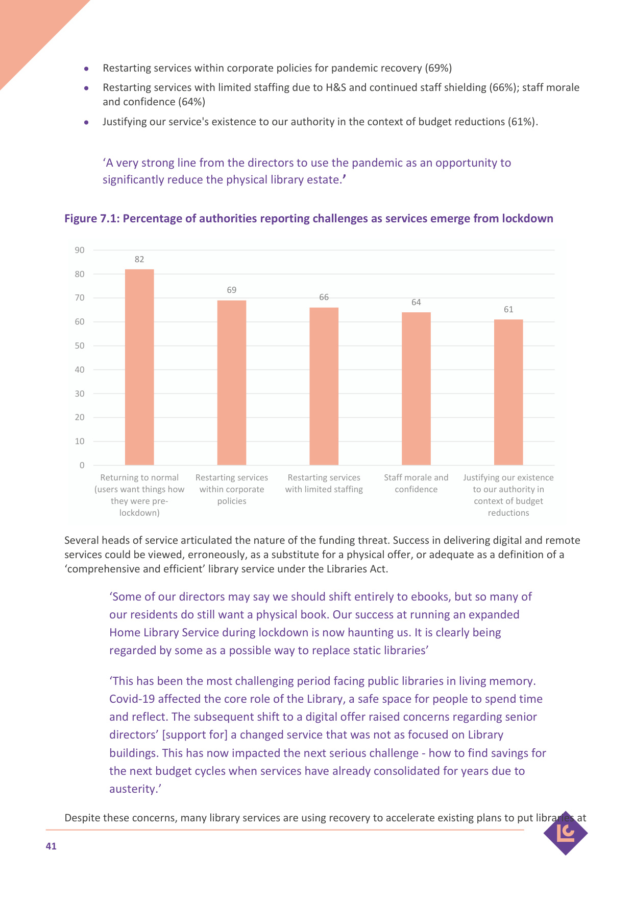

| Challenge | Percentage |
| :--- | :--- |
| Returning to normal (users want things how they were pre-lockdown) | 82% |
| Restarting services within corporate policies | 69% |
| Restarting services with limited staffing | 66% |
| Staff morale and confidence | 64% |
| Justifying our existence to our authority in context of budget reductions | 61% |

•

•

and confidence (64%)

•

Justifying our service's existence to our authority in the context of budget reductions (61%).

‘A very strong line from the directors to use the pandemic as an opportunity to

significantly reduce the physical library estate.’

Several heads of service articulated the nature of the funding threat. Success in delivering digital and remote

services could be viewed, erroneously, as a substitute for a physical offer, or adequate as a definition of a

‘comprehensive and efficient’ library service under the Libraries Act.

‘Some of our directors may say we should shift entirely to ebooks, but so many of

our residents do still want a physical book. Our success at running an expanded

Home Library Service during lockdown is now haunting us. It is clearly being

regarded by some as a possible way to replace static libraries’

‘This has been the most challenging period facing public libraries in living memory.

Covid-19 affected the core role of the Library, a safe space for people to spend time

and reflect. The subsequent shift to a digital offer raised concerns regarding senior

directors’ [support for] a changed service that was not as focused on Library

buildings. This has now impacted the next serious challenge - how to find savings for

the next budget cycles when services have already consolidated for years due to

austerity.’

Despite these concerns, many library services are using recovery to accelerate existing plans to put libraries at

(users want things how

they were pre-

lockdown)

within corporate

policies

with limited staffing

confidence

to our authority in

context of budget

reductions <!-- PAGE: 42 --> the heart of local strategies. These approaches taken different forms including collaboration, commissioning,

co-location and integration with other council services.

Based on the positive experience of library staff working more closely with colleagues in public health and

other community services during the lockdown opportunities are presenting themselves for libraries to

become a core delivery partner across the country.

> ‘Our CEO said that our agile experience of working with colleagues on community support during redeployment has furthered plans for a greater role for libraries in Council customer services’

Changes in footfall and working patterns are leading many library services to consider a more radical re-

configuration of spaces and library locations, which up-end previous assumptions about how libraries target

limited resources and earn income. For example, many services had growing income streams or targets based

on room hire and events which are clearly no longer viable, but there may be an increased demand for work-

hub space for homeworkers near local branch libraries.

> ‘We need to restart and recover services, but also create the space to rethink what we need to offer as we move into the next stage of the pandemic.  Physical distancing, sitting restrictions and limitations on group sizes is a fundamental blow to the strategy of 'social librarianship' we were working towards, which was blending access to resources with active learning and cultural opportunities. I suspect we are at a hinge point where a fresh approach is required, rather than an attempt to reanimate where we were in March.’

<!-- PAGE: 43 -->

### Case study 7: Barking & Dagenham - resident conversations - saving lives in

libraries

### Summary

Barking and Dagenham Library staff were redeployed during lockdown to the Council's Homes and

Money Hub and Adult Intake Team, making nearly 20,000 calls and interventions. The impact of this

was profound for the council's ability to help people during the pandemic.

Now the library service is re-opening gradually, it is seizing the opportunity to re-configure its offer

and give staff the opportunity to work in a new way that supports vulnerable people.

### Scope

50 library staff were redeployed to the Council's Homes and Money Hub and Adult Intake Team

during the lockdown. Meanwhile, the Home Library Service was opened up to anyone who needed it

so library services could still be accessed. Redeployed staff have been recognised by the Council for

their professionalism and efforts in helping vulnerable people.

The Homes and Money Hub Manager nominated Library Assistant, Heather Pope, as employee of the

month. Heather managed to help an 85-year-old woman being displaced from her house to move

into sheltered accommodation. Heather was initially unsure if this role would suit her, but now says

> ‘it feels like I'm saving lives!’. What's unique The Council has recognised the benefits of this new way of working. Zoinul Abidin, Head of Library Service, is now developing a new Residents Conversation team, with roles shared across the library service and Homes and Money Hub and Adult Intake. Better use of self-service will enable staff to spend more time supporting users’ needs more intensively. Library space will need to be used in a better way, particularly with demand for study space so high and the challenges of social distancing. Results As Zoinul explains: ‘We need solutions, otherwise only the people good at organising and booking online will be able to access services. It's against all my own instincts and what I've been preaching my whole career because we normally want to let everyone in. It's hard, but I know I'm doing the right thing, when we see how we're helping people with debt, isolation, employment and housing. Key learning points ‘It's really put library staff up there. People don't normally talk about libraries corporately. Now they are and we're seeing how we can make library spaces work for communities in a new way.’

> ‘There has been a myth that library buildings can offer something for everyone - sadly we don't have the resources for that. However, we can help get people online who need to, and support others with unique needs in a more tailored way.’

For further information

https://www.lbbd.gov.uk/libraries-and-local-history <!-- PAGE: 44 --> ### Figure 7.2: Satisfaction with the support provided by Libraries Connected (%)

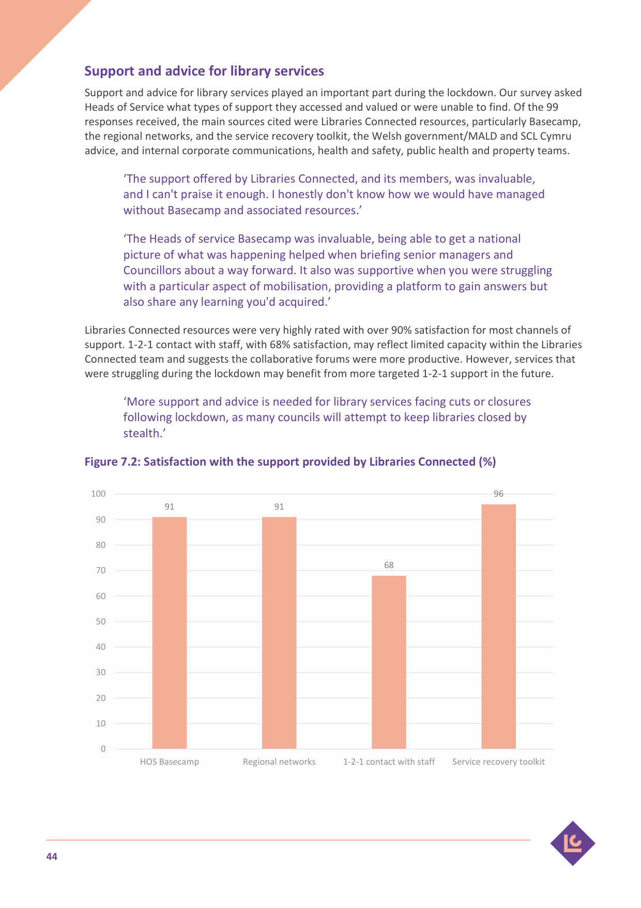

| Support Channel | Satisfaction Rate |
| :--- | :--- |
| Service recovery toolkit | 96% |
| Heads of Service Basecamp | 91% |
| Regional networks | 91% |
| 1-2-1 contact with staff | 68% |

Support and advice for library services

Support and advice for library services played an important part during the lockdown. Our survey asked

Heads of Service what types of support they accessed and valued or were unable to find. Of the 99

responses received, the main sources cited were Libraries Connected resources, particularly Basecamp,

the regional networks, and the service recovery toolkit, the Welsh government/MALD and SCL Cymru

advice, and internal corporate communications, health and safety, public health and property teams.

‘The support offered by Libraries Connected, and its members, was invaluable,

and I can't praise it enough. I honestly don't know how we would have managed

without Basecamp and associated resources.’

‘The Heads of service Basecamp was invaluable, being able to get a national

picture of what was happening helped when briefing senior managers and

Councillors about a way forward. It also was supportive when you were struggling

with a particular aspect of mobilisation, providing a platform to gain answers but

also share any learning you'd acquired.’

Libraries Connected resources were very highly rated with over 90% satisfaction for most channels of

Connected team and suggests the collaborative forums were more productive. However, services that

were struggling during the lockdown may benefit from more targeted 1-2-1 support in the future.

‘More support and advice is needed for library services facing cuts or closures

following lockdown, as many councils will attempt to keep libraries closed by

stealth.’

<!-- PAGE: 45 -->

The survey also asked what support or advice Heads of Service felt they were unable to access. The main

responses included:

- 

Access to council decision-makers, and getting beyond a ‘silo mentality’

- 

Delays and slowness in official advice at every level

- 

Lack of forward-thinking about library and cultural strategy for renewal rather than just re-

opening

- 

Support to challenge the threat of keeping libraries closed by stealth.

> ‘My line manager is the Director of Public Health. I was receiving detailed information first-hand and could test scenarios for recovery with this professional advice.  It was sometimes noticeable when liaising with colleagues in other LAs that I had information long before they did.’

<!-- PAGE: 46 -->

## 8. Libraries are saving lives and offering hope:

recommendations

Local councils and government agencies should recognise that public libraries are an essential service during

recovery from the pandemic, uniquely equipped to offer hope and enrichment to the broadest range of

people. Libraries are not just partners but are core agencies that regularly provide direct services, preventing

the escalation of issues such as deprivation and loneliness. Below we set out our high-level recommendations

for local authorities and national governments, for library services, and for Libraries Connected working with

the other sector governing bodies.

**1.** Valuing quality and value for money in staff and physical services

- 

Councils should recognise the evidence that digital and remote services provide mitigation for

isolation and lack of social contact, but that communities also need and want social spaces with

the values and reach of public libraries

- 

Library services should continue to embrace models of collaboration with other council services

and partners which offer a personalised and holistic service, to prevent future cost burdens to

welfare, education, health and social care

- 

Library services should absorb the potential implications of changes in footfall, working patterns

and space requirements when thinking how library spaces could be best used and located in the

future

- 

Councils and library services should build on the way staff have demonstrated and developed

skills during lockdown to deliver a workforce ready to respond to future customer needs and to

advocate for their services.

**2.** Digital must work for everyone, everywhere

- 

Councils should use the skills and expertise of library staff to ensure all residents have access to

digital services, particularly young people and those facing isolation as social distancing continues

- 

Councils need to remove barriers which prevent libraries from delivering a high-quality digital

offer including corporate limitations on web platforms and use of social media

- 

Library services should prioritise investment in digital capacity to offer an improved user

experience online that meets consumer expectations of a modern digital service

- 

Library sector bodies and government should accelerate negotiations with publishers to improve

the terms of digital lending and online broadcast licensing to increase availability and affordability

for public libraries.

**3.** Recognising and facing the funding threat

- 

The sector governing bodies need to meet head-on any suggestion that digital and remote

services could replace physical spaces as a comprehensive and efficient service, given the

relatively limited reach of the current digital offer, and the risk of excluding those most in need.

- 

Councils should value and leverage their libraries’ reach, assets and trusted brand to enhance

their preventative strategies. They should consider libraries first when commissioning, rather

than viewing libraries as a source of short-term savings.

- 

Libraries should take the opportunity to develop their funding and income generation strategies <!-- PAGE: 47 --> to align them with the emerging needs of community resilience and regeneration and support

their communities to respond to changing employment and working patterns.

- 

The library sector needs to improve their evidence gathering to create a standardised and

comparable dataset so they can more clearly monitor and track their impact and present

evidence which is compelling for councils and other funders.

<!-- PAGE: 48 -->

## Appendices

### Appendix i: Summary of survey responses, split by region

#### Table i.1: Summary of survey responses, split by region

| Region | Proportion | Number |
| :--- | :--- | :--- |
| England – North West | 13.64% | 18 |
| England – North East | 7.58% | 10 |
| England – Yorkshire & Humberside | 9.85% | 13 |
| England – East of England | 6.82% | 9 |
| England – West Midlands | 9.09% | 12 |
| England – East Midlands | 5.30% | 7 |
| England – London | 12.88% | 17 |
| England – South West | 12.88% | 17 |
| England – South East | 14.39% | 19 |
| Jersey | 0.76% | 1 |
| Guernsey | 0.00% | 0 |
| Wales | 6.06% | 8 |
| Northern Ireland | 0.76% | 1 |
| **Total** | **100%** | **132** |

<!-- PAGE: 49 -->

### Appendix ii: Summary of survey responses, split by governance model

#### Table ii.1: Summary of survey responses, split by governance model

| Governance model type | Proportion | Number |
| :--- | :--- | :--- |
| Arms-length body | 2.29% | 3 |
| Local authority (in-house service) | 86.26% | 113 |
| Shared service | 1.53% | 2 |
| Commissioned – charitable | 9.16% | 12 |
| Commissioned - private | 0.76% | 1 |
| **Total** | **100%** | **131** |

<!-- PAGE: 50 -->

### Appendix iii: Summary of interviewees

#### Table iii.1: Summary of interviewees

| Library service | Interviewee |
| :--- | :--- |
| Awen Cultural Trust | Helen Pridham |
| Barking & Dagenham | Zoinul Abidin |
| Barnsley | Kathryn Green |
| Bolton | Samantha Elliott |
| Bournemouth, Christchurch, Poole | Medi Bernard |
| Bracknell Forest | Fiona Atkinson |
| Buckinghamshire | David Jones |
| Hampshire | Emma Noyce |
| Libraries Northern Ireland | Helen Osborn |
| Libraries Unlimited | Martin Parkes |
| Merton | Anthony Hopkins |
| Newham | Caroline Rae |
| Newport | Alun Prescott |
| Rotherham | Zoe Oxley |
| Suffolk | Bruce Leeke |
| Peterborough | Pete Aldridge & Firzana Shaheen |
| Westminster / Kensington & Chelsea | Mike Clarke |

<!-- PAGE: 51 -->

### Appendix iv: Joint DCMS / LGA letter to Councils on public library service recovery (16 July 2020)

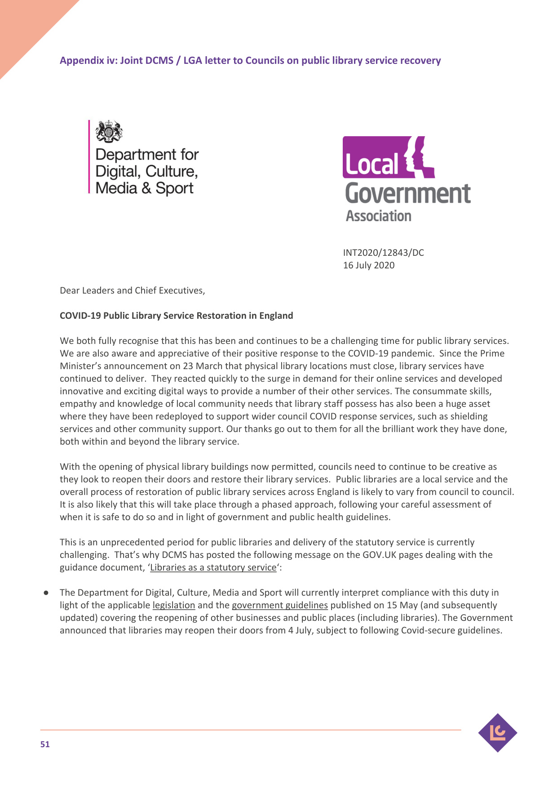

Appendix iv: Joint DCMS / LGA letter to Councils on public library service recovery

INT2020/12843/DC

16 July 2020

Dear Leaders and Chief Executives,

COVID-19 Public Library Service Restoration in England

We both fully recognise that this has been and continues to be a challenging time for public library services.

We are also aware and appreciative of their positive response to the COVID-19 pandemic.  Since the Prime

Minister’s announcement on 23 March that physical library locations must close, library services have

continued to deliver.  They reacted quickly to the surge in demand for their online services and developed

innovative and exciting digital ways to provide a number of their other services. The consummate skills,

empathy and knowledge of local community needs that library staff possess has also been a huge asset

where they have been redeployed to support wider council COVID response services, such as shielding

services and other community support. Our thanks go out to them for all the brilliant work they have done,

both within and beyond the library service.

With the opening of physical library buildings now permitted, councils need to continue to be creative as

they look to reopen their doors and restore their library services.  Public libraries are a local service and the

overall process of restoration of public library services across England is likely to vary from council to council.

It is also likely that this will take place through a phased approach, following your careful assessment of

when it is safe to do so and in light of government and public health guidelines.

This is an unprecedented period for public libraries and delivery of the statutory service is currently

challenging.  That’s why DCMS has posted the following message on the GOV.UK pages dealing with the

guidance document, ‘Libraries as a statutory service‘:

● The Department for Digital, Culture, Media and Sport will currently interpret compliance with this duty in

light of the applicable legislation and the government guidelines published on 15 May (and subsequently

updated) covering the reopening of other businesses and public places (including libraries). The Government

announced that libraries may reopen their doors from 4 July, subject to following Covid-secure guidelines.

<!-- PAGE: 52 -->

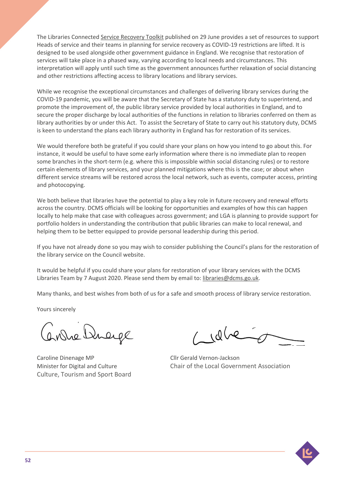

The Libraries Connected Service Recovery Toolkit published on 29 June provides a set of resources to support

Heads of service and their teams in planning for service recovery as COVID-19 restrictions are lifted. It is

designed to be used alongside other government guidance in England. We recognise that restoration of

services will take place in a phased way, varying according to local needs and circumstances. This

interpretation will apply until such time as the government announces further relaxation of social distancing

and other restrictions affecting access to library locations and library services.

While we recognise the exceptional circumstances and challenges of delivering library services during the

COVID-19 pandemic, you will be aware that the Secretary of State has a statutory duty to superintend, and

promote the improvement of, the public library service provided by local authorities in England, and to

secure the proper discharge by local authorities of the functions in relation to libraries conferred on them as

library authorities by or under this Act.  To assist the Secretary of State to carry out his statutory duty, DCMS

is keen to understand the plans each library authority in England has for restoration of its services.

We would therefore both be grateful if you could share your plans on how you intend to go about this. For

instance, it would be useful to have some early information where there is no immediate plan to reopen

some branches in the short-term (e.g. where this is impossible within social distancing rules) or to restore

certain elements of library services, and your planned mitigations where this is the case; or about when

different service streams will be restored across the local network, such as events, computer access, printing

and photocopying.

We both believe that libraries have the potential to play a key role in future recovery and renewal efforts

across the country. DCMS officials will be looking for opportunities and examples of how this can happen

locally to help make that case with colleagues across government; and LGA is planning to provide support for

portfolio holders in understanding the contribution that public libraries can make to local renewal, and

helping them to be better equipped to provide personal leadership during this period.

If you have not already done so you may wish to consider publishing the Council’s plans for the restoration of

the library service on the Council website.

It would be helpful if you could share your plans for restoration of your library services with the DCMS

Libraries Team by 7 August 2020. Please send them by email to: libraries@dcms.go.uk.

Many thanks, and best wishes from both of us for a safe and smooth process of library service restoration.

Yours sincerely

Caroline Dinenage MP

Cllr Gerald Vernon-Jackson

Minister for Digital and Culture

Chair of the Local Government Association

Culture, Tourism and Sport Board <!-- PAGE: 53 --> ### Appendix v: Detailed distribution of changes in library membership and use of online resources

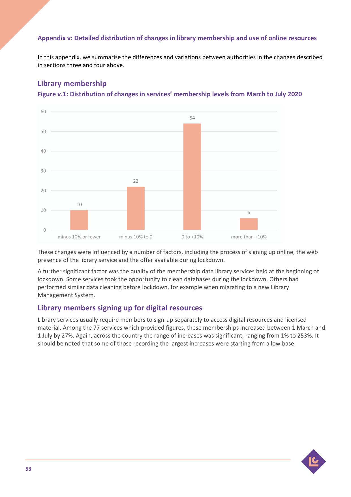

| Change in Membership Level (March to July 2020) | Number of Authorities |
| :--- | :--- |
| minus 10% or fewer | 10 |
| minus 10% to 0 | 22 |
| 0 to +10% | 54 |
| more than +10% | 6 |

Appendix v: Detailed distribution of changes in library membership and use of online resources

In this appendix, we summarise the differences and variations between authorities in the changes described

in sections three and four above.

Library membership

These changes were influenced by a number of factors, including the process of signing up online, the web

presence of the library service and the offer available during lockdown.

A further significant factor was the quality of the membership data library services held at the beginning of

lockdown. Some services took the opportunity to clean databases during the lockdown. Others had

performed similar data cleaning before lockdown, for example when migrating to a new Library

Management System.

Library members signing up for digital resources

Library services usually require members to sign-up separately to access digital resources and licensed

material. Among the 77 services which provided figures, these memberships increased between 1 March and

1 July by 27%. Again, across the country the range of increases was significant, ranging from 1% to 253%. It

should be noted that some of those recording the largest increases were starting from a low base.

<!-- PAGE: 54 -->

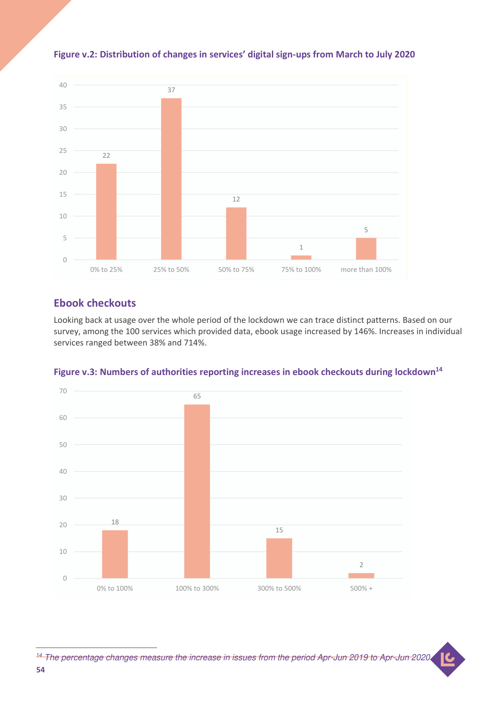

#### Figure v.2: Distribution of changes in services’ digital sign-ups from March to July 2020

| Increase in Digital Sign-ups | Number of Authorities |
| :--- | :--- |
| 0% to 25% | 22 |
| 25% to 50% | 37 |
| 50% to 75% | 12 |
| 75% to 100% | 1 |
| more than 100% | 5 |

#### Figure v.3: Numbers of authorities reporting increases in ebook checkouts during lockdown

| Ebook Checkout Increase | Number of Authorities |
| :--- | :--- |
| 0% to 100% | 18 |
| 100% to 300% | 65 |
| 300% to 500% | 15 |
| 500% + | 2 |

Ebook checkouts

Looking back at usage over the whole period of the lockdown we can trace distinct patterns. Based on our

survey, among the 100 services which provided data, ebook usage increased by 146%. Increases in individual

services ranged between 38% and 714%.

14 The percentage changes measure the increase in issues from the period Apr-Jun 2019 to Apr-Jun 2020 <!-- PAGE: 55 --> 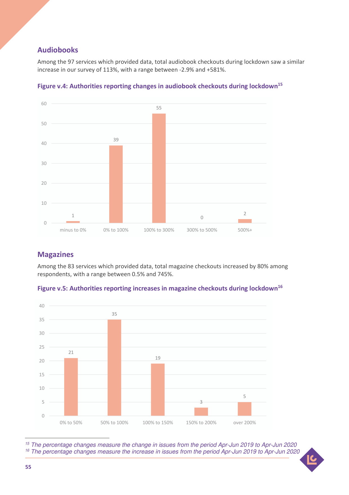

#### Figure v.4: Authorities reporting changes in audiobook checkouts during lockdown

| Audiobook Checkout Change | Number of Authorities |
| :--- | :--- |
| minus to 0% | 1 |
| 0% to 100% | 39 |
| 100% to 300% | 55 |
| 300% to 500% | 0 |
| 500%+ | 2 |

#### Figure v.5: Authorities reporting increases in magazine checkouts during lockdown

| Magazine Checkout Increase | Number of Authorities |
| :--- | :--- |
| 0% to 50% | 21 |
| 50% to 100% | 35 |
| 100% to 150% | 19 |
| 150% to 200% | 3 |
| over 200% | 5 |

Audiobooks

Among the 97 services which provided data, total audiobook checkouts during lockdown saw a similar

increase in our survey of 113%, with a range between -2.9% and +581%.

Magazines

Among the 83 services which provided data, total magazine checkouts increased by 80% among

respondents, with a range between 0.5% and 745%.

15 The percentage changes measure the change in issues from the period Apr-Jun 2019 to Apr-Jun 2020

16 The percentage changes measure the increase in issues from the period Apr-Jun 2019 to Apr-Jun 2020 <!-- PAGE: 56 --> 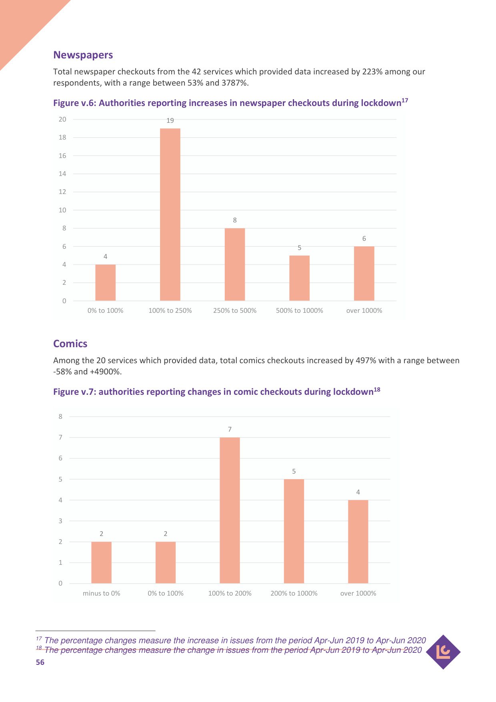

#### Figure v.6: Authorities reporting increases in newspaper checkouts during lockdown

| Newspaper Checkout Increase | Number of Authorities |
| :--- | :--- |
| 0% to 100% | 4 |
| 100% to 250% | 19 |
| 250% to 500% | 8 |
| 500% to 1000% | 5 |
| over 1000% | 6 |

#### Figure v.7: Authorities reporting changes in comic checkouts during lockdown

| Comic Checkout Change | Number of Authorities |
| :--- | :--- |
| minus to 0% | 2 |
| 0% to 100% | 2 |
| 100% to 200% | 7 |
| 200% to 1000% | 5 |
| over 1000% | 4 |

Newspapers

Total newspaper checkouts from the 42 services which provided data increased by 223% among our

respondents, with a range between 53% and 3787%.

Comics

Among the 20 services which provided data, total comics checkouts increased by 497% with a range between

-58% and +4900%.

17 The percentage changes measure the increase in issues from the period Apr-Jun 2019 to Apr-Jun 2020

18 The percentage changes measure the change in issues from the period Apr-Jun 2019 to Apr-Jun 2020 <!-- PAGE: 57 --> Libraries Connected is the sector support organisation for public libraries in England, Wales and Northern Ireland.

**Libraries Connected**  
Website: <https://www.librariesconnected.org.uk>  
Registered Charity: 1176482

[^1]: Libraries Connected analysis of Digital Content Aggregator Data.
[^2]: Libraries Connected Evaluation of Libraries from Home activities.
[^3]: Institute for Fiscal Studies (IFS), *COVID-19 and English local government finance* (2020), <https://www.ifs.org.uk/publications/14977>.
[^4]: Local Government Association (LGA), *Re-thinking public finances* (2020), <https://www.local.gov.uk/re-thinking-public-finances>.
[^5]: Progressive Policy Think Tank, *Why the government needs to pay up before levelling up* (2020).
[^6]: Carnegie UK Trust, *Making a Difference: Libraries, lockdown and looking ahead* (October 2020).
[^8]: In Wales a single consortium operates for ebook licences via Borrowbox.
[^10]: RBdigital, *RBdigital COVID-19 analysis* (27 August 2020), shared with Libraries Connected.
[^11]: Percentage increase from pre-social distancing average to week commencing 14 August 2020.
[^12]: RBdigital, *RBdigital COVID-19 analysis* (27 August 2020).
[^13]: Based on 84 respondents to this survey question.
[^14]: Percentage changes measure the increase in issues from Apr–Jun 2019 to Apr–Jun 2020.
[^15]: Percentage changes measure the change in issues from Apr–Jun 2019 to Apr–Jun 2020.
[^16]: Percentage changes measure the increase in issues from Apr–Jun 2019 to Apr–Jun 2020.
[^17]: Percentage changes measure the increase in issues from Apr–Jun 2019 to Apr–Jun 2020.
[^18]: Percentage changes measure the change in issues from Apr–Jun 2019 to Apr–Jun 2020.

## Footnotes
[^3]: Institute for Fiscal Studies, *COVID-19 and English local government finance* (2020), <https://www.ifs.org.uk/publications/14977>.
[^4]: Local Government Association, *Re-thinking public finances* (2020), <https://www.local.gov.uk/re-thinking-public-finances>.
[^5]: Progressive Policy Think Tank, *Why the government needs to pay up before levelling up* (2020), <https://www.progressive-policy.net/publications/why-the-government-needs-to-pay-up-before-levelling-up>.
[^7]: BBC News, *Coronavirus: Public libraries adapt during lockdown* (2020), <https://www.bbc.com/news/uk-england>.
[^9]: Welsh Government, *Libraries introduce Order and Collect services* (2020), <https://gov.wales/libraries-introduce-order-and-collect-services>.
