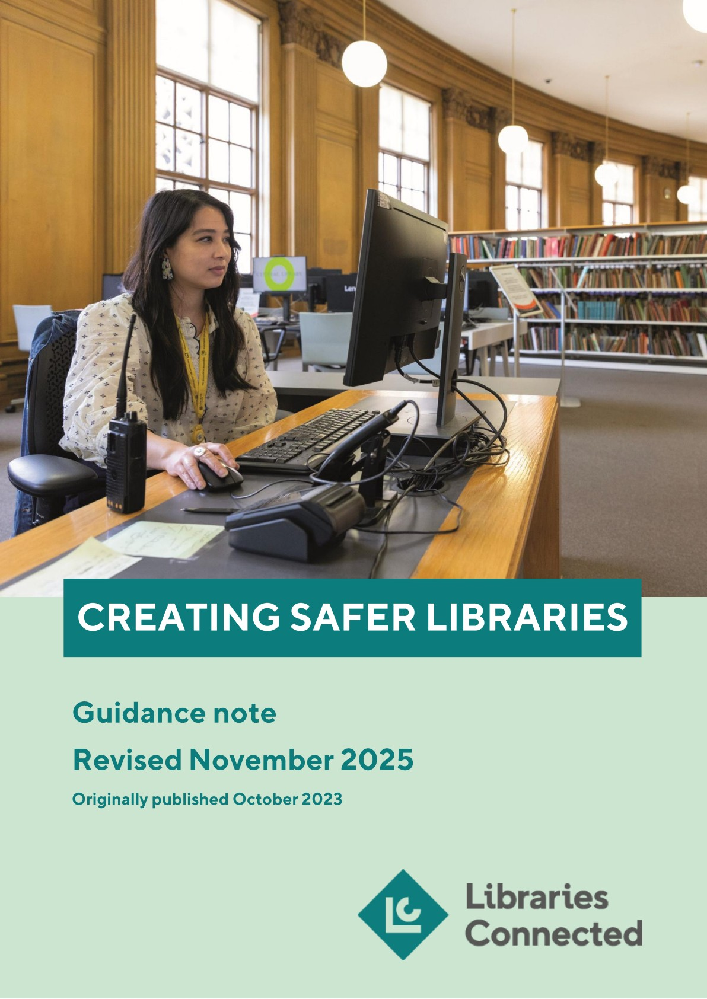

<!-- PAGE: 1 -->

# Creating Safer Libraries

## Guidance Note

**Revised November 2025**  
*Originally published October 2023*

**Libraries Connected**

<!-- PAGE: 2 -->

## Introduction

Libraries Connected believes in the power of libraries to change lives. Our vision is an inclusive, modern, sustainable, and high quality public library service at the heart of every community in the UK.

This guidance has been produced in response to feedback at regional meetings and the Libraries Connected Advisory Group, where colleagues across the sector highlighted the ongoing issue of disruptive behaviour which many services continue to face.

The guidance builds on our webinars on the topic (Creating Safer Libraries Webinar 1 and Webinar 2) and has been produced with the input of a sector wide focus group who supported this work.

Unfortunately, disruptive behaviour is something that frontline workers across the British Isles are having to manage on a regular basis in every setting. These guidelines draw on the experience and insights of staff working within retail and hospitality, as well as public library settings, looking to learn from good practice to inform our work.

We want libraries to be safe, supportive environments for everyone. To underpin this libraries need clear, enforceable policies and consistent, informed support from their local authority and the police. That firm back-stop needs to be balanced with training for staff that gives them the confidence to address disruptive behaviour and, where possible, the ability to engage with and turn potentially challenging behaviour into something more constructive.

What is driving the recent increase in disruptive behaviour is uncertain, but the impact on staff is clearly profound. The first duty of a manager is to provide a safe working environment for their teams. It is our sincere hope that these guidelines will offer valuable support in achieving this.

**Ed Jewell**  
*President Elect, Libraries Connected*

<!-- PAGE: 3 -->

## Planning, Preparing and Preventative Steps

What preventative steps can be taken to make staff and customers feel safe in the library environment? What can help you plan and prepare for disruptive behaviours?

A hard reality of working in public libraries is that, due to their welcome-to-everyone approach, they will have disruptive customers. It is therefore important that library staff are proactive and well prepared. Staff should not feel that they must tolerate disruptive and abusive behaviour.

How the library sector manages incidents and supports staff while also holding on to their central value of a safe welcoming space for all is a key challenge and balancing act. We know from talking to library staff that most people using libraries are respectful of the library and its staff, but incidents of intimidation and abuse have been increasing and the riots of 2024 have shown how civil unrest can have a devastating impact on libraries and their communities.

Reducing the frequency of disruptive behaviour and the impact incidents have on staff and customers is crucial and staff and customer safety should always be the primary driver. De-escalating a difficult situation and finding a mutually beneficial way forward is usually the preferred option as library staff are keen to avoid the need for more extreme measures such as banning someone from a building, but these options are available as well. The focus of this guidance is very much on helping library staff access the tools, resources, and training they need to ensure libraries are welcoming, gentle, friendly places where both customers and staff feel safe.

The following are key areas for consideration when thinking about what preventative steps can be taken and how to plan and prepare to ensure that staff and customers feel safe in the library environment. A range of ideas and suggestions are presented here with the acknowledgement that some may not be suitable or applicable to all library services.

### Removing risk

Risk assessments, for example of the library environment, events, activities, and lone working can help to identify physical and human risks and any controls, changes or mitigations that might need to be put in place. Recording and monitoring risks, their potential impacts and any mitigations via an organisational risk register should also be considered.

<!-- PAGE: 4 -->

### Working practices, processes, and systems

Review existing working practices, alongside risk assessments. This can help to identify where any potential changes are needed to improve and ensure staff and customer safety.

### External communication

Security-minded communications can reduce the risk of your organisation being targeted by people who want to attack or disrupt for profit or to make a political or ideological point. Organisations can protect themselves from hostile actors by sending careful messages to deter, providing information without giving away details that might be useful to them, and promoting security measures that are in place. For more information about how to do this see the guidance from the National Protective Security Authority (NPSA), it won’t all be applicable but could be useful in specific situations.

### Social media

A social media policy and guidance on how to deal with online abuse can help staff when managing the library’s social media accounts. The Government Digital Service has produced a Social Media Playbook which suggests having rules of conduct on your social media channel that can be found easily by users and staff can direct people to these if they behave in an unacceptable manner. The Space has published an *Online Abuse – A Toolkit for the Cultural Sector*, and the LGA also has Guidance for Councillors that may be useful for library staff.

Consider briefing staff on how to deal with “social media auditors”, individuals who attend premises and outside spaces, with the aim of capturing staff and property on camera, the content from which is often uploaded to social media and video platforms. The NPSA have some useful guidance on social media auditors which recommends a CALM approach:
- **C** - Chat in a friendly manner;
- **A** - Assess for hostile intent;
- **L** - Limit interactions beyond what’s necessary;
- **M** - Monitor risk of escalation.

### Environment

Consider the layout and design of the library, identify any pinch points, obstructions or poor sightlines which might encourage poor behaviours. When positioning staff desks in the public areas try to locate them where the customers can’t approach staff from behind. Consider an Access Audit to ensure that buildings are following best practice in terms of accessibility and removing barriers which may make customers feel excluded. It is also important to consider the outside of your building both in terms of security and how spaces might attract antisocial behaviour.

<!-- PAGE: 5 -->

### Internal communication

Constant dialogue and strong lines of communication with library colleagues and managers is key to ensuring that incidents and behaviours are managed consistently and supportively. Instant methods of communication to manage and deal with live incidents are vital. A range of technologies are in use across library services and buildings to support communications including radios/walkie-talkies, mobile phones and instant messaging apps such as WhatsApp. Many services have also instigated the use of codewords which can raise an alarm and seek assistance without alerting those who are causing issues and disruption.

### Intelligence sharing

Consider how you will share information across the service or with partners when needed, quickly and legally, about individuals, whilst ensuring you comply with GDPR and other legislation. You may wish to consider joining local schemes like Shopwatch where shops, libraries and other public amenities link up keeping each other informed of any disruptive customers in the area and providing a mutual support network for staff.

### Understanding your customers and audience

Build knowledge and understanding of your residents, customers, and communities. Engage with them and other stakeholders to build positive relationships which support you to deliver services, respond to their needs and understand their behaviours. Consider if there are barriers to access or existing biases in attitudes towards the provision of access which might be contributing to disruptive behaviour. Are staff and services inclusive, equitable and empathetic?

### Lone working guidelines

The provision of comprehensive guidelines and protocols for staff who lone work is essential in ensuring staff feel supported and are empowered to take appropriate action to ensure their own and customer safety.

### CCTV, staff safety devices and bodycams

CCTV and bodycams may act as a deterrent as well as being a useful way of capturing incidents and evidencing behaviours. CCTV will not capture audio and should be considered alongside incident forms as a way of capturing behaviour and full details of incidents. More discreet safety devices are also available for staff to wear which, at the touch of a button, connect them to a monitoring station where someone listens in to their conversation and contacts the police if they have any concerns.

<!-- PAGE: 6 -->

### Security

Employment of specially trained security staff can ensure staff and customers feel supported and can be a first point of contact for staff in dealing with incidents. This may be deployed as a temporary measure following an incident and withdrawn when judged safe to do so.

### Safe places

Identify an agreed safe place within a library building where staff can retreat to seek help. Ensure these are lockable and equipped with radios/phones/trigger buttons as appropriate.

### Trigger / panic buttons

Consider the installation of trigger or panic buttons which link to either local security services or directly to the police that can be activated discreetly by staff to raise the alarm.

### Training and development

Ensure staff have received relevant and up-to-date training in managing and dealing with issues of disruptive behaviour so they feel empowered, equipped and supported. This guidance provides information on relevant training and training providers, and the supporting appendices have an example of training for library staff in de-escalation and trauma-informed techniques which some library services have found useful.

### Emergency planning and crisis comms strategy

Work with colleagues to put a plan in place for dealing with disruption to services including protocols for closing and evacuating buildings when necessary. Develop a crisis plan based on a variety of potential scenarios and a crisis communication strategy which can quickly be adopted when needed. Make sure you are aware of any Local Authority business continuity plans and disaster plans so that you are ready if there is a crisis. Planning and preparedness helped library staff when Spellow Library in Liverpool was attacked during a riot in 2024.

<!-- PAGE: 7 -->

## Statutory and Civil Protection Tools

### Public Spaces Protection Orders (PSPOs)

PSPOs are orders under the Anti-Social Behaviour, Crime and Policing Act 2014 which ban specific acts in a designated geographical area in England and Wales as set out in the act. PSPOs can help to ensure that the Police can act against individuals because of their antisocial behaviour. Engaging with the police and reporting incidents can help build a case for a protection order.

### Community Protection Notice (CPN) & Criminal Behaviour Order (CBO)

Civil injunctions, CPNs and CBOs replaced Antisocial Behaviour Orders (ASBOs) in England, Wales and Northern Ireland. A court may give someone a CPN if it gets reports of persistent antisocial behaviour from the police, a council or a landlord. Someone can only get a CBO if they’ve been convicted of a crime. Engaging with local community protection teams and the police can help build a case for a CPN or CBO.

<!-- PAGE: 8 -->

## Policies, Procedures, Byelaws and Legislation

### Policies and procedures

Policies and procedures with clear guidance and a consistent approach to dealing with issues of disruptive and unacceptable behaviour are a key component in managing the issue. Ensuring that these remain fit for purpose and are updated regularly is important. These can ensure timely support, intervention from management where needed and swift actions and responses in relation to banning and dealing with issues.

Policies and procedures should be developed in consultation with staff and trade unions and services should consider making them publicly available.

Ensuring staff are fully aware of all relevant library or local authority policies and procedures is an important part of ensuring they are equipped, trained, and supported to deal with any issues.

Relevant policies and procedures may include:

- **Library membership terms and conditions** – Library charters, managing unacceptable behaviour and code of conduct policies. These may include service or organisational statements of expected standards of behaviour that can be prominently displayed at service points and in other locations in library buildings and form the basis of conversations with individuals.
- **Incident recording guidelines** – Clear guidance on recording what happened, when and where. A vital first step in making libraries a safe space is ensuring that all incidents are reported, this means managers can act and, by dealing with situations as they emerge, there is a greater chance of addressing the problem before it escalates. The more incidents are reported the better, as this helps to build a clear evidence-based picture of exactly what is happening and whether there are established patterns, triggers or causes.
- **A list of useful contact numbers** in one easy to locate place for contacting managers, police and other agencies as needed.
- **Banning policies and procedures**, including acceptable behaviour agreements. Bans can be a useful tool for library staff provided there is a well thought out policy with reviews, clear lines of responsibility, and enough flexibility to empower any member of staff to use it in the moment. Having an acceptable behaviour agreement can also be helpful particularly if used when ending a ban by asking an individual to adhere before enabling them to <!-- PAGE: 9 --> start using the service again. The Library Byelaws are a useful reference and framework for policies.

Condensing policies and procedures into easy-to-follow checklists and flowcharts can also be useful as a quick reference guide for staff.

### Library byelaws

Library byelaws provide a framework and legitimacy and should be considered and referenced where necessary in any policies and procedures. The byelaws should be displayed in all your service points.

#### England

Councils can make byelaws regulating the use of library facilities that they run under section 19 of the Public Libraries and Museums Act 1964. The byelaws only apply to statutory libraries operated by or on behalf of local authorities.

Following a review by Libraries Connected, in consultation with DCMS, guidance and revised model library byelaws for England were published in August 2025. These are intended to help libraries, in England, deliver their service within a safe and comfortable environment, to safeguard library property and to make libraries pleasant places for everyone. They assist the library workforce in their daily role, they can be used when necessary to deal with the more extreme cases of behaviour experienced and they allow for flexibility in dealing with local concerns. There is a specific reference to the requirement that:

> “No person may, while in the library or in the course of using any library facilities, behave in a disruptive, violent, aggressive, threatening, discriminatory or indecent manner, use violent, abusive, offensive, insulting, or obscene language, or intentionally or recklessly cause or do anything likely to cause injury to any other person.”

DCMS has to confirm each set of library byelaws, for local authorities in England, before they can come into effect, even if you choose to adopt the model byelaws DCMS provide.

#### Wales

Section 19 of the Public Libraries and Museums Act 1964 also applies to libraries in Wales. There are no model library byelaws in Wales. The Local Government Byelaws (Wales) Act 2012 simplifies the procedures for the making and enforcement of byelaws in Wales. The 2012 Act provides that any byelaws made in accordance with S19 of the 1964 Act do not require confirmation of the Welsh Ministers. Welsh Government <!-- PAGE: 10 --> published guidance on the 2012 Act in March 2015 under the Local Government (Wales) Measure 2011.

#### Northern Ireland

Libraries NI issues byelaws under section 7 of the Libraries Act (Northern Ireland) 2008. They also include a specific requirement that:

> “No person shall behave in a violent, disorderly or indecent manner in the library or use violent, abusive, offensive, insulting or obscene language therein, or intentionally or recklessly cause or do anything likely to cause injury to any person or property.”

### Legislation

A range of legislation is in place to ensure the health and safety of employees and members of the public. The main legal obligations of employers are covered in the following:

#### Health & Safety at Work Act 1974

The Health and Safety at Work Act 1974 is the primary piece of legislation covering occupational health and safety in Great Britain. It’s sometimes referred to as HSWA, the HSW Act, the 1974 Act or HASAWA. It sets out the general duties which:

- employers have towards employees and members of the public;
- employees have to themselves and to each other.

#### Management of Health & Safety at Work Regulations 1999

The Management of Health and Safety at Work Regulations 1999 were introduced to reinforce the Health and Safety Act 1974. They outline what employers are required to do to manage health and safety and apply to every work activity. An employer is required by law to protect its employees and others from harm.

Under the Management of Health and Safety at Work regulations 1999 the minimum employers must do is:

- identify what could cause injury or illness in your business (hazards);
- decide how likely it is that someone could be harmed and how seriously (the risk);
- take action to eliminate the hazard, or if this isn’t possible, control the risk.

<!-- PAGE: 11 -->

## Partnerships and Places for Support

Disruptive behaviour issues impacting on libraries are often a wider issue in the locality in which they are happening. Working in partnership with colleagues internally within your service and the wider organisation, and externally, to take a more cohesive approach to dealing with issues can often be productive and effective.

The following are examples of agencies and partnerships which have been used effectively in some localities to work together to manage and resolve issues of disruptive behaviour.

### Internal organisational teams

Constant dialogue with internal teams within local authorities can help to ensure a joined-up approach. If possible, bringing together colleagues from internal Council teams can bring additional support, insight, and training opportunities in dealing with and understanding some of the underlying issues causing unacceptable behaviours. These teams might include, but are not limited to:

- Health & Safety
- Legal
- Social Care
- Public Health
- Youth Services
- Housing Services
- Community Support Teams

### Councillors and leaders

Ensuring that local councillors and the leader of the council are fully briefed and aware of significant areas and issues of disruption is important in gathering internal support and escalation with Police and other partners and partnerships. Structured reporting of incidents can help with this.

### Libraries Connected

Libraries Connected’s regional and national member networks are a good way to share experiences and approaches and learn from the experiences of other library services. The member networks bring together Heads of Service from across the region or nation and they usually meet four or five times a year.

### Trade unions

Engage with trade unions to ensure that they are aware of ongoing issues and that staff can access welfare and support services that trade unions often provide. An ongoing <!-- PAGE: 12 --> dialogue which shares a responsibility to work together to ensure staff safety is an important element of both preventative steps and managing situations.

### Youth Justice Services

Youth Justice Services (YJS) can be a useful contact. They provide a multi-agency approach and work with children and young people who are involved in, or at risk of offending. They offer a range of services aimed at reducing crime, protecting the public from serious harm and supporting the welfare of young people by helping them stay out of trouble.

### Local schools and colleges

Requesting to meet with local schools and colleges can be key when dealing with issues involving children and young people. Headteachers and teachers are keen to support and help deal with poor or disruptive behaviour, and, if needed, will often contact parents/carers to make them aware of behaviours and arrange meetings to discuss.

Developing simple rules or guidelines for using the library and enlisting the schools' help in communicating these to their students can be helpful in showing a united front, particularly if you notice a trend in disruptive behaviour at a particular time of the year, such as in the lead up to exams.

### Local charities and support organisations

Working with local charities, voluntary action partnerships and other support organisations to support understanding of behaviours, alongside intervention, advice, and signposting for customers can help in both preventing and dealing with difficult behaviours. Local foodbanks, mental health, homeless and addiction support organisations are often supportive in working with, and training, library staff to deal with customers with complex needs and issues.

### Community Safety Partnerships

In each local council area, there are statutory partnerships called Community Safety Partnerships. These bring together local organisations which share goals of reducing anti-social behaviour, reducing crime and fear of crime. Working with local Community Safety Partnerships at a strategic and local level can support libraries to work with other agencies to highlight issues they are experiencing and work together to solve issues in their communities.

### Businesses Against Crime Partnerships

Many towns and cities have a Shopwatch or Businesses Against Crime partnership which is dedicated to combating business crime and anti-social behaviour in towns and city centres. The schemes enable businesses to work together and share information and resources to bring a collective approach to dealing with issues or individuals. The overall <!-- PAGE: 13 --> aim is to make towns and city centres safer and a better environment for those who work and live there. Examples include Exeter Business Against Crime (EBAC), supported by Police and Exeter City Council, and Gloucester City Safe.

### Police Community Support Officers

Reporting incidents and building positive relationships with local Police and in particular Police Community Support Officers (PCSOs) can be beneficial in dealing with local issues. Anecdotal evidence across the sector shows that more regular patrols and increased police presence has helped when dealing with disruptive behaviour in some libraries. Some libraries offer ‘cuppa with a copper’ sessions and police outreach days to build relations and help prevent issues or encourage PCSOs to use libraries as workspaces.

### Business Crime Reduction Partnerships

A Business Crime Reduction Partnership (BCRP) is a partnership-based approach to preventing crime and disorder. There are over 250 BCRPs operating in the UK. They range in size from limited schemes operating in small towns to citywide operations with several staff and hundreds of members. Working closely with police forces and councils they all serve to make their local areas safer places to live, work and visit. A BCRP is a subscription-based, business-led action group working with police and the local authority to tackle and reduce crime and disorder affecting businesses and the wider community. Linking in with BCRPs can be a useful way for libraries to link with other local businesses and partners trying to address local issues.

### Business Improvement Districts

A Business Improvement District (BID) is a defined area in which a levy is charged on all business rate payers in addition to the business rates bill. This levy is used to develop projects which will benefit businesses in the local area. There is no limit on what projects or services can be provided through a Business Improvement District. The only requirement is that it should be in addition to services provided by local authorities. Improvements may include, but are not limited to, extra safety/security, cleansing and environmental measures. An example is Rugby First which employs Town Rangers to patrol the streets and assist with incidents of anti-social behaviour. There is some evidence that BIDs are effective in reducing low-level business crime and anti-social behaviour.

<!-- PAGE: 14 -->

## Post-Incident Care and Reporting

Following an incident, taking time to consider the needs of staff and customers who have been involved and may have been impacted by what they have seen or dealt with and supporting them to debrief, reflect and record what has happened is essential.

You may also need to consider your staff care services, counselling options, or for extreme incidents, group support sessions.

Completion of internal incident forms to build a clear picture of what happened with time, location, and specific details of what was said and done should be completed as soon as possible following an incident to ensure accuracy. Structured reporting of incidents can also raise awareness of the issues facing libraries within the Council and lead to additional support.

Serious incidents should always be reported to the police.

An opportunity for feedback and debrief post-incident can be important to share learning and see where any policies, procedures and risk assessments may need to be applied or revised and where further intervention may be needed. As well as identifying any further support that may be required for staff involved in dealing with the issue.

Most local authorities offer Employee Assistance Programmes which provide access to helplines, counselling and occupational therapy support. A Staff Welfare Checklist can be a useful tool to work through post-incident.

<!-- PAGE: 15 -->

## Training and Support Resources

### Guidance

#### Personal safety at work

- National Business Crime Centre, *Guide to Personal Safety at Work*
- Association of Convenience Stores, *Crime Guidance 2023*

#### Lone worker safety

- National Business Crime Centre, *Guide To Lone Worker Safety*
- Suzy Lamplugh Trust (personal safety at work and lone working advice as well as training and consultancy)

#### Emergency planning and risk management

- Emergency Planning Framework – GCS
- Planning for incidents and emergencies – HSE
- Protecting Your Assets – NPSA
- Building and Infrastructure – NPSA
- Protective Security Risk Management (PSRM) – NPSA
- Protective Security Management Systems (PSeMS) – NPSA
- Publicly accessible locations (PALs) guidance – ProtectUK
- Crisis response kit checklist – ProtectUK

#### Social media and communications advice

- The Space, *Online Abuse Toolkit 2024*
- Social media playbook – GOV.UK
- Social Media Auditors – NPSA
- Security-Minded Communications guidance – NPSA
- Guide to tackling online abuse – Local Government Association

#### Other resources

- Steve Albrecht – *The Safe Library: Keeping Users, Staff, and Collections Secure*. Rowman & Littlefield, 2023. ISBN 9781538169605.
- American Library Association – *Crisis Communication Planning*.
- CILIP – *Managing Safe and Inclusive Public Library Services: a practical guide*. This guidance, published by CILIP, with funding from Arts Council England, in September <!-- PAGE: 16 --> 2023 is intended primarily for public librarians and staff who make decisions around stock, public internet access, use of space and public programming. The guide includes references to good practice for library services in schools and prisons, and its key principles can be applied across all library contexts. It replaces the earlier document *Guidance on the Management of Controversial Materials in Public Libraries*, originally published by the Museums, Libraries and Archives Council (MLA) in 2008. In addition to the guide CILIP have also produced a range of practical resources including checklists, posters, a crisis comms template, a slide deck, and a statement of commitment encouraging governing bodies and funders to support CILIP’s Statement of Professional Commitment to Intellectual Freedom.
- IFLA – *IFLA guidelines for library services to people experiencing homelessness*.
- Health and Safety Executive – *Violence and aggression at work: Guidance for employers and Advice for Workers*.
- Health and Safety Executive – *Managing risks and risk assessments at work: Risk assessment template and examples*.
- National Business Crime Centre – *Reducing Violence Against Staff in The Retail Sector*. Includes information on potential triggers and how to prevent them.

### Useful organisations

- **MIND** – mental health charity, providing training, advice and support.
- **Shelter** – housing advice charity.
- **ProtectUK** – provides free advice, guidance and learning to help businesses and communities understand protective security and improve their response to the risk of terrorism.
- **NPSA** – the UK government’s National Technical Authority for physical and personnel protective security.
- **Salvation Army** – a worldwide Christian church and registered charity, offering friendship, practical help and support to some of the most disadvantaged people in our communities.
- **Centrepoint** – youth homelessness charity.
- **Catch22** – non-profit organization that designs and delivers services that build resilience and aspiration in people of all ages and within communities across the UK.
- **The Ben Kinsella Trust** – charity that tackles knife crime through education and campaigning.

<!-- PAGE: 17 -->

### Training Providers and Courses

- **The Conflict Training Company** – Conflict training focused on turning confrontation into conversations.
- **Crisis Prevention Institute** – A range of training including Verbal Intervention which helps staff to build confidence and skills to verbally de-escalate disruptive behaviours and prevent further escalation.
- **Curious Minds** – *I’m a Teenager... Get Me Into There!* is a training programme aimed at cultural venues and libraries, in particular front of house, customer service and volunteer teams. It aims to support staff to feel more confident in their interactions with young people and create a welcoming, inclusive environment for them. It has been created in collaboration with youth and heritage organisations and most importantly, young people themselves.
- **GoodSense Training** – UK specialists in conflict management and personal safety training.
- **Homeless Library** – Online de-escalation training for library staff who interact with individuals experiencing homelessness.
- **Maybo** – Training provider focused on creating positive and safer outcomes.
- **St Giles Trust** – A charity using expertise and real-life past experiences to empower people who are not getting the help they need.
- **ACT (Action Counters Terrorism)** – Introduction to Action Counters Terrorism. This eLearning is a national counter-terrorism awareness initiative produced by the National Counter Terrorism Security Office on behalf of Counter Terrorism Policing to protect UK cities and communities from the threat of terrorism. Also available via the ProtectUK website.
- **Mental Health Awareness** – This e-learning provides staff with an understanding of what mental health is, basic knowledge of common mental health issues, what good mental health means and therapies and support available.

Other types of training to support understanding and awareness of behaviours and biases include disability awareness, mental health awareness, anti-discrimination, anti-racism, unconscious bias, safeguarding, anti-poverty and LGBTQA+ training.

<!-- PAGE: 18 -->

## Appendices

- **Appendix A** – Banning Policy (Kent Libraries, Registration and Archives)
- **Appendix B** – Banning Policy Flowchart (Kent Libraries, Registration and Archives)
- **Appendix C** – De-escalation training PowerPoint (Kent Libraries, Registration and Archives)
- **Appendix D** – Staff Welfare Checklist (Wiltshire Libraries)
- **Appendix E** – Example letter and guidelines for schools (West Sussex)
- **Appendix F** – Disruptive Behaviour Presentation (Kent Libraries, Registration and Archives)

<!-- PAGE: 19 -->

## Acknowledgements

We are grateful for the advice and support of the following people and services in producing this guidance, presenting at the Creating Safer Libraries webinars and participating in the Creating Safer Libraries focus groups, workshops and consultation:

- Brent Libraries
- Hackney Libraries
- Kent Libraries, Registration and Archives
- Kingston Libraries
- Lancashire Libraries
- Libraries NI
- London Borough of Hillingdon Libraries and Cultural Services
- London Libraries
- Somerset Libraries
- South Tyneside Libraries
- Storyhouse
- Suffolk Libraries
- Telford Libraries
- West Sussex Libraries
- Wiltshire Libraries
- Dr Brian Moss
- Edward Woodall, Government Relations Director, Association of Convenience Stores

<!-- PAGE: 20 -->

## About Libraries Connected

We are an independent charity that supports, promotes and represents public libraries. Our work is driven and led by our membership, which includes almost every library service in England, Wales, Northern Ireland and the Crown Dependencies (Guernsey, Jersey and the Isle of Man).

Across the areas we serve there are 176 individual library services with around 3,000 library branches serving over 61 million people.

Our unique approach is to bring these services together to share experience, expertise and evidence – driving innovation and impact across the public library sector.

While senior library leaders sit on our board and committees, we work with library staff at all levels. As well as providing practical support, training and advice to libraries, we represent them to government and raise their profile in the media. We also develop and lead national library projects with cultural, academic and corporate partners.

**Libraries Connected**  
Maggie O'Neill Business and Training Centre  
Mailbox 1201  
433 Liverpool Road  
Huyton  
Liverpool L36 8HT  
`www.librariesconnected.org.uk`

Company Registration Number: 07559747  
Registered Charity Number: 1176482
