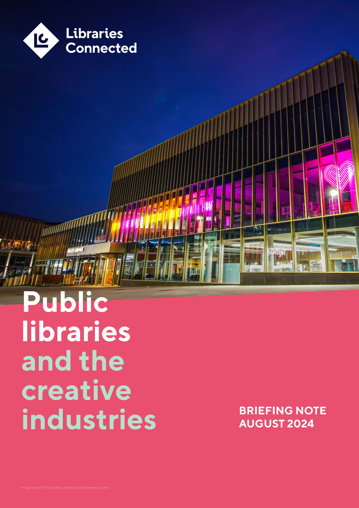

<!-- PAGE: 1 -->

# Public Libraries and the Creative Industries

## Briefing Note

**August 2024**

*Libraries Connected*

<!-- PAGE: 2 -->

## INTRODUCTION
For many of us, a childhood visit to our local library is our first experience of the creative industries. Even in areas with lower levels of cultural activity, libraries deliver first class creative experiences for their communities - day in, day out. They do this not only by providing free access to literature, information and learning, but by staging exhibitions and performances, commissioning artwork and providing opportunities to learn new creative skills and techniques. There are now 16 library services within the Arts Council’s national portfolio, giving their communties easy access to the best cultural events and activities. The public library network strengthens the whole creative economy by brokering local cultural partnerships, supporting artists and creative businesses, and providing free access to industry-standard software and technology. Since their inception in the 1850s, public libraries have been driven by the principle that culture is for all, not just the privileged few. As the Department for Culture, Media and Sport put it, “They bring experiences and events to people who might not otherwise seek them out, and act as a platform from which other cultural and creative organisations can deliver events and interactions.”1 Despite all this, the role of libraries in supporting the creative industries is all too often overlooked by policymakers. As the new government puts into place its plans for a “decade of renewal and growth” in the creative industries, we urge it not to sideline public libraries. They should be recognised - and resourced - as the backbone of our creative life and economy. 1 Written evidence from the Department for Digital, Culture, Media and Sport in response to the Digital, Culture, Media and Sport Select Committee’s Call for Evidence on Reimagining where we live: Cultural Placemaking and the Levelling Up Agenda, 2022 Isobel Hunter MBE Chief Executive Libraries Connected Biblio Beats Festival 2023, Barnsley Libraries. Credit: Wayne Sables Project <!-- PAGE: 3 --> WHY LIBRARIES? REACH AND ACCESS Taken together, the UK’s 4,000 public libraries have the biggest reach of any creative or cultural institution in the country. Around a third (30%) of adults use a public library every year1 and almost nine in 10 of us know where our nearest library is2. Libraries also attract a significantly more diverse audience than other parts of the arts and cultural sector3. Libraries have a unique place in our communities: free, safe, universal spaces, often in prominent locations, with strong links to local civic, educational and cultural organisations. For all these reasons, they are ideally placed to support the creative industries in attracting more young people from all backgrounds and developing a sustainable talent pipeline. ARTIST AND BUSINESS DEVELOPMENT Almost every library service offers some form of specialist support to entrepreneurs, startups and SMEs, primarily through the Business & IP Centre (BIPC) Network. The highest proportion (27%) of businesses supported by the BIPC network is in the creative, media and technology sectors - more than double the proportion of businesses in the UK as a whole.4 Working together with the Intellectual Property Office, BIPCs empower business owners to innovate and to protect their intellectual property - this is particularly important in the creative industries, allowing the owner of the rights in literary or artistic works to control how they are used. Libraries also frequently partner with new and growing creative businesses, or artists-in-residence, giving them access to live audiences, community engagement opportunities and reduced studio or rehearsal space. 1 Participation Survey 2023–24 Department for Culture, Media and Sport, 2024 2 Survation poll conducted on behalf of Libraries Connected, 2024 3 Participation Survey 2023–24 Department for Culture, Media and Sport, 2024 4 Democratising Entrepreneurship 2.0, British Library, 2023 TECHNOLOGY Through BIPCs and Makerspaces, libraries offer access to market-leading technology, software and equipment that would otherwise be inaccessible or prohibitively expensive. Crucially, these are provided alongside technical support, tuition and training. Whether it’s learning to produce a track on Ableton Live, developing video editing skills on Premiere Pro or creating a rapid prototype on a 3D printer, modern library services offer hands- on experience of new technology in a welcoming, supportive environment. PARTNERSHIPS Libraries act as cultural catalysts, working with a network of partners and facilitators to deliver artistic and cultural experiences. These range from “rhyme times” and crafting sessions for toddlers to large scale artistic commissions and digital arts projects. Local libraries also frequently partner with national arts organisations to stream high profile events and host touring exhibitions, most notably through the British Library’s Living Knowledge Network. Libraries have well established partnerships with local schools, universities, businesses, community groups and arts venues, enabling them to stage innovative cultural projects within their communities. PUBLIC LIBRARIES AND THE CREATIVE INDUSTRIES | 3PUBLIC LIBRARIES AND THE CREATIVE INDUSTRIES | 3 <!-- PAGE: 4 --> Reception Reading Stars
## POLICY PROPOSALS
### CENTRAL GOVERNMENT
 ‹ Labour’s Plan for the Arts, Culture and Creative Industries should be developed to recognise the role of libraries in supporting and widening access to the creative industries. ‹ Library services should be included in the Government’s new Cultural Infrastructure Map. In those areas identified as “cultural deserts”, libraries should be at the forefront of efforts to develop the local creative economy ‹ Library services should have equal access - alongside other arts organisations - to any additional funding the government sources from investors and donors through its new cultural strategy. LOCAL GOVERNMENT ‹ Councils should ensure libraries are included in their cultural strategies, particularly for their role in developing skills, supporting creative businesses and widening access to culture. ‹ Councils should put public libraries at the heart of culture-led regeneration, drawing on their unique role as local cultural catalysts.

<!-- PAGE: 5 -->

WAKEFIELD: SUMMER S’COOL Wakefield Libraries works in partnership with the Creative Industries team at Wakefield Council to deliver summer s’cool, a free creative learning programme that takes place over the summer holidays. summer s’cool offers local young people the opportunity to meet and learn from industry professionals, develop new creative and digital skills, and explore pathways into the creative industries. In 2023 summer s’cool was delivered in a range of community hubs including two libraries, with young people learning how to make their own podcasts. Building on this successful pilot, summer s’cool 2024 has been extended and will reach even more community hubs including three libraries where young people will learn about video game design. summer s’cool unlocks creative opportunity for young people living in some of the most deprived areas of Wakefield. There were more than 500 creative engagements in summer s’cool 2023 and around 1,000 are expected this year. The programme is produced by a small team at Wakefield Council working in partnership with local community venues. summer s’cool is enabled by funding by the DCMS Cultural Development Fund, which is administered by Arts Council England, and by Wakefield Council. The 2024 programme is presented as part of Our Year, a yearlong celebration of culture and creativity for everyone, everywhere in Wakefield district. MERTON ARTS SPACE Merton Arts Space, housed within Wimbledon Library, was launched in 2016 to address the lack of cultural facilities in the borough. Despite Merton’s large artistic community, cultural activity was mainly happening outside the borough. The council saw an opportunity to build on their library service’s strong track record of delivering cultural events. The Arts Space is equipped with professional lighting and sound, a flexible stage and seating, exhibition rooms and a recording studio. Initially supported with funding from Arts Council England, it now generates around £120,000 each year and hosts a diverse and innovative programme, delivered in partnership with local creatives and production companies. An additional, smaller Arts Space opened in 2018 at Mitcham Library. Recent events have included music evenings with Jah Wobble, author talks and performances from Miki Berenyi and David Gedge, an evening of British hip hop with Normski and Carousel, an exhibition and film screening exploring rave culture. The Space’s flagship music project, Tuned In, uses jam sessions and music production workshops to address loneliness and isolation in the borough, with over 1,400 people taking part so far. The experience of launching and running the Arts Space led to a successful bid to become an Arts Council National Portfolio Organisation, through which a further £360,000 of investment will transform cultural programming across libraries in Merton over a period of three years.
## CASE STUDIES

<!-- PAGE: 6 -->

## CASE STUDIES
GLOUCESTERSHIRE: SPACE TO CREATE Gloucestershire Libraries is launching a new project, Space to Create Digital Bootcamps, in September 2024. The project provides a platform for young people aged 16–24, targeting those not currently in education, employment, or formal training (NEET). The project is a key strand of the library service’s National Portfolio Organisation (NPO) status, funded by the Arts Council for three years. Space to Create will work with industry specialists, artists, and practitioners to deliver a series of Digital Bootcamps, helping participants improve career prospects in the creative industries. Each syllabus of themed digital bootcamps will run alongside the academic calendar. Young people will work with and be inspired by professionals in creative digital industries, from stop-motion- animation and website design to photography and illustration. By the end of each programme, young people will gain practical experience in working to and delivering on a brief, an introduction to the technical skills required, mentored support, peer learning and the opportunity to showcase their work in an exhibition. The libraries team will work with industry specialists, high-profile artists, and small businesses to offer incentives and prizes to recognise the young people involved. BARNSLEY TOWN CENTRE REDEVELOPMENT The Library @ The Lightbox opened in July 2019, part of the transformation and regeneration of Barnsley’s town centre, which was funded entirely by Barnsley Council. From the planning stages, the council was clear that the redeveloped town centre would include a new library as part of a mix of leisure and retail. This brought the library service into a close working relationship with the economic development team, who saw the opportunities for using libraries to deliver other council and partner services. As the town centre plans progressed, the library service began a Makerspace project in partnership with Barnsley’s Digital Media Centre (DMC), a home for creative and digital entrepreneurs. The library service and DMC worked together to create a pathway for young people to try the latest media, arts and technologies, develop their business skills and pursue creative careers. The library service’s relationship with the council’s economic development team and an organisation based in DMC led to a joint cultural project through which local college students created and delivered arts activities in two libraries. This, alongside other creative projects, informed a successful bid to become an Arts Council England National Portfolio Organisation (NPO). Barnsley’s library service now offers a range of creative commissions and opportunities for creative practitioners, who have developed a series of exciting and bespoke projects for people to access arts and culture across the borough.

<!-- PAGE: 7 -->

BRITISH LIBRARY: GET READY FOR BUSINESS GROWTH Launched in 2022, the British Library’s Get Ready for Business Growth programme offers tailored scaleup support for businesses in the arts and culture sector across England and Scotland. It is funded by Arts Council England and has been designed and delivered by the British Library Business & Intellectual Property Centre (BIPC) and a number of private sector partners. The programme taps into the BIPC network, consisting of 22 BIPCs in central libraries and a further 86 satellite services delivered through branch libraries. The programme, which is delivered across three months to cohorts of around 25 creative business leaders, consists of eight workshops and eight one-to-one bespoke sessions, covering strategy development, fundraising, testing and launching new products, protecting IP, researching competitors and many more. Each participant is paired with a relationship manager who oversees their engagement, acts as a counsellor and refers them to relevant support. Additionally, they receive a personalised research report drawing on the British Library’s world-leading collections and are trained in the use of the BIPC’s extensive market research resources. So far, Get Ready for Business Growth has helped over 200 creative scaling businesses, creating 100 new jobs. Participants have created and implemented almost 250 new products, processes and services in the first three quarters and over 90 graduate mentors were trained with accreditation from the Institute of Leadership & Management (ILM).

<!-- PAGE: 8 -->

LEEDS: STUDIO 12 Studio12 is an multi award winning digital media initiative run by Leeds Library Service, aimed at disadvantaged young people. It provides free access to a production studio, training and an industry panel of creative professionals. The Studio12 space contains a fully equipped studio with a wide range of industry standard multimedia, film, VR, photography, music equipment and software packages. A masterclass and workshop programme is run in partnership with industry practitioners including The British Library, BBC 1Xtra, Roundhouse and the British Art Show. Work by Studio12 participants has been showcased on Sky Arts, the BBC Channel 4 Random Acts and international festivals and performances, including at the Houses of Parliament. Other initiatives from Leeds library service include the Drawing Room - a space for artists, makers and designers to develop ideas, learn skills and achieve their creative potential - and its renowned music library, which will shortly become the go-to place to discover, produce and learn music. COVENTRY: DIGITAL SPACES Coventry’s year as City of Culture in 2021/22 allowed its library service to secure funding from Arts Council England for Digital Spaces, an ambitious multi-strand digital culture programme. It was delivered in partnership with the British Film Institute and The Space, an agency that promotes digital engagement across the cultural sector. Designed to bring communities and creative practitioners together throughout the year, Digital Spaces provided an opportunity for Coventry’s diverse communities to explore the creative possibilities of technology, art and culture. At its heart was a programme of high-quality VR content and immersive audio aimed at audiences who might never otherwise have a chance to experience it. Alongside the VR content, the BBC’s Research and Development team curated a selection of immersive audio experiences, including binaural audio dramas, slow radio and documentaries designed to immerse listeners in an expanded sonic field. In addition, three community co-creation projects saw commissioned artists work with communities around three branch libraries in a broader digital cultural programme. Using archive material relating to Coventry from the British Film Institute and BBC, the artists and communities created new craft, photography and audio projects exploring local heritage. Digital Spaces demonstrated that public libraries can reach a broader demographic that other arts venues, allowing users easy access to new cultural experiences in a safe and trusted environment.
## CASE STUDIES

<!-- PAGE: 9 -->

## FURTHER READING
 ‹ Contribution of the arts to society and the economy, House of Lords Library, 2024 ‹ Cornerstones of Culture, Local Government Association, 2022 ‹ Creating Growth: Labour’s Plan for the Arts, Culture and Creative Industries, Labour Party, 2023 ‹ Creative places: Supporting your local creative economy, Local Government Association, 2020 ‹ Democratising Entrepreneurship 2.0: Libraries as engines of economic recovery and growth, British Library, 2023 ‹ Participation Survey 2023–24 Department for Culture, Media and Sport, 2024 ‹ Reimagining where we live: cultural placemaking and the levelling up agenda, House of Commons, Digital, Culture, Media and Sport Committee, 2022 Library @ The Lightbox, Barnsley. Credit: Barnsley Council <!-- PAGE: 10 --> ## About Libraries Connected
We are an independent charity that supports, promotes and represents public libraries. Our work is driven and led by our membership, which includes almost every library service in England, Wales, Northern Ireland and the Crown Dependencies. Across the areas we serve there are 176 individual library services with around 3,000 library branches serving over 61 million people. Our unique approach is to bring the leaders of these services together to share experience, expertise and evidence – driving innovation and impact across the public library sector. While we mainly work with senior library leaders, most of our events, training, resources and support are available to all library workers. As well as providing practical support, training and advice to libraries, we represent them to government and raise their profile in the media. We also develop and lead national library projects with cultural, academic and corporate partners. Media enquiries James Gray Advocacy & Marketing Manager james.gray@librariesconnected.org.uk 07849085762 Libraries Connected Maggie O’Neill Business and Training Centre 433 Liverpool Road Huyton Liverpool L36 8HT info@librariesconnected.org.uk www.librariesconnected.org.uk Company Registration Number: 07559747 Registered Charity Number: 1176482
