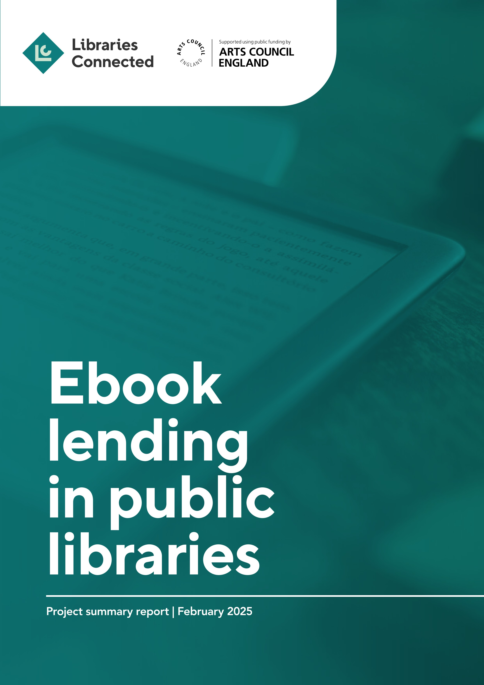
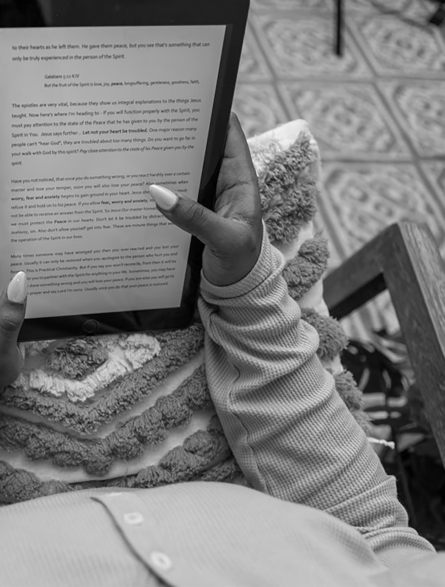

<!-- PAGE: 1 -->

# Ebook Lending in Public Libraries

## Project Summary Report

**February 2025**

*Libraries Connected*

<!-- PAGE: 2 -->

<!-- PAGE: 3 -->

## Contents

- **Introduction** (page 4)
- **Project overview** (page 8)
- **The problems** (page 10)
- **The pilot** (page 13)
- **State-of-play research** (page 18)
- **Recommendations and next steps** (page 21)
- **Case studies** (page 26)
- **Acknowledgements** (page 32)

<!-- PAGE: 4 -->

## Introduction
Libraries have successfully nourished public 
reading habits for 175 years, with their right 
to lend books most recently enshrined in the 
1964 Public Libraries & Museums Act. Habits 
and technology change, of course; and the 
rise of ebooks in the last 15 years means 
libraries have adapted to the growing digital 
needs of their contemporary customers. 
Whilst libraries’ right to lend books is covered 
by the 1964 Act, lending ebooks is not; their 
licensed availability and pricing remains at 
the discretion of individual publishers. Not 
unreasonably, publishers consider online, free 
access to their literature to be a potential 
threat to sales and have often balanced this 
with the ‘frictions’ of restricted availability and 
higher licensing costs for libraries. But the 
perceived risk to sales is only one aspect of a 
more balanced and positive picture. Libraries 
are able to promote writers and publishers to 
borrowers who also buy books, to borrowers 
who may buy different titles after trying out 
a new author; and to readers who would not 
otherwise buy the borrowed book anyway. 
With over 3,000 branches nationwide, libraries 
present a huge opportunity for publishers to 
reach a wider reading public – which smaller, 
independent publishers have found to be a 
valuable commercial asset.

<!-- PAGE: 5 -->

Arts Council England supports public library 
offers but also invests in the commercial 
resilience and development of publishers and 
writers. More than ever, in light of recently 
published research evidencing declining 
habits of reading for pleasure (especially 
amongst young people)1, we are working with 
major national and independent publishers, 
booksellers and the library network to 
stimulate reading appetites. Young readers 
are publishers’ and booksellers’ customers of 
the future, and there is a strong consensus 
amongst libraries, publishers and bookshops 
that encouraging reading is intrinsically 
valuable, for the joy and entertainment, 
empathy and inspiration of immersing in great 
stories, as well as commercially valuable for 
supporting the business of writing and selling 
books. Libraries play a very strong role here. 
Besides investing up to £50m annually through 
stock budgets, they provide a wealth of 
activity, from book clubs to festivals and author 
events, that celebrate and promote reading, 
and generate sales.
1 The National Literacy Trust, Annual Literacy Survey 
(ALS), November 2024 <!-- PAGE: 6 --> We invested £300,000 into ebook stock during 
the 2020/1 lockdowns to help libraries meet 
surging demand when libraries and bookshops 
were physically shut. Lending ebooks has 
remained above pre-Covid levels, which is 
unsustainable for libraries to offer as a viable 
service at current prices. Lending ebooks 
is a vital part of the overall modern library 
service, developing access and choice for 
current, new and future readers, strengthening 
literacy outcomes and reading appetites; and 
supporting diverse communities and those 
most affected by cost of living pressures.
The Arts Council commissioned this pilot 
and survey to understand how ebook licence 
changes might mutually benefit publishers 
and libraries, writers and readers. There is no 
significant or reliable recent data on ebook 
borrowers’ consumption habits. This new 
and timely research evidences the strong link 
between prolific borrowing and significant 
buying habits, among other things, which I 
hope offers some assurance to publishers of 
the value that libraries can add, with more 
flexible license arrangements, to increasing 
book and ebook consumption. Almost all 
publishers participating in the pilot said they 
were incentivised to work more closely with 
libraries in the future.

<!-- PAGE: 7 -->

We hope this report will herald further 
experimentation, giving publishers hard data, 
insight and opportunity to experiment with 
different access and price models to stimulate 
new readerships. Greater collaboration 
and affordable promotion between public 
libraries and publishers is a net benefit. 
Lending ebooks should not be seen as a zero 
sum game for publishers, and collaborative 
promotion with libraries is a beneficial pathway 
to stimulating new reading communities.
James Urquhart
Interim Director, Literature
Arts Council England
Luke Burton
Director, Libraries
Arts Council England <!-- PAGE: 8 --> ## Project overview
 ã Aim: increase the affordability  
and availability of ebooks in public 
library services.
Ebook lending has been offered by British 
public libraries since 2008 but there have 
been consistent challenges around availability 
of stock, cost and licensing since it was 
introduced. William Sieghart addressed 
these challenges in his Independent Review 
of E-Lending in Public Libraries in England 
(known as the Sieghart Review), published 
in 2013. This set out a series of principles for 
ebook lending that would manage the balance 
of needs between all stakeholders.

<!-- PAGE: 9 -->

Since the Sieghart Review there have 
been several changes in the elending 
ecosystem, notably the entrance of new 
ebook distributors, increased catalogues of 
ebooks, the dominance of two major elending 
aggregators (Bolinda and Overdrive), and the 
extension of Public Lending Right (PLR) to 
ebooks. The demand for ebooks in libraries 
has also increased steadily, notably since the 
Covid-19 pandemic.
Despite these developments, there has been 
little change in the relatively high cost to 
library services of purchasing some ebooks 
(in contrast to print books) and the selection 
of ebooks available to libraries remains small 
compared to print.
To explore how these frictions and 
frustrations could be overcome - and how 
ebook lending could be developed to the 
benefit of libraries, publishers, authors and 
readers – Arts Council England awarded 
Libraries Connected funding to lead a  
pilot project and undertake state-of-play 
consumer research. This summary report 
presents the key findings of these, along with 
recommendations and areas for development.

<!-- PAGE: 10 -->

Cost
The cost of ebook titles compared to their 
physical equivalents is generally considered 
by libraries to be prohibitive, particularly in an 
environment of strict financial constraints. This 
means that ebook purchases often consume a 
disproportionate share of stock budgets.
Stock
The range and diversity of ebooks available 
to libraries can be limited. Some major 
publishers, most notably Hachette, do not 
allow their ebooks into the library system at all. 
(This is especially frustrating for libraries when 
a publisher is acquired by Hachette and their 
books suddenly become unavailable.)
Licensing
At present, the standard elending licence 
model is one-copy-one-user (OCOU) often on 
a time-limited licence (24 to 36 months). This 
can create challenges for library services in 
meeting demand for new and bestselling titles, 
resulting in long waiting times. The inflexibility 
of ebook licences – particularly time limits - is 
widely perceived as unfair by libraries (e.g. if a 
library buys an ebook on a 12-month licence 
and it isn’t loaned out, the library will need to 
buy it again or lose the title from its catalogue). 
The lack of a standard language to describe 
## The problems

<!-- PAGE: 11 -->

licences among distributors and aggregators 
can also cause confusion and frustration.
These barriers not only prevent ebook 
borrowers, many of whom use ereaders for 
accessibility (see panel), finding the titles they 
want. They also discourage them from reading 
a wider range of titles, particularly those from 
new and underrepresented writers. Another 
consequence is that libraries are limited in how 
they use ebooks in promotional and reader 
development activities - such as author talks, 
book groups and literature festivals – as the 
standard licensing model cannot meet a short-
term increase in demand.
 ã Ebooks and accessibility 
Easy access to ebooks can be particularly 
important for those with vision and print 
impairments: most ereaders and ebook 
apps have settings to adjust font size, 
shape, colour, and contrast, as well as line 
spacing, margins and justification. Ebooks 
can also be used alongside assistive 
technology such as screen readers. And 
for those who find it difficult to visit a 
library – due to a disability, for example, or 
living in a remote location – ebooks open 
up a world of reading that they wouldn’t 
otherwise be able to access.

<!-- PAGE: 12 -->

Libraries value their relationship with the 
publishing industry and recognise the need 
for author and publisher remuneration for 
their work. Many of the barriers outlined 
above stem from an understandable concern 
that facilitating wider ebook borrowing could 
negatively affect sales. Libraries Connected 
and Arts Council England were therefore 
keen to work proactively and constructively 
with the publishing industry to address these 
frustrations and find solutions that work for 
libraries, publishers, authors and readers.

<!-- PAGE: 13 -->

## The pilot
A six-month pilot commenced in March 2024 
with 28 library services across England and 
Wales, publishers and aggregators testing a 
range of new licensing models for elending 
in public libraries. The project was led by 
Emma House, founder of global publishing 
consultancy Oreham Group and former deputy 
CEO of the Publishers Association, with 
support from the Libraries Connected team.
In total 250 titles from 16 publishers were 
selected for the pilot. Some of these titles 
had not previously been available to borrow 
as ebooks, while others were released on 
different types of licenses. Some titles were 
issued by independent publishers who 
may not have been listed on public library 
catalogues before.
A wide range of publishers were approached 
to join the pilot with several titles that would 
be made available to both Bolinda and 
OverDrive on three different business models.
COMMENT-QUOTE – Library Stock Manager
“It gave us the flexibility to 
choose different models 
based on our needs 
… It also allowed us to 
increase the number of 
licences for titles that 
we suddenly discovered 
we wanted to promote, 
e.g. author talk titles.” <!-- PAGE: 14 --> One copy, one 
user (limited by 
time and loans)
Title can only 
be borrowed by 
one person at 
a time. Expires 
after determined 
period or number 
of loans
Standard model
One copy one 
user limited by 
number of loans, 
no time limit
Title can only 
be borrowed by 
one person at 
a time. Expires 
only after set 
number of loans
Piloted model
Simultaneous 
access
Library service 
buys title for fixed 
number of loans, 
which can occur 
simultaneously
Piloted model
Cost per access 
(also known as 
transactional 
licensing, or cost 
per circulation)
Library service 
only charged 
when title is 
borrowed
Piloted model <!-- PAGE: 15 --> The choice of licences gave library stock 
managers much greater control over how they 
bought, used and promoted the titles. This 
flexibility was welcomed, with many services 
initially purchasing a title on one model and 
then buying the title again on a different 
model (e.g. they bought a popular new title 
on a simultaneous access licence and when 
those issues were used up, bought it again 
on a OCOU licence to ensure it stayed in 
the catalogue). Almost all libraries actively 
engaged in the pilot and bought upwards of 
150 titles across multiple business models.
As part of the pilot, Libraries Connected 
organised two publisher showcase events, 
where publishers presented their pilot titles 
to library stock managers. Publishers also 
provided libraries with marketing materials for 
promoting the titles in their outreach. COMMENT-QUOTE – Library Stock Manager
“Being able to add multiple 
access titles for popular 
titles, or titles that we 
wanted to promote to 
customers was a great 
bonus, and we have 
seen an increase in the 
availability of titles under 
this business model during 
and after the pilot.”
COMMENT-QUOTE – Library Stock Manager
“The simultaneous use 
titles enable us to run 
countywide promotions 
of set titles, as well as 
allowing us to promote 
titles more generally safe 
in the knowledge that 
they’ll be available when 
people check … This is 
what customers expect 
when they access a 
digital service.” <!-- PAGE: 16 --> 

Participating library services
Blackburn  
with Darwen
Bolton
Bury
Bromley
Carmarthen
City of London
Dudley
Greenwich
Hounslow
Lancashire
Leeds
Manchester
Merton
Newham
Norfolk
Oldham
Redbridge
Rochdale
Salford
Sheffield 
Stockport
Surrey
Tameside
Trafford
Wandsworth
West Sussex
Wigan
Wiltshire
Participating publishers
And Other Stories
Arachne Press
Atlantic Books
Bluemoose Books
Bonnier Books UK
Canongate
Charco Press
Epoque Press Ltd
Faber
Fitzcarraldo
Fly on the Wall Press
Hachette
HopeRoad
Peepal Tree
Scotland Street Press
Stairwell Books
The Emma Press
Participating aggregators
Bolinda 
Overdrive <!-- PAGE: 17 --> 

Title performance
Collection impact Independent publishers Influencing factors
Pilot titles 
accounted for about 
1% of collections 
but performed 
well in checkouts.
Titles from 
independent 
publishers generally 
performed 
well, leading to 
increased interest.
Promotions, 
author talks, 
covers, and local 
interest influenced 
checkout rates.

<!-- PAGE: 18 -->

Alongside this pilot Libraries Connected 
commissioned Independent Mind to undertake 
market and audience research into library 
users’ book buying and borrowing habits with 
the 23 participating library services. This 
included demographic mapping of active 
ebook borrowers using data from library 
management systems, and two online surveys 
(before and after the pilot) with over 27,000 
responses combined.
In addition to the quantitative surveys with 
library users, a small number of online or 
telephone interviews were conducted with 
ebook borrowers. The target audiences for 
these interviews were disabled people and 
those with long-term illnesses and mental 
health conditions, people from minoritised 
ethnic communities, and people living on 
low incomes.
Please see technical report for full 
methodology and results.
State-of-play 
research
Survey respondents
Survey 1: 18,283
Survey 2: 9,188 <!-- PAGE: 19 --> Eborrowing 
prevalence and activity Ebook buying vs borrowing behaviour
of borrowers 
bought ebooks in 
the past 12 months
57%
Those who borrow ebooks are more 
likely to buy them.
of non-borrowers 
bought ebooks in 
the past 12 months
32%
Demographic of 
ebook borrowers
28% of ebook borrowers 
come from lower-income 
households, compared 
with 39% of all 
library members.
Ebook borrowers are 
more likely to be 
women aged 45+, 
particularly 55-74.
7% of registered
library users are 
ebook borrowers.
38% of those who borrowed 10+ ebooks 
bought more than 3 ebooks.
When ebooks aren’t available
83% join a waitlist. 
58% borrow another 
ebook instead.
40% have to wait for 
an ebook every time 
or most of the time.
83% of borrowers 
wanted to borrow a title 
not listed in the app.
Key findings <!-- PAGE: 20 --> Distributor to 
ebook distributor
If the distributor 
does not distribute 
ebooks themselves, 
they will appoint an 
ebook distributor. 
Ebook distributor 
to aggregator
The ebook distributor 
supplies the 
aggregator (Bolinda, 
and OverDrive).
The publisher
(print and physical)
Content can reach library 
users through a number 
of ways.
Aggregator 
to library
They in turn supply 
the library.
Publisher toebook distributorPublisher toaggregator Publisher to distributor
Library to users
Library users must 
register separately 
with Bolinda and 
OverDrive to 
borrow ebooks.
## The pilot
When setting up the pilot, what was 
clear is that most independent 
publishers did not know whether their 
books were made available to libraries or 
not, on what business models, or what 
resulting sales looked like. Publishers 
were encouraged to learn from their 
ebook distributors more about the 
business models and understand data 
coming back regarding sales.
From publisher 
to library <!-- PAGE: 21 --> Library user
Publisher
Distributor
Aggregator
Recommendations 
and next steps
Based on evidence and experience gathered 
through the project, we have identified the 
following areas for development. These 
have the potential to create new business 
opportunities for publishers, improve value for 
libraries and expand choice for readers. 
 ã Support all three licensing models, 
especially simultaneous access with 
over 100 loans 
The pilot showed that greater licence 
flexibility would be welcomed and 
valued by libraries. It also highlighted 
the promotional opportunities for 
publishers that new licences, particularly 
simultaneous access, can bring. 
Aggregators have a role to play here 
too by offering all business models 
to publishers and providing more on 
ebook sales to libraries, while ebook 
distributors should ensure that it is 
technically possible for publishers 
to offer their ebooks under a range 
of different licences. 
Data flow
The data of who is 
borrowing and what they 
are borrowing sits with the 
aggregator.
Data on book sales to 
libraries flows from the 
aggregator to the ebook 
distributor and back up 
the chain to the publisher.
Library
Data on number of loans 
is shared with the library, 
however demographic 
data on who is borrowing 
what is not made available.

<!-- PAGE: 22 -->

ã Align ebook prices more closely 
with print book prices 
With many public libraries facing severe 
financial constraints, including cuts to 
book budgets, it is more important 
than ever to aim for cost parity between 
digital and print formats. Along with 
expanding licensing models, reducing 
the cost of ebooks would be a major 
step forward in opening up elending. 
Libraries should continue to monitor the 
financial outlay on ebooks and how this 
compares to the cost for physical stock.
 ã Make a wider range of ebooks 
available for libraries to buy 
Ebook borrowers are keen to 
experiment with new genres, authors 
and publishers - and libraries are eager 
to help them - but limited ebook 
catalogues hinder this. The pilot and 
survey data suggest that publishers 
could be missing out on profitable 
promotional and reader development 
opportunities by restricting availability of 
their titles.

<!-- PAGE: 23 -->

ã Provide authors, assets, and 
promotional materials to libraries 
more readily 
Libraries can find it difficult to access 
marketing and communications materials 
to promote books (both print and 
digital), and to arrange author visits or 
online events. Making these more readily 
available, along with advance reader 
copies (ARCs) for librarians, would offer 
new marketing avenues and opportunities 
to influence reading habits. In return 
the library sector could provide contact 
details of stock managers and outreach/
reader development librarians for 
publishers to pitch to and work with.  
 ã Seek funding for and roll out 
dedicated reader development work 
through the public library network to 
reach underserved communities 
Since the pilot began, various reports 
have been published showing the 
decline in reading for pleasure and the 
literacy gap between disadvantaged 
children and their more affluent peers. 
The library network is ideally placed to 
help communities develop and maintain 
a reading habit, especially using the 
ebook lending system.

<!-- PAGE: 24 -->

ã Develop links between libraries 
and independent publishers 
The project demonstrated a clear 
opportunity for libraries and 
independent publishers to work more 
closely together. This could include 
regular presentations from independent 
publishers to library stock managers, 
opportunities for publishers and 
librarians to meet face-to-face and a 
shared contacted database to facilitate 
easier communications between them.
 ã Increase understanding of elending 
and the opportunities it offers 
It is important that the sector builds 
on the momentum generated by the 
project to ensure that it leads to new 
practices and approaches across the 
ebook ecosystem. This would include 
developing resources for library stock 
managers and publishers explaining how 
ebook lending works, particularly the 
pros and cons of the various licensing 
models, and ensuring publishers can 
access sales data of ebooks to libraries.

<!-- PAGE: 25 -->

ã Data and monitoring 
Libraries should work with aggregators 
and library management system 
(LMS) providers to better present 
data on library users so that the 
impact of ebook borrowing can be 
more clearly articulated. This should 
feed into the significant work that 
Arts Council England and partners are 
doing to improve data in public libraries.

<!-- PAGE: 26 -->

## Case studies
Wiltshire
Wiltshire Libraries was able to participate 
in the pilot because it had some additional 
budget to develop their elending offer. The 
motivation for taking part was to see whether 
new cost-effective and flexible models could 
be developed for elending:
 COMMENT-QUOTE “The main motivator was… trying to 
encourage publishers to see the benefits of 
working with library services and also being a 
bit more flexible with their lending models and 
pricing because that does hold us back quite a 
bit compared to physical stock.”
Wiltshire was able to combine the elending 
pilot with an Arts Council England-funded 
project to develop author talks and “Reading 
Roadshows” in libraries around the county. 
Two titles – Louise Doughty’s A Bird in Winter 
and David Mitchell’s Thinking About It Only 
Makes It Worse - were selected from the 
pilot reading list for library users to read 
over the summer and discuss at four sharing 
events in October. Both titles were available 
on multi-access license models through the 
pilot which meant the library service was able 
to promote them widely.

<!-- PAGE: 27 -->

COMMENT-QUOTE “It’s the 100 checkout license that means 
we can do Roadshow-type promotions, 
otherwise if you’ve just got one copy you get a 
very long request list.” 
The titles have been very popular both 
in ebook and physical format. Due to the 
promotion the library service has invested in 
more titles by Louise Doughty and bought 
more physical copies so that they are available 
across the county for reading groups to enjoy. 
Louise Doughty supported the Reading 
Roadshow through an author event.

<!-- PAGE: 28 -->

COMMENT-QUOTE “We’ve now got a much bigger selection 
of Louise Doughty than we would have if they 
hadn’t been involved in the pilot and they hadn’t 
highlighted that book in multi-access. We’ve 
promoted her in all our libraries and created 
posters about the book.”
The pilot titles were promoted via the 
Wiltshire Libraries social media accounts as 
recommended reads. They also promoted the 
pilot titles through the Libby app, creating a 
carousel of titles for the Reading Roadshow 
and another carousel highlighting titles from 
independent publishers. They monitored loans 
for the pilot titles and created an ‘Undiscovered 
Gems’ carousel for any titles that had not issued.
The library service considered the pilot a 
success: the titles constitute around 9% of the 
ebook catalogue that have issued since 1 March 
2024 but have created 12% of issues, suggesting 
they are “punching above their weight”. 
However, they would have liked to see more 
titles by well-known authors, to help them meet 
the demand for ebook lending in the county and 
reduce waiting lists.  They also reported that, 
while the majority of the titles were reasonably 
priced, the price of some titles were higher than 
they would normally spend with some one copy, 
one user titles costing more than £40.

<!-- PAGE: 29 -->

Norfolk
Norfolk Libraries run a Big Read every year as 
part of their adult reader development work. In 
2024 they ran a Big Indie Read, to encourage 
readers to try less well-known authors 
published by independent publishers.
They asked publishers to nominate titles to 
champion as part of the Big Indie Read, and 
to put forward authors who might be willing to 
take part in online events. The library service 
was pleased to discover that many of the 
nominated titles were available through the 
pilot. Staff attended publisher showcases, to 
help them understand more about the titles 
available and to support stock selection.
COMMENT-QUOTE “It was quite exciting to find out that 
probably about 95% of the titles that we’d 
chosen for the read were available on Libby 
and we could buy them, which for one of our 
Big Reads is pretty rare that we get everything 
available in an e-format”
They used the new licences available during 
the pilot, particularly the multi-access model, 
to tailor their offer around the author events 
and ensure that participants could read the 
titles immediately, instead of facing a long 
waiting list for OCOU titles. In total they held <!-- PAGE: 30 --> 15 online and two face-to-face author events, 
which were attended by 220 people. 
COMMENT-QUOTE “We were able to say you could read the 
book and then meet the author or equally 
meet the author and then instantly download 
the ebook. That was really, really exciting.”
Norfolk Libraries found that the independent 
publisher titles they purchased as part of 
the pilot issued well and were also a useful 
addition to their overall catalogue, because in 
many cases they did not hold physical copies.

<!-- PAGE: 31 -->

COMMENT-QUOTE “There were lots of indie titles that we hadn’t got, so 
it was really good to be able to add those.”
They conducted analysis of the purchased titles and 
promoted those that had not issued as well. They 
continue to feature them as “ebook of the week” and 
through carousels on the Libby app.
The pilot allowed closer relationships between library 
staff, publishers, authors and the public. In future they 
would be keen to see the new licensing models rolled 
out and expanded to other publishers and titles. They 
would also be pleased to see co-ordinated approaches 
to offering online author talks as a way of connecting 
authors to new audiences.
COMMENT-QUOTE “A virtual event makes things much more accessible 
to people. Nobody has to travel…it’s just in your living 
room or on the bus or wherever you happen to be on 
your phone. And it was a really nice vibe about it.” <!-- PAGE: 32 --> ## Acknowledgements
Libraries Connected would like to thank 
Arts Council England for their generous 
support of the project and all those who 
took part, including library staff, publishers, 
aggregators and library users.
We are particularly grateful for the input 
and expertise of our partner organisations 
through the project reference group:
- Booksellers Association
- British Library
- CILIP
- Publishers Association
- Society of Authors
- The Reading Agency Project board
- Julia Eccleshare, British Library
- Jane Ellison, former Libraries  Connected trustee
- Stu Hennigan, Leeds Libraries
- Anthony Hopkins, Libraries  Connected trustee (Chair)
- Tiina Hill, British Library
- Alex Kittow, Libraries Unlimited
- James Pearson, Kent Library Service
- Karen Pugh, Caerphilly Library Service
- Caroline Rae, Newham Library Service
- Julie Reid, Libraries NI
- Liz White, British Library

<!-- PAGE: 33 -->

Lead consultant
Emma House, Oreham Group
Researchers
Katie Pekacar and Monique 
Rotik for Independent Mind <!-- PAGE: 34 --> About  
Libraries Connected
We are an independent charity that supports, promotes 
and represents public libraries. Our work is driven and 
led by our membership, which includes almost every 
library service in England, Wales, Northern Ireland and 
the Crown Dependencies.
Across the areas we serve there are 176 individual library 
services with around 3,000 library branches serving over 
61 million people. Our unique approach is to bring the 
leaders of these services together to share experience, 
expertise and evidence – driving innovation and impact 
across the public library sector.
While we mainly work with senior library leaders, most of 
our events, training, resources and support are available 
to all library workers.
As well as providing practical support, training and 
advice to libraries, we represent them to government 
and raise their profile in the media. We also develop and 
lead national library projects with cultural, academic and 
corporate partners.
 ✉ Libraries Connected, Maggie 
O’Neill Business and Training 
Centre, 433 Liverpool Road, 
Huyton, Liverpool , L36 8HT
 🖥 info@librariesconnected.org.uk 
www.librariesconnected.org.uk
Company Registration Number: 07559747 | Registered Charity Number: 1176482

