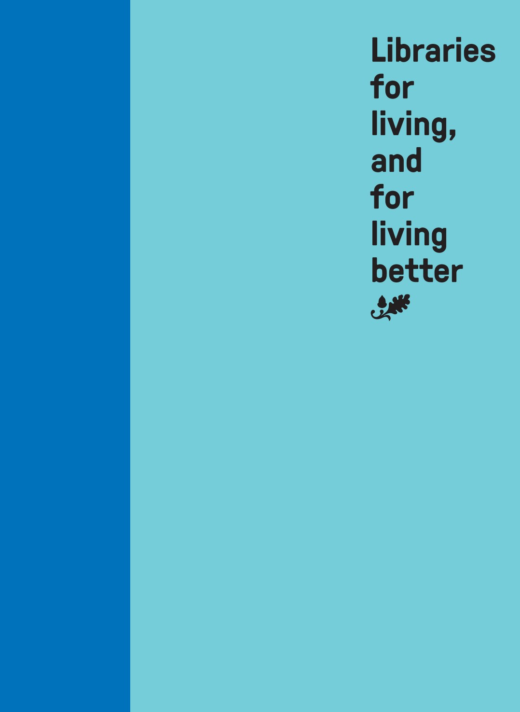
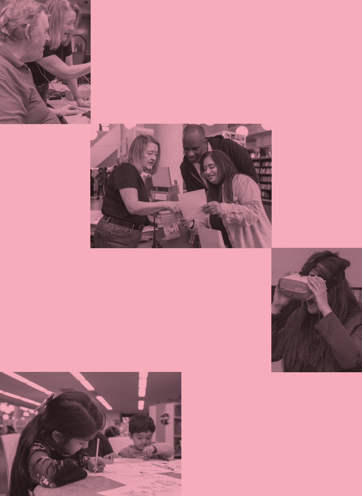
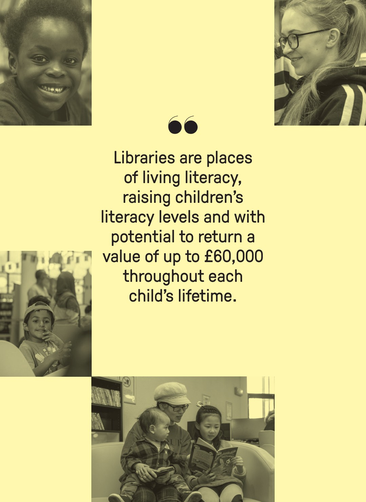
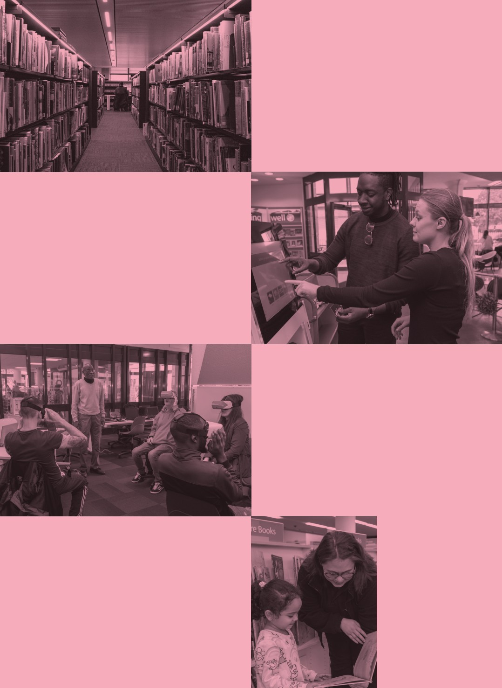
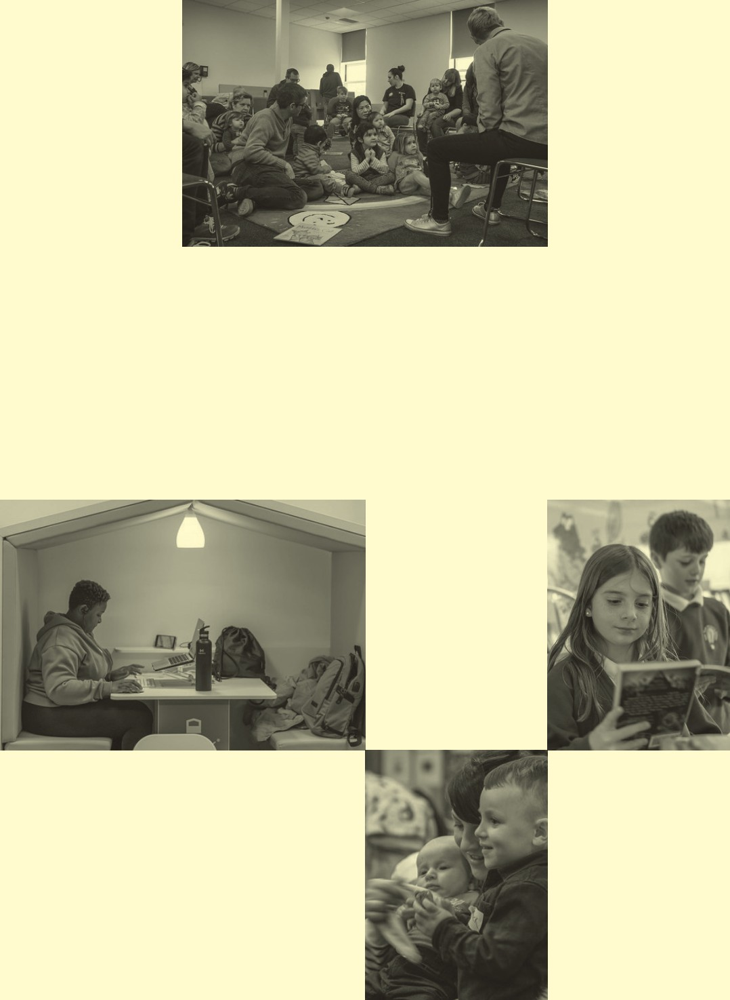
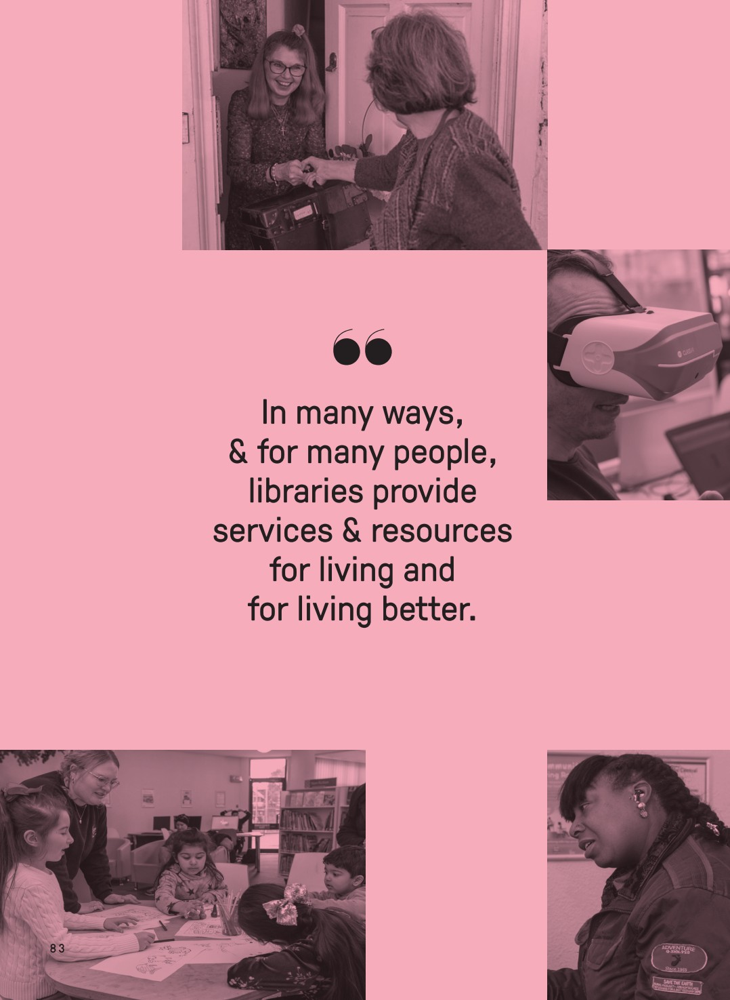
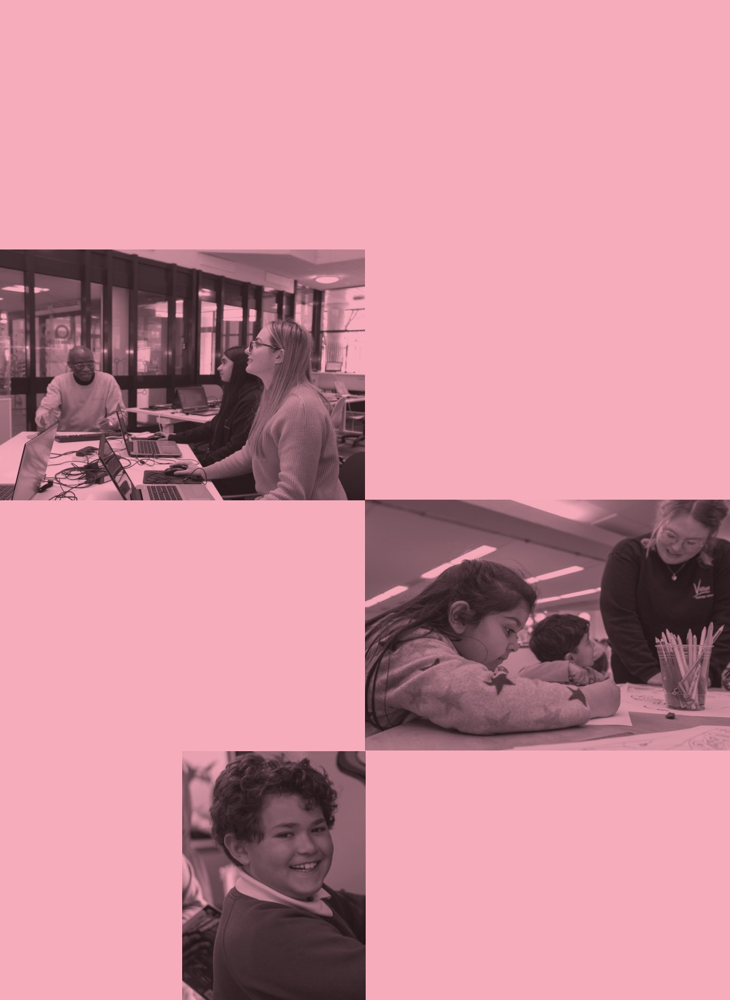

<!-- PAGE: 1 -->
# Libraries for Living, and for Living Better

## The Value and Impact of Public Libraries in the East of England

Report for Libraries Connected East  
June 2023  

**University of East Anglia**  
CreativeUEA and Health Economics Consulting  

**Authors:**  
John Gordon, Anna Blackett, Richard Fordham, Maria Garraffa, Stephanie Howard Wilsher, Eleanor Prince  

<!-- PAGE: 2 -->

<!-- PAGE: 3 -->

Libraries The value and impact of public libraries
in the East of England
Report for Libraries Connected East
June 2023
for
University of East Anglia
CreativeUEA and
Health Economics Consulting
living,
Authors:
John Gordon, Anna Blackett,
Richard Fordham, Maria Garraffa,
Stephanie Howard Wilsher,
and
Eleanor Leist, Aisling Ponzo,
Dan Smith, Allie Welsh
and Georgios Xydopoulos
for
living
better
 <!-- PAGE: 4 --> 

<!-- PAGE: 5 -->

## Contents
## Foreword 9
## Introduction: Libraries for living, and for living better 10
## The value and impact of public libraries in the East of England: Headlines 14-17
## The value and impact of public libraries in the East of England: Executive Summary 18
## The value of libraries considered by theme 20
## The economic value of libraries 23
## Valuing public libraries and their impact: A new evaluation methodology 26
Overview 26
Step One: Horizon scan methodology – workshops 26
Step Two: Case study methodology 26
Step Three: Economic valuation methodology 27
## Limitations of our library evaluation 32
## Context: The East of England 33
## Valuing public libraries in the East of England: Our evaluation, step by step 36
### Step One: Horizon scanning workshops 36
### Step Two: Thematic case study – Digital inclusion 40
### Step Two: Thematic case study – Health, wellbeing and independent living 50
### Step Two: Thematic case study – Children’s literacy 60
### Step Three: Economic valuation described in Step Two, for each Theme 68
## The value and impact of public libraries in the East of England: Findings 82
## Adding to the value and impact of public libraries: Recommendations 88
## References 92
## Appendix 96
Contributors 112
## Acknowledgements 113

<!-- PAGE: 6 -->

We estimate a national value of library services of £3.4bn.

<!-- PAGE: 7 -->

We estimate a national value of library services of £3.4bn.

<!-- PAGE: 8 -->

£3.4bn <!-- PAGE: 9 --> £3.4bn <!-- PAGE: 10 --> “
Libraries are places
of living literacy,
raising children’s
literacy levels and with
potential to return a
value of up to £60,000
throughout each
child’s lifetime.

<!-- PAGE: 11 -->

## Foreword
Libraries Connected Eastern Region commissioned the production of a research report
and development of an evaluation tool that would help measure, manage, and evidence
the impact of social connections in libraries in May 2022. It has been a sector-led
approach in partnership with CreativeUEA and UEA Health Economics Consulting,
supported by Arts Council England and national Libraries Connected.
Libraries Connected East comprises Bedford Borough, Cambridgeshire, Central
Bedfordshire, Essex, Hertfordshire, Luton, Norfolk, Peterborough, Southend, Suffolk,
and Thurrock Library Services. The region includes a range of library governance
models, including local authorities – both county and unitary – and various charitable
independent models. Working collaboratively, we contributed to the development and
funding of the project, for the benefit of the whole sector.
The ambition was to reach a credible, recommended methodology, a replicable
framework for wider application and use, and articulate a return on investment,
providing a financial value of social engagement. The result has been to deliver an
academic research report that has also delivered extra monetary evaluation and
provided an independent reflection on the provision of support for communities through
the public library network.
The report acknowledges the complexity of valuing a holistic service and the many
variables that apply; caution has been applied to ‘downstream’ assumptions, and the
observation that many ‘intangible’ elements mean that the value of libraries may never
be described definitively clarifies the role of public libraries. The report identifies how
libraries provide safe and comfortable spaces where people can develop their literacy
skills, and offer important support when individuals experience crisis moments of
digital exclusion. Libraries are places of living literacy, raising children’s literacy levels
and with potential to return a value of up to £60,000 throughout each child’s lifetime.
This is one value calculation that can be adapted and used locally by professionals
working with libraries in other areas of the nation.
The authors of the report estimate that library services in England can generate social
benefits to their communities to a value of at least £3.4bn per year in relation to the
libraries’ return three value dimensions investigated. Their modelling also suggests that
on investment is at least six times the known annual cost of running libraries nationally.
With a branch library typically providing a gross value of £1M (ranging between
£600,000 and £1.5M depending on the volume, activities and before costs), this report
opens the conversation for library services to develop recognition of the holistic impact
they make on areas of society.
The publication of this report does not conclude the work; it intends to make
recommendations and encourage continual reflection and cross-sectoral conversations.
It enables the use of the evaluation tool (EVOLS) as an interactive model, which can
be adapted for a wide range of social connections and interventions that are a regular
feature of statutory library services now and for the future.

<!-- PAGE: 12 -->

“
Libraries are important
places. They are institutions
and mean so much to so
many people.
Library user in the Libraries Connected Eastern region
I NTRODUCTION
Libraries Connected East asked us to create a credible, replicable and recognisable
methodology for articulating the impact of social engagement with public libraries.
They also asked us to look at the value and impacts of public libraries around three
themes: digital inclusion, health and wellbeing, and children’s literacy.
We found that the three themes are inextricably linked in the work of the libraries
we visited and studied, though we present the themes separately for clarity. We found
many instances of activity ostensibly based on one of these themes having a major
impact on the other themes. We provide examples throughout the body of this report.
The report presents a valuation tool which we created to estimate the monetary
value of library service impacts, for example, in terms of benefit for taxpayers or at the
level of families using a particular service at a branch library. We also present ten case
study examples of stakeholder engagement with public libraries in the Eastern region.

<!-- PAGE: 13 -->

We have grouped the ten case studies according to the three themes:
Theme 1 Theme 2 Theme 3
Digital inclusion Health, wellbeing and Children’s literacy and
independent living associated outcomes
Here we report impacts of Here we report impacts Here we report impacts of
free access to digital skills of activities and events targeted library programmes
and devices for adults and provided for adults. for children, young
families. people and their families,
also considering how
programmes contribute to
literacy recovery following
the Covid-19 pandemic.
For each case study, we present illustrations of monetary value and benefits using the
valuation tool. We also present discussion of other aspects of value represented by each
case study. We use the term ‘extra-monetary value’ to describe these aspects.
Our report offers stakeholders a picture of the value of library services from a
variety of perspectives. We hope that the valuation tool presented here will be a useful
resource for professionals working with libraries. It allows them to make meaningful
estimates of the benefits of library services and programmes, identifying their value in
monetary terms.
Though the valuation tool has been developed through research in the region
represented by Libraries Connected East, we expect the tool to be useful for library
professionals working in other areas of England and potentially across the UK.
We found that attempts to describe the value of libraries usually understate their
reach and impact. Our research led us to reflect with care on what ‘value’ means when
we describe the value of library services. Even when we measure only the monetary
value of a service, we must decide how to assess elements of that service. What units
of value, cost and benefit do we consider to arrive at an overall valuation of a service or
programme? We discuss these decisions when we present the methodology adopted in
the design of the valuation tool.
When we look beyond assessment of monetary value, value can mean many things.
Stakeholders attribute value to activities according to different needs, purposes and
beliefs. Some of the impacts we might value are relatively immediate, such as finding
information to resolve a practical issue in a book or online. Other impacts may be
less obvious or extend over time, for example, the outcomes of joining a ‘reading and <!-- PAGE: 14 --> walking’ group. Participating in a group of this type may shape our habits so that we
spend time walking with others far into our future lives. Some of the impacts we have
looked at begin outside the physical spaces of libraries, starting when library users
engage with digital services online or when they use a mobile library service.
Our experiences of conducting research for this evaluation confirmed a picture that
we also found in the research literature about libraries: the value of library services has
many dimensions, and as a result it can be difficult to describe. Some of this may be
because the availability of libraries is taken for granted, because libraries fulfil many
functions, or because people are not entirely aware of what libraries offer (Moore,
2004). Sometimes not knowing what libraries offer today is linked to how rapidly
libraries have changed in response to the growing availability of online information
sources over the last two decades. If stakeholders have not visited libraries regularly in
that period, their sense of what libraries offer may be out of date.
Recent research about public libraries suggests that these changes are part of
a cultural shift where the functions of libraries are transforming concurrently with
changes in public culture and civic engagement (Wyatt, Mcquire and Butt, 2018).
International perspectives recognise that these are changes accelerated by advances
in digital technology and education, but also by the global Covid-19 pandemic and
the economic instability that we have experienced since (Connaway et al, 2021). The
changes also bear directly upon the three themes we are investigating: new literacies
are required for leisure and work, we may be included in or excluded from the public
sphere in new ways, and the effects of those changing aspects of life and others shape
our health and wellbeing anew. In this changing context, people may look to libraries for
new reasons and value them for different qualities. Policy makers and other institutions
may require or favour different functions and outcomes from library services at
different times, so that the terms by which their value is judged also change. The value
of libraries may never be comprehensively quantified.
Some factors influencing the value we attribute to library services are beyond
the scope of this report. Previous studies examining the attractiveness of libraries to
users have identified influencing factors that are external to library services, like their
proximity to other public amenities and accessibility by public transport (Delrieu and
Gibson, 2017). Our study does not explore these ‘pull factors’, rather it examines a
selection of library services available in branches and online and what stakeholders
value about them.
The libraries we visited, covering various locations of different population sizes,
demographics and prosperity, had user populations that are reasonably representative
of their local area. and we saw nothing to suggest differences in patterns of library use
according to ethnicity. Our case studies describe activities in libraries in each of the
regions represented by Libraries Connected East, and include examples from urban,
rural and coastal branches. In this respect, we believe that when the ten case studies
we present are considered as a group, they provide meaningful insights about what
stakeholders value in library provision for literacy, health and digital inclusion. In the
context of the other studies we have cited, it may also be reasonable to view our case <!-- PAGE: 15 --> studies as a good indication of what library stakeholders value in libraries regardless of
their socio-economic context.
The terms of reference for our study required us to articulate the value of services
and activities provided by libraries. We recognise that libraries themselves are
cultural assets with strong ties to their communities, and often to the heritage of their
communities (Loach, Rowley and Griffiths, 2017). We believe our approach to making
a valuation of library services articulates both the monetary value and the cultural
value of services. It captures aspects of extra-monetary value at a generalised level but
also at a micro level. We ask readers to consider the link between these levels as they
read this report.
Our report shows that how library branches understand and respond to what their
local communities value is itself a high-value feature of library services in general.
Across our report, we seek to balance attention to the value of generalisable features
of library services with consideration of value determined by context, and by the needs
of library visitors and users in a given community and location. spaces of libraries,
starting when library users engage with digital services online or when they use a
mobile library service.

<!-- PAGE: 16 -->

THE INTRINSIC VALUE OF LIBRARY SERVICES
Non-judgemental
& inclusive spaces
Linked services
support users’
wellbeing across
the life course
Alleviate
social
isolation
Frontline mediators
& loneliness
for many public
services & charities
Strong links across the themes
of Digital inclusion, Health,
Responsiveness
wellbeing and independent living,
of library
and Children’s literacy
professionals
Creative in providing
diverse activities
Services &
within tight financial
resources for
constraints
living, and for
living better <!-- PAGE: 17 --> THE VALUE OF LIBRARIES FOR DIGITAL INCLUSION
Support when
people experience
crisis moments
Provide training for
digital technology
Free access to many
digital resources
Link equipment,
skills and
connectivity
Provide IT services
for all <!-- PAGE: 18 --> THE VALUE OF LIBRARIES FOR HEALTH
Improve wellbeing
across the life course
Support
independent
living
Offer
information
on health and
wellbeing
Signpost people to
health and social
care services
Provide other
opportunities
for learning
new skills
Partnerships to improve health
and wellbeing for adults
Support community service
Support GPs
and other Long-term
organisations intergenerational
for social
benefits
prescribing <!-- PAGE: 19 --> THE VALUE OF LIBRARIES FOR CHILDREN’S LITERACY
Support ‘living
literacy’ for families
and children
Access to books
for all children
Link literacy with
many aspects of
peoples’ lives
Complement
school libraries <!-- PAGE: 20 --> IN THE EAST OF ENGLAND: THE ECONOMIC VALUE
OF LIBRAIRES
A branch library
typically provides £1m
worth of value
Library services
can generate social
Libraries’ return on
benefits to a value
investment may be at
of at least £3.4bn
least six times their
per year
annual running cost
Library services in England can generate  A branch library typically provides
social benefits to their communities to a value £1m worth of value (range of £600,000
of at least £3.4bn per year in relation to the to £1.5m depending on volumes and
three value dimensions we investigated. This activities undertaken. These figures are
is based on a conservative estimate of 50% of gross, before operating costs, and include
libraries offering services in the way that aligns only the domains identified by this report).
with the methodology we have used.  For digital inclusion – benefit value
The return on investment calculated from of £379 per participant, assuming
our benefit modelling suggests a conservative that participants continue to secure
figure of at least six times the known annual employment within two years of using
cost of running libraries nationally. these services.
value due to high participation.  For health – benefit value between
£244 and £60,000, depending on the
intervention.
 For literacy programmes – a value of £279
per participant in any programme
 For mobile library services – a value of
£49.70 per participant, and high total
value due to high participation.

<!-- PAGE: 21 -->

ABOUT THIS REPORT AND THE
We link value at different levels,
EVALUATION TOOL WE DEVELOPED across authorities, in library branches and
We take a holistic approach to gauging the programmes, and for people. Please consider
value of library services. We describe many these links which contribute to value, and
types of value, including extra-monetary value value for money.
and monetary value. Please consider these There is no single method to evaluate and
forms of value together. measure the value of all outputs of libraries.
EVOLS EVALUATION TOOL FOR LIBRARY PROFESSIONALS
Use the interactive tool to gauge the monetary value of
services and their benefits
Spreadsheet-based with pre-populated case study examples
Use or adapt the case studies or create your own
Easy to update
Interactive menu of value domains relevant to libraries,
with associated monetary values.
Customise value data for your services (for scale,
participants, events…)
Run evaluation at the push of a button and save
different calculations
The value of
libraries may
never be
Any valuation
comprehensively
of libraries
quantified or
must combine
Some library
definitively
qualitative and users are unsure
what services are
described. quantitative available, or how
to access them.
measures.

<!-- PAGE: 22 -->

IN THE EAST OF ENGLAND: EXECUTIVE SUMMARY
## The value of libraries considered by theme
We evaluated provision in library services across the Libraries Connected East region,
conducting three case studies for each of three themes, and another on mobile library
services. We collected information about outcomes of the activities described in each
theme to inform a robust economic evaluation of the impact and value of the library
services to strengthen future business cases.
THEME 1 – DIGITAL INCLUSION
a) Libraries offer individuals and communities many forms of help and support
for communication (e.g. email, social media), printing (e.g. CVs, returns labels,
tickets) and engaging with government services (e.g. bus passes, blue badges,
passports, housing, schools). For many people, the help available through digital
services and resources also addresses wider health issues they may experience,
particularly isolation, and enables them to participate in society.
The main factors inhibiting better digital inclusion are poor user interfaces and b)
lack of accessibility, task complexity and process design of digital-only processes
and keeping pace with rapidly changing technology. The net effect is that people
who are older, disabled or with literacy needs may be excluded from many
digital services, including statutory government services which are digital-only,
which risks being discriminatory.
c) Library facilities and support are critical and often effective in reducing
the impact of these factors. However, the support offered varies because of
perceived privacy or data protection concerns, staff skills and availability.
Improvements in process and systems design could address these barriers.

<!-- PAGE: 23 -->

THEME 2 – HEALTH, WELLBEING AND INDEPENDENT LIVING: THE IMPACT OF
PROVIDING ACTIVITIES AND EVENTS FOR ADULTS IN LIBRARIES, INCLUDING
THE SIGNIFICANCE FOR SOCIAL PRESCRIBING MODELS
Throughout the Eastern region, many partnerships and initiatives seek to a)
improve health and wellbeing for adults and maintain independent living.
These cover diverse activities, though some library professionals reported
that most are attended by older people. Library services offer activities that
impact directly on the wellbeing of adults, such as physical activities and
mental health initiatives. They also offer activities which impact indirectly on
them and their social networks, through adult education, convening groups to
support parents, carers and families, people with long-term health conditions
and their carers, and intergenerational group activities.
b) Libraries offer information on health and wellbeing and signpost people
to other services. This support has the potential to help people to live
independently, to reduce the risk of falls, and to reduce NHS and social care
costs. Overall, library services provide social care that is central to existing
social prescribing and its development. Library services often initiate
activities to address wider population ambitions such as to level up society
or improve the health and wellbeing of less affluent communities. One
example is the mobile library service that provides contact for many people
in rural communities.
c) Tangible outcomes for participants joining these activities include physical
activity, socialisation and finding employment, which can improve their
wellbeing and reduce mental health issues. Many less tangible impacts
include the effects of trust, volunteering, experience of leading groups,
learning new skills, community service and long-term intergenerational
benefits. Library services provide opportunities for people to improve their
employment, health and to socialise. These are three key indicators for
wellbeing outlined by the Office of National Statistics, which also link the
three themes investigated for this report (health, children’s literacy, and
digital inclusion).
d) Library professionals are creative in providing a range of activities within tight
financial constraints. Circumstances vary between localities. In some, limited
staffing and current challenges to volunteer recruitment and staff training
may limit what could be achieved.

<!-- PAGE: 24 -->

THEME 3 - CHILDREN’S LITERACY AND ASSOCIATED OUTCOMES: THE IMPACT
OF TARGETED LIBRARY PROGRAMMES FOR CHILDREN AND YOUNG PEOPLE THAT
SUPPORTS LITERACY RECOVERY FOLLOWING COVID
a) Library programmes have value and impact on post-Covid literacy recovery by
providing rich experiences and stimulating environments for speaking, listening,
reading and writing. Literacy activities are interactive and face to face, with
impacts on children’s socialisation and confidence.
b) Library programmes for children are creative, fun and motivating. They
build from basics, introducing children to libraries and helping them become
confident and familiar with them. Children learn to find their way around
libraries, make return visits, and begin to use libraries habitually. By introducing
children and their families to libraries and collections, library services
encourage autonomous and motivated information literacy through life.
c) By addressing the whole family unit, libraries provide services and advice
which help families to support their children’s literacy at home and beyond
their direct involvement in specific library programmes. For many children
and their families, library programmes provide free access to a wealth of
books and resources that they would not otherwise encounter. This is shown
by new or increased borrowing of library books by children participating
in programmes, by children’s use of ‘creator spaces’ for art and digital
making, and in the involvement of parents, carers and grandparents who are
sometimes surprised that libraries today can be very different from what they
knew as children.
d) Library programmes have important impacts on children’s literacy that
complement but differ from the impacts of literacy learning in schools. Library
programmes develop ‘living literacy’, for example, by linking literacy with day-to-
day experiences like making a meal at home, or by providing the kit for children
to try out science experiments with household objects. The programmes
link literacy with family relationships, and help develop science and health
literacies. Importantly, the model of literacy in the evaluated programmes is
non-judgemental.
Some programmes are modelling collaborations with two or more organisations e)
(council services, charities). They improve programmes by linking the expertise
of different organisations for making grant applications that secure funding for
literacy provision through sponsored programmes.

<!-- PAGE: 25 -->

We estimate a national
value of library services
of £3.4bn
A typical library might be
expected to produce around a
£1m worth of value per year
## The economic value of libraries
We have attempted to value the outputs of libraries and their associated activities in
monetary terms. There is no single method to evaluate and measure the value of every
output of libraries in how they respond to community needs. There are several ways to
ascertain value. The most useful of them for this evaluation is assessment of ‘value in
use’, resulting from the flow of services, including the knowledge of library professionals
and people who use library services. ‘Value in exchange’ can also be used as a measure
where we can use actual market prices to inform our valuation, but usually this gives
the minimum value. We adopted a pragmatic approach to finding the best economic
data we could, but where data were unavailable, we had to assume that ‘value’
was equal to the cost of the delivery of a particular service (e.g. the cost of a library
professional’s time or for using space in a building). Although this approach is standard
practice, we sought to go beyond this wherever possible.
Without running a full evaluation of each service, we made assumptions based
on the best evidence available. We adapted available published results about library
services to this study, and where necessary updated them to current prices. This helped
us to infer what the total value of a service and value per participant might be. We have
aimed at conservative estimates when assessing downstream benefits, as direct links
with library usage can sometimes be tenuous and subject to other confounding factors.
The case of health benefits is such an instance. Any valuation suggesting a link between
improved health knowledge and a change in behaviour and outcomes would need to
consider many stages which can affect savings on the health system. The same care
would be needed in estimating the extent of the influence of computer access and use
through library services on children’s literacy.

<!-- PAGE: 26 -->

The areas of value (‘domains’) we identified for our valuation are:
 Book and other media borrowing
 Browsing and information
 Digital services
 In-library events
 Community hubs
 Health benefits (physical and mental health)
 Loneliness
 Computing and digital literacy
 Community support and enablement
 Sanctuary and shelter
 Specialised assistance and advice
We valued each of the outputs of library services in the domains shown above and
applied these values to the known volume of activities in this study. Each of these
assumptions is shown in the Appendix, in the Economics Methods paper, where they
are fully explained.
Using these assumptions, we built a model to estimate the monetary benefits for
the ten case studies described in this report, as well as a general library model with
multiple activities. At its crudest estimate, prior to detailed costings and working on
broad assumptions, this whole library model was estimated to generate around £1m
of social benefit per year for a typical urban-centred library. However, because of the
uncertainties and assumptions in the modelling, we designed our valuation tool with
varying circumstances in mind. This modelling can be adapted by a user as required.
The Economic Valuation of Library Services (EVOLS) tool we have created can use a
variety of estimates for future assessment of other services and libraries, where users
can enter their own estimates both of utilisation and cost.
The overall value of domains
We found that there is high overall value in domains associated with a traditional view
of library services i.e. ‘General browsing’ and ‘Books, borrowing and reading’. This
factor remains important as it can drive many of the other services offered by libraries.
The domain of ‘Computing and digital education’ had high overall value. This
seems high by unit value rather than volume. We found these values in previous work by
economists looking at digital inclusion. This value suggests that digital literacy is very
important in many areas of life, including work productivity, time saving, government
efficiency, access to health services, etc.
The domain ‘Media download/accessed’ had relatively high overall value. This
is driven mostly by high volumes of downloads and the cost of electronic media. It
is more expensive than physical books and print media, mainly because of initial
expense, a shorter life before becoming obsolete, and the need for investment in
certain technologies.

<!-- PAGE: 27 -->

The related domains of ‘Health’, ‘Sanctuary and shelter’, ‘Community support and
enablement’ and ‘Community hubs’ are broadly equal in values. Taken individually,
each of these domains has less value than ‘Events’, but together their value is greater.
These smaller sums usually reflect the numbers of sessions and possibly the working
value we adopted. We found that valuing sessions was challenging, given how different
they can be in terms of what can take place and who they are for. Their benefits are
often intangible and harder to monetise as libraries offer a range of non-linear directly
attributable services. We used the cost of their provision as their marginal value, not the
cost of access or willingness to pay.
The value of domains by unit
We have used a set of values per unit, which we feel can be justified (see above). For
example, ‘Computing and digital literacy’ has the greatest value per unit (£400), with
the second greatest value of £60 per unit applying to domains of ‘Events’, ‘Community
hubs’, ‘Community support and enablement’, ‘Sanctuary and shelter’ and ‘Health’.
The domains of ‘General browsing’, ‘Books, borrowing and reading’ and ‘Media
download/access’ have unit values under £9. These estimates are based on a number
of approaches we found in the research literature, and they often varied because of
volume. There may be other bases on which to calculate these values, but after some
consideration we based them on recommended methods.
Conclusion
Library services in England can generate social benefits to their communities to a value
of at least £3.4bn per year in relation to the three value dimensions we investigated.
This is based on a conservative estimate of 50% of libraries offering the services in
the way that aligns with the methodology we have used. The return on investment
calculated from the benefit modelling suggests a conservative figure of at least six
times the known annual cost of running libraries nationally.
A typical library might be expected to produce around £1m worth of value per year
but this may vary, depending on volumes and activities undertaken, from £600,000 to
£1.5m. These figures are gross, before operating costs, and include only the domains
identified by this report.

<!-- PAGE: 28 -->

A NEW EVALUATION METHODOLOGY
OVERVIEW
This section presents a brief outline of the evaluation methodology we developed for
this project. We intend our methodology to be replicable, and that the methods can
be adopted by library professionals to gauge the value of their services. Colleagues
adopting these methods in further projects should follow the sequence of steps we
used. If the recommended steps are not followed, valuation may lack validity and is
unlikely to present a holistic account of the value of a library or service.
The steps we took were:
STEP ONE: INITIAL HORIZON SCAN OF LIBRARY SERVICES IN THE EAST, INCLUDING
COLLECTING DATA ON STAKEHOLDER ENGAGEMENT WITH SERVICES AND
PERCEPTIONS OF SERVICES
Based on the data offered by key stakeholders, we conducted a series of face-
to-face and online workshops with library users, library professionals and other
library stakeholders and partners. We sought a comprehensive picture of services,
including individual experiences, to inform the next evaluation activities. Library
professionals may mirror this step by conducting at least one workshop or focus
groups or a targeted survey, for example, for a specific category of library users.
STEP TWO: EXPLORING LIBRARY SERVICES ‘ON THE GROUND’: COLLECTING CASE
STUDY DATA
Based on the data and materials collected in Step One, including comments
provided during the workshops, we identified examples of library services provision
for our closer attention. For the themes of Health, wellbeing and independent living, <!-- PAGE: 29 --> and Children’s literacy, our case studies looked at specific programmes currently
offered in different libraries, considering value in terms of cost and benefit as
well as extra-monetary value according to thematic interests. Through visits to
the libraries and in-depth interviews with users and librarians, we learned about
programmes and their value. We also looked at available documentation such as
budget sheets, policy documents and available programme-level evaluation. For the
theme of Digital inclusion, we adopted a slightly different approach because digital
inclusion tends to be supported through a variety of inter-related services and
resources rather than through specific programmes or events. As with the other two
themes, we conducted interviews with the same range of stakeholders but also used
observational methods to learn how library users engaged with digital services and
for what purposes. For each theme, our approach was informed by findings from
the workshops in Step One.
Library professionals may replicate this approach by investigating one or more
programmes through a case study approach, drawing on multiple sources of data,
and/or by introducing observational data to their study. They may choose other
themes. It is important that data relating to the cost of services is obtained, and
participant data, in order to complete Step Three.
STEP THREE: DESIGNING AND USING A TOOL CALLED EVOLS TO GAUGE THE
MONETARY VALUE AND BENEFITS OF LIBRARY SERVICES
We used data from Steps One and Two to design the EVOLS valuation tool.
Workshop and thematic findings influenced the value domains we incorporated
to the tool, building on and adapting domains already described in the research
literature for this field. We also applied the tool to the examples of library services
investigated in Step Two, so that we can comment on both the monetary value
and extra-monetary value of library services according to the three themes for
our evaluation.
Later sections of this report present each thematic case study and monetary
valuations for each, estimated using the EVOLS tool. Library professionals will be
able to apply the tool to their services without further design work. We recommend
using the EVOLS tool together with case study evaluation, as in Step Two, so
that both monetary and extra-monetary value can be gauged. This method makes
it possible to understand the value library users attribute to services as well as
monetary value and benefit.
We have outlined our methodology in this way, identifying these steps, because it
tells the story of our work. In this section of our report, we use the same sequence to
share more detail about each method. We follow the same sequence to describe the
findings of our workshops and thematic case studies.

<!-- PAGE: 30 -->

STEP ONE: HORIZON SCAN METHODOLOGY – WORKSHOPS
UEA researchers and Libraries Connected East colleagues held four workshops in
the Eastern region to involve stakeholders in the evaluation of library services. Two
online workshops and two in-person workshops supported maximum engagement with
stakeholders. All workshops were conducted with procedures approved by the Research
1
Ethics Committee of the University of East Anglia .
We took various measures to recruit participants. We invited members of governing
bodies, interest groups and associations to attend. Additionally, we used local
advertisements to raise awareness of the workshops among library users. We placed
posters throughout communities involved in the study, in public areas such as GP
offices, gyms, libraries, and food banks. Leaflets were distributed to nearby residents,
and community social media pages were used to advertise the events. These measures
allowed for convenience sampling of respondents local to the libraries.
One workshop was held specifically for senior library managers and another for an
expert group of councillors, technologists, clinicians and educators associated with the
wider field of each theme for our evaluation (Digital inclusion; Health, wellbeing and
independent living; Children’s literacy). The two library user groups included people
from different racial and ethnic minority groups, older adults, and people living in
localities experiencing poverty. All participants gave informed written consent prior to
joining the workshops.
On the consent form, we asked participants to agree to or reject the recording of
their statements (audio and video), and whether they would like to review transcripts of
their contributions made by our researcher team. We gave each lay group participant a
£25 voucher in thanks for their participation in the workshops.
RECRUITMENT METHOD
 Distribution of flyers
 Invitation of governing bodies, interest groups and associations
 Social media advertisements
SETTING
 Two workshops held online
 Two workshops held in person
ANALYSIS
 Thematic analysis of workshop transcripts
1
D igital inclusion – ETH2223-0137; Health, wellbeing, and independent living, and
Children’s literacy – ETH2223-0162 <!-- PAGE: 31 --> Workshop aims
We designed workshops to gather information about the activities provided by library
services, their potential impact on service users, and what improvements could be
made. Specifically, we aimed to investigate the following:
 What are the local needs of communities?
 Who uses the libraries and for what purposes?
 How could non-users be encouraged to access the libraries?
 How do users of libraries relate to other public services and to online
information services?
 What can libraries do to make communities healthier, and how can
they deliver this to the public?
Workshops in libraries: library users, stakeholders, partners and professionals
We informed participants joining the in-person workshops in libraries about the
evaluation project and the workshop agenda. Participants were invited to comment on
different topics and to ask questions related to each of the themes (Digital inclusion,
Health and well-being, and Children’s literacy) by responding to inclusive resources
and activities placed at different tables/stations in the library venue. Participants
provided feedback verbally, in conversation and/or through contributing to word
clouds, sharing comments using Post-it notes and using pictures or emojis. We also
used scenario methods to collect information, for example, we asked participants how
they would use the library to learn about health, eating well, or joining a gym. Each
workshop lasted between 90 and 120 minutes and included a discussion of proposed
action points at the end.
Workshops online: library service stakeholders
The platform we used for online workshops was Microsoft Teams. We structured
online workshops in the following way: when participants joined, they were welcomed
and informed about the project; different ‘rooms’ were available to discuss the topics/
questions for each theme of our evaluation. Online sessions were recorded (audio and
video) and transcribed. We conducted thematic analysis of the contributions and made
notes which informed emphases in Step Two, our case study activities.
STEP TWO: CASE STUDY METHODOLOGY
Case study methods can provide a rich picture of an activity, programme or service
using different kinds of data collection. They often entail consulting different groups
or individuals to gain information about their subjective experiences and perceptions
of the focus of the case study. Their responses can give insights to what they value,
how their own values influence their perspective, and how their comments relate to
their context. Researchers often speak of case study methods as a way to generate
‘rich data’, as they offer in-depth insights to participants’ lived experiences according
to their circumstances.

<!-- PAGE: 32 -->

We believe this approach suits this evaluation if we want to understand what
library users value about their local services. It is also useful if we want to understand
the value and benefit of library services in relation to health, wellbeing, education and
digital inclusion. In these fields, the rationale, design and efficacy of programmes and
interventions may be determined by different frameworks. Often, programme provision
may be shaped by a combination of assumptions and conscious choices about what
constitutes effective or ‘good’ provision, in fields where the criteria for judging quality
and value are contested in the research literature.
The use of multiple perspectives and different kinds of data collection is
characteristic of high-quality case study and lends weight to the validity of the findings.
The use of two or more forms of data collection and/or the use of two or more
perspectives is known as ‘triangulation’. Through triangulating data and/or perspectives,
it is possible to gain a fuller and more robust picture of the case.
We decided to address the three themes for evaluation through case studies
representing library services in the localities represented by Libraries Connected East.
We looked at services in these areas:
 Cambridgeshire
 Essex
 Hertfordshire
 Luton
 Norfolk
 Suffolk
Our team used a common case study template across themes to record information
for each specific evaluation. The templates documented facts about the provision
examined in each case, recording factual information (e.g. location, time, participation,
etc.), programme aims, details about their links with other themes, and notes about
their value for the evaluation. The rationale for our selection of cases within themes
varied a little depending on the theme. We explain the rationale for each approach in
Section 4, where we present our case studies.
STEP THREE: ECONOMIC VALUATION METHODOLOGY
From the start of our evaluation activity, we recognised that there is no single method
to evaluate and measure the value of all outputs of libraries. In economics there
are several ways to ascertain value. We believed that the most useful method for
considering library services was ‘value in use’, resulting from the flow of services and
including knowledge and information arising from their use or expected ‘utility’ as
far as it can be known. We also used ‘value in exchange’ when actual market prices
could be implied. In this study we adopted a pragmatic approach to ascribe value. In
some cases, where data was unavailable, we had to assume that any ‘value’ that arises
might be equal to the cost of the delivery of that particular service (e.g. for time spent
with a librarian, or for use of building space). This assumes that a service would only <!-- PAGE: 33 --> be provided if costs were less than any assumed benefits. This was not always our
preferred method, so we sought other empirical evidence of more comprehensive value
estimates wherever possible.
This approach depended on well-conducted assessments or statistical studies of
specific services, which were not possible in this study due to constraints of time and
data availability. We adapted these figures for our study as well as to current prices
and have tried to infer from them the cost and value of services per participant where
feasible. Finally, we have been strictly conservative in our estimates when assessing
downstream benefits since any direct link with library usage may be tenuous and
subject to other confounding factors. The case of health benefits is such an instance,
where caution must be adopted in making the link between knowledge and a change in
behaviour, but it also applies to other areas like computer literacy.
The areas of value (‘domains’) we identified for our economic valuation are:
 Book and other media borrowing
 Browsing and information
 Digital services
 In-library events
 Community hubs
 Health benefits (physical and mental health)
 Loneliness
 Computing and digital literacy
 Community support and enablement
 Sanctuary and shelter
 Specialised assistance and advice
We could not estimate the extent of the synergy between benefits such as childhood
literacy, digital inclusion and health although it is obvious there will be some. We have
used the best estimates from the literature for the case studies.
A tool for the Evaluation of Library Services: EVOLS
Because of these uncertainties and assumptions, and because the model has many
applications, we designed a valuation tool to be used interactively. The Evaluation of
Library Services tool (EVOLS) is capable of using a variety of estimates for future
assessment of other services and libraries, where users can enter their own estimates
both of utilisation and cost. The unit cost values used in EVOLS can also be changed
to keep abreast of future prices or variations e.g. according to geographical variation.
EVOLS can also be used to gauge value at scale should this need arise.
The EVOLS model is spreadsheet-based and already contains ten pre-populated
case studies. These can be adapted, or they can be used as they are. However, users
of EVOLS may want to create their own scenarios or cases for future evaluation. To
facilitate this, we have designed it interactively so a user can select from a ‘menu’ of <!-- PAGE: 34 --> relevant value domains (see above) as appropriate, along with their associated monetary
values, already populated in the EVOLS interface. EVOLS users can customise these
values simply by changing the appropriate value cells. Used in this way, the model also
depends on user estimates of the scale of use for a particular service, in terms of number
of participants, events, visits made, etc. Once all relevant inputs are made, the model can
be run by the push of a button. Results will be automatically generated. Users of EVOLS
should note that the calculations include a probability function, so that these results
account for any likely variance in each input parameter. This means that the results,
for example, in terms of total benefit or return on investment, will vary slightly every
time the model is run. A save function is included so that when different versions of the
model are run, or versions are run on different dates with different figures, they can be
saved. The model also has an embedded user guide for easy reference and use. No prior
knowledge is assumed. Libraries Connected will act as a gatekeeper for access to this
model so that a body of evidence can be built over time.
Demonstrating economic valuation in the themed case studies
The following sections of this report include analysis of each theme through case study
examples. Each case study provides descriptions of library provision and programmes.
These qualitative accounts of their extra-monetary value link findings to available research
literature about the relevant theme. We also present data and comment about the
monetary value of these examples. These data are generated using the EVOLS valuation
tool described in section 2.4. We present the case studies alongside valuation data to
demonstrate how the EVOLS tool can be applied to different library services. This also
ensures that discussion of the value of library services balances attention to monetary
and extra-monetary forms of value. The forms of data available for using with the tool
sometimes varied between cases, so the examples illustrate the flexibility of the tool around
whatever information is available for the library professionals who use it in practice.
## Limitations of our library evaluation
We used several methods (flyers, posters, social media, invitations) to recruit
participants for the workshops. Overall, the response was good, but participants were
generally female, older adults, and few were from ethnic minorities. Each of these could
introduce some bias into the findings.
Case studies were chosen for reasons decided by the researchers of each theme.
Digital inclusion researchers wished to cover specific locations. Children’s literacy
case studies were selected to showcase the thematic literacy and reading programmes
across childhood (0-18 years). Likewise, health, wellbeing, and independent case
studies were chosen to highlight the activities provided by the library service and how
these benefit people. Selection processes mean that many other activities and libraries
are not included, thus determining the coverage of the evaluation and its limits.
The economic evaluation of libraries was based on many assumptions, mostly
due to the lack of available data and resources to conduct a comprehensive costing of
activities and benefits.

<!-- PAGE: 35 -->

Regional overview
The East of England is one of the nine official regions of England. It includes the
counties of Bedfordshire, Cambridgeshire, Essex, Hertfordshire, Norfolk, and Suffolk,
and the unitary authorities of Bedford Borough Council, Central Bedfordshire, Luton,
Peterborough, Southend and Thurrock. According to the 2021 Census (Office for
National Statistics, ONS, 2022), the East of England was the region with highest
population growth over the past decade, an increase of 8.7%, with the highest growth
recorded in Cambridgeshire and Hertfordshire. The region’s current population of
around 6.3 million means that it is the fourth most populous region in the UK. Bedford,
Luton, Basildon, Peterborough, Southend-on-Sea, Norwich, Ipswich, Colchester,
Chelmsford, and Cambridge are the region's most populous settlements (Brinkhoff,
2021). Overall, the East of England is a diverse and dynamic region with a varied
economy and a rich cultural heritage.
Geography
The East of England is region of variety. Many of its areas are predominantly rural,
characterised by expanses of countryside, low-lying hills and forests. Much of its
farmland supports intensive farming. There are many small market towns, villages and
hamlets. Other areas have seen some of the UK’s most extensive housing development
since 2011, particularly around Cambridge and Peterborough. The region is home to
tech innovation, for example, in the Silicon Fen area near Cambridge, and the cluster
of telecommunications companies at Adastral Park near Ipswich. The East of England
also has several cities, including Cambridge, Peterborough, Norwich, Chelmsford and
Southend, known for their architecture, retail, entertainment and rich cultural heritage.
They attract visitors and students from all over the world, due in part to their large and
well-regarded universities. The East of England coastline comprises seaside towns,
harbours, ports, nature reserves and Areas of Outstanding Natural Beauty. Popular
coastal destinations include Clacton-on-Sea, Great Yarmouth, Lowestoft, Southend-
On-Sea and Southwold. Variety in the region’s landscape is paralleled by variety in its
demographics. It includes some of the most deprived areas in England, and several
areas receiving government funding for ‘levelling up’ (e.g. Clacton, Colchester, Great
Yarmouth, Lowestoft, Luton, King’s Lynn, Peterborough and Southend), though as a
whole the region ranks third in the UK for gross disposable household income (GDHI)
per capita (2018 data, ONS).
Age
In the East of England, 19.6% of the population are aged 65 and over, compared to the
national average of 18.4%. The region has a higher proportion of people aged 85 and
over compared to other regions in the UK. The region has a low proportion of young
people aged 16-24 (ONS, 2022). The East of England has a median age of 41.7 years,
which is slightly higher than the national median of 40.3 years (2019 data, ONS).

<!-- PAGE: 36 -->

North Norfolk is the local authority with the highest median age of any in England
and Wales at 54 years (ONS, 2022). Among adults, public libraries in England are
most frequently used by people aged 25 to 44 (36.7%) and 65 to 74 years (35.7%).
From 2011 to 2019, the proportion of individuals aged between 16 and 24 years who
reported visiting a public library in England decreased from 34.5% to 20.8% (Statistica,
2023). Among children, 64% of those aged 5 to 10 and 58% of those aged 11 to 15
visited libraries in the year 2019-2020.
Ethnicity
The East of England has a predominantly White British population, accounting for just
over 85% of the region's total population (ONS, 2022). The next largest ethnic group is
Asian/Asian British (6.4 %), followed by Black/African/Caribbean/Black British (2.2 %)
and Mixed/multiple ethnic groups (2.1%). The region has a sizeable Eastern European
population, particularly in Cambridgeshire and Hertfordshire. The Government review
of the use of libraries in the UK by ethnicity (8,161 total respondents – Gov.UK, 2019)
found that Asian people (42.5 %) and Black/African/Caribbean/Black British people
(33.8 %) were more likely to have used a library than White people (31.8 %).
Religion
In the East of England, 46.6% of the population identify as Christian, 3.7% as Muslim,
1.4% as Hindu, and 0.7% as Jewish (Norfolk Insight, 2023).
Economy, education and employment
The East of England has a diverse economy, with strengths in agriculture,
manufacturing, technology, and a growing cultural and creative sector. The region is
home to major companies, including AstraZeneca, Lotus and JCB. Green energy, in
particular wind power, is expanding. The region has a highly educated population,
with a high proportion holding degrees or equivalent qualifications. It also has several
well-regarded universities, including the University of Cambridge, the University of
East Anglia, the University of Essex, the University of Hertfordshire and the University
of Suffolk. The average salary in the East of England is £38.3K (Plumpot, 2023). The
unemployment rate is 3.3%, compared to the UK rate of 3.8% (2022 data). Across the
UK, adults who were not working had higher rates of library attendance than those who
were working (33% compared to 30%) (Department for Digital, Culture, Media & Sport
- DCMS, 2020).
Libraries
Latest datasets indicate that there are 2,581 public libraries in England (Arts Council
England, 2023). Across the East of England there are 11 library services, with around
330 library branches (Libraries Connected data, 2023). Across 2019/20 there were 7.6
million active borrowers in the UK and 34% of all UK-based adults had used a library
within 12 months (DCMS, 2020).

<!-- PAGE: 37 -->

<!-- PAGE: 38 -->

ENGLAND: OUR EVALUATION
### Step One: Horizon scanning workshops
A total of 54 participants joined the four workshops we held. These comprised 26
library members, 10 public members and 18 partner stakeholders. Of the total
54 participants, there were 34 women and 20 men including four ethnic minority
participants. At the workshops, we invited discussion about library services addressing
health and wellbeing, digital inclusion, and children’s literacy. The figure Library
benefits by theme outlines the main benefits of services relating to each of the themes
as reported by the participating stakeholders. Figure: Library benefits by theme
Theme 1 Digital inclusion
The Good Things Foundation 
Access to the National Data Bank 
Learn My Way 
Support from library staff on open access equipment 
Coding classes for children

CV printing 
Scanning, copying, and printing documents 
Access to email 
Engagement with businesses during the pandemic in distributing donated laptops 
refreshed with software to vulnerable households <!-- PAGE: 39 --> Theme 2 — Health, wellbeing and independent living
Replacement of hearing aid batteries 
Free DBS checks for those hosting Ukrainian refugees 
Drop-in sessions for Ukrainian refugees 
Safe places for at-risk groups including refugees and asylum seekers, carers, 
and people with physical or learning disabilities
Various interest groups e.g. knitting, walking, memory 
Phone calls to people at risk of social isolation during the Covid-19 pandemic 
Replacement of ferrules on walking sticks 
Provision of batteries to those with hearing aids 
Slipper Swap programme 
Chronic health condition support

Digital health hubs 
Read My Mind 
Home library service during Covid-19 pandemic 
Free weekly Pilates and yoga sessions refreshed with software to vulnerable households 
Theme 3 — Children’s literacy
Early reading services 
Foster communication 
Sphere of Reading: a Covid-19 Recovery Project 
Dedicated study and tutoring space outside of schools

Book clubs 
Adult Community Learning – English classes for non-native speakers 
Infant programmes – sensory play, bounce and rhyme sessions 
Holiday Activity Fund 
Delivery of library cards through schools 
Holiday reading challenges for school children

Child socialisation and communication through reading, crafts, and Lego groups 
Support for parents through community groups 
The libraries were regarded by the participants as holding a unique role in
the community because of their holistic approach to wellbeing. The stakeholders
acknowledged that librarians are not meant to give expert health advice, but they
recognised that the staff provide much-needed guidance by signposting individuals
towards relevant resources. Libraries also co-ordinate with health experts and
community organisations in supporting initiatives geared towards prevention and early-
stage intervention.

<!-- PAGE: 40 -->

Participants of the workshop agreed on the importance of supporting the libraries
as a safe, warm space for all people to gather. This applies not only to those seeking
adult social care, but also for families with children. Participants described libraries as
welcoming spaces offering support free from judgement.
Stakeholders identified three main areas in which libraries promote digital
inclusion: digital skills, connectivity and devices. Initiatives maintained and supported
by library services promote the teaching of basic digital skills, signpost individuals
towards additional support and provide free mobile data and devices to those who could
not otherwise access these resources.
On the theme of digital inclusion, participants identified and discussed the
important point that people may not realise they are digitally excluded until they reach
a crisis point. The ability to access digital support through library services can be
critical in these situations. Supporting libraries is therefore crucial for helping those
who cannot otherwise access support. Libraries are a vital resource in empowering
individuals to use digital resources on their own.
Libraries are highly regarded for their support of reading programmes, including
children’s literacy. One library professional at the Cambridgeshire meeting shared
her experience of providing reading services for younger children. She emphasised
the importance of maintaining services which promote early reading and help build
communication skills. Libraries are not only beneficial for children’s communication,
but also for offering support to parents. Regarding community groups for young
parents, a librarian in Norfolk reported: ‘We’ve got 165 we’ve developed since the start
of Covid here in Norfolk. We could do with 765.’
Libraries are working within the community to address learning gaps resulting
from the 2020 pandemic. Sphere of Reading, a £1,000,000 Covid recovery project, is
an example of how libraries have worked in co-ordination with public organisations to
support childhood education. This programme is funded by Essex County Council and
run by the Essex Education Task Force, a literacy educator from the library, and an
educational psychologist. Together they lead initiatives to foster early reading.
The intrinsic value of the libraries was reported across the health and wellbeing,
digital inclusion, and children’s literacy themes. Libraries have evolved to meet
the needs of their communities and must continue to assess rising challenges and
areas for improvement. The needs of each community differ based on factors such
as demographics, geographic location and available resources. This affects which
services are needed most by a region and therefore impacts the benefit that certain
initiatives will yield. Additionally, overlapping trends can produce greater benefits in the
community overall. An improvement in reading skills, for example, can help a person in
their ability to find online resources and obtain health information.
The findings of our horizon scanning workshops highlight the value that speaking
directly with the public has for understanding the needs of individual communities.
This research is not without limitations: library and expert stakeholders represented
most of the workshop participants and only four participants overall represented
ethnic minorities. Future research should continue to engage with local communities <!-- PAGE: 41 --> while aiming to include a greater number of public stakeholders and a more diverse
participant group in age, race and gender. Still, the workshops provided informed
insight on how libraries are perceived regionally and how users feel services could be
improved. Libraries should continue to maintain open communication with lay and
expert stakeholders to gauge the areas in which services are most needed.
“ We’ve got 165 community
groups we’ve developed since
the start of Covid here in
Norfolk. We could do with 765.”

<!-- PAGE: 42 -->

STEP TWO:
DIGITAL INCLUSION COMPOSITE CASE STUDIES – METHODOLOGY
Ethnographic methods have had a part in computing research, focusing on
understanding systems design, for several decades (Dourish and Button 1998;
Garfinkel 2002). More recently the use of ethnographic studies has been broadened
to cover the context and use of digital systems and devices. Our approach is similar to
O’Hara’s (2021) study of Detroit libraries.
The main element of our research summarised here is observation. We visited
2
libraries to observe activity and interactions, and to interview staff about their work.
We selected locations for library observations to reflect the general composition of
eastern England: small cities, market towns, rural settlements, and commuter towns
linked to London. Good geographical spread, and differing levels of prosperity, were
also considered when making the selection. We made observations of library users’
activity and behaviour during daytime visits of 60-90 minutes’ duration to a sample of
libraries in the region. These were chosen to provide coverage of the range of locations
across the region.
We conducted interviews with library professionals. Our interviews were open-
ended, designed to allow staff to describe what they saw as important. Prompts
were minimised, and the researchers’ questions were focused on clarifying and
understanding the points made. This ensured that the different staff views of what was
important to them were minimally directed or channelled by the interviewers, to allow
differences of emphases and approach in different places and authorities to be seen.
Case studies were developed based on findings from the observations conducted
in the libraries, and the interviews with library staff and volunteers. These case studies
on digital inclusion are composites or archetypes, illustrating the main features of
the libraries in the region. The locations of the case studies are fictional, but each
element of the case studies is based on the observations and interviews we carried out.
All quotations included in the case studies came directly from library professionals
working in the branches we visited. The results from this work are described in the
thematic discussion below, used in the digital inclusion elements of the model, and
synthesised in the three case studies.
2 Colchester, Great Yarmouth, Hatfield, Letchworth, Luton Leagrave, North Walsham,
Norwich Mile Cross, Norwich Millennium, St Ives, Stevenage, Wisbech.

<!-- PAGE: 43 -->

DIGITAL INCLUSION – MAIN FINDINGS
The libraries we saw all have user populations that are reasonably representative of
their local area (given the overall demographic profile of daytime library users); we saw
nothing to suggest that visible ethnic minorities are less likely to be library users, which
is consistent with a recent Government Review (Gov.UK, 2019). This does not detract
from the typical unbalanced demographic profile of library users: the lack of teens and
younger working age adults using libraries was observed, and frequently mentioned
by respondents. There are exceptions to this, for example, libraries near to colleges or
universities, where students make use of the study spaces from late morning onwards.
Responsiveness
The facilities and services offered by each branch library can be characterised as a
variable but often substantial local adaptation of an authority-wide core provision.
Consequently, libraries with similar catchment areas have very different services
as they are responsive to other local provision. This responsiveness is a significant
strength in delivering efficient and effective services. The following examples illustrate
these characteristics:
 G reat Yarmouth and Wisbech libraries both have substantial areas of deprivation in
their catchment areas. Much library work in Great Yarmouth is driven by the need to
help library users find, use and engage with information and digital services. It also
offers substantial direct provision to alleviate need (e.g. Grab and Go bags containing
toiletries, sanitary products, warm clothing, food).
 Wisbech Library does not seek to replicate activities to address deprivation
provided by the well-established Rosmini Centre, the local community centre which
provides employment support, digital support, translation services, health advice
and access to sport. In library provision, there is a strong focus on digital inclusion
with ‘digital buddy’ sessions, ‘Tea and Tablets’, a laptop borrowing service, help
with wi-fi access and printing, and well-used facilities for people working from
home (who may not have access to good quality wi-fi or printing facilities).
 North Walsham has a high proportion of home-schooled children, so the library
runs a weekly Lego Club in school hours (in addition to the weekend Lego Club)
to bring these children together; it also runs groups for cared-for children and a
monthly autism café.

<!-- PAGE: 44 -->

Co-ordination with other services
The increasing emphasis on libraries as community hubs makes their role as bases
for a range of other activities and services more important. Examples of this include
library space being used for:
 Adult education (particularly ESOL)
 Access to Work
 Registry Office services
 Citizens Advice
 Probation services
 Banking consultations
 Post Offices
In several cases, we saw or were told of scope for further co-ordination between
libraries and other services (e.g. Adult Education), including co-location. A member
of library staff noted that their library has the space and equipment for more co-
ordination, though it is not used in this way, expressed in comments such as “we’ve got
the space but no service.”
Isolation
Public library services have several important strands of work that reduce social
isolation and loneliness and it is an important part of the work of every library we visited.
 From our work, we estimate that across all libraries, an average of two people per
hour visit any single library branch to alleviate social isolation and loneliness.
 Many of the group activities offered by libraries (such as Knit and Natter, Tea and
Tablets, Baby Rhymetime) are designed to reduce isolation, and the volunteer-
led digital services which we looked at had an equally important role in reducing
isolation.
 Outreach services to housebound people and for care homes have a clear role in
reducing isolation
From our observations, coupled with information from staff interviews, we were
able to identify individual behaviour patterns indicating that the library user was
primarily or largely visiting to alleviate isolation. These patterns included lengthy
visits browsing the book stacks but not borrowing or reading, long periods reading a
newspaper with little page turning or similar activity, short visits to ask a question and
leaving without acting on the answer, and purely social visits – only engaging with staff
on matters unrelated to library resources. Fully quantifying the impact of this element
of library work is outside the scope of this study, but social isolation is known to have
an adverse effect on a wide range of health conditions (e.g. Chowdhury, 2018).

<!-- PAGE: 45 -->

“ People are being thrown off
the back of digital.”
Digital-only services
The increasing number of digital-only services, particularly for e-government, excludes
people who cannot access them as a result of disability or health issues, access to
digital infrastructure, low literacy, or unfamiliarity with online systems. There is also a
range of systems-related issues, the most important of which are:
 Task complexity and process design of digital-only processes.
 Poor user interfaces and lack of accessibility.
 Rapidly changing technology.
Libraries offer a wide range of help and support for printing (e.g. CVs, returns
labels, tickets), communication (e.g. email, social media) and official services (e.g.
bus passes, blue badges, passports, housing, schools). For many people, the help
offered also addresses wider health issues (particularly isolation) and enables them to
participate more fully in society.
The types of issue encountered can be shown through the examples of free bus
passes and online banking, though there are other significant issues too.
Bus passes
 The service is online-only. It requires a National Insurance (NI) number, which is
problematic for refugees.
 The process is difficult to complete by people assessed as medically unfit to drive.
 The concept and process of renewal can be confusing, particularly for people with
cognitive or psychological frailty/
Online banking
 Some people don’t trust it as they worry about viruses, scams and phishing – these
fears may often be reinforced by cybersecurity awareness training which is not
sensitive to the background and mental models which people hold (particularly
older people).
 Multifactor authentication is a major problem for many people, particularly those
who only use a phone.

<!-- PAGE: 46 -->

Other problems with online-only services include
 R epeat prescription requests
 Viewing GP letters (links sent to featurephone users)
 B lue badge applications (as the application process is lengthy and confusing)
 Council housing applications or swaps
 School choice and enrolment
These examples show that libraries are acting as ‘frontline mediators’ (O’Hara,
2021) for many services and for many others that have non-digital channels that users
find too difficult, expensive or time-consuming.
The net effect is that many older, disadvantaged and disabled people are excluded
from many digital services, which is potentially discriminatory. Library facilities and
support are critical in alleviating the impact of these problems, but the support offered
varies widely because of perceived privacy and data protection concerns, staff skills
and availability. Some libraries will not help with any problem that may involve finance,
health or any other data that may be thought of as personal, although most take a
pragmatic or risk-balancing approach.
Inclusivity and non-judgemental approaches
The frontline staff we spoke to on all our visits emphasised a non-judgemental
approach and inclusiveness as key principles for their work. These emphases were
evident in the interactions we observed, the choice and presentation of materials in the
library and, in many cases, the organisation of space (e.g. setting up the reception desk
to allow collaborative work on a screen to help users find resources).
An illustration of this is with adult literacy, where most or all the Adult Education
provision is progress-based, which can be a deterrent for many more vulnerable
and disadvantaged library users. In contrast, the help offered by libraries does not
emphasise progression, allowing people to use the service in ways which work for
them (and addressing their needs beyond the presenting issue).
Library professionals
We found that not all frontline library staff are comfortable with digital technologies.
Some younger staff are alarmed at the complexity of Facebook, and dislike the
assumptions of some visitors and colleagues that because they are young they will
be good at looking after the library’s social media presence. For staff of all ages,
familiarity with phone interaction modalities does not prepare people for PC use.
Summary
A review of recent research in libraries, with a focus on digital inclusion, finds
common issues and trends across library services in Europe and North America.
The methodologies used in recent research are based on observations of interactions
within library settings, large scale surveys, and interviews with librarians.

<!-- PAGE: 47 -->

There has been a shift in focus from the provision of physical books towards digital
resources and services, with a consequent change in the competencies needed to
support users of these services. Libraries now have a key role in facilitating access for
disadvantaged people to essential digital services, particularly e-government services.
The provision of free access to equipment and wi-fi is consistently reported as an
important benefit of public libraries. There is a large cultural shift from libraries as book
repositories to becoming information-focused community hubs providing necessary
social interaction, particularly for vulnerable or disadvantaged groups. Critical elements
of this are libraries’ status as trustworthy institutions, in keeping with findings from the
Ipsos Veracity Index (Ipsos, 2021) showing that librarians are considered the second
most trustworthy profession, and the inclusive and non-judgemental staff ethos. The
main barriers are a lack of resources or funding to address the needs of library users
adequately, along with an increased need for staff training.
DIGITAL INCLUSION COMPOSITE CASE STUDY 1: DISADVANTAGED COMMUNITIES
‘DEANGATE LIBRARY, WESTWICH’
Background
Most of the local area is in the bottom quintile for deprivation measures, and many
households do not have broadband access. The library is a two-storey purpose-built
building, opened in 1972. It is situated at the edge of the town centre and, although it is
signposted, it is not on a major pedestrian route. The staff believe this affects footfall.
The public facilities are mostly on the ground floor, with the local history section,
two hireable rooms and staff facilities on the first floor. The ground floor has book
stacks, some casual seating, book borrowing/return stations, a PC and printing area
with eight workstations, study desks and two informal meeting areas. The rooms are
used extensively for ESOL and return to work classes, as the area has a high proportion
of non-native English speakers and, most recently, Ukrainian refugees. The front desk
is at the entrance to the library, with an open layout so that library users and staff can
share a screen.
The library plays an important role in the local community, as there are now few
other community resources in the area. Before the pandemic, a local charity was
offering regular lunch clubs and drop-in sessions, but they ceased when the lease on
their building was due for renewal. A combination of local needs and responses to
budget cuts has led the library service to adopt a devolved management structure, with
a common core offering and services adapted to best meet local needs. Staffing has
3
been reduced due to budget constraints and there has been some reduction in staffed
opening hours.
3 They also considered alternative strategies focusing on reduced opening hours or
increasing the charges made for all non-statutory services.

<!-- PAGE: 48 -->

The library offering
The book stock for adults has been reduced, with a compensating investment in online
subscriptions. This trend towards digital resources was greatly accelerated by the
pandemic, when hard-copy magazine and newspaper subscriptions were cancelled.
There is a good collection of audiobooks, large print, and digital media. The digital
resources are well publicised in the library, but the staff feel that few people are aware
how much is on offer and commented, “we’d like to advertise this on the side of a bus.”
They use Facebook, Twitter and Instagram to publicise library activities and events.
The library is a ‘warm hub’, offering free tea and coffee, and has ‘Grab and Go’
with warm clothing, food, toiletries and sanitary products for anybody who wants
them. No questions are asked, and the staff say the toiletries and sanitary products are
very well appreciated.
The staff see the library and its functions changing rapidly – it’s like a community
hub”; “… not a library anymore, it’s an information service” – but they are committed to
helping people and are proud of their universal, non-judgemental approach. They spend
an increasing amount of time helping with digital issues, mentioning printing (CVs,
return labels, tickets, boarding passes etc. mostly from phones) and help with official
services, particularly those which are online only (including Universal Credit, blue
badges, bus passes, appointments, and a wide range of official services). Many people
are competent smartphone users but struggle with PCs and tablets. Staff mention poor
accessibility, poor user interfaces and online-only services as having the biggest adverse
impacts on people.
The children’s area has a good book collection and open space for Rhymetime for
pre-school children, Lego Club, Homework Club and a jigsaw exchange. Staff noted
that, apart from the primary activity, these groups play an important role in reducing
isolation and encouraging social interaction.
A large proportion of the daytime visitors are older people who visit regularly and
for whom the library is one of their main forms of social interaction. Apart from the
informal interactions, there is a regular Tea and Chat group. Volunteers run regular
services for care home residents and housebound people, borrowing and returning
books. There is some outreach work from the library to care homes. Key services at
Deangate library (main areas of impact only).
Literacy Health Digital
ESOL Rhymetime CV printing
CV building Lego Club Bus pass application
Return to Work Grab and Go bags Blue badges
Homework Club Warm space Universal Credit
Foreign language Tea and chat Passport/visa renewal
publications Travel documents
Free access (wi-fi, PC)

<!-- PAGE: 49 -->

DIGITAL INCLUSION COMPOSITE CASE STUDY 2: MARKET TOWNS
‘DUNTON LIBRARY’
Background
The town is a centre for the local rural area, with good local amenities and a weekly
market on Thursdays. The population is economically mixed, and the area has a high
proportion of older residents.
The library is a single-storey 1970s building situated next to the town’s bus
interchange. It is a single space, with a large children’s area with tables for study and
club activities, soft seating for pre-school children, and book borrowing/return stations.
There is a PC area with four workstations and a printer. The front desk is screened,
but staff can move to a more open position to communicate with people who have
impaired hearing. To cope with budget reductions, the library opening hours have been
reduced, so there are fewer staff employed and many have had their hours reduced, or
they are working over several libraries.
The library offering
There is a good selection of books including an extensive collection of large print
and audiobooks. There is a strong focus on wellbeing and mental health, with a well-
stocked section for adults and a display of resources designed for older children and
young adults. They publicise their activities through Facebook, Twitter, Instagram
and TikTok, although some younger staff dislike the assumption that they should be
responsible for these because they’re ‘digital natives’.
Since the pandemic, there has been a notable reduction in visitors, particularly
on market days. Staff attribute this to old routines being broken, increased borrowing
limits, and a big increase in the use of online library resources. The library still has a
small selection of print newspapers, but all the magazines are online.
The printing facility is extensively used by local people working from home,
including County Council employees, who all have free access by using their badge, as
well as the normal range of return labels, car insurance, prescriptions and other tasks.
It is clearly an important local resource, as there is not a copy shop in the town.
Staff are spending increasing amounts of time helping people (particularly
older library users) with digital issues, although they also say that, for many more
isolated people, ‘problem solving’ is a gateway for social interaction. There is a laptop
loan service, but staff report widespread confusion among a wide range of users
over different input modalities (touchscreen, keyboard, mouse, trackpad) due to
misconceived mental models about the available technology (confusing the phone and
laptop; models of internet connectivity). There is a volunteer ‘digital buddy’ who offers
1:1 sessions for a few hours each week. He notes that he has at least as much impact on
isolation as on digital literacy.
The library has well-established activities for pre-school children on most days.
They used to offer a baby weighing service but stopped as they could not pay for
the routine calibration of the scales. There is a primary age homework club, run by <!-- PAGE: 50 --> a recently retired teacher, as well as a range of clubs and activities (such as Lego,
Reading Challenge, Chess), and schools outreach. A six-month trial of a weekly
Autism Café is due to start soon but staff also recognise value in extending the current
provision – “We need to run more things for kids.”
Services for older people are extensive, including books and other items for local
care homes, reminiscence boxes, a Library at Home (RVS) service for housebound
people, and ‘Tea and Tablets’. Many of the regular users are elderly people who visit for
the interaction with staff, even if they’re not borrowing or returning books.
Key services at Dunton Library (main areas of impact only)
Literacy Health Digital
Homework Club Rhymetime Bus pass application
Lego Club Blue badges
Grab and Go bags Travel documents
Warm space Return labels
Tea and chat Email
DIGITAL INCLUSION COMPOSITE CASE STUDY 3: COMMUTER BELT
‘LINTON ABBOTS LIBRARY’
Background
The library is a purpose-built 1930s building, retaining many of its original decorative
features. It is isolated from the main pedestrian routes by a busy road, although there
is an adjacent pelican crossing.
The public space is all on the ground floor, with the children’s area in one corner,
linked spaces for reference books, a PC area and a hireable space that previously had
PCs. The IT area has six PCs (two with visual impairment keyboards) and five chairs; the
PC printing facility has not worked since the pandemic. This space is used for financial
advice and banking sessions, following the closure of bank branches in the town. The
enquiries desk is fully screened, which makes some interactions with older and disabled
users more difficult.
Charging for services and space hire has been the library’s most direct response to
recent budget reductions.
The library offering
The library has a good book collection with many recent acquisitions, including some
foreign language books (Tamil and Polish); there is also a wide selection of hard copy
magazines and four daily newspapers. Since the pandemic, there has been an increase
in the remote use of digital services and borrowers are taking out more books for
longer periods.

<!-- PAGE: 51 -->

The staff see a clear distinction between ‘library work’ and ‘digital work’ and are
uncomfortable with the speed at which their work is changing. They see themselves as
pioneers or leaders in digital. They regret the loss of interaction around digital training,
which is now mostly online, and see themselves as having a much greater social- and
community-oriented role than previously.
The library offers hour-long 1:1 digital skills taster sessions led by a volunteer,
mostly employment-focused, and charged for. The biggest digital activity for staff is
helping library users print from their phones, using the library app. They have a strict
code about not helping with any activity which may involve users’ personal or financial
information (e.g. booking tickets), and people are advised to bring somebody with them;
staff mentioned visually impaired users as the largest group facing these difficulties.
The library has a range of groups for children and older people, many of which
are charged for; this depends on the event and the demographics – staff see a value in
charging as “if it’s free, people won’t bother to attend.” Events are publicised online via
the library’s Facebook page, where staff estimate there are typically 30 views per post.
The staff are committed to outreach activity and are aware that their non-
judgemental approach sets them apart from other public services. Outreach activities
include a dementia group based in one of the local churches, work with the YMCA to
help homeless people, local SEN schools for ‘Time to Read’, and the district council.
The library is part of a local initiative to give free lunch vouchers to disadvantaged
people (on request, no questions asked).
A recent development is the creation of a ‘maker space’ with facilities for
3D printing, virtual reality (VR), digital embroidery, digital cutter and business
development. This is mostly used by students from the local college and people
working from home, who need quiet space. The more advanced technologies are
underused, as the support and informal ecosystem around the hub are insufficient to
achieve the mass critical for self-sustaining success.
Key services at Linton Abbots library (main areas of impact only)
Literacy Health Digital
Time to Read in SEN schools Dementia group Bus pass application
Saturday stories Work with homeless (YMCA) Blue badges
Weekly ESOL group Returns labels
Police-led sessions on
cybersecurity awareness <!-- PAGE: 52 --> STEP TWO:
INDEPENDENT LIVING
HEALTH, WELLBEING, AND INDEPENDENT LIVING CASE STUDY – METHODOLOGY
Case studies for the health, wellbeing, and independent living theme of this evaluation
were selected by UEA researchers to highlight the benefits of library initiatives in the
Eastern region. We selected one case study for health and one for wellbeing, though
divided independent living in two to provide better coverage of the value libraries bring
to people.
Overall, these case studies demonstrate a qualitative approach via stakeholder
conversations, observations, and the initial overview workshops to understand the
value of the services provided by the libraries in the Eastern region. Using qualitative
case studies provides real life examples, supported by sound research, to build the
quantitative economic evaluation.
RECRUITMENT METHOD
 Desk based research
 Workshops
 Two site visits
 Chats with library staff (face to face and online)
 Chats with service users (face to face)
CONTRIBUTORS
 Fifteen library staff
 Eight service users
 Fifty-four workshop attendees
ANALYSIS
 Thematic analysis of chats <!-- PAGE: 53 --> These case studies offer examples chosen from the wide range of programmes run by
libraries in the Eastern region. Thetford (Norfolk) was selected for the case study on
health because the town experiences a high incidence of unhealthy behaviours (diet,
smoking, alcohol consumption, low physical activity), which consequently result is more
episodes of avoidable chronic health conditions, such as coronary heart disease, and
some cancers. Health data are presented for the east and west of Thetford which show
the effect of deprivation on health.
Clacton, Essex, was chosen for the wellbeing case study because of the high
incidence of mental health problems, which may be due to deprivation in the seaside
town. The other two case studies relate to independent living, representing schemes
devised at county level for countywide access. They describe the Slipper Swap initiative,
and mobile library services. Hertfordshire developed a Slipper Swap scheme to reduce
the risk of falls in older and vulnerable people, while the mobile library services in
Cambridgeshire support people living alone and living in rural communities. The
mobile service is a miniaturised version of a static library and therefore overlaps with
the other three case studies in this theme, and with the Children’s literacy theme.
MAIN FINDINGS – HEALTH, WELLBEING AND INDEPENDENT LIVING
The library service provides numerous activities to help improve health, wellbeing
and independent living for adults living in the Eastern region of the UK. The case
studies focus on activities that attract older adults, however, there may be potential
for greater diversity. Many of the activities provided by the library service could be
included for social prescribing to improve health, wellbeing and independent living. The
three themes addressed in this evaluation – Digital inclusion; Health, wellbeing and
independent living; Children’s literacy – are interconnected, as they all contribute to the
wellbeing of service users across the life course.
Much of the value of the library service is intangible and hard to put a monetary
value on. The economic valuation based on the Knit and Natter case study shown
below may look modest because it focuses on provision at a single branch library, but if
costed at county level the sums would be considerable. In addition, there are challenges
to the service, such as constraints of time and funds; much more could be done with
additional resources. Each case study offers insight into future directions for the library
service, however, collectively, there should be exploration of engaging with minority
groups, men, young adults, and others who do not use the service. Development of best
practice guidelines to engage these communities, to promote and welcome cultural
exchanges, could be one point for action.

<!-- PAGE: 54 -->

HEALTH, WELLBEING AND INDEPENDENT LIVING CASE STUDY 1: HEALTH
Thetford Library, Norfolk: Books and Boots activity
Thetford is a rural market town with around 26,000 inhabitants. It is considered one
of the most deprived areas in Norfolk (Ministry of Housing, Communities and Local
Government, 2019). Unhealthy lifestyle choices (diet, smoking, alcohol consumption,
low physical activity) contribute to major health conditions, preventable cancers,
musculoskeletal conditions, and mental health that are above the national average
(Norfolk County Council, 2020). This reflects the links between deprivation and
poor health identified in recent research, as described by Michael Marmot (Marmot
et al, 2020).
At Thetford library, people can join a monthly Books and Boots group. Books and
Boots was established as part of the wider Healthy Libraries programme, in partnership
with Public Health Norfolk, with the aim of promoting healthier living in the county. It
links walking outdoors with reading.
The programme sought to overcome challenges experienced by the local
community, such as the cost of purchasing books. When the group began six years
ago, it had 12 members, and the library manager led the walk, pointing out wildlife
and historical points of interest, which members enjoyed. Participation numbers have
halved since the Covid-19 pandemic, but those attending liked the informal nature of
the group and were keen for it to continue and grow. Members liked being introduced
to books that were ‘out of their comfort zone’, and they enjoyed walking about two
miles along the river in a beautiful rural area adjacent to the library. One of the group’s
members remarked, “[I] don’t know what we’d do without libraries.”
Books and Boots groups impact health in multiple ways. There are the
health benefits of walking that reduce the risk of many chronic diseases, such as
cardiovascular disease, diabetes, cancers and obesity (NHS, 2019). In addition,
walking impacts mental health both directly (Kelly et al, 2018) and indirectly through
socialisation (Hanson and Jones, 2015). Furthermore, walking in green spaces is also
known to have a positive benefit on health (Barton, Hine and Pretty, 2009). Sedentary
behaviour results in excess healthcare costs: cardiovascular disease (£424m), type 2
diabetes (£281m), colon cancer (£30m), lung cancer (£19m) and endometrial cancer
(£7m) (Heron et al, 2019). Conversely, interventions to increase physical activity in
adults are cost effective (Munro, 1997). For example, twice-weekly exercise classes
for 10,000 participants would prevent 230 patient events with an attached annual
healthcare cost of £601,000 (1997 prices) (Munro, 1997). Research in Norfolk shows
that physical activity is associated with lower hospital admissions and the less time
spent in hospital (Luben, 2020).

<!-- PAGE: 55 -->

“ I feel that they [libraries] are a
“ I don’t know what we’d do community hub, if we're trying to
without libraries.” move towards prevention – early
intervention – supporting our
communities at an early stage.”
The value of libraries for health
Members of the Thetford Books and Boots group take the walk independently of
the library manager. The library continues to support the group by welcoming group
members to the library, choosing books for the group, and by ensuring refreshments are
available after the walk.
Walking is an activity that most people can do at very little cost. Norfolk has 12
walking events each year and other counties, such as Hertfordshire, have over 20
events (Storywalk), attended by more than 190 people. In addition to walking, there
are many other physical activity events held in libraries across the Eastern region. For
example, there are running groups in Norwich held in partnership with MIND, a mental
health charity. Norfolk also offers yoga with instruction in English and Polish, while
other counties provide free seated and outreach yoga and Pilates. Such activities have
potential value to reduce the burden on the National Health Service. Libraries also
function as safe non-medical places for people to seek holistic health information and
are ideal for signposting to other services as required, as described by a healthcare
worker: “I feel that they [libraries] are a community hub, if we're trying to move towards
prevention – early intervention – supporting our communities at an early stage.”
Libraries offer health-related support through books, digital access to health
information, and signposting. Thetford library also has strong links with other
organisations, including Norfolk Public Health and the Charles Burrell Centre, which
support people in surviving the economic crisis and in improving their health. These
facilities can empower people to improve their health literacy, change their behaviours,
and effectively manage long-term health conditions.
Future directions
In partnership with Active Norfolk, Norfolk Ramblers, and other groups, libraries
could increase Books and Boots groups in Norfolk and the Eastern region to offer
opportunities for more people to stay active. The toolkits already used by library
services could be further developed into best practice guides to steer the setting up of
such groups and to help library professionals. There is potential for increasing access
for young adults, families, and people with disabilities with suitable walking routes
and support. Books and Boots, as well as similar activities in the Eastern region, could
be used by General Practitioners and social prescribers for improving the health and
wellbeing of those seeking treatment.

<!-- PAGE: 56 -->

HEALTH, WELLBEING AND INDEPENDENT LIVING CASE STUDY 2: WELLBEING
Clacton Library, Essex: Knit and Natter activity
Clacton-on-Sea is a coastal town with a population over 53,000 (Census, 2021). This
seaside town is one of the most deprived in the UK. It has many older people, children
with low education attainment and high unemployment (Department of Health and
Social Care, 2021). Despite wellbeing and mental health benefits of living by the sea,
the impacts of deprivation reveal a different picture. Clacton has more incidences of
preventable diseases than the rest of Essex and the second highest score for poor
mental health in England, often leading to self-harm and suicide (Ministry of Housing,
Communities, and Local Government, 2019). Employment, health, and connection are
key drivers of wellbeing, and improvements made in these areas can produce greater
benefits (Office of National Statistics, 2023). Social isolation and loneliness negatively
impact wellbeing across the life course, and these needs should be addressed across
communities and society (Mental Health Foundation, 2022). Providing places and
spaces for people to interact is important – libraries are key to this by offering many
free group activities.
Knit and Natter is one such activity group, held weekly in Clacton library, that
can help overcome social isolation and loneliness and improve wellbeing. Around five
participants meet at the library weekly, following the closure of the previous venue.
The ladies are of older age and most travel to the library by public transport or mobility
scooter. The volunteer for the Warm Welcome Campaign, a community initiative
that was set up in response to the cost of living crisis, helps the group and makes
refreshments. People attending the Knit and Natter groups welcome the opportunities
for socialisation and getting to know people. One member of the group said, “I look
forward to it. Gets me out of the house.”
The room is free for the group to enjoy conversation while knitting, crocheting, or
sewing and sharing knowledge about projects. People can take refreshments provided
by the library and set up their own social media groups; however, group members
said they were not particularly confident with computers and preferred in-person
activities. Creative activities and group sessions can improve wellbeing and mental
health across the life course (Fancourt and Finn, 2019); additionally, providing social
activities can reduce loneliness and be effective for people with mental health issues
(Brooks et al, 2022).
The value of the libraries for wellbeing
Clacton library provides free space for the Knit and Natter group, which otherwise
may have folded due to closure of other facilities. Libraries are ideally placed to fill
gaps left by closure of other facilities, such as day centres. Knit and Natter sessions are
commonly available in libraries across the Eastern region. For example, in Essex there
are 27 weekly Knit and Natter events attended by around 180 people. In Hertfordshire
there are more than 230 Knit and Natter events, which are attended by over 1,600
people. Knit and Natter members in Norfolk also participated in charity projects such <!-- PAGE: 57 --> as making clothes for premature babies, and the shoe box scheme for refugees, which
adds further value for wellbeing.
Knit and Natter sessions may be most popular with older people, but there
are different activities to support the mental health and wellbeing of other age and
demographic groups. In libraries across the Eastern region, art and creativity sessions
are available which are directly aimed at improving wellbeing. Many libraries offer
support groups for people with long-term health conditions and their carers. Such
activities may improve wellbeing by providing a safe space for shared experience
and support, leading to a sense of camaraderie and community. As part of the Home
Service, volunteers visit people in their own homes and bring books, thus connecting
with people unable to travel to libraries. Home services have the potential to combat
feelings of isolation amongst people living in rural/coastal areas who face difficulties in
reaching library services and maintaining social connection.
The library service contributes to wellbeing indirectly by supporting people to
navigate systems and gain access to other services e.g. signposting through pamphlets
and online resources. Many libraries offer literacy and digital technology classes and
help people gain additional skills through adult education and training opportunities.
For instance, a library in Essex has a café where people can learn to become baristas.
The library also hosts children’s activities, literacy sessions, and intergenerational
programmes that positively impact wellbeing.
Overall, libraries address wellbeing in many ways that help to reduce the use of
NHS and social care services. As a Council member of staff at a stakeholder workshop
noted: “We're using libraries as community hubs because we're commissioning our
services to sit in those libraries to support older people specifically. But in terms of
adult social care, they really are kind of one of our front doors to a safe space that
people don't feel scared to go in, where open conversations happen quite naturally.”
Future directions
There is potential for partnerships with organisations such as Age UK to create further
opportunities for overcoming social isolation and to challenge normative expectations
of activities according to gender, as found for knitting. ‘Read my Mind’ was developed
in Norfolk to support mental health for men, in partnership with Public Health. The
initiative already has over 70 participants and could be extended across the Eastern
region. This could be further developed to provide non-clinical support for people with
mental health issues while waiting on community therapy team lists. These wellbeing
4
activities could be added to social prescribing lists to offer people alternative ways to
gain help.
4
Non-clinical support for patients waiting for mental health treatment |
NHS Confederation <!-- PAGE: 58 --> HEALTH, WELLBEING AND INDEPENDENT LIVING CASE STUDY 3:
INDEPENDENT LIVING
Hertfordshire libraries: Slipper Swap scheme
Around 30% of people aged 65 and over suffer a fall at least once a year. The
proportion rises to around 50% of people aged 80 and over. Having a fall causes
pain and psychological distress, and around 5% of falls result in a fracture and
hospitalisation (Public Health England, 2022). The cost to the NHS is over £ .3bn per
annum. More than 25,000 emergency admissions due to falls in people aged 65 and
over were recorded in the East of England region during 2020/21 (Office for Health,
Improvement, and Disparities, 2023). Falls prevention includes behavioural aspects,
such as staying active, eating well, and drinking enough, as well as practical solutions,
such as looking after eyesight, hearing, choosing the right footwear (Menant et al,
2008), and having non-slip walking aids (Age UK, 2020). Physical activity can reduce
the risk of falls by 34% (Sherrington et al, 2019) and the relative risk reduction of
falling when hearing loss is corrected with suitable hearing aids is 13% (Mahmoudi et
al, 2019).
To reduce the risk of falls, Hertfordshire Libraries, in partnership with Adult
Social Care, developed the Slipper Swap initiative. Between October and December
2022, eight Slipper Swaps were held and gave out 395 pairs of slippers to people in
Hertfordshire communities. Slipper Swap events were made into social events for
people to engage with other people and organisations, such as Citizens Advice Bureau
(with information on keeping warm and the cost of living crisis), social prescribers,
Macmillan Cancer, Age UK, Herts Healthy Hubs, Fire Safety Officers, Carers in Herts,
Herts Healthy Walks, local police, and local Lions Clubs.
The local police became involved after making a house call to an elderly housebound
resident who had been targeted by vandals. The police officer noticed the poor condition
of the resident’s slippers and made a return visit with some literature on falls prevention
and a pair of robust slippers. The Slipper Swap is aimed at older and vulnerable people
and everyone, including the service users, were pleased with the initiative:
“ On one occasion I was descending carpeted stairs in my home, as usual, and
slipped halfway downstairs to the bottom. I could very well have broken a
limb. These slippers I have received will make a difference and it’s therefore a
preventative measure.”
The value of libraries for independent living
Hertfordshire library service has added value due to the potential reduction in the
risk of falls in older and vulnerable people. The Slipper Swap adds to social activities
already on offer to provide stimulation and interaction that will also impact on
wellbeing and health. Maintaining good health and wellbeing is essential for people to
live independently, and the libraries offer information and support for this.

<!-- PAGE: 59 -->

Across the rest of the Eastern region, initiatives such as replacement of ferrules
(non-slip walking aid tips) and hearing aid batteries reduce the risk of falls and the
attached need for emergency health and social care. Other information helps people
stay safe within their homes and communities.
Outreach services, such as the Library Home service, continue the work by visiting
people at home and in local communities. During the Covid-19 pandemic, some
libraries telephoned service users to find out how they were. The service users valued
this as they had little or no contact with other people.
Libraries work with other organisations, such as Adult Social Care, to share
information about falls prevention and to signpost service users to other places if
they need help with other issues. These are great opportunities for professionals, like
occupational therapists, to work in the community and help older people. The work
of libraries was seen as invaluable to staff in county councils: “We know that falls
are very costly in terms of health interventions, but also leading to adult social care
interventions. These [issues] can all be supported within libraries. So, for example,
Cambridgeshire libraries offer walking stick trade-ins for people needing hearing aids.
All of those are bits of equipment that they can support people with, that can lead to a
de-escalation of need, which is what we want to do really in terms of adult social care
and health.”
Future directions
Libraries should continue to develop partnerships with organisations to promote and
support independent living. Strategies such as the Slipper Swap can help to reduce falls
and promote independent living; however, other library services are not aware of all the
activities. These strategies and activities could be articulated in best practice guidelines,
where library professionals present details of new initiatives, to include the partners
involved, and how they are disseminated for sharing across the region.

<!-- PAGE: 60 -->

HEALTH, WELLBEING AND INDEPENDENT LIVING CASE STUDY 4:
INDEPENDENT LIVING
Cambridgeshire: Mobile library service
Cambridgeshire has three mobile library vans that call at 388 locations in 98 villages
and communities once a month.
The library vans have a broad range of books, and people using the service can
order books and CDs as well as swap magazines and jigsaws. In addition, the vans
carry a range of services including the sale of stamps and reading glasses, and free
walking stick ferrules and NHS hearing aid batteries.
The vans visit care homes, primary schools, playgroups, day centres, housing
shelters, and other places where people are socially isolated (Shared Intelligence,
2017). The breadth of stops also includes campuses, science parks and retail parks.
All vehicles have lifts for easy access. Each van supports between 20 and 60 people per
day of all ages and provides an opportunity for them to meet others in the community.
The staff provide non-judgemental interactions that build trust with services users. This
trust allowed a young person to tell a staff member about potential safeguarding issues.
Another service user came to the library van to tell the staff that her healthcare tests
had come back negative. She was overjoyed but had no one else to tell.
Social isolation and loneliness are associated with the risk of falls (Petersen, König
and Hajek, 2020). Falls cost the NHS over £2.3bn per annum, but this figure almost
doubles (£4.4bn) with social costs and productivity costs (Care Industry News, 2017).
Furthermore, loneliness can affect anyone across the life course. The annual economic
costs of mild, mild to moderate, and severe loneliness in the UK are estimated as
£6,429, £8,157 to £9,537, and £9,976 respectively. Loneliness also places an individual
at greater risk for conditions such as depression, heart disease, stroke, and dementia
(Peytrignet, Garforth-Bles and Keohane, 2020), with associated healthcare costs.
Research is limited on what works well to reduce social isolation and loneliness, but
commissioners are urged find ways to reduce these and the subsequent use of health
and social care services (Social Care Institute for Excellence, 2018).
The value of libraries for independent living
Mobile library services are essential for people unable to access static library services,
however, some mobile library services in the Eastern region are under threat due to
financial cuts in the public sector, while others have already been cancelled. Mobile
libraries provide a lifeline to rural communities and can reduce the social isolation of
living alone in rural areas. Norfolk Mobile Library Service has hundreds of stops within
local communities, which include playgroups, schools, care homes and village halls.
A recent stakeholder consultation in Norfolk showed that mobile library services are
key to local communities to reduce loneliness, social isolation, and to improve literacy
(Norfolk County Council, 2023:564).
Mobile libraries offer an environmentally friendly service. In the context of the cost
of living crisis, they also provide access to the library service for those who cannot afford <!-- PAGE: 61 --> to travel to central libraries. In addition to the loan of books, library staff can share
information, monitor the health and wellbeing of service users, and signpost participants
and carers to other services or even alert social services if they see a problem. These are
hidden values for which it is hard to evaluate the full economic benefit.
Mobile libraries have added value by selling or replacing items that can reduce
the risk of falls and additional costs for health and social care. Additionally, public
awareness of the wider library service is promoted by the mobile vans going to events
around the county. Mobile libraries use social media to alert service users to their stops.
This strategy has increased use of services, especially by families with young children
and people who would normally have been at their workplace at the time of a mobile
library visit.
Cambridgeshire libraries also work in partnership with Cambridgeshire Deaf
Association to provide hearing aid batteries and support for people with hearing
problems. A member of the public from a stakeholder workshop said: “Libraries are
important places. They are institutions and mean so much to so many people.”
Likewise, library staff appreciate the need for the library services that travel
around the community and the volunteers who visit service users in their own homes:
“The home library service has a huge value to those who can’t leave their homes for
whatever reason.”
Future directions
Library services could use local consultations, such as the consultation conducted in
Norfolk, to understand local needs and redesign mobile services to meet these needs
in line with The Public Libraries and Museums Act 1964 and relative to economic
constraints. For example, the Slipper Swap scheme successfully pioneered in some
localities could be added to mobile libraries to provide further value to the library
service, support people living alone and in isolated rural areas, and help to reduce the
risk of falls. More research is needed to understand the hidden value of mobile library
services in the Eastern region.

<!-- PAGE: 62 -->

STEP TWO:
CHILDREN’S LITERACY CASE STUDY METHODOLOGY
In combination, the case studies we present in this section allow us to consider library
service provision for children’s literacy from birth to adulthood, across the birth to
18 age range. The cases allow us to make focused investigations of the relationships
between library service literacy provision and school provision for three different age
groups, also taking account of the changing roles of families, parents and carers for
children across that stage in the life course.
Our selections also allow us to make links with the other two themes of
investigation in this evaluation (Health, wellbeing and independent living; Digital
inclusion), to recognise the multiple and overlapping functions and impacts of
library programmes. We complement each area-based case study with desk research
considering programmes and provision in other areas which have similar functions
and aims. Finally, our case studies afford qualitative exploration of the value of
services through stakeholder testimony, observation and fine-grained attention to
programme design and operation. This qualitative case study approach is aligned with
our quantitative approach to examine the monetary value of library services, providing
illustrative examples of ‘value’ as it is experienced by users of library services.
Our selection of cases is based on the general requirements of the LCE commission
and on the requirements of evaluation specific to the theme of children’s literacy. We
were asked to examine the impacts of library provision on the positive contribution
that engaging with public libraries can have on a child’s school readiness and levels of
literacy. We explore how public libraries support families and children with their literacy
needs post-Covid recovery, for impacts on the development of literacy skills through the
life course, including on self-esteem, accessing information, employment prospects, and
health and wellbeing. Libraries provide safe and comfortable spaces where people can
develop their literacy skills, complementing the support that parents/carers and schools
provide for young people. We will also address the benefits of free access to books, IT,
events, and activities that engage young people with reading and information as well as
to enjoy reading for pleasure.
We have selected three examples of library literacy and reading programmes for
children and young people to investigate, to understand their operation, format and the
involvement of stakeholders.

<!-- PAGE: 63 -->

Selection of case studies according to topic, age range and location
The selected programmes reflect different age groups between birth and 18, and
engage parents/carers and families in different ways. They also represent the range
of relationships between library services and schools, other services, charities and
voluntary organisations.
The first case study is an instance of the core library provision of pre-school par-
ent-and-toddler ‘Storytime’ sessions, a form of early literacy and oracy support catering
for the birth to five age range, directly relevant to school readiness and giving insight to
how libraries respond to parental and family literacy needs. The innovative element of
this provision is in the co-development of the activity in partnership with the family and
community centres to engage difficult-to-reach communities. Crucial parts of the pro-
gramme, such as the selection of participants as well as part of the delivery of the pro-
gramme itself, have been planned in collaborations between the library and the commu-
nity centre and all its activities have been delivered by members of both organisations.
The second case study looks at provision for the 5-11 age group (corresponding
with primary school provision), with a focus on the intersection of literacy with health
and wellbeing, for instance around healthy eating and active lifestyles. We examined a
‘Fit, Fed and Read’ scheme, a form of provision which we have found across different
authorities and which represents an overlap with the social and health-oriented
contributions of library services, especially in a period of crisis in the cost of living.
The third case study explores provision for the 14-18 age group, corresponding with
the upper secondary age range when young people are engaged in study for GCSEs,
A-levels and other qualifications. In this age group, young people may use libraries to
support their study, for example, to inform school homework tasks (a link with home
and family life), but also resulting from other motivations such as reading for pleasure.
We have selected a programme which aims to encourage reading for pleasure
relative to STEM subjects (science, technology, engineering and mathematics), also
engaging young participants in voluntary civic contributions to their communities and
developing skills likely to help them in continuing education and/or employment. The
programme, called ‘Reading Sparks’, also represents a collaboration between library
services and a charity, The Reading Agency, as well as connections with the secondary
phase school curriculum.
The programmes we have identified represent three areas of the LCE region
(Suffolk, Cambridgeshire and Hertfordshire), selected in the context of the wider
evaluation which engages in activity and consultation across all areas of the LCE
region. These selections also afford opportunity to explore provision in communities
that vary according to socio-economic and demographic profiles.

<!-- PAGE: 64 -->

CHILDREN’S LITERACY CASE STUDY 1: EARLY READING 0-5 YEARS
Wisbech, Cambridgeshire: Storytime for pre-school children and families
This case study describes a co-developed Storytime model designed and delivered
by Wisbech Library in partnership with the Wisbech Children and Family Centres in
Cambridgeshire. The study suggests the effectiveness of promoting tangible actions
that link staff members from different services with an innovative and transferable
model for libraries everywhere, to use for the promotion of reading.
Wisbech Library is one of the ten BookTrust Storytime libraries in England, each
invited to pilot activities intended to incentivise ‘difficult-to-reach’ families with pre-
school children to use their local library. The pilot took place between September 2021
and February 2022. Wisbech Library partnered with the Wisbech Children and Family
Centres to select and involve families who would not otherwise have considered using
their local library. The service developed an eight-week programme delivered and
scaled up for the general community. The programme is described in a video created by
the partnership, available via YouTube.
Materials collected for this case included:
 Interviews with Wisbech library staff, the Development Officer, library users
 Flyers, and photos gathered during a visit to the library
 Details on the structure and content of the sessions
 The Book Trust correspondence and materials
 Statistics for attendance at the library
 Cambridgeshire Libraries Service Review
This case study describes a programme model based on the observation that
low-income families do not visit libraries but are involved in weekly sessions at their
local Family and Community Centres. The programme built on the idea of developing
a set of Storytime sessions first delivered in the local Family and Community Centre,
then moved into the library space (see design activity timeline below). Wisbech Library
decided to contact the Wisbech Children and Family Centres and set up a Voting Group
to select participants in low-income families who would have never considered using
their library. Criteria for participation included low income, a socio-economic profile
represented in the experience of parents and carers already active in the Wisbech
Children and Family Centres.
The Storytime activity co-developed by Wisbech Library and Wisbech Children and
Family Centres consisted of an eight-week programme devised around the Book Trust’s
annual Storytime Book Prize. The co-production model proposed by Wisbech Library
was based on the idea that families need to be familiar with the place where the activity
is based, as it would be easier to build up a sense of belonging around the activity. Each
weekly session would include one resource from Wisbech Library and one from the
Wisbech Children and Family Centres. The programme was delivered with a first block <!-- PAGE: 65 --> of three sessions in the Wisbech Children and Family Centres (an environment familiar
to the families), with a transition to the library space for the remaining five sessions
after the first block. The programme concluded with a party for participants.
BookTrust invited the families joining the pilot to help select the next Storytime
Prize shortlist. The parents and library staff read the longlisted books and took part in
an online discussion to nominate the books for the shortlist.
Design activity timeline
MEET MEET MEET
Select and Second Post course
invite users block feedback
@ Community 3 sessions Selection
centre @ Library of new
materials
First block 3 Final
sessions party event
@ Community @ Library
centre
READ END
Based on the piloted activity, Wisbech Library and Wisbech Children and Family
Centres now have a well-attended weekly Story/Craft session catering for children
under five years old. This second offer was requested by the parents and supported as
part of the First Steps Library Club project commissioned by Cambridgeshire Early
Years Service. It uses funding from the Department for Education, East Fenland, and
East Cambridgeshire Opportunity Area.
The Year 2 BookTrust Storytime pilot, targeting difficult-to-reach and lower income
families, started in January 2023, with resources selected by parents to address better
the needs and interests of that age group.
Remarking on some of the benefits of the piloted activities, the Community Library
Assistant responsible for delivering the project said:“I was just there and they got to
know me, so when they came to the library the idea of it wasn't quite so scary. They
had a familiar face to come into the building to. They got really comfortable, and I think
they realised that you can make noise, you can have fun, you know, and all the staff
interacted with the children as well.”
The programme has been covered in the media, with a report available online.

<!-- PAGE: 66 -->

CHILDREN’S LITERACY CASE STUDY 2: YOUNG READERS, 7-12 YEARS OLD
Hertfordshire Library Services: Literacy and health – ‘Fit, Fed and Read’
During school holidays, Hertfordshire libraries provide programmes for children
eligible for free school meals. The collaborate with Hertfordshire Sports Partnership
and Hertfordshire Catering Ltd to challenge the educational inequalities that can arise
from hunger and isolation. National surveys assert that 16 year olds who are eligible for
free school meals are less likely to earn good GCSEs than their peers, by a margin of
around 27%.
Hertfordshire’s Fit, Fed and Read scheme is an adaptation of the Fit and Fed
scheme established by the charity StreetGames. Hertfordshire’s innovation, launched in
2018, recognised an opportunity to support children’s literacy as well as their nutrition
and health. Fit, Fed and Read is available to children aged between 7 and 12 in ten
neighbourhoods. In a typical day of the programme, it offers participating children a
free nutritious meal, physical or sport activities, and creative literacy sessions which
develop children’s skills and confidence for the whole school curriculum. Library
professionals working in the libraries of each neighbourhood design and develop the
literacy sessions, whenever possible organising them in the libraries but also using
other community spaces such as schools, sports centres and fire stations. First offered
in the Easter and summer holidays, the successful scheme was expanded in 2022 to
run in half-term holidays as well.
The value of Fit, Fed and Read for developing children’s literacy has several
dimensions. First, it offers fun and accessible activities for its communities, engaging
families and children who may not access public libraries otherwise. Library service
evaluations of the scheme have shown that some of its participants and their parents
take up library membership, make return visits to libraries, and begin new habits of
borrowing and enjoying books. During the scheme’s book-based sessions, children join
themed activities and games that develop their reading, writing, speaking and listening.
Through varied themes like codebreaking, superheroes, food, and robots, children
learn new vocabulary, read different genres, write for different purposes, and speak
for different audiences. They enjoy listening to stories and poetry read aloud for them
and with them by the Fit, Fed and Read team. They spend time with adults of different
backgrounds who are role models for enjoying reading.
For the community and its families, Fit, Fed and Read has value in raising their
awareness of what their local library can offer. They become more confident in visiting
libraries, and in understanding how to use them. Participating families see how library
resources and spaces support their children’s completion of school homework. Some
evaluations suggest that the scheme helps children who have been reluctant to attend
school towards return. It also seems to offer a space where children and their families
feel comfortable to discuss barriers to their own literacy, acting as a gateway to help
from other services. Fit, Fed and Read also influences the aspirations of its participants,
partnering with the University of Hertfordshire for an end-of-programme celebration
day. For many families, this is their first link with a higher education institution, and <!-- PAGE: 67 --> first opportunity to meet a well-known author in person. Children also receive a free
book, though the wider benefit of Fit, Fed and Read extends to parents and carers who
already buy books but realise that borrowing and engagement in its activities can save
them money. For some themed activities around food, families received the ingredients
for making a nutritious meal at home.
For the library professionals involved in Fit, Fed and Read, the scheme affords
valuable links with colleagues in other local authority services and organisations.
Library professionals and Sports Partnership colleagues often plan and co-teach
programme activities together. They learn informally from one another as well as
through reciprocal training. These teams also worked together to provide a camp for
Afghan refugee children housed in Hertfordshire, with library professionals overseeing
craft-based literacy activities for participants. Through collaboration, representatives
of these services offer their communities experiences that respond to community
needs, and which set literacy development in the context of their everyday experiences,
environments and priorities.
CHILDREN’S LITERACY CASE STUDY 3: TEEN READERS, 14-18 YEARS OLD
Gainsborough Library, Ipswich, Suffolk: Reading for civic action – ‘Reading Sparks’
Library and Information services provide spaces, resources and expertise to develop
community and family literacies. They extend and complement models of literacy
addressed by schools, and have potential lifelong impacts on science literacy and
health literacy.
At Gainsborough Library in suburban Ipswich, young adults aged 14-18 share their
understanding of science with children and families in their community. The library
facilitates the events and communications led by the young adults through the Reading
Sparks4 scheme, with materials provided by The Reading Agency.
The value of library services in relation to this scheme is substantial, in areas
directly related to the literacy development aims of the Reading Sparks scheme and
in other areas brought to our attention by activities linked to the scheme’s provision.
The availability of the scheme for this community, at this library, derives from the
knowledge and skills of library professionals. It is the outcome of a competitive
application process. The application, devised by library professionals, was informed
by their understanding of the needs of the community served by the library, and their
appreciation of the contributions that other local organisations could make to offering
the scheme.
Library professionals interpret and mediate the materials of Reading Sparks to
realise literacy outcomes and community impacts that would not arise from the well-
designed materials alone. Library professionals select and organise book stock drawn
from the scheme’s reading lists, presenting these attractive books ‘front facing’ in
carefully chosen spaces of the library to encourage visitors’ engagement with them.
They help library users to make links between Reading Sparks-recommended books
and other library stock.

<!-- PAGE: 68 -->

Library professionals also identify and facilitate the interactions that make Reading
Sparks books and activities meaningful for library users. They help to translate
experiences of the scheme from the library to home and leisure settings. They afford
agency for the young adults participating in the scheme (Martin and Ito, 2013),
for informal and peer-to-peer learning, as they organise events where people of all
generations in their community can meet. They share their new knowledge of science
(Archer et al, 2015) in themed activities they have designed themselves, making civic
contributions and taking responsibility as volunteers and leaders. They also participate
in and contribute to connected learning (United Nations, 2020), teaching each other the
digital media skills needed to share podcasts, videos and animations on the Reading
Sparks webpages for national and international audiences. Post-pandemic, the library
provides physical, virtual and social spaces for young adults to meet and collaborate for
the benefit of their community.
Library services contextualise and catalyse literacy learning for Reading Sparks
participants and for the community. The services offer, support and conceptualise
literacy development in ways which differ from formal education and school curricula.
In this case study, ‘reading for pleasure’ includes reading non-fiction, and reading about
science in diverse genres, in narratives and in poetry. It encompasses digital literacies,
and acknowledges reading and making texts for real purposes, around materials
and science kit provided for conducting experiments at home (Heck, 2017). Literacy
develops in family and peer interactions, where speech, writing and images combine.
In the process, these library service users become more confident in reading and
understanding science writing in different genres, with potential benefits through life
for leisure, employment, health literacy and wellbeing.

<!-- PAGE: 69 -->

<!-- PAGE: 70 -->

STEP THREE:
VALUATION OF DIGITAL AND COMPUTING PROVISION USING THE EVOLS TOOL
This section presents an economic valuation of library services related to digital
inclusion, demonstrating application of the EVOLS tool to data about a service we
considered during our case study activities. We have chosen to provide an estimate of
the value of services which support library users in preparing CVs.
The value we present is based on an assumption that there are two people using
this service in a branch library in any hour (i.e. two participants for this provision per
hour, as observed during library visits). If we estimate the total use of this service
annually, we arrive at a total of roughly 4,000 participants per year. This figure was
estimated through our field research observations, though in practice it may fluctuate
according to participants’ needs and market conditions.
The EVOLS tool presents these estimates in a Microsoft Excel interface which looks
like this:
Computer/digital literacy (CS10)
Participants per year 4000
Value per Particpant £379.20
Inflated Value £379.20
Total Value £1,516,800.00
The tool also provides this contextualising information:
ASSUMPTION
Based on the assumption of two participants per hour for 250 days (library opening hours).
SOURCE
Good Things Foundation, 2022. The economic impact of digital inclusion in the UK.
(Taking the average cost of all digital learners today as £176.21).
COMMENTS
In terms of libraries’ activities, we assume a cost of £40 per participant, multiplied by a
CBR of 9.48 we calculate the value per participant).
This provides a benefit of around £379 per participant.
We estimate that the total value of this provision is £1,516,800.

<!-- PAGE: 71 -->

VALUATION OF HEALTH, WELLBEING AND INDEPENDENT LIVING PROGRAMMES
USING THE EVOLS TOOL
The screenshots below show valuations for four services relevant to our case studies
for this theme. We have presented four services to illustrate the variation in participant
numbers and value for services relevant to this theme, as the forms of provision differ
greatly depending on the aspect of health, wellbeing or independent living they address.
The screenshots are drawn directly from the EVOLS tool which can be used on any
device capable of running Microsoft Excel. We entered data about each service to the
tool, generating the valuations shown below.
The data show that services related to this theme have values per participant which
vary between £244 (from low intensity, less impactful services) and £60,000 (from
higher intensity and more impactful interventions).
In addition, we present illustrations of other information available to users of the
EVOLS tool in its interface. The figures below show details that are typically displayed
in the tool, which can include information on literature, research or assumptions which
inform the modelling and resulting estimates of value. Often they are accompanied
by brief explanatory comments. The information provided for each service can vary
according to availability, so the forms of information used in each valuation may also vary.
SERVICE A
Falls Prevention Case Study (CS4)
Participants per year 10
Value per Particpant £739.00
Inflated Value £831.45
Total Value £8,314.47
SOURCE
PHE, 2018. A Return on Investment Tool for the Assessment of Falls Prevention
Programmes for Older People Living in the Community. Available at: https://assets.
publishing.service.gov.uk/government/uploads/system/uploads/attachment_data/
file/679856/
A_return_on_investment_tool_for_falls_prevention_programmes.pdf <!-- PAGE: 72 --> SERVICE B
CBT Mental Health Case Study (CS5)
Participants per year 80
Value per Particpant £244.00
Inflated Value £251.11
Total Value £20,089.12
ASSUMPTION
Two sessions per week for 40 weeks as per observations of the research team.
SOURCE
Knapp, M, Wong, G, 2020. Economics and mental health: the current scenario.
World Psychiatry 19, 3–14. doi:10.1002/wps.20692.
COMMENTS
We have adopted an RoI 2.3:1 based on Knapp 2020. The cost per session is £106
in 2021 values (PSSRU 2021).
SERVICE C
Read My Mind Case Study (CS6)
Participants per year 1
Value per Particpant £60,000
Inflated Value £71,643.14
Total Value £71,643.14
ASSUMPTION
Conservative assumption of delaying completed suicide for one participant.
SOURCE
McDaid, D, Park, A, Zervedas, P, 2017. Commissioning Cost-Effective Services for
Promotion of Mental Health and Wellbeing and Prevention of Mental Ill-Health. LSE
Personal Social Services Research Unit.

<!-- PAGE: 73 -->

COMMENTS
According to the PHE report, there are economic benefits from delaying completed
suicide as the number of lost years of productive activity will be reduced; overall it is
estimated that, on average, costs averted of around £60,000 per year per person of
working age can be realised where suicide is delayed.
SERVICE D
Loneliness - Knit and Natter (CS9)
Participants per year 5
Value per Particpant £5,692.00
Inflated Value £6,038.64
Total Value £30,193.21
Following the same sequence, data for mobile library services modelled in the EVOLS
tool estimates a value of the service of £49.70 per participant. The screenshot from
EVOLS shows the bases of this evaluation:
Mobile Libraries (CS11)
Participants per year 6437
Value per Particpant £49.70
Inflated Value £49.67
Total Value £319,725.79
The additional data for this valuation is as follows:
ASSUMPTION
Participants based on case studies’ average yearly visits in mobile libraries.
SOURCES
Verbooy K, Hoefman R, Jobvan E & J, Brouwer W, Time Is Money: Investigating the
Value of Leisure Time and Unpaid Work Value in Health 21 (2018) 1428-1436;
Amazon statistics (value per book), Arts Council of England report (2014).

<!-- PAGE: 74 -->

The total value of each of these services depends on the number of participants using
each service. Of all of the services represented here, the mobile library provision involved
the largest number of participants (n=6,347) and a total value just under £320,000.
Falls Prevention Case Study (CS4)
Participants per year 10
Value per Particpant £739.00
Inflated Value £831.45
Total Value £8,314.47
Comments Assumption based on typical Tai Chi cohort as describe by Public
Health England (PHE)
Source PHE, 2018. A Return on Investment Tool for the Assessment of Falls
Prevention Programmes for Older People Living in the Community.
Available at: https://assets.publishing.service.gov.uk/government/
uploads/system/uploads/attachment_data/file/679856/
Comment Tai Chi has a Social Return on Investment (SRDI) of £1.97 per £1.00
invested. The cost per participant is £374.99 in 2018 values (£422.05
inflated to 2022 using a 3% interest rate). So we estimate a Social
value of £831.45 per participant.
Source A Return on Investment Tool Assessment of Falls Prevention
Programmes for Older People Living in the Community.
Reference PHE, 2018. A Return on Investment Tool for the Assessment of Falls
Prevention Programmes for Older People Living in the Community.
Available at: https://assets.publishing.service.gov.uk/government/
uploads/system/uploads/attachment_data/file/679856/
GO TO CALCULATIONS GO TO CALCULATIONS <!-- PAGE: 75 --> CBT Mental Health Case Study (CS5)
Participants per year 80
Value per Particpant £244.00
Inflated Value £251.11
Total Value £20,089.12
Comments Assumption: 2 Sessions per week for 40 weeks
Source Assumption of the research team
Comment We have adopted an Rol 2.3:1 based on Knapp 2020. The cost per
session is £106 in 2021 values (PSSRU 2021). The value was inflated
to 2022 using 3% interest rate
Source Economics and mental health: the current scenario
Reference Knapp, M., Wong, G., 2020. Economics and mental health: the
current scenario. World Psychiatry 19, 3-14. doi:10.1002/wps.20692
GGOO T TOO C CAALLCCUULLAATTIOIONNSS <!-- PAGE: 76 --> READ MY MIND CASE STUDY (CS6)
Participants per year 1
Value per Particpant £60,000.00
Inflated Value £71,643.14
Total Value £71,643.14
Comments Conservative assumption of delyaing completed suicide for
1 particpant
Source
Assumption of the research team
Comment According PHE report there are economic benefits from delaying
completed suicide as the number of lost years of productive
activity will be reduced; overall it is estimated that on average
costs averted of around £60,00 per year per person of working age
can be realised where suicide is delayed
Commisioning Cost-Effective Services for Promotion of Mental Source
Health and Wellbeing and Prevention of Mental Ill-Health. LSE
Personal Social Services Research Unit
Reference
McDaid, D., Park, A., … Zervedas, P., 2017. Commisioning Cost-
Effective Services for Promotion of Mental Health and Wellbeing
and Prevention of Mental Ill-Health. LSE Personal Social Services
Research Unit
GGOO T TOO C CAALLCCUULLAATTIOIONNSS <!-- PAGE: 77 --> LONELINESS - KNIT AND NATTER (CS9)
Participants per year 5
Value per Particpant £5,692.00
Inflated Value £6,038.64
Total Value £30,193.21
Comments Based on case studies and libraries field research
Source Libraries field research
Comment Estimates based on Loneliness monetisation report (Department
for Digital, Culture, Media & Sport, 2020). The report shows the
median total cost of the loneliness per year per individual is around
£6,429-£9,538 depending on the degree of loneliness.
Source Loneliness Monetisation Report
Reference Department for Digital, Culture, Media & Sport, 2020. Loneliness
Monetisation Report
GGOO T TOO C CAALLCCUULLAATTIOIONNSS <!-- PAGE: 78 --> MOBILE LIBRARIES (CS11)
Participants per year 6437
Value per Particpant £49.70
Inflated Value £49.67
Total Value £319,725.79
Comments Based on the average yearly visits in mobile libraries
Source Case Study
Comment Average of the value of borrowed book (Amazon statistics) and the
leisure time of browsing and wellbeing WTP
Source Various
Reference Verbooy K, Hoefman R, Jobvan E & J, Brouwer W. Time Is Money:
Investigating the Value of Leisure Time and Unpaid Work Value in
Health 21 (2018) 1428-1436; Amazon statistics (value per book), Arts
Council of England
GGOO T TOO C CAALLCCUULLAATTIOIONNSS <!-- PAGE: 79 --> VALUATION OF CHILDREN’S LITERACY PROGRAMMES USING THE EVOLS TOOL
The screenshots below show EVOLS valuations for each programme described in our
case studies for this theme. Earlier sections of this report present EVOLS valuations
for other themes and explain how the EVOLS tool functions to provide valuations in
these formats.
Each literacy programme shows a value per participant of £279. Though the
programmes differ in aims, their design and delivery principles have some commonality,
which may account for the parity of value per participant. However, programmes involve
or engage different numbers of participants. The Reading Sparks programme, for
example, involves volunteer participants in similar numbers to the other programmes
described here, but also engages many other participants in the community through
events organised by library professionals and the volunteers. In the valuation data
presented, this results in a higher total value than the other programmes described. The
valuation using EVOLS is limited to monetary valuation and does not address the other
forms of value offered by these programmes and which we described in our case studies.
Book Trust Storytime Price (CS3)
Participants per year 30
Value per Particpant £279.00
Inflated Value £474.98
Total Value £14,249.36
Fit and Fed Case Study (CS2)
Participants per year 30
Value per Particpant £279.00
Inflated Value £474.98
Total Value £14,249.36
Reading Sparks Case Study (CS1)
Participants per year 650
Value per Particpant £279.00
Inflated Value £474.98
Total Value £308,736.24 <!-- PAGE: 80 --> As readers of this report are now familiar with the forms of information provided by
EVOLS, described in relation to the other two themes, here we present screenshots
of the full EVOLS displays for each literacy programme we considered. These include
details of sources and explanatory comment.
Reading Sparks Case Study (CS1)
Participants per year 650
Value per Particpant £279.00
Inflated Value £474.98
Total Value £308,736.24
Comments 165 Familes (250 adults & 650 children)
Source The Reading Agency - Reading Sparks Final Reporting Template,
November 2022
Comment As a proxy we used the value of the Sure Start Programmes in UK.
Spreading this benefit across all eligible children (as was done
with costs) produces an average lifetime economic benefit to
society of between £279 and £557 per eligible child. Two-thirds of
the economic benefit is received by taxpayers and one-third goes
to families. The lower bound value used to inflated to 2022 values
using a 3% interest rate.
Source Research Report DFE-RR073 - National evaluation of Sure Start local
programmes: An economic perspective
Reference 2004. The National Evaluation of Sure Start Local Programmes in
England. Child and Adolescent Mental Health 9, 2-8. doi:10.1046/
j.1475-357x.2003.00069.x
GGOO T TOO C CAALLCCUULLAATTIOIONNSS <!-- PAGE: 81 --> Fit and Fed Case Study (CS2)
Participants per year 30
Value per Particpant £279.00
Inflated Value £474.98
Total Value £14,249.36
Comments Staff from 10 Libraries deliver to up to 30 children in each location
(school) a one-hour session 1x a week. This programm lasts 1 year
Source Case Study
Comment As a proxy we used the value of the Sure Start Programmes in UK.
Spreading this benefit across all eligible children (as was done
with costs) produces an average lifetime economic benefit to
society of between £279 and £557 per eligible child. Two-thirds of
the economic benefit is received by taxpayers and one-third goes
to families. The lower bound value used to inflated to 2022 values
using a 3% interest rate.
Source Research Report DFE-RR073 - National evaluation of Sure Start local
programmes: An economic perspective
Reference 2004. The National Evaluation of Sure Start Local Programmes in
England. Child and Adolescent Mental Health 9, 2-8. doi:10.1046/
j.1475-357x.2003.00069.x
GGOO T TOO C CAALLCCUULLAATTIOIONNSS <!-- PAGE: 82 --> Book Trust Storytime Price (CS3)
Participants per year 30
Value per Particpant £279.00
Inflated Value £474.98
Total Value £14,249.36
Comments 5 families attended each week (5 Adults / 6 Children) for 8 weeks
Source Case Study
Comment As a proxy we used the value of the Sure Start Programmes in UK.
Spreading this benefit across all eligible children (as was done
with costs) produces an average lifetime economic benefit to
society of between £279 and £557 per eligible child. Two-thirds of
the economic benefit is received by taxpayers and one-third goes
to families. The lower bound value used to inflated to 2022 values
using a 3% interest rate.
Source Research Report DFE-RR073 - National evaluation of Sure Start local
programmes: An economic perspective
Reference 2004. The National Evaluation of Sure Start Local Programmes in
England. Child and Adolescent Mental Health 9, 2-8. doi:10.1046/
j.1475-357x.2003.00069.x
GGOO T TOO C CAALLCCUULLAATTIOIONNSS <!-- PAGE: 83 --> 

<!-- PAGE: 84 -->

THE EAST OF ENGLAND: FINDINGS
When we synthesise the findings of our linked approaches to gauging value, we identify
the value of library services in these terms:
The intrinsic value of libraries
Participants in our research for evaluation commented on the intrinsic value of
libraries in workshops and in activities reported in our thematic case studies. Often
this value was associated with free and holistic provision, and connected with the three
themes we investigated (Health, wellbeing and independent living, Digital inclusion,
and Children’s literacy) and other areas. Participants felt and recognised that library
services evolve to meet the needs of their communities. They articulated many qualities
for which they valued library services, including:
 their flexibility and responsiveness to local needs and circumstances
 the variety of services on offer, presented in different modes and formats
 their contributions to partnerships with other services, organisations and
community groups, including leadership and innovation
 their provision of space and material resources for voluntary and community-led
activities which may not otherwise be resourced
 their contribution to learning and building skills, for leisure, education
and employment
 their outreach activities to engage difficult-to-reach groups in public life and
social connection
In many ways, and for many people, libraries provide services and resources for
living and for living better.

<!-- PAGE: 85 -->

“
In many ways,
& for many people,
libraries provide
services & resources
for living and
for living better.

<!-- PAGE: 86 -->

The value of libraries – the expertise of library professionals
Participants in our research often remarked on what they valued about their
interactions with library professionals. Library professionals were widely perceived as
trustworthy, non-judgemental and helpful. They were reported to be enthusiastic about
working in partnership with other services, organisations and community groups. In our
case study work, we learned that library professionals are highly knowledgeable about
the communities they serve. They often demonstrate skill in catalysing, organising and
leading activities and innovations, or in mediating and adapting other services and
provision to add value in monetary and extra-monetary terms. For example, they play
an important role in ensuring schemes and resources provided by other organisations
such as charities meet the needs of their communities.
The value of library spaces
We found library branches, mobile services and online provision to be welcoming
spaces offering support of many kinds, free from judgement. Library buildings are
seen as safe, warm places in which people of many ages and backgrounds may gather.
Libraries have a role in adult social care, but also for families with children. As freely
accessible indoor spaces providing resources around which people interact, libraries
promote social connection and contribute to reducing isolation.
Theme 1 — The value of libraries for digital inclusion
Libraries offer many cost-free or low-cost
activities that engage participants in physical
activities. They support mental wellbeing by
offering opportunities for social connection.
Libraries help to maintain independent living and
contribute to risk reduction. They increase health
literacy through the provision of health information
literature and signposting to other services and
specialist expertise. Importantly, libraries in the
Eastern region provide direct and indirect value to
the wellbeing of people across the lifespan.

<!-- PAGE: 87 -->

Theme 2 — The value of libraries for health, wellbeing and independent living
Library services support digital skills development
and connectivity, providing free mobile data
and access to devices. Digital services signpost
individuals towards additional support from many
other services. Libraries also offer important support
when individuals experience crisis moments of
digital exclusion. Digital library services are critical
in mediating and obviating access issues associated
with potentially discriminatory digital resources.
Theme 3 — The value of libraries for children’s literacy
The programmes and activities we reviewed pro-
mote early reading and help build communication
skills, offering support and literacy education to
parents as well. Libraries offer diverse programmes
to cater for users’ different interests and purpos-
es for seeking information. These programmes also
promote a form of ‘living literacy’ which connects
different spheres of life – the home, the workplace,
formal education and leisure.

<!-- PAGE: 88 -->

## The economic value of libraries
We found that return-on-investments for library services were higher where
beneficiaries of health-related interventions by library services were in work, or where
they had the potential to resume paid work and improve their longer-term productivity
and wage capacity.
Interventions that make an impact on the life course of individuals generally show
potentially much higher returns on investment. Examples include programmes like
Reading Sparks and pre-school projects such as Lego Club and Storytime.
The area of digital inclusion through libraries makes a substantive return-
on-investment based on the case study example. This too is based on the future
productive capacity of participants in the workplace, and on the future potential impact
on their lifetime earnings. This estimate also includes some health benefits that offset
NHS costs.
For some library programmes, the subsequent health benefits are quite modest,
though in a few cases annually the interventions they provide help to prevent or avoid
catastrophic events such as falls and suicide attempts, and in a few cases can even
save lives.
The scale of library service events and the extent of participation in them are
important to the overall size of benefits. Schemes with low benefit value per person but
high participant numbers may in fact have large monetary impacts. Putting on or running
more events like these, and doing so more often, could realise much bigger benefits.

<!-- PAGE: 89 -->

<!-- PAGE: 90 -->

ADDING TO THE VALUE AND IMPACT OF PUBLIC
LIBRARIES: RECOMMENDATIONS
Review marketing, signage and online access for library services
As indicated in the foreword to this report, the functions of libraries and the needs
they address have been in transition for some time. In that context, members of the
public can have misconceptions about the services currently offered by libraries. We
encountered this during our research. Although libraries have evolved from their
traditionally perceived image as a ‘quiet space’, communities often continue to view
them in this way. This may result in people not feeling welcomed, especially those who
are new to the library or who have young children. Libraries should work to promote
awareness of the services they offer and of their function as an inclusive space. A
digital inclusion officer reported a “massive drop” in volunteers after the pandemic and
a hesitancy throughout the community to be in public spaces due to health concerns.
Stakeholders supported the development of a national bank of volunteers for online
support to address this change.
Throughout the report, we have reported on the holistic value of library services
and the ways in which different types of service overlap with one another. We
believe this virtue and source of value also presents a challenge: it can be difficult
to communicate the ‘offer’ of libraries simply and clearly. At the same time, it can
sometimes be hard for library users to identify exactly what services are available,
and how, where and when to access them. In our research, working across different
library services, we found that the presentation of online information about services
varied. It was not always easy for us to locate information. A review could consider
how improved access supports inclusion of different types, and how to help all
members of the public find and reach the services they need. Consideration of a wider
range of communication methods, such as audio tools or pictures, is needed to inform
the public of library services. Participants suggested creating video clips that could
be presented in libraries and promoted through platforms such as WhatsApp and
Nextdoor, as well as the continued use of social media.
Develop liaison and sharing best practice between library services
and other partners
We found many instances of very effective and often innovative collaboration, at different
levels. At the same time, members of different groups, including library professionals,
indicated to us that there was sometimes scope for better liaison and communication
between partners to realise the full value (monetary and extra-monetary) of some
activities. Sometimes they felt that this could be achieved with extra investment.

<!-- PAGE: 91 -->

Improving digital provision
Some specific steps could enhance digital provision. These include adopting a
legislative provision similar to Section 6 of the Care Act 2014 to improve collaboration
and co-ordination with other services. Developing a campaign to increase awareness of
the range of library services among the wider (non-library using) public could be useful.
In particular, this could promote awareness of digital and non-book provision. We
recommend that any revisions to library apps and websites are focused on improving
their core usability, accessibility and navigation over visual design, and that such
improvements are driven by user needs and appropriate metrics.
Understanding the impacts of library services on health, wellbeing
and independent living
Service providers could explore the impact of schemes on falls prevention, to estimate
how many falls may be prevented by interventions. Development of evaluations on
specific activities could lead to impacts on health, wellbeing, and independent living
across the life span. In terms of the emphasis of this report on the value of services,
it would also be possible to estimate how library service initiatives create savings for
other public services. Social prescribing is one area where this relationship could be
examined: it is a key component of the national strategy of the NHS for promoting
personalised care. Social prescribing connects people to activities and services within
the community to meet practical, social and emotional needs that impact personal
health and wellbeing.
Extending the reach of services supporting children’s literacy
Library services could consider how to develop the offer of programmes for teens and
older teens to match the success and variety of programmes available for younger
children. They could embed approaches we saw in the programmes we considered,
where reading and literacy were supported through connections with other interests
and through purposeful, practical activities. It may also be useful to consider which
locations and what type of spaces support the engagement of more teens with reading
and literacy programmes. Schemes which afford older teens agency and responsibility
appeared to be very successful, especially when they worked alongside young adults as
role models. Libraries could seek to identify more effective ways of communicating their
offer to this age group.
Further evaluation of services
We suggest that library services consider developing a sampling and data collection
strategy, to provide appropriate quantitative data for evaluating the impact and
effectiveness of public library services in key areas. In addition, services could
initiate an evaluation of the wellbeing and mental health outcomes of different library
activities. An evaluation of the environmental impact of using mobile library vans may
also be worthwhile.

<!-- PAGE: 92 -->

Areas for Improvement Identified by Workshop Stakeholders
 Engage more with those who do not currently use library services in learning how
to encourage library use
 Link with the external partners to address community gaps in resources and services
 Standardise services where possible
 Increase outreach for those who are homeless by providing meal vouchers
 Automatic enrolment, especially for areas of deprivation
 Collaborate more with primary schools
 Work with local General Practitioners to obtain suitable health information to pass
on to library service users
 Use of appropriate tools to advertise library activities
 Co-locating services and cross-promotion of services with local organisations
 Lifelong learning consultations with marginalised people who feel they have not
been served by schools or libraries in their lives
 Remove time limits on computers and allow use until the next booking
 Expansion of programmes for maternity services – support groups for pregnant and
new mums and increase health literacy among this group <!-- PAGE: 93 --> 

<!-- PAGE: 94 -->

Brinkhoff, T. (2021). United Kingdom: East of
England. https://www.citypopulation.de/en/uk/
eastofengland/ (Accessed 29/3/23)
Age UK (2020). Avoiding a fall. https://www.ageuk. Brooks, H., Devereux-Fitzgerald, A., Richmond, L.,
org.uk/information-advice/health-wellbeing/ Bee, P., Lovell, K., Caton, N., Cherry, M.G., Edwards,
exercise/falls-prevention/. B.M., Downs, J., Bush, L., Vassilev, I., Young, B. &
Rogers, A. (2022). Assessing the effectiveness
Archer, L., Dawson, E., DeWitt, J., Seakins, A. & of social network interventions for adults with a
Wong, B. (2015). “Science capital”: A conceptual, diagnosis of mental health problems: a systematic
methodological, and empirical argument for review and narrative synthesis of impact. Social
extending Bourdieusian notions of capital beyond Psychiatry and Psychiatric Epidemiology, 57(5), 907–
the arts. Journal of Research in Science Teaching, 925. https://doi.org/10.1007/s00127-022-02242-w
52 (7), 922-948. https://doi.org/10.1002/tea.21227
Chowdhury, D. (2018). The detrimental impact of
Arts Council England (2023). Basic dataset for social isolation on the patient presenting to the
libraries 2022. https://www.artscouncil.org. Emergency Department. Journal of Emergency and
uk/supporting-arts-museums-and-libraries/ Critical Care Medicine, 2 (67), 1-3. http://dx.doi.
supporting-libraries org/10.21037/jeccm.201
Barton, J., Hine, R. and Pretty, J. (2009). The Connaway, L., Faniel, I., Brannon,B., Cantrell, J., Cyr,
health benefits of walking in greenspaces of high C., Doyle,B., Gallagher, P., Lang, K., Lavoie, B., Mason,
natural and heritage value. Journal of Integrative J. & van der Werf, T. (2021). New model library:
Environmental Sciences, 6 (4),261–278. https://doi. Pandemic effects and library directions. OCLC
org/10.1080/19438150903378425 Research. https://doi.org/10.25333/2d1r-f907 <!-- PAGE: 95 --> Delrieu, V. & Gibson, L. (2017). Libraries and the
geography of use: How does geography and asset
“attractiveness” influence the local dimensions of
cultural participation? Cultural Trends, 26 (1), 18-33,
https://doi.org/10.1080/09548963.2017.1268331
Department for Digital, Culture, Media & Sport (2020). Libraries – Taking Part Survey 2019-2020. Hanson, S. & Jones, A. (2015). Is there evidence that
https://www.gov.uk/government/statistics/ walking groups have health benefits? A systematic
taking-part-201920-libraries/libraries-taking-part- review and meta-analysis. British Journal of Sports
survey-201920 Medicine, 49 (11), 710–715. https://doi.org/10.1136/
bjsports-2014-094157
Dourish, P. & Button, G. (1998). On
“Technomethodology”: Foundational relationships Heck, E. (2017). Engaging the community as content
between ethnomethodology and system design. creators: Case study research in grassroots media
Human Computer Interaction, 13 (4), 395–432. production in the library sector. In S.Gair, S & A.van
https://doi.org/10.1207/s15327051hci1304_2 Luyn (Eds.), Sharing qualitative research: Showing
lived experience and community narratives (pp. 219-
Care Industry News (2017). Falls cost the NHS and 234). Routledge.
social care £6m per day – Falls Prevention Week.
https://www.careindustrynews.co.uk/2017/09/ Heron, L., O’Neill, C., McAneney, H., Kee, F. & Tully,
falls-cost-the-nhs-and-social-care-6m-per-day- M.A. (2019). Direct healthcare costs of sedentary
falls-prevention-week/ behaviour in the UK. Journal of Epidemiology and
Community Health, 73 (7), 625–629. https://doi.
Fancourt, D. & Finn, S. (2019). What is the evidence org/10.1136/jech-2018-211758
on the role of the arts in improving health and well-
being? A scoping review. World Health Organization. Ipsos (2021). Ipsos MORI Veracity Index 2021: Trust
Regional Office for Europe. https://apps.who.int/ in professions survey. https://www.ipsos.com/
iris/handle/10665/329834 sites/default/files/ct/news/documents/2021-12/
Veracity%20index%202021_v2_PUBLIC.pdf
Garfinkel, H. (2002). Ethnomethodology's Program.
Rowman and Littlefield. Kelly, P., Williamson, C., Niven, A.G., Hunter, R.,
Mutrie, N. and Richards, J. (2018). Walking on
Gov.UK (2019). Use of libraries. https://www. sunshine: scoping review of the evidence for
ethnicity-facts-figures.service.gov.uk/culture-and- walking and mental health. British Journal of Sports
community/culture-and-heritage/adults-using- Medicine, 52 (12), 800–806. https://doi.org/10.1136/
public-libraries/latest#by-ethnicity bjsports-2017-098827 <!-- PAGE: 96 --> Mental Health Foundation (2022). All the lonely
people. https://www.mentalhealth.org.uk/sites/
default/files/2022-06/MHAW22-Loneliness-UK-
Report.pdf
Loach, K., Rowley, J. & Griffiths, J. (2017). Cultural
sustainability as a strategy for the survival of Ministry of Housing, Communities & Local
museums and libraries. International Journal of Government (2019). English indices of deprivation
Cultural Policy, 23 (2) 186-198. https://doi.org/10.108 2019. https://www.gov.uk/government/statistics/
0/10286632.2016.1184657 english-indices-of-deprivation-2019
Luben, R., Hayat, S., Wareham, N., Pharoah, P. & Ministry of Housing, Communities and Local
Kay-Tee K. (2020). Usual physical activity and Government (2019). The English indices of
subsequent hospital usage over 20 years in a deprivation 2019: Statistical release. https://assets.
general population: the EPIC-Norfolk cohort. BMC publishing.service.gov.uk/government/uploads/
Geriatrics 20, 165. https://doi.org/10.1186/s12877- system/uploads/attachment_data/file/835115/
020-01573-0 IoD2019_Statistical_Release.pdf
Mahmoudi, E., Basu, T., Langa, K., McKee, M.M., Moore, M. (2004). Public library trends. Cultural
Zazove, P., Alexander, N. & Kamdar, N. (2019). Can Trends, 13 (1), 27-57. https://doi.org/10.1080/095489
hearing aids delay time to diagnosis of dementia, 6042000216437
depression, or falls in older adults? Journal of the
American Geriatrics Society, 67 (11), 2362–2369. Munro, J., Brazier, J., Davey, R. & Nicholl, J. (1997).
https://doi.org/10.1111/jgs.16109 Physical activity for the over-65s: Could it be a cost-
effective exercise for the NHS? Journal of Public
Marmot, M., Allen, J., Boyce, T., Goldblatt, P. & Health, 19 (4), 397–402. https://doi.org/10.1093/
Morrison, J. (2020). Health equity in England: The oxfordjournals.pubmed.a024667
Marmot review 10 years on. Institute of Health
Equity. https://www.instituteofhealthequity.org/ NHS (2019). Benefits of exercise. https://www.nhs.
resources-reports/marmot-review-10-years-on/ uk/live-well/exercise/exercise-health-benefits
the-marmot-review-10-years-on-full-report.pdf
Norfolk County Council (2020). Health and social
Martin, C. & Ito, M. (2013). Connected learning and care profile. www.norfolkinsight.org.uk
the future of libraries. Young Adult Library Services,
12 (1), 29–32. Norfolk County Council (2023). Cabinet report:
Equality impact assessment report 2023-24.
Menant, J., Steele, J., Menz, H., Munro, B. & Lord, Document.ashx (cmis.uk.com)
S. (2008). Optimizing footwear for older people
at risk of falls. Journal of Rehabilitation Research Norfolk Insight (2023). Overview report, Norfolk:
& Development, 45 (8), 1167–1182. https://doi. Population report. https://www.norfolkinsight.org.
org/10.1682/JRRD.2007.10.0168 uk/population/#/ <!-- PAGE: 97 --> Office for Health Improvement and Disparities (2023). Public health profiles. https://fingertips.
phe.org.uk/search/falls#page/1/gid/1/pat/15/par/
E92000001/ati/6/are/E12000006/iid/22401/%20%20
%20%20%20age/27/sex/4/cat/-1/ctp/-1/yrr/1/cid/4/
tbm/1/page-options/car-do-0 Shared Intelligence (2017). Stand by me: The
contribution of public libraries to the well-being of
O’Hara, D. (2021). ‘Frontline Mediators’: an older people. Shared Intelligence for Arts Council
ethnographic study of online welfare applications at England. https://www.artscouncil.org.uk/sites/
the public library. 2021 IEEE 45th Annual Computers, default/files/download-file/Combined%20older%20
Software, and Applications Conference (COMPSAC), people%20report%2017%20July.pdf
Madrid, Spain. 1573-1578. https://doi.org/10.1109/
COMPSAC51774.2021.00234 Sherrington, C., Fairhall, N., Wallbank, G., Tiedemann,
A., Michaleff, Z.A., Howard, K., Clemson, L., Hopewell,
Office for National Statistics (2022). Census 2021. S. & Lamb, S. (2019). Exercise for preventing falls in
https://www.ons.gov.uk/census older people living in the community: An abridged
Cochrane systematic review. British Journal of
Office of National Statistics (2023). Measures Sports Medicine, 54 (15), 885-891. https://doi.
of national well-being dashboard: Quality org/10.1136/bjsports-2019-101512
of life in the UK. https://www.ons.gov.uk/
peoplepopulationandcommunity/wellbeing/articles/ Social Care Institute for Excellence (2018).
Tackling loneliness and social isolation: the role
Petersen, N., König, H-H. & Hajek, A. (2020). The of commissioners. https://www.scie.org.uk/
link between falls, social isolation and loneliness: prevention/connecting/loneliness-social-isolation
A systematic review. Archives of Gerontology and
Geriatrics, 88, 104020. https://doi.org/10.1016/j. Statistica (2023). Share of respondents that visited
archger.2020.104020 a public library in England from 2011 to 2019, by
age. https://www.statista.com/statistics/295285/
Peytrignet, S., Garforth-Bles, S. & Keohane, K. public-library-usage-uk-england-by-age/ (2020). Loneliness monetisation report. Department
for Digital, Culture, Media and Sport. https://assets. United Nations (2020). UN report – Youth
publishing.service.gov.uk/government/uploads/ volunteering: Supporting young people’s
system/uploads/attachment_data/file/963077/ engagement in Covid-19 response and recovery.
Loneliness_monetisation_report_V2.pdf https://www.unv.org/sites/default/files/UNV-
UNDP%20Youth%20Volunteerism%20in%20the%20
Plumpot (2023). Area insights: East of England. COVID-19%20Context.pdf
https://www.plumplot.co.uk/
Wyatt, D., Mcquire, S. & Butt, D. (2018). Libraries
Public Health England (2022). Falls: Applying All as redistributive technology: From capacity to
Our Health. https://www.gov.uk/government/ culture in Queensland’s public library network. New
publications/falls-applying-all-our-health/falls- Media & Society, 20 (8), 2934–2953. https://doi.
applying-all-our-health org/10.1177/1461444817738235 <!-- PAGE: 98 --> ## Appendix
THE ECONOMIC VALUE OF LIBRARY SERVICES (EVOLS): METHODS
AND ASSUMPTIONS
This paper provides an overview of the underlying principles and techniques employed to
assess the economic value of library services. More specifically, it:
 Groups and explains the ‘value domains’ that have been identified based on the field
research conducted and the feedback received from various stakeholders during face-
to-face events.
 Explains the rationale for the value domain we have identified.
 Describes the method/s that have been selected for measuring these values and the
rationale for the selection, including the economic approach and where appropriate,
the data sources used.
 Guides the reader to relevant economic and related literature that supports the
content discussed in the paper.
 Explains the data requirements for the modelling that was undertaken.
AIM OF EVOLS
The project aims to estimate the monetary value of services provided by libraries
in the Eastern region, demonstrating relevance on both a local and national level.
Fundamentally we found that libraries, big or small, rural or urban, are responding
to their communities’ needs, in specific and nuanced ways. Libraries are highly
heterogeneous in the services they offer and vary by the populations they serve, their
size, location, available resources, and local council priorities. For these reasons, we
have modelled different case studies from the field work undertaken using a common
framework and set of options in our main model. The model is available online via
Libraries Connected and UEA Publishing Project.

<!-- PAGE: 99 -->

METHODS
In economic theory, there are numerous approaches to assess value. Among them, the
most suitable for libraries are the "value in use,"; which considers the practical benefits
derived from library services, and the concept of "value in exchange"; which is relevant
when certain services or goods, such as book purchases, are already exchanged in a
market setting. Value in use describes the likely or expected ‘utility’ that is derived,
while the value in exchange is more about willingness to pay for a product that has
a ‘shadow’ market price that can be implied. We could not find a single method to
evaluate and measure the value of the output of libraries, so we adopted a pragmatic
approach for each strand of value that was identified. In some cases where we had
nothing more, we assumed that the value of provision was equal to the cost of the
particular service i.e., when considering services such as time spent with a librarian or
the utilization of building space, we assumed that these services would only be provided
if the cost incurred was not greater than the presumed benefit gained. This is standard
economic theory. However, this was not our preferred method and we sought empirical
evidence of more comprehensive value when we could find such relevant sources.
We have tried to identify the most common sources of values of library services
based on extensive relevant research into libraries.
We also appreciate that the role and definition of a library has changed and is
continuing to change in step with social and cultural change. Libraries have had to
address these trends when faced with issues such as digitisation, competition in the
book reading space from alternative sources, new media, and a decline in reading
generally. Literacy and reading habits have also become more challenging in some
populations and the Covid-19 pandemic, financial cuts, and a lack of LA funds for
investment have also played a part in diminishing conventional library access and in
particular, traditional footfall.
COST OF RUNNING LIBRARIES
From the costs associated with library services, we can infer certain aspects of their
value. The usual costs associated with running libraries consist of fixed costs (i.e.
overheads) and variable costs (i.e. mostly staff and consumable). Knowing these costs
is an effective means of expressing value of human input and expertise and the physical
resources required to run a library service. We recognise that such value attribution
is only a minimal value and in many more cases, there may be much more value
potentially to be realised.
Consider a scenario where a class is held in a room within a library. While the
value of this class can be assessed based on the resources invested, such as staff and
space, its true worth is more likely to be reflected in the broader outcomes it generates
for society. The impact of the class on the participants' health, knowledge, skills, and
overall societal benefit is often far greater than the mere inputs utilized to facilitate
it. We have pursued such benefits wherever possible and used such estimates where
the evidence is reliable. Some services in libraries have been evaluated in this way in <!-- PAGE: 100 --> academic literature and various reports but others have not. Where possible, we used
these, provided there was a direct analogue with the services we knew had been carried
out in the specific library case studies being investigated. Otherwise, we have fallen
back on the input’s method. We should also add that none of the case studies that have
been reported in the main report have been formally evaluated, so that the evidence we
have used in the economic modelling if it exists at all, is imputed from other studies not
directly from the scope of this report.
We sought figures for the running of libraries from respondents and specialists in
library services who have collaborated with us in this study. We asked them for estimates
of the cost of running:
1. Buildings, rent or borrowings, maintenance, power and heating etc. and related
services.
2. Staffing, including local and (% of) centralized services, contractors, etc.
3. Other capital equipment, including computers, etc. and transport e.g. vehicles such as
vans, mobile libraries, etc.
4. Consumable (e.g., marketing, postage, advertising, outreach etc.)
Observation from the fieldwork in the project led us to derive some clear activity
functions performed by all libraries to some degree. From these activities it was clear
that different types of outputs emanated from them and that these could be grouped into
several domains, namely:
BOOKS BORROWING, IN-HOUSE READING, AND DIGITAL MATERIALS
Book borrowing
A mainstay of the value of libraries is book borrowing and in-library usage, whether in
physical or digital format, and this value may be defined in different ways Book borrowing
may be evaluated as a conventional rental (albeit usually a free one, although sometimes
potential fines are attached to overuse). The value of accessing and borrowing books,
often found using the shadow value of leisure time, may also be considered. Users are
not restricted by a need to physically visit the library since materials are available through
online library portals. These qualities add to the ‘human capital’ value of libraries through
their role as education and literacy enablers. Their additional value in serving the wider
society and the economy can also be considered.
In summary books etc. can be valued by their:
 Rental value, or shadow-price
 Time value (of staff or users, or both)
 Educational/literacy value (‘human capital’)
 Societal value <!-- PAGE: 101 --> We have chosen to develop a proxy rental value for our valuation purposes. However,
we acknowledge that every book that is read could have a human capital development
facet. For example, a book may improve a person's literacy or knowledge or increase
human economic productivity to society. Some of these values have been measured
in other library activities we have encountered in the case studies which go beyond
simply borrowing books. For the purposes of this model, we assume a base rental value
as a minimum value which works to account for stock management and maintenance
including the costs of buying and replacing stock, turnover and replacement costs
and depreciation.
For borrowed books, we have used the ‘shadow price’ of purchasing the book as the
working life of a book and have discounted it (at 3.5% pa) using a standard method to
obtain the Present Value (PV) of an average physical book in today's terms
£13/book or per item The average book price we used in the model was . This is
based on information gleaned from the Amazon statistics.
Browsing time
Much harder to value is in-library reading time. Users visit libraries in person and on-
line, engaging in both short and sometimes lengthier reads. The value to them is harder
to measure directly without further study. However, we have ascertained the average
time spent in the libraries by a user, the value of leisure time, and the product of both
these factors.
We have therefore assumed that users mostly use their leisure time in libraries. In
our model we can assume whatever duration is chosen, however half-an-hour of time
per visit is seemed reasonable. The value of leisure time which has been estimated to
be £14/hr (Verbooy, Hoefman & Brouwer, 2018).
£16/hour. We have inflated this to the most current value last year (2022 prices) to
ACCESSING DIGITAL MATERIALS
For accessing and downloading digital materials (e.g.books) for consumption over a
given period, we suggest substituting the wholesale price of the book as per the method
above with its ‘Kindle’ equivalent’ price.
£8.83 The average Kindle bookstore price is (converted from US$ equivalent at
current rates).
EVENTS
Libraries often organise events for their communities either as ‘one-offs’, or as
ongoing programmes such as reading groups, health and well-being, arts, and crafts
groups etc. that occur regularly over a period of time. The costs we consider include
the cost of the staff involved in setting up and running an event. Staff costs might
also include time spent in preparation, delivery and follow-up of the events, and
administrative tasks such as report writing. Additionally, a proportion of overheads
may be applicable.

<!-- PAGE: 102 -->

STAFF COSTS
We have used the cost per hour of the appropriate grade of librarian or assistant
undertaking an activity. Additionally, our model uses the number of events laid on
per annum. Average salary levels have been used. Volunteers’ time was included as
appropriate and valued in terms of was valued at their value of leisure time (see above).
2023-24 estimates with on-costs:
£14.51 Library and Information Assistant
£17.88 Library Coordinator (e.g. for Volunteers, Children, Refugee or Digital activities)
£21.45 Community Librarian or Library Manager Level 2
£29.39 Locality Manager or service leadership
We have also used Norfolk venue hire rates for the space in lieu of space costs which can
vary considerably.
Venue Hire rates per hour (vary at different sites):
£7.50 Standard
£15.00 Commercial
Except for Norfolk and Norwich Millennium Library:
£15.00 Standard
£30.00 Commercial
OTHER WAYS TO MEASURE VALUE
Benefit imputation
During our fieldwork, we encountered various types of events or programs organized
by libraries that were suitable for evaluating outcomes. To assess these programs, we
utilized a combination of our own case studies and published evaluations. One such case
study was the ‘Reading Sparks’ initiative which not only contributes to the development
of social and long-term life skills but also introduces young adults to volunteering
opportunities and serves as a platform for informal mentoring and support. Where
we could identify existing benefit estimates using similar programmes with sufficient
robust evidence, we have used the reported return-on-investment (RoI) estimate instead
of the above methods (space and staff cost). In this case, we took the costs and actual
programme in question and multiplied it by that RoI to get the benefits estimate.
Obviously, this method is only a ‘best guess’ and should be treated cautiously. We have
used a method known as ‘probabilistic sensitivity analysis’ (PSA) to account for possible
variation in the estimates we derived.

<!-- PAGE: 103 -->

COMMUNITY ‘HUBS’ (E.G. FOR SOCIALISATION, INCLUSION AND
OVERCOMING ISOLATION ETC.)
1) Well-being
A recent Arts Council of England report (2014) undertaken by economic consultants
SIMETRICA sets out a logic model.
Better health wellbeing
Hire of space by
Fosters social
Community groups/
capital:
service providers Cost
Community Social savings
Social mixing
hub Local information hub cohesion to the
Trust in people
state
Trust in Free, inclusive,
institutions
accesible
Lower level of crime
The above is wide and comprehensive and includes the benefits of social cohesion such
as health and well-being gains and reduced crime, resulting in cost savings to the state.
Using willingness-to-pay methods in a survey of 2,000 adult library visitors, the well-
being gains were estimated to be worth £26.44 and £29.08 per visitor from elicitation of
willingness-to-pay from library users (they were free in practice, so this makes it difficult
to be exact, but the figures are modest and suggest some realism).
£26.44 £29.08 General well-being gains are of between and are used in our model
2) Health benefits
Using the WTP method (all at 2015 prices), the health benefits in this study were
estimated at £39.03. However, using statistical analysis of the British Household Survey
and ‘Taking Part’ survey, the authors also found the value of using health services
through libraries to be only £1.32 per person/year. WTP estimates are accepted often
as providing over-estimates.
Since, the personal value of using a health session at a library is difficult to estimate
£2 £49 per user/ year and could be somewhere between and a possible maximum of (at
£23.50 per user/ year current prices), we suggest a figure of (based around the second
inter-quartile range). We use this figure for organised programmes in our model.
However, a more general health savings on the NHS etc, were found to be £109 per
£136.25 year ( in 2022 prices).

<!-- PAGE: 104 -->

In terms of the health and well-being benefits offered by libraries in a broader sense, the
range can vary significantly. Based on two pertinent studies, the estimated benefits range
from £23.50 to £136.25 per year per user. Therefore, to determine a representative value,
£79.88/year we have opted to use the median figure of . This provides a central estimate
for the health and well-being benefits derived from engaging with library services.
£23.50, £79.88 £109.00 Therefore, we suggest using a figure of or based on their
relevance and appropriateness for the library services being modelled.
For children attending a one-hour session per week, the Fit and Fed programme was
£474.98 inflated in 2022 values estimated to yield benefits of £279 ( ) per child in lifetime
economic benefits using evidence from an evaluation of the Sure Start programme (The
NESS Research Team, 2004). This figure could also be used for similar programmes.
3) Loneliness
Libraries in the UK support programmes and offer services which seek to combat
loneliness and provide social support, particularly for those at risk of isolation. Estimates
based on the Loneliness monetisation report (Department for Digital, Culture, Media &
Sport, 2020) undertaken by consultants, Symmetrical assessed the number of days off
work caused by loneliness (and the proportion of days of work lost due to depression,
heart disease and stroke) attributable to severe loneliness. This method obviously misses
out many other costs both to wage and non-wage earners alike. When considering the
impacts of severe loneliness, they took into account that not all people with severe
loneliness are in work (therefore unlikely to suffer from productivity impacts) or are over
aged 65+.
1 2 3
Loneliness:
‘hardly ever/never’
Being to ‘some of time’ Having a long-
unemployed (Understanding Society) term illness
0.32 0.33 0.33 0.37 0.70 0.70 1.03
£4,725 £4,888 £4,973 £5,398 £9,463 £9,537 £12,943
Being Not having No sense of
a carer any close belonging to Loneliness:
friends neighbourhood ‘hardly ever’ to occasionally’
(Community Life Survery)
1 2 3 4 5 <!-- PAGE: 105 --> The report shows the median total cost of loneliness per year per individual is around
£6,429-£9,537 depending on the degree of loneliness (see below).
Table 4: The health, productivity and wellbeing impacts of loneliness
Impacts Lack of, to mild Mild to moderate Moderate to severe
loneleines loneleines loneliness
Health Evidence NA Evidence NA £109
Productivity Evidence NA Evidence NA £330
Wellbeing £6,429 £8,157 to £9,537 (at least) £9,537
Total £6,42911 £8,157 to £9,53712 (at least) £9,976
The impact that libraries made was based on the degree of severity of loneliness
suffered. From this report, we have estimated that the productivity gain of a single visit
£21 per person/single visit to a library to overcome loneliness might be in the order of in
increased productivity.
The extent to which loneliness can be alleviated by libraries is obviously debatable.
A hypothetical case study of a befriending scheme for 1,000 lonely individuals showed
£5.69 per person a total savings of £5,692 (discounted) per year, or . This figure may be
indicative of similar schemes organised through libraries and is highly conservative.
£13.35 per We have used a figure between £5.69 and £21/per visit with a median of
visit (14.16 inflated in 2022) for general loneliness programmes run by libraries. We
have used figures for visits for loneliness from the fieldwork to estimate the total visits
for total savings.
Where schemes are targeted at unemployed or economically inactive groups, then
£5.69 may be a more appropriate.
Computing and digital education
Digital exclusion is about the lack of access, skills, motivation or confidence to use the in-
ternet and benefit from the opportunities that it provides (Good Things Foundation, 2021).
In a paper commissioned by the Good Things Foundation and undertaken by
Capita Economic consultants in July 2022 at the Centre for Economics and Business
Research (CEBR), an economic case was made for investing in interventions to help the
UK’s 10.6m digitally excluded population.
The result of this analysis was a cost-benefit ratio of £9.48:1, indicating that for
every £1 invested in digital skills training, £9.48 is gained throughout the economy.
This is based on using a learning hub in the community (but not specifically a library).
The following table from this report provides more detail in terms of non-disabled and
disabled clients.

<!-- PAGE: 106 -->

Disabled Non-disabled
Operating cost Capital cost Operating cost Capital cost
per learner per learner per learner per learner
17–24 £176.15 £5.79 £47.04 £1.55
£212.46 £6.99 £56.73 £1.87 25–34
25–44 £219.41 £7.22 £58.59 £1.93
45–54 £279.26 £9.18 £74.57 £2.45
£299.78 £9.86 £80.05 £2.63 55–64
65–74 £339.33 £11.16 £90.61 £2.98
75+ £420.66 £13.83 £112.33 £3.69
Average £278.15 £9.15 £74.27 £2.44
Source: Lloyds Bannking Group/Ipsos MORI, ONS, Cebr analysis
The benefits of digital inclusion are various as shown in next table. The report estimates
several of the main benefits, shown below:
euneveR
ycneicffiE stfieneB
sgnivaS snoitcasnarT tnemyolpmE tnemnorivnE
etaroproC sgninraE
xaT
stsoC emiT latoT
SHN VOG voG
2023 20 30 84 77 4624 4 13 11 2 287 182
2024 39 58 162 150 101 7 25 20 3 566 173
2025 56 85 237 217 156 11 37 30 5 832 164
2026 72 109 307 280 208 14 47 38 6 1,082 155
2027 87 132 374 338 258 27 57 47 7 1,316 147
2028 101 152 437 391 305 20 66 54 9 1,536 139
131 2029 114 172 496 441 250 23 74 61 10 1,741
2030 126 190 552 487 392 25 82 68 11 1,933 124
2031 101 206 604 530 432 28 89 74 12 1,112 117
2032 114 221 653 569 470 30 96 80 13 2,279 111
2030 889 1,355 3,906 3,480 2,719 179 586 483 76 13,683 1,443
The table above shows the results of our analysis when a discount factor of 3.5% is applied to
net present value calculations, as per HM Treasury 2022 guidelines.

<!-- PAGE: 107 -->

The total benefits estimated currently appear to be £287m compared to an outlay of
£182m, or 57% return-on-investment (RoI). However, this RoI looks to increase year-
on-year in these projections, as benefits increase sharply as costs fall. This occurs as
more people are digitally included in the next 10 years. By taking the average cost
of all digital learners today (£176.21) from the likely total benefits in five years’ time
£1359.79 (2027), of approximately £1,536 per person, we obtained an added value of
(undiscounted) per digital learner.
£1,359.79 per participant The benefit figure of is used in our model as a reliable
estimate.
COMMUNITY SUPPORT AND ENABLEMENT
In a modern library, the role of signposting and helping users find information is
extremely important. Visitors find this useful in order to undertake various tasks and
find out more information.
A study of the role of signposting and social prescribing in improving health and
wellbeing in Scotland (2016), suggested that a ‘culture of signposting ‘should be
regarded as a component of a long-term, whole system approach rather than a one-off
project’. It suggested that such initiatives can only be sustained if co-produced with
other local people and groups and integrated with hubs such as local public services,
general practices, libraries, voluntary and third sector groups.
We have been advised by members of our steering group that the effectiveness of
role of signposting in libraries lies with the professionalism and training of individual
librarians. A librarian must be able to interpret a question, define a need, offer insights,
and direct the user to the next stage or level of information. Generally, it is not the
task of a librarian to substitute for other professionals. However, referring or directing
people to more specialised individuals or organisations is considered a key-role. This
being a multifaceted role, it is not as straightforward to establish a monetary value for
such services.
The approach we prefer to take is the basic value of the service rendered by a
librarian in terms of the time spent with such clients.
We have used the cost per hour of a basic grade of librarian’s salary cost of £14.51/
hour. However, we appreciate that every contact will be different, and some enablement
will have much bigger financial impacts. The model can be changed by the user if they
have better evidence.
SANCTUARY AND SHELTER
This covers the role of libraries as a safe and warm space in the community for shelter,
private study, and reflection etc. The domain requires less staffing and may even be
accessible outside out of hours, occasionally without the presence of library staff.
The key value component is space and warmth. We believe that the overhead
costs of running such space could form the basis of the benefit estimation. In a sense
this represents the opportunity cost of providing those services elsewhere, perhaps at
higher, more commercial rates. <!-- PAGE: 108 --> the standard cost of £7.50 per hour We have used venue rate to be on the
£15/hour could be used conservative side. More commercial rates of , where appropriate.
SPECIALISED ASSISTANCE AND ADVICE
In some cases, librarians provide more specialist assistance than only general
signposting. This is where a librarian can actively help with a specific problem or
represent users, for example where the user has literacy challenges, disabled or
otherwise disadvantaged. Other examples, include things like DBS checks, HMRC
enquiries and submissions, Blue Badge and other official applications etc.
Again, the approach we prefer to take is the value of the service rendered by a
librarian in terms of time spent with such clients. The cost per hour of an appropriate
grade of librarian can be used for this domain.
£21.45 We have used the more senior librarian cost of (Library Manager Level 2).
OTHER WAYS TO MEASURE VALUE OF LIBRARY ACTIVITIES AND SERVICES
Benefit imputation
We have used published results from other studies or similar services to impute the
wider social value that libraries create. These studies had to be robust and easily
transferable to library services. We used the results of these studies (savings, costs,
return on investment etc.) to impute hard monetary value. We acknowledge that this
direct imputation method has weakness and may not be context specific. Nor are
monetary values always inclusive of all intangible benefits.
We looked at these studies carefully, decided to use UK evidence only, and
consulted with library experts. We adopted the results with caution, modifying them
where we thought it was appropriate. These estimates are deliberately conservative.
In our fieldwork we came across many different types of ‘events’ or programmes
provided by libraries, that could be suitable for outcomes valuation. We used the case
studies that were collected by other members of the team and combined them with
published evaluations. Some of these are actual but several were a composite that we
found and were combined to be more typical.
One such example is the Reading Sparks initiative. This programme helps develop
social as well as longer-term life-skills. It also introduces young adults to volunteering
as well as acting as informal mentors etc. We identified existing benefit estimates using
similar programmes with sufficient robust evidence and using their reported return-
on-investment we took the costs the actual programme in question and multiplied it by
the imputed RoI to derive the benefit magnitude. As a proxy value we used the value of
the Sure Start Programmes in UK. Spreading this benefit across all eligible children
(as was done with costs) produces an average lifetime economic benefit to society of
between £279 and £557 per eligible child. We have used the low range figure to be on
the conservative side. Two-thirds of the economic benefit is received by taxpayers and
one-third goes to families. The lower bound value was used and inflated to 2022 values
using a 3% interest rate.

<!-- PAGE: 109 -->

We also used a method known as ‘probabilistic sensitivity analysis’ (PSA) to account
of possible variation in the estimates based on known variance. All costs and monetised
benefits were discounted or inflated to a base year (2022) for correct valuation.
HEALTH BENEFITS
Libraries contribute to the delivery of health benefits through a range of activities.
These include providing individuals with accurate information on health and
wellbeing, offering courses that address specific health concerns, guiding individuals
to relevant organizations that provides direct personal assistance. Examples of such
assistance include distributing hearing-aid batteries, offering walking stick ferrules,
providing new anti-slip slippers, and facilitating access to socially prescribed books
for reading, as recommended by healthcare professionals such as GPs. As you might
expect, the attribution of these health benefits to these kinds of activities is complex.
Any posited impacts on final health outcomes must be treated with caution due to
multifactorial issues.
In a systematic review of improving health literacy, Eichler et al, (2009), concluded
that “little evidence is available if interventions that aim to improve health literacy in
citizens/patients will reduce service costs or are cost-effective on a societal perspective.”
Although confirming a direct impact of libraries can be challenging, we maintain that
it becomes more apparent when considering a broader perspective. Specifically, when
expanded to encompass knowledge of where to seek help and the availability of reliable
information about specific conditions or treatments, the potential for a direct impact of
libraries becomes evident. In the majority of examples, it is perhaps better to measure
the benefits of health literacy from the value derived from good signposting and
supportive care from librarians than any downstream health benefits. In this regard,
health signposting can be measured similarly to general signposting value of libraries
(see domain 6).
However, the direct health benefits of libraries may also be in prevention.
Particularly, in addition to physical health, libraries offer support for mental health by
playing a significant role in reducing isolation, facilitating socialization, providing a
sense of safety, serving as a sanctuary, and offering various forms of support. Such a
logic model is shown from the Arts Council England report (2014):
Core offer Reading Benefits mental health
Benefits literacy
(including health lit.)
Supports Cost
‘prevention savings
Targeted service Beneficial context Benefits mental & agenda‘ to the
(e.g. cCBT (non-clinical physical health state
bibliotheraphy inclusive)
workshops) Supports service
partners <!-- PAGE: 110 --> This may prevent/reduce the development of higher dependency on services such
as community health, social care, crisis care, A&E and hospital care etc. It may also
improve the ability to live independently despite mental health problems. Poor mental
health is estimated to cost the UK £118 billion per year or 5% of UK GDP (2019),
but much can be prevented according to a report by the LSE’s Care Policy Evaluation
Centre (Public Health England, 2017).
Libraries have the potential to have a substantial impact on mental health,
especially among specific groups such as the long-term unemployed, economically
inactive individuals (such as retirees and disabled groups), and young people, including
school-age children. However, the direct impacts on MH improvement of libraries are
still difficult to measure.
One UK study found that MH interventions among school children saved £1.58 per
£1 of expenditure, with more general MH interventions having a RoI of between £1.26
and £39.11 (PSSRU, 2017). Assuming a mid-lower quartile in this range, a return for
every hour of leisure time spent by those with moderate MH issues in libraries gave a
return of £10.1.
a RoI from direct library service Therefore, using this robust study we assumed
inputs into mental health of approximately £10 per £1 spent .
However, when it comes to specific programmes such as suicide prevention,
the figure per life saved from the ‘Read my Mind’ programme ran in some library
settings, was estimated to be £60,000 per individual (£71,643.14) just in averted lost
productivity. The attribution of successful suicide prevention to this programme in
libraries was one case per year per participating library.
With regard to physical health, every scheme is different depending on its target
group and the intensity and duration of the programme. For example, we have
evaluated the impact of falls prevention from the various services that libraries often
provide (walking sticks, anti-slip shoes, hearing aids etc). In this case, we based the
estimate of benefit on the most effective falls prevention evidence for a community
setting (PHE,2018). Taking into account a potential exercise program like Tai Chi,
RoI was estimated to be £1.97 per which incurred a cost of £422.05 per participant, the
£1 spent.
DATA REQUIREMENTS FOR EVOLS MODELLING
To populate our model for any given library service requires several data points as
highlighted in the third column of the table below. We are happy to advise on the format
of the data and periods over which it is to be collected.
VOLUME DATA
Volume data refers to the quantification of library users or visitors, commonly referred
to as "footfall". Wherever possible it should be taken from first-hand reported data or
observed in a study. Where this has not been possible, we used typical numbers or
potential estimates, based on the literature or data we have been able to assemble.

<!-- PAGE: 111 -->

Value domain name Type of activity Data measure sought in
annual period
‘General services’ Building, equipment, staff etc Rent, annual running cost &
payroll information
‘Books, borrowing and reading’ ‘Books, borrowing and reading’ Average price books/media;
the average number of times
the books/media is borrowed;
the ‘working life’ of the book;
and the normal circulation
period
‘Browsing’ Footfall The number of visitors; the
average time spent in the
library by users (or proxy).
‘In-library events’ Sessions by topic The cost per hour of an
appropriate grade of librarian
or assistant.
Volunteers time input (as
required).
‘Accessing digital materials’ Digital products Number of downloads etc
‘Computing and digital Sessions by topic Number of clients assisted
education’
‘Community support and Services rendered by a The cost per hour of an
enablement’ librarian in terms of the time appropriate grade of librarian/
spent with clients assistant/volunteer
‘Sanctuary and shelter’ Space and time available Total overhead cost of space
per sq. metre. The cost per
hour of any librarian staff/
assistant/volunteer
‘Specialised assistance and Services rendered by a The cost per hour of an
advice’ librarian in terms of the time appropriate grade of librarian/
spent with clients assistant/volunteer <!-- PAGE: 112 --> ‘Health Benefits’
Physical health signposting and See: Community support and The cost per hour of an
all extant referral pathways enablement (above) appropriate grade of librarian/
assistant/volunteer
Mental health ‘Books, borrowing and MH Number of clients/users
and well-being activities taking part
sponsored by libraries <!-- PAGE: 113 --> Arts Council England (2014). Evidence review Public Health England (2018). A return on
of the economic contribution of libraries, June. investment tool for the assessment of falls
https://www.artscouncil.org.uk/sites/default/ prevention programmes for older people living
files/download-file/Evidence_review_economic_ in the community. https://assets.publishing.
contribution_libraries_2014.pdf service.gov.uk/government/uploads/system/
uploads/attachment_data/file/679856/A_return_
Department for Digital, Culture, Media & Sport on_investment_tool_for_falls_prevention_ (2020). Loneliness Monetisation Report. https:// programmes.pdf
www.gov.uk/government/publications/loneliness-
monetisation-report The NESS Research Team (2004). The National
Evaluation of the Sure Start Local Programmes in
Eichler, K., Wiese, S. & Brügger, U. (2009). The costs England. Child and Adolescent Mental Health, 9, 2–8.
of limited health literacy: A systematic review. https://doi.org/10.1046/j.1475-357X.2003.00069.x
International Journal of Public Health, 54, 313–324.
https://doi.org/10.1007/s00038-009-0058-2 The Reading Agency (2022). Reading Sparks - Final
Report https://tra-resources.s3.amazonaws.com/
Good Things Foundation (2022). The economic tmp/uploads/entries/
impact of digital inclusion in the UK. https://www.
goodthingsfoundation.org/insights/economic- Verbooy, K., Hoefman, R., van Exel, J., & Brouwer,
impact-digital-inclusion/ W. (2018). Time is money: Investigating the
value of leisure time and unpaid work. Value in
Knapp, M., McDaid, D. & Parsonage, M. (Eds.) Health, 21, 1428-1436. https://doi.org/10.1016/j. (2011). Mental health promotion and mental illness jval.2018.04.1828
prevention: The economic case. Department of
Health. https://eprints.lse.ac.uk/32311/1/Knapp_
et_al__MHPP_The_Economic_Case.pdf
Knapp, M. & Wong, G. (2020). Economics and mental
health: The current scenario. World Psychiatry, 19,
3–14. https://doi.org/10.1002/wps.20692
Public Health England (2017). Commissioning
cost-effective services for promotion of mental
health and wellbeing and prevention of mental ill-
health. https://assets.publishing.service.gov.uk/
government/uploads/system/uploads/attachment_
data/file/640714/Commissioning_effective_
mental_health_prevention_report.pdf <!-- PAGE: 114 --> ## Contributors – University of East Anglia
All contributors were involved in the design of the project. They all took
an active role in devising the research methods and activities, and all
contributed to the writing and reviewing of the final report. All contributors
also took on specialist roles within the project as detailed below.
JOHN GORDON. ALLIE WELSH. Academic Chair for Lecturer in Physical Activity
CreativeUEA, and Professor of Language and Health in the School of Education and
Arts and Learning, was overall chair of the Lifelong Learning. Contributed to workshop
research project and led project workshops. design and the case studies on health,
John devised case study methods, conducted wellbeing, and independent living.
research and prepared case studies on
AISLING PONZO. children’s literacy. Research Associate
in Health Economics Consulting, Norwich
MARIA GARRAFFA.
Associate Professor in Medical School. Prepared case studies on
Speech and Language Therapy in the School health, wellbeing, and independent living.
of Health Sciences. Maria led workshops
RICHARD FORDHAM. and devised case study methods, conducted Professor in Public
research and prepared case studies on Health Economics and Consultant for Health
children’s literacy. Economics Consulting, Norwich Medical
School. Developed the economic model
DAN SMITH. Associate Professor in the (EVOLS).
School of Computing Science. Led workshops
GEORGIOS XYDOPOULOS. and devised case study methods, conducted Research
research and prepared case studies on Fellow and Assistant Director of Health
digital inclusion. Economics Consulting, Norwich Medical
School. Developed the economic model
ELEANOR LEIST. Project Tutor in the (EVOLS).
School of Computing Science. Devised case
ANNA BLACKETT. study methods, conducted research and Lecturer in Education
prepared case studies on digital inclusion. and Widening Participation Academic Office
in the School of Education and Lifelong
STEPHANIE HOWARD WILSHER.
Learning. Prepared contextual information.
Qualitative Research Consultant and Senior
Research Associate in Health Economics Please see the People Pages on the University of East
Anglia website for more information and contact details.
Consulting, Norwich Medical School. Led
Find People — University of East Anglia (uea.ac.uk)
workshops and devised case study methods,
Corresponding author for this report: John Gordon
conducted research and prepared case studies john.gordon@uea.ac.uk
on health, wellbeing, and independent living.

<!-- PAGE: 115 -->

## Acknowledgements
We would like to thank all the library professionals, programme leaders
and volunteers who contributed to this report, in workshops, interviews
and conversations during our visits to branch libraries. We met with
library professionals in each of these areas represented by Libraries
Connected East: Bedford Borough Council, Cambridgeshire, Central
Bedfordshire, Essex, Hertfordshire, Luton, Norfolk, Peterborough,
Southend, Suffolk, and Thurrock Library Service.
We also thank representatives of community and stakeholder groups,
charities, services and other organisations working in partnership with
libraries who contributed to our consultative workshops.
Thank you too to the communities and library Representatives of Libraries Connected East
professionals representing these library and library and information services in the
branches and centres: East of England: Bruce Leeke, Iain Moore,
Michele Murphy, Juliet Pirez, Gary Porter,
Jill Terrell and Anna Simmons.
 Cambridge Data Service
 Charles Burrell Centre, Thetford Project support and administration
SOPHIE MORLEY  Clacton Library
 Colchester Library
 Gainsborough Library, Ipswich UEA Publishing Project
NATHAN HAMILTON  Great Yarmouth Library
 Hatfield Library
 Leagrave Library, Luton Design & typesetting
GLEN ROBINSON (aka GRRR.UK)  Letchworth Library
NORWICH UNIVERSITY OF THE ARTS  Mile Cross Library, Norwich
 Millennium Library, Norwich
 Mobile Library Service Proofreading
SARAH GOODERSON  North Walsham Library
 Stevenage Library
 St Ives Library
 Thetford Library
 Wisbech Library <!-- PAGE: 116 --> Libraries The value and impact of public libraries
in the East of England
for
Report for Libraries Connected East
June 2023
living,
and
University of East Anglia
CreativeUEA and
for Health Economics Consulting
living
Authors:
John Gordon, Anna Blackett,
better Richard Fordham, Maria Garraffa,
Stephanie Howard Wilsher,
Eleanor Leist, Aisling Ponzo,
Dan Smith, Allie Welsh
 and Georgios Xydopoulos <!-- PAGE: 117 --> 

<!-- PAGE: 118 -->

ISBN: 978-1-915812-21-6
To cite this publication:
Gordon, J., Blackett, A., Fordham, R., Garraffa, M., Howard
PROJECT PUBLISHING UEA Wilsher, S., Leist, E., Ponzo, A., Smith, D., Welsh, A. and
Xydopolous, G. (2023). Libraries for living, and for living
better: The value and impact of public libraries in the East
of England. UEA Publishing Project: Norwich.
ePub: https://www.ueapublishingproject.com/
