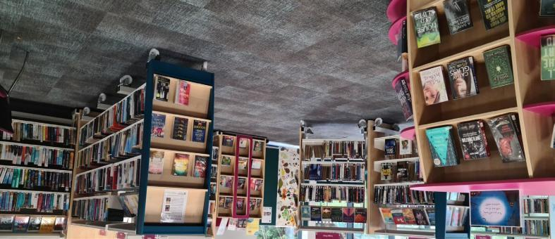
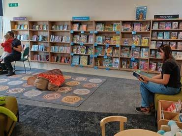
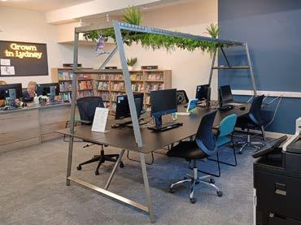
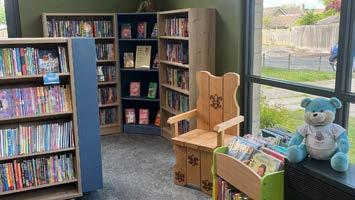
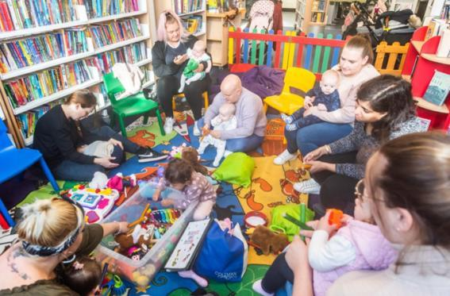
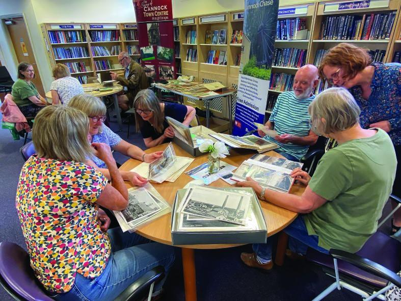
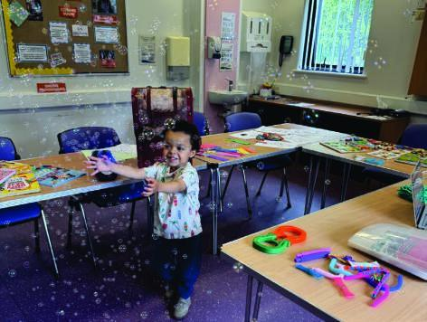
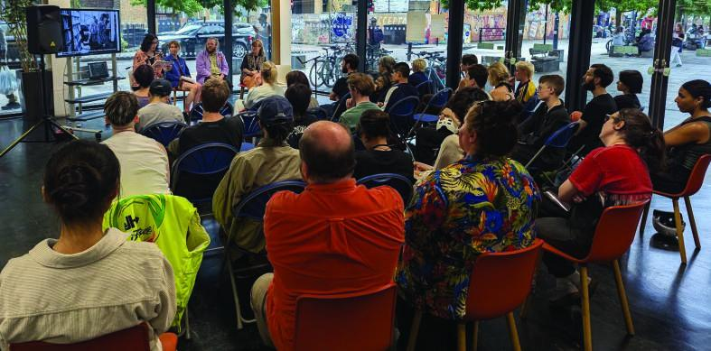
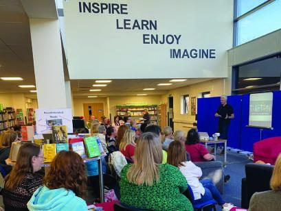

<!-- PAGE: 1 -->

# Library Loans Review: Case Studies

## Wiltshire Libraries: A Strategic Approach to Developing Reading

### The Background

Wiltshire Libraries has 30 branch libraries and three mobile libraries. They have created a library strategy and worked with The Reading Agency to develop a reading strategy for Wiltshire, both of which were recently published.

Wiltshire Libraries’ vision is for libraries to be trusted spaces at the centre of their local community, with a clear purpose to promote reading for pleasure to deliver better health outcomes, enable people to meet, access books, information and culture, use digital services, and develop their skills to improve social mobility.

### The Approach

#### Strategic Partnerships and Positioning

Wiltshire Libraries used the process of developing both the library and reading strategies as an opportunity to build partnerships with other agencies and promote the strategic value of the library service.

#### Funding

Wiltshire libraries have seen a 36% increase in the stock budget since 2019-20, although the budget is still lower than in 2010.

They received funding from Multiply to invest in stock to support maths literacy. They received £30,000 project grant funding in 2023-24 from Arts Council England to support ‘reading roadshows’ which encouraged non-readers and non-library users to read and visit the library.

They have used increased stock budgets to invest in collections that they know will be popular with residents, which cycle through the branch libraries on a rolling basis. These include e.g. fantasy and sci-fi, manga, non-fiction collections relating to cooking and crafts/hobbies. Stock is selected by qualified librarians based on their community knowledge, alongside supplier selection.

#### Community Engagement and Meeting the Needs of Users

##### Infrastructure, Access and Service Offer

Two libraries, which are based in leisure centres, are open seven days a week from 7.30am – 10pm (some self-service hours). They ensure that all residents have access to a library service (building or mobile) within three miles of their house. The service has invested in two new mobile libraries and they hosted celebratory musical events at the mobile library in the places where they visit to raise the profile of the service.

**Melksham Library Statistics Since Opening (Reopened 2022 in Leisure Centre):**

- Issues: 51,543 (2021-22) to 105,865 (2023-24) — +105%
- Visits: 26,175 (2021-22) to 130,933 (2023-24) — +400%
- Members: 6,278 (July 2022) to 8,567 (July 2024) — +36.5%

> “We see a direct correlation with the level of stock fund and issues achieved. If one is increased the other follows.”

They have also:

- maintained late-night opening in all of their libraries (until 7pm)
- removed fines for children’s stock
- removed reservation fees for physical audiobooks as they know they are serving a smaller readership and they only have a limited amount of stock
- introduced wifi printing in larger libraries, which has proven popular especially with traveller and boater communities

##### Events and Activities

Wiltshire libraries maintained a strong offer through the pandemic, including online rhyme-times and click-and-collect services which raised the profile of the service and maintained positive relationships with the customer base.

They offer eight children’s and young people’s reading groups in libraries across the county as well as c. 370 adult reading groups supported by the library service. The adult reading groups receive direct marketing and promotions for activities and events.

They have introduced ‘Story Sharers’ which is an initiative to get parents reading with children aged 0-4 at the same time as their older children do the Summer Reading Challenge.

The Arts Council England funding for ‘Reading Roadshows’ led to many successful author and community events in the library, including:

- two crime writers panel discussion sessions
- high profile and well-known authors including Kate Rhodes, Libby Page, Tammye Huf and Louise Doughty
- 600+ attendance at events, hosted 18 author events, 1,600+ downloads of eBook and eAudio books by Roadshow authors
- hosted three Reading Group days and created six new groups, which received the following feedback: “Being 80, with Parkinson’s I find it’s hard to know what to say, to find the right works. I’ve struggled with reading but to join a group has made me think about other people’s views. I really enjoyed it.”
- worked in partnership with local independent bookshops to support author events

### The Impact

The evaluation of the Arts Council England funded ‘Reading Roadshow’ project showed that 50% of attendees were motivated to read more while 38% reported an improvement in their wellbeing. Data shows that new audiences were attracted to use the library service through these events.

> “[with the mobile libraries] you’re putting on events and activities in villages and communities that wouldn’t normally see things.”

<!-- PAGE: 2 -->

## Gloucestershire Libraries: Investment in Libraries Grows Library Loans

### The Background

Gloucestershire Libraries are an Arts Council England National Portfolio Organisation (NPO). They have 32 branch libraries across the county. Although the stock budget has reduced by 18% since 2019-20, the library service has sourced other funding to ensure they are able to invest in new stock and capital development.

### The Approach

#### Using Section 106 Funding to Refurbish Libraries and Replenish Stock

In Gloucestershire, Section 106 funding is allocated to libraries on an annual basis. This results in regular refurbishments of libraries, which always includes an allocation for new book stock. In the past year five library spaces have been renovated/refurbished.

#### Relocating and Opening New Kinds of Library Spaces to Increase Visits

Stroud library has moved from an older, out-of-centre location to a shopping centre in the middle of the town as part of a Local Authority properties project. This new library has increased both visits and loans:

- footfall went up by 100% from the first week and it has stayed at that level
- issues have increased and that increase has been maintained. Annual total in 2023-2024 was 71,327 issues and in 2024-2025 was 108,252

Using Libraries Improvement Fund investment of £250,000, the library service has opened a new library called The Oakley Centre which includes an immersive Virtual Reality lab. This space is well used by schools and library staff who offer e.g. immersive story times for pre-school children.

**The Oakley Centre Events Engagement Between 2023-25:**

- Visits by adults: 0 (2023/24) to 514 (2024/25)
- Visits by children: 38 (2023/24) to 595 (2024/25)

The library service has six maker-labs across the county which include 3-D printing, fabrication tools and business support which has helped to drive footfall in the library and attract new users to their spaces.

The library service has also used its investment in stock to create new themed areas based on different reading genres that appeal to its audiences. For example, Gloucester Library is currently being refurbished and will have a “cosy crime” section with comfortable seating.

> “Any time and we have s106 money, we use some of that to enhance the stock and the children's stock.”

#### Using NPO Funding to Test and Develop New Approaches to Engagement

Since 2022, Gloucestershire Libraries have received £250,000 per annum as part of their Arts Council England National Portfolio Organisation funding. This funding has supported a range of outreach and engagement activities across Gloucestershire, including:

- “Library Littlies” an activity programme with children aged 0-5 that moves beyond bounce and rhyme (which they have also maintained) into other creative activities. 2024-2025 – 1,044 attendees of which 546 were children and 498 were adults.
- a vibrant and well attended programme of author events, building on the large number of authors who live locally – average of 15 events annually with 15 people attending on average per event.
- three choirs for over-60s in the library, some of which are in areas with traditionally low library engagement, with more choirs in development:
  - Longlevens – weekly attendance on average: 30
  - Coleford – weekly attendance on average: 27
  - Tuffley – weekly attendance on average: 22
- a new, independent library website which has increased annual website engagement by 160% since launch.
- investment in staff training in creative activities with children from expert practitioners.

> “I think the new stock coming in and having the new libraries isn't just about the money coming in, it invigorates the staff and enthuses the staff.”

### The Impact

The library service has managed to increase loans overall by 64% since 2019-20 compared with a 14% increase across the sample. This includes an increase in loans of physical stock by 16%, compared with a 19% reduction across the sample. Loans of physical fiction stock have grown by 30%, compared with an overall decline of 17% across the sample.

> “Having all of the different activities – they’re hard work, but they’re worth it because then you’ve that you’re getting people through the doors.”

<!-- PAGE: 3 -->

## Norfolk Library Service: Adopting New Approaches Post COVID-19

### The Background

Norfolk Library Service consists of 47 libraries, including the flagship Norfolk and Norwich Millennium Library, and five mobile libraries. Since the COVID-19 pandemic the library service has worked hard to rebuild services and recover book issue levels.

Key factors driving borrowing and visits include:

- a strategic and comprehensive approach to Under 5’s engagement
- multi-channel approaches to reader engagement (online and in the library)
- community and data-driven stock selection
- an expanding open-access scheme (Open+); over 95% of opening hours have Open+ access

### The Approach

#### Engaging Under 5s and Families

Bounce and Rhyme and story times are core to the service’s activity programme. Sessions are held consistently across the network. Attendance at under-5s sessions has grown by over 30% post-pandemic, driving physical children's book issues.

#### Reading Friends and Multi-Channel Book Clubs

Norfolk adapted the Reading Friends programme into telephone, online (Zoom), and in-person book clubs. This reached isolated and rural residents across the county. Online Zoom book clubs encouraged members to explore new authors and genres, directly boosting reservations and loans.

#### Mobile Libraries and Rural Outreach

Five mobile libraries serve rural communities, visiting stops on a four-weekly timetable.

#### Open+ and Access Expansion

Norfolk has implemented Open+ self-service across almost all libraries, extending unstaffed access during early mornings, evenings, and weekends. Over 95% of opening hours are now delivered through Open+, providing convenient access for working residents and commuting families.

### The Impact

- Strong recovery in library visits and loans across Norfolk libraries.
- Under-5s session attendance up by more than 30%.
- Increased issue of children’s picture books and early readers.

> “The Zoom book club has changed my borrowing habits a fair bit. Yes, I do borrow more books and renew more books too. The book club reading list encourages me to try, and borrow, from new authors.”  
> — Vicky

> “It’s about community connection and not feeling isolated, even if you started by not being a library user!”  
> — Janaka, Reading Friends participant

<!-- PAGE: 4 -->

## Staffordshire Libraries: Libraries as Gateways to Reading and More

### The Background

Staffordshire Libraries noticed a significant growth in library visits and loans at three of their libraries due to their participation in the ‘Know Your Neighbourhood’ (KYN) project, funded by the Department for Culture, Media and Sport (DCMS) between 2022-25. These activities offset a reduction in footfall in a large town centre library due to construction projects in the area and supported service development and strong growth in visits and loans in community managed libraries.

### The Approach

#### Know Your Neighbourhood (KYN) Interventions

Staffordshire used KYN funding to create vibrant, welcoming spaces, decorate library interiors, and host community events designed to combat loneliness and boost volunteering.

The library service introduced targeted activities:

- volunteering programmes and taster sessions
- social and wellbeing clubs
- family crafting and literacy workshops
- partnership working with local voluntary organisations and community champions

#### Cross-Service Coordination

Staffordshire leveraged KYN activities to connect attendees directly with library collections, encouraging participants to borrow books, register as members, and explore digital services.

### The Impact

The three targeted libraries saw substantial increases in visits, volunteer participation, and book issues, countering wider construction and footfall challenges. Volunteers and staff developed a clearer sense of shared purpose.

> “We wanted to spend the least amount of money on activities as we wanted it to be sustainable.”  
> — Kerry Hutchings, Library Development Manager, Staffordshire Libraries

<!-- PAGE: 5 -->

## St Helens Libraries: Outreach and Engagement

### The Background

St Helens Libraries has reframed its operations to focus on outreach and engagement following a major restructure which saw the service reduce from 13 branches to seven.

### The Approach

Through innovation, partnership building, and targeted community work the service has been successful in maintaining strong library use and increasing book loans. In 2024-25 St Helens saw total loans rise by 27%, adult stock loans rise by 45% and children’s loans rise by 6% compared with the baseline year of 2019-20. All of these statistics are better than the average for this study.

Key elements of their approach include:

- taking library services out of the physical buildings into nurseries, schools, community centres, and parks
- proactive collaboration with early years settings, children’s centres, and family hubs
- targeted book gifting and library registration campaigns for pre-school children
- pop-up library presence at community festivals and outdoor events

### The Impact

Total library loans grew by 27% between 2019-20 and 2024-25, with adult loans rising 45% and children's loans rising 6%, demonstrating how an active outreach model can drive engagement even with a reduced physical footprint.

> “The children who attended the event really enjoyed the experience and parents were overjoyed that the children got to experience this alongside their nursery session. We also had a child with additional needs who will be attending a mainstream school in September and the event provided him with opportunities to be with other children of his own age and also to be in a group event… which was an important part for his own school readiness.”  
> — Nursery Manager

<!-- PAGE: 6 -->

## Lewisham Libraries: Data-Driven Interventions

### The Background

Lewisham Libraries operate a network of 12 libraries, including eight community-run sites and four council-managed branches, alongside a home library service. Despite the temporary closure of Lewisham Central Library for refurbishment, the service has achieved significant growth in lending.

Since 2021, Lewisham has adopted a data-driven approach to stock management, programming, and community engagement.

### The Approach

#### Data-Driven Stock Management

Lewisham analyzed borrowing trends, population demographics, and circulation rates to inform collection procurement. Fast-turnaround popular fiction, diverse voices, graphic novels, and children's books were strategically placed and actively promoted.

#### Community Programming and Events

The service organized cultural events, musical performances, medieval history sessions, and author talks that brought residents back to the library.

### The Impact

- Lending increased significantly across branch and community-run libraries, despite Central Library being closed for capital works.
- Strong positive public feedback on cultural programming and responsive book collections.

> “Really good event and it did bring me back to library after many years of not coming at all.”

> “Really interesting music and great to learn more about the Middle Ages too! It was amazing, please do more things like this, it was so cool.”

<!-- PAGE: 7 -->

## Doncaster Libraries: Joined-Up Services and Community-Focused Engagement

### The Background

The development of a new Central Library in a shared cultural space with Doncaster Museum & Art Gallery, Archives and Local Studies and a Rail Heritage Centre provided a unique opportunity for Doncaster Libraries to enhance and expand its offer to local communities.

Doncaster Library Service operates three branch libraries and twenty community libraries, which are supported by around 400 volunteers. The Central Library is housed in the Danum Gallery, Library and Museum (DGLAM), a landmark cultural building in the Civic and Cultural Quarter of Doncaster. Danum opened to the public in May 2021. The building brings together the Central Library, Museum and Art Gallery, Archives and Local Studies and Rail Heritage Centre.

### The Approach

#### Space for All

Within the new Central Library, separate spaces were created for children and young adults. It was identified in the process of developing the new library that having designated spaces which are designed to be age-appropriate was essential to meeting the different needs of these groups.

Being within a shared space with other cultural providers where there is also a museum café means that families can spend a full day at DGLAM. It makes it a destination. The children’s library has a fully accessible changing space and the spaces offer ways for people to connect.

In addition to the new Central Library, the library at Mexborough was transformed into an enchanted forest with funding support from Arts Council England through the Library Improvement Fund, Libraries Connected and matched Levelling Up funds.

> “We have books in every place, everywhere across DGLAM.”

#### Stock Management

The management of stock is done through supply and selection via Askews and a pot of money is set aside for specific requests from the learning team. The learning team work across DGLAM and engage in activities which provide opportunities for children to read for pleasure. This has included the placement of books throughout gallery and exhibition spaces which tie in with displays.

While they do have classic books and a core collection, in the last few years the team have worked to diversify the stock. They work to ensure there is wide representation of their communities within the collection and a range of different language books on offer. Every new book on offer goes to Danum Library, which is open every day.

Staff who work in the children’s section read the children’s and young adult’s books that come in so they can respond to questions and make informed recommendations. There are no longer fines issued on loans and children can borrow up to 12 books.

E-books have been a big success for the service. They have reduced what they spend on physical books and increased spend on digital books.

#### Events and Activities

The service started seeing a decline in loans and to address this they focused on developing their engagement work. Starting with interventions which aimed to help young people engage in libraries. This included library familiarisation sessions which highlight what a library is and what you can expect from a library service. In addition, library card registration is encouraged during school visits and craft activities are themed to books, such as *The Gruffalo* and *Oi Frog!*.

#### People Making It Work

Within the team there is strong educational expertise among staff. This includes a number of ex-teachers who are keen to engage and know how to best communicate with children and young people. They also know and have strong relationships with schools.

### The Impact

The creation of new spaces and commitment to providing engaging, inclusive and community-focused experiences for children, young adults and families has led to a noticeable increase in book loans, including a 14% increase in children’s stock loans compared with the baseline year of 2019-20 and an increase in both fiction and non-fiction children’s stock issues.

> “It’s a safe and friendly atmosphere. Everyone feels wanted and staff enjoy working in this way.”
