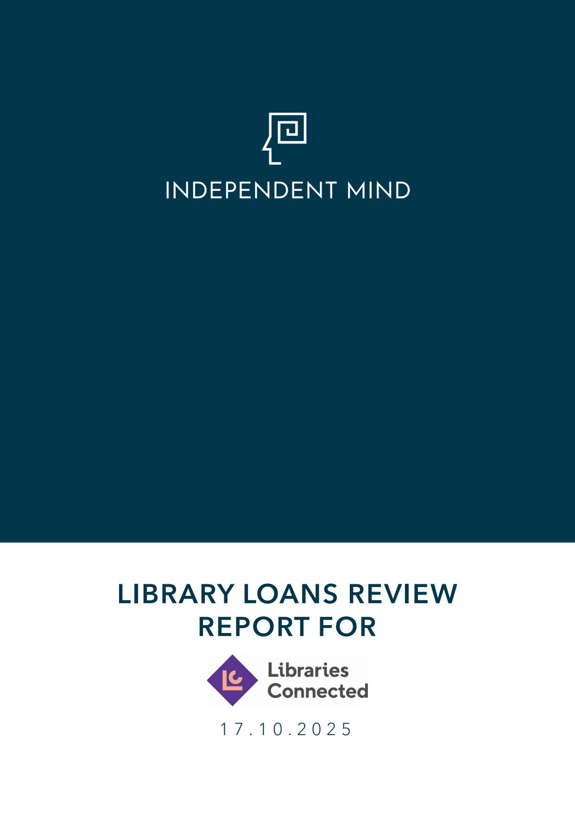
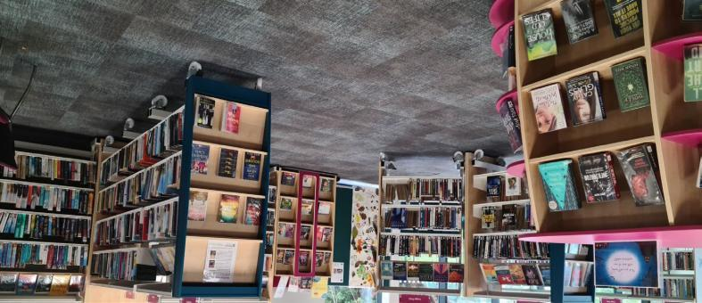
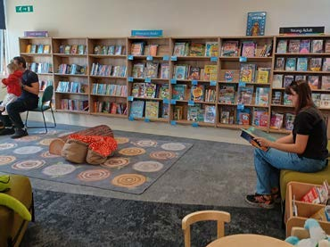
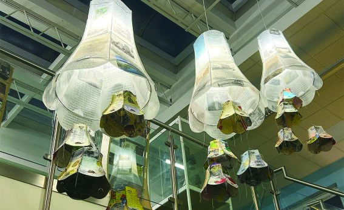
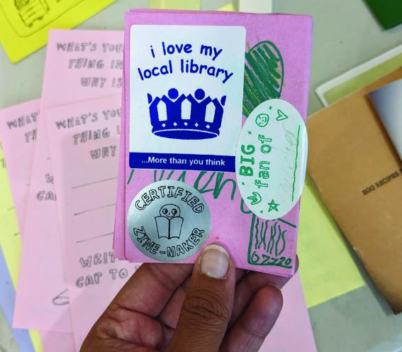

<!-- PAGE: 1 -->

# Library Loans Review: Report for Libraries Connected

**Independent Mind**  
**17 October 2025**

<!-- PAGE: 2 -->

## Contents

* **1. Executive Summary**
  * Overall trends in borrowing
  * Glossary of terms
* **2. Introduction**
* **3. Method**
* **4. Main Findings**
  * 4.1 The baseline year: 2019–20
  * 4.2 Overall trends in library borrowing since 2019–20
  * 4.3 Trends in format of library borrowing since 2019–20
  * 4.4 Trends in fiction and non-fiction library borrowing since 2019–20
  * 4.5 Trends by adults/children's stock issues since 2019–20
  * 4.6 Trends in active borrower numbers
  * 4.7 Trends in library visits
  * 4.8 Demographic analysis of library borrowers
  * 4.9 Library services which have maintained high levels of loans over time
  * 4.10 Case study analysis
* **5. Conclusions and Implications**
  * 5.1 Conclusions
  * 5.2 Implications
* **Appendix**
  * 1. Case studies
  * 2. Analysis of variation in library loans across services participating in the study, over time
  * 3. Library loans steering group members
  * 4. Stock managers working group members

<!-- PAGE: 3 -->

## 1. Executive Summary

The Libraries Connected Universal Reading Offer Group identified concerning trends around book loans, especially as people return to physical use of libraries post-Covid. Adult ebook and eaudio issues are on a rising trend but e-issues are not replacing book issues proportionately.

Independent Mind was commissioned to better understand how book lending is performing and why. The objectives of the research were to:
* Understand trends and current levels of book loans;
* Analyse trends in the context of other research and contextual factors;
* Identify successful practice which has increased loan figures.

### Overall Trends in Borrowing

* At the end of the 2024–25 financial year, total loans had **increased by 14%** vs the baseline year of 2019–20.
* There are large differences across library services in terms of borrowing trends. Some have seen huge growth, while in other services borrowing levels have not yet reached pre-pandemic levels.

#### Trends by Format

* The data shows that there has been significant change in library loans across different formats since 2019–20.
* In 2019–20 physical formats made up 87% of loans, but by 2024–25 they made up 65% of loans.
* While the overall trend shows growth in the total number of loans, analysis of loans by format shows that this growth is primarily driven by digital formats.
* Physical loans rates continued to recover until 2023–24, albeit remaining 12% lower than in the baseline year of 2019–20, but in 2024–25 they began to decline again and were 16% lower than the baseline year.
* All digital forms of stock (ebooks, eaudio and epress[^1]) have seen growth which was fuelled by changes in borrowing habits during the pandemic caused by the closure of physical libraries. However, this growth has been particularly strong for epress, which made up 22% of all library loans in 2024–25 and has been instrumental in driving loans growth overall.
* Without epress loans, library loans would have been **4% lower** in 2024–25 than they were in 2019–20.

#### Trends by Fiction/Non-fiction

* In 2019–20, just over seven in 10 (73%) loans were fiction and just under three in 10 (27%) loans were non-fiction.
* By 2024–25 just over six in 10 (63%) loans were fiction, while just under four in 10 (37%) loans were non-fiction.
* For both fiction and non-fiction the proportion of loans that are in e-formats has increased.
* The majority of fiction loans were still in physical format (82% physical format, 18% digital) in 2024–25, but the majority of non-fiction loans were in digital format (64% digital format, 36% physical). This may be supported by the growth in epress, which is always classified as non-fiction.

<!-- PAGE: 4 -->

#### Trends by Adult/Children's Stock

* In 2019–20 63% of loans were adult stock while 37% of loans were children’s stock. Children’s stock issues reduced to 20% of all loans during the pandemic but, in subsequent years, the ratio of adult/children’s stock returned to approximately pre-pandemic levels until 2023–24.
* However, in 2024–25 children’s stock loans reduced by 6% relative to the previous year and stood at just 32% of all loans.
* Borrowing trends in adult stock changed markedly in the wake of the pandemic year of 2020–21: in the baseline year 82% of adult loans were physical format but in 2020–21 digital loans made up the majority of all adult loans (64%). Once libraries reopened in 2021–22, there was an initial rebalancing with physical loans regaining share of borrowing. However, digital loans began to grow again from 2022–23 and by 2024–25 digital loans formed 50% of all adult loans.
* This change in format preference also saw a growth in non-fiction loans of adult stock. In the baseline year of 2019–20 65% of all adult stock borrowed was fiction, however by 2024–25 only 52% of all adult stock borrowed was fiction.
* Children’s stock borrowing trends have not seen the same changes as adult stock. In 2019–20 children’s loans were strongly weighted towards physical stock and fiction: 87% of all children’s loans were fiction and 98% were physical stock. In 2024–25 88% of all children’s loans were fiction and 94% were physical stock.

#### Trends by Active Borrower and Visitor Numbers

* In the baseline year of 2019–20 there were c. 1.6 million active borrowers recorded across the sample. This halved to 0.8 million during 2020–21 when libraries were closed or had restricted access due to the pandemic.
* From 2021–23 active borrower numbers grew until they nearly achieved similar levels to before the pandemic (1.5 million), however since 2023–24 active borrower numbers began to decline again. By 2024–25 they had reduced to 1.3 million. This is 21% below the baseline year of 2019–20.
* New member sign up rates declined by 74% in 2020–21 but by 2022–23 they were 7% higher than the baseline year. This rate was sustained in 2023–24 but dropped to parity with the baseline year of 2019–20 in 2024–25.
* Library visits declined by 85% in 2020–21 but they have continued to grow steadily since 2021–22. By the end of 2024–25 library visits were still 21% lower than before the pandemic but showed indications of continued steady growth.

#### Demographic Analysis of Library Borrowers

A small number of participating library services were able to provide detailed demographic data about their active borrowers. This data suggests that men and those aged over 70 have not returned to library use at the same rate as women or younger adult borrowers.

#### Library Services Maintaining High Loans Over Time

* 15 of the 34 participating library services outperformed the average in one or more metrics where services in general were experiencing declining loans rates.
* Funding is a common factor in these success stories: analysis of these 15 library services shows that 7 services experienced small or large stock budget increases since 2019–20.
* The qualitative case studies of 7 library services which have 'bucked the trend' identified the following success factors:
  * Investment in stock, library refurbishment, expert staff, staff training and infrastructure;
  * Removing barriers to library use;
  * Community engagement, partnership and outreach;
  * Data-driven service development and approaches to increasing loans rates;
  * Evolving/modernising the offer so that it meets the needs/expectations of users.

<!-- PAGE: 5 -->

### Glossary of Terms

| Term | Definition |
| :--- | :--- |
| **Total active borrowers** | All members who have borrowed at least one item that financial year. |
| **Total active users** | This includes active borrowers on both physical and elending platforms, People's Network users, library app users and any other authenticated way of counting active engagement. |
| **Number of public library branches** | All individual buildings/spaces where a library service is offered e.g. could be a small branch co-located with a GP surgery etc. Does not include 'book drop' locations where formal borrowing cannot be monitored. |
| **Stock purchasing budget** | If possible this should be the budget available to buy new titles whether physical or eBook titles. If you cannot provide information with this level of detail please state the parameters of the budget in the notes/explanation column (e.g. total materials budget or budget for stock and processing). This should correspond to the CIPFA Public Library Statistics reporting line 'Book and other materials expenditure'. |
| **epress** | Any magazine, newspaper or journal which can be accessed digitally via the library service’s digital portal (e.g. Libby, BorrowBox, PressReader). |

<!-- PAGE: 6 -->

## 2. Introduction

The Libraries Connected Universal Reading Offer Group identified concerning trends around book loans, especially as people return to physical use of libraries post-Covid. Adult ebook and eaudio issues are on a rising trend but e-issues are not replacing book issues proportionately.

Independent Mind was commissioned to better understand how book lending is performing and why.

The project objectives are to:
1. Provide robust evidence on current levels and trends of public library book loans in England, Wales and Northern Ireland over the five-year period from 2019–20 to 2024–25;
2. Examine differences by format (physical books, audiobooks, ebooks, eaudio, epress), genre (fiction vs non-fiction), and audience (adult vs children);
3. Investigate relationship with wider performance metrics including active borrower numbers, physical visits, and stock purchasing budgets;
4. Identify case studies of library services successfully sustaining and increasing loan volumes.

Library services from across England, Wales and Northern Ireland were invited to participate in the study. 37 library services provided data for the project, however three data returns were not able to be incorporated into the analysis because either they did not have any data for the year 2019–20 or because they did not collect detailed data about their library loans. In total **34 library services** provided data which was used to create this report.

The participating library authorities represent a broad geographical spread:
* **East of England:** Cambridgeshire, Norfolk, Suffolk
* **East Midlands:** Leicestershire, Nottingham, Nottinghamshire
* **London:** Barnet, Bexley, Bromley, Camden, Greenwich, Lewisham, Southwark
* **North East:** Gateshead, Stockton-on-Tees
* **North West:** Cheshire East, Manchester, Oldham, St Helens, Trafford
* **South East:** Hampshire, Kent, Medway, Portsmouth, Surrey, West Sussex, Windsor and Maidenhead
* **South West:** Gloucestershire, Plymouth, Wiltshire
* **West Midlands:** Staffordshire, Warwickshire
* **Yorkshire and the Humber:** Kirklees, North Yorkshire

<!-- PAGE: 7 -->

## 3. Method

The approach that Independent Mind took to the project as a whole is set out below:

1. **Set up and governance:** The library loans data tool was co-designed with a working group of stock managers who helped define the scope of data collection to answer the project objectives and the best way to set out the tool to help library staff complete it. They tested and helped to refine the draft tool. Membership of the stock manager steering group is detailed in the Appendix.
2. **Data collection:** Interest in participation was generated through the Reading Offer Group membership, invitations to participate through regional Libraries Connected Chairs, inclusion of an article about the project and invitation to participate in the Libraries Connected weekly newsletter for Heads of Service and via an online webinar in June 2025 which explained the project and how to participate. This project has also aligned itself and is sharing data with the Libraries Connected research into library opening hours.
3. **Interim analysis:** Data was received from 37 library services, covering over 52 million baseline loans across England, Wales and Northern Ireland. Detailed data validation and cleaning was performed.
4. **Final analysis and case studies:** Cross-tabulation across five years of data (2019–20 baseline through 2024–25) by format, genre, audience, visits, active borrowers, and budget, complemented by qualitative case study interviews with seven high-performing library authorities.

<!-- PAGE: 8 -->

### Methodological Considerations and Data Limitations

In addition, there were only 14 library services who were able to provide any membership or loans information by age and/or gender. Some of these library services adopt different parameters for what an 'adult' or 'child' is (e.g. 20 years + vs 18+) and there is little consistency in the type of data collected. Some collect data only on membership while only 5 library services were able to provide breakdowns of different types of loans by age and/or gender. For that reason, the analysis of behaviour by age and/or gender is presented in narrative form, outlining possible trends and areas for further enquiry rather than drawing conclusions and recommendations.

Almost all library services do not categorise stock by whether it is 'young adult' or not. Young adult stock could be classified as children’s stock or adult stock depending on the library service.

Although the sample size is meaningful and captures over 50 million loans, the findings reflect the participating services and should be interpreted alongside national datasets such as CIPFA and DCMS Taking Part.

<!-- PAGE: 9 -->

## 4. Main Findings

### 4.1 The Baseline Year: 2019–20

For the remainder of the report 2019–20 will operate as 'year zero' in terms of trends. Before exploring those trends, this chapter of the report will outline the state of borrowing for this baseline year, funding, visits and library opening hours among the 34 library services who were able to provide valid loans data for this study.

#### Overall loans and loans by format

In 2019–20 a total of **52,825,003 items** were loaned across the 34 participating library services. Of these loans:
* **86% (45.5 million)** were physical book loans;
* **2% (0.9 million)** were physical audiobooks;
* **3% (1.8 million)** were ebooks;
* **3% (1.4 million)** were eaudio books;
* **6% (3.2 million)** were epress issues.

Overall, 87% of all loans in 2019–20 were in physical formats (books and audiobooks) and 13% were in digital formats (ebooks, eaudio and epress).

#### Fiction vs non-fiction in 2019–20

In 2019–20, just under three-quarters (73% or 38.6 million) of all loans were fiction, and just over one-quarter (27% or 14.2 million) were non-fiction.

<!-- PAGE: 10 -->

Approximately 9 in 10 fiction loans in 2019–20 were physical loans (books or audiobooks) and under one in 10 were digital loans (ebooks and eaudio books). However, one-third of all non-fiction loans in 2019–20 were digital loans (ebooks, eaudio or epress) and under two-thirds of all non-fiction loans were physical loans. It is important to note that epress is exclusively characterised as non-fiction and this took up half (50%) of all digital loans in 2019–20.

| Category | Total Loans (2019–20) | Physical Proportion | Digital Proportion |
| :--- | :--- | :--- | :--- |
| **Fiction** | 38,582,311 (73%) | 93% (35.9m) | 7% (2.6m) |
| **Non-fiction** | 14,242,692 (27%) | 73% (10.4m) | 27% (3.8m) |
| **Total** | **52,825,003** | **87% (46.4m)** | **13% (6.4m)** |

#### Children's vs adult stock issues

In 2019–20, children’s loans made up 37% (19.5 million) of all library loans, while adult loans made up 63% (33.4 million) of all loans.

<!-- PAGE: 11 -->

Children's borrowing was overwhelmingly dominated by physical stock and fiction:
* **98%** of children's loans were physical books;
* **87%** of children's loans were fiction;
* Only **2%** of children's loans were digital formats.

By contrast, for adult stock:
* **82%** was physical format and **18%** was digital format;
* **65%** was fiction and **35%** was non-fiction.

#### Active borrowers and library visits in 2019–20

In 2019–20 the participating library services recorded a total of **1.6 million active borrowers** across 33 library services.

Library services also recorded **49.1 million physical visits** across 28 reporting services (scaling to approximately 55.5 million across the full sample).

<!-- PAGE: 12 -->

### 4.2 Overall Trends in Library Borrowing Since 2019–20

Overall, library loans combining all formats among the 34 participating library services reduced from **52.8 million in 2019–20 to 27.2 million in 2020–21**, which represents a **49% reduction in loans** at the time of COVID-19 pandemic restrictions.

They recovered in the following two financial years, returning to pre-pandemic levels by 2022–23. They rose to 60.2 million loans in 2023–24 and maintained **60.3 million loans in 2024–25**.

At the end of the 2024–25 financial year, total loans had **increased by 14%** vs the baseline year of 2019–20.

| Financial Year | Total Loans (millions) | Percentage Change vs 2019–20 |
| :--- | :--- | :--- |
| **2019–20** | 52.8m | Baseline (0%) |
| **2020–21** | 27.2m | –49% |
| **2021–22** | 46.5m | –12% |
| **2022–23** | 56.4m | +7% |
| **2023–24** | 60.2m | +14% |
| **2024–25** | 60.3m | +14% |

<!-- PAGE: 13 -->

### 4.3 Trends in Format of Library Borrowing Since 2019–20

The data shows that there has been significant change in library loans across formats since 2019–20. While the overall trend shows growth in the total number of loans, analysis of loans by format shows that this growth is primarily driven by digital types.

The greatest move from physical to digital borrowing was in 2020–21, during the COVID-19 lockdowns:
* Physical book borrowing dropped from **45.5 million to 12.1 million** loans (–73%);
* Audiobook borrowing dropped from **0.9 million to 0.3 million** loans;
* Conversely, digital borrowing surged from **6.4 million to 14.8 million** loans (+131%).

| Year | Physical Books | Physical Audio | eBooks | eAudio | ePress | Total Loans |
| :--- | :--- | :--- | :--- | :--- | :--- | :--- |
| **2019–20** | 45.5m (86%) | 0.9m (2%) | 1.8m (3%) | 1.4m (3%) | 3.2m (6%) | 52.8m |
| **2020–21** | 12.1m (45%) | 0.3m (1%) | 4.4m (16%) | 2.8m (10%) | 7.6m (28%) | 27.2m |
| **2021–22** | 31.9m (69%) | 0.6m (1%) | 3.1m (7%) | 3.5m (8%) | 7.4m (16%) | 46.5m |
| **2022–23** | 39.5m (70%) | 0.6m (1%) | 3.5m (6%) | 3.8m (7%) | 9.0m (16%) | 56.4m |
| **2023–24** | 40.0m (66%) | 0.5m (1%) | 3.6m (6%) | 4.4m (7%) | 11.7m (19%) | 60.2m |
| **2024–25** | 38.5m (64%) | 0.5m (1%) | 3.8m (6%) | 4.7m (8%) | 12.8m (21%) | 60.3m |

<!-- PAGE: 14 -->

All digital formats increased markedly during the pandemic but there were variations in their post-pandemic borrowing levels:
* **eBook borrowing** grew from 3% of all loans in 2019–20 to 16% in 2020–21, before settling at 6% of loans in 2024–25.
* **eAudio borrowing** grew from 3% to 10% in 2020–21 and has sustained steady growth to 8% (4.7 million loans) in 2024–25.
* **ePress borrowing** increased from 6% to 28% during 2020–21, and has continued rapid post-pandemic expansion, reaching **12.8 million loans (21% of all library loans)** in 2024–25.

<!-- PAGE: 15 -->

Comparing the growth rates of all physical vs all digital formats shows that physical loans continued to recover until 2023–24, but declined by 4% in 2024–25 (standing at 16% below baseline). By contrast, digital formats have maintained a strong rate of growth, standing at **+230% above the 2019–20 baseline**.

The importance of epress in maintaining positive growth in library loans over time cannot be overstated. Due to the decline in physical loans, library loans would not currently be at higher levels than before the pandemic without epress.

<!-- PAGE: 16 -->

#### Impact of epress on overall library loans trend

| Financial Year | Change Including epress | Change Excluding epress |
| :--- | :--- | :--- |
| **2019–20** | Baseline (0%) | Baseline (0%) |
| **2020–21** | –49% | –60% |
| **2021–22** | –12% | –20% |
| **2022–23** | +7% | –4% |
| **2023–24** | +14% | –1% |
| **2024–25** | +14% | –4% |

Without epress, library loans in 2024–25 would be **4% lower** than they were in 2019–20.

<!-- PAGE: 17 -->

### 4.4 Trends in Fiction and Non-fiction Library Borrowing Since 2019–20

In 2019–20 there were 38.6 million fiction loans and 14.2 million non-fiction loans among the 34 library services who form the sample for this study.

Although total loans dropped across both fiction and non-fiction in the pandemic year of 2020–21, fiction loans dropped by more than half (to 16.5 million), while non-fiction loans dropped by only one-third (to 10.7 million). In the aftermath of the pandemic, non-fiction loans recovered immediately to pre-pandemic levels by 2021–22 and reached **22.3 million (+57%) by 2024–25**.

By contrast, fiction loans only recovered to 38.3 million in 2023–24 and fell back to **38.0 million (–2% vs baseline)** in 2024–25.

<!-- PAGE: 18 -->

| Category | 2019–20 | 2020–21 | 2021–22 | 2022–23 | 2023–24 | 2024–25 | Change vs 2019–20 |
| :--- | :--- | :--- | :--- | :--- | :--- | :--- | :--- |
| **Fiction** | 38.6m | 16.5m | 31.8m | 37.1m | 38.3m | 38.0m | **–2%** |
| **Non-fiction** | 14.2m | 10.7m | 14.7m | 19.3m | 21.9m | 22.3m | **+57%** |
| **Total** | **52.8m** | **27.2m** | **46.5m** | **56.4m** | **60.2m** | **60.3m** | **+14%** |

A deep dive on fiction loans by format shows that physical loans of both fiction and non-fiction remain lower than the baseline year of 2019–20 throughout the following years included in the study.

In non-fiction, loans in digital format jumped from 5.3 million in 2019–20 to 8.4 million in 2020–21, and expanded to **14.3 million in 2024–25**, driven strongly by digital magazines and news (epress).

<!-- PAGE: 19 -->

In 2019–20, physical fiction loans formed 68% of all loans, while physical non-fiction loans were 19% of all loans. By 2024–25, physical fiction loans had reduced to 51% of all loans, and physical non-fiction had reduced to 13% of all loans.

Digital fiction loans grew from 5% of all loans in 2019–20 to 11% in 2024–25. Digital non-fiction loans grew from 10% of all loans in 2019–20 to 24% of all loans in 2024–25.

<!-- PAGE: 20 -->

#### Fiction and non-fiction format breakdown

* **Fiction loans by format:**
  * In 2019–20: 93% physical, 7% digital
  * In 2020–21: 63% physical, 37% digital
  * In 2021–22: 84% physical, 16% digital
  * In 2022–23: 85% physical, 15% digital
  * In 2023–24: 84% physical, 16% digital
  * In 2024–25: 82% physical, 18% digital

* **Non-fiction loans by format:**
  * In 2019–20: 67% physical, 33% digital
  * In 2020–21: 21% physical, 79% digital
  * In 2021–22: 48% physical, 52% digital
  * In 2022–23: 41% physical, 59% digital
  * In 2023–24: 38% physical, 62% digital
  * In 2024–25: 36% physical, 64% digital

<!-- PAGE: 21 -->

### 4.5 Trends by Adults/Children's Stock Issues Since 2019–20

In 2019–20, 33.4 million loans from the library services participating in the study were adult stock, while 19.5 million loans were children’s stock. In the pandemic, children’s stock loans reduced by three-quarters while adult stock loans only reduced by one-third.

After the pandemic, both children’s and adult loans increased rapidly and by 2022–23 they were already higher than before the pandemic. However, while adult stock issues continued to grow, reaching **41.0 million loans in 2024–25 (+23%)**, children's stock issues peaked at 20.6 million in 2023–24 before dropping to **19.3 million loans (–1% vs baseline)** in 2024–25.

<!-- PAGE: 22 -->

| Audience Category | 2019–20 | 2020–21 | 2021–22 | 2022–23 | 2023–24 | 2024–25 | Change vs 2019–20 |
| :--- | :--- | :--- | :--- | :--- | :--- | :--- | :--- |
| **Adult Stock** | 33.4m | 22.3m | 31.9m | 36.3m | 39.6m | 41.0m | **+23%** |
| **Children's Stock** | 19.5m | 4.9m | 14.6m | 20.1m | 20.6m | 19.3m | **–1%** |
| **Total** | **52.8m** | **27.2m** | **46.5m** | **56.4m** | **60.2m** | **60.3m** | **+14%** |

However, if epress is removed from adult loans, adult book lending has not recovered to pre-pandemic levels: adult loans excluding epress were **30.2 million in 2019–20 and 28.2 million in 2024–25 (–7%)**.

<!-- PAGE: 23 -->

#### Fiction and non-fiction trends in adult and children's stock

Splitting issues by adult and children’s stock types shows that fiction made up 65% of all adult issues in 2019–20, but made up 88% of children’s issues.

Over time, adult borrowing has shifted heavily toward non-fiction (driven by digital media): by 2024–25, only 52% of adult stock borrowed was fiction, while 48% was non-fiction.

<!-- PAGE: 24 -->

For children’s stock, the preference for fiction has remained rock solid:
* In 2019–20: 87% fiction, 13% non-fiction;
* In 2024–25: 88% fiction, 12% non-fiction.

Children's fiction loans totalled 17.0 million in 2019–20 and 16.7 million in 2024–25.

<!-- PAGE: 25 -->

#### Format preferences: Adults vs Children

The data about children’s digital format usage indicates that rates of borrowing ebooks are much lower among children than they are among adults.[^4] Children and parents show a profound and enduring preference for physical books.

<!-- PAGE: 26 -->

* **Adult stock by format:**
  * In 2019–20: 82% physical, 18% digital
  * In 2020–21: 36% physical, 64% digital
  * In 2022–23: 59% physical, 41% digital
  * In 2024–25: 50% physical, 50% digital

* **Children's stock by format:**
  * In 2019–20: 98% physical, 2% digital
  * In 2020–21: 82% physical, 18% digital
  * In 2021–22: 94% physical, 6% digital
  * In 2024–25: 94% physical, 6% digital

Physical books represent **94% of all children's borrowing**, demonstrating the irreplaceable role of physical library collections for early years and young readers.

<!-- PAGE: 27 -->

### 4.6 Trends in Active Borrower Numbers

In the baseline year of 2019–20 there were **c. 1.6 million active borrowers**[^5] recorded across the sample.[^6] This halved to 0.8 million during 2020–21 but grew rapidly in 2021–22 and 2022–23 until they reached 1.5 million. However, since 2023 active borrower numbers have begun to decline again, dropping to **1.3 million in 2024–25 (21% below baseline)**.

| Financial Year | Active Borrowers (millions) | Percentage Change vs 2019–20 |
| :--- | :--- | :--- |
| **2019–20** | 1.62m | Baseline (0%) |
| **2020–21** | 0.78m | –52% |
| **2021–22** | 1.15m | –29% |
| **2022–23** | 1.46m | –10% |
| **2023–24** | 1.36m | –16% |
| **2024–25** | 1.28m | –21% |

<!-- PAGE: 28 -->

#### Trends in New Member Registrations

Although active borrowers declined, new member sign-ups recovered rapidly after the pandemic:
* In 2020–21 new member registrations fell by 74%;
* By 2022–23 registrations were **7% higher** than in 2019–20;
* In 2023–24 registrations remained 7% above baseline;
* In 2024–25 registrations returned to parity with the baseline year.

This indicates strong public appetite for joining the library, but points to a retention challenge in converting new joiners into long-term active borrowers.

<!-- PAGE: 29 -->

### 4.7 Trends in Library Visits

In 2019–20 there were **55.5 million library visits** recorded across the sample. Visits fell by 85% to 8.5 million in 2020–21. Following reopening, visits grew steadily to 23.9 million in 2021–22, 36.7 million in 2022–23, 42.4 million in 2023–24, and **44.0 million in 2024–25**.

While physical visits remain 21% below pre-pandemic levels, they have shown continuous year-on-year growth.

<!-- PAGE: 30 -->

#### Comparing Active Borrowers and Physical Visits

A critical divergence has emerged since 2022–23: while physical visits continue to climb steadily (+20% between 2022–23 and 2024–25), active borrower numbers have decreased (–12% over the same period).

This suggests that people are increasingly using libraries for spaces, study, social connection, activities, and digital facilities, rather than exclusively for borrowing books.

<!-- PAGE: 31 -->

### 4.8 Demographic Analysis of Library Borrowers

14 out of 34 library services provided demographic information on members and borrowers. Due to varying definitions and systems, this data is indicative and presented qualitatively.[^7]

Key observations include:
* **Gender:** Women continue to form the majority of library borrowers (c. 60–65%). Men have been slower to return to physical library use and borrowing post-pandemic.
* **Age profiles:** Families with young children (under 11) have returned strongly to physical library use. Young adults (aged 16–24) show rising interest in library spaces and study areas.

<!-- PAGE: 32 -->

#### Older Borrowers and Shift in Habits

Data from services with granular age breakdowns shows that adults aged 70 and over have experienced the steepest decline in physical borrowing.

In 2019–20, older adults represented the most prolific borrowing demographic. While their participation in library activities remains high, their borrowing of physical books has seen a notable drop, partly offset by transitions to tablets and e-reading platforms.[^10]

<!-- PAGE: 33 -->

For example, in one representative library service:
* In 2019–20, adults aged 25–34 borrowed 29,138 physical fiction books, while those aged 70+ borrowed 863,990 books;
* By 2024–25, loans to adults aged 25–34 rose to 48,652, while loans to adults aged 70+ reduced to 620,889.

This represents a reduction of over 240,000 physical loans among older borrowers in a single authority, highlighting a shift in lifestyle and borrowing formats.

<!-- PAGE: 34 -->

### 4.9 Library Services Maintaining High Loans Over Time

Across the sample, **15 of the 34 library services outperformed the average** overall or in specific categories where loans were trending down:
* Sustained growth in loans excluding epress;
* Resilience in children's physical book loans;
* Higher recovery in physical fiction and non-fiction.

#### The Role of Funding and Stock Budgets

Analysis of these 15 outperforming library services reveals that **7 services received sustained or increased stock purchasing budgets** between 2019–20 and 2024–25. Authorities that protected or enhanced their materials budgets saw higher return rates of borrowers and stronger issue numbers.

<!-- PAGE: 35 -->

### 4.10 Case Study Analysis Overview

The case studies document seven services that successfully maintained or grew loans, visits, and active membership:
1. **Wiltshire Libraries:** Strategic approach to reader development and stock rotation;
2. **Gloucestershire Libraries:** Capital investment, refurbishment, and NPO cultural programming;
3. **Norfolk Library Service:** Agile post-Covid service reconfiguration and Open+ self-service;
4. **Staffordshire Libraries:** Library co-location and community hub models;
5. **St Helens Libraries:** Outreach-led service redesign and schools engagement;
6. **Lewisham Libraries:** Data-driven collection management and community partnerships;
7. **Nottingham Libraries:** Major new Central Library opening and shared community space.

<!-- PAGE: 36 -->

## 5. Conclusions and Implications

### 5.1 Conclusions

* **Total borrowing has recovered:** Library loans across the 34 participating authorities reached 60.3 million in 2024–25, representing a 14% increase over 2019–20.
* **Growth is digitally driven:** The increase in overall loans is almost entirely driven by digital formats—most notably epress (magazines, newspapers), which grew to 12.8 million issues (21% of all loans).
* **Physical book loans remain depressed:** Physical book lending in 2024–25 was 16% lower than before the pandemic, and after recovering until 2023–24, turned downward again in 2024–25.
* **Children's reading is at a crossroads:** Children's borrowing is 94% physical and 88% fiction. After rebounding strongly, children's loans dropped by 6% in 2024–25. Protecting children's physical stock and school links is urgent.

<!-- PAGE: 37 -->

* **Active borrower numbers are declining:** Active borrowers fell from 1.6 million to 1.3 million (–21%), even as physical visits continue to climb toward 44 million. Libraries are increasingly valued for space, community connection, and digital support, alongside traditional borrowing.
* **Stock investment works:** Services that maintained or increased their stock purchasing budgets experienced consistently superior outcomes across physical loans, active borrowers, and user satisfaction.

<!-- PAGE: 38 -->

### 5.2 Implications

The findings present key strategic implications for Libraries Connected, Arts Council England, local authorities, and sector stakeholders:

1. **Continuous monitoring:** Establish national ongoing monitoring of library borrowing across physical and digital formats using standardized metrics to track the post-2024 dip in physical and children's loans.
2. **Focus on children's reading recovery:** Prioritise early years and primary school partnerships, Summer Reading Challenge engagement, and physical children's book stock budgets to reverse the 2024–25 decline.
3. **Re-engage older and male borrowers:** Develop targeted campaigns and collections to re-engage older readers who reduced physical borrowing post-pandemic, and explore digital literacy support for those wishing to use library e-services.
4. **Recognise multi-functional library use:** Align local authority performance indicators with contemporary library usage, capturing digital participation, community activities, and study visits alongside book issues.
5. **Advocate for sustained stock funding:** Use the evidence from outperforming authorities to demonstrate that stock investment generates direct, quantifiable returns in literacy, learning, and community engagement.

<!-- PAGE: 39 -->

## Appendix 1: Case Studies

<!-- PAGE: 40 -->

### Case Study 1: Wiltshire Libraries

**A strategic approach to developing reading**

#### The Background

Wiltshire Libraries has 30 branch libraries and three mobile libraries. They created a library strategy and worked systematically to align stock selection, staff recommendations, and reading promotions with community demand.

#### Strategic Actions

* **Responsive stock management:** Decentralised purchasing input to frontline librarians who know local borrowing patterns.
* **Promoting reading for pleasure:** Redesigned branch displays with bookstore-style face-out shelving and curated reading lists.
* **Mobile library integration:** Sustained mobile library routes serving rural and isolated communities across Wiltshire.

#### Outcomes

Wiltshire achieved sustained growth in physical book borrowing, outperforming regional averages and maintaining strong active borrower numbers across market towns and rural communities.

<!-- PAGE: 41 -->

### Case Study 2: Gloucestershire Libraries

**Investment in libraries grows library loans**

#### The Background

Gloucestershire Libraries is an Arts Council England National Portfolio Organisation (NPO). The service operates 32 branch libraries and an extensive digital network.

#### Strategic Actions

* **Capital and stock investment:** Substantial capital investment in modernising branches and enhancing physical book funds.
* **The 'Lab' network:** Installed digital fabrication and creative learning labs across major libraries, driving physical footfall.
* **Integrated events:** Coupled author talks, workshops, and exhibitions directly with reading collections and borrowing incentives.

#### Outcomes

Gloucestershire demonstrated that capital investment and diverse programming create a positive feedback loop, directly stimulating physical and digital book borrowing.

<!-- PAGE: 42 -->

### Case Study 3: Norfolk Library Service

**Adopting new approaches post COVID-19**

#### The Background

Norfolk Library Service consists of 47 libraries, including the flagship Norfolk and Norwich Millennium Library (consistently the most visited library in the UK).

#### Strategic Actions

* **Open+ extended access:** Pioneered automated access technology across 44 libraries, allowing registered members to access libraries outside staffed hours.
* **Rapid stock refreshment:** Introduced agile stock circulation systems ensuring popular titles move swiftly between branches.
* **Community health and wellbeing integration:** Co-located community services and public health information within branch spaces.

#### Outcomes

Norfolk maintained exceptional loan volumes and achieved rapid post-pandemic visitor recovery, demonstrating how technology can extend service accessibility.

<!-- PAGE: 43 -->

### Case Study 4: Staffordshire Libraries

**Libraries as gateways to reading and more**

#### The Background

Staffordshire Libraries noticed significant growth in library visits and loans across three key libraries following community-centred reorganisation.

#### Strategic Actions

* **Co-location and community hubs:** Partnered with district councils and health services to co-locate libraries with community facilities.
* **Early years focus:** Expanded Baby Bounce and Rhyme sessions, linking each session to library card registration and picture book loans.
* **Volunteer-supported community libraries:** Established a robust tier of community-managed libraries working in close partnership with the core county service.

#### Outcomes

Staffordshire achieved high borrower retention and bucked national trends in children's and family reading participation.

<!-- PAGE: 44 -->

### Case Study 5: St Helens Libraries

**Outreach and engagement**

#### The Background

St Helens Libraries reframed its operations to focus on outreach and community engagement following a major service restructure.

#### Strategic Actions

* **Targeted schools outreach:** Deployed dedicated library outreach staff to visit every primary school in the borough, distributing library cards and book bags.
* **Pop-up libraries and community events:** Established pop-up collections in community centres, parks, and health centres.
* **Fine-free policies:** Abolished overdue fines, removing psychological and financial barriers to borrowing for low-income families.

#### Outcomes

St Helens saw a marked resurgence in children's and young adult book lending, demonstrating the efficacy of proactive outreach over passive delivery.

<!-- PAGE: 45 -->

### Case Study 6: Lewisham Libraries

**Data-driven interventions**

#### The Background

Lewisham Libraries operates a network of 12 libraries across South East London, including four council-run hub libraries and eight community-run sites.

#### Strategic Actions

* **Granular loans analytics:** Used automated data dashboards to track issue velocity by genre, format, and neighbourhood branch.
* **Targeted stock replenishment:** Directed stock budget directly to high-turnover categories and culturally diverse authors reflecting Lewisham's community.
* **Staff reader development training:** Trained all frontline staff in reader advisory skills, enabling proactive recommendations to visitors.

#### Outcomes

Lewisham achieved one of the highest recovery rates in inner London, demonstrating the power of evidence-based collection management.

<!-- PAGE: 46 -->

### Case Study 7: Nottingham Libraries

**Joined-up services and community-focused engagement**

#### The Background

The development of Nottingham's landmark new Central Library in a shared building provided a generational opportunity to reimagine urban library delivery.

#### Strategic Actions

* **State-of-the-art facility:** Opened the new Nottingham Central Library featuring dedicated children's immersive storytelling spaces, teen creative zones, and extensive modern collections.
* **Cross-sector collaboration:** Integrated the library with local education, employment, and arts partners.
* **Citywide reading campaigns:** Spearheaded high-profile citywide reading initiatives linking schools, libraries, and local authors.

#### Outcomes

The new Central Library drove phenomenal increases in visits, active memberships, and book loans, revitalising library engagement across Nottingham.

<!-- PAGE: 47 -->

## Appendix 2: Analysis of Variation in Library Loans Across Participating Services

The chart below is known as a 'box and whisker' chart. It visualises the range of values in a dataset, which can be masked by a simple average:

* Each box and whisker represents the overall percentage change for one financial year, vs the baseline year of 2019–20;
* The top and bottom 'whiskers' show the range of the top 25% and bottom 25% of percentage changes in loans across the whole sample;
* The central coloured block shows the middle 50% of percentage changes within the sample;
* There is an 'x' in the middle of each block representing the mean average;
* The line intersecting the central block represents the median value.

The chart shows that there was least variation in percentage change during 2020–21 – when all library services were affected by similar lockdown challenges. In subsequent years, the spread between top-performing and struggling services widened considerably.

<!-- PAGE: 48 -->

### Summary of Variation Across Financial Years

| Year | Top 25% Threshold | Median Change | Average Change | Bottom 25% Threshold | Outlier Range |
| :--- | :--- | :--- | :--- | :--- | :--- |
| **2019–20** | 0% | 0% | 0% | 0% | 0% |
| **2020–21** | –43% | –46% | –49% | –61% | –75% to –22% |
| **2021–22** | +2% | –12% | –12% | –28% | –43% to +29% |
| **2022–23** | +25% | +3% | +7% | –11% | –28% to +44% |
| **2023–24** | +36% | +8% | +14% | –7% | –32% to +61% |
| **2024–25** | +33% | +7% | +14% | –3% | –34% to +80% |

In 2024–25, while the median service saw a 7% increase in loans and the top performing service achieved an 80% increase, the bottom quartile of services remained 3% to 34% below pre-pandemic borrowing levels.

<!-- PAGE: 49 -->

## Appendix 3: Library Loans Steering Group Members

* **Laura Gilbert**, Libraries Connected
* **Katie Gledhill**, West Sussex Libraries
* **Sarah Hassan**, Norfolk Libraries
* **Terry Heath**, Staffordshire Libraries
* **Kate Lister**, Leicestershire Libraries
* **Sarah Mears**, Libraries Connected
* **Claire Pickering**, Wakefield Libraries
* **Simon Savidge**, Libraries Connected
* **Emma Tennant**, Stockton-on-Tees Libraries

## Appendix 4: Stock Managers Working Group Members

Independent Mind would like to thank the following library staff who voluntarily provided their time and expertise to support the development of the data collection tool:

* **Justin Burns**, West Sussex Libraries
* **Roger Fredericks**, West Sussex Libraries
* **Stu Hennigan**, Leeds Libraries
* **Kerry Hutchings**, Staffordshire Libraries
* **Jill Hunt**, Manchester Libraries
* **Katie Ponting**, Manchester Libraries

Their contribution was invaluable in enabling the project to generate relevant and usable data and in ensuring that the data collection tool was as simple as possible for library staff to complete.

## Footnotes

[^1]: This means any magazine, newspaper or journal which can be accessed digitally via the library service’s digital portal.
[^4]: In addition, the ebook lending evaluation report published in 2024 suggests that rates of borrowing ebooks are much lower among children than they are among adults.
[^5]: Active borrowers are defined as individual library members/cards which have borrowed a physical or electronic item at least once in that financial year.
[^6]: Some library services do not record active borrowers, wrapping them into 'active users' so this number is based on returns from 33 library services.
[^7]: These figures are different to the figures provided on active members in section 4.8 of this report as fewer library services provided data on loans by age and/or gender than provided data on active borrowers.
[^10]: The Elending pilot evaluation report published in 2024 suggests that older borrowers are moving to digital formats such as tablets and ereaders, which may account for some of this reduction in physical loans.
