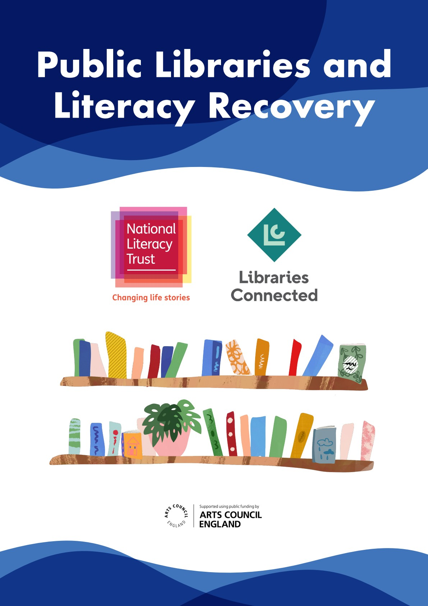
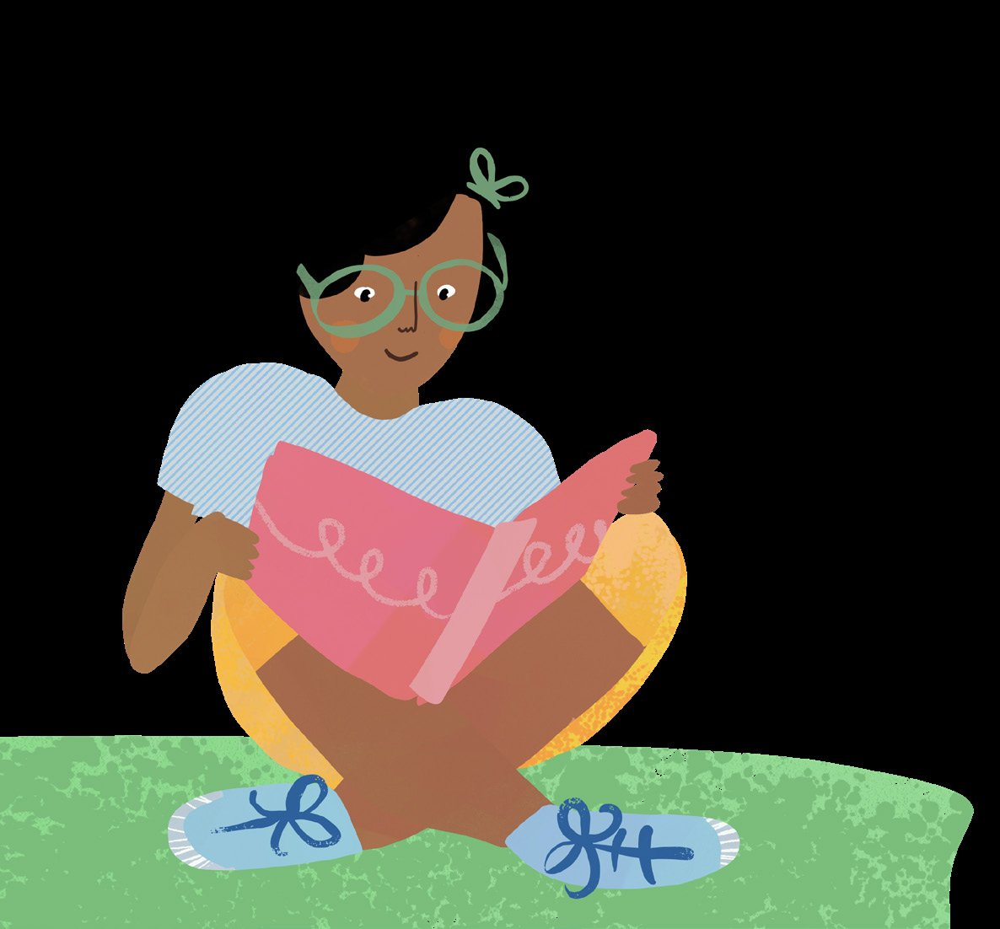
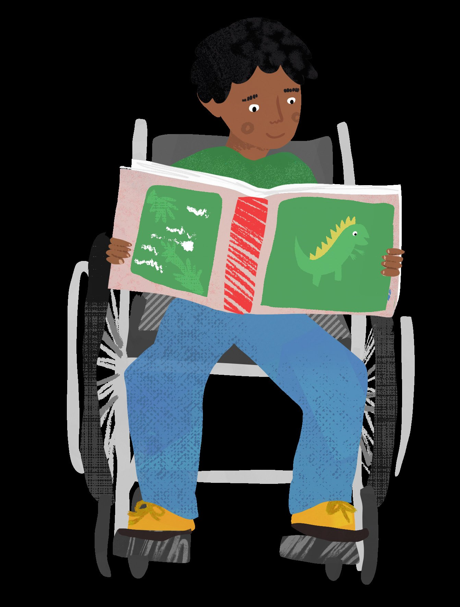
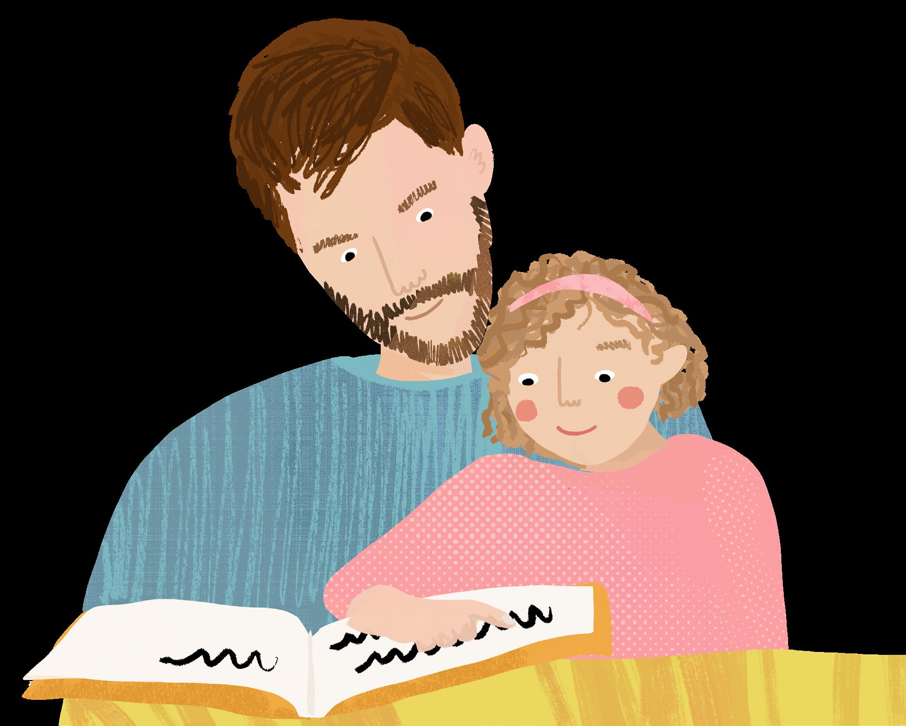
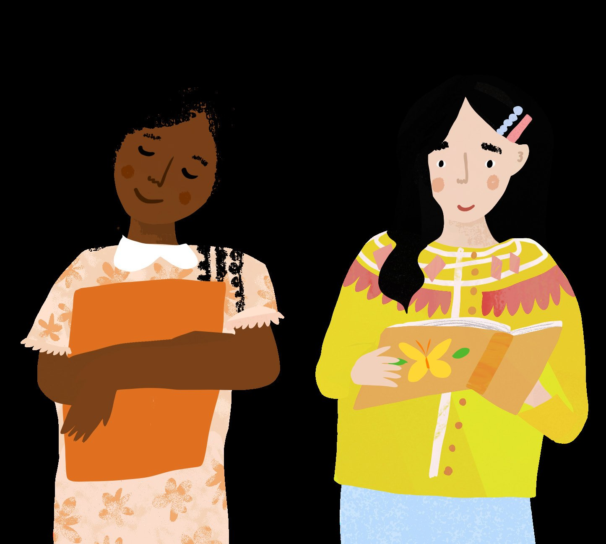
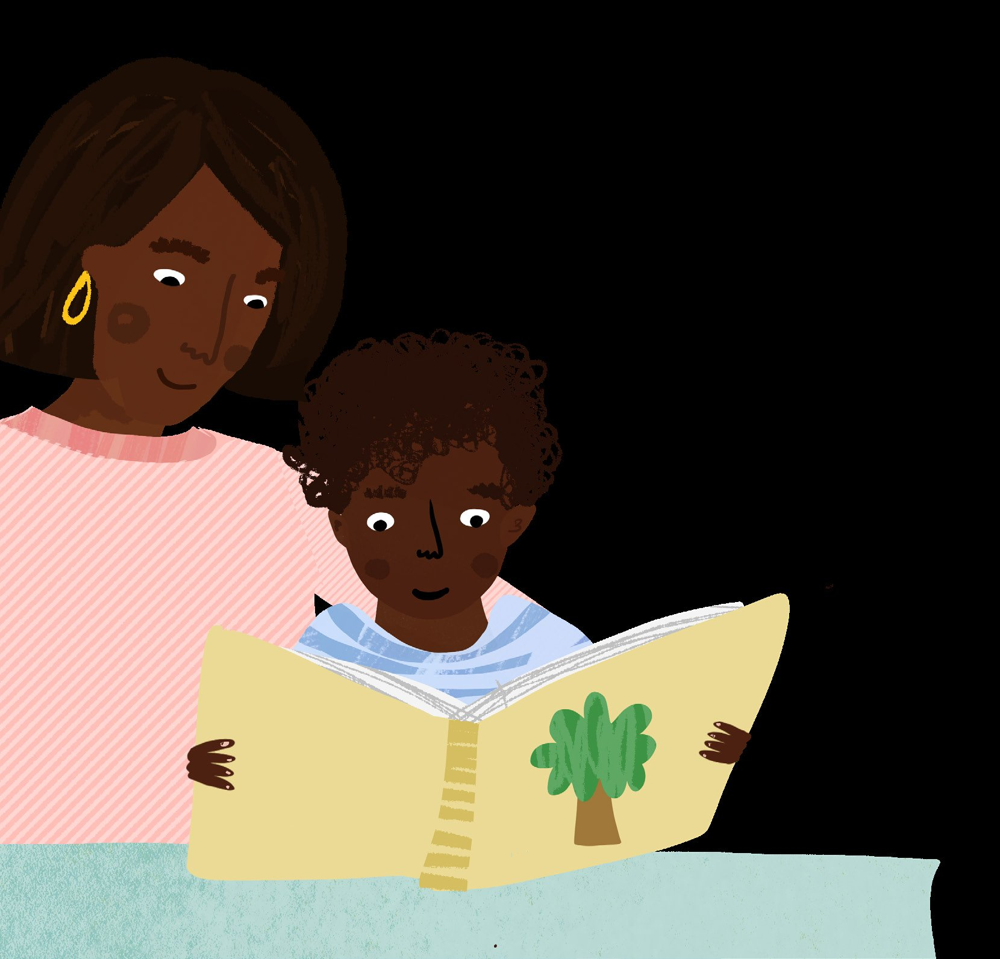
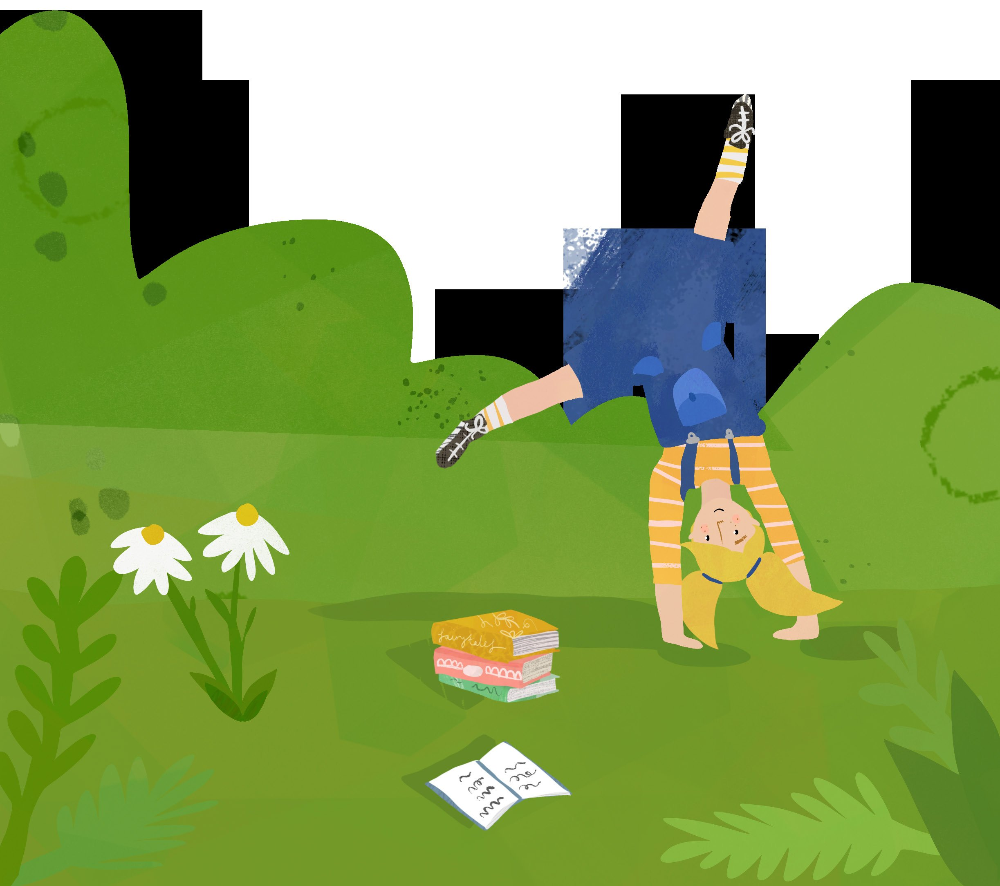
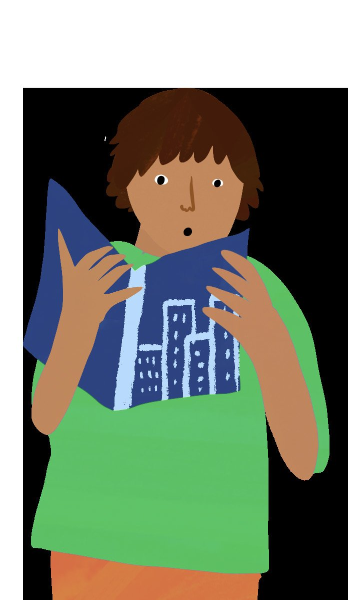

<!-- PAGE: 1 -->

# Public Libraries and Literacy Recovery

**National Literacy Trust**  
**Libraries Connected**

---

<!-- PAGE: 2 -->

## Foreword

Public libraries are a national service, supporting reading and literacy throughout life. I am proud to be the Minister with responsibility for championing public library services across England. This report illustrates how vital both reading and public libraries are, particularly as we recover from the pandemic and work to level up the country.

Through their day-to-day work, libraries support early-years development, giving children a fun and informal introduction to literacy that helps prepare them for school. They spark an interest in books, learning and creativity that lasts well beyond the school gates and into adulthood. Libraries are an engine for social mobility, open to all and free to access.

As this report shows, reading for pleasure is the single most important indicator of a child's future success, more so than their family's socio-economic status. That's why public libraries are indispensable. By connecting children to books and introducing them to authors, libraries unlock potential and broaden horizons.

The Government is committed to supporting our public libraries. Through our investment in the British Library's Business & IP Centre network and our work with Arts Council England, we are helping libraries across the country to innovate, modernise and reach new audiences.

I commend the National Literacy Trust and Libraries Connected for producing this report. As we build back better from the pandemic, public libraries must continue to play a central role in helping every child and every community achieve their full potential.

**Lord Parkinson of Whitley Bay**  
Minister for the Arts, Department for Digital, Culture, Media and Sport

---

Every child deserves the chance to fulfil their potential, and mastering the fundamentals of reading and writing is the bedrock of a good education.

The pandemic has created unprecedented challenges for our education system, and we know that the impact on pupils' learning, particularly in literacy, has been significant. That is why the Department for Education is investing over £3 billion in an ambitious education recovery programme, targeting support to the children and young people who need it most.

As part of this, the National Tutoring Programme is giving hundreds of thousands of pupils access to high-quality tuition, while our English Hubs are driving up standards in early reading and phonics in over 3,000 schools across England.

However, schools cannot do this work alone. Developing a love of reading requires a whole-community effort, and public libraries have a unique ability to inspire children and families outside the classroom. From the Summer Reading Challenge to author visits and book clubs, libraries bring reading alive in communities right across the country.

This report sets out clearly why libraries are such an essential partner in our national mission to level up education and ensure no child is left behind.

**Robin Walker MP**  
Minister of State for School Standards

---

<!-- PAGE: 3 -->

## 1. Executive Summary

Public libraries are a national reading service, supporting reading and literacy throughout life. As a free local resource, they are particularly powerful in supporting the development of literacy and reading skills in disadvantaged communities. Libraries have a unique and powerful role to play in raising literacy skills, vital for individual life chances and local economic and social prosperity.

This report demonstrates:

* **A universal foundation**: Libraries are trusted, accessible community hubs where reading for pleasure is fostered free from financial barrier or academic pressure.
* **Early intervention**: Early library engagement enhances vocabulary, language acquisition and school readiness, closing the attainment gap before school begins.
* **Tackling disadvantage**: Use of public libraries has a disproportionately positive impact on children and adults from lower socioeconomic backgrounds.
* **Addressing pandemic learning loss**: The disruption of the Covid-19 pandemic severely widened existing inequalities in children's literacy and early language development.
* **Strategic partnership**: Libraries are ideally positioned to collaborate with schools, local authorities, and multi-academy trusts to deliver sustainable literacy recovery across England.

---

<!-- PAGE: 4 -->

## 2. Libraries – a national reading service

Libraries have a unique and powerful role in promoting reading and literacy in our society and are the foundation of the national reading culture. They are a universal service, where everybody can discover her or his reading identity, and where there is no financial penalty involved in the free choice of reading materials.

### 2.1 Support for early language and literacy development

A child’s early language experiences are the foundation of life-long literacy. The language and literacy skills acquired in early childhood underpin cognitive development, educational attainment, and future employment prospects.

Public libraries support early language development through:

* **Bookstart partnerships**: Delivering universal and targeted book gifting packs to families with babies and toddlers.
* **Rhymetime and Storytime**: Regular interactive sessions combining songs, rhythm, repetition, and shared reading that build phonological awareness and vocabulary.
* **Welcoming family spaces**: Specially designed, safe, and engaging environments where parents and carers are encouraged to read with their children from birth.
* **Parental empowerment**: Providing informal modeling and support to parents, boosting confidence in home reading routines.

---

<!-- PAGE: 5 -->

### 2.2 Engaging and inspiring young readers

For many children the library is the place where they discover their reading identities, freely choosing the books that interest them and experiencing the fun and excitement of being part of a reading community.

* In 2011, 8 in 10 (84.3%) children and young people who used the public library considered themselves to be a good reader compared with only 5 in 10 (54.9%) who didn’t (Clark & Hawkins, 2011).
* The **Summer Reading Challenge**, delivered by public libraries across the UK in partnership with The Reading Agency, engages hundreds of thousands of children annually, combating the summer reading dip and keeping children reading during the holidays.
* Public libraries host author visits, creative writing workshops, and book clubs that demystify reading and connect young people with contemporary literary role models.

### 2.3 Closing the gap linked to socioeconomic background

As a free universal reading service, public libraries directly address the gap linked to socioeconomic background, which shapes the literacy challenge in England. As a community service with outreach, responding to the needs and profile of the community, libraries have a reach and relationship with young people, families and adults who come from disadvantaged backgrounds, where literacy challenges are intergenerational.

Research consistently shows that children who read for pleasure achieve higher academic outcomes regardless of their family background. Libraries provide unrestricted access to extensive book collections, graphic novels, audiobooks, and digital platforms, levelling the playing field for children who do not have books at home.

---

<!-- PAGE: 6 -->

### 2.4 Supporting adult literacy

Whilst the focus of levelling up and post-pandemic literacy recovery is on children and young people’s literacy, adult literacy skills are also a significant challenge in many disadvantaged communities. Nine million adults in the UK have literacy issues, with up to 40% of the adult population in the most disadvantaged wards facing literacy challenges. This undermines local economic and community development. Low parental literacy also directly impacts children's educational progress.

Public libraries provide non-judgmental, accessible support for adult learners:
* **Quick Reads and adult literacy collections**: Short, engaging books written by bestselling authors specifically for emergent adult readers.
* **One-to-one reading coaching**: In partnership with organisations like Read Easy, offering confidential support to adults learning to read.
* **Family learning initiatives**: Encouraging parents and children to learn together, breaking intergenerational cycles of educational disadvantage.

---

> ### Case Study: North Tyneside Libraries & Bigfoot Arts North
>
> Percy Main Primary School is in Chirton Ward, North Tyneside, and has a Lower Super Output Area that is in the 1% most deprived in Britain. A school in this area was chosen to benefit from a longer-term activity rather than a one-off event to enable a bigger school buy-in and also involve parents and carers.
>
> North Tyneside Libraries worked with Bigfoot Arts North and the school to deliver creative literacy sessions. Children explored stories through drama, role play, and interactive storytelling. Families were invited to attend celebration events in the library, registering for library memberships and taking home books to establish reading routines at home.

---

<!-- PAGE: 7 -->

## 3. Literacy, reading and a fairer society

Literacy and libraries are inextricably linked to opportunity and empowerment. Increasing levels of literacy increases life opportunities, earnings and health outcomes. Raising literacy levels across a community will have collective economic and social benefits.

For this reason literacy is a priority in the Levelling Up agenda and libraries, as community assets embedded in local places, are key vehicles for delivering those ambitions.

* **Social mobility**: Strong literacy skills are the single most important factor in enabling individuals from disadvantaged backgrounds to break free from poverty.
* **Health and wellbeing**: People with good literacy skills live longer, healthier lives. Reading for pleasure has been shown to reduce stress, improve mental wellbeing, and alleviate social isolation.
* **Civic participation**: Functional literacy is essential for exercising democratic rights, accessing public services, navigating digital platforms, and making informed choices.

---

<!-- PAGE: 8 -->

At a societal level the World Literacy Foundation estimated that a failure to master basic literacy skills costs the UK economy £80 billion every year (World Literacy Foundation, 2018). If every 11-year-old was able to read well by the time they left primary school, the economy would be £32.1 billion bigger by 2025 (Read On. Get On., 2014).

---

> ### Case Study: Bradford Libraries & National Literacy Trust
>
> In Bradford, the National Literacy Trust's Hub works in close partnership with Bradford Libraries to deliver targeted campaigns that engage communities with the highest literacy needs.
>
> Initiatives include bilingual storytelling sessions, pop-up library events in community centres and parks, and targeted book distributions to low-income families. By meeting families where they are and removing traditional barriers, Bradford Libraries have seen substantial increases in library registration and sustained book borrowing among children who previously had no access to books at home.

---

<!-- PAGE: 9 -->

## 4. The impact of the pandemic on reading and literacy

The challenge to equip a new generation with the literacy skills they need to fulfil their own potential and the potential of their communities sits at the heart of the Government’s Levelling Up agenda. But this challenge has intensified and has become more pressing in the context of the pandemic, especially for those children who missed substantial periods of in-person schooling.

As well as impacting on literacy skills, the pandemic has also affected children’s reading for pleasure: just prior to the first lockdown overall reading enjoyment levels were at a 15-year low, with under half (48%) of children and young people saying they enjoyed reading in their free time (Clark et al., 2020).

During lockdowns, library closures physically cut off millions of families from access to books and computer facilities. While public libraries made remarkable pivots to digital lending, virtual storytimes, and home deliveries, families without digital access or devices at home faced acute digital exclusion.

---

<!-- PAGE: 10 -->

## 5. The impact of the pandemic on the reading and literacy of children from disadvantaged communities

The pandemic both exposed and exacerbated pre-existing inequalities in literacy, intensifying the urgency of the Levelling Up agenda. The attainment gap linked to disadvantage has been a key challenge for the education system and has sat at the heart of England’s education policy, research and practice for decades.

The pandemic has significantly widened this gap:

* Research by the Education Endowment Foundation (EEF) found that disadvantaged pupils fell further behind their peers in reading during periods of school closure.
* In autumn 2020, the learning gap for disadvantaged pupils in primary reading was estimated at approximately 2 months; by summer 2021 this had widened to between 2.2 and 2.4 months of learning loss.
* Early years language development suffered markedly: thousands of children entering Reception classes arrived with speech, language, and communication deficits due to reduced social interaction and isolation.

---

<!-- PAGE: 11 -->

### Digital and Resource Disparities during School Closures

> **Key Findings on Educational Inequality:**
>
> * Schools in the most deprived areas were least well equipped to support pupils’ remote learning at the start of the pandemic.
> * Fewer than 1 in 4 (23%) of schools in deprived areas had an online learning platform in place, compared with 37% of state schools in affluent areas and 60% of private schools (Cullinane and Montacute, 2020).
> * Just 2% of teachers in the most disadvantaged communities believed all of their pupils would have adequate access to devices for home learning, compared with a national average of 7% (Teach First, 2020).
> * Children in the highest-income families spent an average of 5.8 hours a day on educational activities during lockdown compared with only 4.5 hours in the lowest-income households (Andrew et al., 2020).
> * Over 1.5 million UK children (9%) lacked access to a laptop, desktop, or tablet at home, relying on smartphones or lacking internet access altogether (Ofcom, 2021).

---

<!-- PAGE: 12 -->

The differences in the resources children could access in the home meant that the pandemic also widened the disadvantage gap in early language and literacy. Children growing up in low-income households are significantly less likely to have a rich home learning environment, so libraries, early years settings, social and familial networks all have an important role in supporting parents and young children.

By September 2021 more than three-quarters of schools felt children starting Reception in the last year needed more support than those in previous cohorts (Bowyer-Crane et al., 2021).

It is important to note that parents, teachers and librarians have been tireless and committed to supporting the most vulnerable children’s reading and literacy throughout the pandemic. Without the exceptional efforts of public library staff in distributing physical books, providing doorstep deliveries, and creating innovative online story sessions, the impact on children and families would have been even more devastating.

---

<!-- PAGE: 13 -->

## 6. The role of libraries in literacy recovery

As local authorities, schools and multi-academy trusts continue to develop plans for supporting children and young people whose literacy has been impacted by the pandemic, many are developing approaches in partnership with public libraries. Increasingly, libraries’ ability to engage and inspire young readers is being harnessed to support education catch-up.

---

> ### Case Study: Gloucestershire Libraries & The Reading Agency
>
> Gloucestershire Libraries worked in close partnership with The Reading Agency and local schools to provide intensive literacy catch-up opportunities.
>
> The service developed interactive author events, virtual workshops, and targeted reading packs aimed specifically at children identified by teachers as having fallen behind during lockdown. A standout initiative was an interactive online mystery and escape room challenge featuring popular children's authors Catherine Doyle and Lesley Parr, which re-engaged reluctant readers and inspired renewed excitement in exploring library collections.

---

### Strategic Recommendations

To maximise the contribution of public libraries to national literacy recovery:

1. **Embed libraries in local recovery strategies**: Local authorities, Regional Directors, and Multi-Academy Trusts should formally integrate public libraries into local literacy catch-up and Levelling Up plans.
2. **Expand early years outreach**: Scale up library-led Rhymetime and Bookstart programmes in Family Hubs and community centres in disadvantaged wards.
3. **Targeted book access**: Ensure every disadvantaged child is enrolled in their local library and receives high-interest books to build home libraries.
4. **Co-commissioning across sectors**: Health, education, and cultural partners should pool resources with libraries to tackle early speech, language, and communication delays.

---

<!-- PAGE: 14 -->

## About the Organisations

### About the National Literacy Trust

The National Literacy Trust is an independent charity that transforms lives through literacy. We are dedicated to improving the reading, writing, speaking and listening skills of children who need it most, giving them the best possible chance of success in school, work and life.

We run Literacy Hubs and campaigns in communities where low levels of literacy and social mobility are seriously impacting people’s lives. We support schools and early years settings to deliver outstanding literacy provision and we campaign to make literacy a priority for politicians, businesses and parents. Our research and analysis make us the leading authority on literacy and drive our interventions.

**National Literacy Trust**  
68 South Lambeth Road, London SW8 1RL  
Telephone: 020 7587 1842  
Email: [contact@literacytrust.org.uk](mailto:contact@literacytrust.org.uk)  
Web: [literacytrust.org.uk](https://literacytrust.org.uk)  
Registered charity no. 1116260

---

### About Libraries Connected

Libraries Connected is an independent charity that represents, supports and champions public libraries in England, Wales and Northern Ireland. We work to ensure public libraries are celebrated and valued as essential community institutions that transform lives.

Our membership includes every library service in England, Wales and Northern Ireland. We develop national initiatives, share best practice, support workforce development, and advocate for sustainable investment in libraries.

**Libraries Connected**  
Web: [librariesconnected.org.uk](https://www.librariesconnected.org.uk)  
Registered charity no. 1176482

---
