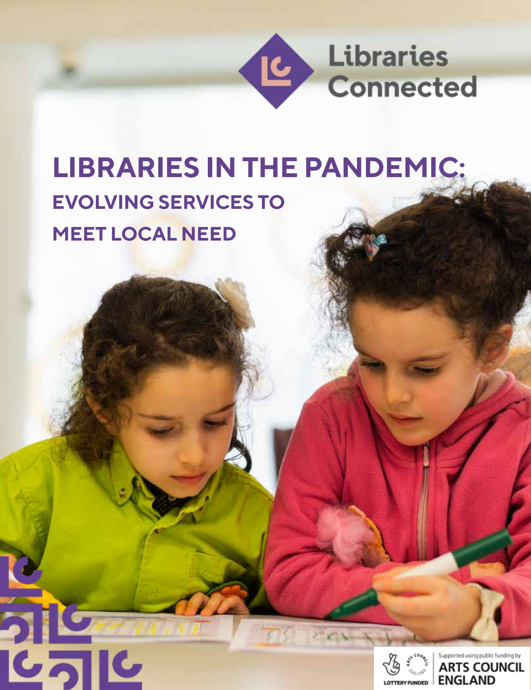
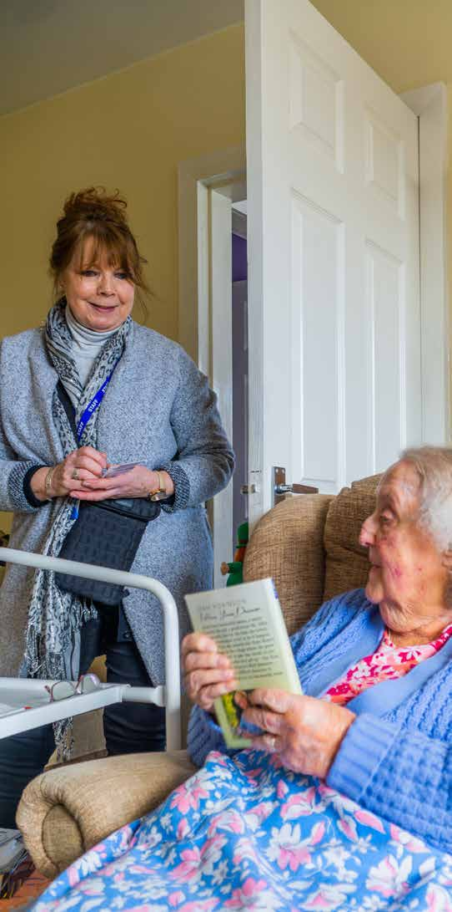
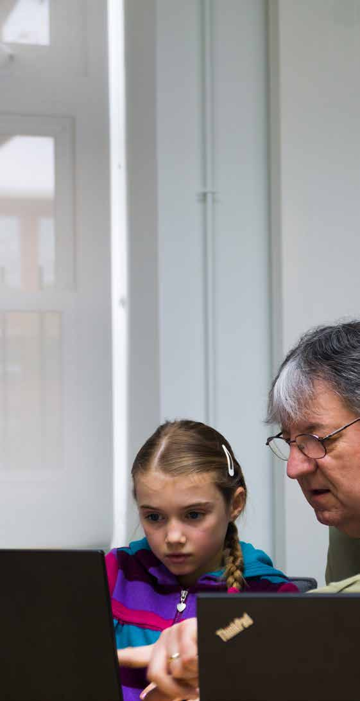

<!-- PAGE: 1 -->

# Libraries in the Pandemic: Evolving Services to Meet Local Need

<!-- PAGE: 2 -->

## Contents

- [Introduction](#introduction) (p. 3)
- [Supporting literacy and learning](#supporting-literacy-and-learning) (p. 4)
- [Fighting isolation and promoting wellbeing](#fighting-isolation-and-promoting-wellbeing) (p. 6)
- [Lockdown: Challenges and barriers](#lockdown-challenges-and-barriers) (p. 8)
- [Libraries’ essential role in local recovery](#libraries-essential-role-in-local-recovery) (p. 10)

*Unless otherwise indicated, facts and figures are from research undertaken by Libraries Connected, 2020. Those marked with an \* are from Making a Difference: Libraries, lockdown and looking ahead by Dr Jenny Peachey, Carnegie UK Trust, 2020.*

<!-- PAGE: 3 -->

### Carol Stump
**President, Libraries Connected**

## Introduction

Public libraries are an essential service for recovery from the pandemic, uniquely equipped to offer human contact and support to the broadest range of people. Libraries are not just partners but core agencies that regularly provide direct services and prevent crises.

This report captures the remarkable work libraries undertook when their physical buildings were closed. In this period, they proved their value to their local communities by:

- **Demonstrating innovation and creativity** to support the local response to the pandemic. Gateshead Libraries used their 3D printers to create visors and other PPE for local care homes and health centres.
- **Serving the vulnerable** through direct, human contact. Many services set up befriending phone lines to keep in contact with their most isolated users, and this went well beyond checking on what books they might want.
- **Providing a digital ‘front door’** to council services, community organisations and health and wellbeing resources.
- **Assisting the frontline** by being redeployed to support the local response. Library staff were well placed to help with business support, coordination and delivery of shielding operations, arranging food deliveries, and contact centres for health and social care.

<!-- PAGE: 4 -->

## Supporting Literacy and Learning

> "Libraries are innovation hubs on the high street and will play a vital role in supporting our national recovery"
> 
> — **Cllr Gerald Vernon-Jackson**, Chair of the Local Government Association’s Culture, Tourism and Sport Board

### Key Findings

- Online lending surged, with 3.5 million more ebooks loaned by mid-August
- Around three in ten adults in the UK engaged with public library services during lockdown – that’s 15 million people\*
- Over 75% of libraries delivered online events during lockdown
- Despite library buildings being closed for four months, library services managed to increase membership by up to 32%
- Almost one in five library users specifically sought out online activities for babies and toddlers.\*

### Overview

Before closing their doors, events in public libraries spanned a wide range of activities, from book-based groups to crafts, performing arts, author events, coding clubs and support for health and wellbeing and employment. Delivering events online during lockdown allowed many library services to keep in touch with their users and reach new audiences.

### 1. Supporting Early Years Development, STEM Learning and Literacy

> "I think [online Code Club is] a great success. My two 10-year-olds thoroughly enjoyed the projects and on completion happily searched for more to do that were more complex once they had gained their confidence."

This was a major innovation for most services which revealed untapped staff skills and resourcefulness, but also presented new challenges. Some of these activities, for example online storytimes, were only possible because Libraries Connected and individual library services were able to negotiate relaxed copyright restrictions with publishers.

<!-- PAGE: 5 -->

> "Parents posted that their children were learning new language and skills by watching and participating in Singing Bears, and that seeing familiar faces and hearing familiar rhymes gave a slice of ‘normality’ to the children who would usually visit the library."

### 2. Helping Schools and Parents Educating at Home

Libraries played an important role in helping parents who were educating their children at home. While Ofsted reports[^1] that younger children have regressed during lockdown and older children have lost reading and writing skills, many libraries doubled the volume of e-resources they loaned out and delivered learning activities including interactive homework support and new resources for local schools.

Among those who managed to offer some form of school library service, examples were cited of increased used of their online resources, use of social media to contact school staff, and the importance of maintaining engagement with schools.

> "Thank you for the amazing online library resources which you have built up recently. They have been a lifesaver for our family during lockdown. I'm especially impressed by the wide range of online books and other resources which are suitable for a child of his age. They have been very helpful in encouraging him to keep reading, and indeed they have actually developed his passion for reading to a greater level."
> — [Parent]

> "The provision of books for the summer reading challenge has ensured that some children who have had no access to books during the lockdown have now got books and this will hopefully support their return to school. The summer reading challenge has engaged some hard to reach families in reading and the library service has been appreciated possibly for the first time by many families."
> — [Schoolteacher]

### 3. Providing Services to the Digitally Excluded

Some services changed their offer to overcome digital exclusion by working with partners to run tablet lending schemes to deprived and digitally excluded families or those who were shielding.

One service, working with colleagues in education, delivered 14,000 Chromebooks to vulnerable families. Another worked with health and social care partners to provide a lending library for devices, sharing wi-fi with homeless shelters and lending them books.

#### Case Study: Digital Services in Suffolk

> "Our public facing site is good, but it’s still not good enough or totally reflective of the breadth of our offer. In lockdown more than ever we were competing with Netflix and YouTube."

Lockdown meant losing the most powerful part of what Suffolk Libraries provide beyond book lending – a programme of 15,000 physical events annually across 44 sites with over 200,000 attendances, meeting very specific local needs particularly in health and wellbeing. After their buildings closed, their website was transformed in a matter of days to reflect the new digital offer.

Suffolk Libraries developed an extensive new online event stream that replicated existing events (online book and craft groups, quiz nights, and podcasts) and launched new activities such as online pregnancy yoga and gentle workouts.

They had around 500,000 video views between late March and early July and attracted new audiences of younger, more diverse people. Their Jumpstart programme of online health and wellbeing events, designed to engage with men aged 40 to 60, saw physical fitness videos watched over 6,000 times.

<!-- PAGE: 6 -->

## Fighting Isolation and Promoting Wellbeing

> "During lockdown, libraries provided vital services to people with a range of needs, with a view to ensuring they feel connected and cared for, as well as offering e-resources and activities that provided education, entertainment, and distraction."

> "Being vulnerable isn’t as clear cut as you think…there’s a routine that keeps people going, contact that improves wellbeing and mental health. Libraries are part of that routine and contact for many people. Libraries are a safety net that catches people before they really begin to struggle."

### Key Findings

- Almost a quarter of people who don't usually use libraries accessed library services during lockdown\*
- Over 60% of people who used public libraries during lockdown said that this had helped them to feel more connected to their community\*
- 64% of those who had used the service during lockdown said that the library service had improved their wellbeing.\*

### Overview

Libraries have played a vital role in preventing isolation and improving health and wellbeing for vulnerable or shielding library users. They provided an important routine and point of human contact for people through check-in calls and the delivery of books and other essentials. They also offered physical and mental stimulation through online craft and fitness events and digital access to resources.

### 1. Befriending and Keeping in Touch

Many services were proactive in keeping in touch with their vulnerable and isolated users who could not access online services, establishing ‘keeping in touch’ or ‘befriending’ calls. Staff from across the library service, and in some cases other council staff or volunteers, made regular phone calls to vulnerable users to check in on their health and wellbeing, have a chat about books, and offer help and support with other issues.

One library service made almost 10,000 keeping in touch calls during lockdown, with many users crying with relief on receiving a call. Other library services reported users saying that the keeping in touch calls were the highlight of their week.

<!-- PAGE: 7 -->

> "One lady died and her quite elderly son who lived with her was bereft. We made daily calls to help him through his grief as he needed to talk to someone he knew but had no one to speak to."

#### Case Study: Remote Services in Bracknell Forest

> "We received so many positive comments and letters, saying that HLS had meant such a lot and, in some cases, saved people’s lives just by seeing a friendly face and having a chat."

Bracknell Forest Library Service rapidly adapted its Home Library Service (HLS) to provide a vital lifeline to its shielding and vulnerable users. Staff identified over 300 users and began phoning them to see if they were happy to receive doorstep deliveries. The calls were very well received and often revealed very vulnerable people who were desperately missing the social connection that the library provided.

Staff created personalised book choices and packed and delivered over 2,000 books during lockdown. Feedback was overwhelmingly positive, with many users reporting that the service made them feel valued, less isolated, and cared for.

### 2. Bringing Books and Reading into the Home

Where possible, library services continued to provide their Home Library Service to their regular users and expanded it to include shielding people or those with physical or mental health conditions who were unable to leave the house. Many library services also introduced ‘Order and Collect’ and ‘Select and Collect’ services, packing bags of books based on users’ reading tastes.

#### Case Study: Home Library Service in Sheffield

Sheffield Libraries redeployed library staff to make 3,250 welfare calls to Home Library Service customers and carers. Staff had conversations about reading and wellbeing, recommended books and audiobooks, and arranged safe, contactless book deliveries.

For many recipients, the telephone call and book delivery were the only human contact they received for weeks. Staff also linked customers with other voluntary and community services for food and medication support, and in some cases identified individuals in crisis or suffering abuse.

### 3. Diverting Library Staff to Critical Council Operations

Library staff played a central role in council-wide emergency operations. Their existing skills in customer service, community knowledge, empathy, and data management made them ideally suited to frontline community response roles.

Staff were redeployed to establish and staff community hubs, manage helpline call centres, coordinate emergency food and medicine delivery, or even more urgent help and support. Staff even identified some who were experiencing elder abuse and referred them to support.\*

<!-- PAGE: 8 -->

## Lockdown: Challenges and Barriers

> "This new evidence shows that the leaders who were given the freedom to shape and adapt their services were better able to respond to meet the specific needs of their communities."
> 
> — **Isobel Hunter**, Chief Executive, Libraries Connected

> "Some of our directors may say we should shift entirely to ebooks, but so many of our residents do still want a physical book. Our success at running an expanded Home Library Service during lockdown is now haunting us. It is clearly being regarded by some as a possible way to replace static libraries."

### Key Findings

- The availability of older volunteers was a significant factor for many services in whether they could deliver a Home Library Service during lockdown
- The increase in digital lending by library services may double its costs in this calendar year, which is not sustainable.
- Some library services were restricted in their digital engagement, particularly in early lockdown by corporate policies, IT systems and a lack of equipment.
- Even services with the strongest online offer recognise that the digital public library offer still requires huge improvement to match the most popular commercial retail and streaming services.
- The pandemic has inevitably increased the pressure on local authority funding and this poses a significant risk to libraries.

### Overview

Public libraries are a vital part of local communities, and they demonstrated their value during lockdown. However, with the right support, library services have the potential to do even more. The sector needs a sustainable financial model, and it needs decision-makers nationally and locally to give it the status that it deserves, recognising the unique contribution that libraries make to so many important issues.

### 1. Reaching the Digitally Excluded

It was widely felt that there were significant gaps in how library staff were able to support their communities during lockdown. These gaps mainly arose from the limitations of delivering services online and the exclusion of those without digital access.

<!-- PAGE: 9 -->

> "People without means to digital have been impacted really negatively: They were not able to borrow books for nearly four months, they did not have access to our virtual services nor could they keep in touch with families or apply for jobs. Many children from low income families were unable to take part in the activities that we moved online."

### 2. Variations in Available Support and Resources

The Carnegie UK Trust report highlighted that the factors limiting service delivery and development included finances; differing attitudes to risk within local authorities; the extent of understanding within a local authority of what the library service does, effective communication and engagement with public; organisational culture; partnerships; and digital skills. In some cases this meant that staff were unable to effectively support communities and local authorities.\*

> "My council had a complete comms lockdown. We weren’t allowed to do marketing or use social media unless it was signed off by the council’s core comms team, who were totally focused on COVID-19 messages. We couldn't promote our services or communicate with users."

> "We have no resources for books and stock at the moment as all budgets are frozen. We can't buy ebooks to meet the massive surge in demand."

#### Case Study: Setting up Help Boro Hub in Middlesbrough

> "Libraries were an obvious service to redeploy because they have detailed knowledge of communities."

Middlesbrough library service was responsible for running the ‘Help Boro Hub’. This included setting up a call centre in the Central Library (and later organising working from home) and working alongside public health, and health and safety teams to manage the volume of calls.

The Help Boro Hub offered delivery of shopping and prescriptions and referred residents to services such as dog walking available in their local areas. Staff both fielded calls and fulfilled requests for support. They received hundreds of calls a day, often from people with complex needs. The Hub delivered 1,900 food parcels and collected over 500 prescriptions.

### 3. Building a Modern Digital Service

Library services faced severe constraints due to council IT infrastructures and security settings, which restricted staff from using video conferencing tools (like Zoom or YouTube) or social media channels. Staff often had to use personal devices and domestic internet connections to film storytimes and interact with the public.

Furthermore, public library ebook platforms often suffer from poor user interfaces and restrictive licensing models that make high-volume digital lending financially unsustainable. Developing a digital offer that meets users’ expectations and demand will require substantial work. Lockdown has accelerated the need to improve the terms of digital lending and online broadcast licensing to increase the availability and affordability for public libraries.

The impact of these various barriers meant that public library services were unable to act as a safety net for the disadvantaged, isolated and vulnerable people within their communities as they did before lockdown.

<!-- PAGE: 10 -->

## Libraries’ Essential Role in Local Recovery

> "Whether it is helping businesses go online, providing access to reliable information or keeping kids engaged and learning, libraries play a vital role in helping communities respond to and recover from this pandemic."

### Key Findings

- During lockdown, libraries proved to be flexible, resilient and creative in delivering services
- While online library activities will continue, the physical library space remains irreplaceable for communities
- Public libraries are crucial for local economic recovery, providing free access to Wi-Fi, computers, and business and employment support
- 71% of respondents in a national poll felt that public libraries are essential for local community recovery.[^2]

### Overview

Libraries are integral to the social fabric of the UK. They deliver against some of our most pressing agendas, including health and wellbeing, education, inequality, community cohesion and economic development. The role of libraries will be crucial as we begin to see the longer-term impacts of the pandemic on our communities.

### 1. Physical and Digital Spaces

The experience of lockdown has confirmed that the physical space of the library remains vital. While virtual services expanded dramatically, they cannot replace the warm, welcoming, free, and safe physical spaces that libraries provide on high streets and in local neighbourhoods.

Libraries offer free access to books, quiet study space, computers, internet access, and face-to-face interaction that is not available anywhere else. In the recovery phase, libraries are developing blended models that combine physical presence with digital outreach, reaching people who were unable or unlikely to visit physical buildings before the pandemic. These offer exciting opportunities but also require extra planning and resourcing.

<!-- PAGE: 11 -->

### 2. A Knowledgeable, Skilled and Flexible Workforce

Library staff have also demonstrated their skills. In particular, there was considerable overlap between the customer service skills, learning and support skills, information management skills, and empathy possessed by library staff and the requirements of the local COVID-19 emergency response.

Staff have acquired new skills in digital production, live broadcasting, video editing, and remote community engagement, transforming how libraries communicate with their users.

#### Case Study: Access to PCs in Westminster and Royal Borough of Kensington and Chelsea

> "The PC offer has been invaluable – the heavy take-up has also underlined the extreme digital divide in the borough. Without access to PCs, many of our users are completely shut out from welfare applications, Universal Credit, and job searches."

Westminster and Kensington and Chelsea Libraries prioritised reopening public computer access as soon as safety protocols permitted. Demand was intense from residents who did not possess home computers or internet connections. Staff implemented strict hygiene and social distancing measures while providing essential assistance to users navigating vital government portals, submitting benefit claims, and drafting CVs.

### 3. A Trusted, Free and Accessible Presence at the Heart of Communities

Libraries are trusted civic spaces, free of commercial pressures, where everyone is welcome regardless of background or financial means. As the economic and social fallout from the pandemic deepens, libraries will be at the forefront of providing free resources, job-seeking assistance, digital skills training, and mental health and wellbeing support.

> "A library is a public space where anyone can go and sit without the expectation of spending money. In the difficult months ahead, that free, non-judgmental community space will be needed more than ever."
> — **Krystal Vittles**, Suffolk Libraries[^3]

<!-- PAGE: 12 -->

## What Libraries Need

A recent IPPR report[^4] suggests over a million people, including 200,000 children, face poverty this year because of the economic fallout from the pandemic. Libraries are a vital prevention and support service yet cost an average of just 0.6% of council spending. To help them to continue this service however, libraries need:

- **Sector governing bodies to reject any suggestion that digital or remote services could replace physical spaces;** communities need and want local, social spaces
- **Councils to think ‘libraries first’ when commissioning** and help libraries to work with local services to reduce future costs in welfare, education, health and social care
- **Sector governing bodies to accelerate negotiations with publishers** to improve the terms of digital lending and online broadcast licensing
- **Councils and library services to build on the skills staff have demonstrated** during lockdown to ensure they are ready to respond to future local need
- **Councils to make it easier for libraries to deliver a high-quality online offer** and use the expertise of library staff to help all their residents to access digital services.

### Contact Information

- **Libraries Connected**
- Email: `info@librariesconnected.org.uk`
- Twitter: `@libsconnected`
- Website / Mailing List: `librariesconnected.org.uk/signup`

## Footnotes

[^1]: Ofsted COVID-19 series: briefing notes, October 2020: <https://www.gov.uk/government/collections/ofsted-covid-19-series#october-briefing-notes>
[^2]: Public Library Reopening Poll, Lorensbergs, 2020.
[^3]: Krystal Vittles, Suffolk Libraries, quoted in *The Guardian*, 26 October 2020: <https://www.theguardian.com/commentisfree/2020/oct/26/lockdown-plot-twist-libraries-needed-ebooks>
[^4]: Institute for Public Policy Research (IPPR), *A family stimulus: Supporting children through the pandemic*, 2020: <https://www.ippr.org/research/publications/a-family-stimulus>
