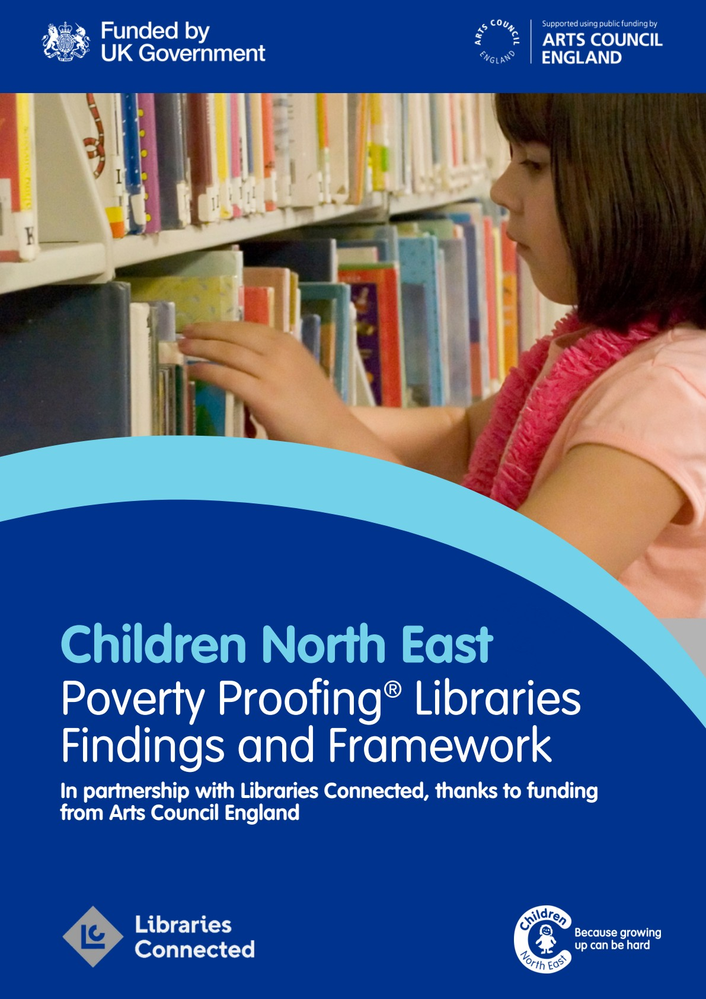

<!-- PAGE: 1 -->

# Poverty Proofing® Libraries

## Findings and Framework

**Children North East**  
*In partnership with Libraries Connected, thanks to funding from Arts Council England*

<!-- PAGE: 2 -->

## Contents

* Executive Summary (Page 1)
* How Poverty Affects Libraries (Page 6)
* Impact and Changes (Page 7)
* The Framework Executive Summary (Page 7)
* Poverty Proofing Libraries – the process (Page 8)
* Findings (Page 11)
  * What works (Page 12)
  * Common barriers (Page 15)
* Examples of changes made (Page 22)
* Principles of a poverty informed service (Page 23)
* Framework – self assessment tool (Page 24)
* Conclusion (Page 35)
* Call to Action (Page 36)
* About the organisations (Page 37)
* Acknowledgements (Page 38)

<!-- PAGE: 3 -->

## We are Children North East

Children North East is a large children's charity based in the North East of England, with work extending across the UK. Our mission is that all babies, children and young people are given the chance to grow up happy and healthy.

Children North East deliver services, support and initiatives that provide a platform for babies, children, young people and families to work through issues, take action and which gives them the tools to reach their full potential. We have a strong children's rights ethos and believe that real social change is achieved when those who are, or have, experienced issues lead the change, and so we campaign on issues and challenge those in positions of influence who make decisions affecting the lives of babies, children and young people.

Since 1891, we have worked to provide life-changing services for babies, children, young people and their families to thrive.

## Executive Summary

This document outlines the findings and framework of the Poverty Proofing® Libraries programme, delivered by Children North East, funded by Arts Council England in partnership with Libraries Connected. The programme seeks to identify and remove barriers that prevent children, young people and families experiencing poverty from fully accessing and benefiting from library services.

Children North East, a children’s charity with a strong rights-based approach, developed Poverty Proofing to ensure that no activity or service excludes or disadvantages individuals due to low income. The initiative has been successfully applied across multiple sectors and was piloted in three library services (Gateshead, Oldham and Cornwall), alongside a programme of national training webinars. The Poverty Proofing process involved staff training, scoping, community consultation (including both users and non-users), detailed reporting, action planning and follow-up review. This approach ensured that lived experiences of poverty directly informed service improvements.

<!-- PAGE: 4 -->

## The Poverty Proofing Ethos

> **No activity or planned activity should identify, exclude, treat differently or make assumptions about those whose household income or resources are lower than others.**

### Voice

The voice of those affected by poverty is central to understanding and overcoming the barriers that they face.

### Place

We recognise that poverty impacts places differently, and so understanding place is vital in our response. Organisationally we also need to be clear about why and how decisions are made. This understanding of context is essential.

### Structural inequalities

The root causes of poverty are structural. What structural changes can we make at an organisational level to eliminate the barriers that those in poverty may face?

<!-- PAGE: 5 -->

## How Poverty Affects Libraries

* In England, **36% of adults** used a public library service at least once in the previous 12 months.[^1]
* Communities in the most deprived deciles were **four times more likely** to have lost a publicly-funded library since 2016.[^2]
* **23%** of library users access free Wi-Fi, computers, or printing facilities.
* **19%** of library users access a free, safe study space.
* **60%** of library users access browsing and borrowing free books/media.

The research identified several strengths within library services. Positive staff interactions, welcoming environments and a strong sense of belonging were consistently highlighted as critical enablers of engagement. Access to free or low-cost IT services, clear navigation within library spaces and the availability of community activities also play a vital role in supporting people on low incomes.

However, a number of common barriers were identified:

* Concerns on costs – fines, printing, cost of food and drink, parking. Unintentional financial pressure and exclusion due to hidden costs.
* Concerns about behaviour expectations (e.g. silence) and lack of confidence can deter new users.
* Insufficient activities for certain age groups, particularly teenagers, and limited cultural representation reduce engagement.
* Transport difficulties, parking costs and poor external signage can make libraries physically hard to access.
* Limited or unclear promotion of services, particularly offline; many families are unaware of available support and activities.
* Limited engagement with underserved communities and low awareness of existing services reduce understanding of community needs and opportunities for service improvement.

<!-- PAGE: 6 -->

## Impact and Changes

Participating libraries have already begun implementing changes, including improved communication of costs, enhanced signage, expanded outreach, increased opportunities for user feedback and targeted work with underrepresented groups such as young people.

## The Framework

The document introduces a practical Poverty Proofing framework to support libraries in embedding inclusive practice. It provides a structured self-assessment tool across key areas:

* Cost transparency
* Communication
* Accessibility
* Representation
* Transparency
* Outreach
* Belonging

A red–amber–green scoring system enables libraries to identify gaps and prioritise action.

<!-- PAGE: 7 -->

## Poverty Proofing Libraries – The Process

Children North East has had the chance to work with three Library services across England, as well as deliver a suite of Universal Training webinars online. Over the last 18 months, we have gone through a programme of work, diligently guided by a steering group made up of enthusiastic and supportive individuals from libraries and organisations across England.

### Poverty Proofing audits

Poverty Proofing Libraries is a programme that Children North East have developed through the voice of children, young people and their families. Its aim is to identify barriers to experiential engagement with libraries that exist because of poverty.

The mission of Poverty Proofing is to ensure that:

> "No activity or planned activity in any cultural organisation should identify, exclude, treat differently or make assumptions about those children whose household income or resources are lower than others."

The Library services that took part in this pilot project were: **Gateshead**, **Oldham** and **Cornwall**. The libraries were selected following submissions of expressions of interest, that the steering group reviewed and awarded to those they felt best met the assessment criteria, which included but was not limited to capacity to support the work and capacity to make change.

### Pilot Engagement Statistics

* **150** library staff trained
* **42** staff consulted
* **573** community members consulted
* **149** universal training participants
* **3** library services involved

<!-- PAGE: 8 -->

### Stages of the Process

Each library service went through the following stages:

#### Staff Training

Staff of all levels were invited to attend a Poverty Awareness Raising training session, with a chance to learn and reflect around the impact of poverty on their local community. 299 members of staff were trained across the project, including online Universal Training delivered nationally across England libraries. 150 of these were trained directly across the three pilot authorities.

#### Scoping

Children North East held conversations with libraries to understand local delivery, identified and contacted community venues to arrange consultations, developed and distributed surveys, and reviewed local statistics and levels of deprivation.

#### Consultation

Staff at libraries were consulted with around what they saw the main barriers being in libraries; library visitors were asked for their views around what supports them and what barriers they have had to overcome to attend; and finally, Children North East staff went out into the community to seek the views of non-library users.

#### Feedback and Report

The team at Children North East pulled together the insights from the consultation phase to create a comprehensive report. The report was broken down into themes, with each theme sharing what works and areas to explore, along with suggestions from the community or Children North East’s research, to try out to remove those barriers that came up.

#### Action Planning

Following receipt of the report, the libraries had a session with Children North East to explore the suggestions and create an action plan with short, medium and long term goals that can be actioned at place.

#### Review

Finally, after a period of 6-8 months, Children North East reconnect with the libraries to see what changes have been made and to try to understand the impact of those changes.

#### Universal Training

A series of three training webinars were delivered online alongside the Poverty Proofing work in libraries, hosted by Libraries Connected.

The first, sharing Children North East’s Poverty Awareness Raising training, with a chance for library colleagues to connect and understand the context of poverty and the impact this can have on library attendance or non-attendance. The second shared ongoing learning from the work in the three areas, with colleagues coming to reflect on the impact of poverty in their local areas. The final saw the three libraries coming along to share the work they have done since receiving their report and some of the outcomes of the process.

<!-- PAGE: 9 -->

## Findings

The following sections of this document share some of the findings of the work outlined above. As the work has been delivered in three areas of England, Children North East has been able to establish what barriers are specific to the places we have worked with and what may be felt more universally in libraries in England. The following two sections share what came out as working well in the majority of areas and what some of the common barriers were.

The following findings are drawn directly from consultations with library staff, users and non-users across the three areas.

The intention is for these to be used as a starting point for libraries to reflect upon their own policies, procedures and practices. It is important to keep in mind that these themes are not exhaustive, nor can it be assumed that all themes are present in each library service. A poverty aware approach should always be place-based and be led by those experiencing structural barriers. See Principles of a Poverty Informed Service below.

<!-- PAGE: 10 -->

## What Works

### Staff welcome

Feedback from communities shows that the warmth, approachability and consistency of staff play a crucial role in making the library a safe and accessible space, particularly for those experiencing poverty.

When people feel respected, listened to and able to ask for help without judgement, they are far more likely to engage with services, seek support early and build trust in the organisation.

This sense of welcome is not just a "nice to have", it actively reduces barriers, counters stigma and helps ensure that individuals facing financial hardship can access community, information and opportunities.

> "I've felt so welcome and supported here over the years…the library has given me friends and community and really been a lifeline. The staff are great."  
> — *Community Member*

> "If I had any issues, I'd go straight to the staff - they're lovely and I'd feel fine approaching them about absolutely anything. They're always on hand to ask about anything happening and are always knowledgeable."  
> — *Community Member*

### Affordable IT services (and support)

Access to affordable, reliable IT services is a lifeline for many people experiencing poverty, and the library plays a crucial role in removing digital barriers that can otherwise limit opportunities.

Free computer use, low-cost printing and supportive staff create an environment where individuals can stay connected, complete essential tasks, and manage day-to-day needs without financial pressure.

For those who cannot afford home broadband, devices or ongoing data costs, the library becomes a vital point of access, helping them maintain independence, apply for jobs, manage benefits, stay in touch with services and participate fully in their community.

> "It’s 10p a sheet for printing and that’s ok; I’ve done that today and used the computer. They’re helpful the people here too. I once came and didn’t have cash but they let me off."  
> — *Community Member*

> "I’ve been coming to the library near enough every day for the past 9 years. It’s my favourite place. It’s quiet and I can borrow books and use the computers. The staff are really friendly too."  
> — *Young Person*

> "I go to the library whenever I run out of Wi-Fi, which is quite often."  
> — *Community Member*

> "I can use the computer for free, it’s really good. Don't need money here."  
> — *Community Member*

<!-- PAGE: 11 -->

### Wayfinding

Clear, intuitive wayfinding is more than a design feature, it plays a meaningful role in ensuring that people experiencing poverty can access library services with confidence and dignity.

When a space is easy to navigate, with signage that is visible, readable and welcoming, it reduces the anxiety that can come with entering public buildings, especially for those who may already feel marginalised or unsure of "how things work."

A well-laid-out environment removes hidden barriers, supports independence, and helps ensure that everyone can move through the space without needing to ask for help or worry about making mistakes.

> "We find the layout really nice and easy to navigate. It's great that the space is so light and airy and well laid out. The signage is easy to read and helpful."  
> — *Community Member*

> "Signage is helpful and the space is well laid out and easy to navigate."  
> — *Community Member*

### Feeling of belonging

A strong sense of belonging within the library plays a vital role in supporting people who may be experiencing poverty, isolation or instability.

When individuals feel recognised, safe and connected, the library becomes more than a service, it becomes a community anchor. This sense of welcome helps to counteract the social exclusion that often accompanies financial hardship, offering a place where people can build relationships, feel represented and experience dignity and consistency in their daily lives.

Belonging reduces barriers, encourages engagement and provides emotional as well as practical support.

> "I find the staff really helpful - I have dementia and the staff support and connection I feel to the library has been really important to me. They look after me."  
> — *Community Member*

> "We do feel it's a safe place and representative of our diverse community."  
> — *Young Person*

> "I’m really happy with the library. It helps give the towns and cities a sense of community. It gave me a sense of belonging after being new and moving here."  
> — *Community Member*

<!-- PAGE: 12 -->

### Support to communities

Free and low-cost community activities within the library play a vital role in supporting people on low incomes, offering social connection, routine and practical help without financial pressure.

By providing welcoming spaces, free refreshments and access to multiple supportive groups in one place, the library reduces the cost of participation and makes it easier for families to plan meaningful, supportive days without worrying about affordability.

This kind of accessible community infrastructure helps counter isolation, strengthens wellbeing and ensures that those experiencing poverty can still engage in enriching, social and developmental opportunities.

> "There's all these free groups and it's great that we can come to this session and then go straight up to weigh and play, being able to plan a full day's activities, that are social and supportive is such a benefit to parents, especially for me on a low income."  
> — *Community Member*

> "You can get free tea and coffee here."  
> — *Community Member*

<!-- PAGE: 13 -->

## Common Barriers

### Refreshments and Costs

Access to something as simple as free or low-cost refreshments can make a meaningful difference for people on low incomes, particularly those using the library as a warm, safe space or as part of a full day of activities.

When no food, drink or water is available, it can unintentionally create barriers, making visits shorter, less comfortable and less accessible for families who may not be able to afford café prices.

Free tea, coffee or water stations help reduce these pressures, support people to stay longer, and ensure that the library remains a genuinely inclusive space, especially during colder months when warm spaces are essential.

> "It was really good when they had free tea and coffee that you could just help yourself to, it was good to just make a brew and sit here, they’ve stopped doing it now though. It would be good if they could bring that back."  
> — *Community Member*

> "No there is no food or drink allowed, and no water provision that I know."  
> — *Community Member*

> "I think free tea and coffee would be good. Especially in the winter. We’ve got warm spaces but certainly if you live that end of town, it would be really good."  
> — *Community Member*

### Secondary Spend (Cafés and gift shops)

Secondary spend areas – such as cafés and gift shops – can unintentionally create exclusion for people on low incomes, especially when prices are high, payment options are limited or information, specifically around pricing, isn’t clearly displayed.

For families who rely on the library as an affordable, accessible space, encountering costly items, card-only payments or cafés and gift shops can make the environment feel less welcoming.

These barriers can also shorten visits, limit participation and reinforce the sense that certain parts of the space are "not for them," reducing the overall inclusivity of the library experience.

> "There’s no menu when you go in, you have to go round the corner to see in the café."  
> — *Community Member*

> "I think the cafe is just pay by card, that would be a barrier for some people."  
> — *Community Member*

> "We wanted to visit the café; however, it was closed by 3 pm. Instead, we explored the gift shop...we found them (items) to be quite pricey."  
> — *Community Member*

<!-- PAGE: 14 -->

### Feedback collection

Meaningful feedback is essential for ensuring that library services meet the needs of all users. Many people, especially those on low incomes, report that they are rarely asked for their views.

When families experiencing poverty are not routinely invited to share their experiences, the barriers they have experienced, their priorities and ideas can remain invisible.

This lack of structured feedback can lead to services that unintentionally overlook the needs of those who rely on the library most, reinforcing feelings of exclusion and limiting opportunities for improvement. Actively seeking input, perhaps with a different approach such as conversations rather than online or paper surveys, particularly with groups who often feel unheard, is a crucial step in creating more equitable and responsive services.

> "Never been asked for feedback or opinions on rhyme time."  
> — *Community Member*

> "I’m really glad you came and asked. Our age group often feels excluded so having access to someone to give our opinion to is great."  
> — *Community Member*

> "Nobody has ever asked us for feedback in any of the sessions we've visited or the libraries we visit."  
> — *Community Member*

### Community outreach

Effective community outreach is essential for ensuring that people on low incomes can still benefit from library services. When outreach is limited, not well communicated or absent, families who would gain the most from free resources, social connection and support may never know what is available to them.

A lack of visibility in neighbourhoods, community groups and informal gathering spaces can reinforce existing inequalities, leaving those already facing hardship further disconnected from opportunities that could make a meaningful difference to their daily lives.

Where libraries deliver a range of outreach activities, it is not always clear that these are library-led. Libraries should promote their community work more visibly and use local partnerships to strengthen family engagement, helping families build familiarity and confidence when visiting the library.

> "The library staff have never come here to speak with us but it’s a good idea. Also, the mobile thing [library] where they could bring it to the car park and I think more would use it."  
> — *Community Member*

> "I haven't heard of any library outreach into the community and no one from the library has visited our group before to do anything with us."  
> — *Community Member*

<!-- PAGE: 15 -->

### Communication around events

Clear, accessible communication about events is essential for ensuring that families on low incomes can take full advantage of what the library offers. When information is hard to find, only advertised online, or not visible within local neighbourhoods, it disproportionately affects those who may not have reliable internet access, access to data on a mobile phone, who cannot afford to travel to multiple venues, or who rely on free activities during school holidays.

Poor communication can mean families miss out on opportunities that would otherwise support learning, wellbeing and social connection – reinforcing existing inequalities and limiting the library’s reach to those who could benefit most.

> "I think that’s the problem, you don’t hear about what’s going on even when there is plenty of stuff on. I think leaflet drops in the local areas to the libraries would work best."  
> — *Community Member*

> "I don’t see anything advertised. If there is stuff on, I might go but if it’s something that would interest these [children], it’s expensive visiting different places these days so be good if advertised better about anything that was on during the school holidays."  
> — *Community Member*

> "All the things we do are online or advertised within the library; accessing smartphone or coming in is what people need to do to be able to know."  
> — *Staff*

### Target audiences catered for

When activities and events are designed primarily for certain age groups or demographics, it can leave many young people without accessible, engaging options. For families who rely on the library as a free or low-cost place for social connection, learning and safe recreation, a lack of targeted programming can lead to boredom, disengagement and a sense that the space is "not for them."

This gap can deepen inequalities, as young people who cannot afford paid activities elsewhere miss out on opportunities to build skills, confidence and community. Ensuring that all age groups feel represented and catered for is essential to making the library a genuinely inclusive space.

> "Nothing is designed for us and we just get bored. We are bored, there is nothing for us to do so we just mess on."  
> — *Young Person*

> "It’s more, like, younger kids’ stuff that’s on there, there’s not really anything for us (16-18yrs)."  
> — *Young Person*

> "I don't feel the library is particularly inclusive. I feel that they cater to a particular demographic and their 'regulars' - middle aged to older mainly women and very young children."  
> — *Young Person*

<!-- PAGE: 16 -->

### Apprehension about costs

Worries about hidden costs such as overdue fines, replacement fees for lost or damaged books can create significant barriers for low-income families using the library.

For parents on tight budgets, the fear of fees, embarrassment or penalties can stop them borrowing altogether – a worry that grows with multiple kids, easily misplaced items, or past experiences with fines.

These concerns can be heightened when families have multiple children, when items are easily misplaced, or when past experiences with fines create uncertainty about what they might owe.

Even with supportive staff, the systems themselves, especially self-service blocks, can unintentionally cause stress, shame or exclusion. Reducing these financial anxieties is essential to keeping libraries genuinely accessible and welcoming.

> "I don’t have a library card because I know I’d forget to take books back and what if they [children] break them? I just buy books from charity shops for them now, then at least if they break them it’s their book. I’d be embarrassed taking back a broken book."  
> — *Community Member*

> "I did get a letter about an overdue book that I loaned a friend, I asked her to bring it back but they didn’t, I’m not sure now if there is a charge I need to pay on my account?"  
> — *Community Member*

### General communications around library offer

Clear, accessible communication about events and services is essential for helping families and the wider community understand that libraries offer far more than just borrowing books and quiet reading spaces.

When information is limited, inconsistent, or only shared online, it can reinforce the common perception that libraries are not relevant to everyday needs, especially for those who may already feel disconnected or assume the library is "not for them."

Families may miss out on free activities, support and learning opportunities simply through lack of awareness, a gap that hits low-income households hardest, who often stand to benefit most. Strengthening non-digital, neighbourhood-level communication is key to raising awareness and helping more people feel welcomed to take part.

> "I don’t use libraries really. I don’t read so don’t see a reason for me to go."  
> — *Community Member*

> "I think if they had more on social media people would know what's on offer. I can't read - well, I can but I'm dead slow, by the time I get to the end of a page I've forgotten what I just read, it takes me that long - so that puts me off."  
> — *Community Member*

<!-- PAGE: 17 -->

### Expected behaviour

Expectations about how people should behave in the library, particularly the longstanding idea that it must be a silent space, can create barriers for low-income families, especially those with young children.

When parents worry that their children might be too noisy, too active or "out of place," they may avoid visiting altogether, missing out on free learning opportunities, warm spaces and community support.

These unspoken assumed rules can reinforce feelings of judgement or not belonging, making the library feel less accessible to those who could benefit from it most.

By creating and communicating a more openly family-friendly, noise-tolerant environment it can help to reduce this anxiety and ensure that all families feel welcome.

> "It’s supposed to be a quiet place really isn’t it, so there’s only so much you can do in them with kids really because they get rowdy."  
> — *Community Member*

> "I think there’s still a preconception that libraries need to be quiet so it puts me off going."  
> — *Community Member*

### Diverse representation

Feeling represented in the library’s collections and programming is essential for ensuring that people from all cultural, linguistic and religious backgrounds feel welcome and included.

When materials reflect only a narrow range of communities, it can leave others feeling overlooked or unsure about whether the library is a space for them.

For low-income families this lack of representation can deepen feelings of exclusion and reduce engagement.

Ensuring that collections and outreach reflect the full diversity of the local community is key to breaking down these barriers and helping everyone feel seen, valued and invited in.

> "The only problem I find not so nice is some books were there for Polish [individuals] but what about the other communities? Makes me wonder why we are not all being represented and I felt disappointed. There are so many communities in this area. I’ve heard there is an international library but you have to pay."  
> — *Community Member*

> "I’m from a different religion, a different world. I don’t know what the library would or could do to attract a young person like me."  
> — *Community Member*

<!-- PAGE: 18 -->

### Public transport

Reliable, affordable transport is essential for families on low incomes to access library services, yet many face significant barriers simply getting to and from their local branch.

When buses are infrequent, unpredictable or stop running early, families without cars are left with long walks, missed sessions or the constant worry of being late. For parents with young children, these challenges can make library activities feel out of reach, even when they are free and designed to support them.

Transport barriers can therefore deepen inequalities, limiting access to learning, social connection and warm, safe spaces that families rely on.

While it is not individual libraries or library services’ responsibility to help families overcome these barriers, having an awareness of the challenges and where possible advocating for transport service improvement would be a welcome step.

> "Local bus never comes on time or just don’t come at all. My little boy is 5 and we need to get the bus as it’s half an hours walk and he can’t do it. We can get an 824 but it is so bad getting there on time so then we’re late. I wouldn’t trust it for an important appointment."  
> — *Community Member*

> "Buses don't run after 6pm in other villages around here."  
> — *Community Member*

### Parking

Accessing the library can become significantly harder for low-income families when parking is limited, far from the entrance or unaffordable.

For those who rely on cars, especially in areas with poor public transport, young children, mobility issues or bad weather, the cost and difficulty of parking can turn what should be a free, welcoming visit into a financial burden.

High parking fees can make regular attendance unsustainable, even when the activities themselves are free, while distant parking adds physical strain and reduces accessibility. These barriers can discourage families from engaging with library services.

> "I parked miles away; I’m still out of breath!"  
> — *Community Member*

> "In the winter we might drive but the price for parking is ridiculous. For one session it’s over £4-6 for twice a week. £12 is ridiculous when the activities you’re going to are free."  
> — *Community Member*

<!-- PAGE: 19 -->

### Signage to library

Clear, visible signage is essential for ensuring that everyone, especially low-income families who may be visiting a new area, juggling childcare, or relying on limited time, can easily find and access the library.

When signs are hidden, confusing or missing altogether, it can make the library feel inaccessible or even invisible.

Families may walk past without realising a library is there, or feel unsure about whether they are entering the right place, particularly when buildings are tucked away, poorly marked or located on school grounds.

These barriers can discourage visits, reduce engagement and reinforce the sense that the library is not an open, welcoming space for all.

> "Street connectivity is a massive issue. There’s no safe spaces to cross, it’s hard enough when you’re mobile enough to run across, never mind if you’re not. The signage is bad, it’s behind you as you turn in and then there’s a big wall and it doesn’t even look like a library, it’s not inviting at all / we’re also on school grounds which is interesting because people might feel like they’re almost trespassing on school grounds."  
> — *Staff*

> "They need a clear sign somewhere on the High Street as I had no idea there was even a library here, where is it?"  
> — *Community Member*

<!-- PAGE: 20 -->

## Examples of Changes Made

The library services who engaged with this programme have all received a report detailing what works for their communities and some areas to explore. From those areas, there are suggestions for change. We had a chance to catch up with the libraries, and they kindly shared some of the actions they have taken, here are some of those changes:

### Cost Transparency

* Clearer signage of café costs, menu and prices
* Increased visibility of printing costs, online and in-branch
* Warmer, less formal language in fee and reminder letters
* Clearer guidance for staff supporting people with no money for printing

### Voice & Access

* Bi-annual feedback weeks introduced, covering both general library use and activities
* Trialling evening opening hours

### Reach & Programming

* New teen/young person working group launched
* Increased outreach through the mobile library, taster sessions, and school and group visits

<!-- PAGE: 21 -->

## Principles of a Poverty Informed Approach

Creating truly inclusive services requires more than good intentions, it demands a conscious, ongoing commitment to understanding and addressing the real experiences of people living in poverty. Poverty-informed services are built on a simple but powerful cycle: **Ask, Listen, Act, Advocate**.

### 1. Ask

Asking is the starting point. It means actively reaching out to children, young people, families and communities, especially those who are often underrepresented or excluded, to understand their experiences, challenges and needs. This requires creating safe, accessible opportunities for people to share their views without fear of judgement or stigma.

### 2. Listen

Listening goes beyond collecting feedback. It is about valuing lived experience as expertise, recognising patterns in what people tell us and being open to hearing uncomfortable truths. Genuine listening requires reflection, empathy and a willingness to challenge assumptions about how services are designed and delivered.

### 3. Act

Acting ensures that what is heard leads to meaningful change. This means translating insight into practical improvements – removing barriers, adapting services, reviewing policies and testing new approaches. Visible action builds trust and demonstrates that people’s voices matter.

### 4. Advocate

Advocating extends this work beyond individual services. It involves using insight and evidence to influence wider systems, partners and decision-makers, ensuring that the needs of those experiencing poverty are recognised and addressed at every level.

Together, these four elements create a continuous and dynamic approach to service improvement. By embedding into everyday practice, organisations can move towards services that are not only accessible, but equitable, responsive and shaped by the communities they serve.

<!-- PAGE: 22 -->

## Framework – Self Assessment Tool

Work through the following grids, considering where your service is performing in each element.

For each element, also consider how you know how well your service is performing e.g. customer feedback quote or attendance numbers.

This can be done by managers, or with staff team input, hopefully allowing for reflection and honesty.

The intention is for these self-assessment grids to be used as a starting point for libraries to reflect upon their own policies, procedures and practices.

It is important to keep in mind that these themes are not exhaustive, nor can it be assumed that all themes are present in each library service.

A poverty aware approach should always be place-based and be led by those experiencing structural barriers.

### Scoring Key

* **Red:** Not in place / significant gaps
* **Amber:** Partially in place / inconsistent
* **Green:** Fully in place / embedded practice

<!-- PAGE: 23 -->

### Costs, Spend & Hidden Barriers

Even small or unexpected costs can be a major deterrent for families on low incomes. Many people assume libraries involve fines, fees, or "getting told off" for not being able to pay. Making costs transparent (and removing hidden ones) helps families feel safe, welcome, and confident that they won’t face embarrassment or financial pressure.

| Element | Score | Evidence | Next Steps |
|:---|:---:|:---|:---|
| All potential costs are communicated transparently and accessibly (including those related to lost or damaged books) | | | |
| Staff reassure visitors that spending money is not required | | | |
| Hidden or unexpected costs have been identified and removed | | | |

<!-- PAGE: 24 -->

### Refreshments & Secondary Spend

Cafés, gift shops, and paid refreshments can unintentionally create a sense that spending money is expected or required for a visit. For families managing tight budgets, this can make the space feel off-limits. Ensuring there are free or low-cost options helps reinforce that the library is a place to spend time, not money.

| Element | Score | Evidence | Next Steps |
|:---|:---:|:---|:---|
| Low-cost or free refreshments are available | | | |
| Café/gift-shop areas do not create pressure to buy | | | |
| Paid items are positioned to avoid stress for families | | | |
| There is a clear pricing in place with costs shown (e.g. café menu online and outside the café) | | | |

<!-- PAGE: 25 -->

### Exhibitions, Events & Activities

Events are often the gateway to deeper engagement, but if they involve fees, equipment, or online booking systems, they can exclude families experiencing poverty. Offering high-quality free activities – and making them easy to access – ensures all families can participate equally. Working with local community groups to share free to attend tickets or passes for some events may encourage new families to attend.

| Element | Score | Evidence | Next Steps |
|:---|:---:|:---|:---|
| Events and activities are free or low-cost | | | |
| All costs and resources required are shared ahead of the event or activity | | | |
| Free alternatives are high-quality and accessible | | | |
| Booking systems do not disadvantage families without digital access or bank cards | | | |

<!-- PAGE: 26 -->

### Communication & Messaging

Language, tone, and clarity matter. Communications that assume disposable income, digital access, or prior knowledge can alienate families. Clear, inclusive messaging helps people understand what’s available, what’s free, and that they are genuinely welcome.

| Element | Score | Evidence | Next Steps |
|:---|:---:|:---|:---|
| Event descriptions use clear, accessible language | | | |
| Communications emphasise that the library is for everyone | | | |
| Free offers and concessions are proactively communicated (particularly around café/refreshments) | | | |
| Communication is shared through digital and analogue channels (e.g. social media, posters and local information) | | | |

<!-- PAGE: 27 -->

### Target Audiences & Representation

Families are more likely to attend when they see themselves reflected in the space. Representation in books, imagery, programming, and marketing signals that the library values all communities — not just those who already engage or who fit traditional cultural norms.

| Element | Score | Evidence | Next Steps |
|:---|:---:|:---|:---|
| Feedback shows that programme of activities reflect interest of community | | | |
| Target audiences are inclusive and avoid assumptions | | | |
| Imagery and displays show diverse families and cultures | | | |
| Some activities and events appeal to teenagers providing a safe space for young people | | | |

<!-- PAGE: 28 -->

### Experience of Entry & Sense of Belonging

The first few minutes shape whether a family feels they belong. Low-income families may have had negative experiences in other public spaces, so warmth, clarity, and non-judgement are essential. A welcoming entry experience reduces anxiety and encourages repeat visits.

| Element | Score | Evidence | Next Steps |
|:---|:---:|:---|:---|
| Entrance is welcoming and easy to navigate | | | |
| Staff interactions signal warmth and inclusion | | | |
| Families can stay without spending money or feeling monitored | | | |
| It is clear that silence is not expected in the library | | | |

<!-- PAGE: 29 -->

### Signage, Navigation & Practical Access

If people can’t easily find their way around, they may feel embarrassed or out of place. Clear, friendly signage and simple explanations of processes help remove the fear of "doing something wrong", which is a common barrier for families who haven’t used libraries before.

| Element | Score | Evidence | Next Steps |
|:---|:---:|:---|:---|
| Signage is clear and accessible for different literacy levels | | | |
| Key areas are easy to find without needing to ask | | | |
| Rules and processes are explained simply and without jargon | | | |

<!-- PAGE: 30 -->

### Travel, Transport & Parking

Transport costs and logistics are major barriers for low-income families. If getting to the library is expensive, complicated, or poorly timed, attendance drops. This is often outside of the library services control. This is where advocating for families based on feedback can have impact. Considering transport realities ensures that events and services are genuinely accessible.

| Element | Score | Evidence | Next Steps |
|:---|:---:|:---|:---|
| Library is accessible by affordable public transport | | | |
| Parking is affordable and easy to understand | | | |
| Event times consider transport realities and school schedules | | | |

<!-- PAGE: 31 -->

### Engagement, Participation & Outreach

Families experiencing poverty may not naturally gravitate towards library services, even when they would benefit. Proactive, relationship-based outreach helps build trust and ensures the library reaches those who are least likely to walk through the door on their own.

| Element | Score | Evidence | Next Steps |
|:---|:---:|:---|:---|
| Outreach targets communities who are least likely to engage | | | |
| Partnerships exist with schools, VCSE groups, and community organisations | | | |

<!-- PAGE: 32 -->

### Feedback & User Voice

Low-income families often feel unheard in public services. Creating accessible, stigma-free ways for them to share their experiences – and showing that their input leads to change – builds trust, strengthens relationships, and ensures services reflect real needs.

| Element | Score | Evidence | Next Steps |
|:---|:---:|:---|:---|
| Feedback is collected in accessible, low-barrier ways | | | |
| Families see evidence that feedback leads to change | | | |
| Low-income families are invited to share experiences to support continuous improvement | | | |

<!-- PAGE: 33 -->

## Conclusion

The Poverty Proofing Libraries programme has demonstrated that while libraries are highly valued as inclusive, community-based spaces, there remain a range of visible and hidden barriers that can prevent full and equitable access for children, young people and families experiencing poverty.

Through engagement with library staff, users and non-users, this work has highlighted that small, often unintentional factors – such as unclear costs, limited communication, lack of targeted activities or assumptions about behaviour – can significantly influence whether individuals feel able, confident and welcome to engage.

At the same time, the findings reinforce the powerful role libraries already play as trusted, supportive environments that promote connection, learning and wellbeing.

Importantly, this programme shows that meaningful change is both achievable and impactful.

Where libraries have reflected on these findings and taken action, improvements in accessibility, inclusivity and engagement have already been realised. Embedding a poverty-informed approach is not about large-scale transformation, but about consistent, practical changes rooted in empathy, dignity and lived experience.

Libraries are uniquely positioned to act as anchors within their communities. By continuing to challenge assumptions, listen to underrepresented voices and remove barriers, they can ensure that their services are genuinely open, welcoming and accessible to all.

<!-- PAGE: 34 -->

## Call to Action

To build on the momentum of this work and maximise impact, all library services are encouraged to:

* **Adopt the Poverty Proofing framework** as a practical tool to assess current provision, identify gaps and prioritise actions.
* **Review and remove financial and perceived cost barriers**, making it clear that libraries are free, safe spaces where no spending is required.
* **Invest in inclusive and representative programming**, with a focus on underserved groups, including teenagers and diverse communities.
* **Embed a culture of continuous listening**, ensuring that the voices of children, young people and families experiencing poverty are regularly heard and acted upon.
* **Strengthen communication and outreach**, particularly through non-digital channels, to ensure services reach those who may benefit most.
* **Work collaboratively with partners**, including schools, community organisations and local services, to extend reach and build trust within communities.

National partners, funders and sector bodies are also encouraged to continue supporting this work by investing in training, sharing learning and championing a poverty-informed approach across the cultural sector.

By taking these steps, libraries can further strengthen their role as vital, inclusive spaces – helping to reduce inequalities and ensure that everyone, regardless of their financial circumstances, can access the opportunities, support and sense of belonging that libraries provide.

*If your library service would be interested in undertaking a Poverty Proofing approach, delivered by Children North East you can find out more and make an enquiry here: `https://children-ne.org.uk/how-we-can-help/poverty-proofing-services/`*

<!-- PAGE: 35 -->

## About the Organisations

### Children North East

Since 1891, Children North East has supported babies, children, young people and their families to grow up happy and healthy. Working across the North East and beyond, they deliver vital services – often stepping in when there is no one else to turn to.

Their commitment to children’s rights, advocacy for policy change, and listening to the voices of those experiencing hardship drive their mission to ensure every child has the best possible future.

Children North East’s Poverty Proofing® methodology works to address and uncover the hidden barriers that reduce attainment for children and young people experiencing poverty. The work has been recognised nationally, cited multiple times as good practice in the UK Government’s Child Poverty Strategy, and continues to influence how organisations understand and respond to the impact of poverty on children’s lives.

### Arts Council England

Arts Council England is the national development agency for creativity and culture. Between 2023 and 2026 we will have invested over £467 million of public money from Government, alongside an estimated £250 million each year from The National Lottery, to support individual practitioners, arts organisations, museums and libraries, and to help ensure that people in every part of the country have access to culture and creativity in the places where they live.

### Libraries Connected

Libraries Connected is an independent charity that supports, promotes and represents public libraries. Its work is driven and led by its membership, which includes almost every library service in England, Wales, Northern Ireland and the Crown Dependencies.

Alongside providing practical support, training and advice, Libraries Connected represents public libraries to government and raises their profile in the media. It also develops and leads national library projects in partnership with a wide range of cultural, academic and corporate organisations. Libraries Connected is an Arts Council England Investment Principles Support Organisation (IPSO), supported using public funding.

<!-- PAGE: 36 -->

## Acknowledgements

This report was compiled with support from:

* **Luke Burton** – Arts Council England
* **Sophie Lancaster** – Arts Council England
* **Sue Elwell** – Arts Council England
* **Paul Evered** – Cornwall Libraries
* **Steph Housman** – Cornwall Libraries
* **Rachel Ridley** – Gateshead Libraries
* **Ed Jewell** – Jersey Library
* **Sarah Mears** – Libraries Connected
* **Lauren O’Kill** – Libraries Connected
* **Tabitha Witherick-Macaulay** – Libraries Rising
* **Jessica Dunnicliff** – Warwickshire Libraries & Libraries Rising
* **Subnum Hariff-Khan** – Oldham Heritage, Libraries and Arts
* **Jacqueline Widdowson** – Oldham Heritage, Libraries and Arts
* **Martin Roberts** – Stockport Libraries
* **Lorna Nicoll** – Children North East
* **Chloe Maclellan** – Children North East
* **Molly Taylor** – Children North East
* **Tearlach Duncanson** – Children North East

<!-- PAGE: 37 -->

## Contact

**Children North East**  
Website: `children-ne.org.uk`  
Charity number: 222041

---

## Footnotes

[^1]: According to the latest Community and Engagement Survey, with 31% visiting physically.
[^2]: BBC Data Unit research, Public libraries in 'crisis' as councils cut services.
