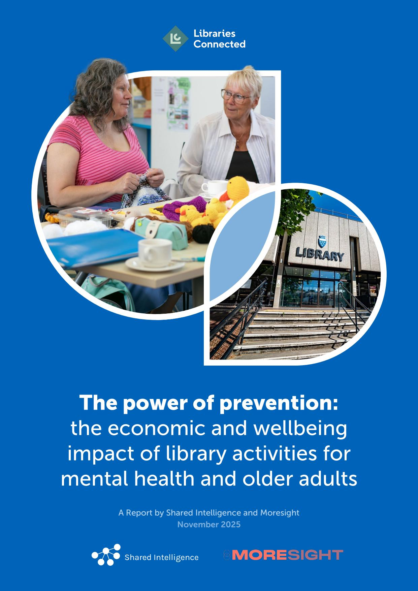
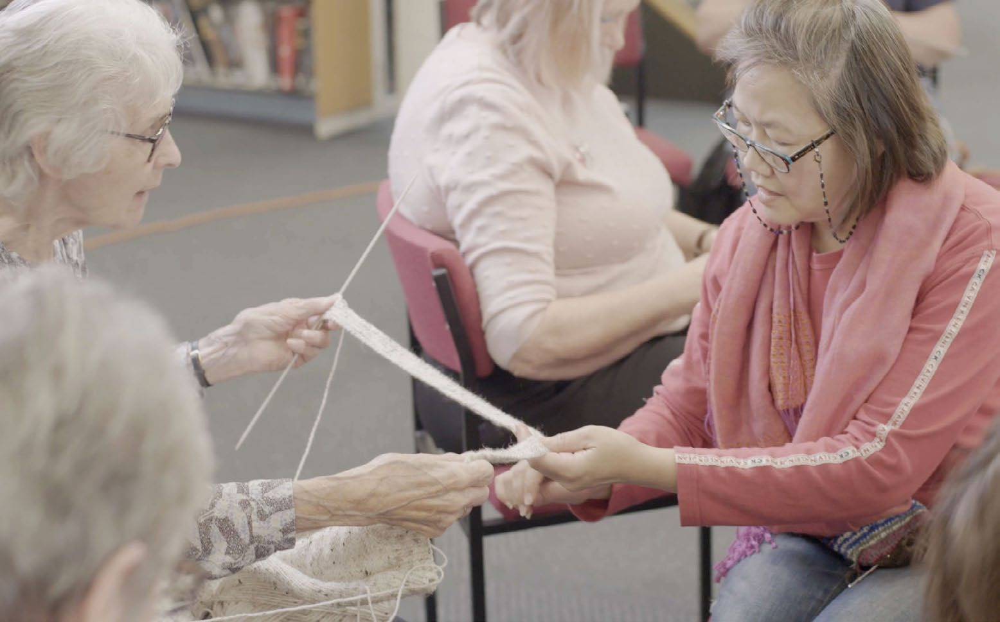
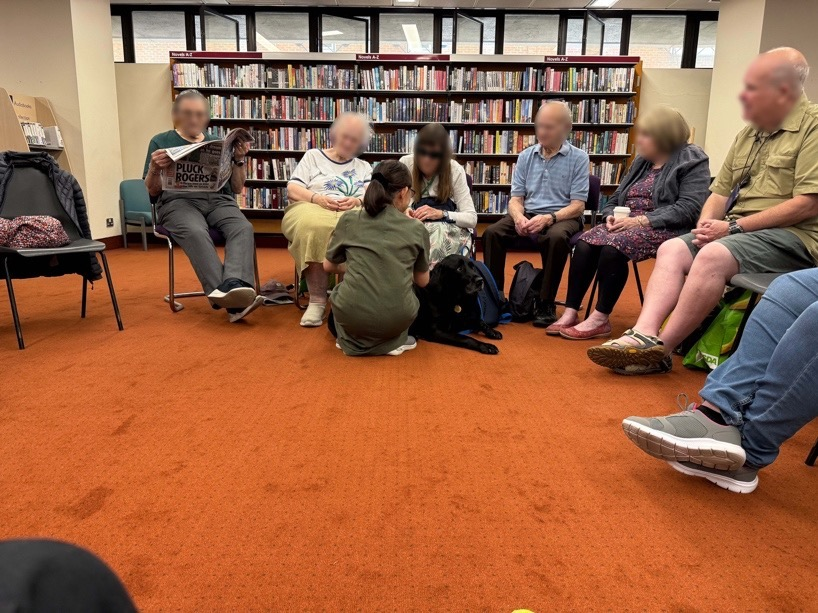
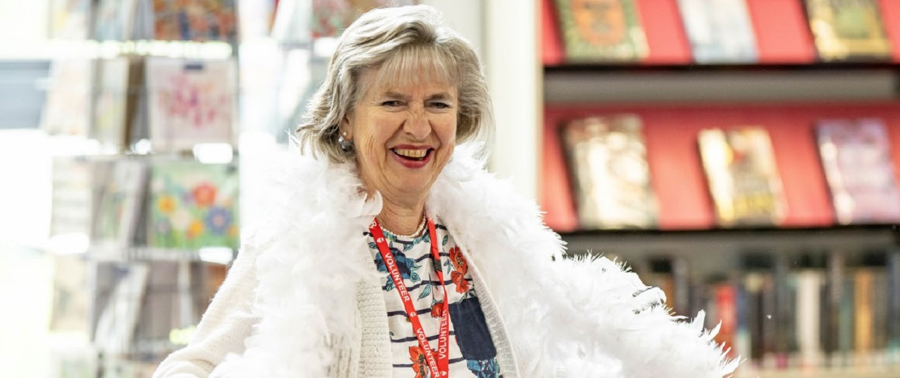
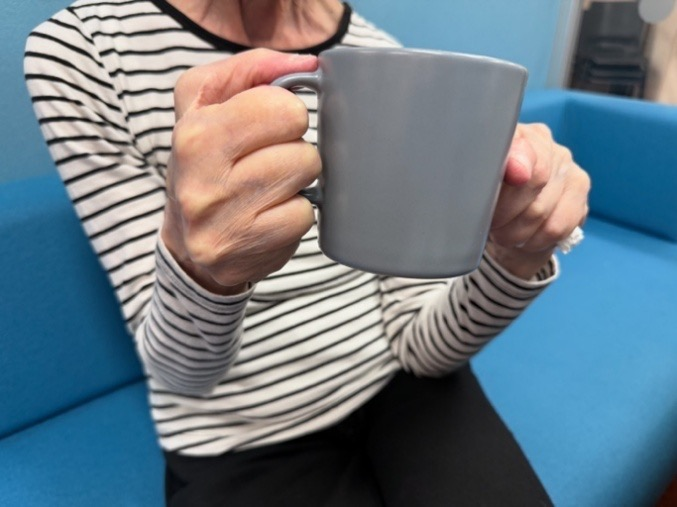
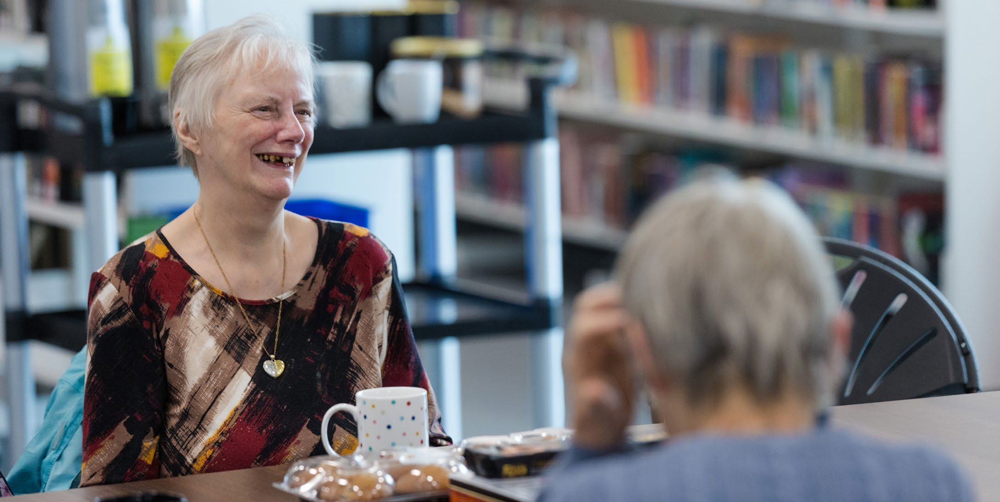
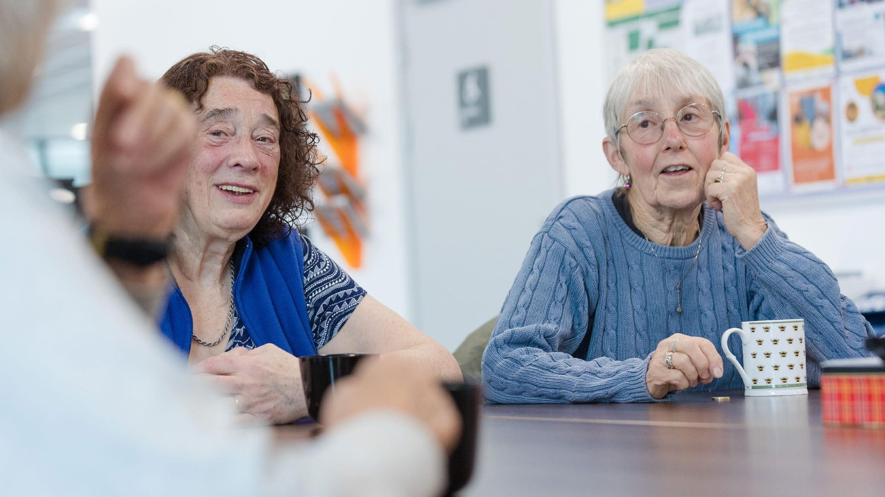
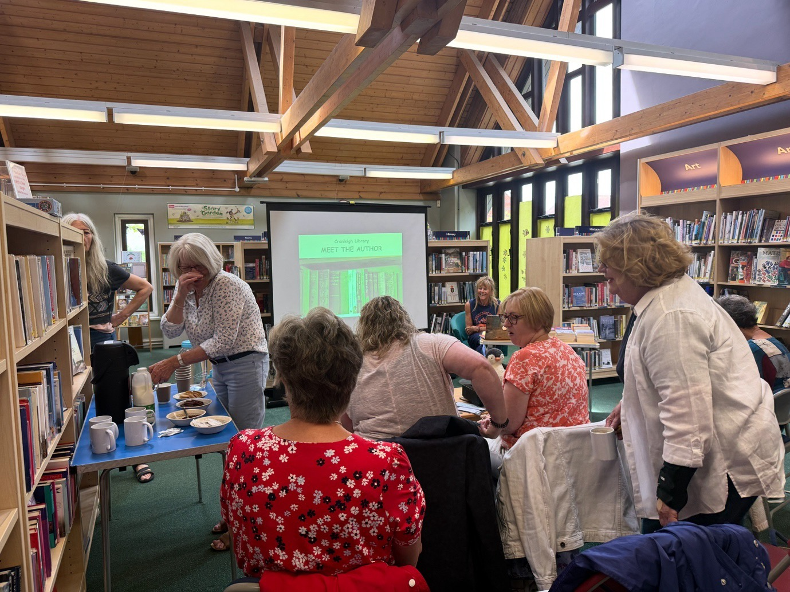

<!-- PAGE: 1 -->

# The power of prevention: the economic and wellbeing impact of library activities for mental health and older adults

### A Report by Shared Intelligence and Moresight
**November 2025**

**Shared Intelligence | Moresight | Libraries Connected**

<!-- PAGE: 2 -->

## Acknowledgements

Our thanks go to the Libraries Connected South East network client team of Russell Allen, James Pearson and Clancy Mason, and the project steering group: James Gray, Iain Moore, Nick Partridge, Sharon Stewart-Smith, William Train, Sarah O'Kane, Emma Stratton and Joshua Roberts. Special thanks are also due to Karin Backlog, Katie Kinnear, Zachary Parsons and Caroline Darby for testing the data tools. Thanks also to Mark McCree as Chair of The Combined Regions who contributed to the cost of this project.

We are also indebted to Harriet Turner and Sam Burthem from DCMS who contributed detailed technical advice and challenge throughout the project.

We also received advice and support from: Ed Dallas from Simetrica-Jacobs on applying their loneliness valuation research; Sarah Karlsberg, Danail Popov and Emma Kearney from Frontier Economics on applying their arts and crafts financial values; and Will Watt, Lizzie Trotter and Iulian Gramatki from State of Life on applying their volunteering research findings.

Finally we must thank everyone in the South East library services who collected and submitted data and helped organise ethnographic interviews with their users.

<!-- PAGE: 3 -->

## Executive Summary & Introduction

This report is about the value and impact of public library activities, in financial and social terms, in supporting older people and mental health. It provides evidence we hope will be used by senior decision makers in public services, and methods of data collection we hope will be adopted by other library services.

Today’s public library services offer a huge variety of activities based around reading, learning and creativity that appeal to people of all ages and backgrounds. We focus on demonstrating the impact of three activities common to all library services:
* Regular arts and crafts
* Volunteering
* Activities which alleviate loneliness.

This study is based on data collected during 2025 from a sample of services and activities in South East England. The activities they relate to take place in library services across the country and the methods we have applied can also be used by any library service. Using real data from actual attendees and volunteers, we’ve produced HM Treasury 'Green Book' standard evidence that quantifies the social value of these activities in financial terms.

The data collected as part of this study, from a sample of activities across 12 of the 21 library services in South East England, puts the financial value of social benefits at **between £1,746,069 and £1,877,959 per year**.

This is based on real data relating to actual library users as opposed to estimated or modelled data. If every library service in the South East region was able to collect data across all of their users of these activities, then we would be able to see the true annual value and it would be many times greater. In fact, we hope that one quick win from this research will be that other library services apply these methods to their own data to calculate and share their own values.

Building on the valuable work of the Libraries Connected East of England network and their report, *Libraries for living, and for living better*, this work looks to go further.

This research demonstrates how public libraries deliver social impact with an economic value, and it proves they can produce HM Treasury 'Green Book' standards of evidence. This research has produced a replicable process and toolkit that will enable other library services to use their own data to demonstrate economic value in the same way. This report also includes first-hand evidence from library users gathered through ethnographic research which illustrates social value and individual impact in human terms.

We and Libraries Connected received unprecedented support for this research from technical specialists at the Department for Culture Media and Sport (DCMS) which was invaluable. We hope that this report is also useful to central government by providing a test case for the local implementation of financial valuation methodologies developed under the DCMS Culture and Heritage Capital (CHC) framework.

Some readers of this report might be less familiar with today’s public library and the detail of what they do alongside literacy and book lending, or the links between reading and the wider community offer. Reading, learning, and access to trustworthy information in a neutral community space is a gateway to community networks, friendship, pride in place, creativity, positive wellbeing and self-help. This report adds to the growing evidence around the value of libraries as vital social infrastructure by showing how investment in library services provides value for money through life-enhancing outcomes – which directly and indirectly reduce demands on other local services.

<!-- PAGE: 4 -->

## Regional Scope and Participating Services

This study was commissioned by the 21 members of the Libraries Connected South East regional network:

* Bracknell Forest
* **Brighton and Hove**
* **Buckinghamshire**
* East Sussex
* **Guernsey**
* **Hampshire**
* Isle of Wight
* Jersey
* **Kent**
* **Medway**
* **Milton Keynes**
* Oxfordshire
* **Portsmouth**
* Reading
* **Royal Borough of Windsor and Maidenhead**
* Slough
* **Southampton**
* **Surrey**
* **West Berkshire**
* **West Sussex**
* Wokingham

The 12 services in **bold** are those that were able to participate in data collection for this research. Their combined populations account for around 75% of the South East region’s 9.7 million population.

<!-- PAGE: 5 -->

## Our Paracetamol Analogy

This report draws parallels between the benefits of activities like library-based arts and crafts, and the benefits of paracetamol. Any brand of paracetamol will provide consistent benefits – so long as it was produced with the same ingredients in the right proportions and is taken in the recommended way. We don't need to undertake new research into its effectiveness every time we take it, we just need to be sure it really is paracetamol.

The same applies to the library-based activities in this report.

Activities like arts and crafts can claim the same health, wellbeing and economic benefits seen in the original studies, so long as they implement their core elements faithfully and with fidelity to the version of the activity that was subject to research.

The activities chosen for this study (arts and crafts, volunteering and activities that reduce loneliness) were chosen because they are delivered by all library services in the South East. We know that they are not absolutely identical everywhere because there has to be local tailoring to suit local circumstances. But if we think of library activities like paracetamol, then we realise that the further they are from the proven model, the less likely it is that we can claim continuity with the proven effects.

This raises an important question for library services. Do they prioritise a degree of uniformity, akin to all the many brands of paracetamol, or should they adapt entirely to local contexts, even if this weakens the connection to the evidence and makes it harder to demonstrate impact?

We hope this report and toolkit helps library services see the case for staying closer to tested blueprints, just as manufacturers do when producing everyday painkillers.

> **Can't wait, just want to play with the toolkit?**  
> If you already know about this project and just want to try calculating your own values, then all you need to do is join Libraries Connected’s Social Value Impact Programme community of practice – which is where the toolkit is hosted. The community of practice is open to anyone working in public libraries. Just get in touch with `chad.bentley@librariesconnected.org.uk` who will sign you up.

<!-- PAGE: 6 -->

## Weekly Arts and Crafts for Over 65s

Libraries across the South East offer a variety of weekly arts and craft activity groups with many designed to meet the needs and interests of older people. Sessions make use of library space, with staff or volunteers able to welcome attendees. They are often open groups advertised widely to maximise attendance.

Our conservative estimate produces a value of the health and wellbeing benefits of weekly arts and crafts activities at seven out of the 21 South East library services is **£491,481 a year**, relating to general health benefits and improvement in quality of life. This value only includes individuals aged over 65 who attended weekly arts and crafts for six or more weeks over a 12-week period – because the evidence around this age group and level of participation is strongest.

If we included all over 65s who joined weekly arts and crafts sessions, including those who only attended just one or two sessions, then the value of health and wellbeing benefits is higher, at **£623,371**. This higher figure is based on activities at eight of the 21 South East library services (the broader criteria enables us to include data from one additional library service).

These values have been calculated from a 12-week period of data collection. If data were collected in the same services but continuously for a whole year and not just 12 weeks, the values would obviously have been higher. The data shows that in just 12 weeks of data collection in only seven library services there is almost £0.5 million in value generated.

### Arts and crafts groups in libraries improve quality of life

Attending arts and crafts activities, such as knit and natter sessions, profoundly enriches people’s lives by providing a space for social interactions, offering a sense of purpose, and actively engaging both mind and body. Alongside the values calculated, this study undertook ethnographic research, capturing the impact of activities on individuals and demonstrating the positive difference library activities have on individuals in human terms.

The ethnographic research found that arts and crafts sessions are more than just a creative outlet; they are a source of wellbeing and community for their participants.

* **Increases people’s social connections:**
  > "We know little bits about each other, but we’re not in each other’s pockets. But if you feel that you need someone to talk to, there will always be someone to listen"

* **Increases sense of purpose:**
  > "It’s like you’re doing something with your time. You can say there’s something produced that you’ve done for that time"

* **Keeps minds and bodies active:**
  > "It’s also something you can do where you don’t have to move excessively, but it does get you out and away. I knit at home anyway, but it does get you away from the house and you’re doing things"

<!-- PAGE: 7 -->

### How we estimated the values

We assigned a financial value to the health benefits of participation in weekly, library-based arts and crafts for adults aged 65 and over using government commissioned research by Frontier Economics from 2024.[^1] This method is part of the Culture and Heritage Capital initiative and monetises the general health benefits of arts-based activities for adults aged 65 years and over. The Frontier Economics method draws on primary research from Canada[^2] which studied over-65s participating in arts-based activities hosted in museums.

The method looks at impacts of attendance on an individual’s quality of life using Quality Adjusted Life Years (QALYs). This is a measure widely used in health and social care to compare the value of different interventions. Using this approach, the monetary benefit of weekly arts and crafts sessions was calculated by Frontier Economics to be **£1,310 per person for 12 weeks of participation**, or **£109 per person per single week of attendance**. These are the values we have used. It is also assumed by Frontier Economics that the QALY benefits are linear and therefore each week of participation has the same £109 value. Having taken advice from DCMS technical specialists as part of this project, we chose to produce a conservative estimate including only data from individuals who took part in six or more weeks. But we have also shown an alternative, including all participants including those who took part in just one single week of activity.

#### Definition: QALY

> **Quality Adjusted Life Year (QALY):** A measure of the state of health of a person or group in which the benefits, in terms of length of life, are adjusted to reflect the quality of life. One quality-adjusted life year (QALY) is equal to 1 year of life in perfect health.  
> QALYs are calculated by estimating the years of life remaining for a patient following a particular treatment or intervention and weighting each year with a quality-of-life score (on a 0 to 1 scale). It is often measured in terms of the person’s ability to carry out the activities of daily life, and freedom from pain and mental disturbance.

#### The data collection method

Using our 'paracetamol' analogy, other arts and craft activities that follow the same design as those in these studies (i.e. weekly, and in cultural settings) can be assumed to have the same effects. Due to the focus of the original study, only participants aged over 65 can be included in the financial calculations (because that is also part of the 'paracetamol' model for this valuation); however, the activities themselves can be for all ages – but we can only include over-65s in calculating values.

The data collection for this method simply involves: keeping a register of attendance at weekly arts and crafts sessions held in libraries; recording which individuals are over 65 years old; and recording how many weeks each individual attends. Collecting a register of attendance, including age, in this way was a new process for many library services in the South East region, but was possible to easily adopt and technically quite simple. It is also useful data for a library service to have for other reasons, for example for management reporting, or for a Libraries Development Framework assessment.

<!-- PAGE: 8 -->

### Calculate your own values

If you already have service data on attendees aged over 65 at weekly arts and crafts sessions, and you have a record of the number of weeks each person has attended, you can calculate values based on the same methodology using the toolkit published jointly with this report.

### Results: Arts and Crafts

We received arts and crafts data from eight out of the 21 South East library services, accounting for around 62% of the regional population. This covered typical library-based arts and crafts activities including 'knit and natter', 'craft and chat', and 'slow stitching'. We removed data that did not fit the requirements of the methodology including:

* **Data from participants under the age of 65:** data from individuals under 65 were removed from the dataset, as were individuals where no age was recorded.
* **Data from activities that were less frequent than weekly:** some areas collected data for activities that occurred at a different 'dosage' than the weekly frequency on which the values are based.

#### Money values

We calculated two values for the arts and crafts strand:

* **A conservative value:** this reflects caution in attributing value to single weeks of attendance and removes all individuals who attended fewer than six weeks of activity (one of the eight library services that submitted data had to be excluded because of this). Based on 4,509 participant-sessions over 12 weeks, we calculated a total value using data from seven out of the 21 South East library services of **£491,481 over a year**.
* **A higher value:** this follows the guidance in the original research which suggests that values can be created from individual weeks of attendance including those who attended for just one week. Based on 5,719 participant-sessions over 12 weeks, we calculated a total value using data from eight out of the 21 South East library services of **£623,371 over a year**.

<!-- PAGE: 9 -->

## Ethnography: Arts and Crafts Keep Mind and Body Active

This ethnographic study was conducted with individuals in one library in Maidenhead, but we believe these experiences are not unique and are reflective of library users across the South East and nationally. From the economic evidence we can see that arts and crafts improve participants’ quality of life measured in QALYs, and that this has a value of £109 per week of attendance or £1,310 for 12 weeks. But what does that mean in human terms?

> "It’s the only time I sit down and do something fully like this, because I work a few days a week, I’m running the house, doing this, doing that. This is my time … And you don’t always have the time to spend, and this gives you the time to actually sit down and talk to people, like-minded people as well, and produce something."

Attending arts and crafts activities, such as knit and natter sessions, profoundly enriches people’s lives by providing a space for social interactions, offering a sense of purpose, and actively engaging both the mind and body. These groups are more than just a creative outlet; they are a source of wellbeing and community for their participants, something that can’t be achieved at home.

We attended a knit and natter session at Maidenhead library and nattered to 10 knitters about why they attend the weekly group, and what difference it makes to them.

### Social interactions

Arts and crafts groups offer a low-stakes social environment where people can enjoy a creative pastime together, using it as a pretext for as much or as little social interaction as they feel comfortable with on that day. The atmosphere is communal – *(we’re all knitting…)* but also independent *(…but I’m doing my own thing)*, making it easy for people to feel accepted, no matter how skilled or confident they might be.

The easy, relaxed setting enables conversation about all sorts of topics from crochet tips to life advice. Skills and experience are shared too, both about knitting and navigating life. Generally, the group keep the conversation light and cheerful. But when we visited, two long-term members had recently died, and another member explained that if someone ever wanted to discuss something more serious, they would be there for each other.

> "We talk about all sorts. We just talk about anything we’ve done. We sat and discussed food. I lost a stone in the last year; I had surgery a year ago. We discuss food and 'how do you eat?' And then we get on to favourite foods, and what you like and what you don’t like, all sorts of strange things! You get little stories. It’s not personal, but it’s interpersonal. We have a good interpersonal relationship. We know little bits about each other, but we’re not in each other’s pockets. But if you feel that you need someone to talk to, there will always be someone to listen. Around this table, there are people with many different lives. Sometimes, someone with a different opinion can often help. There’s a lot of knowledge here."

<!-- PAGE: 10 -->

> "I found when I came everybody made me feel so welcome. It makes you want to come back again, because you get accepted. You’re nervous that first time when you meet a group of people. But if they don’t like you, what can you do? But I found most people, especially in a knitting group, very friendly. People just swap around. I don’t think I’ve ever sat in the same place. I enjoy that, it’s quite refreshing."

> "There’s always a space, there’s always a place. They’re always welcome. And if there’s lots of us, everybody just, we just moved out from the table slightly, and another chair goes in. We come and go anytime between one and one thirty, some of us are here sometimes quarter to one, one o’clock, right through till four, sitting just chatting. Sometimes we just put the needles down and nothing gets done!"

> "I was sitting here last week, and they said, 'Oh, there’s June at the end. She’s a crochet queen. She knows what she’s doing.' And I was like, 'I need to learn how to crochet!' This is part of the reason why I joined. The seat was empty. I sat down and said, 'are you June?' And she said, 'yeah'. And I said, 'I need to learn!' Amazing. New friend."

### A sense of purpose

Engaging in arts and crafts provides people with a tangible sense of achievement and purpose. Transforming an idea into a handmade creation and then seeing it finished, knowing the time was well spent, is profoundly rewarding.

<!-- PAGE: 11 -->

## Keeping the Mind and Body Active

Knitting was also described as highly beneficial for both mental and physical wellbeing. It’s simultaneously calming and engaging. Knitters described a sense of switching off, but also of feeling focussed on the task at hand. They also described in detail what they believe the cognitive benefits to be, and why the activity is beneficial. It’s creative, and it’s also analytic, requiring planning and progress tracking.

Physically attending these groups gets attendees up and out of the house at least once a week, carrying their materials and equipment with them. Once there, they’re focussed on detailed handwork, requiring fine motor control. They’re adamant this supports joint health and helps with conditions like arthritis.

> "I think it is a mental thing to keep your brain from sitting there and just watching the box. It is a mental thing. You’re pattern planning, you’re counting. Here you’ve got a different pattern to that pattern, so I’ve got to the point where I change pattern. So I’ve got to remember which row I’m on, and it’s like every third row, it changes. So I start with a different method here to the previous row, and this is a different method here, so you can see I’ve got two different patterns on the go."

> "They say if you’re arthritic and you move your hand, that’s supposed to be good for your arthritis and all that. I’ve got arthritis in my wrist, and I was encouraged to knit. It’s also something you can do where you don’t have to move excessively, but it does get you out and away. I knit at home anyway, but it does get you away from the house and you’re doing things."

> "It’s quite mathematical. If you’re engineering-minded, you’re creating your own patterns"

<!-- PAGE: 12 -->

## Volunteering in Libraries

Almost all public library services have volunteer programmes, offering volunteering opportunities in many different roles, supporting basic operations, organising group activities, and contributing specialist knowledge or skills.

Our estimate produces a value of the wellbeing benefits of volunteering in libraries across 11 out of the 21 South East library services of **£341,803 a year**. This relates to individuals who were identified as library volunteers during 2025 and whose main or only volunteering activity is with their library.

### Library volunteering increases wellbeing

Library volunteers work across a range of roles and projects, supporting library staff and users. Not only does their work benefit the library service, it is also clear that it benefits themselves as individuals.

The ethnographic research that was part of this research found that volunteering, among other benefits:

* **Increases life satisfaction:**
  > "that’s tremendously interesting for me. I’d much rather be doing that than watching TV sat on the sofa"

* **Reduces isolation:**
  > "The big important thing for me with volunteering is meeting people, talking to them, and people who are outside of your normal friendship circle"

* **Provides motivation for self-care:**
  > "You’ve got to have a reason to get up in the morning, and you’ve got to be halfway presentable if you’re volunteering and working with other people, which means looking to yourself. It’s part of looking after yourself and keeping yourself interested in life"

<!-- PAGE: 13 -->

### How we estimated the values

This value is calculated using a health and care 'Cost of Production' valuation from a 2021 study by Professor Paul Frijters, as described in a report by the research organisation State of Life.[^3] The report applies Frijters' WELLBY valuation approach to benefits associated with various frequencies of volunteering described in a report by Lawton, Gramatki and Fujiwara published in 2020. This estimates the cost of production to the health and care system of delivering the equivalent wellbeing benefits seen in volunteering. For example, if an activity generates the same wellbeing boost as £100 worth of health and social care, then we can say it generates £100 in Cost of Production terms.

Using these values the method calculates that:
* Volunteering **at least once a week** (if it is that person’s main or only volunteering role) generates a value of **£396 a year** in health and care Cost of Production terms;
* Volunteering **at least once a month** is worth **£325 a year**;
* Volunteering **several times a year** is worth **£158 a year**.

However, volunteering that is only undertaken once a year or less produces a negative value (–£269). This is because very infrequent volunteering is associated with a negative impact on life satisfaction, perhaps due to a negative volunteering experience or frustration at not being able to contribute more regularly.

#### The data collection method

The data collection for this method involves gathering data from volunteers on how frequently they volunteer for the library service and whether their library volunteering is their main or only volunteering role. Library services typically maintain records of their active volunteers, and so this data was often already held by the service or could be gathered easily through a short survey.

<!-- PAGE: 14 -->

### Results: Volunteering

Volunteering data was the most widely collected for this study. We received data from 11 of the 21 library services in the South East, representing 980 volunteers.

Of these 980 volunteers:
* **845 volunteers** (86%) volunteered at least once a week;
* **104 volunteers** (11%) volunteered at least once a month;
* **31 volunteers** (3%) volunteered several times a year.

Based on the frequency of volunteering reported, and applying the Cost of Production values, we calculated a total annual value of **£341,803 across the 11 participating services**.

<!-- PAGE: 15 -->

## Ethnography: How Volunteering Improves Mental Wellbeing

This ethnographic study was conducted with individuals in one library in Portsmouth, but we believe these experiences are not unique and reflect experiences of library users across the South East and nationally. From the economic evidence we can see that volunteering generates an improvement in wellbeing that would cost health and care services between £158 and £396 to produce. But how can we relate that to real-life experiences of library users?

> "It was well overdue for me from a mental health point of view… That’s one of the big things. When you stop working for whatever reason, you’re not contributing anymore. You’re not contributing to society."

Portsmouth Library is a busy and welcoming hub of volunteering activity. During our visit there we spoke to seven volunteers working across a range of projects: supporting library staff with different on-site administrative tasks; delivering books to housebound library users; assisting a visually impaired support group; and helping run the mobile library. It became very clear from all our discussions that, in the absence of work, volunteering is a vital pillar of a person’s wellbeing, not just providing a task to complete, but also enhancing life satisfaction, mitigating isolation, and supporting wellbeing.

### Increasing life satisfaction

Volunteering provides a sense of usefulness and purpose. Not only is this vital in combating negative feelings, it also brings a lot of pleasure to life! Achieving goals and completing tasks in a social setting helps remind volunteers that they have relevant skills and can do things which are valuable to their communities.

> "You meet people, and particularly in the mobile library, people don’t just come in for books, to loan books or to return books. They come in for a chat. They’re already a member of the library, but they’ll stay for a chat, and you learn a little bit about their lives and how people are getting on and coping and things and that’s tremendously interesting for me. I’d much rather be doing that than watching TV on sat on the sofa."

> "I get given a gift every Christmas. I think it may be driven by one of the librarians on the ground floor. I don’t know where she gets the money from, but I don’t know if it’s library money or where it comes from. Most recently, they gave me a gift voucher for 50 quid. In fact, I’ve probably had three of them in a row, from the library. And they always say thank you, always. And Jackie who I help with, always sends me an email saying, 'Hi, lovely lady!'"

> "They just appreciate the mobile library. I tell you what gives me a lot of pleasure, is when mums bring young children down, or sit down and read to them, because I’ve seen that with my own kids, it’s gives you such a good start in life."

> "Every time I meet her, she thanks me and every time she introduces me to somebody else it’s 'this is one of our really helpful volunteers.'"

<!-- PAGE: 16 -->

## Reducing Isolation

Volunteering also provides opportunities for social interaction, helping people combat loneliness and isolation. It can be a way to recover from grief or trauma, giving people a reason to participate in society, practice their social skills, and ultimately regain their confidence, which has been transformative for many of the people we spoke to.

> "I was a very shy person. I still am now, but I’ve come out a lot since working here. I didn’t know what I was going to do once, you know, we did all the send offs and stuff. He died in the April. I came here, and in May, that was two and a half years ago. It brought me out. When I first came here, I wasn’t sure if I could, because I’m not very good at speaking. I was very shy and I was very nervous, because I sort of stayed indoors all the time, because of looking after my husband. But when I came I stuck it out, and it’s great now, because I know everybody. Talking to people, even at home, even down my road, they all say how different I am. I feel a lot better."

> "The big important thing for me with volunteering is meeting people, talking to them, and people who are outside of your normal friendship circle, if you like, you know or work circle, we do. It keeps your brain active, and it just keeps the social side of things. You know, I think it’s very important to your mental health to have a social life not just be stuck at home or going to the allotment and not seeing anybody. I see a lot of people who are like that."

> "You get more confidence in applying for roles on the computer. Before, I always kept trying to think about maybe applying for stuff, but never really got around to it. But now I’ve been doing it, I keep doing it on a semi regular basis since then."

<!-- PAGE: 17 -->

## Maintaining Wellbeing

Volunteers also found it easy to point to ways in which volunteering helps their physical and mental health. They must stick to a schedule and work with a team which gives them a sense of structure. A commitment to perform tasks in out-of-home locations also gently encourages mobility. Volunteers need to get to the place their activities are happening, and from there may need to go somewhere else as well. Depending on their volunteering they could be delivering books to homes for those who are housebound or unable to leave their home, packing boxes of gifts to send to schools, gardening, or other kinds of physical activity.

> "A person’s got to keep busy once they retire, haven’t they? When you retire, you become invisible. People stop noticing you. And if I hadn’t found volunteering, I would have been sitting on my couch doing nothing, watching television, losing my brain activity."

> "It’s good to get out on the bike, and it gets me out on my bike. It’s one of the reasons that I cycle around the city"

> "It’s keeping me in time with the world so I’m not going to bed at 4am and waking up in the middle of the afternoon. When you’re not doing anything, when you wake up and when you go to sleep doesn’t really matter, so it gets quite messed up. It’s not healthy"

> "’You can only go for so many coffees’ my wife always says. You’ve got to do something more with your life than just go for coffees with other old people. I know people who do that, or sit and watch the TV, and if anything they tend to die earlier. They don’t tend to look after themselves so much because they’re not engaged with life. It has all these other side effects, continuing to be engaged. Some people don’t look after themselves, not so much. But you’re more likely to if you’re engaged, because you know you’ve got to get up in the morning. You’ve got to have a reason to get up in the morning, and you’ve got to be halfway presentable if you’re volunteering and working with other people, which means looking to yourself. It’s part of looking after yourself and keeping yourself interested in life"

<!-- PAGE: 18 -->

## Activities that Reduce Loneliness

Collecting data for activities that reduce loneliness was more challenging and time-consuming for library services than for arts and crafts or volunteering, but yielded the largest financial values per person.

Libraries offer many activities that reduce loneliness, such as book clubs, coffee mornings, digital inclusion sessions, and creative groups. To measure the financial impact of reducing loneliness, we used the loneliness monetisation framework developed for DCMS by Simetrica-Jacobs in 2020.[^6]

<!-- PAGE: 19 -->

### How we estimated the values

To estimate the impact of library activities on loneliness, the Simetrica-Jacobs methodology combines three elements of economic cost associated with loneliness:
1. **Health value:** reduced use of NHS and healthcare services;
2. **Productivity value:** reduced impact of sickness absence and economic inactivity;
3. **Wellbeing value:** monetised life satisfaction improvements using the WELLBY approach.

The model evaluates the economic benefit when an individual transitions between four states of loneliness:
* 'Severely lonely'
* 'Moderately lonely'
* 'Mildly lonely'
* 'Not lonely'

<!-- PAGE: 20 -->

### Impacts of Transitions Across Loneliness Levels

The table below sets out the financial values per person associated with transitions between loneliness states (Simetrica-Jacobs, 2020):

| Component | Moving from 'severe' to 'moderate' loneliness | Moving from 'moderate' to 'mild' loneliness | Moving from 'mild' loneliness to 'not lonely' |
| :--- | :--- | :--- | :--- |
| **Health** | £109 | Evidence NA | Evidence NA |
| **Productivity** | £330 | Evidence NA | Evidence NA |
| **Wellbeing** | £9,537 | £8,157 | £6,429 |
| **Total** | **£9,976** | **£8,157** | **£6,429** |

The value of an activity can be quantified if participants’ levels of loneliness change while they are taking part, for example if someone changes from being severely lonely to moderately lonely then there will be a reduction in cost (of health, productivity, and wellbeing combined) of **£9,976**.

The final stage in the Simetrica-Jacobs method is to apply a 'deadweight' value; this accounts for the reduction in loneliness that individuals might have experienced that was nothing to do with the activity being measured. This deadweight value is **19%** (this means that the total calculated needs to be reduced by 19% or multiplied by 0.81).

#### Data collection method

The data collection method required library services to collect data from attendees at activities designed to alleviate loneliness at two points in time. Using data collection forms, libraries captured self-reported loneliness on two occasions, up to three months apart. They then compared each individual’s responses across the two timepoints to determine how many had become less lonely.

Templates and instructions for data collection are part of the toolkit published jointly with this report which also includes instructions on how to input your data and calculate values for your own library service.

#### Calculate your own values

Calculating financial values around your service’s impact on loneliness requires more work than for the other methods in this report, but the values are much higher when positive changes in loneliness are demonstrated.

If you want to replicate the values of the six library services who gathered loneliness data for this study, you will need to collect data from attendees at activities designed to alleviate loneliness. You will need to use the data gathering tools that accompany this report to capture self-reported loneliness at two points in time (ideally three months apart). The tools we have provided will then enable you to count how many attendees have self-reported as less lonely at the second point in time.

<!-- PAGE: 21 -->

### Results: Loneliness

We received data from six out of the 21 library services across the South East, relating to 357 library users. This was the smallest dataset of this study – largely due to the effort required to collect before and after data. This is also the most sensitive topic and library customers do not typically expect to be surveyed in this way. However, this exercise proves this type of measurement is feasible and, where implemented, produces large values.

The data we were able to collect also shows that a surprisingly high proportion of individuals gave better loneliness scores (i.e. saying they were less lonely) the second time they were asked. Between them, the six library services were able to collect data from 357 of their users. Of these, **123 out of 357 (34%) reported feeling less lonely** at the second timepoint. This is all the more surprising given that 235 out of 357 had been attending their library activity for six months or more prior to this research.

As many individuals are already established in these types of activities, the difference seen over time may not be as great as if individuals answered a baseline survey at their first session. Although this requires more input from library staff to support the collection of this data, the value of these activities and alleviating loneliness are too great not to capture.

#### Money values

From the sample of 357 respondents, 123 said they were less lonely when asked for a second time. Based on the degree of change they reported, we can estimate a total value of **£912,785**. Obviously, this only covers a small proportion of all library users in the South East who take part in social or group activities. The true value of South East libraries’ contribution to reducing loneliness will therefore be many times greater.

<!-- PAGE: 22 -->

## Ethnography: Loneliness and Book Clubs

This ethnographic study was conducted with book club members in one library service in Surrey. Loneliness is an insidious condition that can affect anyone, regardless of age, background, or social standing. It is distinct from simply being alone; loneliness is the painful feeling that one’s social relationships are insufficient or unsatisfying.

The economic evidence shows that moving from severe to moderate loneliness generates an economic saving of £9,976 per person, and moving from moderate to mild generates £8,157. But what is the lived reality behind these numbers?

<!-- PAGE: 23 -->

### Improving mental health

The absence of loneliness profoundly benefits mental health by providing stimulation, a sense of belonging, and emotional support. Book club participants shared how having a regular, structured group discussion provided intellectual nourishment and companionship that transformed their week.

While the connection to physical health might not be immediately obvious, avoiding loneliness can contribute to physical health by encouraging regular activity and providing motivation to leave the house. Book club members can easily pinpoint how their commitment to library activities requires an increased level of activity.

> "I walk a mile to book group and a mile back, okay, and I’ve met someone on my route now, right, who also walks a mile there and a mile back now too, and I met my walking group here as well."

> "You have to get up and come and it’s ongoing, because once you come and you get into the routine of going"

<!-- PAGE: 24 -->

### Encouraging participation

Book club members told us that, through attending library activities, they were able to practice social skills in a safe space, on their own terms; a 'welcoming haven' as one happy book club member put it. Despite feeling shy at the beginning, through the book club, it’s possible to foster social connections, build confidence, and enrich daily life by sharing experiences and ideas. Being exposed to books they may not have otherwise considered, and the often divergent opinions on those books, broadens book club members’ minds.

> "It’s fascinating, because you will always get one or two that love something that you dislike, or have seen something in the book that you hadn’t thought about. Somebody will point it out and you think, 'Oh God, yeah, I hadn’t thought about that aspect of it.' And then somebody else will add a bit more in and you almost rebuild the story in a different point of view. It’s tremendously stimulating... I think you have to be stimulated, particularly when you’re older. You can’t live your life if you don’t actually get on and enjoy it and participate in it. And that’s, I think, half the joy of the book club."

> "I’m more confident in the group. I’m more confident to go and do my driving lesson. You have to go on your own, meet someone you don’t know, who’s going to teach you to be a better driver... I’m not afraid to join groups now and be part of a group, the walk group, I’m now part of a gardening group. I’m going with my son, but I’m quite happy to go on my own. And that’s a new-found freedom, really."

> "There have been one or two people in the book club who have been painfully shy. I mean, painfully shy, who are now very much coming out of their shells. You know, they’re starting to chat to us, they’re starting to take part in it, and they won’t just accept that you know, we’re right, no. If they didn’t like the book, they’re going to say so, which is great! And it’s nice for you to feel that you’ve contributed to that. Yeah, you know, you’ve helped somebody."

> "We often meet in the village and stop and chat and things like that. Often we’ll be en route somewhere, but a few of them pop into Barnardos when they know I’m there. It’s super."

<!-- PAGE: 25 -->

### Libraries level up book clubs!

All our book club members had experience of other book clubs, both in other libraries and outside the library service. Our conversations suggested that there are some benefits that library-run book clubs have over non-library alternatives, and that members are proud to be part of their club:

#### Accessibility and capacity

Our interviewees told us about their previous difficulty in joining book clubs, that are often hosted in people’s homes or at awkward times.

> "While I was getting the bus pass, there was a book group in progress, so I introduced myself to the book group and said, 'Please, may I join?' And they said, 'Oh, there’s quite a lot of us, but we never turn anyone away. So yes, you can join.' I was thrilled, because I’ve tried to get in book groups before, and they’re often in people’s homes. You can’t have a lot of people, but the one run by in the library, it seems flexible on numbers."

> "They were the only one who had a vacancy. And the book clubs in Guildford were at night. They’re in the evenings, which doesn’t suit me at all."

#### Atmosphere and depth

Being surrounded by books, and knowing that your fellow book club members are likely also library users, seems to elevate the discussion.

> "They’re glad to have somebody else to give their view on books. They talked about the book in a very in-depth and intelligent way. It’s a very well-balanced group. They were all really interested in books and literature. They didn’t go off the rails and start talking about anything else or loads of silly things."

<!-- PAGE: 26 -->

## Conclusions and Next Steps

This research is based on data from 12 out of the 21 library services in the South East and shows an annual financial value of the social benefits for three types of activity that are delivered universally by library services, of **between £1,746,069 and £1,877,959**.

These figures are based on real data, not estimates or modelled data, and they raise the exciting prospect of systematic regional gathering of data and calculation of financial impact. As we said at the start, imagine if the whole South East region collected data for all their users of these activities – then we would be able to see the true annual value and it would be many times greater.

Imagine if this approach were extended to other activities too? As part of this research, we found evidence around:
* **Befriending** (evidence from the Rotherham social prescribing pilot, 2014);[^7]
* **Community singing** (randomised controlled trial of the Silver Song Club Project across the South East);[^8]
* **Reminiscence activities** (cost benefit analysis from community-based reminiscence projects in Ontario, Canada);[^9]
* **Low impact exercise** (Public Health England’s 'Health economics: evidence resource' includes economic values for community-based Tai Chi).[^10]

All of which had the potential to be used in the same way as the evidence for arts and crafts, volunteering and loneliness. The main reason we did not follow those trails was that we wanted to focus on activities that all libraries deliver. But what if all libraries did deliver these, and were able to gather consistent data to demonstrate impact?

### What next?

We suggest four next steps to enable this research to become a springboard for library services across the country to measure their social value impact:

#### 1. Put more economic evidence into frontline practice

Through this project, library services in the South East have successfully applied HMT Green Book standards of evidence and financial values to data that was gathered through frontline delivery. Much of this approach has drawn on the DCMS Culture and Heritage Capital (CHC) framework and DCMS officials have provided unprecedented hands-on support to this project, which has been critical to its success.

This work has showcased how libraries already deliver vital social benefits, their potential to present economic impact, and the untapped potential of government economic research to be used by frontline services. The careful deployment of methodologies has enabled actual values to be created from data that policy makers and senior decision makers can be confident in. We see this as a step up in partnership between central and local government, and hope DCMS and Libraries Connected can find other new areas where economic and CHC research can be applied in practice. Moving forward, we also hope Libraries Connected can use this report to support the libraries sector in expanding evaluation and data collection approaches and building understanding of when and where to use different techniques.

<!-- PAGE: 27 -->

#### 2. Find out the true scale of the financial impact of libraries on loneliness

The data on loneliness was the hardest for library services to collect, but we believe it shows the greatest potential. Data from just a few hundred users produces an estimate of economic value of almost one million pounds, comprised of contributions to health, economic productivity and wider wellbeing. If every library service in the South East could gather similar data, even if it was only as a one-off exercise, what might the true scale and value be?

We are also aware of the valuable work being done by Kent Libraries, Registration and Archives as part of their DCMS and Arts Council England funded Know Your Neighbourhood (KYN) programme in Thanet, which is also targeted directly at loneliness. KYN is a data-rich programme and there may be potential to use it as a catalyst for expanding activities and data collection around loneliness. For example, what if the practical activities for tackling loneliness being pioneered in Kent were adopted across the South East, and combined with the evidence and data collection methods we have established through this work? This could provide a regional-scale practical loneliness offer with regional-scale data collection and economic evidence.

#### 3. Identify a champion for this work

The real value of this work will be when library services across all of the South East and in other regions generate their own monetary values using this report and toolkit. By doing this they will also embed the 'paracetamol' way of thinking. One of the great things about library services is the diversity of delivery. Services offer activities tailored to their local area but there are also activities that are similar or the same everywhere. This different-but-similar model is at the heart of the Universal Library Offers. But what if there were a core of activities across all library services that were delivered in a 'paracetamol' approach, with them all feeding consistent data into a national dataset using the values and methods in this report?

What difference might that make to the sector’s ability to demonstrate its value in Green Book terms? As a start towards this, we encourage Libraries Connected to identify a sector champion who is as excited as we are about the potential the project has demonstrated. It could be someone from the Libraries Connected team itself, or someone working in a service. A champion would support dissemination of this work, encourage others to join the existing online social value community of practice, provide briefings at meetings or seminars where others want to learn more, and become a source of support and guidance within the sector.

#### 4. Refresh the values to futureproof the method

The monetary values relied upon for this research were all calculated at specific points in time between 2020 and 2024 (some based on values developed in earlier research). To keep this research usable, credible, and future-proofed, the values will need to be updated with new figures to ensure they reflect present-day values and continue to be robust. This may be an area where economic specialists in DCMS and Arts Council England can work with Libraries Connected in a practical way to ensure the validity of this approach and the tools we have produced.

> **So now – get hold of the toolkit and try this for yourself**  
> We hope your next step is to try calculating your own values. You might find it easiest to start with volunteering, or maybe arts and crafts. The simple first step is to join Libraries Connected’s Social Value community of practice – which is where the toolkit and all the instructions are hosted.  
> The community of practice is open to anyone working in public libraries. Just get in touch with `chad.bentley@librariesconnected.org.uk` who will sign you up.

<!-- PAGE: 28 -->

## Appendices: Values for Each Activity by Service

### Arts and crafts

| Library service | Value (6 or more weeks attendance) | Value (all attendees) | Number of users included[^11] |
| :--- | :--- | :--- | :--- |
| **Buckinghamshire** | — | £8,938 | 31 |
| **Kent** | £118,483 | £135,269 | 159 |
| **Medway** | £40,003 | £40,003 | 38 |
| **Milton Keynes** | £11,990 | £21,800 | 43 |
| **Portsmouth** | £54,827 | £57,334 | 65 |
| **Surrey** | £89,707 | £127,530 | 205 |
| **West Sussex** | £127,530 | £176,471 | 241 |
| **Royal Borough of Windsor & Maidenhead (RBW&M)** | £48,941 | £56,026 | 58 |
| **Total** | **£491,481** | **£623,371** | **840** |

### Volunteering

| Library service | Value | Number of users included[^12] |
| :--- | :--- | :--- |
| **Guernsey** | £3,318 | 10 |
| **Hampshire** | £60,481 | 171 |
| **Kent** | £60,675 | 182 |
| **Medway** | £1,584 | 4 |
| **Milton Keynes** | £24,951 | 70 |
| **Portsmouth** | £26,212 | 76 |
| **Southampton** | £25,542 | 69 |
| **Surrey** | £80,584 | 247 |
| **West Berkshire** | £12,221 | 32 |
| **West Sussex** | £23,011 | 62 |
| **Royal Borough of Windsor & Maidenhead (RBW&M)** | £23,224 | 87 |
| **Total** | **£341,803** | **1,010** |

<!-- PAGE: 29 -->

### Loneliness

| Library service | Value | Number of users included[^13] |
| :--- | :--- | :--- |
| **Guernsey** | £3,318 | 10 |
| **Kent** | £110,135 | 76 |
| **Milton Keynes** | £11,815 | 7 |
| **Portsmouth** | £29,375 | 13 |
| **Surrey** | £692,368 | 205 |
| **West Sussex** | £19,895 | 17 |
| **Royal Borough of Windsor & Maidenhead (RBW&M)** | £49,197 | 39 |
| **Total** | **£916,103** | **367** |

<!-- PAGE: 30 -->

## Publication Details

* **Libraries Connected:** [librariesconnected.org.uk](https://www.librariesconnected.org.uk)
* **Shared Intelligence:** [sharedintelligence.net](https://www.sharedintelligence.net)
* **Moresight:** [moresight.co](https://www.moresight.co)

<!-- PAGE: 31 -->

## Footnotes

[^1]: Frontier Economics (for DCMS), 2024, *Culture and heritage capital: monetising the impact of culture and heritage on health and wellbeing*.
[^2]: Beauchet et al., 2021, *Health benefits of "Thursdays at the Montreal Museum of Fine Arts": Results of a randomized clinical trial*.
[^3]: Paul Frijters, 2021, *WELLBY valuation approach to health and care Cost of Production*, as described in State of Life report; applying volunteering benefits from Lawton, Gramatki and Fujiwara (2020).
[^6]: Simetrica-Jacobs (for DCMS), 2020, *Loneliness monetisation report*.
[^7]: Evidence from the Rotherham social prescribing pilot (2014).
[^8]: Randomised controlled trial of the Silver Song Club Project across the South East.
[^9]: Cost benefit analysis from community-based reminiscence projects in Ontario, Canada.
[^10]: Public Health England, *Health economics: evidence resource* (includes economic values for community-based Tai Chi).
[^11]: Number is all individuals aged over 65 from whom arts and crafts participation data was collected.
[^12]: Number is all volunteers in these services who said their main or only volunteering role was with their library.
[^13]: Number is all library users who answered the survey (which was distributed to selected activities).
