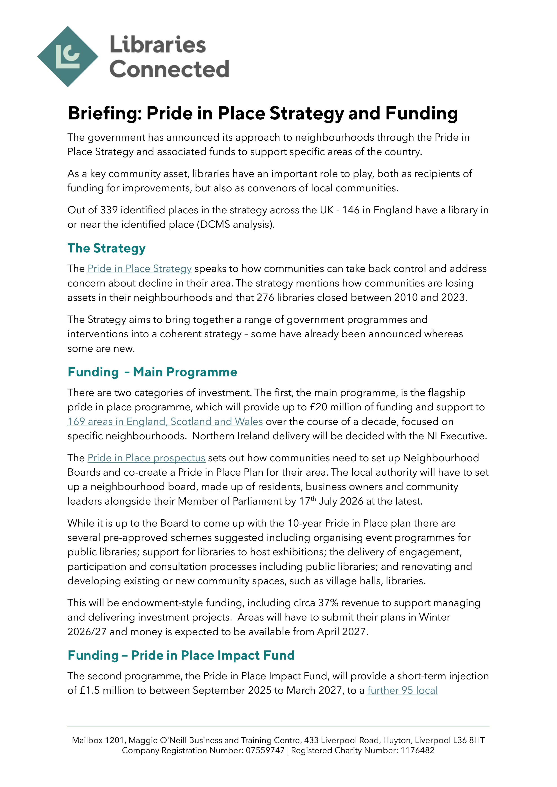

<!-- PAGE: 1 -->

**Libraries Connected**  
Mailbox 1201, Maggie O'Neill Business and Training Centre, 433 Liverpool Road, Huyton, Liverpool L36 8HT  
Company Registration Number: 07559747 | Registered Charity Number: 1176482  

# Briefing: Pride in Place Strategy and Funding

The government has announced its approach to neighbourhoods through the Pride in Place Strategy and associated funds to support specific areas of the country.

As a key community asset, libraries have an important role to play, both as recipients of funding for improvements, but also as convenors of local communities.

Out of 339 identified places in the strategy across the UK - 146 in England have a library in or near the identified place (DCMS analysis).

## The Strategy

The Pride in Place Strategy speaks to how communities can take back control and address concern about decline in their area. The strategy mentions how communities are losing assets in their neighbourhoods and that 276 libraries closed between 2010 and 2023.

The Strategy aims to bring together a range of government programmes and interventions into a coherent strategy – some have already been announced whereas some are new.

## Funding – Main Programme

There are two categories of investment. The first, the main programme, is the flagship pride in place programme, which will provide up to £20 million of funding and support to 169 areas in England, Scotland and Wales over the course of a decade, focused on specific neighbourhoods. Northern Ireland delivery will be decided with the NI Executive.

The Pride in Place prospectus sets out how communities need to set up Neighbourhood Boards and co-create a Pride in Place Plan for their area. The local authority will have to set up a neighbourhood board, made up of residents, business owners and community leaders alongside their Member of Parliament by 17th July 2026 at the latest.

While it is up to the Board to come up with the 10-year Pride in Place plan there are several pre-approved schemes suggested including organising event programmes for public libraries; support for libraries to host exhibitions; the delivery of engagement, participation and consultation processes including public libraries; and renovating and developing existing or new community spaces, such as village halls, libraries.

This will be endowment-style funding, including circa 37% revenue to support managing and delivering investment projects. Areas will have to submit their plans in Winter 2026/27 and money is expected to be available from April 2027.

## Funding – Pride in Place Impact Fund

The second programme, the Pride in Place Impact Fund, will provide a short-term injection of £1.5 million to between September 2025 to March 2027, to a further 95 local authorities in England, and all local authorities in Wales. The first tranche of funding, £750,000 has to be spent by March 2026. All these authorities have relevant library services.

<!-- PAGE: 2 -->

It will be delivered by local authorities for the most immediate results in three areas: community spaces, public spaces and high streets and town centre revitalisation.

The prospectus allows the funding to “create, improve or refurbish maker spaces, and funding to create or improve art galleries, theatres, museums, libraries, cultural or heritage sites, sports facilities.” It also allows “provision of public toilets or improvements to existing facilities, including providing Changing Places toilets”.

## Existing Place Funding

There have already been rounds of localised funding, including 75 places that were part of the Plan for Neighbourhoods. This scheme has now been rolled into the Pride in Place programme, and these earlier areas must submit their plans by 28th November 2025.

## Other Funding and Programmes

The following are also mentioned in the Pride in Place Strategy:

- **Digital Inclusion Action Plan** – this is mentioned and the role that libraries play in connecting digitally excluded people.
- **Cornwall Libraries Partnership Working** – this is provided as a case study in the strategy about how Cornwall Libraries are creating safe spaces for resettled Afghan families.
- **Great British Energy**, the Government’s publicly-owned clean energy company, has awarded mayoral authorities a share of £10 million in grant funding to roll out clean energy projects at the centre of communities. This includes leisure centres, libraries, fire stations and care homes.
- **The Know Your Neighbourhood Fund** has been given an extra £4.5 million to March 2026 to continue supporting people to connect and volunteer in some of the most disadvantaged areas across England. Libraries Connected co-ordinates this project with 26 library authorities.

## Engaging with Pride in Place Funding

The Pride in Place strategy marks a shift in how funding will operate. Instead of bidding into a national pot, the money will be devolved down to local authorities who will then decide in conjunction with their neighbourhood boards, how the funding is used locally. Detailed guidance on these boards is available here.

Some library staff already sit on Town Boards as part of the Plan for Neighbourhoods. There is the list of pre-approved projects that the boards can follow, but ultimately, they will decide collectively what the regeneration looks like.
