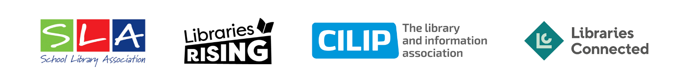

<!-- PAGE: 1 -->

Mailbox 1201, Maggie O'Neill Business and Training Centre, 433 Liverpool Road, Huyton, Liverpool L36 8HT  
Company Registration Number: 07559747 | Registered Charity Number: 1176482

# Briefing: Libraries in Primary Schools

**December 2025**  
**Joint briefing from the School Library Association (SLA), Libraries Rising, Libraries Connected, and the Chartered Institute of Library and Information Professionals (CILIP)**

## Overview

We strongly welcome the Chancellor’s announcement to fund a library in every primary school in England, by the end of this Parliament, as a landmark commitment to educational equity, literacy and the transformative power of reading. With an estimated one in seven primary schools currently lacking a library, this pledge has the potential to embed a culture of reading in primary education and improve outcomes for children across the country.

We also welcome the £5 million books for secondary schools that was announced in the Budget by the Chancellor. This is a welcome first step that will provide £1.36 per current secondary school pupil for book supplies.

The new announcement comes at a critical time for children’s reading. A 2025 National Literacy Trust survey found only one-third of children aged 8-18 enjoy reading for pleasure, and government data shows that 25% of pupils leave primary school unable to read at the level expected. There is now a large research base evidencing the positive impact that libraries, both school and public — could have on these concerning figures.

As the details of the programme – which will be co-designed by the National Lottery Community Fund – are being considered and finalised, this briefing sets out key principles to ensure the long-term success of the policy.

<!-- PAGE: 2 -->

## What is a school library?

School library provision varies significantly across the country, but a well-functioning school library should be a dedicated space other than the classroom, managed by suitably trained staff. It should offer a wide, inclusive and regularly updated collection of books and other reading materials covering diverse genres and interests, with regular timetabled opportunities for children to participate in reading and learning activities. While classroom book corners can enhance and extend reading provision within a school, they are not a substitute for a library space with dedicated expert staff.

## What is a Schools Library Service?

Local authority-run or commissioned School Library Services provide critical support and resource rotation in many parts of the country.

In the 1980s and early 1990s School Library Services (SLS) were typically part of the offer to schools in every English Local Authority and provided a range of book loan services to enhance school library stock and to add resource to different curriculum areas. Qualified librarians provided advice and expertise for schools and both primary (age 5-11) and secondary (11-18) schools were entitled to the service. In most cases these services were run and managed as part of the public library service, although in some cases they were part of the Education service.

Given the fragmentation and academisation of schools, this universal offer is now a discretionary service which is offered to schools often on a commercial basis by local authorities, though many services still receive local authority funding as well.

There is no government-held data on how many School Library Services there are, what their offer to schools is or how many schools are served, however, recent research by the University of Leeds, commissioned by Libraries Rising and supported by Arts Council England, shows there are 60 local authority-run School Library Services. (Schools Library Services - LibrariesRising)

The services offered by School Library Services include book loans and resource boxes aligned to the curriculum, advisory support including professional training, reading promotion activity, specialist stock especially to SEND pupils, and artefacts loans. By pooling the expertise and offering it to a variety of schools, the services offer excellent value for money and significantly support teaching, learning and curriculum delivery in schools.

As the educational landscape continues to evolve, Schools Library Services remain a vital and highly specialised part of the wider learning ecosystem. While the ways schools operate and invest in support services are changing, the value of Schools Library Services remains clear. Their expertise, wide range of resources and cost-effective support are unique and would be impossible to replace if lost.

<!-- PAGE: 3 -->

These services should be maintained, promoted and valued for the expertise and resources they provide. Continued support on local and national levels will enable these services to thrive and keep supporting teaching and learning across the country.

## Key recommendations

This pledge is a vital step toward ensuring every child has access to books, a reading space and the proven benefits of reading. To realise its full potential, the policy must be backed by sustained investment, access to suitable staff, new guidance, improved data collection, and strategic partnerships with public libraries and existing Schools Library Services (SLS):

1. **Strategic partnerships:** The programme must forge strategic partnerships with public libraries and existing Schools Library Services (SLS). By collaborating with these services, the government can leverage existing local infrastructure, specialist expertise and economies of scale.
2. **Access to expert staff:** Funding must be made available to ensure school library spaces are professionally managed. This can be achieved through dedicated school library staff, resource-sharing arrangements, access to local SLS or public library staff, and professional development for teachers.
3. **Equitable, needs-based funding:** Allocation of funding should be transparent, evidence-based and prioritised for schools with high levels of disadvantage (e.g. Free School Meals eligibility, pupil premium, and areas identified as literacy or social mobility cold spots) and where no library currently exists.
4. **Ringfenced, ongoing funding:** The capital investment to establish libraries must be coupled with ongoing, ringfenced funding for stock maintenance and staffing. Without sustained financial support, libraries risk becoming outdated and underused within a few years of opening.
5. **Data collection and accountability:** The Department for Education should formally collect and publish data on school library provision, staffing, and funding to ensure accountability and enable impact evaluation.
6. **Statutory guidance:** Statutory guidance should be developed for school libraries — in consultation with expert organisations – covering equipment, stock levels, staffing, pupil access and how the library can support curriculum outcomes alongside the new school libraries introduced through the programme.

<!-- PAGE: 4 -->

## Other considerations and areas for development

### Professional staffing

A dedicated school librarian is essential to a well-functioning school library. School librarians curate collections, deliver library lessons, support curriculum delivery and promote reading. They are also perfectly placed to support the renewed commitment to media literacy in the curriculum. However, of those primary schools that had a designated library, only 29% have library staff – and only 8% of those staff members had no other role within the school.

### Training and CPD

Teachers and school library staff need access to high-quality, ongoing professional development on reading for pleasure pedagogy, contemporary children’s literature, information literacy and library management.

### Reading environment

The physical space of the school library should be designed to be welcoming, inclusive and conducive to both quiet reading and collaborative activities. It should be easily accessible to all pupils, including those with special educational needs and disabilities (SEND).

### Inspiring readers

Libraries are more than just a room with books; they are spaces for inspiration. Regular opportunities to meet authors, illustrators and storytellers, alongside engaging events and book clubs, are vital for sparking a lifelong love of reading.

### Upton Meadows Primary School, Northampton

Upton Meadows Primary School have positioned their library at the physical and educational heart of the school. The pupils are regularly experiencing quality books, as well <!-- PAGE: 5 --> as many of them holding the position of library helper, further developing their sense of responsibility and community.

These further examples of best practice show how Schools Library Services are developing to meet the needs of local school communities:

### Warwickshire Schools Library Service

Warwickshire SLS are enhancing resources for children with Special Education Needs and Disabilities (SEND) in mainstream and specialist schools, to meet growing needs. They have delivered taster boxes of resources to 4 specialist schools and 13 specialist resource provisions (SRPs), highlighting their specialist collections and training opportunities. They work closely with teachers to offer curated collections of books and sensory resources that meet the needs of pupils with specific learning difficulties and neurodivergent pupils.

### Tower Hamlets Schools Library Service

Tower Hamlets SLS runs a popular book award: the Tower Hamlets Book Award. In 2024, they engaged 46 schools (over 2,500 pupils), who read the shortlisted books and attended an in-person event, where each child received a copy of the winning book. A school reading lead noted that this initiative “helps us engage our readers, celebrate reading and engage our parents”.

### Nottingham Schools Library Service

Nottingham SLS works with around 80% of the city’s schools. They curate and deliver bespoke topic boxes of books and artefacts to enrich the curriculum. In 2024–25, they loaned over 73,000 resources. An educator noted that this service “has impacted directly on the children; their involvement and enthusiasm for reading as well as our participation in enrichment activities and the maintenance of the reading environment.”

## Contact details

We would be happy to expand on any of the points we have made here, and to assist in any way that would be helpful:

- **Emma Hoddinott**, Director of Policy, External Affairs and Research, Libraries Connected  
  Email: <emma.hoddinott@librariesconnected.org.uk>  
  Telephone: 07415 322420.

<!-- PAGE: 6 -->

## About the organisations

**Libraries Connected** is the membership body for public library services across England, Wales, Northern Ireland, and the Crown Dependencies. It represents nearly every library service in these regions, encompassing around 176 services and 3,000 branches serving over 61 million people. As an independent charity, its mission is to support, promote, and advocate for public libraries.

**The School Library Association (SLA)** is dedicated to supporting everyone involved in school libraries, from librarians to educators. Its core mission is to ensure that every child has access to a well-resourced and professionally managed school library. SLA provides training, resources, and advocacy to promote the role of school libraries in improving literacy and learning outcomes.  
Contact: Saira Aspinall, Publicity and Partnerships Manager, <info@sla.org.uk>.

**Libraries Rising**, formerly known as the Association of Senior Children’s and Education Librarians (ASCEL), is a collaborative network focused on shaping the future of libraries for children and young people. Its vision is to create inclusive, inspiring spaces where young people feel understood, inspired and empowered. The charity works with public and school library services, as well as cultural partners, to co-design services and programs that amplify youth voices and promote engagement.  
Contact: Tabitha Witherick, Chief Executive, <info@librariesrising.org.uk>.

**The Chartered Institute of Library and Information Professionals (CILIP)** is the UK’s leading professional body for librarians, information specialists, and knowledge managers. Guided by its Royal Charter, CILIP works to improve library and information services, develop professional expertise, and advocate for the sector. It offers membership, professional registration, and continuing professional development opportunities to individuals at all career stages. As a registered charity, it acts in the public interest and serves as the independent voice for the UK’s information profession.  
Contact: Louis Coiffait-Gunn, Chief Executive, <press@cilip.org.uk>.

<!-- PAGE: 7 -->

## Further reading

- Centre for Literacy in Primary Education (CLPE). (2021). *Reading for Pleasure: A review of research*. Available at: [https://clpe.org.uk/system/files/2022-03/CLPE%20Reading%20for%20Pleasure%202021%20v3.pdf](https://clpe.org.uk/system/files/2022-03/CLPE%20Reading%20for%20Pleasure%202021%20v3.pdf)
- Cremin, T. (2025). The overlooked service that could make plans for a library in every primary school in England a reality. *The Conversation*. Available at: [https://theconversation.com/the-overlooked-service-that-could-make-plans-for-a-library-in-every-primary-school-in-england-a-reality-266394](https://theconversation.com/the-overlooked-service-that-could-make-plans-for-a-library-in-every-primary-school-in-england-a-reality-266394)
- Cremin, T. & Lockwood, M. (2023). *School Library Services: A research report*. White Rose Research Online. Available at: [https://eprints.whiterose.ac.uk/id/eprint/220648/7/School%20Library%20Services%20Research%20Report%20.pdf](https://eprints.whiterose.ac.uk/id/eprint/220648/7/School%20Library%20Services%20Research%20Report%20.pdf)
- Department for Education. (2023). *The Reading Framework: Teaching the foundations of literacy*. Available at: [https://assets.publishing.service.gov.uk/media/664f600c05e5fe28788fc437/The_reading_framework_.pdf](https://assets.publishing.service.gov.uk/media/664f600c05e5fe28788fc437/The_reading_framework_.pdf)
- Great School Libraries. (2023). *Equal Futures? An imbalance of opportunities*. Available at: [https://www.greatschoollibraries.org.uk/_files/ugd/8d6dfb_b6f1af1fa9ec48b08b93566dc7608d95.pdf](https://www.greatschoollibraries.org.uk/_files/ugd/8d6dfb_b6f1af1fa9ec48b08b93566dc7608d95.pdf)
- National Literacy Trust. (2023). *Evidence Review: School Libraries*. Available at: [https://nlt.cdn.ngo/media/documents/Evidence_review_school_libraries_2023.pdf](https://nlt.cdn.ngo/media/documents/Evidence_review_school_libraries_2023.pdf)
- National Literacy Trust & Penguin Random House UK. (2023). *Libraries for Primaries: Unlocking the Power of Reading*.
- Publishers Association. (2025). *Turning the Page: The case for reading for pleasure in every primary school*. Available at: [https://www.publishers.org.uk/wp-content/uploads/2025/04/PA_Turning-the-page_report.pdf](https://www.publishers.org.uk/wp-content/uploads/2025/04/PA_Turning-the-page_report.pdf)
- University of Leeds. (n.d.). *Books, Bags and Boxes: A study of the role and impact of the Leeds School Library Service*. Available at: [https://essl.leeds.ac.uk/education/dir-record/research-projects/1264/books-bags-and-boxes-a-study-of-the-role-and-impact-of-the-leeds-school-library-service](https://essl.leeds.ac.uk/education/dir-record/research-projects/1264/books-bags-and-boxes-a-study-of-the-role-and-impact-of-the-leeds-school-library-service)
