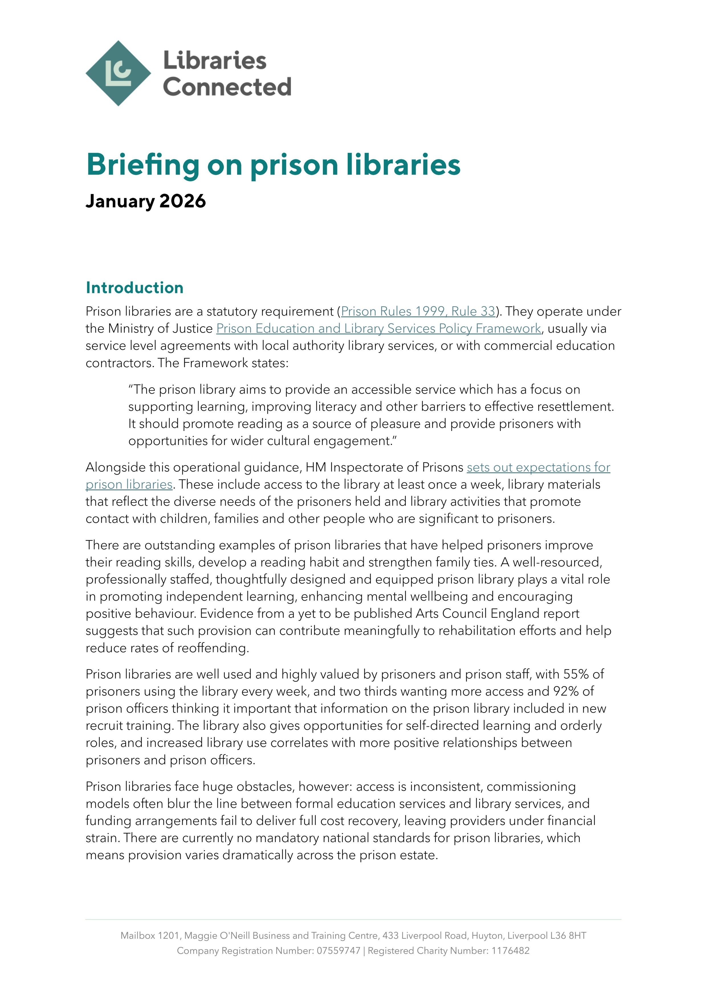

<!-- PAGE: 1 -->

**Libraries Connected**  
Mailbox 1201, Maggie O'Neill Business and Training Centre, 433 Liverpool Road, Huyton, Liverpool L36 8HT  
Company Registration Number: 07559747 | Registered Charity Number: 1176482  

# Briefing on prison libraries

**January 2026**

## Introduction

Prison libraries are a statutory requirement (Prison Rules 1999, Rule 33). They operate under the Ministry of Justice Prison Education and Library Services Policy Framework, usually via service level agreements with local authority library services, or with commercial education contractors. The Framework states:

> “The prison library aims to provide an accessible service which has a focus on supporting learning, improving literacy and other barriers to effective resettlement. It should promote reading as a source of pleasure and provide prisoners with opportunities for wider cultural engagement.”

Alongside this operational guidance, HM Inspectorate of Prisons sets out expectations for prison libraries. These include access to the library at least once a week, library materials that reflect the diverse needs of the prisoners held and library activities that promote contact with children, families and other people who are significant to prisoners.

There are outstanding examples of prison libraries that have helped prisoners improve their reading skills, develop a reading habit and strengthen family ties. A well-resourced, professionally staffed, thoughtfully designed and equipped prison library plays a vital role in promoting independent learning, enhancing mental wellbeing and encouraging positive behaviour. Evidence from a yet to be published Arts Council England report suggests that such provision can contribute meaningfully to rehabilitation efforts and help reduce rates of reoffending.

Prison libraries are well used and highly valued by prisoners and prison staff, with 55% of prisoners using the library every week, and two thirds wanting more access and 92% of prison officers thinking it important that information on the prison library included in new recruit training. The library also gives opportunities for self-directed learning and orderly roles, and increased library use correlates with more positive relationships between prisoners and prison officers.

Prison libraries face huge obstacles, however: access is inconsistent, commissioning models often blur the line between formal education services and library services, and funding arrangements fail to deliver full cost recovery, leaving providers under financial strain. There are currently no mandatory national standards for prison libraries, which means provision varies dramatically across the prison estate.

<!-- PAGE: 2 -->

## Literacy and Neurodivergence

Prisoners have much lower levels of literacy than the general population. The most recent data published by the Ministry of Justice shows that 65% of adult prisoners had literacy levels below those expected of an 11-year-old. It is estimated that up to half of the adult prison population could be considered neurodivergent, covering a range of conditions and disorders such as learning disabilities and acquired brain injuries. But screening for these conditions is inconsistent and many prisons still rely on self-disclosure.

## Provision by Public Libraries

The provision of library services in prison is provided by a range of providers, but across the country there are still 32 local authority library services that also serve their local prisons.

Libraries Connected has been helping our members negotiate with MoJ about these contracts and a 6% uplift has been agreed with the equivalent to the public sector pay award year on year. MoJ are actively trying to retain libraries as providers.

## Projects and Initiatives

### Profiling Prison Libraries within the Prison Estate

An Arts Council England funded project running over 2 years exploring how prison libraries were being highlighted to people entering prison, and how support training and awareness raising amongst prisoners and prison staff could enhance use and outcomes of the prison library service. The project found strong links between prison library use and positive relationships between prisoners and prison staff and positively reported impact of library use on the prisoner's behaviour, wellbeing and mental health.

This shows two thirds of prisoners felt people didn’t have enough access to the library, and 55% of prisoners visited once a week or more.

The project identified several areas where prison library use – and its impacts – could be improved further: training for prison officers, awareness raising at all levels of the prison estate and stronger links between prison libraries and public libraries in the community.

<!-- PAGE: 3 -->

### Other Notable Projects and Initiatives

- **The Shannon Trust** – supporting peer-led reading schemes (Turning Pages) across the prison estate, helping non-readers learn to read with support from fellow prisoners.
- **Storybook Dads / Storybook Mums** – enabling imprisoned parents to record bedtime stories on CD or DVD for their children, strengthening family bonds and encouraging reading across generations.
- **Reading Ahead (The Reading Agency)** – challenging prisoners to choose and review six reads (books, magazines, poems, or articles), building confidence and literacy skills.
- **National Prison Radio book clubs** – broadcasting author interviews and book recommendations across the prison estate.

### Remission for Reading: International Precedents

Several jurisdictions provide remission from prison sentences for taking part in reading initiatives. The Ministry of Justice of Brazil introduced a law in 2012 enabling prisoners to reduce their sentences by reading books. Initially, remission was based on the number of days worked, but in 2012 the law was amended to include remission for study and reading to recognise this as a way of preparing prisoners for life outside prison.

<!-- PAGE: 4 -->

## The Challenges

### Inadequate Library Access

Overcrowding, coupled with chronic staff shortages, makes it more difficult for prisons to engage prisoners in activities that help rehabilitation, including library visits. In the face of such pressures, governors often prioritise safety and security over “purposeful activity”. While some higher category prisons have dedicated library officers to accompany prisoners to and from the library, most do not – meaning library visits are often cancelled at short notice, leaving prisoners frustrated and despondent. In 2023, HMIP and Ofsted found that prisoners’ access to libraries was severely limited, with only 51% of male and 44% of female prisoners saying they could visit their prison library at least once a week. Concerningly, 29% of male and 39% of female prisoners said that they never visited the library. Libraries are rarely open at weekends or in the evenings.

### Blurring of Formal Education and Libraries

Prison library provision is at risk of being rolled into formal education contracts, eroding its distinct role. While education services focus on formal learning and qualifications, libraries support informal, self-directed learning, promote reading for pleasure, and provide access to legal information. Their neutral, calm environment is vital for reluctant learners with negative classroom experiences. Librarians are not teachers; they bring expertise in service design, stock selection, collection management, and reader development — skills education providers often lack without links to public library services. Professionally trained librarians understand public library trends and how prison libraries connect with the wider sector locally and nationally. Crucially, a prison library run by a library authority provides access to the full stock of that service.

### Funding Arrangements

A contract extension process between public libraries providing prison library services and the MOJ has highlighted – and partly addressed – key issues. In the past few years, <!-- PAGE: 5 --> contracts had been rolled over and no longer offered full cost recovery and neither public libraries nor their local authorities could continue to subsidise the delivery of prison libraries.

Funding needs to cover the full cost of staffing, stock, IT, and overheads for public library services delivering prison library services, and we cannot run the risk of slipping back to the position where these services are at risk. Digital inclusion is a particular challenge in prison libraries – implementation of new technologies across the estate does not match the pace of digitalisation in the community.

To maintain the positive impacts on rehabilitation outcomes – we would like to see over the period of the contract extension:

- Work towards a shared understanding of the cost of running a prison library across all the various contexts – the profile of prisoners, size of prison etc.
- Agreement on a basic specification of the service.
- Work promoting the service within the prison system – prisoners and those working in the estate – to ensure best use is made of the current provision.
- Inclusion of public libraries in the prison leavers journey to ensure the connection and engagement with the library service in prison is made when people settle into communities.

## Future Recommendations

- **Protect library access as a statutory entitlement** for all prisoners.
- **Develop national standards for prison libraries** based on CILIP’s Excellence Framework for Prison Libraries, which define staffing, stock, IT and outreach requirements.
- **Safeguard the independence of prison libraries from education contracts**: separate library contracts from education services or include independence clauses.
- **Guarantee full cost recovery** for sustainable delivery of prison libraries. Review Service Level Agreements and contracts to ensure full cost recovery.
- **Explore the inclusion of public libraries in the prison leavers journey** to ensure the connection and engagement with the library service in prison provides continuation on release.

## Contact

We would be happy to expand on any of the points we have made here, and to assist in any way that would be helpful.

**Emma Hoddinott**  
Director of Policy, External Affairs and Research  
`emma.hoddinott@librariesconnected.org.uk` / 07415 322420  
