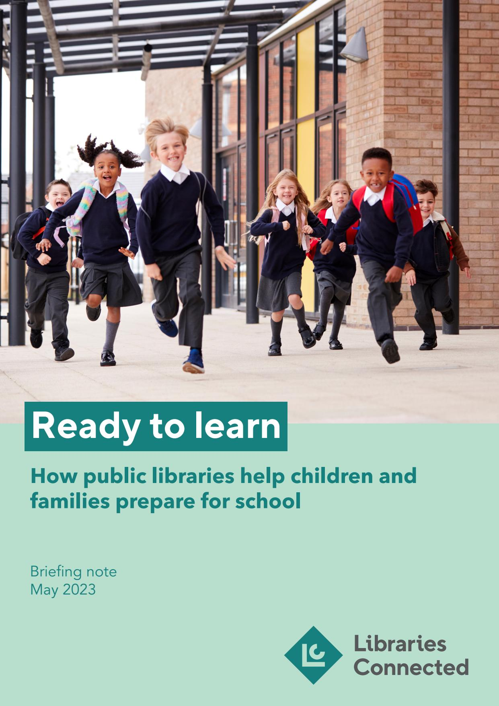
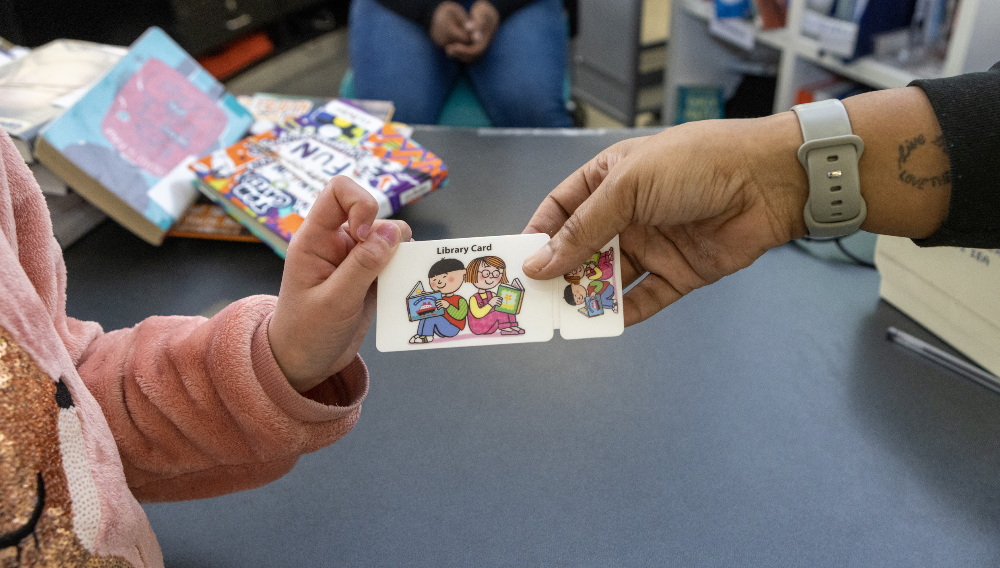
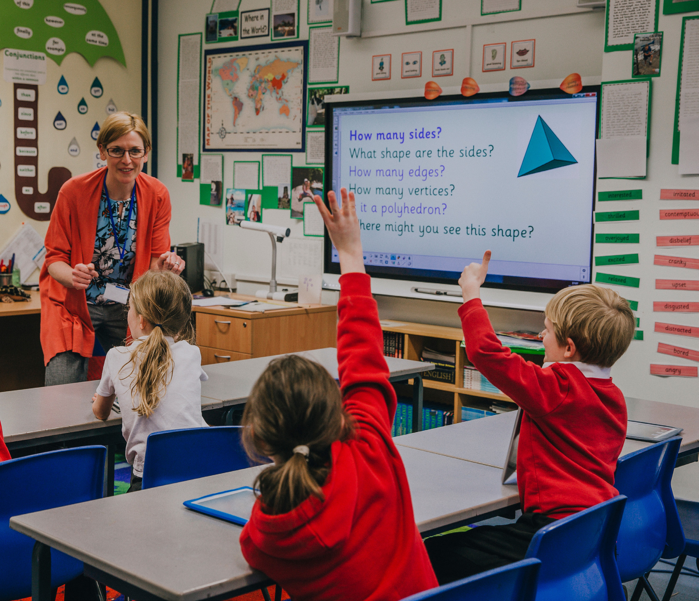
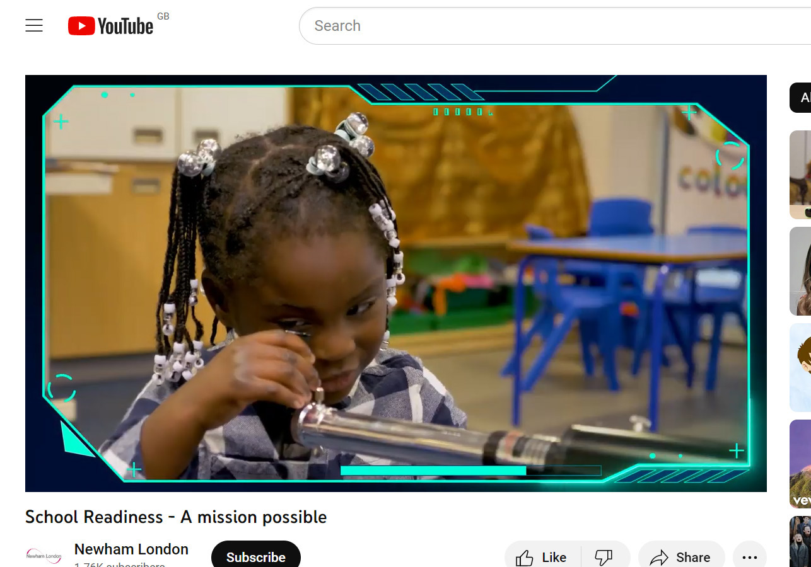
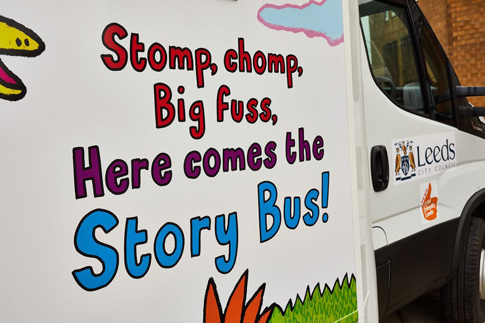
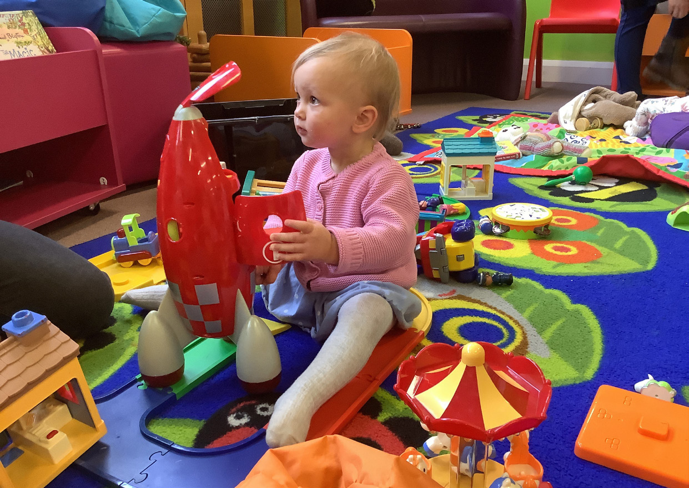

<!-- PAGE: 1 -->

# Ready to learn

## Briefing note — May 2023

### How public libraries help children and families prepare for school

<!-- PAGE: 2 -->

## Introduction

There is no single definition of what it means for a child to be "school ready". But there is broad agreement that young children get the most out of school – and enjoy it more – if they are curious about learning, able to co-operate with others and confident in communicating. There is concern, however, that the number of children starting school without these skills is growing.

Public libraries have a critical role to play here. By providing access to a wide range of age-appropriate reading materials, hosting high-quality family activities and promoting a positive home learning environment, libraries can have a significant impact at this major milestone in children's lives.

As our exclusive polling reveals, primary school teachers agree. They are extremely positive about libraries and overwhelmingly believe that they can help prepare children for school. They also want to see more action by councils to improve children's preparedness for learning, and believe public libraries should be an integral part of those efforts.

The case studies in this briefing showcase some of the most innovative work that libraries are doing to support young children and their families as they make the transition to school. Responding to the needs of their communities, these libraries are a core part of a wider network that includes nurseries, health visiting teams, family hubs and primary schools themselves. Our case studies also show the importance of proactive membership recruitment initiatives.

As under-fives continue to feel the effects of lockdowns (those starting school this September were toddlers during the pandemic) some campaigners warn of a "school readiness gap". Children starting Reception without core learning behaviours could slip even further behind their peers, with an impact that will be felt across a lifetime. The role of libraries – and librarians – has never been more important.

**Isobel Hunter MBE**  
Chief Executive  
Libraries Connected

### Research evidence

* Visiting the library is a vital component of a strong home learning environment. At the age of three it impacts positively on reading skills in the first years of school. (Melhuish et al, 2008)
* A child taken to the library on a monthly basis from ages 3 to 5 is two and a half months ahead of an equivalent child at age 5 who did not visit the library so frequently (Waldfogel & Washbrook, 2010)
* Language development at the age of 2 strongly predicts children's performance on entry to Year 1 of primary school (Roulstone et al, 2011)
* By September 2021 more than three-quarters of schools felt children starting Reception in the last year needed more support than those in previous cohorts (Bowyer-Crane et al., 2021)
* Library rhyme times can improve maternal mental health, one of the strongest predictors of wellbeing in the early years (Boulton et al, 2018)

<!-- PAGE: 3 -->

## Policy recommendations

1. **Multi-agency approach:** Local authorities should put public libraries at the heart of a co-ordinated multi-agency approach to supporting young children and their families as they prepare to start school. This should also include children's services, early years settings and health professionals such as midwives and health visitors.
2. **Promoting library benefits:** Local authorities should promote the benefits of libraries for helping children prepare for school, particularly during the summer months leading up to the start of the new school year.
3. **Early years enrolment:** Libraries should explore library enrolment opportunities throughout a child's early years and work with partner services to promote library membership to all families with babies and young children.

As our poll and case studies demonstrate, public libraries already play an important role in supporting young children and their families as they prepare to start school. But there is more to be done to ensure this support reaches the right families at the right time and in the most effective way.

## What do teachers say?

We commissioned Survation to poll primary school teachers on their view of public libraries and their role in preparing children for school. The results show that primary school teachers are overwhelmingly positive about libraries and firmly believe that they can help children make the transition to formal education.

Our poll revealed that:

* **90%** of primary school teachers agree that visiting a public library regularly can help young children prepare for starting school
* **97%** say preschool activities such as library "rhyme times" are important for young children's development, with 66% saying they are "very important"
* **97%** would advise a parent with a child starting school in September to enroll them with their local library
* **94%** would advise a parent with a child starting school in September to take part in the Summer Reading Challenge
* **92%** would support a national programme to give preschool children automatic membership of their local library
* **87%** believe libraries should work with other services, such as health visiting teams or children's centres, to help young children transition to school

### Teachers' comments

> "Visiting libraries exposes children to literature in all forms: speaking, listening and reading. It also promotes a love of reading and reading for pleasure."

> "Being surrounded by books and stories, knowing how to handle books, knowing how stories are structured, joining in with repetitive rhymes and refrains, all help towards brain development and being able to read and write. Being in a quiet, more controlled environment can help with settling to listen at carpet time. Interaction with library staff can help with social interactions at school."

> "Our local library offers wonderful story telling sessions, not only does it help them build a love of books and familiarity with stories they may read it helps them to learn to sit in a quiet environment with others, experience phonic sounds and learn to take turns in offering opinions."

*Poll conducted by Survation on behalf of Libraries Connected. Methodology: online interviews of primary school teachers. Fieldwork: 25th April to 1st May 2023. Sample size: 522. Full data tables are available at librariesconnected.org.uk.*

<!-- PAGE: 4 -->

## What libraries do

### Free early years activities

Almost every library in the UK hosts regular rhyme and story sessions (often called Rhymetimes) for babies, young children and their parents or carers. Designed to promote a love of reading and develop language skills, these sessions involve songs, rhymes, stories and movement, often with an opportunity to share games, instruments and toys. Importantly, they include synchronised face-to-face songs and stories, promoting bonding and wellbeing. Rhymetimes are also a valuable opportunity for parents of young children to meet and make new friends at what can be a lonely and overwhelming time.

### Children's libraries and collections

All public libraries have dedicated collections of books for children and many now offer a range of other educational resources for loan, such as games, puzzles and activity kits. These collections are carefully curated by expert librarians to support early literacy and numeracy – as well as social and emotional development – and are presented in exciting accessible environments that make reading for pleasure irresistible.

### Information and advice

Public libraries are a valuable source of information and advice for parents and carers as they prepare their children for school. Library staff can recommend books and other resources, provide information on local schools and give advice on helping children prepare for Reception. Libraries can also signpost families to other local services for specialist support or guidance.

### Outreach services

Many library services run programmes to reach audiences, particularly children and families, that are less likely to visit the library. This may include visiting nurseries and other early years settings, operating mobile children's libraries or "book buses", or lending books to community venues such as children's centres.

### Reading Challenges

The Summer Reading Challenge and the Winter Mini Challenge, run by The Reading Agency, encourage children to read for pleasure. Children join the Challenge at their local library and receive a collector folder, stickers and other special incentives, with library staff and volunteers on hand to help them choose books. The Challenge is open to children of all ages; in 2021, over 38,000 children aged 0 to 3 took part.

<!-- PAGE: 5 -->

## Case studies

### Newham

The school readiness programme in the London Borough of Newham is delivered by health visitors and libraries. Now in its second year, its aim is to support the parents of children who missed, or had concerns raised at, their two year health review. The programme was conceived following concerns that many children starting school in reception were not considered school ready.

The programme uses evidence-based tools to assess children's key developmental milestones. It delivers key health messages such as language and communication, learning through play, oral hygiene and the importance of making healthy lifestyle choices in nutrition. The programme also stresses the importance of establishing a regular bedtime routine, with the library team delivering key messaging around sharing a book at bedtime. It also ensures that parents are aware of the basic skills children need to succeed and to be independent at school.

Clinical leads in each area are responsible for contacting parents and inviting them to a school readiness session at their local library. Each session starts with health messaging delivered by a health visitor and a screening of a specially made video. The library team then deliver a story time and craft activity, join up all participants to the library and discuss the benefits of reading and library membership.

The story time and craft activities are opportunities for health visitors to observe the children working independently and their ability to problem solve. During the craft activity, families attend a private meeting with a health visitor to discuss any concerns and how they can help their child prepare for starting school. Each child leaves with a take home pack including a toothbrush and Healthy Start vitamins.

*Watch the Newham school readiness video at: `youtu.be/RK85GXs3qVo`*

### St Helens

St Helens library service is represented on the borough council's early years strategy group and has contributed to both its early years and school readiness strategies, ensuring libraries are part of every child's first 1001 days.

The library service has been instrumental in the design and launch of the Start Well Wheel, a tool for parents to track all appointments and key milestones in their child's life. St Helens libraries use the Start Well Wheel at read and rhyme times to encourage parents to access services for their child and to prepare for school.

St Helens schools library service works in partnership with the council's children's speech and language therapy service to deliver BLUSH (Books and Language Unite St Helens). Developed due to concerns about the high prevalence of communication difficulties in St Helens, BLUSH brings together librarians' rich knowledge of children's literature with the expertise of speech and language therapists. Boxes containing carefully chosen books and question templates are distributed to primary schools and early years settings, where they can be used to assess and improve children's reading development.

The library service's strong track record in delivering speech, language and communication services led to a year-long partnership with Liverpool Philharmonic to deliver a series of music courses to support the wellbeing of pregnant and perinatal women and their babies.

<!-- PAGE: 6 -->

### Leeds

Leeds Libraries runs two flagship projects aimed at improving school readiness and early reading skills. Reception Reading Stars is a simple and highly targeted intervention: library staff share information at local schools' new starter meetings before the summer holiday. Families receive a booklet with reading tips, a booklist including books from a range of genres, an invitation to join the library and attend some special story times over the summer.

Families are encouraged to spend time together reading all books from the booklist. After each book is read, they receive a star from the library to add to their booklet. After they have collected all their stars the children receive a certificate to take into school in September. Schools are encouraged to display the books in the classroom and prepare activities based on them, providing some familiarity for children and boosting their confidence.

Last summer the library service gave out over 500 booklets and over 200 children attended sessions across 10 libraries during the summer holidays. A celebration Reception Reading Stars event is held in Central Library during the October half term to which all participating children from schools across the city and their families are invited.

Another project is the Story Bus service for under-5s and their families, delivered through children's centres, early years settings and community stops in neighbourhoods with lower library use and poorer outcomes for children.

The Story Buses provide a creative, friendly environment with books and story-related activities. Families are welcomed on board by the staff team, who recommend books and model shared reading to increase the confidence of parents in enjoying books with their children. Children and parents are often accompanied on their first visits by trusted individuals such as children's centre staff, but they are also free to explore at their own pace. Books can be borrowed and returned to local libraries or early years settings.

During term time, the buses make special visits to schools and other settings as part of promotions such as World Book Day.

Leeds has also recently added Playboxes to its range of services for under-5s. These brightly-coloured boxes, now available in every Leeds library, contains games and activities which encourage early speech, language, communication and numeracy and which families can easily recreate at home.

### Cheshire East

Cheshire East Libraries recently launched Let's Get Ready for School, an initiative to support children's communication and early literacy skills as they prepare to start Reception. It is particularly aimed at children whose opportunities to socialise have been limited due to coronavirus lockdowns.

Let's Get Ready for School centres around 10 different book bags, which can be borrowed from any Cheshire East library. Each bag contains four picture books specially selected by librarians with advice from specialist speech and language therapists, children's centre staff and the local BookTrust coordinator.

The books focus on themes such as making friends, building confidence and overcoming worries as well as stories about starting school for the first time, and have been chosen for families to read and enjoy together.

The bag also contains a useful leaflet co-written with early years speech and language therapists, including practical ideas for supporting children's communication and emerging literacy at this important stage.

Let's Get Ready for School harnesses the power of books to develop language skills, promote emotional wellbeing and rehearse new situations in a safe and supportive way.

<!-- PAGE: 7 -->

### North Yorkshire

North Yorkshire's library service is a key partner in the Council's school readiness initiative Grow and Learn. Having representation on the steering groups for Grow and Learn has enabled the library service to form new relationships with several organisations and has increased reach through children's settings and early years providers.

Co-ordinated, collaborative activities, such as targeted distribution of activity packs, baby days and delivery of Small Talk and Babbling Babies sessions in libraries has attracted families who have traditionally been more difficult to reach. Through Grown And Learn, the library service has also enhanced its existing programme of visits from local nurseries and reception classes and helped promote local libraries as safe, welcoming and inclusive spaces.

A key element of the initiative is working with the county registration service to enrol babies in their local library. Library staff have trained registration colleagues in enrolment and library advocacy and the registrars actively encourage library membership, issue tickets and distribute Grow and Learn packs when families come to register births. This was initially piloted in one area, and such was the success that is has now been rolled out to all registration offices across the county. Over 1,100 children have joined the library through this route.

Working on Grow and Learn has opened opportunities for training and development. As well as joint training with the early years team and bespoke workshops on speech and language development, the library service has delivered two conferences to library staff and volunteers on the theme of "childhood futures" with speakers and workshops delivered by the wider school readiness team. This has helped raise understanding of the important role libraries play in supporting children's development and wellbeing and improving their life chances.

### Bradford

Bradford library service, which oversees 27 individual libraries, has its own school readiness plan, helping local parents give their children the best start in life. Aimed at increasing the percentage of children in the city who achieve a good level of development at the end of reception year, the plan has been developed in conjunction with Bradford's public health department. Many of the initiatives are funded by children's services through the early help and prevention service.

The centrepiece of the plan is the Bradford Libraries Rhyme Challenge, which last year reached 6,000 children and their parents or carers. Taking place across the autumn and spring terms, the challenge brings together libraries, toddler groups, nurseries and primary schools to encourage families to learn five rhymes together.

Another innovative scheme in Bradford gives families the opportunity to sign their baby up for a library card when they register the birth of their child. The registrars complete an online joining form for the baby and email a temporary library card number to the parent. The family is then invited to attend a baby photo booth activity at the library, where they can pick up a permanent card. The library service is now looking to extend the scheme to the four family hubs in Bradford.

Bradford libraries have also forged strong links with early years settings in the city. They offer a scheme for nurseries to borrow books on a term-by-term basis and story sacks for nurseries and children's centres. They also host nursery visits and can arrange for all visiting children to receive a library card.

Meanwhile, families with children starting reception in September can borrow a Great Start bag with books on starting school, a school readiness leaflet, puppets, games and more. This is supported by online story sessions with both library staff and reception teachers from two partner schools.

<!-- PAGE: 8 -->

## References and further reading

* BookTrust (2022). *BookTrust Storytime: Summary of key lessons from first year of pilot*.
* Boulton, C., Granville, G., Hayden, C., Lee, B., & Musyoki, E. (2018). *Library Rhyme Times and Maternal Mental Health: Results of an Action Research Project*. Shared Intelligence and Essex County Council.
* Bowyer-Crane, C., Bonetti, S., Compton, S., Nielsen, D., D'Apice, K., & Tracey, L. (2021). *The Impact of Covid-19 on School Starters: Interim Briefing 1 Parent and School Concerns about Children Starting School*. Educational Endowment Foundation.
* Law, J., Charlton, J., & Asmussen, K. (2017). *Child language as a wellbeing indicator*. Early Intervention Foundation.
* Melhuish, E.C., Phan, M.B., Sylva, K., Sammons, P., Siraj-Blatchford, I., & Taggart, B. (2008). Effects of the Home Learning Environment and Preschool Center Experience on Literacy and Numeracy Development in Early Primary School. *Journal of Social Issues*, 64(1), 95–114.
* National Literacy Trust (2022). *Public Libraries and Literacy Recovery*.
* Ofsted (2022). *Education recovery in early years providers: spring 2022*.
* Rankin, C., & Brock, A. (Eds.). (2019). *Library Services from Birth to Five: Delivering the Best Start*. Facet Publishing.
* Roulstone, S., Law, J., Rush, R., Clegg, J., & Peters, T. (2011). *Investigating the Role of Language in Children's Early Educational Outcomes*.
* Waldfogel, J., & Washbrook, E. V. (2010). *Low Income and Early Cognitive Development in the UK: A Report for the Sutton Trust*. Sutton Trust, London.

<!-- PAGE: 9 -->

## About Libraries Connected

Libraries Connected is a membership organisation representing heads of library services in England, Wales and Northern Ireland. We take a leading role in the development of public libraries through advocating for the power of libraries, sharing best practice and helping to shape the public library service now and in the future.

### Contact information

**Media enquiries:**  
James Gray  
Communications and Advocacy Manager  
james.gray@librariesconnected.org.uk  
07849085762  

**Libraries Connected**  
3rd Floor, Islington Central Library  
2 Fieldway Crescent, Highbury East  
London N5 1PF  
info@librariesconnected.org.uk  
www.librariesconnected.org.uk  

Company Registration Number: 07559747  
Registered Charity Number: 1176482  
