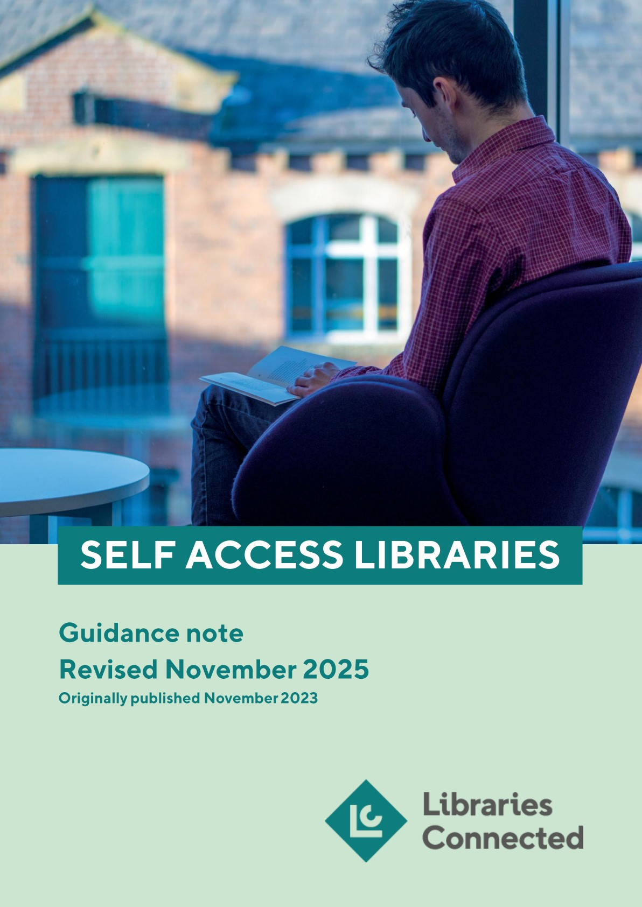

<!-- PAGE: 1 -->

# Self Access Libraries

## Guidance Note

**Revised November 2025**  
*Originally published November 2023*

**Libraries Connected**

<!-- PAGE: 2 -->

## Introduction

Libraries Connected believes in the power of libraries to change lives. Our vision is an inclusive, modern, sustainable, and high quality public library service at the heart of every community in the UK.

This guidance has been produced in response to feedback at regional meetings and the advisory group and has been produced with the input of colleagues across the sector. It complements the webinars on the topic of Self Access Libraries, recordings of which are available on the Libraries Connected YouTube channel. The webinar shares case studies from Sutton Libraries, Barnet Libraries and Kent Libraries, Registration and Archives Service. Further case studies from Northern Ireland Libraries, Leicestershire Libraries and Sutton Libraries can be found below.

Many services in England, Wales and Northern Ireland offer a mixed model of service delivery including a variety of ways in which access to library services is delivered, e.g. extending access through partnerships, volunteers, and the use of technology. This guidance notice focuses on some of the key considerations for library services exploring the use of technology to extend access for residents and communities to their local library.

Libraries Connected recognise that Self Access isn’t a substitute for a staffed library, but it can be a good way to expand provision, extend opening hours and make libraries accessible and offer convenient opening hours, when they are not staffed.

**Ed Jewell**  
*President Elect, Libraries Connected*

<!-- PAGE: 3 -->

## What is a Self Access Library?

Self Access is a service that gives customers extended, independent access to full library services without staff present.

Self Access technology, also known as Open+ (plus), Open Library, or Extended Access, was first introduced and used in libraries in Scandinavia. The technology is designed to support library buildings to operate with limited human intervention and to complement staffed library hours. It enables libraries to offer extended opening hours or provide additional hours without staff present, supporting libraries to be more accessible and convenient to their residents and communities and extending access to services. The level of service is limited during Self Access hours as staff aren’t available and there are no or very limited events and activities on offer.

It has been implemented in different ways depending on a library service’s particular needs and model, see the case studies below. It supports libraries to have the flexibility to extend access in the way that best meets the needs of their community and their individual buildings and spaces. Access can be provided to an entire library or only part of it, and can support customers to borrow, return and renew books, to access study facilities, IT, printing, photocopying, and Wi-Fi. It can be used in a range of libraries, whether they are in an urban or rural setting. It can also provide a mechanism to allow communities to use library spaces in evenings and weekends for events and activities and to keep a library open when, due to unplanned circumstances, staff are not available or the service is running a staff event or delivering staff training.

<!-- PAGE: 4 -->

## Key Areas for Consideration

The following are some key areas for consideration which have been identified through conversations with colleagues currently using Self Access technology in their library services in England and Northern Ireland.

### Project Planning Phase

#### Project management and strategy

Ensure you have capacity, resource, and good project management support in place to work across all areas of the project from planning to implementation, evaluation, and review. Be clear about your strategy and drivers for change, these are essential to ensure a successful project and implementation. Build your business case for internal and external stakeholders. Establish a strong project management team across all areas of planning, delivery and implementation, and consider how you will build technical capacity and expertise into your project team.

#### Stakeholder and community engagement

Invest significant time with staff, volunteers, customers, councillors, officers, trade unions and other key stakeholders at an early stage, working and engaging with them about your ideas and proposals. Liaise with internal and external colleagues and teams including IT, Health & Safety, Legal, Security, Facilities Management and Marketing and Communications to identify the benefits, potential barriers and risks for your project and plans.

#### Staff engagement and consultation

Key to success is early engagement with staff to understand their concerns. In Sutton, the staff shared that they preferred not to work evenings and Sundays. Self Access hours were able to address this, making it a good win for the staff. Engagement with staff will enable the Service to identify problems and challenges which staff can often help find solutions to. This helps the project to be ‘owned’ by staff. Regular (e.g. monthly) meetings with staff and Unions ensures communication and engagement take place.

#### Risk assessments, policies, systems, and procedures

Review existing policies and procedures to see where they need to be changed or updated and consider where new ones may be needed. Examine library specific policies and procedures as well as wider organisational policies and procedures, some of which may require sign off from other departments, officers or councillors. Map risks and create a risk register which is monitored and updated regularly. Consider your emergency and health and safety policies and procedures. Generally, <!-- PAGE: 5 --> the response to opening library buildings to the public without staff is seen as a risk not worth taking.

Writing a risk assessment and considering the mitigation is key to taking away some of the anxiety around Self Access. It’s key to remember that public libraries are open all the time to the public, when staff are present, without any knowledge of who is using the library. Every time the doors are opened, there is no way of knowing who is coming through them. That is a risk that Library managers take every time the library is open. With Self Access, whilst there is a risk with tailgating, generally, we know who is using the library. Tailgaters are usually people who genuinely want to use the library space.

#### Equalities Impact Assessment

Consider the way the changes to the service may impact on different user groups and complete an Equalities Impact Assessment.

#### Climate Impact Assessment

Consider the way changes may impact the environment.

#### Health & Safety requirements

This has often been a key area of challenge from interested parties, so it is important that you consider how you can alleviate any concerns. Consider the age limit for access to library services during Self Access sessions and how you will keep customers safe. Consider what safeguarding protocols, emergency procedures and protocols are needed when the building has no staff present. Early engagement with your internal Health & Safety team and emergency services, in particular, your local Fire Service and Fire Officer is important. Consider any legal implications and insurance needs.

#### Security

When considering health & safety requirements some services have assessed the need for security teams to access buildings towards the end of the Self Access session to close and secure buildings. Other services allow the technology to close and secure the building. Some services have live remote monitoring of CCTV and others have regular drop in patrols of security guards.

#### Funding and investment

There are key streams of capital and revenue investment needed to implement and run Self Access within a library building. In addition to the Self Access technology investment is also required to change library buildings and infrastructure. For example, investment and changes may need to be made to external access doors, fire and intruder alarms, CCTV, self-service kiosks, IT servers, networks and <!-- PAGE: 6 --> firewalls, Wi-Fi and phone lines and integration with existing systems e.g., the Library Management System, to enable Self Access to operate successfully.

Alongside any capital investment consideration should also be given to ongoing revenue and maintenance costs associated with adopting Self Access technology and extra utilities and running costs for the library building. Funding for Self Access technology has come from different internal and external sources including “invest to save” initiatives within local authorities, Section 106, the Community Infrastructure Levy and in Northern Ireland the Department of Agriculture, Environment and Rural Affairs (DAERA).

### Public Engagement and Consultation

#### Audit libraries / buildings / spaces

Carry out an audit of the library building to make sure they are compliant and consider whether the landlord’s consent is required for any changes that might be required to buildings not owned by the library service/local authority. Consider how the technology will be retrofitted for existing buildings or where there is scope to futureproof new library buildings for any potential changes required to support Self Access technologies.

A lot of issues can come from the doors not operating properly and retrofitting existing doors can be problematic, so it is worth spending time thinking about it in the planning stages and considering options carefully with your supplier. Also consider the need for additional emergency exits, adaptations to counters or desks, wiring for CCTV, additional locks for doors and windows to secure areas when staff are not present, keypad and fob access, changes to fire and intruder alarm systems.

#### Research, soft market testing and procurement

Contact other services using Self Access technology and review existing case studies and models. Where possible arrange visits for staff and other stakeholders to libraries operating Self Access. Contact suppliers for further information and consider running a soft market testing (procurement may refer to this as ‘open dialogue’) exercise before full tender and procurement. Research and examine existing procurement frameworks for Self Access before going out to tender.

#### Piloting

Consider piloting the technology in one or a small number of libraries. Most services currently using Self Access technology operated at a pilot site to test and try systems and <!-- PAGE: 7 --> processes before rolling out across other libraries. This is also an opportunity for staff to experience how Self Access works and help find solutions to any problems identified.

#### Available services

Consider exactly what the service offer will be during Self Access sessions. What will you enable customers to access? Will there be a limited or full range of services available? In spaces over different floors, you may need to consider limiting access to the ground floor. You may also need to decide whether public toilets are kept open during Self Access and if/how they can be accessed safely.

### Implementation Phase

#### New Terms and Conditions

A review of the current library terms and conditions may be needed. Some authorities produce new T&Cs for Self Access which customers need to sign up to.

#### Induction and training

Induction and training should relate to both staff and customers. New protocols and procedures will need to be produced for staff switching buildings into Self Access mode. Building staff training and confidence in the new systems and process and providing reassurance are important. Consider how you will register and induct customers wishing to use Self Access sessions. Some library services automatically register new customers when they join, others offer an opt in choice to using the service, existing customers need to register and access induction materials. Some library services offer a one to one induction with library staff before access is given, other library services use an online induction process or provide written induction materials. Think carefully about your induction process and consider automating it as much as possible.

#### Operational procedures

Consider how you will manage any transition from staffed hours to Self Access hours. Some library services require people to leave the building at the end of a staffed session and re-enter when Self Access sessions begin by entering/swiping their library card on the keypad at the door.

Consider how you balance and programme Self Access and staffed opening hours. Staff will need time to process and deal with any issues or backlogs which have occurred during the Self Access sessions before re-opening the library. Ensure procedures are in place for when there are power cuts or when self-service and other systems go down.

<!-- PAGE: 8 -->

#### The library building

Many library services have revised and updated their wayfinding and building information before implementing Self Access. For example, providing access to building plans which detail emergency exits and emergency procedures and the location of first aid kits. Some library services provide digital screens with key information available about the library when it is operating in Self Access mode and where to seek help. Most libraries using Self Access have a designated help point with an emergency phone.

#### Staff communications

Provide regular FAQs and updates for staff. Set up specific meetings with staff who are impacted by the change and with trade unions. Create a shared drive for information and resources. Share any communications for the press and other stakeholders with staff before they are released. Support staff to identify problems and find solutions.

#### Marketing and Communications

Invest time in the launch and pre-promotion of Self Access, preparing FAQs, displays and drop ins at libraries. Communicate with library users and any groups regularly using the library who may be impacted or interested in using the library during the Self Access sessions. Develop a set of key messages outlining the changes and the benefits for customers and stakeholders. Provide examples of where Self Access is already in place and being used successfully in other library services. Prepare press releases and briefings for officers and councillors. Ensure opening hours information in libraries and on the library’s website are updated.

#### Emergency procedures

Many library services using Self Access provide an emergency phone with clear information about how to seek help if required. Some library services link this directly to a central number where help can be requested, other library services offer a talk back system linked with their CCTV.

#### Evaluation and review

Consider what success will look like for your project at the beginning and how you will evaluate and review how Self Access is operating for your service. What are its qualitative and quantitative benefits? Set benchmarks for your data and outcomes. How will data be used to measure benefit and performance? Build in mechanisms for feedback and review. Set review periods and be willing to make changes to the way Self Access operates for your customers.

Engage and communicate with Councillors. Set up regular updates for all Councillors. Inviting them to visit a Self Access site to see how it works will help them to understand how health and safety is managed, which is often one of their biggest concerns.

<!-- PAGE: 9 -->

## Benefits

The following are some of the key benefits of Self Access that library services have identified:

- Supports and enables an extension of existing opening hours for the benefit of residents and communities, with a blended delivery model of staffed and Self Access hours, providing customers with flexibility and a choice of how and when they access the library.
- Supports customers who may not be able to access the library during existing opening hours, e.g., customers who work and may only be able to come to the library on their way to/from work, during school drop-offs or later in the evening.
- Benefits customers with additional needs to access library services at quieter times or times better suited to their individual needs.
- Enables groups to meet and use spaces in the evenings e.g., local history groups, reading groups.
- Supports additional access to study places and facilities.
- Can provide access to libraries on occasions when they may be at risk of remaining closed due to staff sickness.
- Keeps libraries open and can offset the impact of reduced staffing.
- Can be used to offer uniform library opening hours across all branches e.g., a library service may choose to keep all libraries open from 8am to 9pm daily with Self Access technology.

<!-- PAGE: 10 -->

## Learnings

The following highlights some of the key learnings identified by colleagues working with Self Access technology in their library services.

### Buildings

There are complexities when combining the technology with existing building infrastructure. Be prepared for teething problems, in particular, with doors and access. These can take time to tweak and resolve, with some services having to replace doors. It can also result in the service being unavailable until issues are resolved. Most commonly downtime is linked to other systems not to Self Access technology. Consider building smart / Self Access technology requirements into new library buildings rather than retrofitting. Find one contractor to do all of the work.

### CCTV & Security

It is important to work closely with security teams on the live monitoring of CCTV, so they have a clear understanding and awareness of the typical activities, behaviours and needs of library users. There are also specific regulations in relation to the installation, use and monitoring of CCTV that library services need to be aware of or will need support from colleagues to understand and implement. You may choose to monitor CCTV constantly or as a backup to review incidents. Some authorities choose to dial into the CCTV system ad hoc to review activity.

### Suppliers

Currently there are a limited number of suppliers, though this is changing and growing.

### Tailgating

Tailgating is where someone with legitimate access to Self Access sessions is followed into the library by someone who isn’t a library member. This has been reported as an issue for some library services. It is monitored by security teams via CCTV or where live CCTV monitoring is not in place library services review CCTV footage each morning for any issues the previous day. However, services using Self Access report that most people behave as they should and very few services have seen significant issues with theft, damage, or disruptive behaviour during Self Access hours.

<!-- PAGE: 11 -->

## Case Studies

### Libraries NI - Out of Hours Service

Northern Ireland’s Out of Hours Service was introduced in 2017. It offers adults (aged 18 years and over) controlled access to library facilities outside of normal opening hours, providing a limited but important range of services on a self-service basis, including broadband/Wi-Fi access, printing facilities, study space and book borrowing.

The Out of Hours Service has been in place from 2018 in six small rural libraries (Dungiven, Irvinestown, Lisnaskea, Maghera, Saintfield and Whitehead) in order to address rural isolation and broadband connectivity. The infrastructure to enable physical access is funded by the Department of Agriculture, Environment and Rural Affairs (DAERA). However, Libraries NI covers the cost for additional utilities and security including an end of night visit to assess the library.

One further library, Omagh, a larger library with a rural hinterland, was added to the list to test the offering for the service in a much bigger location.

The Out of Hours Service is enabled by technology which works with our existing infrastructure. This has recently been upgraded through our e3 project to provide refreshed self-service kiosks, public access computers and cashless printing.

Adults register as an Out of Hours member and following a short induction/safety briefing they can access the library when in Out of Hours mode using their PIN and library card. To get into the library they use an access point at the front door. CCTV cameras record who is coming in and out and staff view this video the following day to ensure customers are working within agreed terms and conditions.

A short video explaining more about the service can be found online:  
`https://www.librariesni.org.uk/libraries/out-of-hours-service/`

Promotion of the service is done at a local and corporate level, with marketing collateral available for customers and stakeholders alike.

Libraries NI is currently reviewing the service and investigating other options to provide Self Access in a sustainable and cost effective way moving forward.

**Kim Aiken**  
*Deputy Head of Service, Libraries NI*

<!-- PAGE: 12 -->

### Leicestershire Libraries - Smart Library

Leicestershire Libraries have 51 static libraries in their network. 35 are community-managed and 16 are county-council managed. In 2018/19, following a year’s pilot at Syston Library, 14 of the council-run libraries implemented Open Plus Access, known in Leicestershire as Smart Libraries, as part of efficiency savings. Although core staffing hours were reduced, the Open Plus Access technology provided the opportunity to extend library access to customers to 8.00am–7.00pm Monday to Friday and 8.00am–6.00pm on Saturdays.

Prior to launch a significant amount of time was invested in surveying and engaging with communities and stakeholders through a comprehensive community engagement exercise. Staff were also widely engaged and consulted with a shared drive for information sharing, frequent updates in the staff bulletin, meetings with staff at each library and meeting with specific staff groups and trade unions.

To register as a Smart Library user, you must be aged 16 or over and a Leicestershire Libraries member. An online Smart Library induction process must be completed before you can access the service. The Induction process contains a Smart Library Induction video, information on what services are and are not available during Smart Library hours and individual floor plans of each library so customers can familiarise themselves with the library building including fire evacuation points and exit routes.

During Smart Library hours customers can:

- Borrow, return and renew library items and pay charges using the self-service kiosk;
- Collect reserved items and borrow them using the self-service kiosk;
- Use the public PCs and free library Wi-Fi, print and use the photocopier to scan and copy documents;
- Browse the library catalogue, renew titles and place reservations online using the public PCs.

CCTV cameras are in constant operation during Smart opening hours. This enables the premises to be remotely monitored to alert staff of any issues. There is also a dedicated phone that customers can use to contact emergency services or report any property issues that they may come across.

During the first year of operation approximately 89,000 visits were made during Smart Library sessions and approximately 12,000 people registered to use Smart Library of which a small percentage were from non-Smart Libraries.

<!-- PAGE: 13 -->

**Kate Lister**  
*Library Resources Manager, Leicestershire Libraries*

#### Additional resources from Leicestershire

- Smart Library Induction pack for customers
- What is a smart library (`leicestershire.gov.uk`)

<!-- PAGE: 14 -->

### Sutton Libraries - Extended Hours Wallington Library Pilot

Sutton Council offers a modern library service to be proud of with a network of eight libraries located across the Borough. Libraries in Sutton are an integral part of community life supporting everything from early years development, digital literacy, community activities, to study space, cultural celebrations, and access to Council services. The ambition is to further enhance the library service offer by:

- Reimagining libraries as community spaces from which a range of cultural, heritage and other services can be delivered by the Council, our partners and the community;
- Narrowing the digital divide, exploring ways to make digital access offered by the service easier, now and for the future;
- Giving customers access to library spaces at times which are more convenient to them by extending library opening hours using Self Access technology.

To test the offer of more convenient times by extending library opening hours, we ran an ‘Extended Hours’ pilot at Wallington Library for 3 months between May and July 2023. The aim of the pilot was to use Self Access technology to expand our offer. By extending our opening hours and making access possible outside of our core staffed hours, we were able to make the library more accessible for our residents. It is also a solution to proposed budgetary savings requirements that take effect from April 2024.

To use the library during the pilot you had to be 18 or over (16–17 year olds were able to access with parental consent), to have undertaken an induction and to have agreed to the terms and conditions that had been set in place.

We created a short video to show how to use the library during extended hours as part of the online induction process.

24-hour CCTV capture was installed as part of the system to enable monitoring during the pilot and a detailed and robust risk assessment was put in place to mitigate any health and safety concerns.

#### Main objectives and aims for the customer

- Customers were able to access the library at times more convenient to them;
- Customers felt confident using the library during Extended Hours;
- Customers' behaviour was appropriate;
- Number of incidents involving customers were kept to a minimum;
- Customers read and understood the Terms and Conditions of access.

<!-- PAGE: 15 -->

During the pilot we ran an extensive public engagement survey which was completed by over 1,000 residents. Analysis of the 1,066 responses indicated a strong appreciation for libraries as an invaluable resource in the community, with services largely regarded as a lifeline and support system for parents and families alike.

Respondents indicated a strong interest in accessing libraries during extended opening hours, particularly on Sundays and late evenings. Book borrowing remains the most popular and most used service in libraries, followed by study spaces and free Wi-Fi. There is a demand for services in a shared building including Health and Fitness classes, Health Services and Adult Education. Self Access technology provides an opportunity to offer a service that is hybrid: with greater access, longer opening hours and appropriate assistance for those who need help.

#### Key findings of the pilot

- Usage trends and customer feedback showed a clear demand and positive experience of using Extended Hours.
- Communication and engagement with customers, staff and stakeholders was key to the successful implementation of the pilot. This included engaging with DCMS.
- Extended Hours can be used safely with mitigations in place that address any issues or concerns.

As a result of the success of the pilot, the decision was made to continue running Extended Hours. Following a successful public and staff consultation the hope is to roll out this technology to a further 5 sites by April 2024.

#### Lessons Learnt

- Access to public toilets during extended hours is essential;
- The induction process needs to be simplified for customers and should be instant;
- More work is needed to agree on the right age for children to use the library on their own during extended hours, for example, access for 13+ or older;
- Test emergency protocols;
- Check CCTV requirements.

**Steve Tudgey**  
*Area Customer Service Manager, Cultural Services, London Borough of Sutton*

<!-- PAGE: 16 -->

## Appendices

- **Appendix A** – Barnet Libraries, Barnet CCTV Protocols
- **Appendix B** – Hertfordshire Libraries, Staff Procedure, Open+ Membership Agreement Checklist

<!-- PAGE: 17 -->

## Acknowledgements

We are grateful for the advice and support of the following services in producing this guidance and presenting at the Self Access Libraries webinar:

- Barnet Libraries
- Gloucestershire Libraries
- Hertfordshire Libraries
- Kent Libraries, Registration and Archives
- Leicestershire Libraries
- Libraries NI
- Sutton Libraries

<!-- PAGE: 18 -->

## About Libraries Connected

We are an independent charity that supports, promotes and represents public libraries. Our work is driven and led by our membership, which includes almost every library service in England, Wales, Northern Ireland and the Crown Dependencies (Guernsey, Jersey and the Isle of Man).

Across the areas we serve there are 176 individual library services with around 3,000 library branches serving over 61 million people.

Our unique approach is to bring these services together to share experience, expertise and evidence – driving innovation and impact across the public library sector.

While senior library leaders sit on our board and committees, we work with library staff at all levels. As well as providing practical support, training and advice to libraries, we represent them to government and raise their profile in the media. We also develop and lead national library projects with cultural, academic and corporate partners.

**Libraries Connected**  
Maggie O'Neill Business and Training Centre  
Mailbox 1201  
433 Liverpool Road  
Huyton  
Liverpool L36 8HT  
`www.librariesconnected.org.uk`

Company Registration Number: 07559747  
Registered Charity Number: 1176482
