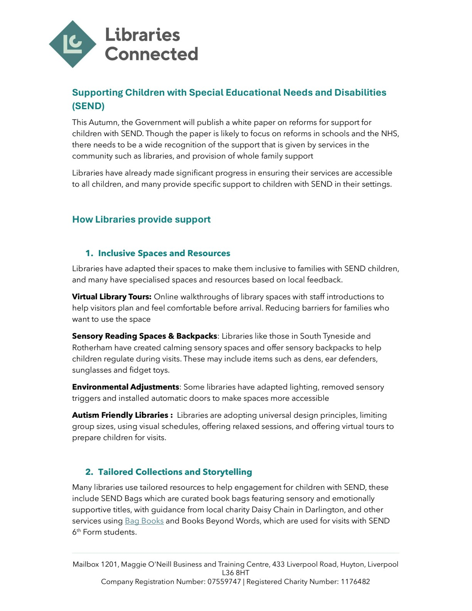

<!-- PAGE: 1 -->

# Supporting Children with Special Educational Needs and Disabilities (SEND)

This Autumn, the Government will publish a white paper on reforms for support for children with SEND. Though the paper is likely to focus on reforms in schools and the NHS, there needs to be a wide recognition of the support that is given by services in the community such as libraries, and provision of whole family support.

Libraries have already made significant progress in ensuring their services are accessible to all children, and many provide specific support to children with SEND in their settings.

## How Libraries provide support

### 1. Inclusive Spaces and Resources

Libraries have adapted their spaces to make them inclusive to families with SEND children, and many have specialised spaces and resources based on local feedback.

- **Virtual Library Tours:** Online walkthroughs of library spaces with staff introductions to help visitors plan and feel comfortable before arrival. Reducing barriers for families who want to use the space.
- **Sensory Reading Spaces & Backpacks:** Libraries like those in South Tyneside and Rotherham have created calming sensory spaces and offer sensory backpacks to help children regulate during visits. These may include items such as dens, ear defenders, sunglasses and fidget toys.
- **Environmental Adjustments:** Some libraries have adapted lighting, removed sensory triggers and installed automatic doors to make spaces more accessible.
- **Autism Friendly Libraries:** Libraries are adopting universal design principles, limiting group sizes, using visual schedules, offering relaxed sessions, and offering virtual tours to prepare children for visits.

### 2. Tailored Collections and Storytelling

Many libraries use tailored resources to help engagement for children with SEND, these include SEND Bags which are curated book bags featuring sensory and emotionally supportive titles, with guidance from local charity Daisy Chain in Darlington, and other services using Bag Books and Books Beyond Words, which are used for visits with SEND 6th Form students.

---

Mailbox 1201, Maggie O'Neill Business and Training Centre, 433 Liverpool Road, Huyton, Liverpool L36 8HT  
Company Registration Number: 07559747 | Registered Charity Number: 1176482.

<!-- PAGE: 2 -->

There are also partnerships with Reading Sight - share the vision who support the visual and print impaired people’s promise which includes children.

Some libraries provide specialist sessions such as South Tyneside who do a storytime TimbaDash Theatre visit at their library called The Word, once a month for multisensory stories with children and their families.

### 3. Events and Community Engagement

Libraries provide events in their spaces, and many give consideration to ensuring that they are inclusive, for example in the Summer Reading Challenge, children can read what they want at their own pace, with no judgement or competition, and each child’s achievement is celebrated. Parents really value library activities as a way of their children being able to participate, alongside everyone else receiving the same rewards.

There are also numerous examples of libraries partnering with local special schools to provide visits and events outside the school environment. These help foster familiarity, independence and engagement with library services. These alongside stand-alone events for families throughout the year, such as specially curated Annual SEND Day in Darlington, and celebrating Learning Disabilities Week.

### 4. Education and Skills Development

We are aware of libraries offering specialist work experience such as long-term placements offered in partnership with a local SEND school 6th form.

There are also example of providing volunteering opportunities for young people, for example during the Summer Reading Challenge.

Libraries have also been developing their own staff and training around autism and neurodiversity awareness is commonplace and feedback has been positive about the opportunities it presents.

> ‘I’d been struggling to find a suitable SEN School. The Library Advisor shared details of an organisation which she had learned about through neurodiversity training. Thanks to their help, my daughter has been offered a place in a school she loves’  
> — Attendee at the Knit and Natter Group in Kirkby Library.

There is also growing awareness of the need for stock selection to be in different formats – audiobooks, eBooks, large print, older reader picture books, dyslexia friendly formats, and high interest, low ability titles for young people.

---

Mailbox 1201, Maggie O'Neill Business and Training Centre, 433 Liverpool Road, Huyton, Liverpool L36 8HT  
Company Registration Number: 07559747 | Registered Charity Number: 1176482.

<!-- PAGE: 3 -->

## Libraries Background

Today the main legislation governing public libraries in England and Wales is the Public Libraries and Museums Act 1964.

Under section 7(1) of the 1964 act, each local authority must “provide a comprehensive and efficient library service”.

Across England, Wales, Northern Ireland and the Crown Dependencies there are 176 individual library services with around 3,000 library branches serving over 61 million people.

The vast majority of libraries are run directly by local authorities (Arts Council England basic dataset), though there are libraries run by communities and other organisations.

However, libraries continue to be affected by austerity and since 2016, there has been a net loss of 276 static libraries across the UK (BBC Shared Data Unit).

Recent analysis finds public library funding has fallen 53% since 2010 (University of Warwick / Campaign for the arts), with Local authority spending on public libraries having decreased from £1.5bn in 2009/10 to £673m in 2022/23 (Institute for Government / MHCLG).

## This briefing is provided by Libraries Connected

We are an independent charity that supports, promotes and represents public libraries.

Our work is driven and led by our membership, which includes every library service in England, Wales, Northern Ireland and the Crown Dependencies. As well as providing practical support, training and advice to libraries, we represent them to government and raise their profile in the media. We also develop and lead national library projects with a range of cultural, academic and corporate partners. Part of our core funding in England comes from Arts Council England to help libraries embed their Investment Principles.

[www.librariesconnected.org.uk](https://www.librariesconnected.org.uk)

For more information contact Emma Hoddinott, Director of Policy, External Relations and Research: [emma.hoddinott@librariesconnected.org.uk](mailto:emma.hoddinott@librariesconnected.org.uk).

---

Mailbox 1201, Maggie O'Neill Business and Training Centre, 433 Liverpool Road, Huyton, Liverpool L36 8HT  
Company Registration Number: 07559747 | Registered Charity Number: 1176482.
