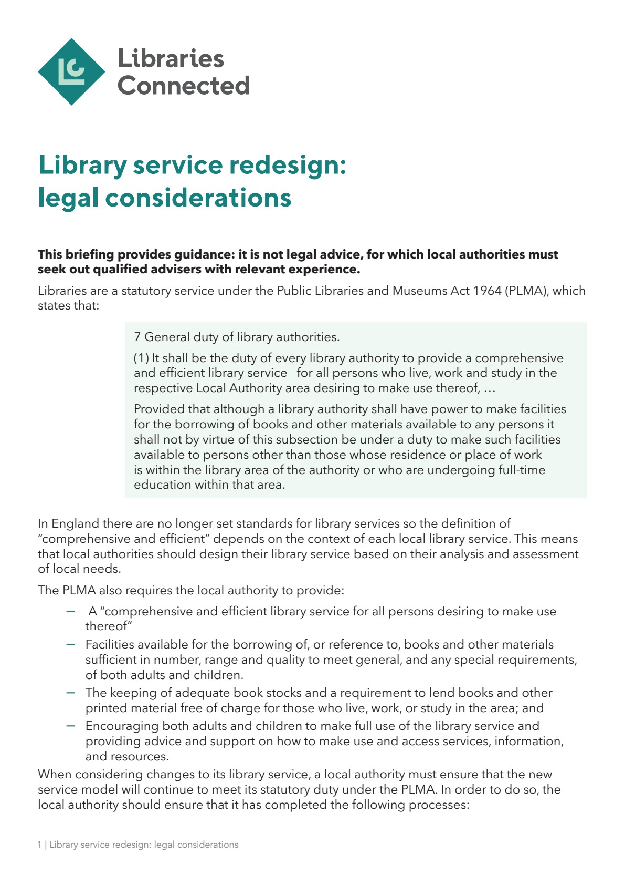

<!-- PAGE: 1 -->

# Library Service Redesign: Legal Considerations

> **Notice:** This briefing provides guidance: it is not legal advice, for which local authorities must seek out qualified advisers with relevant experience.

Libraries are a statutory service under the Public Libraries and Museums Act 1964 (PLMA), which states that:

> **7 General duty of library authorities.**
>
> **(1)** It shall be the duty of every library authority to provide a comprehensive and efficient library service for all persons who live, work and study in the respective Local Authority area desiring to make use thereof, …
>
> Provided that although a library authority shall have power to make facilities for the borrowing of books and other materials available to any persons it shall not by virtue of this subsection be under a duty to make such facilities available to persons other than those whose residence or place of work is within the library area of the authority or who are undergoing full-time education within that area.

In England there are no longer set standards for library services so the definition of “comprehensive and efficient” depends on the context of each local library service. This means that local authorities should design their library service based on their analysis and assessment of local needs.

The PLMA also requires the local authority to provide:

- A “comprehensive and efficient library service for all persons desiring to make use thereof”
- Facilities available for the borrowing of, or reference to, books and other materials sufficient in number, range and quality to meet general, and any special requirements, of both adults and children.
- The keeping of adequate book stocks and a requirement to lend books and other printed material free of charge for those who live, work, or study in the area; and
- Encouraging both adults and children to make full use of the library service and providing advice and support on how to make use and access services, information, and resources.

When considering changes to its library service, a local authority must ensure that the new service model will continue to meet its statutory duty under the PLMA. In order to do so, the local authority should ensure that it has completed the following processes:

<!-- PAGE: 2 -->

## Core Processes

### Local needs assessment

This is a detailed analysis of the needs and desires of the local community, including demographic data, accessibility and transport, patterns of use and demand, views of users and non-users and information from other local authority departments and partners, such as charities and schools.

### Equality Impact Assessment

Like all public bodies, library services must comply with the Public Sector Equality Duty (PSED) as set out in Section 149 of the Equality Act 2010. An Equality Impact Assessment (EIA) can demonstrate compliance with the PSED and ensure that no specific communities or groups will suffer any adverse impact from changes to the service. While an EIA focuses on identifying the impact of policies on groups with protected characteristics under the Equality Act 2010, it can also consider other factors like socio-economic status, rural or urban location, and other community needs.

### Community consultation

The proposed changes must be subject to a full consultation process with as wide an audience as possible, including library users, staff, and local community groups. An effort should be made to engage those who do not currently use the library service. A range of feedback methods should be used, including printed and online surveys, focus groups, and public meetings. The consultation should be clear about how feedback will be used and when decisions will be made.

### Corporate priorities

The local authority’s corporate priorities should be considered throughout the redesign process. The authority should be able to demonstrate how the proposed new model - and the service it would deliver - fits in with and complements these wider priorities.

### Mitigations

Mitigations are measures designed to avoid or minimise the possible negative impacts of a proposed service redesign. These may have been identified through a needs analysis, EIA or public consultation. It is crucial to consider mitigations as they can enable you to address customer concerns, remove barriers to access and demonstrate that changes have been properly considered.

If a service has already been through a consultation exercise and service redesign, and has already made mitigations, it is important to be mindful of those past mitigations when going into the next round of savings. Mitigations can be temporary or permanent.

The corporate priorities of the local authority should also be considered when planning for mitigations. For example, if the local authority is providing a digital inclusion service and cites libraries, then mitigations regarding digital may go against its own policy.

| Proposed change | Potential impacts | Mitigations |
| :--- | :--- | :--- |
| Remove hard copy newspapers | Could restrict access for elderly, digitally excluded and low-income residents | Provide digital newspapers and magazines on Hublets, with staff to support transition. |

<!-- PAGE: 3 -->

## Consequences of Not Meeting the Statutory Responsibility

### Local inquiry

Following a local authority’s final decision to implement changes to its library service, anyone can make representations to DCMS claiming the redesigned service will not meet the requirements of the PLMA. If DCMS decides representations should be treated as a formal complaint under the Act, an investigation by DCMS would follow, which may require considerable information and time to support. A potential outcome of a formal complaint may be that the Secretary of State orders a local inquiry to determine if the authority is meeting its statutory duty. This could result in an order directing the authority to carry out specific actions, including reversing the changes. Ultimately, if the local authority fails to comply with the order, the library service may be transferred to the Secretary of State. Under the PLMA the Secretary of State can also order a local inquiry of their own motion when a local authority fails (or is suspected of failing) to provide the required statutory service.

### Judicial review

Another possibility that should be considered is judicial review against the local authority, during which the courts will examine the local authority’s decision-making process around its library provision, including its approach to equality considerations. A judicial review can be brought by individuals, groups or organisations who can show they have a legitimate interest or have been adversely impacted by the local authority’s decision. The consequences if the court finds against the local authority would be significant: it may quash the decision and force it to begin the process again.

The consequences of any legal process regardless of its outcome should not be underestimated. Simply defending is costly in terms of time, legal fees and reputation. Proposals must be as robust as possible, and local authorities should be fully aware of the potential legal challenges that could arise from their proposals.

### Timescales

You should expect any major change to a library service to take at least a year and possibly up to two years. Best practice suggests you should plan for up to six to 12 weeks for a consultation exercise and should be prepared for significant public interest, which may necessitate procuring a third party to process and analyse the responses. The consultation may need to be extended and, if it leads to substantive changes, may need to be run again. In some cases, the scrutiny committee may be involved before a final decision is made, examining proposals and making recommendations. And if changes to staffing are proposed these will need to be consulted on separately in line with employment law and the local authority’s HR processes.

See indicative timeline below for more detail.

<!-- PAGE: 4 -->

## Further Reading

- **DCMS guidance: libraries as a statutory service**
- **Strategic planning: longer-term, evidence-based sustainable planning toolkit produced by the Libraries Taskforce**
- **Creating a Comprehensive Library Service - Getting the Equality Duty Right (slide presentation by Sue Charteris)**
- **Inquiry into the public library service provided by Wirral Metropolitan Borough Council (the Charteris review), 2009**  
  Sue Charteris’s examination of Wirral Council’s plans to close 11 of its 24 libraries concluded that the authority was in breach of the PLMA, primarily because it had failed to make an assessment of local need. DCMS encourages library authorities to consider the review’s findings when developing their library strategy and particularly when considering significant changes to library provision.
- **Gloucestershire and Somerset judicial review judgment, 2011**  
  This case focused on both counties’ plans to cut funding for several libraries, claiming that the authorities failed to comply with the public sector equality duty. The court found in favour of the claimants and quashed the decisions.
- **Brent judicial review judgment, 2011**  
  The case challenged Brent Council’s decision to close six libraries, arguing the local authority failed to meet its legal duty to provide a comprehensive library service. The High Court ruled in favour of the authority, concluding that Brent met its statutory obligations.
- **Lincolnshire judicial review judgment, 2014**  
  The High Court ruled against Lincolnshire County Council’s library cuts, stating that the consultation process was flawed, and the local authority did not properly consider alternative options.

<!-- PAGE: 5 -->

## Indicative Steps

**1.** Changes proposed

**2.** Develop needs assessment, statutory building network map and EIA (with input from legal and data teams)

**3.** Potentially develop library plan or strategy (5 year)

**4.** Develop public consultation plan – how long will the consultation run for (recommendation 12 weeks)? Design consultation document and questionnaire, website pages. Organise face to face sessions / drop-ins. Begin procurement process for processing and analysing responses, if necessary

**5.** Legal review of proposal and consultation material/EIA

**6.** Develop overall timeline

**7.** Get officer/senior management agreement to proposals

**8.** Get member agreement to proposals

**9.** Cabinet or cabinet committee paper outlining consultation exercise. Time needed to draft, agree and then post

**10.** Staff briefings on proposals going to cabinet committee before being made public

**11.** Initial press statement and briefings on proposals

**12.** Further staff briefing on proposals and the public consultation period

**13.** Distribution of all consultation material to all service points

**14.** Consultation on library changes (12 weeks).
- a) Break period to consider consultation responses

**15.** Analyse results
- a) Update needs assessment, equality impact assessment if needed

**16.** Confirm actions

**17.** Confirm mitigations

**18.** Second cabinet/committee paper confirming decision to be taken

**19.** Staff briefings and press statements on decision taken and next steps

**20.** Post-decision: allow for time for decision to be called into scrutiny

---

*Note:* These steps may be taken concurrently or in a different order and some may be repeated.
