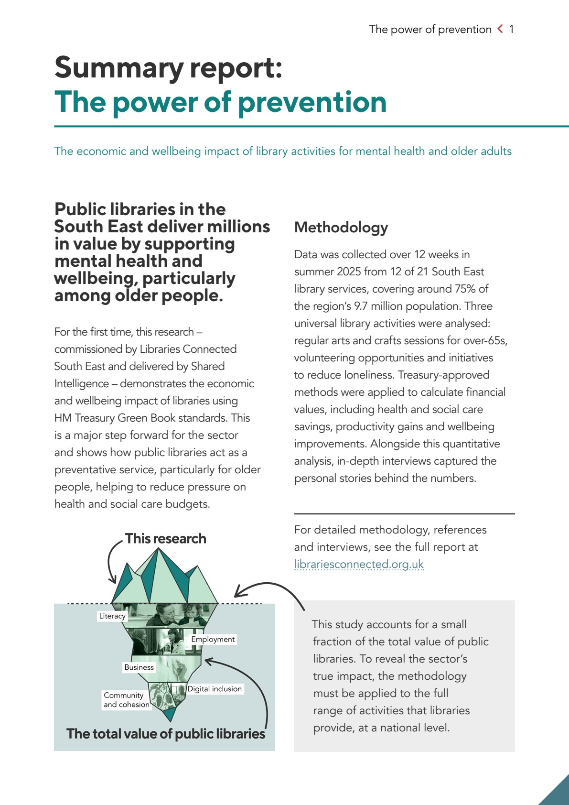
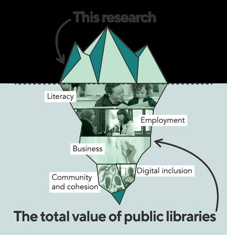
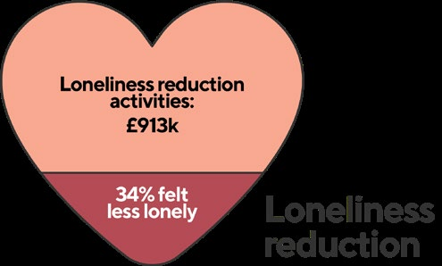
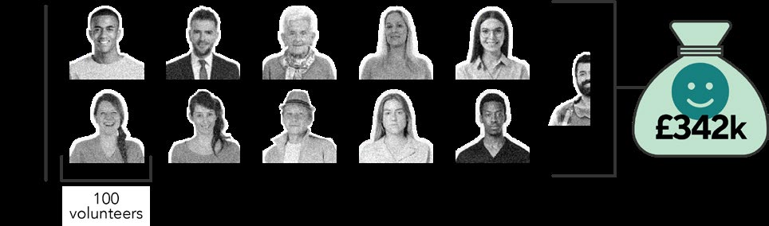
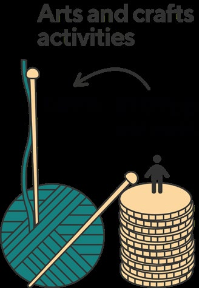
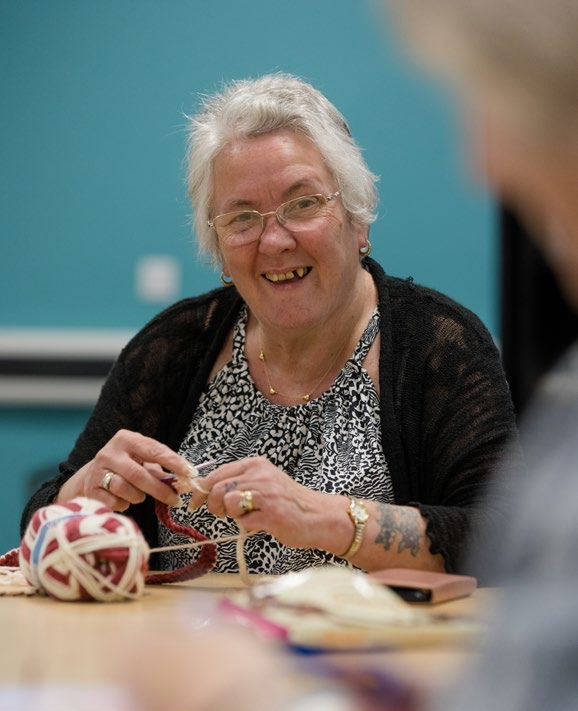

<!-- PAGE: 1 -->

# The power of prevention

## Summary report: The economic and wellbeing impact of library activities for mental health and older adults

Public libraries in the South East deliver millions in value by supporting mental health and wellbeing, particularly among older people.

For the first time, this research – commissioned by Libraries Connected South East and delivered by Shared Intelligence – demonstrates the economic and wellbeing impact of libraries using HM Treasury Green Book standards. This is a major step forward for the sector and shows how public libraries act as a preventative service, particularly for older people, helping to reduce pressure on health and social care budgets.

### Methodology

Data was collected over 12 weeks in summer 2025 from 12 of 21 South East library services, covering around 75% of the region’s 9.7 million population. Three universal library activities were analysed: regular arts and crafts sessions for over‑65s, volunteering opportunities and initiatives to reduce loneliness. Treasury‑approved methods were applied to calculate financial values, including health and social care savings, productivity gains and wellbeing improvements. Alongside this quantitative analysis, in‑depth interviews captured the personal stories behind the numbers.

For detailed methodology, references and interviews, see the full report at [librariesconnected.org.uk](https://www.librariesconnected.org.uk).

This study accounts for a small fraction of the total value of public libraries. To reveal the sector’s true impact, the methodology must be applied to the full range of activities that libraries provide, at a national level.

<!-- PAGE: 2 -->

## The results

Weekly arts and craft sessions for older people generate at least £491k each year in health and wellbeing benefits across eight services, using a valuation of £109 per person per weekly session based on quality of life improvement.

Volunteering generates an estimated £342k each year in wellbeing value across 11 library services, reducing isolation and boosting life satisfaction. This is based on a valuation of up to £396 per person per year – the estimated cost for health and care services to deliver the same benefit.

Loneliness reduction activities generate an estimated £913k each year in health, productivity and wellbeing value across six services, based on 357 participants – 123 of whom (35%) reported feeling less lonely. The small sample size means the true regional impact is many times greater.

<!-- PAGE: 3 -->

## What library users say: the personal stories behind the numbers

### Social value toolkit

Libraries Connected has published a toolkit enabling library services across the country to apply this methodology and estimate values for their own activities.

Visit [librariesconnected.org.uk](https://www.librariesconnected.org.uk) or email [chad.bentley@librariesconnected.org.uk](mailto:chad.bentley@librariesconnected.org.uk) to find out more.

> “I found when I came everybody made me feel so welcome. It makes you want to come back again, because you get accepted. You’re nervous that first time when you meet a group of people. But if they don’t like you, what can you do? But I found most people, especially in a knitting group, very friendly. People just swap around. I’ve don’t think I’ve ever sat in the same place. I enjoy that, it’s quite refreshing.”  
> — Knit and Natter participant, Maidenhead Library.

> “He died in the April and I came here in May - that was two and a half years ago. It brought me out. When I first came here, I wasn’t sure if I could, because I’m not very good at speaking. I was very shy and I was very nervous, because I had stayed indoors all the time, looking after my husband. But when I came I stuck it out, and it’s great now because I know everybody. Talking to people, even at home, even down my road, they all say how different I am. I feel a lot better.”  
> — Volunteer, Portsmouth Library.

> “It’s fascinating, because you will always get one or two that love something that you dislike, or have seen something in the book that you hadn’t thought about. It’s tremendously stimulating... I think you have to be stimulated, particularly when you’re older. You can’t live your life if you don’t actually get on and enjoy it and participate in it. And that’s, I think, half the joy of the book club.”  
> — Book group participant, Cranleigh Library (Surrey).

<!-- PAGE: 4 -->

## What next for the library sector?

This study is a significant milestone in demonstrating the true impact of libraries. To build on this progress, in partnership with DCMS and Arts Council England, we should:

- **Identify a sector champion** to share the findings widely, deepen understanding of the social value model and support libraries to implement it.
- **Apply the Treasury‑approved values locally** to strengthen advocacy and decision‑making.
- **Scale up loneliness data** – the most complex to collect, but potentially the most valuable ‑ starting in the South East, then nationally.
- **Keep the valuations current and credible** by regularly updating them.

### Participating library services

This study was commissioned by the 21 members of the Libraries Connected South East regional network. The 12 services in bold are those that were able to participate in data collection for this research.

- Bracknell Forest
- **Brighton and Hove**
- **Buckinghamshire**
- **East Sussex**
- Guernsey
- **Hampshire**
- Isle of Wight
- Jersey
- **Kent**
- Medway
- Milton Keynes
- **Oxfordshire**
- **Portsmouth**
- Reading
- Slough
- Southampton
- **Surrey**
- **West Berkshire**
- **West Sussex**
- **Royal Borough of Windsor and Maidenhead**
- **Wokingham**
