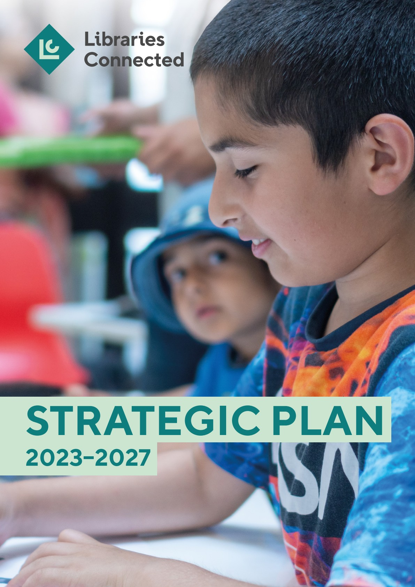
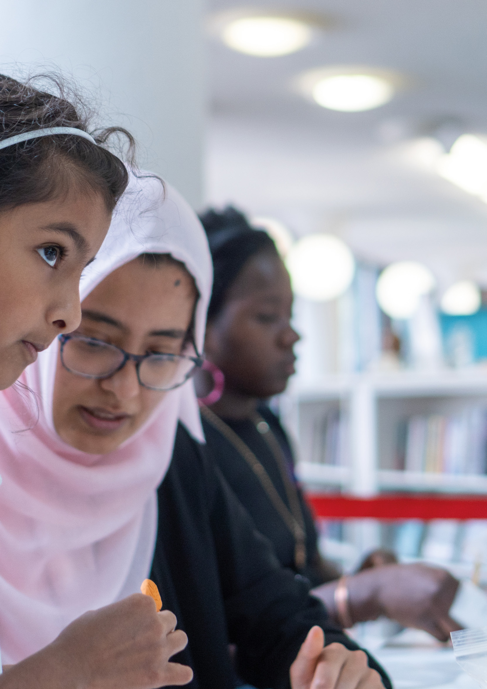
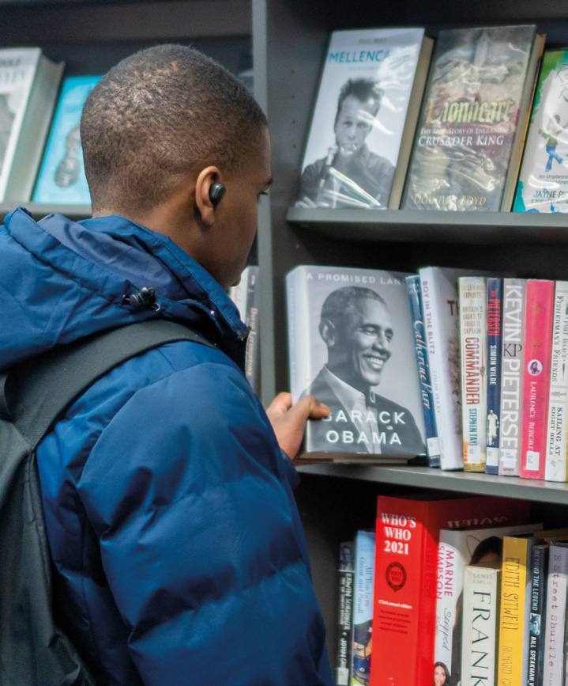
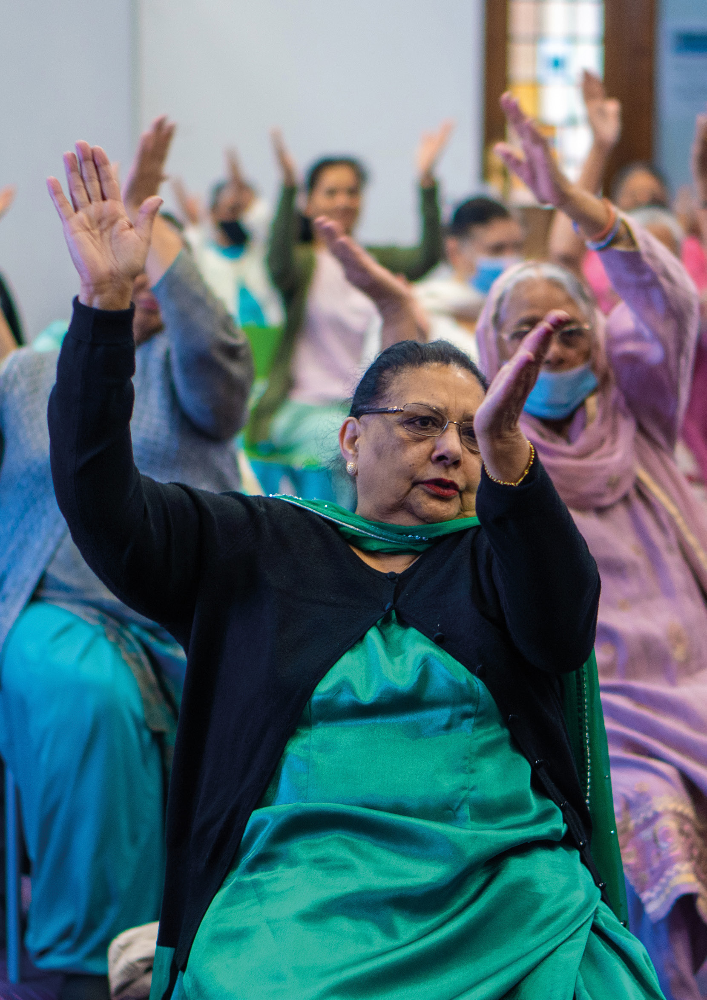
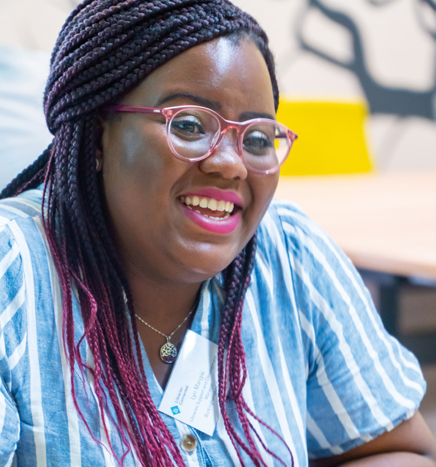
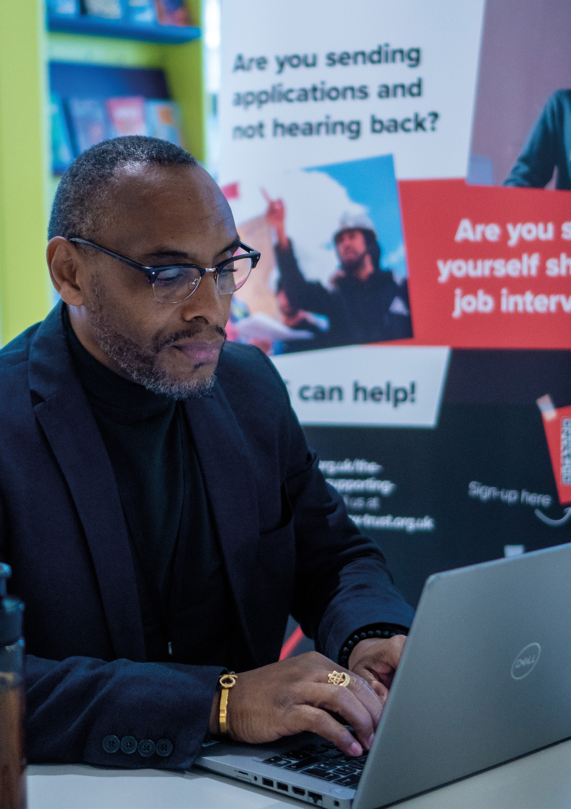
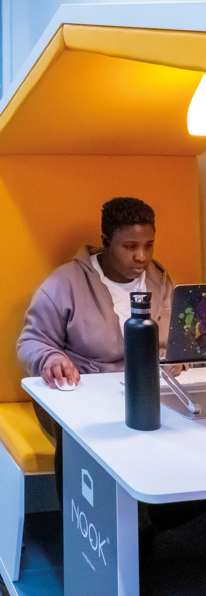
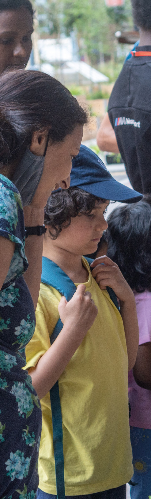
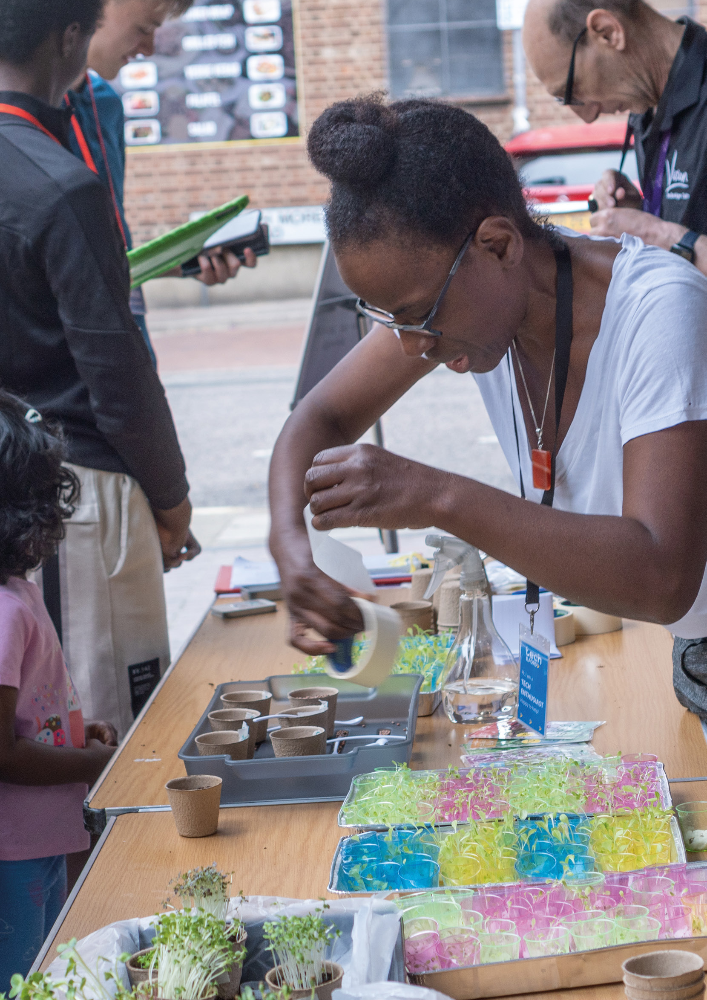

<!-- PAGE: 1 -->

# STRATEGIC PLAN 2023–2027

<!-- PAGE: 2 -->

# WHO WE ARE AND WHAT WE DO

Libraries Connected is an independent charity that supports, promotes and represents public library services in England, Wales, Northern Ireland, and the Crown Dependencies. Our work builds on 20 years’ experience as the Society of Chief Librarians and today our audience extends beyond heads of public library services to all library workers. We generate income from membership subscriptions, commissioned services, events and grants, including from Arts Council England as we are the Sector Support Organisation (SSO) for public libraries.

Public libraries help tackle some of society’s biggest challenges by providing vital community infrastructure, access to culture, literacy and the written word, learning opportunities, and essential digital resources for modern life. Across the areas we serve there are 176 individual library services with around 3,000 library branches serving over 61 million people. Each has a unique local offer that reflects the needs of its communities, but by connecting and working together libraries can act with greater collective impact.

The core mission and purpose of Libraries Connected is therefore to act as a connecter and catalyst. Through the work of our staff, trustees, members and partners, we support libraries to harness the power of collaboration. This in turn means we can innovate, empower, connect and influence so library services better meet current and future challenges.

We take a leading role in developing what libraries do and who they do it for. We work for continuous improvement on behalf of local communities, and shape the national debate on the future of library services. We demonstrate the value of libraries, broker national partnerships, share best practice and drive innovation in the sector.

<!-- PAGE: 3 -->

# OUR VISION

Our vision is for an inclusive, modern, sustainable and high-quality public library service at the heart of every community. Modern public libraries should be the cornerstone of the community, delivering a diverse range of services meeting local needs around information, learning, literacy, employment and digital skills, health, culture and leisure.

<!-- PAGE: 4 -->

# OUR MODEL OF CHANGE 2023-2027

## VISION

An inclusive, modern, sustainable and high-quality public library service at the heart of every community in the UK. We believe modern public libraries should be the cornerstone of the community and should deliver a diverse spectrum of local needs around information, learning, literacy, employment and digital skills, health, culture and leisure.

## PURPOSE

Public library services address big societal challenges but can meet these with more impact when working together.

The purpose of Libraries Connected is to innovate, empower, connect, and influence so library services can meet these and the next societal challenges.

## INPUTS

- **LC members**
- **Trustees**
- **Funding**
- **Partners**
- **Core team expertise**
- **Knowledge and data**

## ACTIVITIES

- **Drive innovation at scale**
- **Grow and empower through skills and diversity**
- **Connect to realise ambitions**
- **Engage and influence others to utilise sector potential**

## IMPACTS

### Enabled

- Public libraries reach more people and with more impact.
- Public libraries have the skills and diversity to inspire and support their communities.

### Amplified

- Collaboration enables larger ambitions, more effective action, and amplifies actions of partners.
- Those beyond sector champion public libraries and utilise/invest in their potential.

## PRINCIPLES

- **Support climate and sustainability**
- **Promote equality, diversity and inclusion**
- **Harness connection and collaboration**
- **Support sustainable financial models**
- **Operate at national and regional scale**

<!-- PAGE: 5 -->

# STRATEGY ACTION THEMES

Our 2023-2027 strategy has four core areas of action:

## DRIVE

We drive innovation by gathering evidence and testing new ideas at a national scale. We create insight and intelligence that individual library services can apply to their current needs and future plans: social, financial, and environmental. Our programmes are designed collaboratively with our members and delivered in partnership with leading organisations.

Our goal is for all public library services to reach their full potential and be recognised as an essential, high impact public service.

## GROW

We develop and foster skills for change within our own organisation and throughout the public libraries sector. We build leadership skills and provide senior managers with the tools to lead high quality library services rooted in evidence and best practice. We support the creation of an inspired and inclusive new generation of library workers, helping build a workforce that truly reflects the communities it serves.

Our goal is for the public libraries workforce to be confident and skilled, diverse and representative, with a shared vision of what a 21st century library service is.

## CONNECT

We connect our members with each other and with leaders and innovators from other sectors, in the UK and internationally. We are a platform for debate and a bridge to new ideas, opportunities, and partnerships. We use our networks to share best practice and celebrate the successes of our sector.

Our goal is for libraries to deliver maximum impact in their places by drawing on the expertise and experiences of their peers across the country.

## ENGAGE

We engage with decision makers to make the case for public libraries and influence public policy. We work to raise the profile of library services, communicate their impact and articulate their value with national and local politicians, policy makers and the media. We promote public libraries as vital social and cultural infrastructure and as dynamic partners for achieving policy goals.

Our goal is to build strong, sustainable public libraries that have the political and public support they need to thrive.

<!-- PAGE: 6 -->

# FIVE PRINCIPLES UNDERPIN ALL OUR WORK

Through everything we do we seek to:

- Support climate responsibility and sustainability.
- Promote equality, diversity and inclusion.
- Harness connection and collaboration.
- Support sustainable financial models.
- Operate at national and regional scale.

## SUPPORT CLIMATE RESPONSIBILITY AND SUSTAINABILITY

Having established an environmental policy for Libraries Connected our focus is now on supporting libraries to develop their own environmental strategies. Our two main areas of work will be:

- Supporting library services to operate in a more environmentally responsible manner by reducing the footprint of their activities, buildings and physical resources.
- Building libraries’ role in supporting their communities, jointly with local partners, to explore, develop, learn, and decide about sustainability. This is inspired by the growing number of libraries around the world who work with their communities to explore how personal and group decisions can help tackle the climate crisis.

This work will be informed both by the Green Libraries programme and our new Futures Hub, which will generate evidence and insight that library services can use to meet the challenges of the coming decade. It will also be supported by national programmes of themed activity based on the Universal Library Offers which include community and place-based challenges including climate change.

## PROMOTE EQUALITY, DIVERSITY AND INCLUSION

Our focus here is two-fold: developing our own approach to equality, diversity and inclusion as an organisation, and supporting inclusive practice across the public library sector. Our aim is for public libraries to be exemplars of inclusive, diverse and accessible public services. Our three main areas of work will be:

- Developing the diversity and inclusiveness of our Board and organisation as we recruit a new set of external trustees in January 2023.
- Building on the Leading Libraries programme with new initiatives to foster a more inclusive and diverse library workforce at all levels. This includes our work on career pathways and next generation skills which is key to making career routes in the sector more transparent, and more attractive to people from diverse backgrounds.
- Using the Universal Library Offers and our innovation programmes to help libraries ensure their stock, events and activities reflect the communities they serve. This will be supported by a new Equality, Diversity and Inclusion learning programme for the whole of the public library workforce.

<!-- PAGE: 7 -->

<!-- PAGE: 8 -->

# HARNESS CONNECTION AND COLLABORATION

We want to inspire our members to deliver the very best service for the communities they serve. Central to this has been our development of the new accreditation scheme for English public libraries. Over the next four years we will support the roll-out of the scheme as a driver and measure of ambition and quality. We will also deliver a strategic Universal Library Offers programme of themed annual projects to build on the work of the successful Offers review. Our newly created Libraries Connected Awards is also structured around the Offers and is proving a simple but effective way to support a culture of ambition and pride in our sector. Our peer-to-peer networks, online forums, regional meetings and seminars are also important drivers of improvement. This will be underpinned by evidence-based advocacy, with a focus on developing influencing tools for use by heads of library services.

## SUPPORT SUSTAINABLE FINANCIAL MODELS

There are two distinct dimensions to the challenges public libraries face over the coming decade. First is the significant challenge of operating within a tightly cash-constrained local government environment, in which social care spending will increasingly overshadow all other budgets. Second are the changing needs of the communities libraries serve - from climate change and its impact on daily lives and local economies, to technology and automation and their impact on jobs, skills, and patterns of inequality.

To help services navigate these challenges our focus will be on building commercial awareness and expertise, and to support them to unlock additional sources of income. Our three main areas of work will be:

- We will support library services to identify and bid for new funding opportunities, including from charitable and statutory sources.
- We will develop new commercial partnerships, building on the success of the contract we negotiated for library services to support UK visa applicants, which generates £2.5m annually.
- We will also undertake a much-needed project to set out a series of standardised structures for individual services based on proven approaches. This is key to financial sustainability at the local level.

## OPERATE AT NATIONAL AND REGIONAL SCALE

A key focus for our work in England will be development of our regional networks into strategic partnerships that can deliver projects at scale – building on our pilot projects in the North East and South East. Our two main areas of work will be:

- Working with regional library networks to develop regional business cases, partnership strategies, and funding proposals.
- Developing our regional support offer, including intensive support to two regions each year, to build delivery capacity and enable regions to pilot new approaches.

<!-- PAGE: 9 -->

<!-- PAGE: 10 -->

# OUR TRACK RECORD

It is four years since Libraries Connected was established as an independent charity and Sector Support Organisation (SSO), with a core staff team and board of trustees.

Our start-up phase has been one of rapid development in a volatile environment, proving our ability to adapt rapidly while remaining focused on core mission.

The basics of our new organisation were just established when the pandemic began and we have benefited from stable executive and board level leadership throughout this phase. This has enabled us to achieve our goals for the first four years:

- We have established a solid reputation as a respected and effective national body for public libraries, which has created a powerful platform for our next phase.
- We have grown membership, with 100% of English, Welsh and Northern Irish library services in membership, alongside the Crown Dependencies.
- We have developed trusted relationships with key national bodies: Arts Council England, Department for Digital, Culture, Media and Sport, Local Government Association, The Reading Agency, CILIP, the British Library and BookTrust.
- We have created a strong and valued service for our members, expanding our support to library staff at all levels and diversifying our events programme, including our flagship annual sector seminar.
- We have delivered several major projects including Leading Libraries, Future Funding, library service accreditation, Novels That Shaped Our World, and a programme of regional support. Through our sector support programmes we have enabled individual library services to work collaboratively and innovate at scale, to maximise their potential for enabling greater participation in culture and creativity in ways which are relevant to their own communities.
- We have developed additional income-generation opportunities including a major contract to support UK visa applicants which generates £2.5 million annual income for the participating library services and supports our commercial team.
- In our first four years as an SSO we have begun to take action on accessibility and representation. In our workforce-focused activities we have broadened the scope of networking and support beyond our core audience of senior library managers. Our MOOC courses, accessed by around 16,500 sector workers so far, have extended our reach far beyond heads of library services, as has our work to open up our annual seminar to ‘next generation’ sector leaders.

<!-- PAGE: 11 -->

Our programme to reshape the Universal Library Offers was co-produced; the process enabled mid-level and frontline staff to engage in national projects and work with peers from other places. Through the development of the library accreditation scheme we have focused on accessibility and representation in the public-facing role of library services. The scheme is centred around the unique reach of public libraries as the only part of the cultural sector with an audience not skewed by education, socioeconomic status, or disability. To gain accreditation library services must show they meet the needs of the most disadvantaged in their communities.

The next stage of our development will be to ensure our staff and trustees represent the communities our libraries serve, and that this is also reflected in the library workforce as a whole.

As a membership body during the pandemic we created a role for ourselves we had not foreseen. We provided essential support to public libraries to support their service delivery during lockdown with the #LibrariesFromHome programme, working with government to produce the official COVID secure guidance for public libraries, and supporting service recovery through a series of webinars, data collection, advocacy publications and skills toolkits.

> ‘Thank you so much to you and Libraries Connected for unbelievable support, resources, materials, guidance and contacts. It would not have been possible to get to this position without Libraries Connected.’  
> — Head of library service, and member of Libraries Connected.

Our ability to add value during the upheaval of the past two years, while maturing as a new organisation, leaves us in an extremely strong position - in some ways stronger than we imagined back in 2018 – to deliver our core mission as a connecter and catalyst for public library services.

<!-- PAGE: 12 -->

# LEADERSHIP AND GOVERNANCE

Our Board has 13 members: nine heads of library service appointed from our membership and four external trustees. The member trustees are selected to represent a geographical spread and different types of library service, including urban and rural. Our external trustees bring in additional skills and different perspectives. The Board is supported by our Advisory Committee which represents the views of our members, ensuring their voice is at the heart of all our work.

## ORGANISATIONAL DEVELOPMENT

The pandemic accelerated our evolution into a hybrid and dispersed organisation with 75% of our staff based outside London. This enables us to engage more effectively with our members, better understand their place-based opportunities and challenges, and bring their expertise into our working. Our team days every six weeks take place in libraries across the country, where we are briefed on their work within their communities.

Over the next four years we will continue to consolidate this way of working with regular team days, development of our processes and IT capacities and we will identify a number of touch-down locations across the country to move our core office location out of the capital.

We will diversify our financial base by developing new commercial offers in partnership with libraries and will build relationships with a wider pool of funders to expand our capacity. We will develop the skills of our team to support this by embedding professional development within each person’s annual work plan, supported by a dedicated corporate budget.

<!-- PAGE: 13 -->

<!-- PAGE: 14 -->

# STRATEGY ACTION PLAN

## DRIVE

| What we will do | Our goal |
| :--- | :--- |
| Establish a Futures Hub for the libraries sector, a programme of collaborative research on the challenges and opportunities of the next decade including inequality, climate, technology and skills. | The libraries sector has the skills, knowledge and resilience to meet the challenges of the next decade. |
| Establish a public libraries data and evidence observatory. | Robust data and evidence play a greater role in service design, decision making and learning by public libraries. |
| Support and promote a Public Library Service Accreditation Scheme. | More library services demonstrate the highest standards in governance, service design, audience engagement and workforce development. |
| Expand national programme of activity based on the Universal Library Offers, including the Children and Young People’s Promise. | Libraries leverage more funding from statutory, corporate and voluntary sources. Library workers have access to more practical tools and guidance to help deliver high quality events and activities. |
| Launch an environmental sustainability strategy for the libraries sector through the Green Libraries Partnership. | The role of libraries in achieving net zero is established, understood and embedded throughout the libraries sector. Library leaders can access practical tools, resources and advice to reduce emissions and increase sustainability. |
| Launch supply chain engagement programme, including series of nationally negotiated deals for all library services to use. | Library services and their users benefit from greater value for money, efficiency and effectiveness in procurement of books, content, digital systems and equipment. |
| Develop new commercial offers and business case models. | Library services become more financially sustainable by diversifying their income streams. |

## GROW

| What we will do | Our goal |
| :--- | :--- |
| Establish career pathway research and engagement programme. Develop next generation skills programme. | The existing and next generation of library workers benefit from increased career transparency and more inclusive recruitment and progression. |
| Expand existing leadership and workforce development programme, including peer mentoring, bursaries, new learning modules and international networking opportunities. | Library leaders are more empowered, skilled, and attuned to the needs of their communities. |
| Develop codified organisational models for library services. | There is less duplication of work when services are reorganised, and organisational models coalesce around proven types. |
| Launch an equality, diversity and inclusion learning and development programme for library services. | Libraries become models of inclusive, diverse, and accessible local services. |
| Hold the Libraries Connected Awards each year. | Successes are celebrated, shared, and documented, supporting a culture of ambition in the libraries sector. |

<!-- PAGE: 15 -->

## CONNECT

| What we will do | Our goal |
| :--- | :--- |
| Stage three Thought Leadership events each year: seminar, webinar and conference. | The libraries sector has common positions on key issues, increasing profile and influence on policymakers and budget holders. |
| Provide intensive support to two regions each year. | Leadership of the libraries sector is decentralised and national delivery capacity is replicated at a regional level. |
| Establish a support and collaboration network for library services serving ACE Priority Places and Levelling Up for Culture Places. | Library leaders and policy makers have robust evidence on how libraries can help tackle geographical inequalities. Library services in levelling up areas have greater access to funding and partnership opportunities. |
| Continue to support and develop Libraries Connected online networks. | Library workers have stronger peer-to-peer relationships within the sector, which builds resilience and innovation. |

## ENGAGE

| What we will do | Our goal |
| :--- | :--- |
| Establish a commission on libraries and disadvantage to review the evidence on the role of public libraries in reducing social, environmental, financial and health inequalities. | Leaders and policy makers beyond the sector champion public libraries and invest in their potential. |
| Strengthen existing partnerships and establish new strategic partnerships with other organisations. | Libraries Connected has greater access to expertise, resources and funding to advance the aims and ambitions of the library sector. |
| Launch a strategic advocacy programme, including toolkit, publications, briefings and roundtable events. | Library leaders can draw on evidence-based core messages around libraries’ social impact, to effectively influence local and regional decision makers. |
| Execute an organisational communications strategy that delivers our key messages internally (to our membership and the libraries sector) and externally (policy makers, wider public and voluntary sectors). | Internal audiences are more involved with the work of Libraries Connected and have a better understanding of the benefits of membership. External audiences have a better understanding of the impact, breadth and reach of modern library services. |
| Develop and execute a public affairs strategy to influence government on key policy issues relating to public libraries. | The views and interests of the libraries sector are better understood by senior decision makers and reflected in government policy. |

<!-- PAGE: 16 -->

Libraries Connected,  
3rd Floor, Islington Central Library,  
2 Fieldway Crescent, Highbury East,  
London N5 1PF.  
Email: info@librariesconnected.org.uk.  
Twitter: @libsconnected.  
Or join our mailing list at: [librariesconnected.org.uk/signup](https://www.librariesconnected.org.uk/signup).

© Libraries Connected, 2022.  
Registered Charity Number: 1176482.
