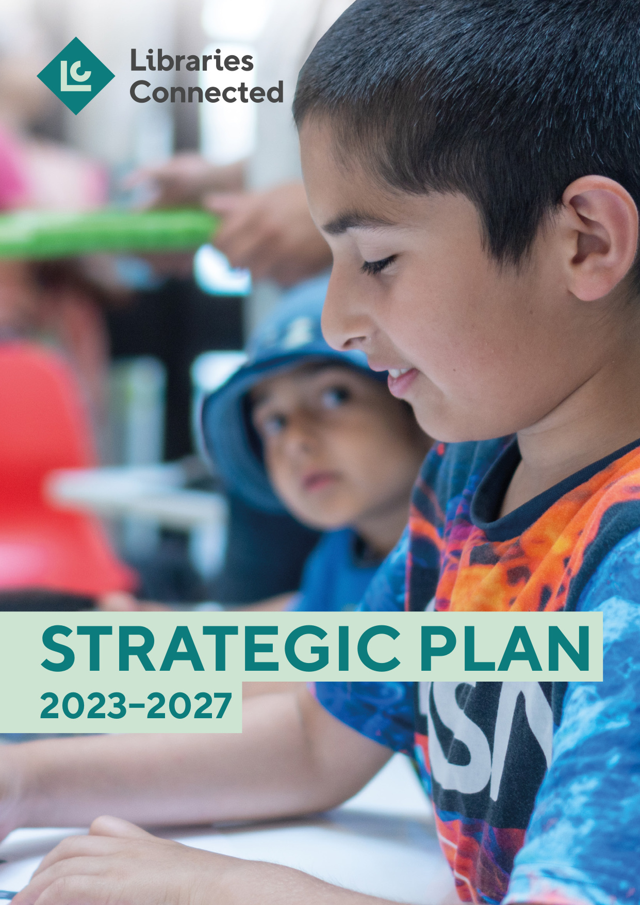
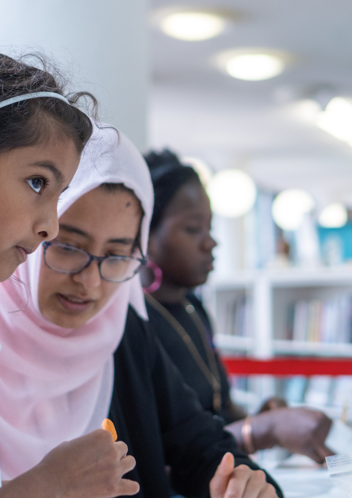
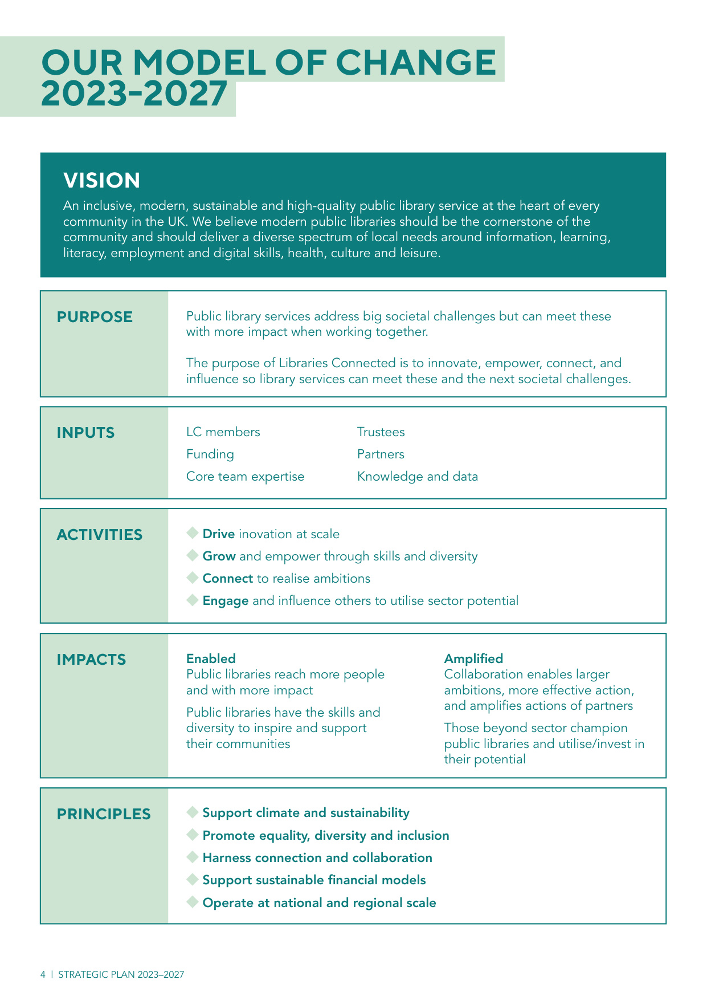
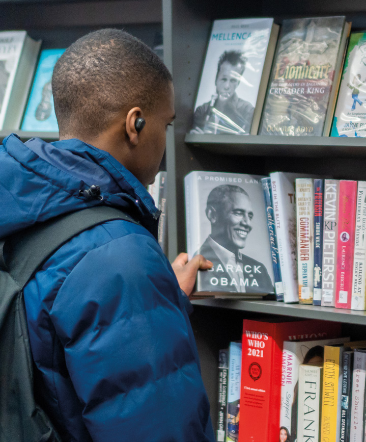
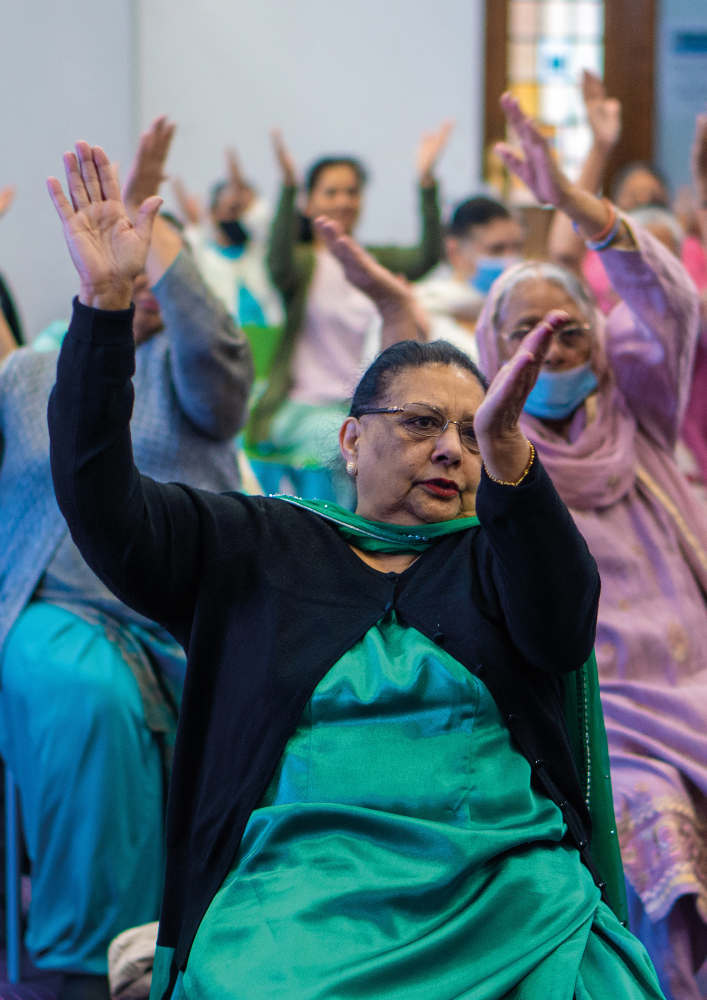
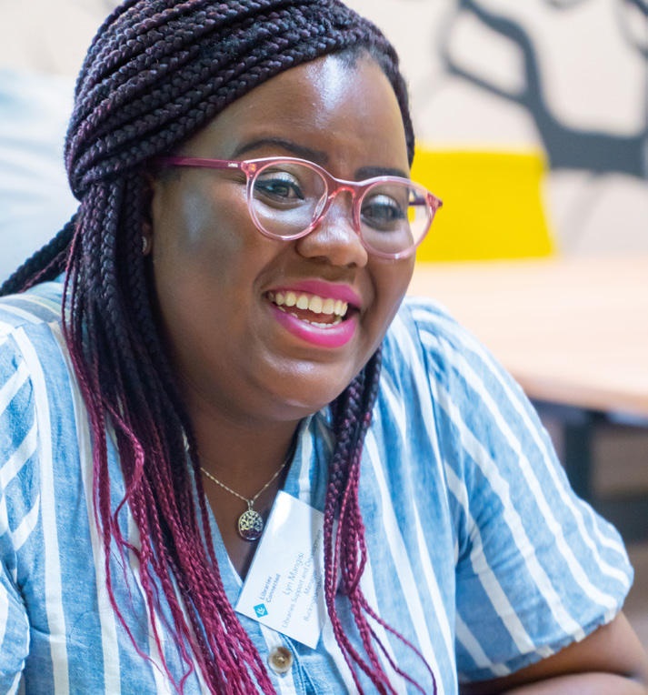
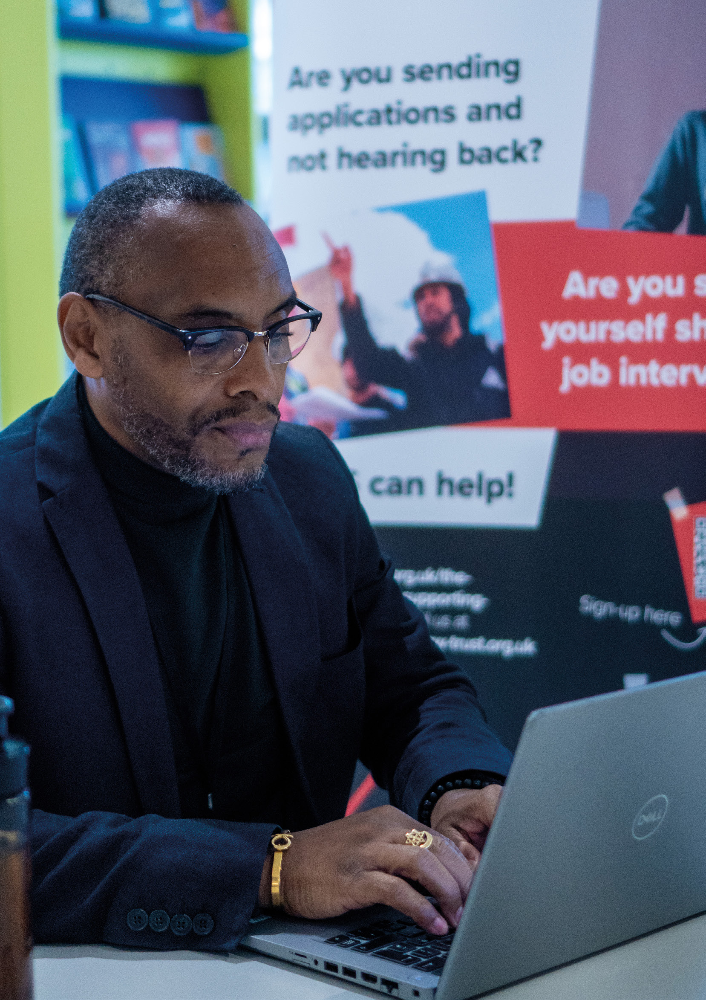
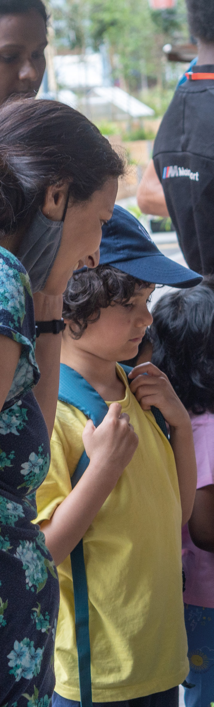
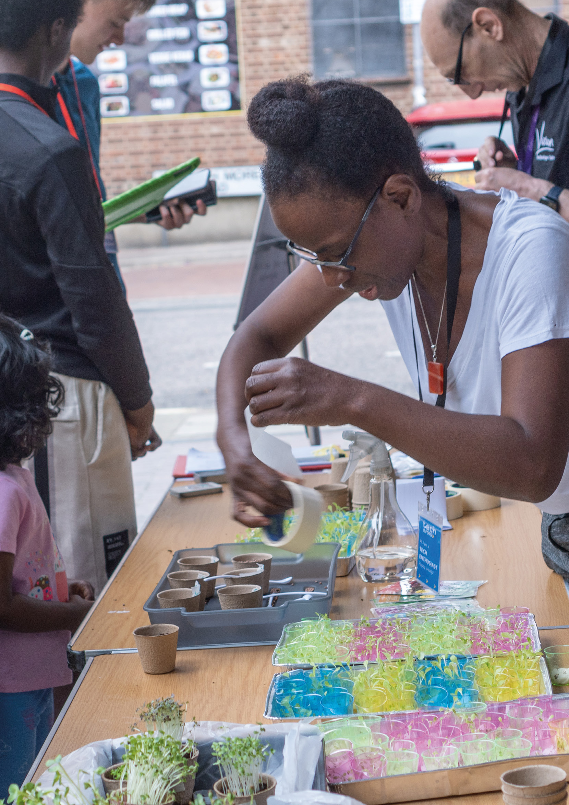

<!-- PAGE: 1 -->

# Strategic Plan 2023–2027

### Libraries Connected

<!-- PAGE: 2 -->

## Who We Are and What We Do

Libraries Connected is an independent charity that supports, promotes and represents public library services in England, Wales, Northern Ireland, and the Crown Dependencies. Our work builds on 20 years’ experience as the Society of Chief Librarians and today our audience extends beyond heads of public library services to all library workers. We generate income from membership subscriptions, commissioned services, events and grants, including from Arts Council England as we are the Sector Support Organisation (SSO) for public libraries.

Public libraries help tackle some of society’s biggest challenges by providing vital community infrastructure, access to culture, literacy and the written word, learning opportunities, and essential digital resources for modern life. Across the areas we serve there are 176 individual library services with around 3,000 library branches serving over 61 million people. Each has a unique local offer that reflects the needs of its communities, but by connecting and working together libraries can act with greater collective impact.

The core mission and purpose of Libraries Connected is therefore to act as a connecter and catalyst. Through the work of our staff, trustees, members and partners, we support libraries to harness the power of collaboration. This in turn means we can innovate, empower, connect and influence so library services better meet current and future challenges.

We take a leading role in developing what libraries do and who they do it for. We work for continuous improvement on behalf of local communities, and shape the national debate on the future of library services. We demonstrate the value of libraries, broker national partnerships, share best practice and drive innovation in the sector.

<!-- PAGE: 3 -->

## Our Vision

Our vision is for an inclusive, modern, sustainable and high-quality public library service at the heart of every community. Modern public libraries should be the cornerstone of the community, delivering a diverse range of services meeting local needs around information, learning, literacy, employment and digital skills, health, culture and leisure.

<!-- PAGE: 4 -->

## Our Model of Change 2023–2027

### Vision
An inclusive, modern, sustainable and high-quality public library service at the heart of every community in the UK. We believe modern public libraries should be the cornerstone of the community and should deliver a diverse spectrum of local needs around information, learning, literacy, employment and digital skills, health, culture and leisure.

### Purpose
Public library services address big societal challenges but can meet these with more impact when working together. The purpose of Libraries Connected is to innovate, empower, connect, and influence so library services can meet these and the next societal challenges.

| Component | Detail |
| :--- | :--- |
| **Inputs** | - LC members - Trustees - Funding - Partners - Core team expertise - Knowledge and data |
| **Activities** | - **Drive:** Drive innovation at scale - **Grow:** Grow and empower through skills and diversity - **Connect:** Connect to realise ambitions - **Engage:** Engage and influence others to utilise sector potential |
| **Impacts (Enabled)** | - Public libraries reach more people and with more impact - Public libraries have the skills and diversity to inspire and support their communities |
| **Impacts (Amplified)** | - Collaboration enables larger ambitions, more effective action, and amplifies actions of partners - Those beyond sector champion public libraries and utilise/invest in their potential |
| **Principles** | - Support climate and sustainability - Promote equality, diversity and inclusion - Harness connection and collaboration - Support sustainable financial models - Operate at national and regional scale |

<!-- PAGE: 5 -->

## Strategy Action Themes

Our 2023–2027 strategy has four core areas of action:

### Drive
We drive innovation by gathering evidence and testing new ideas at a national scale. We create insight and intelligence that individual library services can apply to their current needs and future plans: social, financial, and environmental. Our programmes are designed collaboratively with our members and delivered in partnership with leading organisations.

*Our goal is for all public library services to reach more people with more impact.*

### Grow
We develop and foster skills for change within our own organisation and throughout the public libraries sector. We build leadership skills and provide senior managers with the tools to lead high quality library services rooted in evidence and best practice. We support the creation of an inspired and inclusive new generation of library workers, helping build a workforce that truly reflects the communities it serves.

*Our goal is for public library services to have the skills and diversity to be vital and enduring community institutions.*

### Connect
By connecting individual public library services we amplify the efforts of our members and the sector as a whole. This allows us and our sector to promote a shared understanding of the value of libraries and their role in tackling society’s biggest challenges, including inequality and climate change. Our events, online networks, and regional capacity-building programmes create powerful professional communities and decentralised leadership, which helps create a resilient libraries sector.

*Our goal is to enable collaboration which creates greater ambition and more effective action, amplifying the work of our members and partners.*

### Engage
We represent our sector and our members. We influence local and national decision-makers with evidence, insight and policy proposals that realise the unique potential of public libraries. We provide clear value to our members, while serving the public library sector as a whole.

*Our goal is for those within and beyond our sector to champion public libraries and invest in their potential, which in turn strengthens the benefits libraries provide to society.*

<!-- PAGE: 6 -->

## Five Principles Underpin All Our Work

Through everything we do we seek to:

- **Support climate responsibility and sustainability**
- **Promote equality, diversity and inclusion**
- **Harness connection and collaboration**
- **Support sustainable financial models**
- **Operate at national and regional scale**

### Support Climate Responsibility and Sustainability
The climate emergency will impact everything that libraries do in the coming decades, affecting their buildings, supply chains, funding, and the lives of the people who use them. Libraries can act as community catalysts to increase understanding of climate and biodiversity challenges, support behaviour change, and help reduce emissions.

We co-founded the Green Libraries Partnership in 2022 to support public libraries in their sustainability journeys. We will embed environmental sustainability across all our programmes, share best practice on reducing emissions from buildings and services, and help libraries access capital funding to improve environmental efficiency.

### Promote Equality, Diversity and Inclusion
Public libraries are the most accessible cultural spaces in the UK, open to all regardless of income, age, background or belief. Yet to remain truly representative and inclusive, libraries must continually evaluate whose voices are heard and whose needs are met.

We will support libraries to develop services that reflect and celebrate the diversity of modern Britain. We will examine barriers to recruitment and career progression in the library workforce, promote anti-racism and inclusive collection development, and ensure libraries are safe, welcoming spaces for marginalized communities.

<!-- PAGE: 7 -->

<!-- PAGE: 8 -->

## Harness Connection and Collaboration

We want to inspire our members to deliver the very best service for the communities they serve. Central to this has been our development of the new accreditation scheme for English public libraries. Over the next four years we will work with Arts Council England to roll out the scheme across the country.

The accreditation framework will support libraries to evaluate their performance against clear quality criteria, celebrate excellence, and identify opportunities for continuous improvement. Crucially, the scheme will recognise the diverse local contexts in which libraries operate, providing a flexible framework that promotes innovation rather than uniform compliance.

### Support Sustainable Financial Models
Public library services continue to face severe financial pressures as local authority budgets remain constrained. While statutory core funding remains the bedrock of public library provision, libraries must develop sustainable and resilient financial models.

We will support libraries to explore innovative income-generation opportunities, commercial partnerships, and philanthropic support that align with library values. We will leverage collective bargaining power through national procurement frameworks for digital resources, books, and technology, securing maximum value for public funds.

### Operate at National and Regional Scale
While every library service is firmly rooted in its local authority and community, many of the strategic opportunities and challenges facing libraries require coordination at scale.

We operate as a national voice and advocate, representing public libraries to central government, national media, corporate partners, and charitable trusts. Simultaneously, our regional networks empower library leaders to collaborate across local authority boundaries, share resources, and deliver joint regional programmes.

<!-- PAGE: 9 -->

<!-- PAGE: 10 -->

## Our Track Record

It is four years since Libraries Connected was established as an independent charity and Sector Support Organisation (SSO), with a core staff team and board of trustees.

Our start-up phase has been one of rapid development in a volatile environment. We have built strong relationships with Arts Council England, the Department for Digital, Culture, Media and Sport (DCMS), the Welsh Government, and local government bodies.

### Key Achievements 2018–2022

- **Universal Library Offers:** Reshaped and modernized the core national library offers (Reading, Health & Wellbeing, Culture & Creativity, Information & Digital), underpinned by the Children & Young People’s Promise and the Vision & Print Impaired People’s Promise.
- **Accreditation Scheme:** Developed and piloted the first comprehensive Accreditation Scheme for English public libraries in partnership with Arts Council England.
- **Workforce Training:** Over 16,500 library staff registered and trained on our dedicated online learning platform (MOOC), building skills in digital navigation, health literacy, and customer service.
- **Commercial Income:** Brokered a major national commercial contract to deliver UK visa and citizenship biometric services through public libraries, generating £2.5 million annually for participating library services.
- **Green Libraries Partnership:** Co-founded the Green Libraries Partnership with CILIP, Julie’s Bicycle, and the British Library, securing grant funding to pilot carbon-reduction and environmental projects across 15 library services.

<!-- PAGE: 11 -->

### Expanding Leadership and Sector Reach

Our workforce-focused activities have extended far beyond heads of library services, opening up our annual seminar to ‘next generation’ sector leaders. Our programme to reshape the Universal Library Offers was co-produced; the process enabled mid-level and frontline staff to engage in national projects and work with peers from other places.

Through the development of the library accreditation scheme we have focused on accessibility and representation in the public-facing role of library services. The scheme is centred around the unique reach of public libraries as the only part of the cultural sector with an audience not skewed by education, socioeconomic status, or disability. To gain accreditation library services must show they meet the needs of the most disadvantaged in their communities.

The next stage of our development will be to ensure our staff and trustees represent the communities our libraries serve, and that this is also reflected in the library workforce as a whole.

### COVID-19 Pandemic Response

During the COVID-19 pandemic, Libraries Connected stepped into an unprecedented national leadership role:

- Supported public library services during lockdown with the nationwide **#LibrariesFromHome** digital engagement initiative.
- Worked directly with DCMS and Public Health England to author and publish the official **COVID-secure reopening guidance** for public libraries.
- Supported service recovery through regular national webinars, data collection, economic advocacy, and digital skills toolkits.

> "Thank you so much to you and Libraries Connected for unbelievable support, resources, materials, guidance and contacts. It would not have been possible to get to this position without Libraries Connected."  
> — *Head of Library Service and Member of Libraries Connected*

<!-- PAGE: 12 -->

## Organisational Development

The pandemic accelerated our evolution into a hybrid and dispersed organisation with 75% of our staff based outside London. This enables us to engage more effectively with our members, better understand their place-based opportunities and challenges, and bring their expertise into our working. Our team days every six weeks take place in libraries across the country, where we are briefed on their work within their communities.

Over the next four years we will continue to consolidate this way of working with regular team days, development of our processes and IT capacities and we will identify a number of touch-down locations across the country to move our core office location out of the capital.

We will diversify our financial base by developing new commercial offers in partnership with libraries and will build relationships with a wider pool of funders to expand our capacity. We will develop the skills of our team to support this by embedding professional development within each person’s annual work plan, supported by a dedicated corporate budget.

### Leadership and Governance

Our Board has 13 members: nine heads of library service appointed from our membership and four external trustees. The member trustees are selected to represent a geographical spread and different types of library service, including urban and rural. Our external trustees bring in additional skills and different perspectives. The Board is supported by our Advisory Committee which represents the views of our members, ensuring their voice is at the heart of all our work.

<!-- PAGE: 13 -->

<!-- PAGE: 14 -->

## Strategy Action Plan: Drive & Grow

### Theme: Drive

| What We Will Do | Our Goal |
| :--- | :--- |
| **Establish a Futures Hub** for the libraries sector, a programme of collaborative research on the challenges and opportunities of the next decade including inequality, climate, technology and skills. | The libraries sector has the skills, knowledge and resilience to meet the challenges of the next decade. |
| **Establish a public libraries data and evidence observatory.** | Robust data and evidence play a greater role in service design, decision making and learning by public libraries. |
| **Support and promote a Public Library Service Accreditation Scheme.** | More library services demonstrate the highest standards in governance, service design, audience engagement and workforce development. |
| **Continue to deliver innovative practical and research projects** based on the Universal Library Offers (Health and Wellbeing, Culture and Creativity, Information and Digital, and Reading), underpinned by the Vision and Print Impaired People’s Promise and The Children and Young People’s Promise. | - Library leaders have stronger evidence to demonstrate the core impacts libraries make. - Libraries form new partnerships with other organisations. - Libraries leverage more funding from statutory, corporate and voluntary sources. - Library workers have access to more practical tools and guidance to help deliver high quality events and activities. |
| **Launch an environmental sustainability strategy** for the libraries sector through the Green Libraries Partnership. | - The role of libraries in achieving net zero is established, understood and embedded throughout the libraries sector. - Library leaders can access practical tools, resources and advice to reduce emissions and increase sustainability. |
| **Launch supply chain engagement programme**, including series of nationally negotiated deals for all library services to use. | Library services and their users benefit from greater value for money, efficiency and effectiveness in procurement of books, content, digital systems and equipment. |
| **Develop new commercial offers and business case models.** | Library services become more financially sustainable by diversifying their income streams. |

### Theme: Grow

| What We Will Do | Our Goal |
| :--- | :--- |
| **Establish career pathway research** and engagement programme. Develop next generation skills programme. | The existing and next generation of library workers benefit from increased career transparency and more inclusive recruitment and progression. |
| **Expand existing leadership and workforce development programme**, including peer mentoring, bursaries, new learning modules and international networking opportunities. | Library leaders are more empowered, skilled, and attuned to the needs of their communities. |
| **Develop codified organisational models** for library services. | There is less duplication of work when services are reorganised, and organisational models coalesce around proven types. |
| **Launch an equality, diversity and inclusion learning and development programme** for library services. | Libraries become models of inclusive, diverse, and accessible local services. |
| **Hold the Libraries Connected Awards** each year. | Successes are celebrated, shared, and documented, supporting a culture of ambition in the libraries sector. |

<!-- PAGE: 15 -->

## Strategy Action Plan: Connect & Engage

### Theme: Connect

| What We Will Do | Our Goal |
| :--- | :--- |
| **Stage three Thought Leadership events** each year: seminar, webinar and conference. | The libraries sector has common positions on key issues, increasing profile and influence on policymakers and budget holders. |
| **Provide intensive support** to two regions each year. | Leadership of the libraries sector is decentralised and national delivery capacity is replicated at a regional level. |
| **Establish a support and collaboration network** for library services serving ACE Priority Places and Levelling Up for Culture Places. | - Library leaders and policy makers have robust evidence on how libraries can help tackle geographical inequalities. - Library services in levelling up areas have greater access to funding and partnership opportunities. |
| **Continue to support and develop** Libraries Connected online networks. | Library workers have stronger peer-to-peer relationships within the sector, which builds resilience and innovation. |

### Theme: Engage

| What We Will Do | Our Goal |
| :--- | :--- |
| **Establish a commission on libraries and disadvantage** to review the evidence on the role of public libraries in reducing social, environmental, financial and health inequalities. | Leaders and policy makers beyond the sector champion public libraries and invest in their potential. |
| **Strengthen existing partnerships** and establish new strategic partnerships with other organisations. | Libraries Connected has greater access to expertise, resources and funding to advance the aims and ambitions of the library sector. |
| **Launch a strategic advocacy programme**, including toolkit, publications, briefings and roundtable events. | Library leaders can draw on evidence-based core messages around libraries’ social impact, to effectively influence local and regional decision makers. |
| **Execute an organisational communications strategy** that delivers our key messages internally (to our membership and the libraries sector) and externally (policy makers, wider public and voluntary sectors). | - Internal audiences are more involved with the work of Libraries Connected and have a better understanding of the benefits of membership. - External audiences have a better understanding of the impact, breadth and reach of modern library services. |
| **Develop and execute a public affairs strategy** to influence government on key policy issues relating to public libraries. | The views and interests of the libraries sector are better understood by senior decision makers and reflected in government policy. |

<!-- PAGE: 16 -->

## About This Publication

© Libraries Connected, 2022

Libraries Connected  
3rd Floor, Islington Central Library  
2 Fieldway Crescent, Highbury East  
London N5 1PF

Email: info@librariesconnected.org.uk  
Twitter: @libsconnected  
Website: [librariesconnected.org.uk](https://www.librariesconnected.org.uk)  
Mailing list: [librariesconnected.org.uk/signup](https://www.librariesconnected.org.uk/signup)

Registered Charity Number: 1176482
