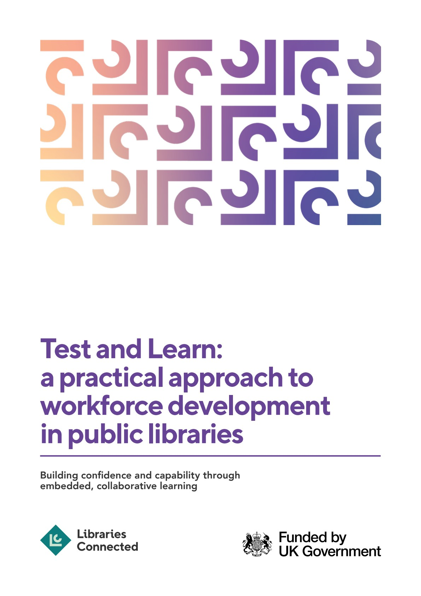
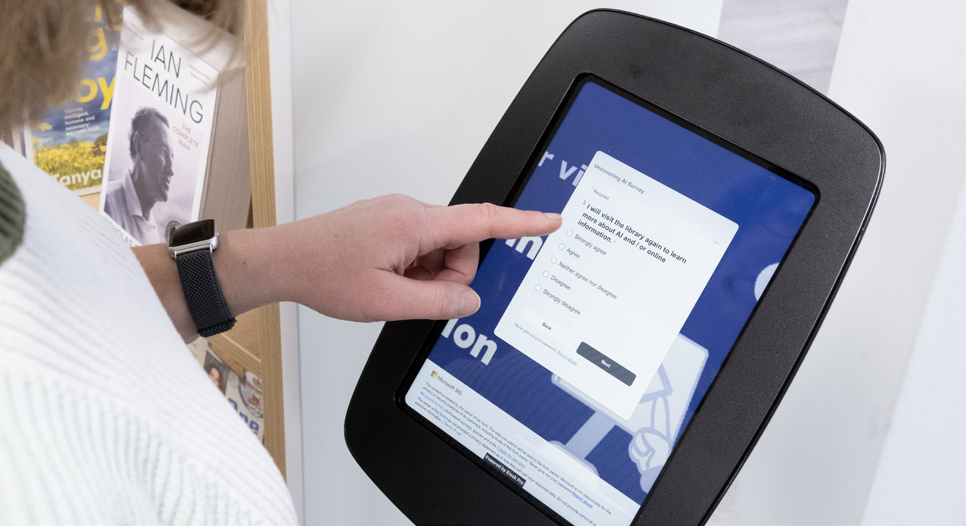
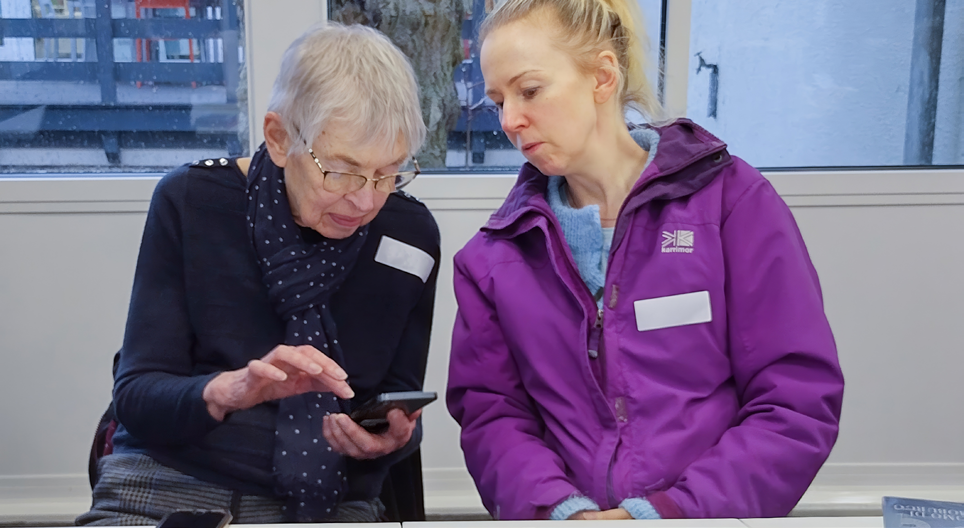
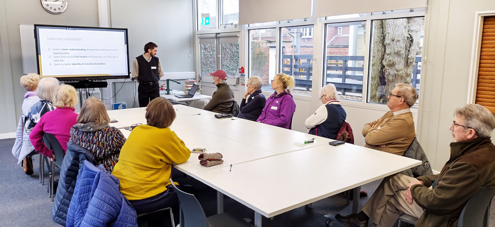
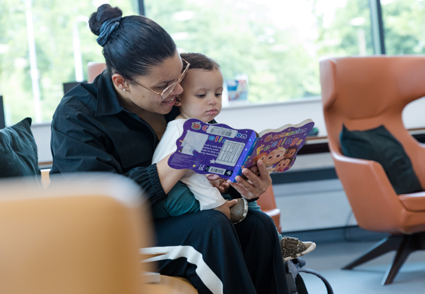

<!-- PAGE: 1 -->

# Test and Learn: a practical approach to workforce development in public libraries

## Building confidence and capability through embedded, collaborative learning

<!-- PAGE: 2 -->

<!-- PAGE: 3 -->

> Insights from Innovating in Trusted Spaces to help public library leaders and teams strengthen staff confidence, capability and collaboration through Test and Learn.

<!-- PAGE: 4 -->

# Contents

- **Executive summary** (p. 4)
  - Purpose of this guide
  - What is Test and Learn?
  - Why it supports workforce development
  - What we learned from Innovating in Trusted Spaces
- **Introduction** (p. 6)
  - The workforce development challenge
  - Resource and capacity constraints
  - Gaps in digital confidence and skills
  - Increasing digital complexity
  - Staff story: Abbey (p. 10)
  - Universal Library Offers
- **What is Test and Learn?** (p. 12)
  - Why Test and Learn works within public libraries
  - What our baseline survey told us
  - How Test and Learn worked in Innovating in Trusted Spaces
  - Staff story: Richard (p. 17).

<!-- PAGE: 5 -->

- **Workforce development benefits** (p. 18)
  - Benefits for library staff
  - Benefits for library leaders and organisations
  - How Test and Learn unfolded
  - Staff story: Charlotte (p. 24)
  - Lessons learned about staff development
  - What worked well
  - Challenges
- **Bringing Test and Learn into your workforce development plan** (p. 28)
  - Where Test and Learn can add value
  - Staff story: Louise (p. 31)
- **Test and Learn template** (p. 32)
- **About our organisations** (p. 36)
  - Our partner library services
- **References and resources** (p. 38).

<!-- PAGE: 6 -->

# Executive summary

## Purpose of this guide

Skilled and committed library teams are at the heart of a thriving public library service, and keeping pace with rapid digital change requires continued learning and development. Staff play a vital role in supporting digital inclusion, helping people navigate emerging technologies and strengthening community connections.

However, traditional training, often delivered through e-learning modules or one-off courses, can feel removed from frontline practice and difficult to prioritise alongside daily operational demands. Test and Learn offers a practical alternative: an embedded, collaborative approach to workforce development that integrates learning directly into service delivery.

Drawing on insights from the Innovating in Trusted Spaces project, this guide provides library leaders, managers, and teams with an actionable framework for using Test and Learn to build staff capability, confidence, and connection across the service.

## What is Test and Learn?

Test and Learn is a design-led approach that supports learning through practical experimentation. It involves testing small-scale changes with users, gathering feedback, and using those insights to adapt, refine, and improve before deciding whether to adopt ideas more widely.

## Why it supports workforce development

Test and Learn supports workforce development by:

- Embedding learning in everyday practice, making development immediately relevant and applicable.

- Developing a broad range of transferable skills, from digital capabilities to facilitation, collaboration and project design.

- Reframing “failure” as learning, helping staff build confidence by taking low-risk steps.

- Fostering cross-team collaboration, breaking down silos and connecting staff across different roles and services.

- Providing leaders with a scalable model, enabling services to innovate and improve without significant upfront investment.

<!-- PAGE: 7 -->

> “Confidence is key here, so empowering our staff and seeing that change along the way… has been great!”  
> — Middle Manager.

## What we learned from Innovating in Trusted Spaces

Four English public library services and 24 staff used Test and Learn to support users to engage with AI and digital media literacy. Many staff were initially apprehensive, but by the end of the project:

- **Staff confidence grew significantly:** 87% felt comfortable experimenting with new digital tools in their work (up from 48% at baseline).

- **Learning was shared across teams:** frontline staff and managers developed stronger working relationships, sharing insights and supporting each other’s ideas.

- **Services adapted to community needs:** teams created practical, user-centred activities, including AI Discovery Kits and targeted digital media literacy sessions, based directly on user feedback.

- **A culture of experimentation took root:** staff reported feeling braver, more creative, and more willing to try new things.

This guide shows how any library service can apply these lessons, offering a step-by-step process, practical tools, and inspiration from the project to help teams test, learn, and grow together.

<!-- PAGE: 8 -->

# Introduction

Skilled and committed library teams are essential to the role public libraries play in their communities, and staying responsive amid rapid technological and social change depends on continued learning and development. Staff support digital inclusion, explore new technologies with users and strengthen community connections. To ensure services can continue to meet these needs into the future, staff need ongoing opportunities to develop their skills and capabilities.

Yet finding time and resources for training in an environment of constrained budgets and high demand is a persistent challenge. Traditional approaches, such as one-off courses or mandatory e-learning, often struggle to translate into changed practice on the ground.

Test and Learn offers an effective alternative. By framing development around small, practical experiments embedded in day-to-day service delivery, it allows staff to build confidence, explore emerging areas of practice, and collaborate with colleagues in ways that directly benefit their communities.

This guide shares insights from Innovating in Trusted Spaces, a collaborative project funded by the Department for Science, Innovation and Technology (DSIT) and delivered by Libraries Connected in partnership with Good Things Foundation and WSA Community. Over six months, four public library services—Newcastle Libraries, Northumberland Libraries, Nottingham City Libraries, and Inspire: Culture, Learning and Libraries—used Test and Learn to explore how library staff can support users with artificial intelligence (AI) and digital media literacy.

The guide outlines the workforce development benefits of Test and Learn, provides a step-by-step approach to implementing it within your service, and includes practical templates and case studies to support your team.

<!-- PAGE: 9 -->

# The workforce development challenge

Public libraries operate in an environment of increasing societal need, growing digital complexity, and persistent resourcing pressures. Within this environment, workforce development is both essential and increasingly difficult to deliver. The evidence points to three interlinked challenges: limited learning opportunities, resource and capacity constraints, and gaps in digital confidence and skills.

## Limited learning opportunities

While informal and on-the-job learning is common in libraries, structured opportunities for professional development are often constrained:

- Training is frequently reactive, focused on compliance or new system rollouts rather than proactive skills development.

- Frontline staff have fewer development opportunities than managers, despite delivering the majority of user-facing services.

- E-learning, while flexible, is often undertaken in isolation, without opportunities to discuss, reflect on, or apply what has been learned.

This can leave staff feeling unsupported in developing new capabilities, particularly in fast-evolving areas such as emerging technologies.

<!-- PAGE: 10 -->

## Resource and capacity constraints

Even when professional development opportunities exist, many staff lack the time or capacity to participate. This challenge has been intensified by a significant reduction in library staffing over the past decade (BBC Shared Data Unit, 2024).

- CILIP Workforce Mapping (2023) identifies a strong relationship between professional development, staff engagement and retention, yet investment in training appears to have fallen across the sector due to budget constraints.

- High footfall and demanding operational targets leave little room for staff to step away from frontline desks.

- Solo-working and small branch teams make arranging cover for training particularly difficult.

## Gaps in digital confidence and skills

The rapid evolution of digital services has widened the gap between what library users need help with and the digital skills of some library staff. Recent research shows:

- While basic digital skills are widespread, confidence in explaining and navigating emerging technologies like AI, algorithmic bias, or misinformation is much lower (Cox, 2025).

- Many staff express anxiety about “not being the expert” when asked questions by users about complex digital topics.

- There is often no safe space for staff to experiment with new technologies before being expected to support the public with them.

<!-- PAGE: 11 -->

## Increasing digital complexity

All three challenge areas are intensified by the accelerating pace of digital change. Library services must now respond to:

- Rapid technological advancements including AI, augmented reality and virtual reality.

- Rising disinformation (including deepfakes), declining public trust in mainstream media outlets, dependence on social media and risks to online privacy and security (Zenou & Ivanov, 2025).

- The evolving role of public libraries as trusted civic spaces that help users navigate these developments safely and critically.

<!-- PAGE: 12 -->

## Staff story: Abbey

**Library Assistant, Nottingham City Libraries**

Abbey joined the project feeling confident about teaching digital skills as her role involves troubleshooting users’ digital queries. This project was an opportunity for Abbey to build on her knowledge and high level of digital capability.

> “Until this project I had not utilised Generative AI outside of customer interactions at work, where it is integrated into searches. To help plan creative sessions for users, I used ChatGPT to generate pattern designs and used this as a teaching aid. By familiarising myself with the platform beforehand, I was able to explain to users what prompts were and how to get the most out of the system. I also shared risks around privacy.”

Through hands-on testing, Abbey developed greater confidence in explaining generative tools, addressing user concerns around data privacy, and designing creative activities that blend digital and traditional library resources.

<!-- PAGE: 13 -->

## Universal Library Offers

The Universal Library Offers (ULO) provide a framework for high-quality, consistent services while allowing flexibility to meet local needs. There are currently four ULOs: Culture and Creativity, Health and Wellbeing, Reading, and Information and Digital. The aim of the Information and Digital ULO is to:

> “Ensure communities can access quality information and digital services, learn new digital skills and be safe online, supported by trained staff and volunteers, by removing barriers and enabling independent life choices.”

Test and Learn directly supports this aim by building staff capability and confidence to deliver the Digital and Information offer in practice.

<!-- PAGE: 14 -->

# What is Test and Learn?

Test and Learn is a design-led approach that supports learning through practical experimentation. Used across sectors including technology, product development and project management (Public Digital, 2024), it involves testing small-scale changes with users before deciding whether to adopt them more widely.

Test and Learn is:

- **Iterative, agile and responsive:** moving in quick cycles of testing, learning, and adapting.

- **Focused on small experiments:** generating quick insights without large initial commitments.

- **Designed to help teams adapt:** refining ideas and making incremental improvements based on real user feedback.

- **Collaborative:** bringing staff and communities into the design and evaluation process together.

- **Permission-giving:** encouraging calculated risk-taking and learning from outcomes that don’t go as expected.

<!-- PAGE: 15 -->

# Why Test and Learn works within public libraries

Public libraries operate within a societal, technological, and political landscape where change is constant and accelerating. To thrive, services must adapt to complexity, navigate persistent funding constraints, and develop collaborative leadership approaches that empower staff at all levels to lead and respond to emerging community needs.

Staff readiness for this approach was evident at the outset of our project:

- 96% agreed or strongly agreed they were comfortable making incremental changes in their day-to-day work.

- 87% agreed they were comfortable trying new approaches, even if they might fail.

- 83% felt comfortable learning through experimentation rather than formal training alone.

Test and Learn harnesses this appetite for practical learning by providing a structured, low-risk framework for trying new things in service delivery.

<!-- PAGE: 16 -->

# What our baseline survey told us

At the start of the project, we surveyed the 25 library staff involved to understand their attitudes, confidence, and readiness to engage with Test and Learn, as well as their familiarity with digital media literacy and AI. We repeated the survey at the end of the project, when 24 staff were still involved (23 responses received). The initial survey revealed:

- 46% of staff were unfamiliar with the concept of Test and Learn, yet many were able to describe examples of innovation within their library service.

- Only 48% felt comfortable experimenting with new digital tools in their work before the project began.

- Gaps in understanding of AI were notable, with many expressing concern about misinformation, deepfakes, and user safety.

- Staff valued peer collaboration highly, seeing it as more beneficial than isolated training.

<!-- PAGE: 17 -->

## How Test and Learn worked in Innovating in Trusted Spaces

The project delivered two structured testing cycles (“Sprints”) across the four library services:

- **Sprint 1 (Co-creation and initial testing):** Staff attended regional co-creation workshops, developed initial action plans, and tested small experiments with users.

- **Sprint 2 (Refinement and scaling):** Teams reviewed what worked, refined their approaches, and tested more developed sessions and resources.

- **Community of Practice:** Regular cross-service sessions enabled staff to share challenges, exchange ideas, and learn together.

This framework provided the balance of structure, support, and autonomy that staff needed to experiment with confidence.

<!-- PAGE: 18 -->

> “My mindset of being a “trusted voice” has been embedded. I do feel it is my place to be a guide for people who have questions.”  
> — Middle Manager.

They understood that they were not required to be an expert but that their existing skills in active listening and guiding to useful resources is relevant here:

> “I feel able to say that I am not an expert, but that I am happy to learn together. I feel this puts the learner at ease, knowing I won’t be using jargon or speaking down to them.”  
> — Frontline staff.

Middle Manager There was an evident increase in how library staff can use AI more broadly in their work:

> “I’ve used AI more at work (it’s particularly useful for social media - helps with creativity). I’ve just generally felt more confident with my own digital literacy; able to critique information and it’s just generally sparked an interest!”  
> — Frontline staff.

Staff survey evidence also shows clear growth in staff confidence when supporting digital enquiries, including helping users stay safe online and evaluate information (see Figure 1). Staff who initially felt uncertain about AI grew more confident after engaging with Good Things Foundation resources and expertise, using AI tools alongside peers and reflecting on their relevance in library settings. The results highlight the value of hands-on experimentation, peer-to-peer learning and structured support when introducing new and unfamiliar concepts.

<!-- PAGE: 19 -->

## Staff story: Richard

**Customer and Culture Assistant, Newcastle Libraries**

Richard felt apprehensive but approached the first co-creation workshop with optimism. In the first Sprint, Richard developed a classroom-style session using the AI Gateway as an introduction for users, with an added activity and quiz. In the second Sprint, Richard developed creative sessions utilising generative AI.

> “The AI Gateway was very helpful for me and the public, I [also] learned how to use chatbots and prompts. During the sessions, we explored how users can interact with AI to see what it could do, and asked questions to reflect on what it produced. It made me realise that AI isn’t replacing our skills, it’s a tool we can learn to use critically together.”

Through these sessions, Richard discovered that users were eager to explore AI when provided with a supportive, non-judgmental environment led by friendly library staff.

<!-- PAGE: 20 -->

# Workforce development benefits

The findings from Innovating in Trusted Spaces show that Test and Learn benefits both library staff and organisations. Staff developed new skills and confidence through hands-on experimentation, while leaders gained a practical, low-risk method for driving improvement and strengthening collaborative cultures.

## Benefits for library staff

A Test and Learn approach supports workforce development closely tailored to frontline realities. Staff reported four key personal benefits:

- **Increased confidence and reduced fear of failure:** testing low-risk ideas allowed staff to overcome self-doubt.

- **Development of practical digital skills:** learning by doing proved far more memorable and applicable than passive reading.

- **Enhanced facilitation and user engagement skills:** designing interactive sessions deepened staff appreciation of user needs.

- **Strengthened professional agency:** staff felt empowered as active problem solvers rather than passive recipients of top-down directives.

<!-- PAGE: 21 -->

> “I feel braver and more confident about trying something, without the fear of failure. Reframing ‘failure’ as a learning opportunity has made a huge shift in how I cope with trying things out.”  
> — Middle Manager.

Through this project, staff were able to:

- Develop new and relevant skills, including digital capabilities, facilitation, negotiation and collaborative working, built through hands-on experimentation and applying learning in practice.

- Increase their confidence by testing new approaches in a safe, supported environment where the emphasis was on discovery rather than perfection.

- Connect with peers across roles and authorities, establishing collaborative relationships that extended beyond the project.

- Experience a sense of accomplishment and pride in seeing their ideas deliver positive community impact.

<!-- PAGE: 22 -->

### Summary: How Test and Learn drives workforce engagement

| Role | Core Actions | Outcome |

| :--- | :--- | :--- |

| **Leaders** | Encourage innovation in practice; create time and space for experimentation; model positive risk-taking. | Culture of continuous improvement and empowerment. |

| **Staff** | Test ideas with purpose; run small experiments; build skills through hands-on learning. | Increased capability, confidence, and job satisfaction. |

| **Data and learning** | Gathered during practice; used to inform decisions; shared across peers to support improvement. | More responsive, effective services + more engaged workforce. |

Staff comfort with innovation and experimentation grew significantly across all measures between the baseline and end-of-project surveys.

<!-- PAGE: 23 -->

# Benefits for library leaders and organisations

> “It is a very different way of learning… it’s flexible and creative and great to work with other people and change your views throughout the process.”  
> — Frontline staff.

For library leaders, Test and Learn provides a practical approach to workforce development that supports organisational resilience and improvement. It enables services to:

- Encourage small, incremental improvements that can be tested quickly and cheaply before wider rollout.

- Foster collaborative leadership, empowering frontline and mid-level staff to take ownership of service development.

- Break down departmental silos by connecting staff across different branches, teams, and tiers.

- Align workforce development with strategic priorities, ensuring that training directly addresses local needs and national frameworks.

- Build evidence-based decision-making habits into frontline teams.

<!-- PAGE: 24 -->

# How Test and Learn unfolded

Test and Learn followed a clear cycle that was applied consistently across both sprints:

1. **Co-create:** Regional workshops brought together staff from different services to explore local challenges, exchange ideas, and identify focus areas.

2. **Plan:** Teams formulated a clear, manageable question (“How might we...?”) and designed a small, low-risk experiment.

3. **Test:** Staff delivered the activity with users in library branches, collecting simple feedback and observing reactions.

4. **Reflect:** Teams reviewed data and feedback, identifying what worked, what surprised them, and what needed adjustment.

5. **Refine & Repeat:** Adjustments were made before running a second test cycle or embedding the activity into core provision.

<!-- PAGE: 25 -->

## AI Discovery Kits case study – Northumberland Libraries

In the first sprint, the team approached existing groups to introduce AI tools. Building on what they learned, the second sprint focused on creating AI Discovery Kits – portable boxes containing a Chromebook, a printed introduction to AI, and a mouse for fine motor control. After receiving feedback from a participant with a hearing aid, the team also purchased a portable induction loop to increase accessibility.

The team promoted the offer on Eventbrite and were delighted when sessions booked up rapidly. Feedback was overwhelmingly positive, with users praising the welcoming atmosphere and clear explanations provided by library staff.

<!-- PAGE: 26 -->

## Staff story: Charlotte

**Library Customer Service Advisor, Inspire**

Charlotte joined the project feeling concerned about collecting data within a short timeframe. During the first test cycle, Charlotte encouraged members of craft groups to try using AI to generate inspiration for craft patterns and collected simple feedback.

> “I undertook training using Learn My Way and the AI Gateway. [This] helped my understanding of AI and honed my digital media literacy skills. [In] the second sprint, I collaborated with Inspire Learning staff on lesson planning, such as learning how to adapt my teaching style to engage users. Resources shared by project partners provided me with a strong foundation to develop my skills sessions.”

> “Due to the valuable training I received during this project, I can now deliver digital skills sessions confidently and hope to continue this practise.”

<!-- PAGE: 27 -->

# Lessons learned about staff development

The project provided valuable insights into what supports staff learning:

- **Staff confidence grew through learning by doing:** theoretical explanations were far less impactful than direct experimentation.

- **A broad range of transferable skills were built:** facilitation, presentation, delegation, user research, and project management flourished alongside digital literacy.

- **Peer support was crucial:** having colleagues to bounce ideas off and commiserate with reduced anxiety and sustained momentum.

- **Permission to make mistakes was liberating:** when leadership explicitly stated that failure was acceptable, staff willingness to innovate surged.

<!-- PAGE: 28 -->

# What worked well

Several aspects of how we applied Test and Learn worked well:

- **Time for in-person co-creation:** bringing together staff from different teams and levels enabled learning to be shared between development staff and frontline colleagues.

- **Drawing on structured partner resources:** toolkits and guidance from Good Things Foundation helped ground ideas in proven digital inclusion methodologies.

- **Creating protected time for reflection:** regular check-ins encouraged teams to pause, assess data, and adjust course.

- **Keeping administrative demands low:** simple feedback forms and lightweight planning tools prevented bureaucracy from overwhelming delivery.

- **Working at pace:** short, focused sprint cycles maintained momentum despite competing operational demands.

<!-- PAGE: 29 -->

## Challenges

The project also highlighted several challenges:

- **Time and capacity constraints:** finding time to plan and promote sessions amid daily branch duties was the single biggest obstacle reported.

- **Cultural barriers:** overcoming the fear of failure required persistent reassurance from senior managers.

- **Recruitment of participants:** reaching non-users or specific target demographics required targeted outreach and community partnerships.

- **Hardware and software hurdles:** IT security restrictions, network firewalls, and equipment availability occasionally delayed testing.

> “The timescale has been a limiting factor (though also motivating in some ways)… It has also been a limiting factor because we needed more lead-in time to promote sessions to the public.”  
> — Frontline staff.

<!-- PAGE: 30 -->

# Bringing Test and Learn into your workforce development plan

Embedding Test and Learn within your workforce development plan provides a practical, flexible way for staff to build skills and confidence while responding to real service priorities. This approach works best when it is anchored in your strategic objectives and aligned with the Universal Library Offers (ULOs).

Key principles for implementation:

1. **Start small:** choose a single branch, a small team, or a narrow practice area before attempting service-wide rollout.

2. **Give explicit permission:** make clear to staff that trying something new and reflecting on what happened is valued, regardless of immediate success.

3. **Protect time:** ensure participating staff have dedicated, protected time for planning and reflection.

4. **Connect across levels:** pair frontline assistants with development officers or managers to blend frontline experience with strategic perspective.

<!-- PAGE: 31 -->

5. **Use available expertise and evidence:** where possible, draw on existing research, guidance and subject-matter expertise to inform your ideas. This might include toolkits from previous projects, published research, a Libraries Connected webinar, local authority knowledge, or insights from partners who work with your target user group.

6. **Design a simple question:** effective cycles begin with a focused question such as “How might we support older users to evaluate health information online?”

7. **Collect lightweight data:** focus on qualitative observations and simple feedback questions that are easy for staff to collect and analyse.

8. **Share learning widely:** celebrate insights and share failures openly so the whole organisation learns from each test.

<!-- PAGE: 32 -->

# Where Test and Learn can add value

Staff identified several areas where Test and Learn could add value across the library service, including:

- **Introducing new digital technologies:** building staff comfort and user engagement with emerging digital tools in a low-stakes setting.

- **Designing new events and creative activities:** prototyping interactive, play-based, or cultural sessions before scheduling full seasonal programmes.

- **Engaging underrepresented audiences:** exploring new outreach approaches, partnerships, and co-designed sessions for specific community groups.

- **Refining operational workflows:** testing minor adjustments to enquiries, stock displays, or layout to improve user experience.

<!-- PAGE: 33 -->

## Staff story: Louise

**Library Supervisor, Northumberland**

At the beginning the project, Louise felt quite nervous about AI and unsure how she could support customers with it when she had her own reservations. In the first sprint, Louise ran 1:1 sessions with library members, using a person-centred approach to help them build their digital skills.

> “I completed learning on the AI Gateway and Learn My Way, I also practised with [other] AI tools. I completed the ‘Living with AI’ course from Scottish AI alliance and participated in the partner workshops. Gaining this knowledge gave me confidence in having conversations with users about what AI is, how it works, and how to use it safely.”

Louise’s experience demonstrated that engaging with workforce learning directly empowers staff to overcome personal hesitation and guide users with empathy and insight.

<!-- PAGE: 34 -->

# Test and Learn template

### What would you like to explore through this Test and Learn cycle?

*This could relate to a practice area, emerging technology, user group, or service you want to strengthen.*

*(Record your focus area and core goals here.)*

### Staff members and roles

*Who is involved? What skills will be valuable? Include a mix of roles, experiences and perspectives. Who will be responsible for leading the project, facilitating the discussion, collecting data, leading the activity, communications.*

*(Record team members and designated responsibilities here.)*

### Initial thoughts

*What does the team want to understand or investigate?*

*(Record baseline observations and exploratory questions here.)*

<!-- PAGE: 35 -->

### Possible approaches to explore

*What are the different ways you could explore this area through Test and Learn? Consider different formats, activities or starting points before choosing one direction.*

*(Record alternative activity ideas here.)*

### Expertise and evidence

*What research, toolkits, webinars, partner insights or local knowledge can help inform your approach?*

*(List relevant evidence sources and toolkits here.)*

### Your question

A clear, manageable question to guide your first cycle:

> **How might we...** _______________________________________________________?

### Data collection plan

*What insights will you gather, how will you gather them and how often?*

*(Record metrics, feedback mechanisms, and observation prompts here.)*

<!-- PAGE: 36 -->

### Resources

*What space, technology, equipment, materials or staff time will this require? Are any permissions or bookings needed?*

*(List physical and digital requirements here.)*

### Communication

*Who needs to know about this Test and Learn cycle? How will you keep them informed?*

*(Record internal and external stakeholder communication plans here.)*

### Timescale for first test

*Define the period for your first small experiment. When will you reconvene to discuss results?*

*(Record milestone dates and review meeting schedule here.)*

### First small experiment

*What low-risk idea will you test? What will you do? What is the intended outcome?*

*(Describe the initial intervention here.)*

### Reflection (After first test)

*What worked? What didn’t? What surprised you?*

*(Record post-test reflections and findings here.)*

<!-- PAGE: 37 -->

### Refinements

*What changes will you make before testing again?*

*(Record adjustments to format, audience, or materials here.)*

### Second test

*What happened when you applied your refinements?*

*(Record results and user reactions from the second iteration here.)*

### Next steps

*Revise? Repeat? Adapt? Scale up?*

*(Record final decisions on adoption, adaptation, or retirement here.)*

<!-- PAGE: 38 -->

# About our organisations

**Libraries Connected** is an independent charity that supports, promotes and represents public libraries across England, Wales, Northern Ireland and the Crown Dependencies. It provides practical support, training and advice to library services, leads national programmes and raises the profile of libraries through strategic partnerships.

**Good Things Foundation** is the UK’s leading digital inclusion charity. It helps fix the digital divide through its National Digital Inclusion Network, made up of over 8,000 community partners. Good Things provides high quality digital inclusion resources, alongside research and evidence to understand digital exclusion and inform its strategy, policy and advocacy work.

**WSA Community** is a community development organisation that delivers research, learning and evaluation projects. It is committed to equity, diversity and inclusion and works alongside communities to build capacity, co-create learning, evaluate projects and deliver training.

<!-- PAGE: 39 -->

# Our partner library services

Our partner library services serve a combined population of 1.2 million people, spanning a diverse demographic and geographic range:

- **Newcastle Libraries:** Provides a network of 14 libraries across the city. Innovative and creative services sit alongside its historic collections. Recognised as part of the Libraries Development Framework, and as a Library of Sanctuary, it is proud to deliver an inclusive, modern public library service.

- **Northumberland Libraries:** Managed by Northumberland County Council, the Library Service comprises 29 libraries across the county. These include stand-alone buildings, libraries co-located in community buildings and leisure centres, and a mobile library service which uses two vehicles to visit 73 villages. The majority offer public access to PCs, free internet, and Wi-Fi.

- **Inspire: Culture, Learning & Libraries:** Contracted by Nottinghamshire County Council to operate 57 public library buildings and three mobile libraries. Inspire is a National Portfolio Organisation for Arts Council England, delivering cultural activities through public libraries. It also offers alternative education provision for 16–19 year olds through Inspire College and Adult Learning in the form of accredited and leisure courses.

- **Nottingham City Libraries:** Runs 14 libraries within Nottingham City, serving a population that is both ethnically and socio-economically diverse. These include a mix of stand-alone libraries, libraries co-located within Joint Service Centres (which also house NHS and council services), and a library within HMP Nottingham.

<!-- PAGE: 40 -->

## Suggested citation

Scott, R. (2026). *Test and Learn: A practical approach to workforce development in public libraries*. Libraries Connected.

## Resources

- Copper, C. M. (2023). *The Experimental Library: A guide to taking risks, failing forward, and creating change*. Facet Publishing.

- Design Thinking for Libraries.

- *Innovating in Trusted Spaces: Resources and Learning Report*.

## References

- Allman, K., Blank, G. & Wong, A. (2021). *Libraries on the front lines of the digital divide: The Oxfordshire digital inclusion project report*. Centre for Socio-Legal Studies, University of Oxford. [oii.ox.ac.uk](https://www.oii.ox.ac.uk).

- Asiri, A., & Finlay, J. (2025). Digital competencies of public library professionals in England. *Journal of Electronic Resources Librarianship*, 37(1), 35-57. DOI: [10.1080/1941126X.2025.2455785](https://doi.org/10.1080/1941126X.2025.2455785).

- BBC Shared Data Unit. (2024). *Public libraries in ‘crisis’ as councils cut services*. [bbc.co.uk](https://www.bbc.co.uk).

- CILIP. (2023). *Workforce Mapping 2023*. [cilip.org.uk](https://www.cilip.org.uk).

- CILIP. (2024). *Come rain or shine: Preparing public libraries for the future in an age of uncertainty*. [cilip.org.uk](https://www.cilip.org.uk).

- Copper, C. M. (2023). *The Experimental Library: A guide to taking risks, failing forward, and creating change*. Facet Publishing.

- Cox, A. (2025). *AI and the UK Library Profession: Survey Report*. CILIP. [cilip.org.uk](https://www.cilip.org.uk).

- Good Things Foundation. (2024). *Digital inclusion: What the main UK datasets tell us*. [goodthingsfoundation.org](https://www.goodthingsfoundation.org).

- Public Digital. (2024). *Adopting the practice of Test and Learn*. [public.digital](https://public.digital).

- UK Government. *Test, Learn and Grow*.

- Zenou, T., & Ivanov, H. (2025). *Breaking the echo chamber: Enhancing disinformation resilience in the UK*. Henry Jackson Society. [henryjacksonsociety.org](https://www.henryjacksonsociety.org).

<!-- PAGE: 41 -->

<!-- PAGE: 42 -->

# About Libraries Connected

We are an independent charity that supports, promotes and represents public libraries. Our work is driven and led by our membership, which includes almost every library service in England, Wales, Northern Ireland and the Crown Dependencies.

Across the areas we serve there are 176 individual library services with around 3,000 library branches serving over 61 million people. Our unique approach is to bring these services together to share experience, expertise and evidence – driving innovation and impact across the public library sector.

While senior library leaders sit on our board and committees, we work with library staff at all levels. As well as providing practical support, training and advice to libraries, we represent them to government and raise their profile in the media. We also develop and lead national library projects with cultural, academic and corporate partners.

---

Libraries Connected, Maggie O’Neill Business and Training Centre, 433 Liverpool Road, Huyton, Liverpool, L36 8HT.  

Email: [info@librariesconnected.org.uk](mailto:info@librariesconnected.org.uk).  

Website: [www.librariesconnected.org.uk](https://www.librariesconnected.org.uk).  

Company Registration Number: 07559747 | Registered Charity Number: 1176482.
